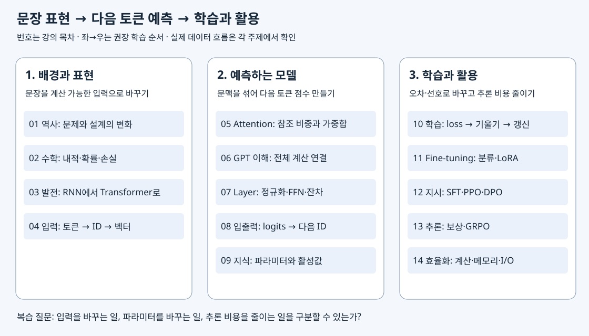

# LLM 모델의 이해와 확장 — 개정 학습자료

LLM은 문장을 토큰으로 바꾸고, 앞 문맥을 이용해 다음 토큰의 점수를 계산하는 모델입니다. 학습은 그 예측이 정답이나 선호에 가까워지도록 가중치를 바꾸는 과정입니다. 이 자료는 **입력 표현 → 문맥 계산 → 예측 → 학습 → 활용과 효율화**를 연결해 설명합니다.

원본은 [app_sp_slides_20261013.pdf](../교안/app_sp_slides_20261013.pdf) 1~280쪽, 제목은 「LLM 모델의 이해와 확장」입니다. 파일명의 날짜는 2026-10-13이며 별도 작성일은 확정하지 않습니다. 아래 쪽수는 인쇄 번호가 아닌 **PDF 파일상의 1-based 페이지 순서**입니다. 개정일은 2026-11-09입니다.

독자는 Python의 변수·리스트와 간단한 배열을 읽을 수 있다고 가정합니다. 벡터·확률·미분은 02장에서 설명합니다. 최신 제품 소식이나 공식 시험 출제 순위를 외우기 위한 자료가 아니라, 계산과 선택의 이유를 설명하기 위한 전체 교안 재구성입니다.

[전체 폴더 안내](../README.md) · [원 실습](../../04_LLM_실습/README.md) · [브라우저 미리보기](미리보기/00_학습안내.html)

## 어디서 시작할까

처음 배우면 아래 01~14 순서로 읽습니다. 각 장의 도입과 핵심 본문을 읽고, 작은 계산을 직접 따라 한 뒤, 해설을 접어 둔 채 확인 질문에 답하세요. 심화 수식과 변형은 기본 동작을 설명할 수 있게 된 뒤 읽어도 됩니다.

복습할 때는 막힌 질문으로 이동합니다. 입력·정답 정렬은 04, Attention 계산은 05, 모델 전체 흐름은 06~08, 손실과 가중치 갱신은 10, 학습 목적과 방법 비교는 11~13, 시간·메모리 문제는 14입니다. 이 폴더의 주제별 Markdown이 **개정판의 기준 본문**입니다. HTML은 같은 본문을 읽는 미리보기입니다. 원 실습은 [실습 안내](../../04_LLM_실습/README.md)에서 찾습니다.

## 전체 관계를 먼저 보기

아래 지도는 왼쪽에서 오른쪽으로 권장 학습 순서를 보여줍니다. 각 칸의 번호를 아래 목차에서 찾으세요. 모든 칸이 하나의 실행 파이프라인을 뜻하는 것은 아닙니다.

입력의 토큰 ID와 토큰 벡터는 다릅니다. 모델의 순전파는 현재 가중치로 출력을 계산하고, 학습은 손실을 이용해 그 가중치를 갱신합니다. 효율화는 같은 계산을 더 적은 메모리 이동으로 수행하거나, 참조 구조·정밀도 등 계산 조건을 바꿉니다. 이 세 차이를 각 장의 구체적인 예로 확인하는 것이 전체 학습의 목표입니다.

## 강의 목차와 학습 목표

| 번호 | 강의 주제 / 기준 본문 | PDF 범위 | 학습 후 할 일 |
| --- | --- | --- | --- |
| 01 | [AI 모델의 역사](01_AI_모델의_역사.md) | 3~30 | 문제와 설계 선택을 연결한다 |
| 02 | [AI 기본 수학](02_AI_기본_수학.md) | 31~66 | 내적·softmax·CE·갱신을 계산한다 |
| 03 | [언어 모델의 발전](03_언어_모델의_발전.md) | 67~77 | 순차 상태와 Attention, 구조와 목표를 구별한다 |
| 04 | [언어 모델: 입력](04_언어_모델_입력.md) | 78~101 | ID·정답 창·임베딩·위치를 추적한다 |
| 05 | [Attention 이해](05_Attention_이해.md) | 102~124 | scale·mask·softmax·가중합을 계산한다 |
| 06 | [GPT 모델 이해](06_GPT_모델_이해.md) | 103·117·120~123과 통합 | 문맥 벡터가 어휘 점수로 이어지는 흐름을 설명한다 |
| 07 | [GPT Layer들](07_GPT_Layer들.md) | 125~143 | 정규화 축·FFN·두 잔차 경로를 설명한다 |
| 08 | [GPT 모델 입출력](08_GPT_모델입출력.md) | 144~149 | shape와 생성·샘플링을 추적한다 |
| 09 | [지식의 저장](09_지식의_저장.md) | 150~157 | 가중치·활성값·잠재 표현을 구별한다 |
| 10 | [모델 학습](10_모델_학습.md) | 158~175 | 손실·기울기·갱신 및 데이터 분리를 설명한다 |
| 11 | [Fine-tuning](11_Fine_tuning과_LoRA_QLoRA.md) | 176~194 | 분류와 LoRA·QLoRA의 서로 다른 축을 설명한다 |
| 12 | [지시 미세 튜닝](12_지시미세튜닝과_선호학습.md) | 195~215 | SFT 마스크와 선호 손실을 계산한다 |
| 13 | [추론 모델](13_추론모델.md) | 216~239 | 보상·advantage·clip·KL을 연결한다 |
| 14 | [LLM 효율화](14_LLM효율화.md) | 240~280 | 계산·캐시·참조·I/O 병목을 구분한다 |

원본 목차의 06 「GPT 모델 이해」에는 독립된 구분 슬라이드가 없어 05와 원문 범위가 겹칩니다. 05는 Attention 계산, 06은 GPT 전체 구조 연결을 담당합니다. 11은 분류·LoRA·QLoRA를, 12는 지시 미세튜닝과 그 뒤의 선호 최적화를 함께 다룹니다. 14의 세부 기법은 같은 문제를 해결하는 배타적 후보가 아니라, 서로 다른 비용을 줄이며 조합할 수 있는 방법입니다.

## 계산에 사용하는 공통 기호

| 기호 | 뜻 | 주의 |
| --- | --- | --- |
| B | 배치에 함께 넣는 예제 수 | 토큰 길이와 다름 |
| T | 현재 시퀀스의 토큰 길이 | temperature와 혼동하지 않도록 해당 절의 정의 확인 |
| C 또는 d | 토큰 표현의 은닉 폭 | 장별 수식의 정의를 우선 확인 |
| h, dh | head 수, head 하나의 폭 | 기본형은 C=h×dh |
| V | tokenizer 어휘 크기 | 현재 입력 토큰 수 T와 다름 |

가장 먼저 자료 없이 `정수 ID [B,T] → 벡터 [B,T,C] → 문맥 계산 [B,T,C] → 어휘 점수 [B,T,V]`를 설명해 보세요. 이어서 생성은 마지막 유효 위치의 점수로 다음 ID를 고르고, 학습은 위치별 정답과 손실을 계산한다는 차이를 설명합니다. 막히는 단계에 해당하는 장으로 돌아가면 됩니다.

## 원문·시각화와 확인 범위

- 원문 위치는 각 장의 PDF 링크와 [페이지 대응표](16_원문대응과_확인범위.md)에서 찾습니다. 표지·목차와 실습 안내 페이지도 처리 범위를 기록합니다.
- [시각화 안내](15_시각화_안내.md)에서 도표와 조작 가능한 계산 자료를 찾습니다. 모든 핵심 설명은 본문 텍스트와 정적 도표로도 읽을 수 있습니다.
- 계산·렌더 확인 범위와 남은 확인 사항은 [원문 대응과 확인 범위](16_원문대응과_확인범위.md)에 정리했습니다. 실제 독자의 학습 효과와 수행하지 않은 원 실습 실행을 완료로 판정하지 않습니다.
- 본문·도표·읽기용 HTML을 제공합니다. 본문을 수정하면 해당 도표와 HTML의 설명도 함께 확인하세요.
