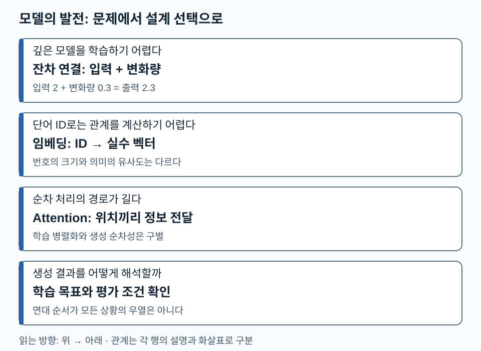

# 01. AI 모델의 역사 — 무엇이 바뀌어 LLM이 가능해졌나

[전체 학습 안내](00_학습안내.md) · [다음: 기본 수학](02_AI_기본_수학.md) · [PDF 3~30쪽](../교안/app_sp_slides_20261013.pdf#page=3)

AI의 발전은 모델 이름의 교체만으로 설명되지 않습니다. **데이터에서 표현을 학습하는 방법, 깊은 모델을 학습시키는 구조, 계산 자원, 학습 목표**가 함께 바뀌었습니다. 이 단원의 목표는 유명 모델을 암기하는 대신 각 변화가 해결한 문제를 설명하는 것입니다.

처음 읽는다면 1~3절을 읽고 확인 질문을 푸세요. 복습할 때는 2절 비교표에서 ‘문제→설계 선택’을 재구성하세요. 수학은 다음 단원에서 시작하므로 이 단원에는 미분 선행 지식이 필요하지 않습니다.

## 1. AI·머신러닝·딥러닝·생성형 AI의 관계

AI는 지적인 작업을 기계로 수행하려는 넓은 범위입니다. 머신러닝은 사람이 모든 규칙을 적는 대신 데이터로부터 예측 규칙을 학습합니다. 딥러닝은 여러 층의 신경망으로 표현과 예측 규칙을 함께 학습하는 머신러닝 방법입니다. 생성형 AI는 텍스트·이미지 같은 새로운 데이터를 생성하는 **작업 성격**을 나타냅니다.

따라서 ‘머신러닝→딥러닝→생성형 AI’라는 교안 4쪽의 화살표는 강의의 관심 이동으로 읽습니다. 서로 완전히 교체되는 세 종류로 읽으면 안 됩니다. 현대의 생성형 모델에는 딥러닝이 널리 쓰이며, 분류와 생성은 같은 기반 모델 위에서 결합될 수 있습니다.

## 2. 모델 이름을 문제와 해결책으로 바꾸어 읽기

| 원문 범위 | 기존 어려움 | 핵심 선택 | LLM 공부로 이어지는 점 |
| --- | --- | --- | --- |
| 5~7쪽: AlexNet·ResNet | 큰 신경망의 계산과 깊은 층의 학습 | GPU 활용, 잔차 연결 | 계산 자원과 학습 가능한 구조가 함께 필요 |
| 8쪽: Word2Vec | 단어를 독립 번호로만 다루면 관계 계산이 어려움 | 문맥에서 단어 벡터 학습 | 토큰 번호와 의미 표현을 구별 |
| 9쪽: AlphaGo 계열 | 거대한 행동 탐색 공간 | 학습된 평가와 탐색의 결합 | 언어모델 생성과 게임 탐색은 목표·절차가 다름 |
| 10쪽: Transformer | RNN의 순차 의존과 긴 문맥 전달 부담 | Attention과 병렬화 가능한 층 | 토큰 사이 정보 전달을 직접 계산 |
| 11쪽: GAN·Diffusion | 데이터 분포에서 새 샘플 생성 | 서로 다른 생성 학습 방식 | ‘생성형’이라는 작업이 한 구조만 뜻하지 않음 |
| 12쪽: GPT | 대규모 텍스트에서 전이 가능한 예측 능력 | 다음 토큰 예측을 큰 규모로 학습 | 학습 목표·규모·데이터를 함께 봐야 함 |
| 13쪽: AlphaFold | 생물학적 서열과 구조의 복잡한 관계 | 구조 예측에 적합한 표현과 제약 | Attention은 언어 이외에도 적용됨 |

여기서 잔차 연결은 층이 계산한 변화량을 입력에 더하는 통로입니다. 입력이 `x=2`, 변화량이 `F(x)=0.3`이라면 출력은 `2.3`입니다. `F(x)=0`이면 입력을 그대로 보존할 수 있습니다. 이것은 깊은 모델의 학습을 돕는 설계상의 성질이며, 깊이를 늘리면 언제나 성능이 오른다는 보장은 아닙니다.

다음 그림에서는 각 행의 **어려움과 설계 선택**을 짝지어 읽으세요. 행끼리 인과 순서를 나타내는 화살표는 두지 않았습니다.

모델 이름보다 해결하려는 문제를 기준으로 보면 다음 단원에서 수학과 구조를 배우는 이유가 드러납니다. 생성형이라는 목표와 Transformer라는 구조를 구별할 수 있는지도 확인하세요.

## 3. 미래 전망·사회 사례는 모델 원리와 구분하기

14~30쪽은 AI 투자, World Model, 로봇, 학습, 노동, 산업, 전쟁, 의식, 전문가의 활용에 관한 토론입니다. **World Model**은 환경과 행동의 결과를 예측하기 위한 내부 모델, **Physical AI**는 물리 환경에서 감지하고 행동하는 시스템이라는 관점으로 읽습니다. 환경 예측 모델을 갖는 일과 실제 로봇의 센서·제어·안전을 해결하는 일은 구분됩니다.

교안의 투자액·특정 모델 출시·시험 점수·연구 해결 건수·기업 및 정책 관련 사례는 교안 시점의 서술로 보존합니다. 이 학습자료에서는 최신 사실이나 검증된 인과로 재확정하지 않습니다. 의식과 자유의지에 관한 26~27쪽도 논쟁적 관점과 질문이며, LLM에 의식이 있다는 결론을 도출하는 근거로 사용하지 않습니다.

19~22쪽의 배움·시험·수학 사례와 28~30쪽의 바둑 사례가 던지는 학습 질문은 ‘도구의 답을 어떻게 검증하고 자신의 지식과 결합할 것인가’입니다. 바둑의 관찰을 모든 전문직의 생산성 수치로 일반화하지 않습니다. 원문 동영상의 재생 내용과 강사의 구두 설명은 이 자료에서 복원하지 않았습니다.

## 4. 확인 질문

1. 잔차 블록에서 입력이 2이고 변화량이 -0.4이면 출력은 얼마인가요? 변화량이 0이면 무엇이 유지되나요?
2. ‘생성형 AI이므로 Transformer다’라는 추론의 문제는 무엇인가요?
3. 전문가가 AI를 잘 활용했다는 사례만으로 AI 사용이 전문성을 자동으로 높인다고 결론 내릴 수 있나요?

해설과 돌아갈 위치

1. `2+(-0.4)=1.6`, 변화량 0이면 입력 2가 유지됩니다. 막히면 2절의 잔차 예시로 돌아가세요.
2. 생성형은 작업 분류이며 구조가 아닙니다. GAN·Diffusion처럼 다른 구조·학습 방식도 있습니다. 1절과 비교표를 함께 보세요.
3. 기존 전문성, 사용 목적, 결과 평가 방법 등 다른 조건이 영향을 줄 수 있습니다. 3절의 관찰과 일반화 구분으로 돌아가세요.

**다음 연결:** 모델은 단어의 번호를 그대로 계산하지 않고 벡터 표현을 변환합니다. 다음 단원에서 그 변환을 내적·행렬 곱·확률·손실로 읽는 법을 배웁니다.
