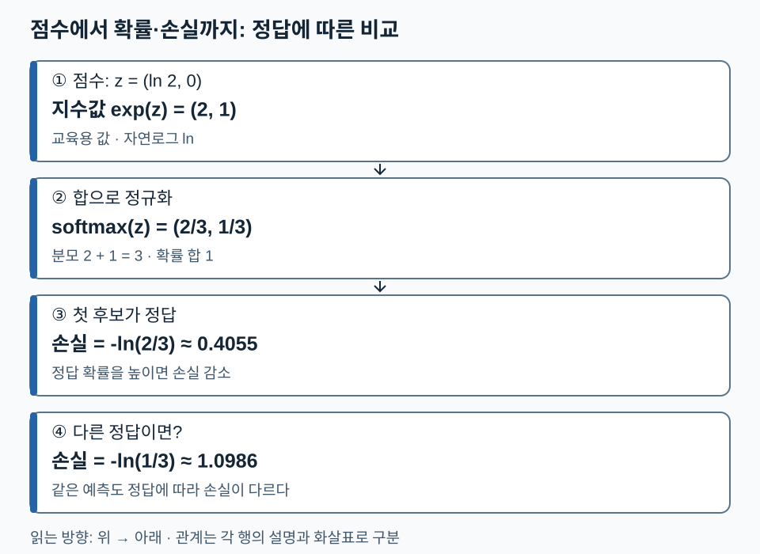

# 02. AI 기본 수학 — 표현을 비교하고 예측을 학습하는 도구

[전체 학습 안내](00_학습안내.md) · [이전](01_AI_모델의_역사.md) · [다음](03_언어_모델의_발전.md) · [PDF 31~66쪽](../교안/app_sp_slides_20261013.pdf#page=31)

LLM의 핵심 계산은 **벡터를 변환하고, 관련성을 점수로 만들고, 점수를 확률로 바꾸고, 정답의 확률을 높이도록 가중치를 갱신하는 것**입니다. 이 단원에서는 이를 손으로 계산합니다. 사칙연산을 알면 시작할 수 있으며, 미분은 ‘입력의 작은 변화가 출력에 미치는 비율’로 설명합니다.

기본 경로는 1→2→3→4절입니다. 확률 조건이 헷갈리면 5절, 역전파 원문 수치를 확인하려면 4절의 상세 계산을 읽으세요. 모든 새 숫자 예시는 교육용이며 실제 모델 측정값이 아닙니다. 로그는 자연로그 `ln`을 사용합니다.

## 1. 벡터와 행렬: 무엇을 비교하고 무엇을 바꾸나

벡터는 순서가 있는 숫자 목록입니다. `a=(1,2)`, `b=(2,0)`이면 덧셈은 `(3,2)`, 내적은 `a·b=1×2+2×0=2`라는 하나의 수입니다. 벡터 길이(norm)는 `||a||=√5`, `||b||=2`이므로 코사인 유사도는 `2/(√5×2)=1/√5≈0.4472`입니다.

내적에는 길이와 방향이 함께 반영됩니다. `b`를 `3b=(6,0)`으로 바꾸면 내적은 6이지만 코사인은 0.4472 그대로입니다. 두 **영벡터가 아닌** 벡터를 각각 길이로 나누어 단위 벡터로 만들면 내적과 코사인이 같습니다. 영벡터는 방향이 정의되지 않아 코사인 식의 분모가 0입니다. ‘의미 유사도’라는 해석은 학습된 표현과 데이터에 의존하며 아무 숫자 벡터에 자동으로 붙지 않습니다.

행렬은 여러 벡터를 모은 숫자 표입니다. `A=[[1,2],[3,4]]`, `B=[[2,0],[1,3]]`으로 놓으면 요소별 곱은 `[[2,0],[3,12]]`이고 행렬 곱은 다음과 같습니다.

```text
AB의 (1,1): 1×2+2×1 = 4
AB의 (1,2): 1×0+2×3 = 6
AB의 (2,1): 3×2+4×1 = 10
AB의 (2,2): 3×0+4×3 = 12
AB = [[4,6],[10,12]]
```

`[m,n]@[n,p]→[m,p]`처럼 가운데 차원이 같아야 합니다. 전치 `Aᵀ`는 행·열을 바꾸므로 `[[1,3],[2,4]]`입니다. 행렬 곱은 순서를 바꾸면 일반적으로 값도 달라집니다.

38쪽의 회전은 열벡터 기준 `R(θ)=[[cosθ,-sinθ],[sinθ,cosθ]]`를 왼쪽에서 곱합니다. 90°에서 `(1,0)→(0,1)`이고 길이는 유지됩니다. 이 성질은 입력 단원의 RoPE를 읽는 배경입니다. 이후 토큰 표에서는 행벡터 관례 `XW`를 사용하므로, 같은 변환도 표기 방향을 맞춰 전치해야 합니다.

## 2. 선형 변환과 활성화: 숫자를 어떻게 특징으로 바꾸나

신경망의 한 뉴런은 `z=w·x+b`로 입력 특징의 가중합을 만듭니다. `x=(1,2)`, `w=(2,-1)`, `b=0.5`이면 `z=2-2+0.5=0.5`입니다. 편향 `b`가 있으면 엄밀히는 아핀 변환이지만 교안에서는 관례상 선형층이라고 부릅니다.

여러 아핀 변환만 이어 붙이면 하나의 아핀 변환으로 합칠 수 있습니다. 중간에 활성화함수라는 비선형 변환을 넣어야 더 복잡한 관계를 표현할 수 있습니다. 예를 들어 ReLU는 `max(0,z)`이므로 음수를 0으로 만듭니다. Sigmoid는 `σ(z)=1/(1+e^(-z))`로 한 점수를 0~1 사이로 옮깁니다. `σ(0)=0.5`입니다. 활성화의 역할과 학습 목표에 따른 출력 확률 해석은 구분하세요.

## 3. Softmax·로그·교차엔트로피·PPL

Softmax는 여러 후보의 점수를 함께 정규화합니다. `z=(ln2,0)`이면 지수값은 `(2,1)`, 합은 3이므로 확률은 `(2/3,1/3)`입니다. 두 값 모두에서 같은 상수를 빼도 결과는 같습니다. 큰 지수 계산을 피하려고 실제 계산에서는 최댓값을 뺀 뒤 지수화할 수 있습니다.

Sigmoid를 두 점수에 각각 적용하면 합이 1일 필요가 없습니다. 반면 두 클래스 softmax의 첫 확률은 `σ(z₁-z₂)`와 같습니다. 이진 분류는 한 logit+sigmoid 또는 두 logits+softmax로 표현할 수 있지만 손실의 입력 계약은 맞춰야 합니다.

정답 토큰 확률이 `p`이면 그 위치의 손실은 `-ln p`입니다. 두 위치의 정답 확률이 0.5와 0.25라면:

```text
각 손실: -ln0.5≈0.6931, -ln0.25≈1.3863
평균 CE = (0.6931+1.3863)/2≈1.0397
PPL = exp(CE)≈2.8284 = sqrt(2×4)
```

확률의 곱 `0.5×0.25=0.125`와 로그확률의 합은 같은 사건의 가능도를 다른 척도로 나타냅니다. 언어의 토큰은 서로 독립이라는 뜻이 아닙니다. 각 위치의 **앞 문맥에 조건을 둔 확률**을 곱합니다. 긴 곱을 로그의 합으로 다루면 작은 수가 0으로 사라지는 언더플로 문제를 줄일 수 있습니다.

목표 분포를 `p`, 모델 분포를 `q`라 하면 `H(p,q)=-Σpᵢlnqᵢ`, `H(p)=-Σpᵢlnpᵢ`, `KL(p||q)=Σpᵢln(pᵢ/qᵢ)=H(p,q)-H(p)`입니다. 목표 분포가 고정이면 CE를 최소화하는 것과 KL을 최소화하는 것은 같습니다. `p=q`이면 KL은 0이지만 CE는 일반적으로 0이 아닙니다. 정답 one-hot의 경우에는 목표 엔트로피가 0입니다.

교안 54~59쪽의 주사위 예시는 **관측된 결과열을 높은 확률로 설명하는 분포**를 고르는 활동입니다. 원본 이미지를 확인하면 결과열은 `A,A,A,A,B,B,C,D,E,E`이며 경험 분포는 `p=(0.4,0.2,0.1,0.1,0.2)`입니다. 후보 분포와 자연로그 기준 평균 손실은 다음과 같습니다.

| 후보 | A,B,C,D,E의 확률 | 관측열의 평균 CE | `CE-H(p)`인 KL |
| --- | --- | --- | --- |
| Die 1 | `(0.4,0.2,0.1,0.1,0.2)` | 약 1.4708 | 0 |
| Die 2 | `(0.4,0.1,0.2,0.2,0.1)` | 약 1.6094 | 약 0.1386 |
| Die 3 | `(0.1,0.2,0.4,0.2,0.1)` | 약 1.9560 | 약 0.4852 |

예를 들어 Die 2는 `-[4ln0.4+2ln0.1+ln0.2+ln0.2+2ln0.1]/10≈1.6094`입니다. **가중치 p는 같은 관측 빈도로 고정**하고 로그 안의 후보 확률만 바꿉니다. 가장 낮은 CE인 Die 1이 이 관측열을 가장 높은 가능도로 설명합니다. 독립적인 주사위 시행이라는 원문의 가정은 언어 토큰의 무조건 독립과 다르므로, 언어모델에서는 각 토큰의 문맥 조건부확률을 사용합니다.

PPL은 정답 확률 역수의 기하평균입니다. 균등한 K개 후보라면 정확히 K지만, 일반적인 분포에서 실제 남은 후보 개수를 센 값은 아닙니다. 60~61쪽처럼 `(0.5,0.25,0.125)`이면 `(2×4×8)^(1/3)=4`입니다. PPL 비교는 토크나이저·데이터·평균 기준이 같아야 의미가 있습니다. 정답 확률 0의 손실은 무한대로 발산합니다.

다음 그림은 같은 점수로부터 확률을 만든 뒤 정답에 따라 손실이 달라지는 과정을 보여줍니다. 위에서 아래로 읽고, 마지막 두 행은 서로 다른 정답을 가정한 비교임을 확인하세요.



첫 후보가 정답이면 약 0.4055, 두 번째 후보가 정답이면 약 1.0986입니다. 더 높은 확률을 받은 정답의 손실이 작다는 관계를 숫자로 확인할 수 있습니다.

## 4. 손실에서 가중치 갱신까지

순전파는 현재 가중치로 예측을 계산합니다. 손실은 예측과 정답의 차이를 숫자로 나타냅니다. 역전파는 연쇄법칙으로 각 가중치의 손실 기울기를 구합니다. **가중치를 바꾸는 단계는 그 다음의 optimizer 갱신**입니다.

가장 작은 예로 `ŷ=wx`, `x=2`, `y=3`, `w=1`, `L=(ŷ-y)²`를 사용합니다.

```text
순전파: ŷ=1×2=2
손실: L=(2-3)²=1
기울기: dL/dw = 2(ŷ-y)×x = 2×(-1)×2 = -4
학습률 η=0.1: w_new = w-η×기울기 = 1-0.1×(-4)=1.4
재계산: ŷ_new=2.8, L_new=(2.8-3)²=0.04
```

연쇄법칙의 두 인자는 `dL/dŷ=2(ŷ-y)`와 `dŷ/dw=x`입니다. 학습률을 1로 바꾸면 `w_new=5`, 예측 10, 손실 49로 오히려 증가합니다. 학습률은 양수라는 조건만으로 안정성이 보장되지 않습니다. 교안 53쪽의 `0<α<1`은 예시 범위이지 모든 문제의 수학적 필요충분조건이 아닙니다.

<details><summary>원문 47~52쪽 신경망 계산의 정정과 재현</summary>

원문 입력 `(0.5,0.3)`, 초기 가중치 `(w₁,w₂,w₃,w₄,w₅,w₆)=(0.7,0.3,0.4,0.6,0.55,0.45)`, 편향 없음, 모든 뉴런 sigmoid, 정답 1, 제곱오차, 학습률 0.1을 그대로 사용합니다. `z₁=0.47`, `z₂=0.33`이고 `h₁≈0.615384`, `h₂≈0.581759`, `z₃≈0.600253`, `o≈0.645714`, 손실 `≈0.125518`입니다.

`δ₃=2(o-1)o(1-o)≈-0.162098`이므로 `∂L/∂w₅=δ₃h₁≈-0.099753`, `∂L/∂w₆≈-0.094302`입니다. 원문 49쪽의 `-0.71×0.229×0.615≈-0.01`은 곱셈 오류입니다. 그 곱은 약 -0.100입니다. 따라서 `w₅_new≈0.559975`가 되며 0.551과 다릅니다.

입력층 경로는 `δ₁=δ₃w₅h₁(1-h₁)`, `δ₂=δ₃w₆h₂(1-h₂)`로 구합니다. 기울기는 모두 **갱신 전 가중치**로 계산한 뒤 함께 갱신합니다. 교육용 재계산의 새 가중치는 약 `(0.701055,0.300887,0.400633,0.600532,0.559975,0.459430)`이고 새 손실은 약 0.12362입니다. 반올림 자릿수 차이 때문에 원문의 저장된 출력과 직접 일치시키지 마세요. 52쪽의 수치는 오류가 포함된 갱신 경로의 예로 구분합니다.

</details>

## 5. 조건부확률과 베이즈: 분모가 무엇인가

`P(A|B)=P(A∩B)/P(B)`는 B가 참인 경우만을 새 기준 집합으로 사용합니다. 교안 62쪽에서 축구를 좋아하는 50명 중 농구도 좋아하는 사람이 30명이면 `30/50=0.6`입니다. 전체 100명을 분모로 쓰는 0.3은 다른 질문의 답입니다. `P(B)>0`이어야 합니다.

베이즈 정리는 같은 교집합을 두 방향에서 세어 `P(A|B)=P(B|A)P(A)/P(B)`로 바꾼 식입니다. 64~65쪽의 가상 검사 예시는 원리 학습용이며 실제 검사 해석 지침이 아닙니다. 1만 명 중 해당 집단 100명, 그중 양성 99명, 나머지 9900명 중 양성 495명이므로 양성 594명 중 해당 집단의 비율은 `99/594≈16.7%`입니다. 분자는 99, 분모는 모든 양성입니다. `P(양성|해당 집단)=99%`와 방향이 다릅니다.

66쪽의 LLM 연결에서 정확한 부분은 `P(다음 토큰|앞 문맥)`을 예측한다는 점입니다. 프롬프트에 근거가 추가되면 출력 분포가 바뀌지만, 일반 LLM이 매 응답에서 명시적인 베이즈 공식을 실행하거나 가중치를 갱신한다는 뜻은 아닙니다. 검색 근거도 오류·누락이 있을 수 있어 사실성을 보장하지 않습니다.

## 6. 확인 질문

1. `(1,2)`와 `(6,0)`의 내적과 코사인은? 왜 내적만 바뀌었나요?
2. logits가 `(0,0,0)`이고 정답은 첫 후보라면 CE와 PPL은?
3. 4절의 스칼라 예시에서 학습률을 0.25로 바꾸면 새 가중치·손실은?
4. `p=q=(0.5,0.5)`인데 ‘KL=0이므로 CE=0’이라고 하면 무엇이 빠졌나요?

<details><summary>해설과 돌아갈 위치</summary>

1. 내적 6, 코사인 `6/(√5×6)=1/√5`. 길이 정규화로 배율이 지워집니다. 1절.
2. 확률 각각 1/3, `CE=ln3≈1.0986`, `PPL=3`. 3절.
3. `w_new=1-0.25×(-4)=2`, 예측 4, 손실 1. 한 번의 갱신이 감소를 보장하지 않습니다. 4절.
4. `H(p)=ln2`를 빼먹었습니다. `CE=KL+H(p)=ln2`. 3절.

</details>

**다음 연결:** 벡터·행렬은 모델 구조를, 조건부확률·CE는 언어모델의 학습 목표를 읽는 도구가 됩니다.
