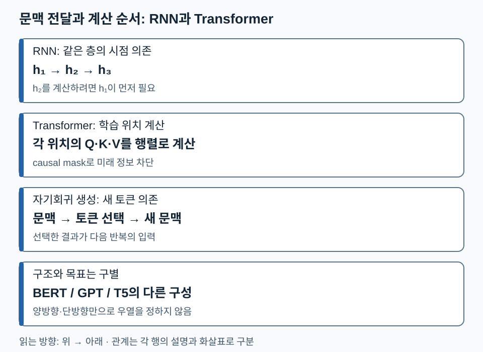

# 03. 언어 모델의 발전 — 문맥을 어디에 담고 어떻게 전달할까

[전체 학습 안내](00_학습안내.md) · [이전: 기본 수학](02_AI_기본_수학.md) · [다음: 입력](04_언어_모델_입력.md) · [PDF 67~77쪽](../교안/app_sp_slides_20261013.pdf#page=67)

언어모델은 문맥을 바탕으로 토큰의 확률을 예측하는 모델입니다. 이 단원은 **RNN의 순차 상태 전달과 Transformer의 Attention을 비교하고, Encoder·Decoder·학습 목표를 분리해 설명하는 것**이 목표입니다. 먼저 ‘벡터는 숫자 목록’이라는 점만 알면 읽을 수 있습니다. 내적이 낯설면 [수학 1절](02_AI_기본_수학.md#1-벡터와-행렬-무엇을-비교하고-무엇을-바꾸나)로 돌아가세요.

## 1. 규칙에서 학습된 표현으로

68쪽의 규칙 기반 번역은 형태소·구문을 분석하고, 사람이 정한 변환 규칙으로 어순을 배열합니다. 예외 규칙의 설계와 유지에 비용이 듭니다. 학습 기반 모델은 데이터에서 표현과 변환을 학습하지만 데이터 편향과 보지 못한 입력의 오류가 생깁니다. ‘학습한다’는 말이 규칙이나 검증이 필요 없다는 뜻은 아닙니다.

Encoder는 입력을 다른 처리에 사용할 표현으로 바꾸는 부분이고, Decoder는 그 표현 또는 앞선 출력 문맥을 사용해 결과를 만드는 부분입니다. 이 이름은 **역할**입니다. Encoder가 텍스트만 받거나 Decoder가 항상 별도 Encoder를 필요로 하는 것은 아닙니다.

## 2. RNN이 문맥을 기억하는 방법과 한계

RNN(Recurrent Neural Network)은 이전 상태 `h_(t-1)`와 현재 입력 `x_t`로 새 상태 `h_t=f(h_(t-1),x_t)`를 계산합니다. 상태는 지금까지 읽은 정보의 요약입니다. 길이가 다른 입력에도 같은 계산을 반복할 수 있지만, 시점 t를 계산하려면 t-1이 필요합니다. 긴 경로로 기울기를 전달하는 학습도 어려워집니다.

의존성만 보는 교육용 덧셈 RNN `h_t=h_(t-1)+x_t`, `h₀=0`, 입력 `[2,5,1]`이면 상태는 `2→7→8`입니다. 두 번째 입력을 6으로 바꾸면 상태는 `2→8→9`입니다. 단, 덧셈은 순서가 바뀌어도 최종 합이 같으므로 이 예시가 실제 언어 RNN의 표현 능력을 보여주는 것은 아닙니다. 실제 학습된 비선형 갱신은 순서에 민감할 수 있습니다.

RNN Attention은 한 최종 요약 벡터에만 의존하지 않고 필요한 입력 위치의 상태를 골라 섞게 합니다. ‘앞 정보를 선택해서 참조할 수 있다’는 장점이 생기지만, 기반 RNN의 순차 상태 계산 자체가 사라지지는 않습니다.

## 3. Transformer는 어떤 의존성을 바꾸나

Transformer는 같은 층에서 토큰들이 서로 참고할 관계를 Attention으로 계산합니다. FFN(Feed-Forward Network)은 각 위치의 벡터를 비선형 변환합니다. Attention이 위치 간 정보를 섞는 역할이라면 FFN은 각 위치의 특징을 가공합니다.

훈련에서는 정답 시퀀스가 이미 있으므로 모든 위치의 계산을 행렬 연산으로 묶을 수 있습니다. GPT에서는 미래 정답을 훔쳐보지 않도록 causal mask가 필요합니다. 반면 생성할 때는 아직 다음 토큰을 모르므로, 한 토큰을 선택해 문맥에 추가한 뒤 다시 계산합니다. **학습 위치의 병렬 계산과 생성 토큰의 순차성은 동시에 성립합니다.** 병렬화가 모든 길이·장치에서 자동으로 빠르다는 뜻도 아닙니다.

다음 비교도에서는 RNN의 **상태 의존**, Transformer 학습의 **위치 계산**, 생성의 **새 토큰 의존**을 서로 구별하세요. 각 행의 화살표는 그 행 안의 계산 의존성을 뜻합니다.

따라서 ‘Transformer는 병렬’이라는 한 문장만으로 생성 절차까지 설명할 수 없습니다. 다음 토큰이 이전 선택에 의존하는지 질문하면 두 경우를 나눌 수 있습니다.

## 4. BERT·GPT·T5: 구조와 과제를 같은 표에서 구별하기

| 대표 구성 | 입력 문맥을 보는 방식 | 대표 사전학습 과제 | 자연스러운 사용 예 |
| --- | --- | --- | --- |
| BERT형 Encoder | 입력 안에서 양쪽 문맥 참조 | 가린 토큰 예측(MLM) | 문장 표현·분류·검색 표현 |
| GPT형 Decoder-only | 해당 위치까지의 앞 문맥 참조 | 다음 토큰 예측 | 이어쓰기·자기회귀 생성 |
| T5형 Encoder–Decoder | Encoder는 입력을 읽고 Decoder는 앞 출력과 입력 표현 참조 | 손상된 연속 구간 복원 | 입력 텍스트를 출력 텍스트로 변환 |

교안 75쪽은 BERT와 T5를 빈칸 복원 계열로 묶습니다. **보충 구분:** T5의 대표 목적은 span corruption이며 BERT와 구조·출력 방식이 같은 것은 아닙니다. T5의 Decoder는 복원할 문자열을 순차 생성합니다. [T5 원 논문, 3.3~3.5절](https://jmlr.org/papers/volume21/20-074/20-074.pdf).

이 표는 가능한 작업의 제한 목록이 아닙니다. 모델을 목적에 맞게 미세튜닝할 수 있습니다. ‘양방향이므로 더 우수’처럼 서로 다른 학습 조건의 모델을 한 순위로 매기지 않습니다.

## 5. 확인 질문

1. Transformer로 학습했으니 100개 새 토큰도 언제나 한 번에 생성할 수 있나요?
2. RNN에 Attention을 붙이면 RNN 상태 계산의 순차 의존도 없어지나요?
3. 빈칸 복원을 학습했다는 이유로 BERT와 T5의 구조가 같다고 말할 수 있나요?

해설과 돌아갈 위치

1. 일반 자기회귀 생성에서는 앞에서 선택한 토큰이 다음 입력이므로 순차 반복합니다. 3절.
2. 참조할 정보 통로가 늘어나도 기반 상태 갱신은 순차적입니다. 2절.
3. 아닙니다. Encoder-only와 Encoder–Decoder의 차이가 있고 T5는 복원 문자열을 Decoder로 만듭니다. 4절.

**다음 연결:** 어떤 구조든 먼저 문자열을 숫자 ID와 벡터로 바꿔야 합니다. 다음 단원에서 입력·정답이 만들어지는 경로를 추적합니다.
