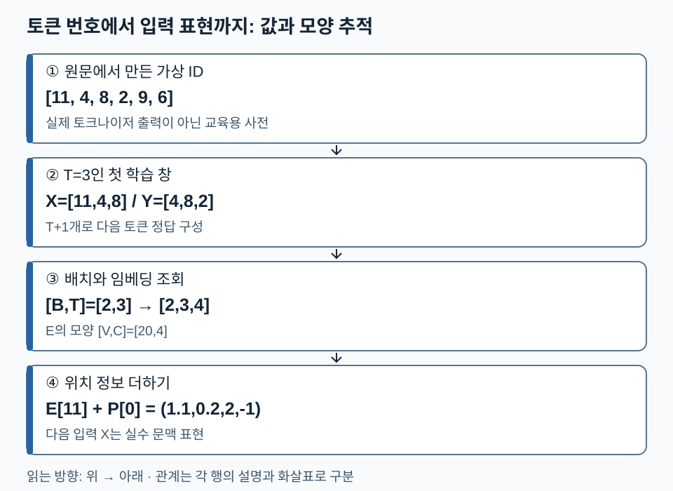

# 04. 언어 모델 입력 — 문자열이 학습 가능한 숫자가 되는 과정

[전체 학습 안내](00_학습안내.md) · [이전](03_언어_모델의_발전.md) · [다음: Attention](05_Attention_이해.md) · [PDF 78~101쪽](../교안/app_sp_slides_20261013.pdf#page=78)

문자열은 **전처리→토큰화→ID→입력·정답 창→임베딩과 위치 정보**를 거쳐 모델로 들어갑니다. 목표는 각 단계의 값과 모양을 추적하고, 토큰 ID·벡터·정답을 서로 구별하는 것입니다. 기본 학습은 1~4절을 따르고 위치 방식 비교는 5절에서 읽으세요. 행렬 모양이 낯설면 [수학 1절](02_AI_기본_수학.md#1-벡터와-행렬-무엇을-비교하고-무엇을-바꾸나)을 보세요.

## 1. 전처리와 토큰화는 서로 다른 일을 한다

79쪽의 파운데이션 모델은 넓은 데이터에서 기본 능력을 학습한 기반 모델이고, Chat 모델은 대화 지시와 응답 형식에 맞도록 추가 학습된 모델입니다. 입력을 숫자로 바꾸는 기본 경로는 공유하지만, 대화 템플릿·역할 토큰·정답 구간이 달라질 수 있습니다. 추가 학습은 [지시 미세튜닝과 선호학습](12_지시미세튜닝과_선호학습.md)에서 이어집니다.

전처리는 문서 정제·중복 처리·형식 통일 등 데이터 준비이고, 토큰화는 문자열을 모델이 다룰 조각(token)과 고유 ID로 바꾸는 규칙입니다. 토큰은 단어 전체일 수도, 단어 일부·공백·바이트 조각일 수도 있습니다. 81쪽의 ‘의미 단위’는 직관이며 의미 경계가 항상 보장되지는 않습니다.

토큰 ID는 어휘표의 번호입니다. ID 20이 ID 10보다 의미가 두 배 크거나 가깝다는 뜻은 없습니다. 동일 문자열이라도 토크나이저·버전·특수 토큰 설정이 다르면 ID와 길이가 달라집니다. 아래 ID는 전부 교육용 가상 사전의 값이며 실제 모델의 encode 결과가 아닙니다.

| 원문 85~88쪽 | 어휘를 만드는 관점 | 학습자가 구별할 것 |
| --- | --- | --- |
| BPE | 자주 함께 등장하는 이웃 조각의 병합을 반복 | 병합 학습과 이미 학습된 병합 규칙 적용은 다름 |
| WordPiece | 교안에서는 쌍의 빈도와 각 조각 빈도의 비율로 설명 | 단순 빈도 병합과 점수 기준을 구별; 구현별 세부 학습법을 보편화하지 않음 |
| Unigram | 후보 조각과 확률 모델로 분절을 평가하고 어휘를 줄임 | 최선 분절 선택과 확률적 분절 샘플링은 별도 옵션 |

Unigram 토크나이저가 매번 무조건 다른 결과를 내는 것은 아닙니다. 확률적 분절은 subword regularization을 위해 선택할 수 있으며, 결정적 분절도 가능합니다. [Kudo의 원 논문](https://aclanthology.org/P18-1007/).

병합 예시로 단어 `low`가 3회, `lower`가 1회 나오는 작은 말뭉치를 봅시다. 초기 조각을 문자와 단어 경계로 두면 `(l,o)`와 `(o,w)`는 각각 4회입니다. 동률 처리 규칙으로 `(l,o)`를 먼저 고르면 `lo w`가 되고, 다음 병합에서 `lo+w`가 후보가 됩니다. 실제 byte-level BPE의 초기 조각·공백 처리·동률 규칙은 이 단순 예시와 다를 수 있습니다.

## 2. next-token 입력·정답은 한 토큰 어긋난다

가상 토큰열 `[11,4,8,2,9,6]`, 문맥 길이 `T=3`, 창 이동폭 `stride=2`를 사용합니다. 다음 토큰을 정답으로 만들려면 창 하나당 원 토큰 `T+1=4`개가 필요합니다.

| 창 시작 | 입력 X | 정답 Y | 의미 |
| --- | --- | --- | --- |
| 0 | `[11,4,8]` | `[4,8,2]` | 11 뒤 4, 11·4 뒤 8, 11·4·8 뒤 2 |
| 2 | `[8,2,9]` | `[2,9,6]` | 8 뒤 2, 8·2 뒤 9, 8·2·9 뒤 6 |

여기서는 창 시작이 바뀌면 잘린 문맥으로 새 예측 사례를 만듭니다. X와 Y를 따로 섞으면 대응이 깨지므로 한 사례를 묶어서 shuffle해야 합니다. 두 창을 배치로 모으면 X·Y의 모양은 각각 `[B,T]=[2,3]`이고 값은 정수 ID입니다. stride를 1로 바꾸면 시작점은 0,1,2로 늘어나 세 창이 됩니다. 짧은 마지막 창을 버릴지 padding할지는 데이터 계약으로 정합니다.

교안 99쪽의 자기지도학습(Self-Supervised Learning)은 사람이 각 위치의 라벨을 따로 쓰지 않아도 원문에서 정답을 만든다는 뜻입니다. 학습 신호가 없다는 뜻은 아닙니다. 일부 라이브러리 모델은 내부에서 shift하므로, 그 경우 바깥에서 정답을 또 이동하면 안 됩니다.

## 3. 임베딩은 ID로 행을 조회하는 학습 가능한 표

어휘 크기 `V=20`, 벡터 폭 `C=4`인 임베딩 표 E의 모양은 `[20,4]`입니다. ID 11은 `E[11]`이라는 길이 4의 행을 선택합니다. X의 모양이 `[2,3]`이면 `E[X]`는 `[2,3,4]`입니다. 곱셈 대상인 실수 표현이 이 단계에서 생깁니다.

가상 행 `E[11]=(1,0,2,-1)`와 첫 위치 벡터 `P[0]=(0.1,0.2,0,0)`를 더하면 첫 입력 표현은 `(1.1,0.2,2,-1)`입니다. 같은 ID가 다른 위치에 오면 토큰 임베딩은 같아도 더해지는 위치 정보는 다를 수 있습니다.

82~84쪽의 단어 벡터 유사도와 유추는 **특정 학습된 벡터 공간에서 나타나는 경향**입니다. 벡터 산술이 언어 관계를 항상 정확히 풀거나 무작위 초기 임베딩이 의미를 담는다고 해석하지 않습니다. 뒤의 Attention을 통과하면 같은 토큰도 문맥에 따라 다른 표현을 갖게 됩니다.

아래에서는 원래 ID, 학습용 창, 임베딩 모양을 위에서 아래로 따라가세요. X는 표의 ②에서는 정수 입력, 본문의 Attention 입력에서는 임베딩 이후의 실수 표현을 뜻하므로 단계와 함께 읽습니다.

ID 11 자체가 벡터 `(1.1,0.2,2,-1)`인 것은 아닙니다. E의 11번 행을 조회하고 위치 벡터를 더한 결과가 이 벡터입니다. T와 C를 바꾸면 어느 축이 달라지는지 6절의 질문으로 확인하세요.

## 4. 특수 토큰과 padding: 값과 목적을 구별하기

BOS는 시작, EOS는 끝, PAD는 길이를 맞추기 위한 자리라는 용도로 쓰일 수 있습니다. 대화 역할·도구 호출 표시 등도 98쪽의 구조 제어 신호입니다. 정확한 이름과 ID는 모델마다 다릅니다. BOS나 EOS가 모든 데이터 형식에 반드시 자동 삽입되는 것도 아닙니다.

padding을 추가하면 두 질문이 생깁니다. **Attention mask**는 어떤 입력 위치를 참조할지 제어하고, **loss mask**는 어떤 정답 위치를 손실에 넣을지 제어합니다. 하나가 다른 하나를 자동으로 대신하지 않습니다. 실제 EOS는 ‘여기서 종료’를 학습시키는 정답이 될 수 있습니다. PAD와 EOS가 같은 ID라도 추가된 PAD 위치와 실제 EOS 위치를 길이·mask로 구분해야 합니다. prompt 구간의 loss 제외 등은 지시 미세튜닝에서 이어집니다.

## 5. 위치 정보: 순서를 어디에 넣을까

Attention의 토큰 간 비교만으로는 ‘Tom ate meat’와 ‘meat ate Tom’의 순서를 충분히 구별할 수 없습니다. 위치 정보는 토큰의 내용과 함께 위치·상대 거리를 계산에 반영합니다.

| 방식 | 무엇을 하는가 | 조건과 한계 |
| --- | --- | --- |
| 학습된 절대 위치 임베딩 | 위치 번호로 표를 조회해 토큰 벡터에 더함 | 학습된 위치 범위와 문맥 길이 제한 확인 |
| Sinusoidal | 위치별 sin·cos 값을 정해 더함 | 주파수가 다른 좌표를 사용; 학습하지 않은 길이의 성능 보장은 별개 |
| 상대 위치 bias | query–key 거리 등의 정보를 Attention 점수에 더함 | 모든 상대 위치 방식의 계산·캐시 비용이 같지는 않음 |
| RoPE | 위치에 따라 Q·K의 좌표 쌍을 회전 | 내적에 상대 위치가 드러남; 모든 위치 벡터를 입력에 더하는 방식과 다름 |

Sinusoidal의 대표 식은 `PE(p,2i)=sin(p/10000^(2i/C))`, `PE(p,2i+1)=cos(p/10000^(2i/C))`입니다. p는 위치, i는 좌표 쌍 번호입니다. `p=0`이면 모든 sin 좌표는 0, cos 좌표는 1입니다. 91쪽의 ‘긴 문장에서도 유일’은 실수 이론·유한 정밀도·일반화 성능을 구분해서 읽습니다.

RoPE의 교육용 2차원 예시에서 `q=(1,0)`, `k=(1,0)`를 각각 위치 m,n의 각도 `mθ,nθ`로 회전하면 내적은 `cos((m-n)θ)`가 됩니다. 예를 들어 m=n이면 내적은 1이고, 위치 차이에 해당하는 회전이 90°이면 내적은 0입니다. 이 특수 예시에서는 내용 벡터를 같게 고정해 상대 거리의 효과만 분리했습니다. 회전은 길이를 보존하며, 실제 모델은 여러 좌표 쌍에 다른 주파수를 사용합니다. [RoFormer 원 논문](https://arxiv.org/abs/2104.09864).

## 6. 확인 질문

1. 위 토큰열에서 `T=3,stride=1`일 때 중간 창의 X와 Y를 쓰세요.
2. `V=20,C=4,B=2,T=3`일 때 입력 ID·임베딩 표·임베딩 결과의 모양을 쓰세요.
3. PAD에 loss를 주지 않았으니 Attention mask도 필요 없다는 주장에 어떤 조건이 빠졌나요?
4. RoPE와 절대 위치 임베딩의 적용 대상을 비교하세요.

해설과 돌아갈 위치

1. 시작 1이므로 X=`[4,8,2]`, Y=`[8,2,9]`. 2절.
2. `[2,3]`, `[20,4]`, `[2,3,4]`. 번호를 실수 벡터와 혼동했다면 3절.
3. PAD가 실제 토큰의 표현 계산에 참조되는지 별도 제어해야 합니다. 데이터 배치·padding 방향·mask 규약에 따라 판단합니다. 4절.
4. 기본 RoPE는 Q·K에 회전을 적용하고, 절대 위치 임베딩은 토큰 표현에 위치별 벡터를 더합니다. 5절.

**다음 연결:** 이제 실수 입력 표현 X가 준비되었습니다. 다음 단원에서는 X에서 만든 Q·K·V를 이용해 문맥 정보를 섞습니다.
