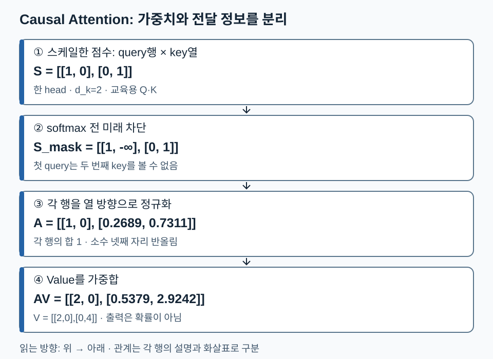

# 05. Attention 이해 — 누구를 참고해서 어떤 정보를 가져올까

[전체 학습 안내](00_학습안내.md) · [이전: 입력](04_언어_모델_입력.md) · [다음: GPT 구조 입문](06_GPT_모델_이해.md) · [PDF 102~124쪽](../교안/app_sp_slides_20261013.pdf#page=102)

Attention은 **각 위치가 참고할 위치의 가중치를 정하고, 그 위치들이 가진 정보를 가중합하는 계산**입니다. 이 단원을 마치면 Q·K·V의 역할, scaling·mask·softmax의 순서, head의 모양을 설명하고 작은 예제를 계산할 수 있어야 합니다. [수학의 내적·softmax](02_AI_기본_수학.md)와 [임베딩](04_언어_모델_입력.md#3-임베딩은-id로-행을-조회하는-학습-가능한-표)이 선행 내용입니다.

기본 경로는 1→2→3절입니다. head 축 추적은 4절에서 이어집니다. ‘애플’이 과일인지 회사인지는 토큰 자체만으로 확정되지 않습니다. 주변 표현을 섞어 문맥에 맞게 표현을 바꾼다는 것이 104~107쪽의 중심 질문입니다.

## 1. Q·K·V는 ID나 고정 사전이 아니라 입력의 투영 결과

입력 표현을 행으로 모은 `X[T,C]`에서 서로 다른 학습 행렬을 곱합니다. `Q=XW_Q`, `K=XW_K`, `V=XW_V`입니다. Query는 무엇을 찾는지 나타내는 비교 기준, Key는 각 위치를 찾기 위한 단서, Value는 선택된 위치에서 전달할 내용입니다. 질문·주소·내용이라는 비유는 역할 설명이며 실제 검색 엔진이나 자연어 문장이 저장된다는 뜻은 아닙니다.

`W_Q,W_K,W_V`는 손실을 줄이는 학습 과정에서 갱신됩니다. 특정 head가 문법이나 지시 대상을 본다고 미리 프로그래밍하는 것은 아닙니다. Attention 점수도 곧바로 의미적 유사도나 사실성의 정답으로 해석할 수 없습니다.

교안 109쪽의 ‘항상 자기 자신을 우선 주목’은 일반 규칙이 아닙니다. Q와 K가 다르게 투영되면 자기 점수가 최고일 필요가 없고, 같은 벡터를 써도 다른 벡터의 길이와 방향에 따라 더 큰 내적이 나올 수 있습니다. Q·K 분리는 역할별 학습의 자유를 주지만, 공유 변형을 수학적으로 불가능하다고 단정하지 않습니다. 110쪽의 K·V 분리도 검색 단서와 전달 정보를 독립적으로 학습하게 하는 기본 설계로 읽습니다.

## 2. 손계산: 점수에서 문맥 벡터까지

한 head, 두 위치, `d_k=2`로 제한한 교육용 예시입니다. 학습된 투영 과정은 생략하고 Q·K·V를 입력으로 줍니다. 실제 측정값이 아닙니다.

```text
Q = [[√2,0], [0,√2]]
K = [[1,0],  [0,1]]
V = [[2,0],  [0,4]]
```

먼저 `S=QKᵀ/√d_k`를 계산하면 `[[1,0],[0,1]]`입니다. 행은 질문하는 query 위치, 열은 참고할 key 위치입니다. 첫 행의 `1`은 첫 query와 첫 key의 점수입니다. 점수 행렬의 두 축 길이가 같아도 두 역할은 다릅니다.

아직 causal mask를 적용하지 않았다고 합시다. 각 행의 **열 방향**으로 softmax하면 `A≈[[0.7311,0.2689],[0.2689,0.7311]]`입니다. 첫 출력은 `A₁₁×(2,0)+A₁₂×(0,4)≈(1.4621,1.0758)`입니다. 표시한 A는 소수 넷째 자리 반올림이지만, 중간 계산에는 반올림 전 값을 사용하고 최종 결과에서 반올림합니다. 두 번째 출력은 약 `(0.5379,2.9242)`입니다. 행마다 합이 1인 것은 가중치 A이며, 가중합 출력의 좌표 합이 1일 필요는 없습니다.

`1/√d_k`는 내적 점수 규모를 완화합니다. 독립·평균 0·분산 1 같은 단순 가정에서 d_k개 곱의 합은 분산 d_k, 표준편차 √d_k를 가집니다. 이를 √d_k로 나누면 분산이 약 1이 됩니다. 교안 115쪽의 ‘dk로 나눔’이라는 문장은 표시 수식의 **√d_k**로 읽어야 합니다. 실제 학습된 Q·K가 이 가정을 정확히 만족한다는 뜻은 아닙니다.

## 3. Causal mask: 다음 토큰 정답을 훔쳐보지 않게 하기

위 예시에 왼쪽부터 오른쪽으로 생성하는 조건을 추가합니다. 첫 위치는 아직 두 번째 입력을 볼 수 없어야 합니다. softmax **전에** 미래 위치를 -∞로 바꿉니다.

```text
스케일 점수 S       mask 뒤 점수        softmax A            출력 AV
[[1,0],            [[1,-∞],           [[1,0],              [[2,0],
 [0,1]]             [0, 1]]            [0.2689,0.7311]]     [0.5379,2.9242]]
```

첫 행의 미래 가중치는 `exp(-∞)=0`이 되고 나머지 유효 위치로 다시 정규화됩니다. 0으로만 점수를 덮으면 `exp(0)=1`이라 완전히 차단되지 않습니다. softmax 뒤에 0만 곱하는 방식도 유효 위치 합이 1로 유지되지 않을 수 있습니다.

자기 위치는 볼 수 있습니다. 입력 `[11,4,8]`의 두 번째 위치는 토큰 4까지 보고 **그 다음 정답 8**을 맞히기 때문입니다. 정답 이동과 causal mask는 함께 이해해야 합니다. padding mask는 별도 제약이며, 한 행의 모든 key가 가려진 상황은 NaN 등 구현 문제를 만들 수 있으므로 유효 key가 존재하도록 데이터와 mask 규칙을 정해야 합니다.

**원문 그림 주의:** 118쪽 왼쪽의 S자 곡선은 단일 입력 sigmoid 모양입니다. 여러 점수를 함께 정규화하는 softmax 전체를 단일 스칼라 곡선으로 읽지 않습니다. softmax는 식과 오른쪽의 벡터→분포 변환을 기준으로 이해하세요.

Attention map은 A의 각 행에서 어디에 큰 가중치가 있는지 읽습니다. 교안 114쪽의 색 농도와 119쪽의 삼각형은 서로 다른 것, 즉 **학습된 참조 가중치**와 **허용 참조 범위**를 보여줍니다. 큰 가중치를 그 모델 판단의 완전한 인과 설명으로 보지는 않습니다.

다음 그림은 같은 Q·K·V 예시에 causal mask를 적용한 경로입니다. 점수→미래 차단→행별 정규화→Value 가중합 순서로 읽으세요.



첫 출력이 `(2,0)`으로 바뀌는 이유는 첫 위치가 자기 Value만 볼 수 있기 때문입니다. 두 번째 출력은 미래가 없으므로 mask 전후가 같습니다. 그림의 소수는 반올림값이며 본문의 중간식을 기준으로 재계산할 수 있습니다.

## 4. Multi-head: 병렬 관점과 순차 층을 구별하기

각 head는 서로 다른 투영으로 Attention을 계산합니다. head 결과를 마지막 특징 축으로 연결한 뒤 출력 투영을 적용합니다. 여러 head를 ‘각각 반드시 특정 의미를 담당하는 전문가’로 고정 해석하지 않습니다.

배치 B=2, 길이 T=3, 전체 폭 C=8, head 수 h=2이면 head 폭 `d_h=C/h=4`입니다. 기본 구현에서 C는 h로 나누어떨어져야 합니다.

| 단계 | 모양 | 무엇이 달라졌나 |
| --- | --- | --- |
| X, Q, K, V | `[2,3,8]` | 토큰당 전체 폭 8 |
| head 분리·축 교환 | `[2,2,3,4]` | 배치·head·위치·head 폭 |
| `QKᵀ/√4` | `[2,2,3,3]` | 마지막 두 축은 query·key 위치 |
| A와 V 곱 | `[2,2,3,4]` | 각 head의 문맥 벡터 |
| 축 복원·연결 | `[2,3,8]` | head 2개×폭 4 |
| 출력 투영 | `[2,3,8]` | 잔차에 더할 전체 폭 |

transpose한 텐서는 메모리 배치가 연속적이지 않을 수 있으므로 구현의 reshape/view 조건을 확인합니다. head 수 2는 한 층 안의 병렬 분할 수이며, 층 수는 이 과정을 몇 번 순차 반복하는가입니다. 121~123쪽의 head×layer 지도는 그 두 축을 함께 펼친 그림입니다. 모델별 숫자는 원문 사례로 읽고 모든 GPT 구조의 상수로 외우지 않습니다.

## 5. 확인 질문

1. 2절의 첫 query만 `[0,0]`으로 바꾸고 causal mask를 쓰지 않으면 첫 출력은?
2. 같은 변경 후 causal mask를 적용하면 첫 출력은?
3. B=1,T=5,C=12,h=3일 때 점수와 head 출력의 모양은?
4. ‘첫 위치의 미래 점수를 0으로 바꾸면 미래 확률도 0’이라는 계산을 반박하세요.

<details><summary>해설과 돌아갈 위치</summary>

1. 점수 `[0,0]`→확률 `[0.5,0.5]`→출력 `(1,2)`. 2절.
2. 점수 `[0,-∞]`→확률 `[1,0]`→출력 `(2,0)`. 3절.
3. head 폭 4, 점수 `[1,3,5,5]`, head 출력 `[1,3,5,4]`. 4절.
4. softmax는 지수화하므로 exp(0)=1입니다. 유한 점수 0은 배제 표시가 아닙니다. 3절.

</details>

**다음 연결:** Attention 출력은 다음 토큰 번호가 아니라 문맥 벡터입니다. 다음 단원에서 이 벡터가 GPT 전체 구조의 어디로 가는지 연결합니다.
