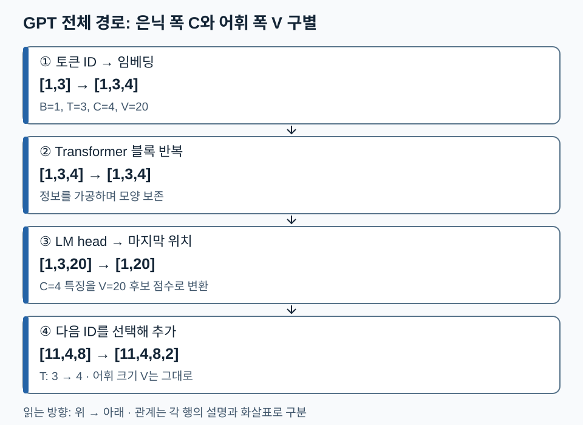

# 06. GPT 모델 이해 — Attention의 출력은 어떻게 다음 토큰 예측으로 이어질까

[전체 학습 안내](00_학습안내.md) · [이전: Attention](05_Attention_이해.md) · [다음: GPT Layer들](07_GPT_Layer들.md) · [PDF 103쪽 전체 구조](../교안/app_sp_slides_20261013.pdf#page=103)

GPT는 앞 문맥으로부터 다음 토큰의 분포를 계산하는 Decoder-only 언어모델입니다. 핵심은 **Attention이 만든 문맥 벡터를 여러 블록에서 가공한 뒤, 어휘별 점수로 변환한다**는 연결입니다. 이 단원은 구조 입문이며, LayerNorm·FFN·잔차의 상세는 다음 목차 ‘GPT Layer들’, 생성·샘플링은 ‘GPT 모델 입출력’에서 이어집니다.

원문 목차 6번은 별도 구분 슬라이드가 없고 103쪽의 전체 구조, 117쪽 문맥 표현, 120~123쪽 head·layer 설명과 연결됩니다. 05번은 Attention **내부 계산**, 이 문서는 **전체에서의 역할**을 기준으로 같은 원문을 다르게 읽습니다.

## 1. 세 층위의 값을 구별하기

| 층위 | 예시 모양 | 뜻 |
| --- | --- | --- |
| 토큰 ID | `[B,T]` | 사전에서 토큰을 가리키는 정수 번호 |
| 문맥 표현 | `[B,T,C]` | 위치마다 현재까지 가공된 실수 특징 |
| 어휘 logits | `[B,T,V]` | 위치별 다음 토큰 후보 V개의 점수 |

B는 배치 크기, T는 문맥 길이, C는 은닉 폭, V는 어휘 크기입니다. Attention의 출력 폭 C는 정답 후보 수가 아닙니다. 마지막 언어모델 출력층(LM head)이 C차원 특징을 V개 점수로 바꿉니다. logits는 아직 확률이 아니며 softmax로 정규화할 수 있습니다.

## 2. 구조를 한 번 따라가기

교육용 설정 B=1,T=3,C=4,V=20을 사용합니다.

```text
입력 [11,4,8]                    [1,3]
→ 임베딩과 위치 정보             [1,3,4]
→ Transformer 블록 반복          [1,3,4]
→ 최종 정규화와 LM head          [1,3,20]
→ 마지막 위치 점수 선택          [1,20]
→ 다음 ID 선택·문맥에 추가        [1,4]
```

블록 안의 Attention은 다른 위치의 정보를 섞습니다. FFN은 각 위치의 특징을 비선형 변환합니다. 잔차 통로는 변환 전 표현과 변화량을 더하고, 정규화는 학습의 수치적 동작을 조절합니다. 여기서는 기본 구성의 역할만 연결합니다. 구체적인 순서가 Pre-Norm인지 Post-Norm인지는 구현과 교안의 해당 블록을 확인해야 합니다.

LM head가 토큰 2에 가장 큰 점수를 주었다면 greedy 방식은 2를 선택합니다. 입력은 `[11,4,8,2]`가 되고 길이가 4로 늘어납니다. 다음 반복에서는 **이제 선택한 2도 조건**으로 사용합니다. 95쪽의 자기회귀는 이 반복을 뜻합니다. 확률에서 무작위로 선택하는 샘플링은 greedy와 다른 선택 규칙이며 구조 자체는 공유할 수 있습니다.

아래 그림에서는 **은닉 특징 축 C가 어휘 축 V로 바뀌는 곳**과 **생성 후 길이 T가 늘어나는 곳**을 찾아보세요.



블록 반복에서는 모양이 유지되고 LM head에서 마지막 폭이 4에서 20으로 바뀝니다. 토큰을 추가할 때 바뀌는 것은 문맥 길이입니다. 수가 우연히 같더라도 축의 역할을 이름으로 구별하세요.

## 3. 학습과 생성의 같은 점·다른 점

학습 입력 `[11,4,8]`의 정답은 `[4,8,2]`입니다. 세 위치 logits 모두에서 각 정답 확률을 평가합니다. 첫 위치는 11을 보고 4를, 마지막 위치는 11·4·8을 보고 2를 맞힙니다. 정답이 이미 주어졌으므로 한 번에 계산할 수 있지만 causal mask로 허용 문맥을 제한합니다.

생성 시에는 새 정답이 주어지지 않습니다. 마지막 위치의 분포에서 직접 토큰을 선택하고 그 선택을 다음 입력에 넣습니다. 학습에서 이전 정답을 넣어주는 방식(teacher forcing)과 생성에서 자신의 선택을 이어 쓰는 방식의 차이가 있습니다. 학습된 모델도 한 번의 잘못된 선택 이후 다른 문맥을 따라갈 수 있습니다.

## 4. Head가 많다는 것과 깊다는 것

head는 한 층에서 서로 다른 투영으로 **나란히** 정보를 섞고, layer는 이전 층의 출력 표현을 **차례로** 입력받습니다. 교안 123쪽의 초기·후기 층 시각화는 특정 예시에 대한 관찰입니다. 모든 초기 층은 문맥만, 모든 후기 층은 다음 토큰만 처리한다는 엄격한 규칙은 아닙니다.

층을 두 번 통과한다고 토큰 수 T가 두 배가 되지 않습니다. 보통 블록은 잔차 덧셈과 반복을 위해 `[B,T,C]` 모양을 보존하고, 내부 정보가 바뀝니다. 마지막 LM head만 특징 축을 C에서 V로 바꿉니다. 이 구분을 먼저 해두면 다음 단원의 잔차·FFN 설명을 따라가기 쉽습니다.

## 5. 확인 질문

1. 위 예시의 Attention 출력 `[1,3,4]`에서 가장 큰 좌표를 고르면 다음 토큰 ID가 되나요?
2. layer 수를 2에서 4로 바꾸되 B,T,C,V를 유지하면 최종 logits 모양은?
3. 생성 과정에서 토큰 하나를 추가하면 어느 축이 바뀌나요? 어휘 크기도 증가하나요?

<details><summary>해설과 돌아갈 위치</summary>

1. 아닙니다. 은닉 특징 4개는 어휘 후보 20개가 아닙니다. LM head를 거쳐 V개 logits를 만들어야 합니다. 1~2절.
2. `[1,3,20]`으로 같습니다. 반복 횟수와 표현은 바뀌지만 입력 길이·출력 어휘 폭은 유지됩니다. 4절.
3. 문맥 길이 T가 3에서 4로 바뀝니다. 어휘 크기 V=20은 그대로입니다. 2절.

</details>

**다음 연결:** 이제 [GPT Layer들](07_GPT_Layer들.md)에서 블록 내부의 정규화·FFN·잔차를 자세히 읽고 같은 `[B,T,C]`가 어떤 연산을 거쳐 보존되는지 검증합니다. 실습 원문에서는 [Chapter 3 Attention](../../04_LLM_실습/Chapter_3_Excercise_Attention.ipynb)을 찾아 계산과 축을 대조하세요.
