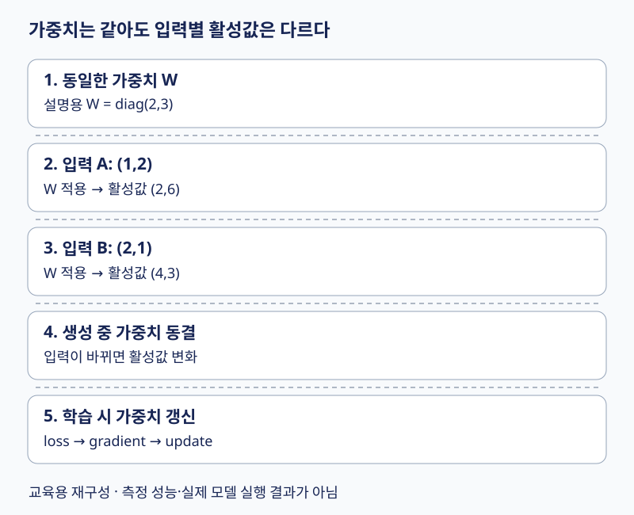

# 09. 지식의 저장 — 가중치와 현재 표현을 구별하기

학습 후 남는 **가중치**와 문장을 읽을 때마다 만들어지는 **활성값**은 다르다. FFN을 지식 저장소로 보는 관점은 유용하지만 ‘한 뉴런=한 사실’이나 ‘은닉 공간=항상 저차원 압축’으로 외우면 실제 계산을 놓친다.

[전체 학습 경로](00_학습안내.md) · [원문 PDF 150~157쪽](../교안/app_sp_slides_20261013.pdf#page=150) · [선행: FFN](07_GPT_Layer들.md#3-ffn과-활성화-선형층-사이에서-무엇이-달라지나)

이 장의 목표는 파라미터와 활성값을 구분하고, 직교와 거의 직교를 계산하며, 폭 확장의 의미를 설명하는 것이다. 1~3절은 기본, 고차원 직관은 4절의 보충이다.

## 시각적으로 확인할 핵심

첫 상자의 W를 고정하고 두 입력의 출력값을 비교하세요. 뒤 두 상자는 조건 비교입니다.

현재 활성값과 장기 가중치를 구분한다. 생성과 학습은 가중치 갱신 여부가 다르다.

## 1. 입력이 바뀌어도 남는 것, 매번 달라지는 것

파라미터는 embedding 표, Attention 투영, FFN 가중치처럼 학습으로 조정되는 수다. 활성값은 그 가중치에 현재 입력을 통과시킨 결과다. 같은 모델에 두 문장을 넣으면 파라미터는 같아도 활성값은 다르다. 학습하지 않는 생성 중에는 문맥이 늘어도 가중치는 그대로다.

예를 들어 FFN의 입력이 x=(1,2), 가중치가 대각행렬 diag(2,3)이면 중간 표현은 (2,6)이다. 다른 입력 (2,1)에서는 같은 가중치로 (4,3)이 나온다. `(2,6)`을 저장된 지식 자체라 부르면 ‘현재 무엇을 읽었는가’와 ‘무엇을 학습했는가’가 섞인다. 사실과 능력은 여러 파라미터에 분산될 수 있고 Attention·embedding 등도 기여하므로 FFN만이 유일한 저장 장소라고 단정하지 않는다.

## 2. Latent space는 관측값 대신 쓰는 내부 표현 공간

잠재 공간은 원자료에 직접 붙은 이름 대신 모델이 다루는 내부 특징 좌표로 표현하는 공간이다. 압축 모델에서는 입력보다 낮은 차원이 될 수 있지만, 모든 은닉층이 입력보다 작아야 하는 것은 아니다. 토큰 ID라는 스칼라 범주를 8차원 벡터로 표현할 수도 있고 FFN 내부에서 폭을 더 늘릴 수도 있다. ID의 숫자 크기는 의미 거리와 같지 않다.

원문 155쪽의 압축 설명은 **압축을 수행하는 잠재 표현의 한 사례**로 읽는다. ‘latent’라는 용어 자체가 차원 축소를 보장하지는 않는다. 도서관 비유를 쓰면 가중치는 정리 규칙, 활성값은 현재 질문으로 꺼낸 작업 자료에 가깝다. 실제 모델에 파일별로 사실이 분리 보관된다는 뜻은 아니다.

## 3. 확장층은 특징을 계산할 여지를 늘린다

FFN의 `C→4C→C`는 토큰 수를 네 배로 늘리지 않는다. 각 토큰의 특징 폭을 늘렸다 되돌린다. C=2, 입력 x=(1,-1)에서 설명용 확장값을 `(x1,x2,x1+x2,x1-x2)=(1,-1,0,2)`로 만들고 ReLU를 적용하면 `(1,0,0,2)`가 된다. 출력 투영으로 첫째와 넷째 값을 합쳐 첫 좌표로, 둘째와 셋째를 합쳐 둘째 좌표로 정하면 결과는 (3,0)이다.

이 예는 입력에서 만든 여러 조합 중 일부를 선택하고 합칠 수 있음을 보인다. 실제 GPT의 GELU·학습 가중치를 모사한 결과는 아니다. 확장은 더 많은 중간 특징을 다룰 수 있게 하지만 비선형 변환과 축소에서 **정보 손실이 반드시 방지된다는 보장**은 없다. 원문 156쪽의 표현은 이런 계산상의 가능성과 구분한다.

## 4. 보충: 직교와 거의 직교

0이 아닌 두 벡터의 내적이 0이면 직교다. u=(1,0), v=(0,1)은 내적 0이다. u와 w=(1,0.01)은 내적 1로 거의 같은 방향이다. v와 w의 cosine은 `0.01/sqrt(1.0001)≈0.0099995`이므로 거의 직교다. 이 예의 ‘거의’는 cosine 절댓값이 0.01보다 작다는 기준이다.

N차원에서 서로 쌍마다 정확히 직교하는 **0이 아닌 벡터**는 최대 N개다. 고차원에서 독립적인 무작위 방향의 내적이 0 근처에 집중되는 성질은 더 많은 방향을 약한 간섭으로 다루는 직관을 준다. 그러나 임의의 학습 특징이 모두 무작위·독립이라는 보장은 없다. 89~91도라는 허용폭에서 얼마나 많은 벡터 쌍이 해당하는지는 차원·분포·표본수에 따라 달라진다. 원문 151쪽을 모든 개념이 직교한다는 정리로 읽지 않는다. 직교성만으로 특징 해석 가능성이나 지식의 정확성이 보장되는 것도 아니다.

## 5. 이해 확인과 실습 연결

1. 같은 가중치에 문장을 바꿔 넣었을 때 바뀌는 것은 파라미터인가 활성값인가?
2. 3차원에 정확히 쌍별 직교하는 0 아닌 벡터 4개를 둘 수 있는가?
3. C=8을 C=12로 바꾸면 기본 FFN 중간 폭은? 위치 수 T도 바뀌는가?
4. 원문 157쪽 GPT 실습에서 출력 문장이 어색하면 이 장의 지식 설명이 틀린 것인가?

해설과 돌아갈 위치

1. 학습하지 않는다면 활성값이다. 1절의 두 입력 계산을 다시 본다.
2. 불가능하다. 최대 3개다. ‘거의’ 직교와 혼동했다면 4절로 돌아간다.
3. 48이며 T는 그대로다. 3절에서 폭과 위치를 구별한다.
4. 랜덤 초기화 모델이면 자연스러운 언어 지식을 학습한 적이 없다. 순전파와 shape 검증을 언어 품질 검증과 나눈다. 원 실습은 [Chapter 4 GPT](../../04_LLM_실습/Chapter_4_Excercise_GPT.ipynb)를 참조하며 여기서 전체 노트북 실행을 재현하지 않았다.

다음 [10장](10_모델_학습.md)에서는 현재 출력으로 손실을 계산하고 가중치를 바꾸는 과정을 배운다.
