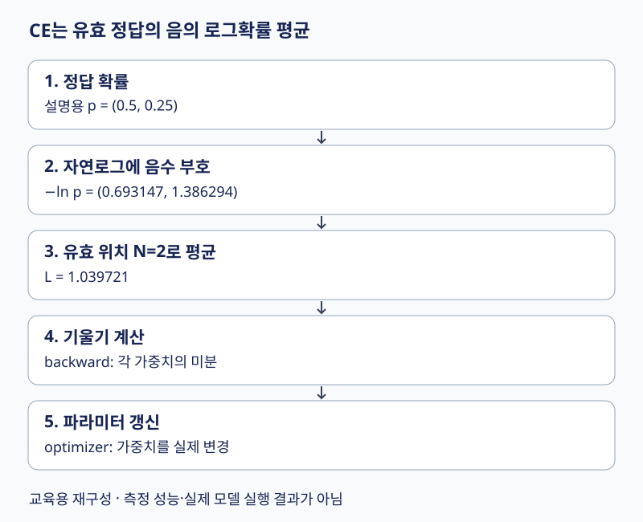

# 10. 모델 학습 — 정답 확률에서 가중치 갱신까지

언어모델 학습은 정답 토큰에 부여한 확률을 높이도록 가중치를 조정한다. **손실 계산 → 기울기 계산 → 파라미터 갱신**은 서로 다른 단계다. 생성과 같은 다음 토큰 문제를 풀지만, 학습 중에는 정답 문맥이 이미 주어져 여러 위치의 예측을 함께 계산할 수 있다.

[전체 학습 경로](00_학습안내.md) · [원문 PDF 158~175쪽](../교안/app_sp_slides_20261013.pdf#page=158) · [선행: 출력과 logits](08_GPT_모델입출력.md)

학습 목표는 CE를 손계산하고 학습·검증·시험 데이터를 구분하며, batch와 optimizer step을 세는 것이다. 1~4절은 기본이고 Adam의 수식은 보충 확인용이다.

## 시각적으로 확인할 핵심

확률에서 손실까지 내려간 뒤, 미분 계산과 가중치 변경을 따로 확인하세요.



확률 합이 아니라 로그 손실의 평균이다. backward와 optimizer update는 별개 단계다.

## 1. 같은 자료로 공부하고 시험 보면 생기는 문제

train은 가중치를 맞추는 데이터, validation은 설정·중단 시점 등을 선택하는 데이터, test는 선택을 마친 뒤 최종 평가하는 데이터다. 같은 문서의 겹치는 조각을 서로 다른 분할에 넣으면 내용을 사실상 미리 본 누수가 생길 수 있다. 문서·사용자·시간 등 독립 단위를 고려해 나눈다. validation은 과적합을 **발견하고 대응할 근거**를 주며, 분리 자체가 과적합을 자동 방지하지는 않는다. 시험 데이터를 계속 보고 설정을 고르면 더 이상 독립 시험이 아니다.

## 2. 손실은 예측 대상에 맞게 고른다

| 대상 | 출력과 정답 | 손실의 의미 |
| --- | --- | --- |
| 실수 회귀 | 예측값·실제값 | MSE: 제곱 오차 평균 |
| 이진 분류 | 양성 logit·0/1 | BCE: 정답 사건의 음의 로그확률 |
| 다중 토큰 분류 | V개 logits·정답 ID | CE: 정답 후보의 음의 로그확률 |

토큰 ID 3과 4가 숫자로 가깝다고 의미가 가까운 것은 아니다. ID 차이의 MSE로 next-token 문제를 풀지 않는다. CE는 자연로그를 사용하고 유효한 정답 위치 수 N으로 평균낸다.

$$L=-\frac1N\sum_{i=1}^N\ln p(y_i\mid x_{\le i}).$$

설명용으로 정답 확률이 0.5와 0.25인 두 위치를 생각하자. 첫 손실은 `-ln(0.5)=0.693147`, 둘째는 `-ln(0.25)=1.386294`, 평균은 1.039721이다. 확률들을 단순히 더하는 것이 아니다. perplexity는 `exp(L)≈2.828427`이다. 평균 대상·토큰화·데이터가 다르면 PPL 숫자만으로 모델 우열을 비교하지 않는다. 정답 확률이 0이면 이론적 손실은 무한대이므로 실제 구현에서는 logits에서 log-softmax를 안정적으로 계산한다.

입력 `[7,2,9]`, 정답 `[2,9,5]`라면 첫 위치는 7을 보고 2를 예측한다. causal mask가 뒤의 정답을 직접 보지 못하게 한다. `[B,T,V]` logits를 `[B*T,V]`, 정답 `[B,T]`를 `[B*T]`로 펴도 위치 대응은 보존해야 한다. API가 내부에서 정답을 shift한다면 밖에서 다시 shift하지 않는다. padding 정답은 평균의 분모에서도 제외한다.

## 3. 손실이 계산되어도 가중치는 저절로 바뀌지 않는다

```text
배치 → forward → logits → loss → backward → optimizer update
                                   ↑               ↓
                                   다음 배치 전에 gradient 초기화
```

위는 의사 흐름이다. 보통 이전 기울기를 초기화한 뒤 forward/backward/step을 진행한다. backward는 각 가중치가 손실에 미치는 미분을 계산하고 optimizer가 그 값을 이용해 갱신한다. SGD는 `w_new=w_old-ηg`다. w=2, g=0.3, η=0.1이면 1.97이다. η를 너무 크게 하면 손실이 증가하거나 발산할 수 있다. `model.eval()`은 Dropout 등 모듈 동작을 바꾸고, `no_grad()`는 자동미분 기록을 끈다. 검증 시 둘을 구별해 사용한다.

Adam은 기울기 g의 지수이동평균 m과 제곱 기울기의 지수이동평균 v를 유지한다. 보충 수식은 `m_t=β1 m_(t-1)+(1-β1)g_t`, `v_t=β2 v_(t-1)+(1-β2)g_t²`이다. 초기 0의 편향을 보정한 `mhat=m_t/(1-β1^t)`, `vhat=v_t/(1-β2^t)`로 `w←w-η mhat/(sqrt(vhat)+ε)`를 계산한다. ‘방향’과 ‘보폭’ 비유는 직관이며 최적 손실·일반화를 보장하지 않는다.

> 원문 해석 주의: 169쪽의 ‘고차원에서는 local minimum이 발생하지 않음’은 일반 명제로 사용하지 않는다. 고차원에도 국소 최소가 존재할 수 있으며 평탄한 영역·안장점·기울기 문제를 구분해야 한다. 173쪽의 작은/큰 배치 효과 역시 학습률·데이터·총 학습량·하드웨어 조건에 의존하므로 단정하지 않는다.

## 4. Epoch·batch·step과 생성의 차이

데이터 1,000개, batch size 100, 마지막 배치 버림 없음, 배치마다 한 번 갱신이면 한 epoch은 10 optimizer step이다. batch size 128이면 `ceil(1000/128)=8`배치이며 마지막 104개를 포함한다. `drop_last=True`면 7배치, 896개만 사용한다. gradient accumulation으로 두 배치마다 갱신하면 배치 수와 optimizer step 수는 달라지므로 마지막 나머지를 갱신할지도 명시해야 한다.

학습에서는 teacher forcing으로 정답 이전 토큰을 각 위치에 공급해 한 번의 causal forward로 여러 next-token 손실을 계산한다. 생성에서는 다음 입력 토큰을 아직 모르므로 선택한 토큰을 붙여 반복한다. 조건부 예측의 방향은 같지만, 학습 문맥은 정답이고 생성 문맥은 자기 예측이므로 두 전체 과정이 완전히 동일하지는 않다. 원문 174쪽의 ‘동일’은 미래를 가리는 조건부 예측 구조로 한정해 읽는다.

## 5. 이해 확인

1. 두 정답 확률을 0.5,0.5로 바꾸면 CE와 PPL은?
2. 데이터 10개, batch size 4에서 마지막을 버릴 때와 유지할 때 배치 수는?
3. validation loss가 오르는데 train loss만 내려간다면 무엇을 의심하는가?
4. backward만 호출한 다음 가중치를 비교하면 왜 그대로일 수 있는가?

<details><summary>해설과 돌아갈 위치</summary>

1. 평균 CE=0.693147, PPL=2. 둘째 정답의 확률이 높아져 손실이 줄었다. 2절.
2. 버리면 2, 유지하면 3. 한 배치당 갱신 가정 아래 step 수도 각각 2·3이다. 4절.
3. 과적합, 분할 차이 등을 살핀다. test를 조정용으로 쓰지 않는다. 1절.
4. backward는 기울기를 계산할 뿐이다. 실제 optimizer update가 필요하다. 3절.

</details>

원문 175쪽 Chapter 5는 실습 안내 페이지다. 이 장의 수치는 새 설명용 예시이며 원 노트북 실행 결과가 아니다. 다음 [11장](11_Fine_tuning과_LoRA_QLoRA.md)은 사전학습 모델을 특정 작업에 맞추는 방법이다.
