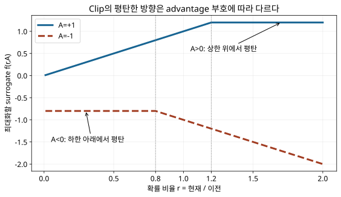

# 13. 추론 모델 — 좋은 풀이를 더 자주 만들도록 학습하기

[학습 안내](00_학습안내.md) · [다음: LLM 효율화](14_LLM효율화.md) · [원문 PDF 216~239쪽](../교안/app_sp_slides_20261013.pdf#page=216)

추론 모델은 문제를 풀기 위한 중간 계산과 검증을 수행하도록 학습하거나 사용하는 언어 모델이다. **풀이를 길게 쓰는 것만으로 정답이 보장되지는 않는다.** 여러 응답을 만들고, 평가 신호를 이용해 유리한 응답의 생성 확률을 높이는 과정이 핵심이다. 이 장에서는 응답 평가가 정책 업데이트로 이어지는 연결을 계산한다.

선행 지식은 다음 토큰의 조건부 확률, 로그확률, 경사하강법이다. 막히면 [학습 안내](00_학습안내.md)에서 10장 모델 학습과 12장 지시 미세튜닝으로 돌아간다. 처음에는 1~4절과 확인 문제를 읽고, GRPO 수식의 상세 구조는 5절에서 확인한다. 시험 중요도는 이 자료가 정하지 않는다.

| 학습 목표 | 확인 방법 |
| --- | --- |
| 결과 평가와 과정 평가를 구분한다 | 같은 답을 낸 두 풀이의 점수 차이를 설명 |
| 그룹 상대 advantage를 계산한다 | 보상 0, 1, 2의 평균·표준편차·정규화 |
| 확률 비율과 clip의 역할을 설명한다 | advantage 부호별 네 경우 계산 |
| 이전 정책과 참조 정책을 구별한다 | 각 정책이 쓰이는 수식의 위치 설명 |

## 1. 정답을 채점하는 일과 풀이를 채점하는 일

원문 217~220쪽의 문제는 `2x + 4 = 10`이다. 양변에서 4를 빼면 `2x=6`, 양변을 2로 나누면 `x=3`이다. 정답을 원래 식에 넣으면 `2×3+4=10`으로 검증된다. 이 예시는 다음 세 행동을 구분하게 한다.

| 행동 | 모델 또는 평가자의 일 | 가중치 변경 |
| --- | --- | --- |
| 풀이 생성 | 현재 정책으로 토큰을 이어 응답 작성 | 없음 |
| 여러 풀이 평가·선택 | 답 또는 단계가 맞는지 평가하고 후보 선택 | 선택만으로는 없음 |
| 강화학습 | 평가를 학습 신호로 삼아 정책 파라미터 갱신 | 있음 |

**결과 보상(outcome reward)**은 최종 답의 정확성처럼 응답 전체를 평가한다. **과정 보상(process reward)**은 풀이의 중간 단계도 평가한다. 잘못된 과정을 거쳐 우연히 맞은 답은 결과 평가만으로 발견하기 어렵다. 반대로 올바른 우회 풀이에 불필요한 감점을 주면 유용한 전략을 잃을 수 있다. 원문 220쪽의 ‘So-so’는 강의용 평가 예이며, `4x+8=20 → x=3` 자체는 수학적으로 올바르다. 효율성과 정확성을 별도 기준으로 채점해야 한다.

중간 풀이를 출력하도록 프롬프트를 쓰는 것, 추론 시 후보 수·계산량을 늘리는 것, 추론용 학습을 하는 것은 서로 결합 가능한 서로 다른 조작이다. 출력된 설명을 내부 계산의 완전한 기록으로 단정하지 않는다.

## 2. 그룹 상대 평가: 점수의 절댓값보다 같은 문제 안의 차이

정책(policy) `πθ`는 문맥이 주어졌을 때 다음 토큰에 확률을 부여하는 모델이다. GRPO는 **같은 문제에 대한 응답 그룹**을 이용해 상대적인 학습 신호를 만든다. 별도 가치 모델로 기준 점수를 추정하는 대신 그룹의 보상을 기준으로 삼는 것이 기본 아이디어다. 결과 보상과 과정 보상을 사용하는 변형이 있으며, 과정별 평가가 모든 GRPO의 필수 조건은 아니다. [DeepSeekMath §4.1](https://arxiv.org/html/2402.03300v3#S4.SS1)

교육용으로 응답 3개의 보상을 `s=[0,1,2]`라고 하자. 표준편차는 여기서 **모집단 기준**으로 정의한다.

```text
평균 μ = (0+1+2)/3 = 1
분산 σ² = ((0-1)²+(1-1)²+(2-1)²)/3 = 2/3
표준편차 σ = √(2/3) ≈ 0.816497
정규화 advantage Âi = (si-μ)/σ
결과: [-1.224745, 0, +1.224745]
```

Advantage는 ‘현재 그룹의 기준에 비해 얼마나 유리한가’를 나타내는 신호다. 높은 점수의 응답은 확률을 높이고 낮은 응답은 낮추는 방향을 제시한다. 모든 보상에 10을 더해도 평균도 10 커지므로 위 정규화 결과는 같다. 반면 모든 응답의 보상이 같으면 표준편차가 0이 된다. 실제 구현에서는 작은 상수 등을 사용해 0 나눗셈을 막고, 구분할 보상 차이가 없는 그룹의 학습 효과를 확인해야 한다.

> **원문 해석 주의:** 223쪽 수식의 `|oi|`는 응답의 토큰 수다. 자연어로 번호를 붙인 ‘Step 1, Step 2’와 토큰 한 개는 다르다. 원문의 단계 그림은 평가 직관을 위한 단순화다. 과정 보상을 사용할 때도 단계별 보상을 토큰별 advantage로 연결하는 규칙이 필요하다.

## 3. 좋은 응답의 확률을 얼마나 바꾸었는가

학습 데이터를 생성한 정책을 `πold`, 지금 갱신하는 정책을 `πθ`라고 하자. **같은 prompt와 같은 응답 prefix 아래 같은 토큰**의 확률을 비교한다.

`r = πθ(토큰 | 문맥) / πold(토큰 | 문맥)`

분자는 갱신 중이고 분모는 해당 업데이트 구간에 고정된다. `r>1`이면 그 토큰의 확률이 이전보다 커졌다는 뜻이다. 전체 응답 확률은 조건부 토큰 확률의 곱이지만, 여기서 clip하는 기본 단위는 토큰 확률 비율이다. 서로 다른 새 응답과 옛 응답의 확률을 아무 문맥에서 나누면 이 비율이 아니다.

원문 230~231쪽의 교육용 범주 예시에서 답 ‘3’의 확률이 `0.3→0.7`이면 비율은 `0.7/0.3≈2.3333`이다. advantage를 `+1.5`라고 따로 가정하면 `rÂ=3.5`다. 답 ‘2’가 `0.6→0.2`, advantage `-1`이면 `rÂ≈-0.3333`이다. 이 수치는 토큰별 학습 흐름을 단순화한 예시이며 실제 정규화 그룹의 값이라고 주장하지 않는다.

## 4. Clip: 좋은 방향의 과도한 변경에 추가 이익을 주지 않기

최대화할 clipped surrogate를 다음과 같이 정의한다. `ε=0.2`, advantage는 미분 시 고정된 신호로 본다.

`f(r,A) = min(rA, clip(r,0.8,1.2) A)`

중요한 것은 **비율끼리 min을 취한 다음 A를 곱하는 식이 아니라, 각각 A를 곱한 두 항의 min**이라는 점이다. A가 음수이면 대소관계가 바뀐다.

| A | r | rA | clip(r)A | f(r,A) | r에 대한 국소 기울기 |
| --- | --- | --- | --- | --- | --- |
| +1 | 1.5 | 1.5 | 1.2 | 1.2 | 0: 좋은 토큰을 이미 충분히 증가 |
| +1 | 0.5 | 0.5 | 0.8 | 0.5 | +1: 좋은 토큰의 감소는 되돌릴 신호 유지 |
| -1 | 1.5 | -1.5 | -1.2 | -1.5 | -1: 나쁜 토큰의 증가는 되돌릴 신호 유지 |
| -1 | 0.5 | -0.5 | -0.8 | -0.8 | 0: 나쁜 토큰을 이미 충분히 감소 |

**정정 — 원문 236쪽의 ‘범위를 벗어나면 기울기 0’은 조건을 보충해야 한다.** A>0에서는 r>1+ε일 때, A<0에서는 r<1-ε일 때 이 surrogate 항이 평탄하다. 반대쪽 범위 밖에서는 기울기가 유지된다. 경계에서의 미분 처리, 다른 토큰의 항, KL 항, 공유 파라미터를 통한 영향까지 모두 0이라는 뜻도 아니다. 위 식을 각 경우에 대입하면 직접 확인할 수 있다. 원문 237쪽은 A>0·상한 초과의 제한된 경우를 설명한다.

아래 그림에서는 가로축 r을 증가시키며 두 선의 평탄한 쪽이 반대임을 확인한다.



[SVG가 표시되지 않으면 PNG로 보기](assets/13_clip.png)

평탄해지는 쪽은 ‘보상이 좋은 방향으로 이미 충분히 이동한 쪽’이다. [직접 r·A·ε를 바꾸는 계산기](assets/13_clip_탐색.html)에서는 모델 실행 없이 위 수식만 계산한다. 기본 예시는 본문의 표에 있으므로 계산기를 열지 않아도 학습할 수 있다.

## 5. 전체 목적 함수: 보상 신호와 정책 유지 제약

원문 221쪽을 읽을 때는 다음 순서로 본다. 같은 문제에 `G`개의 응답 `oi`를 생성한다. 각 응답의 토큰 `t=1…|oi|`마다 clipped surrogate를 계산하고 토큰 평균을 낸 뒤 응답 평균을 낸다. 여기에 참조 정책에서 멀어지는 비용을 뺀다.

```text
J ≈ 응답별 평균[ 토큰별 평균[ f(ri,t, Âi,t) - β KL항i,t ] ]
최대화 J    ↔    구현에서는 loss = -J 를 최소화
```

| 기호 | 의미 | 혼동하지 않을 대상 |
| --- | --- | --- |
| πold | 응답을 샘플링한 고정 스냅샷 | 현재 갱신 중인 πθ |
| πref | KL 제약의 기준 모델 | πold와 같아야 하는 것은 아님 |
| G | 같은 질문의 응답 수 | 배치 전체 질문 수 |
| t | 응답 토큰 위치 | 자연어 풀이 단계 번호 |
| β | KL 비용의 강도 | clip 폭 ε |

KL은 분포가 기준에서 얼마나 달라졌는지 재는 방향성 있는 양이다. 여기서 비율의 분모를 제공하는 old와 KL 기준 ref의 역할을 구별해야 한다. β를 무조건 키우면 보상 개선도 제약할 수 있다. 개별 토큰의 한 확률 차이만으로 전체 KL을 계산할 수는 없다.

원문 239쪽의 분포를 자연로그로 직접 계산해 보자. `P=(0.1,0.1,0.4,0.4)`, `Q1=(0.1,0.1,0.5,0.3)`, `Q2=(0.35,0.05,0.55,0.05)`이고 **방향을 DKL(P||Q)**로 정한다.

```text
DKL(P||Q1) = 0.4 ln(0.4/0.5)+0.4 ln(0.4/0.3) ≈ 0.02582
DKL(P||Q2) = 0.1 ln(0.1/0.35)+0.1 ln(0.1/0.05)
            +0.4 ln(0.4/0.55)+0.4 ln(0.4/0.05) ≈ 0.64843
```

이 방향에서 Q1이 P에 더 가깝다. 실제 학습의 KL 방향·추정식은 사용 목적 함수에 맞춰야 한다. 보상 설계가 잘못되면 모델이 채점 규칙만 만족하는 응답을 만들 수 있으므로, 점수가 높다는 사실과 문제 해결 능력이 향상되었다는 사실을 별도로 평가한다.

## 6. 스스로 확인하기

1. 보상 `[0,1,2]`에 각각 10을 더하면 정규화 advantage는 어떻게 되는가?
2. A=-2, r=1.4, ε=0.2에서 f와 r에 대한 기울기를 구하라. ‘범위 밖이면 항상 0’의 반례인가?
3. 결과 보상만으로 항상 올바른 중간 풀이를 보장할 수 있는가?
4. clip 비율의 분모를 참조 정책 πref로 바꾸어도 같은 알고리즘인가?

<details><summary>해설과 돌아갈 위치</summary>

1. 같다. 중심화하면 추가한 10이 사라진다. 막히면 2절의 평균 계산으로 돌아간다.
2. rA=-2.8, clip(r)A=-2.4이므로 f=-2.8, 기울기는 -2다. 음의 advantage에서 상한 초과는 평탄하지 않다. 4절 표를 본다.
3. 아니다. 우연히 맞은 답, 평가 오류, 보상 해킹이 가능하다. 1절의 채점 기준을 본다.
4. 일반적으로 다르다. 샘플링 정책 대비 비율과 참조 모델 대비 제약은 역할이 다르다. 3·5절로 돌아간다.

</details>

복습할 때는 ‘응답 생성 → 보상 → 그룹 상대 advantage → 토큰 비율 → clip과 KL → 파라미터 갱신’을 자료 없이 설명한다. 다음 장에서는 모델이 학습한 정책을 실행할 때 시간과 메모리를 줄이는 방법을 다룬다.

원문의 시각적 점수와 세부 평균값은 강의용 예시이며 실제 학습 실행 결과로 재사용하지 않았다. 이 장의 수치 예시는 재현 가능한 교육용 계산이다. 원 논문 근거 확인일: 2026-11-09.
