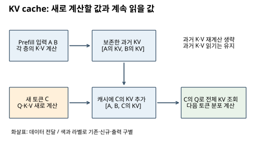
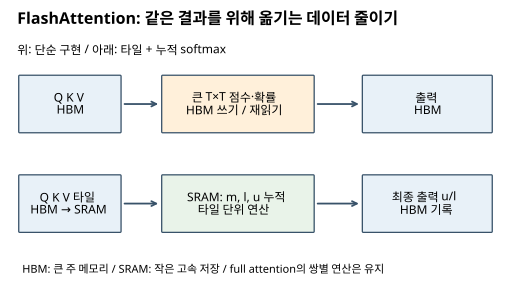

# 14. LLM 효율화 — 무엇을 다시 계산하고 무엇을 저장할까

[학습 안내](00_학습안내.md) · [이전: 추론 모델](13_추론모델.md) · [원문 PDF 240~280쪽](../교안/app_sp_slides_20261013.pdf#page=240)

LLM의 속도는 연산 횟수뿐 아니라 **저장한 데이터를 GPU 안팎에서 옮기는 비용**에 좌우된다. 이 장은 같은 모델을 더 효율적으로 실행하는 방법과, 저장·계산 구조 자체를 바꾸는 방법을 나누어 설명한다. 효율화 기법의 이름을 외우기보다 ‘어떤 중복이나 병목을 줄였는가’를 답할 수 있어야 한다.

선행 지식은 Q·K·V, causal mask, head, GPT의 `[B,T,C]` 흐름이다. 막히면 [학습 안내](00_학습안내.md)에서 Attention과 GPT 입출력으로 돌아간다. 처음에는 1~3절과 5절, 복습은 마지막 선택 표와 문제를 사용한다. 4·6절은 구조 변형, 7절은 양자화 보충이다. 교안의 제품·모델 사례는 해당 시점의 사례이며 현재 지원 기능 목록을 제공하는 문서는 아니다.

| 배울 수 있는 일 | 확인할 결과 |
| --- | --- |
| KV cache가 줄이는 계산과 늘리는 저장을 구별 | 캐시 바이트 직접 계산 |
| GQA·MLA·window·FlashAttention의 축을 구별 | 서로 결합 가능한 방법 설명 |
| online softmax의 누적 상태를 추적 | 두 토큰의 중간값 검산 |
| recurrent state와 full attention 차이 설명 | 길이 증가 시 저장 대상 예측 |
| 양자화의 이득과 오차를 구별 | 메타데이터 포함 메모리와 오차 조건 설명 |

## 1. KV cache: 과거 토큰의 K와 V는 다시 만들지 않는다

**Prefill**은 입력 prompt의 토큰을 한꺼번에 처리하는 단계다. **Decode**는 이전 출력까지 문맥에 넣고 다음 토큰을 한 개씩 생성하는 단계다. causal 모델에서는 미래에 새 토큰을 붙여도 과거 위치가 볼 수 있는 문맥은 변하지 않는다. 따라서 각 층의 과거 K·V를 저장해 다음 decode에서 재사용할 수 있다.

캐시가 없으면 `A B`로 다음 토큰 C를 만들고, 다시 `A B C`를 모델에 넣으며 A·B의 표현도 계산한다. 캐시가 있으면 A·B의 K·V를 보존하고 C의 Q·K·V를 새로 만든다. C의 Q는 저장된 A·B와 새 C의 K 전체에 점수를 내고 V를 합친다. **과거를 읽는 attention까지 사라지는 것은 아니다.** 통상 Q는 과거 토큰의 값을 이후 query로 재사용할 필요가 없어 K·V처럼 모두 보존하지 않는다.

아래 그림을 왼쪽에서 오른쪽으로 읽으며 새로 만드는 값과 계속 보존하는 값을 구별한다.



[SVG가 표시되지 않으면 PNG로 보기](assets/14_kv.png)

캐시의 장점은 반복되는 과거 계산을 줄인다는 것이다. 대신 생성 길이에 따라 캐시가 커지고, 매 decode마다 이를 읽는 메모리 대역폭이 병목이 될 수 있다. prompt·모델 가중치·위치 처리 등 조건이 달라지면 기존 캐시를 무조건 재사용할 수 없다.

### 작은 메모리 계산

동일 길이 배치를 가정하고 `B=배치 수`, `L=층 수`, `T=저장 토큰 수`, `Hkv=KV head 수`, `dh=head 폭`, `s=원소당 바이트`라 하자.

`KV bytes = 2 × B × L × T × Hkv × dh × s`

2는 K와 V 두 개를 뜻한다. 예제는 `B=1,L=2,T=4,Hkv=4,dh=8,s=2`이다.

```text
한 토큰·한 층: 2×4×8 = 64개 원소
4토큰·2층: 64×4×2 = 512개 원소
2바이트 저장: 512×2 = 1,024 bytes
T=8로 두 배면 2,048 bytes
```

가중치·활성값·임시 버퍼·페이지 관리 메타데이터를 제외한 **교육용 KV 데이터만의 계산**이다. 실제 전체 GPU 메모리를 뜻하지 않는다. `MiB=2^20 bytes`, `MB=10^6 bytes`도 구별한다.

## 2. GQA: query는 여러 개, 저장할 K·V는 그룹별로

MHA는 query head마다 대응 K·V head를 둔다. **Grouped-query attention(GQA)**는 여러 query head가 하나의 K·V head를 공유한다. query head 수 Hq는 유지하면서 Hkv를 줄이는 구조다. Hkv=1인 끝점은 MQA라고 부른다. 단순 캐시 삭제 설정이 아니라 모델의 투영·학습 구조와 연결되므로 임의의 MHA 모델에서 K·V head를 버리면 같은 결과가 보장되지 않는다. [GQA 원 논문](https://arxiv.org/abs/2305.13245)

| 같은 Hq=4일 때 | Hkv | query와 KV 연결 | 위 예제의 캐시 |
| --- | --- | --- | --- |
| MHA | 4 | Q0→KV0, Q1→KV1, Q2→KV2, Q3→KV3 | 1,024 bytes |
| GQA | 2 | Q0·Q1→KV0, Q2·Q3→KV1 | 512 bytes |
| MQA | 1 | 모든 Q→KV0 | 256 bytes |

위 비율은 B·L·T·dh·dtype가 같다는 조건의 저장량이다. 품질이나 생성 속도가 정확히 같은 비율로 바뀐다는 뜻은 아니다. 그룹이 줄면 공유가 강해져 저장은 줄지만 표현 및 학습 조건을 평가해야 한다.

## 3. MLA: K·V의 공통 저차원 표현을 저장한다

**Multi-head latent attention(MLA)**은 K·V를 만드는 데 필요한 작은 공유 latent, 즉 압축된 중간 표현을 캐시에 둔다. 여러 query가 K·V를 공유하는 GQA와는 압축 방식이 다르다. 여기서는 원문 247~248쪽처럼 위치 성분을 생략한 선형 부분부터 설명한다.

행벡터 배치 X의 모양을 `[T,C]`, 공유 latent Z를 `[T,r]`라 하자. `Z=X Wdown`, `K=Z UK`, `V=Z UV`이다. UK는 `[r,dk]`, UV는 `[r,dv]`이다. 작은 r은 저장을 줄이지만 정보 병목이 될 수 있다.

```text
점수: Q Kᵀ = Q (Z UK)ᵀ = (Q UKᵀ) Zᵀ
출력: A V = A (Z UV) = (A Z) UV
```

Q가 `[1,dk]`이면 `Q UKᵀ`는 `[1,r]`, Zᵀ는 `[r,T]`이므로 점수는 `[1,T]`이다. 전체 K를 복원하지 않고 작은 latent 공간에서 점수를 구할 수 있다. V도 먼저 latent 가중합을 만든 다음 UV를 적용할 수 있다. 출력 투영과 UV를 결합하는 것도 선형 연산의 결합법칙을 활용한다.

교육용 숫자로 `Z=[[1,2],[3,4]]`, `UK=[[1],[2]]`, `Q=[[2]]`라 하자. 직접 K는 `[[5],[11]]`, 점수는 `[10,22]`다. 재배열하면 `Q UKᵀ=[2,4]`, `[2,4] Zᵀ=[10,22]`로 같다. 이는 **선형 부분이 같은 계산임**을 보일 뿐, 실제 모든 연산 비용이 항상 줄어든다는 증명은 아니다.

> **원문 조건 보충:** 실제 DeepSeek MLA에는 RoPE를 위한 분리된 위치 key 성분도 있어 ‘latent만 저장한다’는 도식은 전체 캐시를 단순화했다. latent 폭에 추가 위치 성분 등을 포함해 비교해야 한다. 원문 249쪽의 ‘4 MB/500 KB/70 KB’, ‘57배’, ‘6배’는 비교 모델 구성·층수·정밀도·측정 조건이 충분히 적혀 있지 않아 일반 성능 수치로 사용하지 않는다. 구조와 상세 조건은 [DeepSeek-V3 §2.1.1](https://arxiv.org/html/2412.19437v2#S2.SS1.SSS1)을 참고한다.

## 4. 문맥을 제한하거나 상태로 압축하는 방법

### Sliding window attention

전체 과거 대신 현재 위치에서 정해진 범위만 본다. window 크기 W를 **현재 위치를 포함한 참조 토큰 수**라고 정의하면, 위치 t가 보는 위치는 `max(0,t-W+1)…t`이다. T=8, t=7, W=3이면 5·6·7만 본다. 로컬 캐시를 오래된 위치부터 제거하는 구현에서는 해당 층의 저장 길이를 W 근처로 제한할 수 있다.

장점은 참조 범위와 비용을 제한한다는 것이고, 한계는 창 밖 토큰을 그 층에서 직접 볼 수 없다는 것이다. 여러 층이나 전역 attention과의 혼합으로 정보가 전달될 수 있지만 정확한 장거리 검색이 자동 보장되지는 않는다. window가 다른 기법의 대체재인지는 목적을 따져야 한다. GQA는 head 공유, window는 참조 위치 제한이므로 함께 쓸 수 있다.

### Gated DeltaNet: 토큰 목록 대신 갱신되는 기억 상태

Full attention은 과거 K·V 목록에서 직접 정보를 읽는다. Gated DeltaNet 계열은 크기가 정해진 행렬 상태 S를 매 토큰 갱신해 과거 정보를 압축한다. 다음은 열벡터 k·v를 사용하는 **핵심 갱신식의 교육용 표현**이다.

```text
기존 기억 감쇠: Sbar = α Sprev
현재 key로 예측: vhat = Sbar k
오차: e = v - vhat
기억 수정: Snew = Sbar + β e kᵀ
읽기: o = Snew q
```

α는 과거 기억을 얼마나 남길지, β는 현재 key에 대응하는 새 정보를 얼마나 반영할지 조절한다. 출력 gate는 읽어 낸 정보 중 무엇을 다음 층에 전달할지 조절한다. k가 단위 길이라면 β=1일 때 해당 key 방향의 예측 오차를 한 번에 수정하는 직관을 얻을 수 있다. 실제 블록의 정규화·convolution·출력 gate 등은 위 핵심식 밖에 있다. [Gated Delta Networks §3](https://arxiv.org/html/2412.06464v1#S3)

스칼라 장난감 예로 Sprev=2, α=0.5, k=1, v=3, β=0.25라 하자. Sbar=1, vhat=1, e=2이므로 Snew=1+0.25×2=1.5다. β=0이면 새 정보가 반영되지 않고 감쇠된 1만 남는다. 이는 실제 모델의 품질 측정이 아니라 gate 역할을 보이는 축소 예시다.

상태 크기를 고정하면 길이가 늘어도 해당 recurrent 상태는 선형 캐시처럼 계속 커지지 않는다. 대신 과거를 개별 토큰 형태로 모두 보존하지 않아 검색 능력에 손실이 생길 수 있다. full attention을 일부 층에 섞는 hybrid는 압축과 직접 참조를 조합한다. 전체 모델에는 full-attention 층의 캐시가 남을 수 있다.

> **원문 정정:** 255쪽의 ‘앞뒤 1~2개 토큰을 섞는다’는 표현을 causal 생성에서 미래 토큰 참조로 해석하면 안 된다. causal short convolution은 현재와 과거의 허용된 위치만 사용한다. 254쪽의 Qwen·Kimi 제품 사례는 이 장에서 현재 구현을 확인한 목록으로 사용하지 않는다.

## 5. FlashAttention: 결과의 수학은 유지하고 데이터 이동 줄이기

HBM은 GPU의 큰 주 메모리, SRAM은 칩 안의 작은 고속 저장 공간이다. 일반적인 attention을 단순 구현하면 `[T,T]` 점수와 확률을 HBM에 기록했다가 다시 읽는 일이 많다. **FlashAttention은 Q·K·V를 작은 타일로 나누고 softmax의 누적 상태를 유지해 큰 중간 행렬의 저장·재읽기를 줄인다.** 기본 full attention의 토큰 쌍 계산 자체는 남는다. 따라서 FlashAttention을 선형 attention이라고 부르면 안 된다. [FlashAttention 원 논문](https://arxiv.org/abs/2205.14135)

아래 그림의 위 경로는 큰 중간 행렬을 HBM에 쓰는 단순 구현, 아래 경로는 타일과 누적 상태로 출력까지 이어 가는 방식이다. 화살표는 데이터 이동을 뜻한다.



[SVG가 표시되지 않으면 PNG로 보기](assets/14_flash.png)

두 경로의 목표는 같은 `softmax(QKᵀ/√dh)V`다. 부동소수점 연산 순서에 따른 작은 수치 차이는 있을 수 있다. 원문 261쪽의 ‘2~3배’는 특정 조건의 성능 주장으로 읽고 GPU·길이·dtype·구현을 고정하지 않은 보편 배수로 사용하지 않는다. 265쪽의 메모리 접근 ‘32번’도 작은 도식의 접근 단위에 의존한다.

### Online softmax를 직접 따라가기

한 query에 대한 점수를 순서대로 `xj`, value를 `vj`라 하자. 누적 최댓값 m, 정규화 분모 l, 가중합 분자 u를 유지한다.

```text
초기: m=-∞, l=0, u=0
새 점수 x와 value v 도착:
 mnew = max(m,x)
 lnew = exp(m-mnew) l + exp(x-mnew)
 unew = exp(m-mnew) u + exp(x-mnew) v
최종: o = u/l
```

점수 `[0,ln 3]`, value `[2,6]`를 차례로 넣자. 점수에는 이미 scale·mask가 적용되어 있다고 가정한다.

| 단계 | m | l | u | u/l |
| --- | --- | --- | --- | --- |
| 첫 토큰 x=0,v=2 | 0 | 1 | 2 | 2 |
| 둘째 x=ln3,v=6 | ln3 | (1/3)×1+1=4/3 | (1/3)×2+6=20/3 | 5 |

한 번에 계산한 softmax는 `[1/4,3/4]`이고 `1/4×2+3/4×6=5`로 같다. 두 번째 단계에서 최댓값 기준이 바뀌어 이전 분모·분자에 1/3을 곱하는 과정이 핵심이다. 실제 커널은 토큰 하나씩이 아니라 타일 단위로 이 원리를 확장한다. 모든 위치가 mask되어 유효 key가 없는 경우에는 `-∞-(-∞)` 등의 처리가 필요하므로 위 장난감 루프를 그대로 production 코드로 쓰지 않는다.

## 6. 레이어 설계와 multi-token prediction

원문 252쪽의 Pre-Norm은 정규화를 하위 모듈 **앞**에 두는 구조다. 예를 들어 `y=x+Attention(Norm(x))`이다. Post-Norm은 `y=Norm(x+Attention(x))`다. 위치는 학습 안정성·최종 정규화·초기화와 연결되므로 두 식이 같은 함수라고 볼 수 없다. 원문 253쪽의 ‘넓으면 안정적, 깊으면 유연한 사고’는 설계 직관이며 고정 예산에서의 일반 성능 법칙으로 사용하지 않는다. 폭·깊이 비교에는 파라미터 수, 학습량, 데이터, 실행 환경을 함께 고정·기록해야 한다.

**Multi-token prediction(MTP)**은 한 위치의 표현으로 다음 토큰만이 아니라 여러 미래 토큰을 예측하는 보조 학습 목표를 둔다. 원문 260쪽의 독립 head 예에서 입력 prefix가 A B이면 head1의 정답은 C, head2는 D, head3은 E다. 여러 head의 CE를 결합해 공유 본체가 여러 미래 위치에 유용한 특징을 학습하게 한다. [독립 head MTP 원 논문](https://arxiv.org/abs/2404.19737)

교안의 단순형처럼 추론 시 보조 head를 제거하고 일반 next-token 생성만 할 수도 있다. 다만 이것이 유일한 방식은 아니다. 보조 예측을 draft로 사용하는 speculative decoding 같은 설계도 있다. 여러 토큰의 후보를 냈다고 조건부 의존성을 무시하고 검증 없이 모두 확정해도 된다는 뜻은 아니다. 보조 head 추가가 학습 비용이나 품질을 항상 개선한다는 보장도 없다.

## 7. TurboQuant: 저장 비트 수와 내적 오차를 함께 관리

가중치 양자화와 KV cache 양자화는 저장 대상이 다르다. KV는 입력과 생성 과정에서 계속 생기는 활성값이므로 온라인 압축의 비용과 품질을 따져야 한다. 원문 274~280쪽은 TurboQuant를 회전·양자화·잔차 보정 흐름으로 소개한다.

```text
벡터 x → 길이와 방향 분리 → 공유 무작위 직교 회전
       → 좌표별 저비트 코드 저장 → 필요 시 근사 내적/복원
                               ↘ 잔차에 대한 QJL 보정 정보
```

직교 회전 R은 `RᵀR=I`여서 **회전 자체는 길이와 내적을 보존**한다. 큰 성분이 특정 좌표에 몰려 있던 벡터를 여러 좌표로 분산시키면 정해진 코드북을 활용하기 쉬워진다. 단위 방향의 회전된 좌표는 유한 차원에서는 구면 유래 분포를 따르며, 고차원에서 적절히 스케일한 좌표가 정규분포에 가까워진다는 직관을 쓴다. ‘모든 벡터가 정확한 정규분포로 변한다’는 뜻은 아니다.

예를 들어 원소당 3bit 코드만 세면 8구간 중 하나를 저장하고, 8차원 벡터는 24bit=3bytes다. FP16의 같은 벡터는 16bytes다. 하지만 norm, 코드북 또는 공유 설정, 정렬·packing, 잔차 보정 정보가 추가된다. **실제 압축률을 16/3으로 바로 확정할 수 없다.** 0벡터는 방향 정규화를 바로 적용할 수 없으므로 별도 처리가 필요하다.

TurboQuant 원 논문은 MSE를 줄이는 양자화와 내적 오차를 다루는 구성을 구별하며, 후자에서 잔차에 대한 1bit QJL을 활용한다. QJL의 부호만 보고 일반적인 원래 벡터를 정확히 복원할 수는 없다. 필요한 scale·확률적 추정식 등 전체 정의가 있어야 한다. [TurboQuant 원 논문 §2~3](https://arxiv.org/html/2504.19874v1)

> **원문 보충·미확인:** 279쪽 코드의 `QJL_decode`는 정의되지 않은 설명용 의사 코드다. 이를 실행 가능한 복원 함수로 제시하지 않는다. ‘QJL은 양자화가 아님’은 저비트 부호 sketch로 내적 오차를 보정한다는 역할 설명으로 제한하며, 논문은 QJL을 1bit inner-product quantization으로 설명한다. 원문 280쪽의 ‘softmax 때문에 QJL이 품질을 떨어뜨린다’는 결과는 대상 구현·데이터·설정이 없어 보편 결론으로 확인되지 않았다. 이 자료는 해당 성능 주장을 재현했다고 표시하지 않는다.

정밀도가 낮아지면 캐시가 작아져 같은 장치에서 더 긴 문맥이나 큰 배치를 담을 가능성이 있다. 곧바로 전체 시스템 메모리 수요가 줄었다거나 모든 생성이 빨라졌다고 결론내릴 수는 없다. 역양자화·packing 비용, 커널 지원, 실제 병목과 품질을 함께 측정해야 한다.

## 8. 같은 축에서 비교하고 조합하기

| 방법 | 줄이는 대상 | 그대로 남거나 바뀌는 조건 | 선택 상황 |
| --- | --- | --- | --- |
| KV cache | 과거 토큰 표현 재계산 | 과거 KV 저장·조회 증가 | causal decode 중복 계산이 큼 |
| GQA | KV head 수 | 모델 구조·품질 검토 필요 | 지원 모델에서 KV 저장·대역폭 부담 |
| MLA | KV 표현의 저장 폭 | latent·위치 성분·재배열 조건 | MLA로 설계된 모델 실행 |
| Sliding window | 직접 참조 위치 수 | 창 밖 직접 접근 제한 | 근거리 문맥으로 충분하거나 hybrid |
| Gated DeltaNet | 과거 토큰 목록 저장 | 고정 상태로 압축, 검색 손실 가능 | recurrent/hybrid 모델 설계 |
| FlashAttention | 큰 중간 행렬의 HBM 이동 | full attention의 쌍별 계산 유지 | 지원 환경의 full attention 병목 |
| MTP | 학습 신호·예측 전략 개선 시도 | 보조 목표·검증 비용 필요 | 학습 설계 또는 draft 생성 |
| KV 양자화 | 캐시 원소당 저장 비트 | 근사 오차·변환 비용 | 캐시 메모리/대역폭 병목 |

GQA와 FlashAttention, KV cache와 양자화는 축이 달라 결합할 수 있다. 다만 실제 구현이 조합을 지원하는지는 별도 확인 사항이다. 어떤 방법이든 속도는 prefill latency, token당 decode latency, throughput, peak memory를 구분하고 같은 모델·정밀도·입력/출력 길이·배치·장치로 비교한다. 이 문서의 숫자는 실측 성능 데이터가 아니다.

## 9. 스스로 확인하기

1. 1절 설정에서 B만 3으로 바꾸면 MHA와 Hkv=2인 GQA 캐시는 각각 몇 bytes인가?
2. KV cache가 있으면 새 토큰은 과거 K를 읽지 않아도 되는가?
3. FlashAttention의 softmax 상태에서 이전 누적값을 재스케일하지 않으면 무엇이 틀리는가?
4. window W=3의 로컬 attention과 GQA를 함께 쓸 수 있는 이유는?
5. Gated DeltaNet의 교육용 예에서 β=1이면 Snew는 얼마인가? 과거 토큰 전부가 그대로 보존되는가?
6. 3bit 양자화라는 말만으로 전체 GPU 메모리가 FP16 대비 3/16로 줄었다고 말할 수 있는가?

<details><summary>해설과 돌아갈 위치</summary>

1. B에 비례하므로 3,072bytes와 1,536bytes다. 1·2절의 저장량 식을 다시 쓴다.
2. 아니다. 새 Q와 과거 K의 점수, 과거 V 가중합이 필요하다. 1절 흐름도로 돌아간다.
3. 최댓값 기준이 달라져 이전 항과 새 항의 기준이 어긋난다. 5절에서 두 번째 단계의 1/3을 확인한다.
4. window는 위치 범위, GQA는 head 공유를 바꾼다. 2·4절을 비교한다.
5. Snew=1+1×(3-1)=3이다. 상태는 압축된 기억이므로 모든 토큰을 개별 보존하는 것은 아니다. 4절로 돌아간다.
6. 아니다. norm·보정·packing 등의 비용과 가중치·활성값 등 다른 메모리가 남는다. 7절을 본다.

</details>

마지막으로 ‘계산을 다시 하지 않기’, ‘저장 형태 줄이기’, ‘참조 범위 바꾸기’, ‘동일 계산의 이동 줄이기’에 각 기법을 연결한다. 원 논문 확인일은 2026-11-09이며 실제 GPU 성능 실험과 독자 이해도 평가는 수행하지 않았다.
