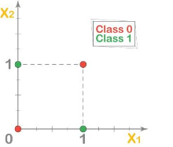
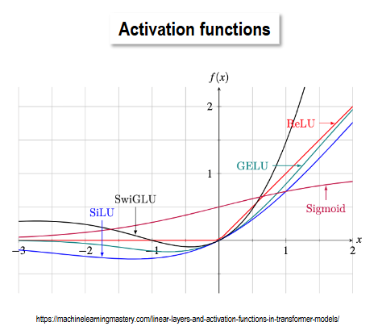
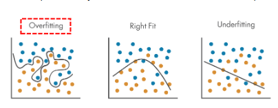
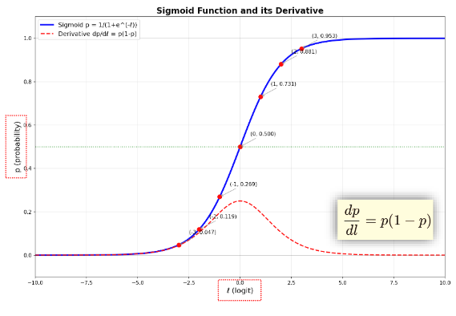
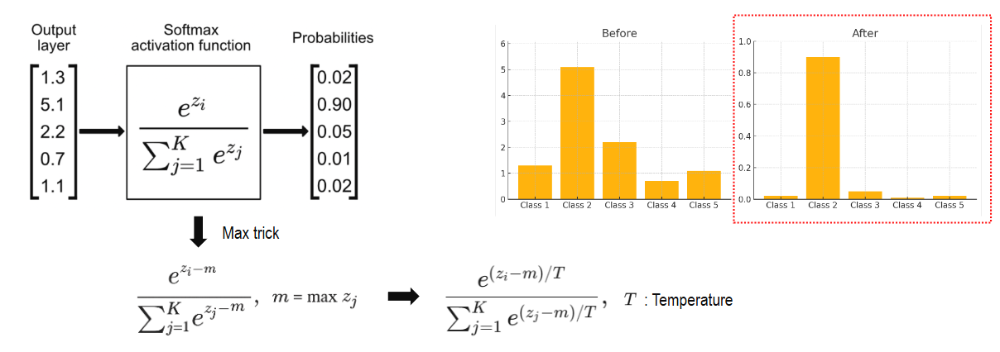

# DNN: 이미지 학습을 위한 신경망의 기초

컴퓨터 비전 모델은 이미지를 숫자로 받아 특징을 학습하고, 그 특징을 바탕으로 물체의 종류나 위치를 예측합니다. 이 과정을 이해하려면 데이터와 정답을 어떻게 준비하는지, 이미지가 어떤 수치로 표현되는지부터 살펴볼 필요가 있습니다. 이후 예측을 평가하는 확률 개념과 신경망 구조를 차례로 연결하겠습니다.

**목차**

- [1. Intro — 비전과 학습의 기초](#1-intro--비전과-학습의-기초)
  - [Vision History](#vision-history)
  - [Vision Concept](#vision-concept)
  - [Background Knowledge — 이미지의 수치 표현](#background-knowledge--이미지의-수치-표현)
  - [Image Processing — 촬영과 보정](#image-processing--촬영과-보정)
  - [Vector Norm — 수치의 크기와 거리](#vector-norm--수치의-크기와-거리)
- [2. 확률과 통계 — 예측의 차이 측정](#2-확률과-통계--예측의-차이-측정)
  - [Entropy — 엔트로피](#entropy--엔트로피)
  - [Cross Entropy — 교차 엔트로피](#cross-entropy--교차-엔트로피)
  - [KL Divergence — KL 발산](#kl-divergence--kl-발산)
- [3. DNN — 신경망 구조와 출력](#3-dnn--신경망-구조와-출력)
  - [Perceptron — 퍼셉트론](#perceptron--퍼셉트론)
  - [MLP (Multi-Layer Perceptron) — 다층 퍼셉트론](#mlp-multi-layer-perceptron--다층-퍼셉트론)
  - [Sigmoid](#sigmoid)
  - [Softmax — 다중 클래스 분류](#softmax--다중-클래스-분류)
- [4. Summary](#4-summary)
  - [Perceptron, MLP, DNN의 차이](#perceptron-mlp-dnn의-차이)
  - [Regression(회귀)과 Classification(분류) 비교](#regression회귀과-classification분류-비교)

---

## 1. Intro — 비전과 학습의 기초

### Vision History

컴퓨터 비전에서는 사람이 특징을 설계하는 방법에서, 모델이 입력부터 최종 예측까지 특징을 함께 학습하는 **End-to-end 학습**으로 접근 방식이 확장되었습니다. 이후 Transformer 기반 비전 모델, 이미지와 언어를 함께 다루는 Vision-language 모델, 이미지를 생성하거나 사용자와 상호작용하는 모델로 연구 범위가 넓어졌습니다.

이러한 모델들은 구조와 목적이 다르지만 데이터에서 유용한 표현을 학습한다는 공통점이 있습니다. 먼저 학습에 정답을 어떻게 활용하는지에 따라 접근 방법을 구분해 보겠습니다.

### Vision Concept

#### Supervised Learning — 지도학습

지도학습은 **입력 데이터와 그에 대응하는 정답 라벨**을 함께 제공하는 방법입니다. 모델은 예측과 정답의 차이를 줄이면서 입력과 출력의 관계를 학습합니다.

대표적인 작업은 분류(Classification)와 회귀(Regression)입니다. 분류는 사진 속 동물이 강아지인지 고양이인지처럼 종류를 예측하고, 회귀는 물체를 감싸는 사각형의 좌표처럼 수치를 예측합니다. 물체 검출에서는 이 두 작업을 결합해 무엇이 어디에 있는지 판단합니다.

#### Semi-supervised Learning — 준지도학습

준지도학습은 **라벨이 있는 데이터와 라벨이 없는 데이터를 함께 활용**합니다. 모든 이미지에 사람이 정답을 붙이기 어려울 때, 일부 라벨로 학습한 모델을 활용해 라벨이 없는 데이터에서도 학습 신호를 얻습니다.

예를 들어 모델의 예측을 임시 정답인 의사 라벨(Pseudo-label)로 사용하거나, 같은 이미지를 조금 변형해도 일관된 예측을 하도록 학습할 수 있습니다. 단순히 데이터별로 지도학습과 라벨링을 나누는 것이 아니라, 두 종류의 데이터를 하나의 학습 과정에서 활용한다는 점이 핵심입니다.

#### Self-supervised Learning — 자기지도학습

자기지도학습은 **데이터 자체에서 학습 목표를 구성**합니다. 사람이 붙인 정답 라벨이 없어도 이미지의 가린 부분을 예측하거나, 같은 이미지의 서로 다른 변형을 연결하는 문제를 만들 수 있습니다.

이처럼 사전학습(Pretraining)에서 풀도록 구성한 문제를 Pretext task라고 합니다. 사전학습으로 얻은 표현은 이후 강아지와 고양이 분류 같은 Downstream task에 전이학습(Transfer learning)으로 활용할 수 있습니다. 따라서 사전학습에서 수동 라벨을 사용하지 않았더라도 후속 작업에서는 라벨을 사용할 수 있습니다.

### Background Knowledge — 이미지의 수치 표현

학습 방법을 정했다면 모델에 들어가는 이미지가 어떤 데이터인지 이해해야 합니다. 컬러 이미지는 일반적으로 빨강(R), 초록(G), 파랑(B) 채널의 값으로 표현합니다. 이 값을 밝기 성분으로 바꿀 때 사용하는 대표적인 근사식은 다음과 같습니다.

$$
Y' = 0.299R' + 0.587G' + 0.114B'
$$

여기서 가중치는 각 색 성분이 밝기에 기여하는 정도를 나타냅니다. 이 식은 흔히 쓰는 밝기 성분 변환의 한 예이며, 모든 색 공간에 동일하게 적용되는 공식은 아닙니다.

한편 **Bayer 방식 이미지 센서**는 일반적인 2×2 배열에 초록 2개, 빨강 1개, 파랑 1개의 색 필터를 배치합니다. 이는 센서의 색 샘플링 구조이며, 완성된 RGB 이미지의 픽셀 하나가 네 개의 픽셀로 구성된다는 뜻은 아닙니다. 측정하지 않은 색 성분은 주변 정보를 이용해 보간합니다. 밝기 변환식과 센서의 필터 배열은 서로 구분해서 이해해야 합니다. [Bayer 패턴 설명](https://support.pixelink.com/support/solutions/articles/3000122383-bayer-patterns)

### Image Processing — 촬영과 보정

이미지의 수치 표현은 촬영 조건에도 영향을 받습니다. 카메라는 선명도, 밝기, 색 균형을 조절하기 위해 다음과 같은 **3A 알고리즘**을 사용합니다.

- **Auto Focus(AF):** 초점을 조절합니다.
- **Auto Exposure(AE):** 노출을 조절해 적절한 밝기를 확보합니다.
- **Auto White Balance(AWB):** 조명의 영향을 보정해 흰색과 전체 색 균형을 조절합니다.

어두운 영역의 기준값을 다루는 **Black level 보정**도 이미지 처리에 포함됩니다. 원 메모의 “Black light subtraction”은 문맥상 Black level 보정을 가리키는 것으로 보입니다. 정확한 원 용어는 강의 자료와 대조할 필요가 있으며, 여기서는 검정 수준을 조절하는 처리로 이해하겠습니다. [Black level 설명](https://docs.baslerweb.com/black-level)

### Vector Norm — 수치의 크기와 거리

이렇게 얻은 이미지는 모델 안에서 벡터나 텐서로 처리됩니다. 벡터의 여러 성분을 하나의 크기로 요약하는 함수가 **노름(Norm)**이며, 그 결과는 스칼라입니다.

예를 들어 L2 노름은 벡터 성분의 제곱합에 제곱근을 취한 값입니다. 두 벡터의 차이에 노름을 적용하면 거리를 측정할 수 있으므로 특징 간 차이나 예측 오차를 수치로 표현할 때 활용할 수 있습니다.

## 2. 확률과 통계 — 예측의 차이 측정

거리로 수치 간 차이를 측정할 수 있다면, 분류 모델이 출력하는 확률분포의 차이는 어떻게 측정할 수 있을까요? 이를 이해하기 위해 엔트로피, 교차 엔트로피, KL 발산을 순서대로 살펴보겠습니다.

### Entropy — 엔트로피

엔트로피는 **확률분포의 불확실성**을 나타냅니다. 정보 부호화 관점에서는 사건을 표현하는 데 필요한 평균 정보량으로 해석할 수 있습니다. 자주 발생하는 사건에 짧은 부호를, 드물게 발생하는 사건에 긴 부호를 배정하면 평균 부호 길이를 줄일 수 있습니다.

로그의 밑을 2로 사용하면 단위는 비트입니다. 이때 엔트로피는 이상적인 부호화에서 평균 부호 길이의 이론적 기준이 됩니다.

### Cross Entropy — 교차 엔트로피

엔트로피가 실제 분포 자체의 불확실성을 나타낸다면, 교차 엔트로피는 **실제 분포의 데이터를 다른 예측 분포로 부호화할 때 필요한 평균 비용**을 나타냅니다. 따라서 교차 엔트로피 전체가 추가 비용인 것은 아닙니다.

분류에서는 정답 분포를 기준으로 모델의 예측 확률을 평가하는 손실 함수로 사용합니다. 정답이 하나의 클래스에만 해당하는 경우 모델이 정답 클래스에 높은 확률을 줄수록 교차 엔트로피 손실은 작아집니다.

### KL Divergence — KL 발산

교차 엔트로피에서 실제 분포의 엔트로피를 뺀 값이 **KL 발산**입니다. 실제 분포를 $p$, 예측 분포를 $q$라고 하면 다음 관계가 성립합니다.

$$
H(p,q) = H(p) + D_{\mathrm{KL}}(p\Vert q)
$$

즉, KL 발산은 분포 $p$ 대신 $q$를 사용할 때 발생하는 추가 비용으로 해석할 수 있습니다. 비교 대상은 엔트로피와 교차 엔트로피라는 두 분포가 아니라 **실제 분포와 예측 분포**입니다. 또한 두 분포의 순서를 바꾸면 일반적으로 값이 달라지므로 보통의 대칭적인 거리와는 다릅니다.

이제 예측의 오차를 측정하는 기준을 살펴보았으므로, 그 예측을 만들어 내는 신경망 구조로 넘어가겠습니다.

## 3. DNN — 신경망 구조와 출력

### Perceptron — 퍼셉트론

퍼셉트론은 입력에 가중치를 곱해 더하고 편향을 더한 뒤, **계단 함수(Step function)**로 두 클래스 중 하나를 선택하는 기본적인 인공 뉴런입니다. 이진 분류를 수행할 수 있지만 단일 퍼셉트론의 결정 경계는 직선이나 초평면 형태입니다.

따라서 XOR처럼 하나의 직선으로 나눌 수 없는 문제는 단일 퍼셉트론으로 해결할 수 없습니다. 이는 계단 함수 자체가 선형 함수여서가 아니라, 그 앞에서 계산한 가중합을 하나의 기준으로 나누기 때문입니다.

### MLP (Multi-Layer Perceptron) — 다층 퍼셉트론

이 한계를 확장한 구조가 **입력층과 출력층 사이에 은닉층을 둔 MLP**입니다. 각 층에서 가중합과 비선형 활성화 함수를 적용하면 여러 뉴런의 출력을 조합해 더 복잡한 결정 경계를 표현할 수 있습니다.

중요한 점은 층을 추가하는 것과 함께 **비선형성**을 도입해야 한다는 것입니다. 선형 연산만 여러 번 쌓으면 결국 하나의 선형 연산과 같아지므로, XOR 같은 문제를 해결하려면 비선형 활성화 함수가 필요합니다.

표현력이 커지면 복잡한 패턴을 학습할 수 있지만, 학습 데이터의 우연한 특징까지 따라가는 **과적합(Overfitting)**도 발생할 수 있습니다. 아래 그림처럼 학습 데이터에 지나치게 맞춘 경계는 새로운 데이터에서 잘 작동하지 않을 수 있으므로 검증 데이터로 일반화 성능을 확인해야 합니다.

### Sigmoid

신경망의 비선형 함수 중 하나인 Sigmoid는 입력값을 **0과 1 사이의 값**으로 변환합니다.

$$
\sigma(z) = \frac{1}{1+e^{-z}}
$$

입력 $z$가 커질수록 출력은 1에 가까워지고, 작아질수록 0에 가까워집니다. 이 특성 때문에 이진 분류의 출력층에서 특정 클래스에 속할 확률을 표현할 때 사용할 수 있습니다. 예를 들어 출력이 0.8이라면 설정한 임계값에 따라 최종 클래스를 결정합니다.

Sigmoid는 과거 은닉층에서도 널리 사용되었지만 입력의 절댓값이 커지는 구간에서 기울기가 작아집니다. 깊은 신경망에서는 이로 인해 기울기 소실이 발생하기 쉬워, 은닉층에는 ReLU 같은 다른 활성화 함수도 사용합니다.

### Softmax — 다중 클래스 분류

Sigmoid로 이진 분류의 확률을 표현할 수 있다면, 서로 배타적인 여러 클래스의 확률은 **Softmax**로 표현할 수 있습니다. Softmax는 모델이 출력한 클래스별 점수인 **로짓(Logits)**을 받아 각 값이 양수이고 전체 합이 1인 확률분포로 변환합니다.

$$
p_i = \frac{e^{z_i}}{\sum_j e^{z_j}}
$$

예를 들어 고양이·강아지·토끼 중 하나를 고르는 모델은 세 로짓을 Softmax로 변환하고, 가장 높은 확률의 클래스를 최종 예측으로 선택할 수 있습니다. 학습할 때는 이 예측 분포와 정답을 앞서 살펴본 교차 엔트로피로 비교합니다.

Softmax를 계산할 때 사용하는 **Max trick**은 모든 로짓에서 최댓값을 먼저 빼는 방법입니다. 결과 확률은 그대로 유지하면서 지수 계산에서 너무 큰 값이 발생하는 것을 줄입니다. [Softmax와 수치 안정성 설명](https://cs231n.github.io/linear-classify/)

또한 로짓을 양수인 **온도(Temperature) $T$**로 나누어 분포의 뾰족함을 조절할 수 있습니다. $T=1$이면 기본 Softmax이며, $T$를 낮추면 높은 점수의 클래스에 확률이 더 집중되고 높이면 분포가 더 부드러워집니다. $T=1$이라고 해서 나머지 클래스의 확률이 자동으로 0에 가까워지는 것은 아닙니다.

## 4. Summary

지금까지 입력과 정답을 준비하는 방법, 예측 오차를 측정하는 기준, 신경망이 예측을 만드는 구조를 연결해 보았습니다. 이를 바탕으로 퍼셉트론에서 깊은 신경망으로 확장될 때 무엇이 달라지는지 정리하겠습니다.

### Perceptron, MLP, DNN의 차이

| 항목 | Perceptron | MLP (Multi-Layer Perceptron) | DNN (Deep Neural Network) |
| --- | --- | --- | --- |
| 정의 | 기본적인 단일 분류 뉴런 | 은닉층을 둔 완전연결 신경망 | 여러 층으로 표현을 학습하는 심층 신경망 |
| 깊이 | 기본 구조는 입력에서 출력으로 연결 | 은닉층을 얕거나 깊게 구성 가능 | 여러 은닉층을 사용하며 보편적인 층 수 기준은 없음 |
| 활성화 함수 | 주로 Step function | Sigmoid, ReLU, Tanh 등 | ReLU, GELU 등, 출력층은 작업에 따라 선택 |
| 학습 방법 | 퍼셉트론 학습 규칙 | 역전파로 기울기를 구한 뒤 최적화 | 역전파와 최적화 알고리즘 활용 |
| 표현력 | 선형 분리 가능한 문제에 제한 | 비선형 결정 경계 표현 | 특징을 여러 단계로 조합 |
| 활용 | 단순한 이진 분류 | 분류·회귀 등 | 이미지·음성·자연어 등 |
| 계산량 | 매우 적음 | 층 수와 너비에 따라 증가 | 규모가 크면 GPU·TPU 등을 활용 |
| 해석 가능성 | 비교적 이해하기 쉬움 | 구조가 복잡해질수록 해석이 어려워질 수 있음 | 복잡한 판단 근거를 해석하기 어려울 수 있음 |
| 확장성 | 복잡한 문제를 표현하는 데 한계 | 데이터와 문제에 맞게 깊이·너비 조절 | 대규모 데이터와 다양한 구조로 확장 가능 |
| 과적합 관리 | 데이터 조건에 따라 필요 | Dropout, L2 등을 활용 가능 | 규모와 데이터에 맞는 규제 전략 필요 |
| 역사적 의미 | 인공 신경망의 초기 모델 | 다층 비선형 학습의 기본 구조 | 다양한 현대 딥러닝 모델의 기반 |

이 표의 핵심은 **은닉층과 비선형 활성화 함수가 표현력을 확장한다는 점**입니다. 퍼셉트론은 단순한 경계를 만들고, MLP는 여러 뉴런을 조합해 비선형 경계를 학습하며, 깊은 신경망은 특징을 여러 단계로 조합합니다. 다만 표현력이 높다고 언제나 성능이 좋은 것은 아니므로 데이터의 양과 품질에 맞는 구조를 선택해야 합니다.

여기서 **MLP와 DNN은 서로 완전히 분리된 분류가 아닙니다.** MLP도 깊게 쌓으면 DNN이 될 수 있고, DNN에는 CNN이나 Transformer 같은 다양한 구조도 포함됩니다. 층 수를 셀 때 입력층을 포함하는지에 따라 숫자가 달라질 수 있으므로 단순한 층 수보다 실제 구조를 확인하는 것이 중요합니다.

활성화 함수나 규제 방법도 모델 이름만으로 정해지지 않습니다. MLP와 DNN 모두 여러 활성화 함수를 사용할 수 있고, Softmax는 주로 다중 클래스 분류의 출력에서 사용합니다. Dropout과 L2는 과적합을 줄이는 대표적인 방법이며, Batch normalization은 학습 안정화에 활용되고 규제 효과도 나타날 수 있습니다. 모든 DNN에 이 기법들이 필수인 것은 아니며 작은 모델은 CPU로도 실행할 수 있습니다.

### Regression(회귀)과 Classification(분류) 비교

신경망의 구조를 정한 다음에는 **어떤 출력을 예측할지에 맞춰 출력층·손실 함수·평가 지표를 선택**해야 합니다. 처음 소개한 회귀와 분류를 이 관점에서 다시 비교하면 다음과 같습니다.

| 항목 | Regression(회귀) | Classification(분류) |
| --- | --- | --- |
| Output(출력) | 연속적인 수치 | 구분된 클래스 라벨 |
| Activation(출력층 활성화 함수) | 일반적으로 선형 출력 | Sigmoid / Softmax |
| Loss(손실 함수) | MSE, MAE | Cross Entropy(BCE 포함) |
| Metrics(평가 지표) | RMSE | Accuracy, F1-score, mAP |
| Representation(표현) | 실수값 | 클래스별 확률 또는 확률분포 |
| Applications(활용) | 수치 추정, 관절 좌표 추정, 바운딩 박스 좌표 예측 | 물체 종류 분류, 이미지 분할(Segmentation) |

**회귀는 “얼마인가?”를 예측**합니다. 집값, 온도, 물체의 위치처럼 수치로 답하며 MSE·MAE는 예측값과 정답의 수치 차이를 측정합니다. RMSE도 오차를 나타내므로 보통 작을수록 좋습니다. 표의 선형 출력은 출력층에 별도 활성화 함수를 적용하지 않는다는 뜻이며 모델 전체가 선형이라는 뜻은 아닙니다.

**분류는 “무엇인가?”를 예측**합니다. Sigmoid나 Softmax로 얻은 확률에 임계값이나 최댓값 기준을 적용해 클래스를 선택하고, 교차 엔트로피로 학습할 수 있습니다. Accuracy와 F1-score는 대표적인 분류 평가 지표이며 mAP는 주로 물체 검출 등에서 활용합니다.

실제 비전 작업은 둘을 함께 사용하기도 합니다. 물체 검출에서 물체의 종류는 분류로, 바운딩 박스 좌표는 회귀로 예측합니다. 이미지 분할은 각 픽셀의 클래스를 예측하는 작업입니다.

이제 신경망 학습의 기본 요소를 갖추었습니다. 다음 CNN 노트에서는 이미지를 완전연결 신경망에 넣을 때의 부담을 살펴보고, **가까운 픽셀의 관계와 반복되는 시각적 특징을 구조적으로 활용하는 합성곱 신경망**으로 이어가겠습니다.
