# CNN

앞 문서에서는 완전연결 신경망이 비선형 함수를 통해 복잡한 입력과 출력의 관계를 학습하는 과정을 살펴봤습니다. 이를 이미지에 적용할 때는 픽셀의 값뿐 아니라 이웃 관계와 공간 구조도 함께 활용해야 합니다. **CNN(Convolutional Neural Network, 합성곱 신경망)**은 작은 영역을 처리하는 필터를 이미지 여러 위치에서 공유하여 이러한 구조를 효율적으로 학습합니다. CNN도 DNN의 한 종류이며, 여기서는 완전연결 신경망과 비교하면서 설명합니다.

먼저 합성곱의 원리를 살펴보고, 필터와 특징 맵의 크기를 결정하는 방법을 익힙니다. 이어서 계산을 줄이는 합성곱 변형과 대표적인 CNN 구조를 통해, 특징 추출에서 깊은 모델의 학습까지 연결해 보겠습니다.

**목차**

- [1. Convolution — 합성곱의 기초](#1-convolution--합성곱의-기초)
  - [완전연결 신경망에서 CNN으로](#완전연결-신경망에서-cnn으로)
  - [합성곱의 설정과 학습 파라미터](#합성곱의-설정과-학습-파라미터)
  - [합성곱의 구조적 장점](#합성곱의-구조적-장점)
  - [Padding / Stride / Pooling](#padding--stride--pooling)
  - [CNN Architecture](#cnn-architecture)
- [2. 수용영역과 합성곱 변형](#2-수용영역과-합성곱-변형)
  - [Receptive field](#receptive-field)
  - [1×1 Convolution: 위치를 유지하며 채널 조합하기](#11-convolution-위치를-유지하며-채널-조합하기)
  - [Group Convolution: 채널을 나누어 계산하기](#group-convolution-채널을-나누어-계산하기)
  - [Depthwise Separable Convolution: 공간 처리와 채널 조합을 분리하기](#depthwise-separable-convolution-공간-처리와-채널-조합을-분리하기)
  - [추가 합성곱 기법: 수업 범위 안내](#추가-합성곱-기법-수업-범위-안내)
- [3. CNN은 무엇을 학습할까?](#3-cnn은-무엇을-학습할까)
  - [학습한 특징을 얼굴 검출에 활용하기](#학습한-특징을-얼굴-검출에-활용하기)
- [4. CNN 모델의 발전 — VGGNet](#4-cnn-모델의-발전--vggnet)
  - [CNN Models](#cnn-models)
  - [VGGNet](#vggnet)
- [5. ResNet — Degradation과 잔차 학습](#5-resnet--degradation과-잔차-학습)
  - [ResNet은 어떻게 도움을 줄까?](#resnet은-어떻게-도움을-줄까)
  - [항등변환을 학습하기 어려운 이유](#항등변환을-학습하기-어려운-이유)
  - [Skip Connection: 잔차 학습의 의미](#skip-connection-잔차-학습의-의미)
  - [ResNet의 성과: 깊은 모델을 실제로 학습하기](#resnet의-성과-깊은-모델을-실제로-학습하기)
  - [잔차 경로는 어떤 출력을 학습할까?](#잔차-경로는-어떤-출력을-학습할까)
  - [ResNet이 역전파를 돕는 원리](#resnet이-역전파를-돕는-원리)
- [6. 사람의 시각계와 CNN 비교](#6-사람의-시각계와-cnn-비교)
  - [그림의 뇌 영역과 CNN 층의 대응](#그림의-뇌-영역과-cnn-층의-대응)
  - [사람의 시각과의 유사성](#사람의-시각과의-유사성)
  - [판다 이미지가 보여주는 인식의 한계](#판다-이미지가-보여주는-인식의-한계)

---

## 1. Convolution — 합성곱의 기초

합성곱을 이해하려면 **Convolution(합성곱), Cross-correlation(상호상관), Autocorrelation(자기상관)**을 구분하면 도움이 됩니다. 합성곱은 수학적으로 필터를 뒤집어 적용하고, 상호상관은 뒤집지 않고 적용합니다. CNN에서 관례적으로 합성곱이라 부르는 연산은 보통 상호상관 방식으로 구현됩니다. [PyTorch의 Conv2d 설명](https://docs.pytorch.org/docs/stable/generated/torch.nn.Conv2d.html)에서도 이 정의를 확인할 수 있습니다. 자기상관은 하나의 신호를 이동시킨 자기 자신과 비교하여 반복성 등을 살펴봅니다.

아래에서는 세 연산의 활용을 직소 퍼즐에 빗대어 살펴봅니다. 이는 역할을 이해하기 위한 예시이며, 세 연산을 차례로 실행하면 퍼즐이 자동으로 풀린다는 뜻은 아닙니다.

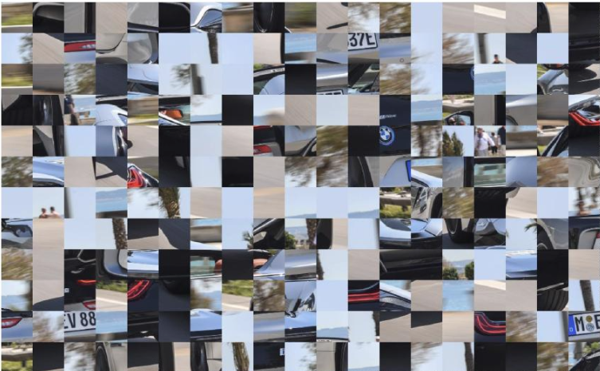

사진을 조각내 무작위로 섞은 뒤 복원하는 것은 **직소 퍼즐을 맞추는 문제**와 비슷합니다. 세 연산은 복원 과정에서 다음 역할을 할 수 있습니다.

| 연산                          | 복원에 활용하는 방법                     | 한계                        |
| --------------------------- | ------------------------------- | ------------------------- |
| **Convolution(합성곱)**        | 조각에서 선·윤곽·질감 같은 특징을 추출          | 조각의 원래 위치를 직접 알려주지는 않음    |
| **Cross-correlation(상호상관)** | 서로 다른 조각의 경계나 특징을 비교해 이웃 후보를 찾음 | 하늘처럼 비슷한 무늬가 많으면 구별하기 어려움 |
| **Autocorrelation(자기상관)**   | 한 조각 안의 반복 무늬와 방향성을 파악          | 서로 다른 조각의 연결을 직접 결정하기 어려움 |

예를 들어 **나뭇가지가 조각 경계에서 끊겨 있다면** 다음처럼 활용할 수 있습니다.

1. **Convolution**으로 각 조각의 나뭇가지 윤곽과 방향을 추출합니다.
2. **Cross-correlation**으로 다른 조각의 경계 특징을 비교해 가지가 이어질 후보를 찾습니다.
3. **Autocorrelation**으로 나무껍질 같은 반복 무늬를 분석해 보조 정보로 사용합니다.

다만 **맞닿는 두 조각의 경계는 같은 그림이 아니라 ‘이어지는 그림’입니다.** 따라서 상호 상관 점수가 높다는 이유만으로 정답 이웃이라고 볼 수는 없습니다. 색의 변화, 선의 연결, 물체의 형태까지 함께 확인해야 합니다.

최종 복원에는 이런 비교 점수를 바탕으로 **모든 조각이 가장 자연스럽게 이어지도록 전체 배치를 찾는 과정**이 추가로 필요합니다. 조각이 회전되어 있다면 방향도 함께 찾아야 합니다.

### 완전연결 신경망에서 CNN으로

이 예시에서 중요한 것은 조각 내부의 작은 무늬와 경계 사이의 관계입니다. **CNN은 지역 연결과 가중치 공유를 통해 이런 공간 구조를 활용하도록 설계되어 있습니다.** 완전연결 신경망과 비교하면 다음과 같습니다.

| 비교               | 완전연결 DNN           | CNN                  |
| ---------------- | ------------------ | -------------------- |
| 이미지 처리           | 보통 픽셀을 한 줄로 펼쳐 입력  | 가로·세로 구조를 유지         |
| 주변 픽셀 관계         | 학습으로 알아내야 함        | 작은 필터로 가까운 픽셀을 함께 처리 |
| 같은 무늬가 다른 위치에 등장 | 위치마다 별도로 학습할 부담이 큼 | 같은 필터를 여러 위치에서 재사용   |
| 가중치 수            | 이미지가 커지면 매우 많아짐    | 지역 연결과 가중치 공유로 줄어듦   |

**완전연결 신경망의 한계**는 이미지의 위치 관계를 활용하는 구조가 기본적으로 없다는 점입니다. 픽셀을 펼쳐도 정보 자체가 사라지는 것은 아니지만, “이 픽셀과 저 픽셀이 이웃이다”라는 관계까지 데이터로 배워야 합니다. 많은 가중치가 필요해 계산량과 과적합의 부담도 커질 수 있습니다.

**CNN이 convolution을 사용하는 이유**는 작은 영역에서 유용한 특징을 찾고, 같은 특징을 이미지 어디서든 찾기 위해서입니다.

퍼즐 조각에 적용하면 다음처럼 작동할 수 있습니다.

1. 작은 필터가 **경계선·색 변화·질감**을 찾습니다.
2. 더 깊은 층이 특징들을 조합해 **나뭇가지·창문·물체의 일부**를 파악합니다.
3. 이 특징으로 두 조각의 가장자리가 자연스럽게 이어지는지 판단합니다.

예를 들어 나뭇가지가 조각의 왼쪽에 있든 오른쪽에 있든, **같은 필터로 가지의 특징을 찾을 수 있습니다.** 이것이 가중치 공유의 장점입니다.

다만 **CNN만 사용한다고 원래 사진이 자동으로 복원되지는 않습니다.** CNN이 추출한 특징을 이용해 조각 간 연결 점수를 구하고, 전체 배치를 결정하는 모델이나 탐색 과정이 필요합니다. 또한 일반적인 CNN은 조각 회전을 자동으로 해결하지 않으므로 회전도 별도로 고려해야 합니다.

### 합성곱의 설정과 학습 파라미터

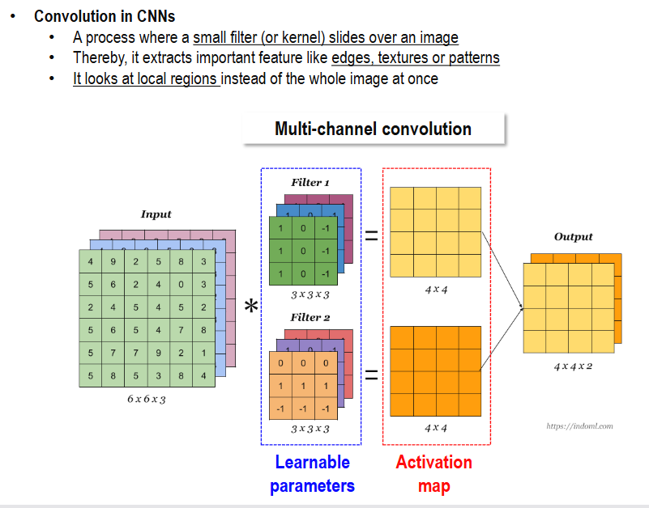

이제 작은 필터가 실제로 어떤 크기의 출력을 만드는지 살펴보겠습니다. 합성곱에서는 **설계자가 정하는 하이퍼파라미터**, **설정에 따라 계산되는 크기**, **학습으로 갱신되는 파라미터**를 구분해야 합니다.

#### 1. 설계자가 정하는 값

| 항목           | 그림의 값       | 의미                   |
| ------------ | ----------- | -------------------- |
| 필터의 가로·세로 크기 | `3 × 3`     | 한 번에 볼 이미지 영역의 크기    |
| 필터 개수        | `2개`        | 출력할 특징 맵의 개수         |
| Stride       | `1`로 해석     | 필터를 한 번에 몇 칸 이동할지    |
| Padding      | `0`으로 해석    | 입력 가장자리에 몇 겹을 추가할지   |
| 활성화 함수       | 그림에 명시되지 않음 | 합성곱 결과에 ReLU 등을 적용할지 |

예를 들어 **필터 개수를 2개에서 10개로 바꾸면, 출력 채널도 10개가 됩니다.** 각 필터는 학습을 통해 서로 다른 특징을 찾을 수 있습니다.

#### 2. 설정에 따라 결정되는 크기

| 항목        | 그림의 값   | 결정되는 이유                            |
| --------- | ------- | ---------------------------------- |
| 필터의 깊이    | `3`     | 입력 채널이 3개이므로                       |
| 출력의 가로·세로 | `4 × 4` | 입력 크기, 필터 크기, Stride, Padding으로 계산 |
| 출력 채널 수   | `2`     | 필터가 2개이므로                          |

그림은 일반적인 합성곱이므로 입력이 `6 × 6 × 3`이면, 필터 하나는 **세 채널 전체를 처리하는** `3 × 3 × 3`이어야 합니다.

일반 합성곱에서는 필터 깊이만 독립적으로 `1`이나 `5`로 바꿀 수는 없습니다.

출력 한 변의 크기는 이 그림의 조건에서 다음과 같습니다.

$$
N_{\text{out}} = \left\lfloor \frac{N_{\text{in}} - K + 2P}{S} \right\rfloor + 1
$$

여기서 $N_{\text{in}}$은 입력 한 변의 크기, $K$는 필터 한 변의 크기, $P$는 Padding, $S$는 Stride입니다. $\lfloor \cdot \rfloor$는 소수점 아래를 내림한다는 뜻이며, 위 식은 dilation이 1인 경우입니다.

그림의 값을 대입하면 다음과 같습니다.

$$
N_{\text{out}} = \left\lfloor \frac{6 - 3 + 2 \times 0}{1} \right\rfloor + 1 = 4
$$

따라서 최종 출력은 **`4 × 4 × 2`**입니다.

입력 크기 `6 × 6 × 3`은 현재 데이터의 조건입니다. 전처리로 이미지 크기를 조정하거나 흑백으로 바꿀 수는 있지만, 그에 맞춰 모델의 입력 구조도 맞춰야 합니다.

#### 3. 학습으로 정해지는 값

그림에서 필터 안에 적힌 `1`, `0`, `-1` 같은 숫자가 **가중치**입니다. 이 값들은 보통 사람이 최종 값을 정하는 대신, 초기값을 설정한 뒤 **역전파와 최적화 알고리즘으로 수정**합니다.

```
사람: 필터 크기와 개수를 정함
              ↓
학습: 각 필터 안의 숫자를 수정함
              ↓
결과: 선·경계·질감 등을 찾는 필터가 만들어짐

```

이 그림의 필터 가중치는 다음 개수입니다.

$$
3 \times 3 \times 3 \times 2 = 54
$$

즉, 필터 가중치는 총 54개입니다.

일반적으로 필터마다 편향을 하나씩 사용한다면 **편향 2개를 더해 총 56개**가 학습됩니다. 그림에는 편향이 표시되어 있지 않습니다.

즉, **필터의 ‘틀’은 내가 정하고, 필터 안의 ‘숫자’는 모델이 학습하며, 출력 크기는 설정에 따라 계산됩니다.**

### 합성곱의 구조적 장점

앞의 계산에서 보았듯이, 필터는 작은 영역을 보면서 같은 가중치를 여러 위치에서 사용합니다. 이 구조가 CNN에 주는 장점을 정리하면 다음과 같습니다.

| 특징 | 의미 | 장점 |
| --- | --- | --- |
| **Parameter sharing — 가중치 공유** | 같은 필터를 이미지 전체에서 반복 사용 | 가중치 수를 줄이고 같은 특징을 여러 위치에서 검출 |
| **Local connectivity — 지역 연결** | 가까운 픽셀들을 묶어 처리 | 선·경계·질감 같은 지역 특징을 효율적으로 추출 |
| **Translation equivariance — 이동 등변성** | 입력이 이동하면 특징 맵도 함께 이동 | 위치가 달라져도 같은 필터로 특징을 추적 |

합성곱의 이동 등변성은 출력이 완전히 같아지는 **이동 불변성**과 구분해야 합니다. Pooling이나 전역 평균 등을 함께 사용하면 위치 변화에 덜 민감한 분류 결과를 만들 수 있지만, 경계 처리와 Stride 등의 조건에 따라 그 성질은 달라질 수 있습니다.

### Padding / Stride / Pooling

이러한 장점을 유지하면서 특징 맵의 크기와 계산량을 조절하는 도구가 Padding, Stride, Pooling입니다. 앞서 출력 크기 공식에서 사용한 설정을 구체적인 예로 살펴보겠습니다.

| 개념                | 쉬운 설명                      | 사용하는 이유                              |
| ----------------- | -------------------------- | ------------------------------------ |
| **Padding(패딩)**   | 이미지 가장자리에 값을 덧붙임. 보통 0을 사용 | 출력 크기가 줄어드는 것을 조절하고, 가장자리 정보도 충분히 활용 |
| **Stride(스트라이드)** | 필터를 한 번에 몇 칸씩 이동할지 설정      | 값이 클수록 출력 크기와 계산량이 줄어듦               |
| **Pooling(풀링)**   | 작은 영역을 대표값 하나로 요약          | 특징 맵 크기를 줄이고 작은 위치 변화에 덜 민감하게 만듦     |

예를 들어 **5×5 입력에 3×3 필터**를 적용하면:

| 설정                  | 출력 크기 |
| ------------------- | ----- |
| Padding 0, Stride 1 | 3×3   |
| Padding 1, Stride 1 | 5×5   |
| Padding 1, Stride 2 | 3×3   |

Pooling은 보통 다음 두 방법을 사용합니다.

```
입력 영역
1  3
2  8

Max Pooling → 최댓값 8
Average Pooling → 평균값 3.5

```

**Padding은 테두리 추가, Stride는 이동 간격, Pooling은 영역 요약**으로 기억하면 됩니다. Pooling 자체에는 일반적으로 학습하는 가중치가 없습니다.

### CNN Architecture

합성곱과 크기 조절 연산을 연결하면 하나의 CNN이 됩니다. 아래 그림은 특징 추출부 뒤에 완전연결 분류부를 붙인 대표적인 구성을 보여줍니다.

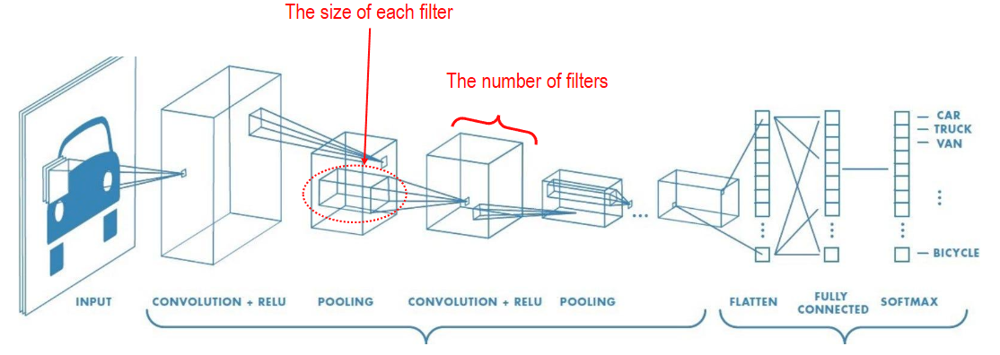

| 순서  | 단계                 | 명칭            | 쉬운 설명                                                                                                          | 반복 여부             |
| --- | ------------------ | ------------- | -------------------------------------------------------------------------------------------------------------- | ----------------- |
| 1   | Input              | 입력부           | 이미지를 입력합니다.                                                                                                     | 시작                |
| 2   | Convolution + ReLU | 합성곱 기반 특징 추출부 | 선·경계·질감을 찾고 비선형성을 더합니다.                                                                                         | 4번에서 같은 종류의 연산 반복 |
| 3   | Pooling            | 합성곱 기반 특징 추출부 | 특징 맵의 크기를 줄여 계산량을 줄입니다.                                                                                         | 5번에서 반복           |
| 4   | Convolution + ReLU | 합성곱 기반 특징 추출부 | 앞의 특징을 조합해 모양·물체의 일부 등 더 복잡한 특징을 찾습니다.                                                                          | 2번과 별도의 필터를 학습    |
| 5   | Pooling            | 합성곱 기반 특징 추출부 | 특징 맵의 크기를 다시 줄입니다.                                                                                              | 3번과 같은 종류의 연산     |
| 6   | Flatten            | 형태 변환 단계      | 가로·세로·채널로 구성된 특징을 한 줄로 펼칩니다.                                                                                    | —                 |
| 7   | Fully Connected    | 분류부           | 특징을 종합해 클래스별 점수를 계산합니다.                                                                                         | —                 |
| 8   | Softmax            | 분류부           | 점수를 각 값이 0\~1 사이이고 합이 1인 클래스별 확률분포로 바꿉니다. 예: 고양이 0.7, 강아지 0.2, 토끼 0.1은 모델이 각 종류일 가능성을 70%, 20%, 10%로 예측한다는 뜻입니다. | —                 |
| 9   | Output             | 출력부           | 보통 가장 높은 확률의 클래스를 최종 결과로 선택합니다.                                                                                 | 끝                 |

그림의 전체 구조가 CNN입니다. 2~5번은 특징 추출부, 6번은 형태 변환, 7~8번은 분류부에 해당합니다. Flatten은 학습 가중치 없이 배열의 형태를 바꾸며, Softmax는 클래스별 점수를 확률분포로 변환합니다.

Convolution + ReLU → Pooling 블록을 여러 번 쌓으면 앞선 특징을 다음 층에서 조합하게 됩니다. 이는 입력에서 출력으로 진행하는 순방향 계산입니다. 학습할 때는 이 순방향 계산에 손실 계산과 역전파를 더한 다음 과정을 반복합니다.

| 학습 순환                                     | 역할                      |
| ----------------------------------------- | ----------------------- |
| 예측 → 손실 계산 → 역전파로 기울기 계산 → 가중치 수정 → 다시 예측 | 정답과의 차이가 줄어들도록 반복 학습합니다. |

## 2. 수용영역과 합성곱 변형

### Receptive field

층을 쌓으면 뒤쪽 특징은 원본 이미지의 더 넓은 영역을 바탕으로 계산됩니다. **수용 영역(Receptive field)**은 특정 출력값에 영향을 줄 수 있는 입력 영역을 뜻합니다. 이를 통해 작은 필터를 여러 번 쌓는 이유를 이해할 수 있습니다.

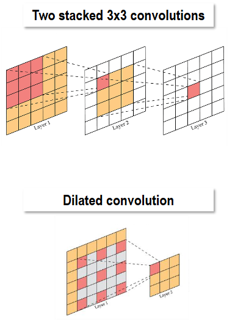

| 방법        | 계산 과정                                        | 최종 수용 영역(Receptive field) |
| --------- | -------------------------------------------- | ------------------------- |
| 큰 필터 한 번  | `5×5 입력 → 5×5 필터 → 1×1 출력`                   | 원본의 `5×5` 영역              |
| 작은 필터 두 번 | `5×5 입력 → 3×3 필터 → 3×3 출력 → 3×3 필터 → 1×1 출력` | 원본의 `5×5` 영역              |

**두 방법 모두 마지막 출력 하나가 원본의 5×5 영역을 봅니다.**

작은 필터를 두 번 사용하는 이유는 다음과 같습니다.

1. **가중치를 줄일 수 있습니다.** 입력·중간·출력 채널이 모두 1이고 편향을 제외하면 다음과 같습니다.
   - `5×5` 필터 한 개: **25개**
   - `3×3` 필터 두 개: **9 + 9 = 18개**
2. **중간에 ReLU를 넣어 더 복잡한 특징을 학습할 수 있습니다.** `Conv → ReLU → Conv`처럼 구성하면, 한 번의 선형 합성곱보다 다양한 관계를 표현할 수 있습니다.
3. **단순한 특징을 조합해 복잡한 특징을 만듭니다.** 첫 층에서 작은 선·경계를 찾고, 다음 층에서 이를 조합해 모서리·모양을 찾는 식입니다.

다만 **가중치가 적다고 계산량도 항상 적은 것은 아닙니다.** 이 작은 예에서는 중간 `3×3` 출력도 계산해야 합니다. 또한 중간에 활성화 함수가 없다면 두 합성곱을 쌓는 것만으로 비선형 표현력이 늘어나지는 않습니다.

### 1×1 Convolution: 위치를 유지하며 채널 조합하기

지금까지 공간적으로 더 넓은 영역을 보는 방법을 살펴봤다면, 이번에는 같은 위치의 채널들을 조합하는 방법을 살펴보겠습니다.

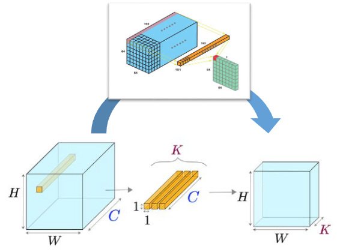

**1×1 합성곱은 같은 위치에 있는 여러 채널의 값을 가중합하여 새로운 특징을 만드는 연산**입니다.

그림의 길쭉한 필터는 가로·세로가 각각 1이고, 입력 채널 전체를 관통하는 깊이 C를 가집니다.

| 구성    | 크기        | 의미                          |
| ----- | --------- | --------------------------- |
| 입력    | H × W × C | 높이 H, 너비 W, 입력 채널 C개        |
| 필터 하나 | 1 × 1 × C | 한 위치의 C개 값을 가중합해 출력값 하나를 만듦 |
| 필터 개수 | K개        | 서로 다른 채널 조합을 K개 학습          |
| 출력    | H × W × K | 공간 크기는 유지하고 채널 수를 K개로 변환    |

위 표는 **Stride 1, Padding 0**인 경우입니다. 각 필터를 모든 위치에 같은 가중치로 적용하면 특징 맵 하나가 만들어지고, 필터 K개를 사용하면 출력 채널도 K개가 됩니다.

예를 들어 한 위치의 채널 값이 `[2, 3, 1]`, 필터 가중치가 `[1, 0, -1]`이라면, 편향을 제외한 출력은 다음과 같습니다.

$$
2 \times 1 + 3 \times 0 + 1 \times (-1) = 1
$$

#### 왜 사용할까?

- **채널 수 조절**: 그림 위쪽 예처럼 `64 × 64 × 192`를 `64 × 64 × 64`로 바꿀 수 있습니다. 채널을 줄인 뒤 3×3 합성곱을 적용하면 그 합성곱의 계산량을 줄일 수 있습니다.
- **새로운 특징 조합**: 같은 위치의 여러 채널에 담긴 정보를 학습된 비율로 섞습니다. 단순히 채널 일부를 버리는 방식이 아닙니다.
- **비선형 변환 추가**: 뒤에 ReLU 등을 붙이면 채널을 조합한 결과에 비선형성을 더할 수 있습니다.

**3×3 합성곱은 주변 위치와 채널을 함께 보고, 1×1 합성곱은 현재 위치의 채널들을 조합합니다.** 따라서 1×1 합성곱 자체는 공간 수용 영역을 넓히지 않습니다. 학습 파라미터 수는 가중치 C × K개이며, 편향을 사용하면 K개가 추가됩니다.

### Group Convolution: 채널을 나누어 계산하기

1×1 합성곱을 포함한 일반 합성곱은 각 출력 채널을 만들 때 모든 입력 채널을 사용합니다. 계산 비용을 더 줄이려면 이 연결 자체를 그룹별로 제한할 수 있습니다.

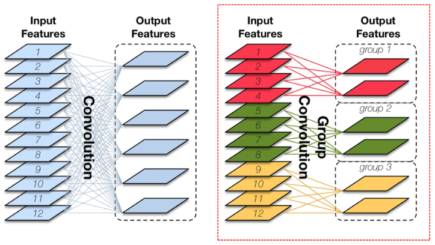

**그룹 합성곱은 입력·출력 채널을 여러 그룹으로 나누고, 각 그룹 안에서만 합성곱하는 방식**입니다. 그림의 판 하나는 특징 맵, 즉 채널 하나를 나타냅니다.

| 구분     | 일반 합성곱 — 왼쪽               | 그룹 합성곱 — 오른쪽                 |
| ------ | ------------------------- | ---------------------------- |
| 연결 방식  | 각 출력 채널이 입력 12개 채널 전체를 사용 | 각 출력 채널이 자기 그룹의 입력 4개 채널만 사용 |
| 그림의 구성 | 입력 12개 → 출력 6개            | 3개 그룹에서 각각 입력 4개 → 출력 2개     |
| 특징     | 모든 입력 채널의 정보를 조합          | 그룹별로 독립적으로 계산해 가중치와 계산량을 줄임  |

같은 입력·출력 채널 수, 필터 크기, 출력 공간 크기라면 **3개 그룹으로 나눌 때 합성곱 가중치 수와 곱셈·덧셈 연산량은 일반 합성곱의 약 1/3**이 됩니다. 편향은 이 비교에서 제외합니다.

다만 **이 층에서는 서로 다른 그룹의 정보가 섞이지 않습니다.** 필요하면 뒤에 일반 1×1 합성곱 등을 사용해 그룹 사이의 정보를 조합합니다. 일반적인 구현에서는 입력·출력 채널 수 모두 그룹 수로 나누어떨어져야 합니다.

#### 그룹을 나눌 때의 장점과 제약

그룹별로 독립적으로 계산하면 연결과 가중치 수가 줄어 모델을 가볍게 만들 수 있습니다. 그룹을 서로 다른 연산 장치에 나누어 처리할 수도 있지만, 실제 병렬 처리 효과는 하드웨어와 구현에 따라 달라집니다. 따라서 그룹 수를 늘릴 때는 연산 절감과 채널 간 정보 교환의 제약을 함께 고려해야 합니다.

아래 그림에서처럼 그룹 내부의 연결만 남는다는 점이 핵심입니다.


### Depthwise Separable Convolution: 공간 처리와 채널 조합을 분리하기

그룹 수를 입력 채널 수까지 늘리면 채널별 공간 처리가 가능합니다. 여기에 앞서 배운 1×1 합성곱을 연결하면, 공간 특징 추출과 채널 조합을 분리할 수 있습니다.

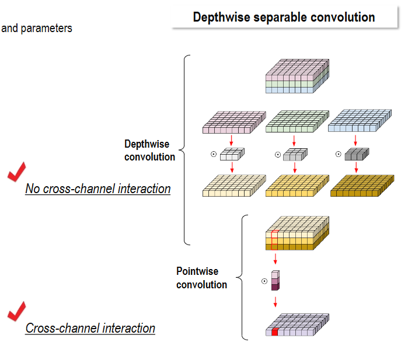

**일반 합성곱이 한 번에 수행하는 공간 특징 추출과 채널 조합을 두 단계로 나눠, 가중치와 계산량을 줄이는 방식**입니다.

| 순서  | 단계                    | 쉬운 설명                                           | 채널 간 정보 조합           |
| --- | --------------------- | ----------------------------------------------- | -------------------- |
| 1   | Depthwise convolution | 각 입력 채널에 별도의 3×3 같은 필터를 적용해 선·경계 등 공간 특징을 추출합니다. | 없음: 각 채널을 독립적으로 처리   |
| 2   | Pointwise convolution | 1×1 합성곱으로 여러 채널의 특징을 섞고 원하는 출력 채널 수로 바꿉니다.       | 있음: 서로 다른 채널의 정보를 조합 |

기본 구성에서는 Depthwise 단계가 입력 채널 C개를 그대로 C개로 처리하고, Pointwise 단계의 필터 K개가 출력 채널을 K개로 만듭니다. Depthwise는 앞서 설명한 그룹 합성곱에서 **그룹 수를 입력 채널 수와 같게 한 경우**로 이해할 수 있습니다.

예를 들어 **입력 3채널 → 출력 8채널**, 필터 크기 3×3이고 편향을 제외하면 가중치 수는 다음과 같습니다.

- **일반 합성곱**: 3 × 3 × 3 × 8 = **216개**
- **Depthwise + Pointwise**: (3 × 3 × 3) + (1 × 1 × 3 × 8) = 27 + 24 = **51개**

즉, **채널별로 특징을 먼저 찾고 → 채널들을 섞는다**고 기억하면 됩니다. 효율적인 대신 일반 합성곱과 표현 방식이 달라, 같은 정확도가 항상 보장되는 것은 아닙니다.

#### 경량 모델에 사용하는 이유

앞의 예에서는 가중치가 **216개에서 51개로 줄어듭니다.** 같은 출력 공간 크기를 가정하면 곱셈·덧셈 연산량도 줄일 수 있어, 메모리와 연산 자원이 제한된 모바일·임베디드 기기에 유용합니다. 다만 실제 속도는 하드웨어와 구현에 따라 달라지므로, 정확도와 실행 효율을 함께 평가해야 합니다.

### 추가 합성곱 기법: 수업 범위 안내

합성곱에는 다음과 같은 변형도 있습니다. 원래 수업 메모에서 두 주제는 시험 범위에서 제외되어 있으므로, 이 문서에서는 이름만 남기고 설명을 생략합니다.

- **Transposed Convolution**: 시험 범위에서 제외합니다.
- **Deformable Convolutional Networks**: 시험 범위에서 제외합니다.

## 3. CNN은 무엇을 학습할까?

이제 합성곱의 구조와 계산 방법을 배웠으므로, 실제 학습을 통해 어떤 특징이 만들어지고 그 특징이 어떻게 활용되는지 살펴보겠습니다.

**CNN은 학습을 통해 필터의 가중치를 조정하고, 층이 깊어질수록 단순한 특징들을 조합해 복잡한 특징을 찾습니다.**

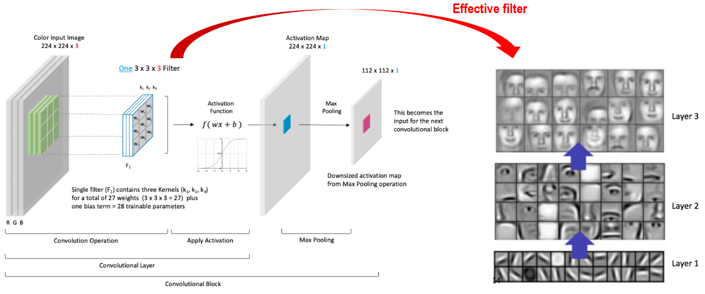

왼쪽 그림은 합성곱 블록 하나의 흐름을 보여줍니다.

| 단계          | 그림의 예           | 의미                                                   |
| ----------- | --------------- | ---------------------------------------------------- |
| 입력          | 224 × 224 × 3   | RGB 3채널 이미지                                          |
| 합성곱         | 3 × 3 × 3 필터 1개 | 세 채널의 주변 픽셀을 함께 계산해 특징 맵 하나를 만듦                      |
| 활성화 함수      | f(wx + b)       | 계산 결과에 비선형성을 더함. 그림은 Sigmoid 형태이며, CNN에서는 ReLU 등도 사용 |
| 활성화 맵       | 224 × 224 × 1   | 특정 특징이 어느 위치에서 강하게 검출됐는지 나타냄                         |
| Max Pooling | 112 × 112 × 1   | 영역별 최댓값을 선택해 공간 크기를 줄이고 다음 블록에 전달                    |

그림처럼 3×3 합성곱 후 크기를 유지하려면 Stride 1, Padding 1로 설정할 수 있습니다.

2×2 Max Pooling을 Stride 2로 적용하면 가로·세로가 절반이 됩니다. 필터 하나의 학습 파라미터는 **가중치 27개(3 × 3 × 3) + 편향 1개 = 28개**이며, 모든 위치에서 같은 값을 공유합니다.

오른쪽 그림은 얼굴 이미지에서 학습할 수 있는 특징을 단계별로 보여주는 예시입니다.

| 층                 | 학습하는 특징의 예                |
| ----------------- | ------------------------- |
| Layer 1 — 입력에 가까움 | 선, 방향, 경계 같은 단순한 특징       |
| Layer 2           | 선과 경계를 조합한 눈·코·입 같은 부분 특징 |
| Layer 3 — 더 깊은 층  | 부분들을 조합한 얼굴 형태 같은 복잡한 특징  |

위쪽의 **Effective filter**는 깊은 층의 특징이 원본 이미지에서 어떤 패턴에 반응하는지를 나타내는 관점입니다. 작은 필터를 여러 층 쌓으면 원본에서 영향을 받는 영역인 **수용 영역(Receptive field)**도 커집니다. 오른쪽 그림은 이런 특징의 시각화 예시이며, 깊은 층에 실제로 얼굴 모양의 큰 필터가 그대로 저장된다는 뜻은 아닙니다.

### 학습한 특징을 얼굴 검출에 활용하기

앞의 그림은 얼굴 특징이 여러 층에서 조합되는 모습을 설명합니다. 이 특징 추출부에 얼굴 여부와 위치를 예측하는 출력을 연결하면 **얼굴 검출(Face detection)** 모델을 만들 수 있습니다.

| 단계          | 하는 일                                          |
| ----------- | --------------------------------------------- |
| 1. 특징 추출    | 앞쪽 층에서 선·경계를 찾고, 깊은 층에서 눈·코·입과 얼굴 형태를 파악      |
| 2. 얼굴 여부 예측 | 이미지의 여러 위치에서 “여기에 얼굴이 있는가?”라는 점수 계산           |
| 3. 위치 예측    | 얼굴을 둘러싸는 사각형인 **바운딩 박스**의 좌표와 크기 계산           |
| 4. 결과 정리    | 점수가 낮은 박스를 제거하고, 같은 얼굴에 겹친 박스는 NMS 같은 방법으로 정리 |

학습할 때는 **얼굴에 사각형을 표시한 정답 이미지**를 사용합니다.

- **분류 손실:** 얼굴인지 아닌지 잘 맞히도록 학습
- **위치 손실:** 사각형이 실제 얼굴 위치에 맞도록 학습

얼굴 크기가 다양하므로 여러 크기의 특징 맵을 활용하기도 합니다.

즉, 앞서 본 **CNN 특징 추출부 뒤에 ‘얼굴 여부’와 ‘박스 위치’를 예측하는 부분을 붙이면 얼굴 검출 모델**을 만들 수 있습니다.

얼굴 검출은 “누구인가?”가 아니라 **“얼굴이 어디 있는가?”**를 찾는 작업입니다.

## 4. CNN 모델의 발전 — VGGNet

앞에서는 개별 연산과 특징의 활용을 살펴봤습니다. 이제 이를 조합한 대표 모델인 VGGNet과 ResNet을 통해, 층을 깊게 쌓는 방법과 그 과정에서 생기는 학습 문제를 연결해 보겠습니다.

### CNN Models

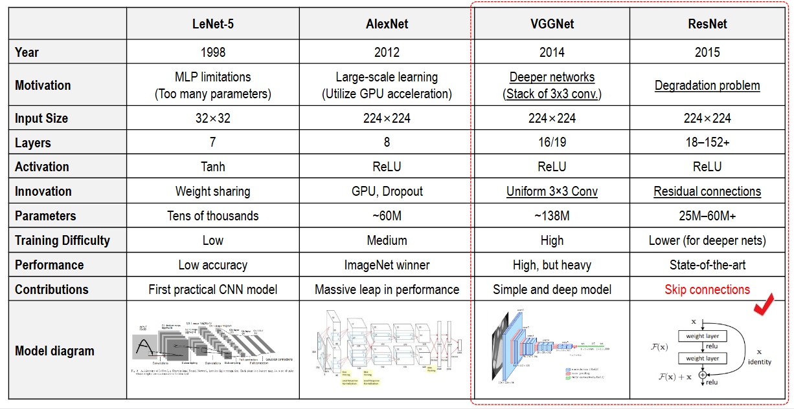

| 구분      | VGGNet                    | ResNet                     |
| ------- | ------------------------- | -------------------------- |
| 핵심 아이디어 | **작은 3×3 합성곱을 여러 층 쌓습니다.** | **입력을 뒤쪽에 더해주는 지름길을 만듭니다.** |
| 대표 구조   | VGG-16, VGG-19            | ResNet-18, 50, 101, 152    |
| 장점      | 구조가 단순하고 이해하기 쉬움          | 매우 깊은 신경망도 학습하기 쉬움         |
| 특징      | 대표 모델은 파라미터가 많아 무거움       | 잔차 연결로 정보와 기울기의 전달을 도움     |

- **VGGNet**은 작은 필터를 반복해서 사용하여 **선·경계 → 물체의 부분 → 복잡한 형태**를 단계적으로 학습합니다.
- **ResNet**은 여러 층의 계산 결과 F(x)에 원래 입력 x를 더합니다.

```
y=F(x)+x
```

이 **잔차 연결(Residual connection 또는 Skip connection)** 덕분에, 층을 깊게 쌓았을 때 학습이 어려워지는 문제를 완화합니다.

특히 층을 추가했는데 오히려 **학습 오차가 커지는 현상인 degradation 문제**를 해결하는 데 중요한 역할을 했습니다.

### VGGNet

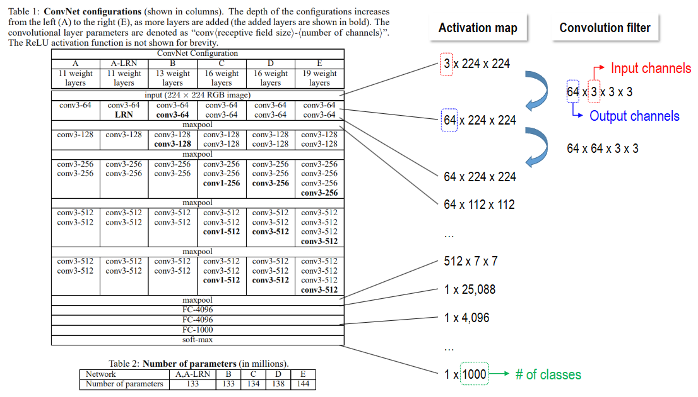

이 그림은 **VGGNet에서 이미지가 여러 합성곱·풀링 층을 지나 1,000개 클래스의 확률로 바뀌는 과정**을 보여줍니다.

#### 1. 왼쪽 표: VGGNet의 여러 버전

A~E는 깊이가 다른 구성입니다. 대표적으로 **D가 VGG-16, E가 VGG-19**입니다.

- `conv3-64`: **3×3 필터를 사용하고 출력 채널이 64개**인 합성곱 층
- `maxpool`: 특징 맵의 가로·세로 크기를 줄이는 층
- `FC-4096`: 출력값이 4,096개인 완전연결 층

VGG-16의 ‘16’은 **합성곱 13개 + 완전연결 3개**입니다. Pooling과 ReLU는 이 층 수에 포함하지 않습니다.

#### 2. 가운데: 특징 맵의 크기 변화

이 그림은 **채널 × 높이 × 너비** 순서로 표시합니다.

| 단계                                   | 크기                      | 의미                     |
| ------------------------------------ | ----------------------- | ---------------------- |
| 입력 (input)                           | `3 × 224 × 224`         | RGB 이미지                |
| 첫 합성곱 (maxpool-con3-64)              | `64 × 224 × 224`        | 특징 맵 64개 생성            |
| 두 번째 합성곱 (maxpool-con3-64)           | `64 × 224 × 224`        | 공간 크기를 유지하며 특징을 조합     |
| 첫 Pooling (maxpool-con3-64)          | `64 × 112 × 112`        | 높이·너비를 절반으로 축소         |
| 마지막 Pooling 이후 (maxpool-con3-512)    | `512 × 7 × 7`           | 작은 공간에 많은 특징 채널이 존재    |
| Flatten                              | `25,088`                | `512 × 7 × 7`을 한 줄로 펼침 |
| Fully Connected (FC-4096 \~ FC-1000) | `4,096 → 4,096 → 1,000` | 특징을 종합해 클래스별 점수 계산     |
| Softmax                              | `1,000`                 | 1,000개 클래스의 확률분포 생성    |

**깊어질수록 공간 크기는 줄이고, 채널 수는 늘려 더 다양한 특징을 표현하는 구조**입니다.

##### 512 × 7 × 7의 의미

**가로·세로가 7칸인 특징 맵이 512장 쌓여 있다는 뜻**입니다. 여기서는 `채널 수 × 높이 × 너비` 순서로 표시하며, 이미지 한 장에 대한 크기입니다.

| 숫자    | 의미                                   |
| ----- | ------------------------------------ |
| 512   | 학습된 특징을 표현하는 채널 수. 클래스가 512개라는 뜻은 아님 |
| 7 × 7 | 각 특징 맵의 공간 크기. 채널마다 49개의 값이 있음       |

각 값은 해당 위치 주변의 입력 정보에 대해 그 채널이 얼마나 반응했는지를 나타냅니다. 원본 사진을 단순히 7×7로 축소한 것이 아니라, 여러 합성곱과 Pooling을 거쳐 얻은 특징입니다. 채널마다 눈·코 같은 이름이 하나씩 정해져 있는 것은 아닙니다.

VGGNet에서는 Pooling을 다섯 번 거치며 한 변의 크기가 `224 → 112 → 56 → 28 → 14 → 7`로 줄어듭니다. 이때 채널 수는 합성곱 필터 개수로 정해집니다.

Flatten은 이 값들을 순서대로 한 줄로 펼쳐 **512 × 7 × 7 = 25,088개**의 벡터로 만듭니다. 값의 개수는 그대로이며, 이후 Fully Connected 층이 이를 종합해 분류합니다.

#### 3. 오른쪽: 합성곱 필터 숫자의 의미

첫 번째 합성곱의 가중치 형태는 다음과 같습니다.

```
64 × 3 × 3 × 3
 ↑   ↑   └──┘
출력 입력  필터의 가로·세로
채널 채널

```

즉, **입력 3채널 전체를 보는 3×3 필터가 64개** 있다는 뜻입니다.

두 번째 합성곱은 입력이 이미 64채널이므로 다음처럼 바뀝니다.

```
64 × 64 × 3 × 3
출력  입력   필터 크기
채널  채널

```

두 층 모두 출력 채널은 64개지만, **각 필터가 받아들이는 입력 채널 수가 다릅니다.**

그림 아래 파라미터 표의 `138M`은 약 **1억 3,800만 개**라는 뜻입니다. VGG-16은 특히 Flatten 이후의 큰 완전연결 층 때문에 파라미터가 많습니다.

## 5. ResNet — Degradation과 잔차 학습

VGGNet처럼 작은 필터를 반복해 층을 늘리면 표현력을 높일 수 있습니다. 그러나 층 수를 늘리는 것만으로 성능이 좋아지지는 않습니다. 다음 실험은 깊은 모델에서 최적화가 왜 중요한지 보여줍니다.

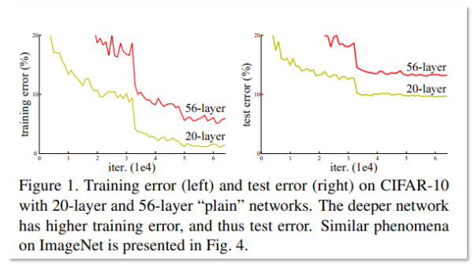

이 그림은 CIFAR-10에서 **잔차 연결이 없는 일반 신경망(plain network)**의 20층 모델과 56층 모델을 비교한 결과입니다. 가로축은 학습 반복 횟수, 세로축은 분류 오차율이며 **낮을수록 좋습니다.** 빨간색은 56층, 노란색은 20층입니다.

| 그래프                | 관찰 결과                 | 의미                             |
| ------------------ | --------------------- | ------------------------------ |
| 왼쪽: Training error | 56층이 20층보다 학습 오차가 높음  | 깊은 모델이 학습 데이터조차 충분히 잘 맞히지 못함   |
| 오른쪽: Test error    | 56층이 20층보다 테스트 오차도 높음 | 이 실험에서는 깊게 쌓는 것만으로 성능이 좋아지지 않음 |

**층을 추가했는데 학습 오차가 오히려 커지는 현상을 degradation 문제라고 합니다.** 과적합은 학습 데이터는 잘 맞히지만 새로운 데이터에서 성능이 떨어지는 현상입니다. 이 그림은 학습 오차부터 높으므로, 단순한 과적합보다 **깊은 모델의 최적화가 어렵다는 점**을 보여줍니다. 그래프만으로 원인을 기울기 소실 하나로 단정할 수는 없습니다.

### ResNet은 어떻게 도움을 줄까?

ResNet은 여러 층의 계산 결과에 원래 입력을 더하는 **잔차 연결**을 사용합니다.

$$
y = F(x) + x
$$

입력을 그대로 전달하는 경로가 있어 정보와 기울기가 흐르기 쉬워집니다. 입력을 바꿀 필요가 없는 블록은 F(x)를 0에 가깝게 학습하면 입력을 그대로 전달할 수 있어, 깊은 모델의 학습 부담을 줄입니다. 위 그래프 자체는 ResNet의 결과가 아니라 **ResNet이 해결하려 했던 문제를 보여주는 비교**입니다.

### 항등변환을 학습하기 어려운 이유

ResNet 맥락에서 **항등행렬(identity matrix)을 학습한다**는 것은, 입력을 그대로 출력하는 **항등함수 H(x)=x**를 학습한다는 뜻입니다.

일반 신경망에서는 입력이 여러 가중치와 ReLU를 통과합니다. 입력을 그대로 보존하려 해도 **여러 층의 가중치가 함께 맞아야 하고, ReLU는 음수 정보를 제거할 수 있어** 학습이 쉽지 않습니다. 역전파도 각 층의 최종 가중치를 직접 알려주는 것이 아니라 조금씩 수정할 방향만 알려줍니다.

ResNet은 이를 다음처럼 바꿉니다.

H(x)=F(x)+x

**입력 x는 지름길로 그대로 전달하고, 추가로 바꿀 부분 F(x)만 학습**합니다. 항등함수가 필요하면 F(x)를 0에 가깝게 만들면 됩니다.

| 구조     | 입력을 그대로 전달하려면                |
| ------ | ---------------------------- |
| 일반 신경망 | 여러 층이 함께 항등변환을 구현해야 함        |
| ResNet | 직접 연결된 입력에 더하는 잔차를 0으로 만들면 됨 |

항등행렬 자체가 복잡해서가 아니라, **여러 층을 거쳐 항등변환을 찾아가는 최적화가 어려웠던 것**입니다.

### Skip Connection: 잔차 학습의 의미

항등변환의 관점에서 잔차 연결의 역할을 더 구체적으로 살펴보겠습니다. 아래 세 그림은 각각 모델의 복잡도, 활성화 함수, 일반 연결과 잔차 연결을 보여줍니다. 서로 다른 개념이 섞이지 않도록 구분해서 읽어야 합니다.

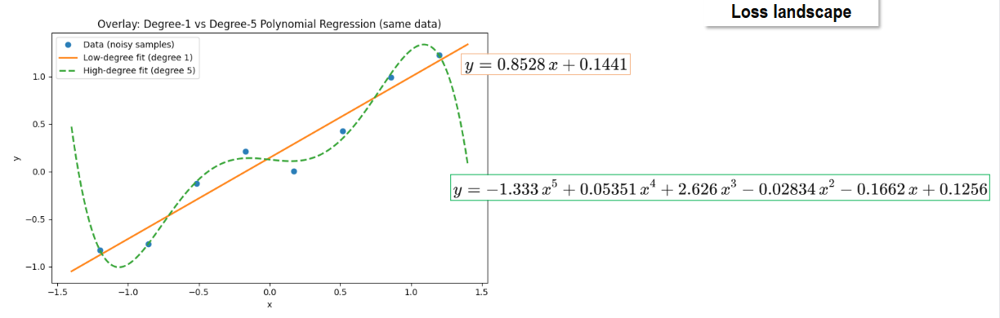

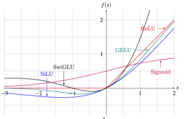

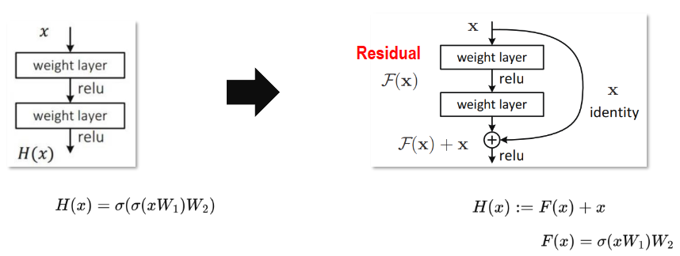

**Skip connection은 입력을 그대로 전달하는 지름길을 만들어, 여러 층이 입력에 더할 변화량(잔차)만 학습하도록 돕는 연결**입니다.

| 그림                 | 설명                                                                                          |
| ------------------ | ------------------------------------------------------------------------------------------- |
| 첫 번째: 직선과 구불구불한 곡선 | 복잡한 모델은 데이터의 잡음까지 따라가 과적합할 수 있다는 예시입니다. 이 그림 자체가 Skip connection의 효과나 손실 지형을 비교한 실험은 아닙니다.  |
| 두 번째: 활성화 함수       | ReLU, Sigmoid 등 함수별 입력·출력 관계를 보여줍니다. 함수마다 기울기와 포화 구간이 다르므로, 0 근처가 항상 학습하기 좋다고 일반화할 수는 없습니다. |
| 세 번째: 일반 연결과 잔차 연결 | 일반 연결은 원하는 출력 전체를 학습하지만, 잔차 연결은 원래 입력에 더할 변화량을 학습합니다.                                       |

| 구조              | 학습 목표              | 입력을 그대로 전달하려면                |
| --------------- | ------------------ | ---------------------------- |
| 일반 연결           | 원하는 변환 H(x)        | 여러 층이 함께 H(x) = x를 구현해야 함    |
| Skip connection | 잔차 F(x) = H(x) − x | 잔차 F(x)를 0으로 만들면 됨. 덧셈 직후 기준 |

예를 들어 입력이 10이고 원하는 출력이 11이면, 잔차 경로는 추가할 값 1을 학습합니다.

$$
y = x + F(x) = 10 + 1 = 11
$$

지름길은 역전파 때 기울기가 전달되는 직접 경로도 제공하므로, 깊은 신경망의 학습을 돕습니다. 입력과 잔차를 그대로 더하려면 두 값의 형태가 같아야 하며, 다르면 1×1 합성곱 등으로 맞출 수 있습니다.

#### 위 설명에서 주의할 점

- **Skip connection과 가중치 규제는 다릅니다.** 가중치 변화가 크다는 사실만으로 과적합을 판단할 수 없으며, 작은 변화만으로 과적합이 방지되는 것도 아닙니다. Skip connection의 핵심은 최적화를 쉽게 해 degradation 문제를 완화하는 것입니다.
- **0 중심 초기화가 잔차 출력을 자동으로 0으로 만들지는 않습니다.** Xavier·He 초기화는 주로 신호와 기울기의 규모를 적절히 유지하도록 설계된 방법입니다. 잔차 연결은 항등변환이 필요할 때 잔차를 0으로 학습할 수 있는 구조를 제공합니다.
- **마지막 그림에는 덧셈 뒤 ReLU도 있습니다.** 따라서 실제 블록 출력은 아래 식과 같으며, F(x)가 0이어도 음수 입력은 그대로 통과하지 않습니다. 입력이 비음수라면 그대로 전달됩니다.

$$
y = \operatorname{ReLU}(F(x) + x)
$$

### ResNet의 성과: 깊은 모델을 실제로 학습하기

잔차 연결의 의미를 이해했다면, 이번에는 이를 적용한 모델의 성과를 살펴보겠습니다. 아래 결과는 깊은 구조를 학습할 수 있게 된 효과를 보여주되, 서로 다른 평가 조건을 구분해 읽어야 합니다.

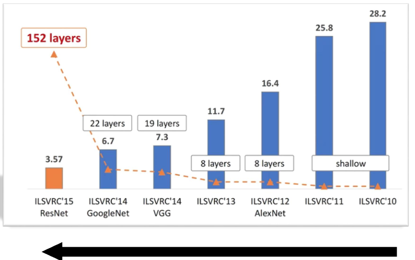

**첫 번째 그림은 이미지 분류 기술이 발전하며 대회 오차율이 낮아진 흐름**을 보여줍니다. 시간은 오른쪽의 2010년에서 왼쪽의 2015년 방향으로 흐르며, 막대가 낮을수록 좋습니다.

| 대표 모델            | 그림의 층 수 | 그림의 Top-5 오차율 |
| ---------------- | ------- | ------------- |
| AlexNet — 2012   | 8       | 16.4%         |
| VGG — 2014       | 19      | 약 7.3%        |
| GoogLeNet — 2014 | 22      | 약 6.7%        |
| ResNet — 2015    | 152     | 3.57%         |

Top-5 오차율은 **모델이 고른 상위 5개 후보에 정답이 없는 비율**입니다. 3.57%는 약 100장 중 3~4장에서 상위 5개 안에 정답이 없다는 뜻이며, Top-1 정확도가 96.43%라는 뜻은 아닙니다.

잔차 연결은 매우 깊은 모델을 학습할 수 있게 하는 중요한 요소였습니다. 다만 이 그림은 연도별 대회 결과이므로, 성능 향상을 층 수 증가만의 효과로 해석하면 안 됩니다. 또한 **3.57%는 단일 152층 모델 하나의 점수가 아니라 여러 ResNet을 결합한 앙상블 결과**입니다.

### 잔차 경로는 어떤 출력을 학습할까?

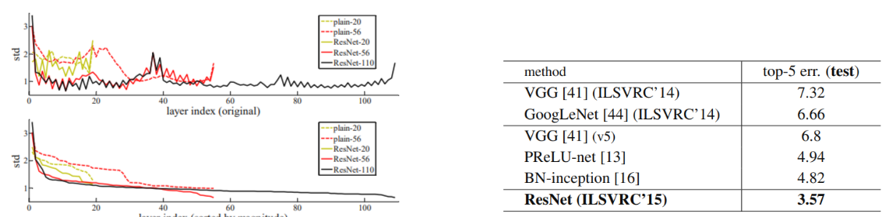

두 번째 이미지의 왼쪽 그래프는 CIFAR-10에서 **각 층의 반응값이 얼마나 퍼져 있는지 나타내는 표준편차(std)**를 비교합니다. 가중치나 기울기 자체의 크기를 그린 그래프는 아닙니다.

| 구분                   | 읽는 방법                     |
| -------------------- | ------------------------- |
| 위 그래프                | 원래 층 순서에 따라 반응의 표준편차를 표시  |
| 아래 그래프               | 같은 값을 표준편차가 큰 순서대로 정렬해 비교 |
| plain-20 / plain-56  | 잔차 연결이 없는 20층·56층 모델      |
| ResNet-20 / 56 / 110 | 잔차 연결을 사용하는 모델            |

실험에서는 ResNet의 잔차 경로가 일반 신경망보다 대체로 작은 반응을 보였고, 깊은 ResNet에서는 반응이 더 작아지는 경향이 관찰됐습니다. 이는 **원래 입력 전체를 새로 만들기보다 필요한 수정량을 학습한다**는 잔차 학습의 해석을 뒷받침합니다. 다만 표준편차가 작다는 사실만으로 평균이 0이거나, 학습이 잘됐다고 단정할 수는 없습니다.

오른쪽 표는 ImageNet 테스트의 Top-5 오차율을 비교합니다. 표시된 방법 중 ResNet의 3.57%가 가장 낮습니다. **왼쪽은 CIFAR-10의 내부 반응 분석, 오른쪽은 ImageNet의 분류 성능 비교**로 서로 다른 실험입니다.

출처: [ResNet 원 논문 — Deep Residual Learning for Image Recognition](https://arxiv.org/abs/1512.03385)

### ResNet이 역전파를 돕는 원리

앞의 결과를 학습 과정과 연결하려면, 잔차 연결을 따라 기울기가 어떻게 전달되는지 보면 됩니다.

**Skip connection은 기울기가 전달될 직접 경로를 제공하고, 잔차 블록이 입력에 필요한 수정량을 학습하도록 돕습니다.** 역전파 알고리즘 자체를 바꾸는 것이 아니라, 신경망의 연결 구조를 바꿔 깊은 모델을 학습하기 쉽게 만듭니다.

| 구분              | 일반 신경망                         | ResNet                        |
| --------------- | ------------------------------ | ----------------------------- |
| 역전파             | 여러 층의 미분값을 곱하면서 기울기가 약해질 수 있음  | 입력을 그대로 전달하는 경로가 기울기 전달에도 기여  |
| 블록의 학습 목표       | 원하는 변환 전체를 학습                  | 입력에 더할 수정량인 잔차를 학습            |
| 입력을 바꿀 필요가 없을 때 | 여러 층이 함께 항등변환을 구현해야 함          | 잔차를 0에 가깝게 만들면 덧셈 결과가 입력과 같아짐 |
| 깊은 구조의 활용       | 층을 늘려도 최적화가 어려워 학습 오차가 커질 수 있음 | 최적화 부담을 줄여 깊은 구조를 활용하기 쉬워짐    |

잔차 블록의 덧셈 부분을 간단한 스칼라 예로 보면 다음과 같습니다.

$$
y = x + F(x)
$$

손실 L에서 입력 x로 전달되는 기울기는 연쇄법칙에 따라 다음과 같습니다.

$$
\frac{\partial L}{\partial x}
= \frac{\partial L}{\partial y}
\left(1 + \frac{\partial F(x)}{\partial x}\right)
$$

여기서 **1은 입력을 그대로 전달하는 경로에서 생깁니다.** 잔차 경로의 미분값이 작아도 직접 경로를 통해 기울기가 전달될 수 있습니다. 실제 특징 맵처럼 벡터를 다루면 1에 해당하는 역할을 항등행렬이 합니다.

위 식은 덧셈 직후를 기준으로 하며, 덧셈 뒤에 ReLU가 있으면 그 미분도 역전파에 반영됩니다. 따라서 잔차 연결이 모든 상황에서 기울기 소실을 완전히 없앤다는 뜻은 아닙니다.

**여기서 효율이 좋아진다는 것은 학습과 최적화가 쉬워진다는 의미입니다.** Skip connection 자체가 합성곱의 계산량을 줄이는 것은 아니며, 층을 더 쌓으면 연산량과 메모리 사용량이 증가할 수 있습니다.

## 6. 사람의 시각계와 CNN 비교

지금까지 CNN의 연산과 깊은 구조의 학습을 살펴봤습니다. 마지막으로 이러한 계층적 특징 처리를 사람의 시각과 비교해, CNN이 설명하는 부분과 한계를 함께 정리하겠습니다.

**CNN은 작은 특징을 조합해 물체를 인식하는 계층적 처리 방식을 사람의 시각과 공유합니다. 다만 뇌의 구조와 학습 과정을 그대로 재현한 것은 아닙니다.**

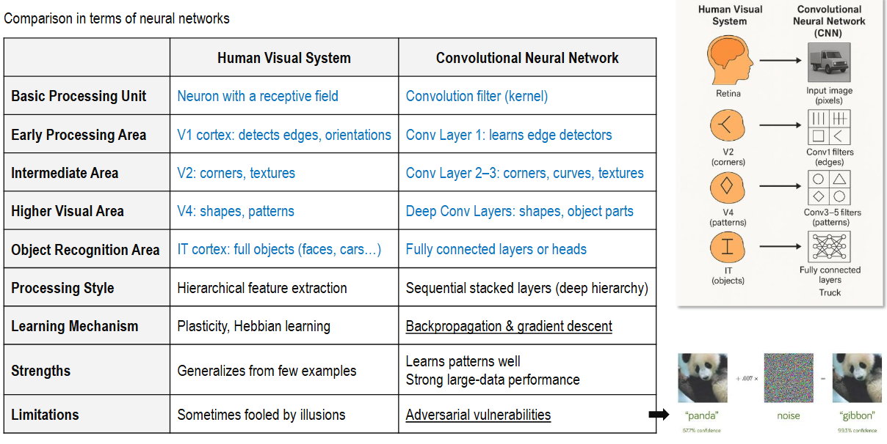

| 비교 항목 | 사람의 시각 시스템 | CNN |
| --- | --- | --- |
| 기본 처리 | 뉴런이 특정 시야 영역인 수용 영역의 자극에 반응 | 필터가 이미지의 작은 영역에서 특징을 추출 |
| 특징의 계층 | 선·방향에서 형태·물체로 이어지는 처리 | 얕은 층의 경계·질감을 깊은 층에서 복잡한 특징으로 조합 |
| 정보 흐름 | 앞뒤 방향의 피드백과 반복 처리가 풍부 | 기본적인 CNN은 입력에서 출력으로 순서대로 계산 |
| 학습 | 경험에 따른 신경 연결의 변화 등 다양한 생물학적 과정 | 손실 함수와 역전파·최적화 알고리즘으로 가중치 조정 |
| 인식의 한계 | 착시와 문맥의 영향을 받을 수 있음 | 사람이 알아보기 어려운 작은 교란에도 오분류할 수 있음 |

### 그림의 뇌 영역과 CNN 층의 대응

그림은 **V1의 선·방향 처리 → V2·V4의 형태·질감 처리 → IT의 물체 표현**을 CNN의 얕은 층에서 깊은 층으로 이어지는 특징 처리에 빗대어 설명합니다. 각 영역의 기능은 서로 겹치며, 뇌 영역과 CNN 층이 정확히 일대일로 대응하지는 않습니다. 오른쪽 도식은 V1을 비롯한 실제 시각 경로의 여러 단계를 생략한 단순화입니다.

### 사람의 시각과의 유사성

- **특징 표현은 일부 닮았습니다.** 물체 인식에 맞춰 학습한 계층형 모델이 영장류 V4·IT 영역의 신경 반응 일부를 예측한 연구가 있습니다. 이는 내부 표현의 유사성을 보여주지만, 사람의 시각 전체를 재현했다는 뜻은 아닙니다. [Yamins 등의 연구](https://pmc.ncbi.nlm.nih.gov/articles/PMC4060707/)
- **반복 처리에는 차이가 있습니다.** 어려운 이미지를 인식할 때 영장류 시각계의 반복 회로가 중요하다는 연구가 있습니다. 단방향 CNN만으로는 이런 시간에 따른 처리를 충분히 설명하기 어렵습니다. [Kar 등의 연구](https://pmc.ncbi.nlm.nih.gov/articles/PMC8785116/)
- **유사성을 하나의 퍼센트로 표시할 수는 없습니다.** 같은 정답을 맞혀도 사용하는 특징, 학습 방식, 실수하는 조건이 다를 수 있습니다. 과제 성능과 뇌와의 유사성은 따로 평가해야 합니다.

### 판다 이미지가 보여주는 인식의 한계

판다 사진에 사람이 거의 알아차리지 못하는 교란을 더해 모델이 긴팔원숭이로 오분류하도록 만든 **적대적 공격(Adversarial attack)**의 예시입니다. 아무 잡음이나 넣으면 반드시 이런 결과가 나는 것은 아니며, 모델의 판단을 바꾸도록 교란을 설계합니다. 사람의 착시와 CNN의 적대적 취약성은 모두 인식의 한계이지만, 같은 원리로 발생한다고 볼 수는 없습니다.

CNN의 핵심은 **지역적인 특징을 공유된 필터로 추출하고, 이를 여러 층에서 조합하는 것**입니다. 잔차 연결은 이 과정을 깊게 쌓아 학습하도록 돕습니다. 다음 문서에서는 이러한 특징 추출 관점을 바탕으로, 입력의 여러 위치가 서로를 참고하며 정보를 조합하는 **Attention**을 살펴봅니다.
