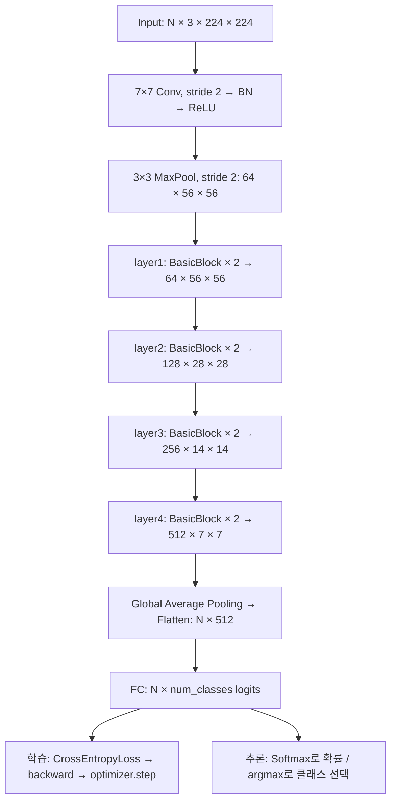
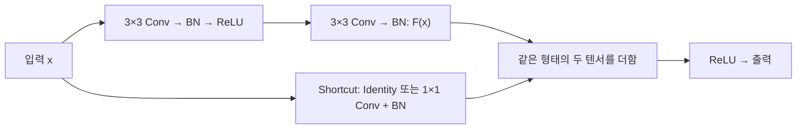

## ResNet 18-Layer (실습 및 시험에 도움이 되는 항목)

### 구조와 출력 크기

**ResNet-18은 3×3 합성곱 두 개로 이루어진 BasicBlock을 총 8개 쌓은 모델**입니다. 네 단계(layer1~layer4)에 블록을 각각 2개씩 배치합니다. 아래는 ImageNet 방식의 RGB 224×224 입력 기준이며, 크기는 `채널 × 높이 × 너비`입니다. 배치 차원 N은 생략했습니다.


| 단계                     | 구성                                              | 출력 크기          |
| ---------------------- | ----------------------------------------------- | -------------- |
| Input                  | RGB 이미지                                         | 3 × 224 × 224  |
| Stem                   | 7×7 Conv, 64채널, Stride 2, Padding 3 → BN → ReLU | 64 × 112 × 112 |
| MaxPool                | 3×3, Stride 2, Padding 1                        | 64 × 56 × 56   |
| layer1 (conv2\_x)      | BasicBlock × 2, 64채널                            | 64 × 56 × 56   |
| layer2 (conv3\_x)      | BasicBlock × 2, 128채널, 첫 블록에서 Stride 2          | 128 × 28 × 28  |
| layer3 (conv4\_x)      | BasicBlock × 2, 256채널, 첫 블록에서 Stride 2          | 256 × 14 × 14  |
| layer4 (conv5\_x)      | BasicBlock × 2, 512채널, 첫 블록에서 Stride 2          | 512 × 7 × 7    |
| Global Average Pooling | 채널마다 7×7 값의 평균                                  | 512 × 1 × 1    |
| Flatten                | 공간 차원을 펼침                                       | 512            |
| Fully Connected        | 512개 특징 → 클래스별 점수                               | num\_classes   |


**18층 = 처음 합성곱 1개 + (BasicBlock 8개 × 합성곱 2개) + 마지막 FC 1개**입니다. BN·ReLU·Pooling과 지름길의 투영 합성곱은 이 명칭의 층 수에 포함하지 않습니다. ResNet-50의 Bottleneck 블록과 달리, ResNet-18의 기본 블록은 `3×3 → 3×3`입니다.

### 전체 Flowchart



### BasicBlock 내부 Flowchart



같은 크기이면 Shortcut은 입력을 그대로 전달합니다. layer2~layer4의 첫 블록처럼 공간 크기와 채널 수가 바뀌면, Shortcut에도 **1×1 Conv, Stride 2 + BN**을 적용해 형태를 맞춥니다. 덧셈은 채널을 이어 붙이는 Concatenate가 아니라 **같은 위치의 값끼리 더하는 연산**입니다.

### Python 예제: PyTorch로 직접 구현하고 한 번 학습하기

아래 예제는 `torch`만 사용합니다. ImageNet 방식의 구조를 유지하고 출력 클래스 수만 10개로 설정했습니다. 무작위 입력·라벨로 실행 흐름을 확인하는 코드이므로 실제 분류 성능을 학습하는 예시는 아닙니다.

```python
import torch
from torch import nn


class BasicBlock(nn.Module):
    def __init__(self, in_channels, out_channels, stride=1):
        super().__init__()
        self.residual = nn.Sequential(
            nn.Conv2d(in_channels, out_channels, 3,
                      stride=stride, padding=1, bias=False),
            nn.BatchNorm2d(out_channels),
            nn.ReLU(),
            nn.Conv2d(out_channels, out_channels, 3,
                      padding=1, bias=False),
            nn.BatchNorm2d(out_channels),
        )
        # 덧셈 전에 채널 수와 공간 크기를 일치시킨다.
        if stride != 1 or in_channels != out_channels:
            self.shortcut = nn.Sequential(
                nn.Conv2d(in_channels, out_channels, 1,
                          stride=stride, bias=False),
                nn.BatchNorm2d(out_channels),
            )
        else:
            self.shortcut = nn.Identity()
        self.relu = nn.ReLU()

    def forward(self, x):
        return self.relu(self.residual(x) + self.shortcut(x))


class ResNet18(nn.Module):
    def __init__(self, num_classes=10):
        super().__init__()
        self.stem = nn.Sequential(
            nn.Conv2d(3, 64, 7, stride=2, padding=3, bias=False),
            nn.BatchNorm2d(64),
            nn.ReLU(),
            nn.MaxPool2d(3, stride=2, padding=1),
        )
        self.layer1 = self.make_stage(64, 64, stride=1)
        self.layer2 = self.make_stage(64, 128, stride=2)
        self.layer3 = self.make_stage(128, 256, stride=2)
        self.layer4 = self.make_stage(256, 512, stride=2)
        self.avgpool = nn.AdaptiveAvgPool2d((1, 1))
        self.fc = nn.Linear(512, num_classes)

        for module in self.modules():
            if isinstance(module, nn.Conv2d):
                nn.init.kaiming_normal_(module.weight, mode="fan_out",
                                        nonlinearity="relu")
            elif isinstance(module, nn.BatchNorm2d):
                nn.init.ones_(module.weight)
                nn.init.zeros_(module.bias)

    @staticmethod
    def make_stage(in_channels, out_channels, stride):
        return nn.Sequential(
            BasicBlock(in_channels, out_channels, stride),
            BasicBlock(out_channels, out_channels),
        )

    def forward(self, x):
        x = self.stem(x)
        x = self.layer1(x)
        x = self.layer2(x)
        x = self.layer3(x)
        x = self.layer4(x)
        x = self.avgpool(x)
        x = torch.flatten(x, start_dim=1)  # N × 512: 배치 차원은 유지한다.
        return self.fc(x)  # Softmax 전 점수(logits)를 반환한다.


torch.manual_seed(0)
model = ResNet18(num_classes=10)
images = torch.randn(2, 3, 224, 224)  # NCHW: RGB 이미지 2장
labels = torch.tensor([1, 3], dtype=torch.long)
criterion = nn.CrossEntropyLoss()
optimizer = torch.optim.SGD(model.parameters(), lr=0.01, momentum=0.9)

# 학습: 예측 → 손실 → 기울기 → 가중치 수정
model.train()
optimizer.zero_grad()
logits = model(images)
loss = criterion(logits, labels)  # Softmax를 먼저 적용하지 않는다.
loss.backward()
optimizer.step()
print("logits shape:", logits.shape)  # torch.Size([2, 10])
print("loss:", loss.item())

# 추론: BatchNorm을 평가 모드로 전환한다.
model.eval()
with torch.no_grad():
    logits = model(images)
    probabilities = torch.softmax(logits, dim=1)
    predictions = logits.argmax(dim=1)
print("probability sums:", probabilities.sum(dim=1))  # 약 [1, 1]
print("predictions:", predictions)
```

### 실습·시험 핵심 확인

- **NCHW**: PyTorch 이미지 텐서는 `배치 수 × 채널 × 높이 × 너비`입니다.
- **[2, 2, 2, 2]**: 네 단계의 블록 개수입니다. 단계마다 합성곱이 2개라는 뜻은 아닙니다.
- **Global Average Pooling**: `512×7×7 → 512×1×1`로 요약하므로, VGG처럼 25,088개 값을 그대로 FC에 넣지 않습니다.
- **CrossEntropyLoss**: 정수 클래스 라벨과 Softmax 전 점수인 logits를 받습니다. 확률이 필요할 때 추론에서 Softmax를 적용합니다.
- **train / eval**: BN의 동작이 달라집니다. `no_grad()`만으로 평가 모드가 되지는 않습니다.

구조 참고: [TorchVision ResNet 공식 구현](https://github.com/pytorch/vision/blob/main/torchvision/models/resnet.py)