# Attention과 Vision Transformer

앞 문서에서는 CNN이 지역적인 특징을 추출하고 여러 층에서 조합하는 과정을 살펴봤습니다. 이번에는 입력의 각 위치가 다른 위치의 정보를 직접 참고하는 Attention을 배우고, 이를 이미지에 적용한 ViT로 이어갑니다. 먼저 Transformer의 기본 계산을 이해한 뒤, ViT의 입력부터 분류 출력까지 따라가고, DeiT와 Swin이 학습 효율과 계산 효율을 어떻게 개선했는지 살펴봅니다. 이어서 CLIP의 이미지·언어 정렬과 DINO의 자기지도 학습까지 연결합니다.

**목차**

- [1. Attention과 Transformer](#1-attention과-transformer)
  - [Attention의 기본 원리](#attention의-기본-원리)
  - [Transformer의 기본 구성](#transformer의-기본-구성)
  - [Transformer 구조 그림 설명](#transformer-구조-그림-설명)
  - [Encoder의 내부 계산](#encoder의-내부-계산)
  - [가중합과 전역 Attention의 의미](#가중합과-전역-attention의-의미)
- [2. Vision Transformer (ViT)](#2-vision-transformer-vit)
  - [처리 흐름](#처리-흐름)
  - [패치 사이의 Attention은 무엇을 할까?](#패치-사이의-attention은-무엇을-할까)
  - [CNN과 비교](#cnn과-비교)
  - [기억할 점](#기억할-점)
  - [ViT Architecture](#vit-architecture)
  - [Patch Embedding](#patch-embedding)
  - [Linear Projection](#linear-projection)
  - [Position Embedding](#position-embedding)
  - [Query/Key/Value](#querykeyvalue)
  - [Attention among patches](#attention-among-patches)
  - [Self-attention](#self-attention)
  - [Multi-Head Self-Attention](#multi-head-self-attention)
  - [Classification](#classification)
  - [ViT 실험과 학습된 표현](#vit-실험과-학습된-표현)
  - [ViT Variant](#vit-variant)
- [3. Post-ViT 연구 방향](#3-post-vit-연구-방향)
- [4. DeiT](#4-deit)
  - [Overview](#overview)
  - [Architecture & Loss](#architecture--loss)
  - [DeiT Experiments](#deit-experiments)
  - [DeiT Summary](#deit-summary)
- [5. Swin Transformer](#5-swin-transformer)
  - [어떤 문제를 해결하려 했을까?](#어떤-문제를-해결하려-했을까)
  - [Patch Merging은 어떻게 할까?](#patch-merging은-어떻게-할까)
  - [Swin의 Window와 Shift](#swin의-window와-shift)
  - [Swin Architecture](#swin-architecture)
  - [Complexity](#complexity)
  - [Experiments](#experiments)
  - [Summary](#summary)
- [6. Parameter Count — 모델별 파라미터 수 비교](#6-parameter-count--모델별-파라미터-수-비교)
  - [1. ViT: 깊이보다 폭이 커질 때도 빠르게 증가한다](#1-vit-깊이보다-폭이-커질-때도-빠르게-증가한다)
  - [2. DeiT: 비슷한 크기의 학생을 더 잘 학습시키기](#2-deit-비슷한-크기의-학생을-더-잘-학습시키기)
  - [3. Swin: 채널과 Stage별 깊이가 모델 크기를 결정한다](#3-swin-채널과-stage별-깊이가-모델-크기를-결정한다)
  - [4. 파라미터가 비슷해도 계산량은 다르다](#4-파라미터가-비슷해도-계산량은-다르다)
- [7. CLIP](#7-clip)
  - [어떻게 학습할까?](#어떻게-학습할까)
  - [학습한 뒤에는 어떻게 사용할까?](#학습한-뒤에는-어떻게-사용할까)
  - [Overview](#overview-1)
  - [New dataset](#new-dataset)
  - [Architecture](#architecture)
  - [Training](#training)
  - [Inference](#inference)
  - [Zero-shot experiments](#zero-shot-experiments)
  - [Summary](#summary-1)
- [8. DINO](#8-dino)
  - [Overview — 라벨 없이도 물체를 구분하는 표현 배우기](#overview--라벨-없이도-물체를-구분하는-표현-배우기)
  - [Self-attention map — CLS가 어느 패치를 참고할까?](#self-attention-map--cls가-어느-패치를-참고할까)
  - [Architecture (1/6) — Student–Teacher와 자기 증류](#architecture-16--studentteacher와-자기-증류)
  - [Architecture (2/6) — ViT Backbone과 Multi-crop](#architecture-26--vit-backbone과-multi-crop)
  - [Architecture (3/6) — EMA와 Centering의 역할](#architecture-36--ema와-centering의-역할)
  - [Architecture (4/6) — 두 Softmax와 Temperature](#architecture-46--두-softmax와-temperature)
  - [Architecture (5/6) — CLS, Projection Head, Cross-Entropy](#architecture-56--cls-projection-head-cross-entropy)
  - [Architecture (6/6) — Stop-gradient](#architecture-66--stop-gradient)
  - [Architecture summary — 한 학습 단계를 연결하기](#architecture-summary--한-학습-단계를-연결하기)
  - [Experiments — Attention과 Teacher 업데이트 분석](#experiments--attention과-teacher-업데이트-분석)
  - [Summary](#summary-2)


---

## 1. Attention과 Transformer

### Attention의 기본 원리

**Attention(어텐션)은 여러 정보 중에서 현재 작업에 중요한 정보에 더 큰 가중치를 주는 방식**입니다.

예를 들어 사진에서 고양이를 찾는다면, 배경보다 **귀·눈·수염 같은 정보**를 더 많이 반영하는 식입니다. 다만 반드시 사람이 보는 위치처럼 눈에 보이는 영역만 선택하는 것은 아닙니다.

계산은 다음 순서로 이해하면 됩니다.

1. **관련도 계산:** 지금 필요한 정보와 각 정보가 얼마나 관련 있는지 점수를 구합니다.
2. **가중치 생성:** 보통 Softmax로 점수를 합이 1인 가중치로 바꿉니다.
3. **정보 조합:** 각 정보에 가중치를 곱한 뒤 더합니다.

Transformer에서는 이를 세 요소로 표현합니다.


| 요소           | 쉬운 의미                 |
| ------------ | --------------------- |
| **Query(Q)** | 지금 무엇을 찾고 있는가?        |
| **Key(K)**   | 각 정보가 어떤 특징을 가지고 있는가? |
| **Value(V)** | 실제로 가져와 조합할 정보        |


**Q와 K를 비교해 가중치를 정하고, 그 가중치로 V를 섞습니다.** Q·K·V는 보통 입력에서 학습된 변환으로 만들어집니다.

앞서 본 CNN은 작은 필터의 지역 연산을 여러 층에 걸쳐 조합합니다. 이와 비교하면 **전역 Attention은 멀리 떨어진 위치 사이의 관계도 한 층에서 직접 계산할 수 있습니다.** 이 계산을 핵심 구성 요소로 사용하는 구조가 다음의 Transformer입니다.

---

### Transformer의 기본 구성

**Transformer는 Attention을 중심으로, 데이터 요소 사이의 관계를 학습하는 신경망 구조**입니다. 문장에서는 단어·토큰 사이의 관계를, 이미지에서는 작은 조각인 패치 사이의 관계를 파악합니다.

예를 들어 **“고양이가 소파 위에서 잠을 잔다”**라는 문장에서, “잔다”를 해석할 때 “고양이”의 정보를 반영할 수 있습니다.


| 구성 요소                    | 역할                                     |
| ------------------------ | -------------------------------------- |
| **Embedding**            | 단어나 이미지 패치를 숫자 벡터로 변환                  |
| **위치 정보**                | 단어의 순서나 패치의 위치를 알려줌                    |
| **Self-Attention**       | 같은 입력 안에서 각 요소가 다른 요소의 정보를 얼마나 반영할지 계산 |
| **Feed Forward Network** | Attention으로 모은 정보를 추가로 가공              |
| **잔차 연결·정규화**            | 정보를 전달하고 깊은 모델의 학습을 안정화                |


이 구성 요소를 하나의 블록으로 묶고 여러 층 쌓으면, 각 요소의 표현에 문맥 정보를 반복해서 반영하며 복잡한 관계를 학습할 수 있습니다.

**Attention이 ‘정보를 가중합하는 계산 방식’이라면, Transformer는 그것을 핵심 부품으로 사용하는 전체 모델 구조**입니다.

이미지에 Transformer를 적용한 대표적인 모델이 **ViT(Vision Transformer)**입니다. ViT로 넘어가기 전에 원래의 Transformer 구조를 살펴보면, Encoder와 Attention이 각각 어떤 역할을 하는지 구분하기 쉽습니다.

---

### Transformer 구조 그림 설명

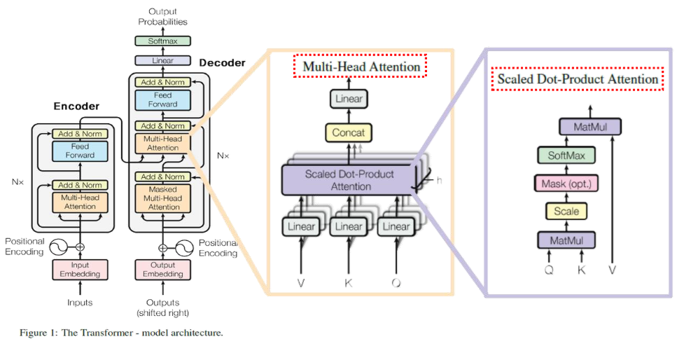

이 그림은 원래의 **Encoder–Decoder Transformer**입니다. 왼쪽에서 전체 입력·출력 흐름을 살펴본 뒤, 오른쪽의 Attention 계산과 가운데의 Multi-Head 구성을 차례로 확인하겠습니다.

#### 1. 왼쪽: 입력을 이해하는 Encoder와 출력을 만드는 Decoder

번역을 예로 들면 Encoder는 원문 정보를 표현하고, Decoder는 그 정보를 참고해 번역문을 생성합니다.


| 구성                            | 쉬운 설명                                         |
| ----------------------------- | --------------------------------------------- |
| Input / Output Embedding      | 토큰을 학습 가능한 숫자 벡터로 변환                          |
| Positional Encoding           | 벡터에 순서 정보를 더함. Attention만으로는 토큰 순서를 알 수 없기 때문 |
| Encoder Self-Attention        | 입력 안의 각 토큰이 다른 입력 토큰의 정보를 얼마나 반영할지 계산         |
| Decoder Masked Self-Attention | 생성 위치에서 미래 토큰을 보지 못하도록 가리고, 앞선 출력 정보를 참고      |
| Decoder Cross-Attention       | Decoder의 현재 표현으로 Encoder 출력에서 필요한 정보를 가져옴     |
| Feed Forward                  | 각 위치에 같은 작은 신경망을 적용해 특징을 추가로 가공               |
| Add &amp; Norm                | 잔차 연결로 원래 표현을 더한 뒤 LayerNorm을 적용해 학습을 안정화     |
| Linear → Softmax              | 다음 토큰 후보들의 점수를 구하고, 합이 1인 확률분포로 변환            |
| N×                            | 블록을 N층 쌓는다는 뜻. 같은 가중치로 되돌아가는 순환은 아님           |


**Outputs (shifted right)**는 학습 시 정답 출력 앞에 시작 토큰을 넣고 한 칸 밀어 입력한다는 뜻입니다. 예를 들어 Decoder 입력이 `[시작, 나는, 학생]`이면 각 위치의 예측 목표는 `[나는, 학생, 종료]`입니다. 추론에서는 정답 대신 지금까지 생성한 토큰으로 다음 토큰을 예측합니다.

---

#### 2. 오른쪽: Scaled Dot-Product Attention

전체 구조에서 정보를 모으는 핵심 계산은 **관련도 계산 → 가중치 생성 → 정보 가중합** 순서로 이루어집니다. 앞서 소개한 Q·K·V가 이 과정에서 어떻게 쓰이는지 수식과 연결해 보겠습니다.


| 요소       | 쉬운 의미                 |
| -------- | --------------------- |
| Query(Q) | 지금 어떤 정보를 찾는가?        |
| Key(K)   | 비교할 각 정보의 특징은 무엇인가?   |
| Value(V) | 실제로 가져와 조합할 내용은 무엇인가? |


Q·K·V는 보통 입력 벡터에 각각 학습된 선형 변환을 적용해 만듭니다.

$$
\operatorname{Attention}(Q,K,V)
= \operatorname{softmax}\left(\frac{QK^T}{\sqrt{d_k}} + M\right)V
$$


| 그림 속 단계        | 역할                                                                   |
| -------------- | -------------------------------------------------------------------- |
| MatMul: Q와 K   | 각 Query와 Key의 내적으로 관련도 점수를 구함                                        |
| Scale          | Key 벡터 차원 d\_k의 제곱근으로 나눠 점수가 과도하게 커지는 것을 완화                          |
| Mask (선택)      | 참고하면 안 되는 위치의 점수를 차단. 마스크 M은 허용 위치에 0, 차단 위치에 음의 무한대를 더하는 방식으로 표현 가능 |
| Softmax        | 각 Query에 대해 참고할 Key 위치들의 가중치 합을 1로 만듦                                |
| MatMul: 가중치와 V | 중요한 위치의 Value를 더 많이 반영해 새로운 표현을 만듦                                   |


예를 들어 세 위치의 가중치가 `0.7, 0.2, 0.1`이면 결과는 `0.7V₁ + 0.2V₂ + 0.1V₃`입니다. 여기의 Softmax는 **어느 위치를 참고할지**를 정하며, 모델 최상단의 **다음 토큰 확률**을 만드는 Softmax와 역할이 다릅니다.

---

#### 3. 가운데: Multi-Head Attention

하나의 Attention이 한 가지 표현 공간에서 정보를 모은다면, **Multi-Head Attention은 여러 Scaled Dot-Product Attention을 병렬로 계산해 다양한 관계를 함께 표현**합니다. Head 수는 토큰 수나 블록 반복 횟수와 구분하도록 h로 표기합니다.

- **Head마다 다른 Q·K·V 변환을 학습합니다.** 같은 입력도 서로 다른 표현 공간으로 변환하므로, 각 Head가 다른 관련도와 가중합을 계산할 수 있습니다.
- **Head들은 병렬로 계산합니다.** 앞 Head의 결과를 다음 Head에 넣는 순차 구조가 아닙니다. 서로 다른 관계를 함께 표현할 수 있지만, 특정 Head의 역할이 미리 정해지는 것은 아닙니다.
- **결과를 합쳐 출력합니다.** h개 Head의 결과를 Concat으로 이어 붙인 뒤, 학습 가능한 출력 Linear 변환으로 조합합니다.

예를 들어 모델 차원이 512이고 Head가 8개이면, 일반적인 구성에서 Head마다 Q·K·V를 64차원으로 만듭니다. 각 Head는 **전체 토큰을 64차원 표현으로 비교**하며, 토큰을 8그룹으로 나누는 것이 아닙니다. Head별 64차원 출력을 이어 붙이면 512차원이 됩니다.

```text
같은 입력 → 서로 다른 Q·K·V 변환 → Attention Head 8개를 병렬 계산
         → Head별 64차원 출력 → Concat으로 512차원 → 출력 Linear
```

같은 Attention 계산도 Q·K·V의 출처에 따라 Self-Attention 또는 Cross-Attention으로 구분됩니다. 전체 구조에서의 차이는 다음과 같습니다.


| 사용 위치                           | Q의 출처             | K·V의 출처          |
| ------------------------------- | ----------------- | ---------------- |
| Encoder Self-Attention          | Encoder의 현재 입력 표현 | 같은 표현            |
| Decoder Masked Self-Attention   | Decoder의 현재 입력 표현 | 같은 표현. 미래 위치는 차단 |
| Encoder–Decoder Cross-Attention | Decoder의 앞 하위층 출력 | Encoder의 최종 출력   |


#### 핵심 요약과 Vision 연결

**Encoder는 입력 정보를 표현하고, Decoder는 입력과 앞선 출력을 참고해 다음 토큰을 예측합니다. 그 중심에서 Attention이 관련 정보에 가중치를 줍니다.**

모든 Transformer가 이 전체 구조를 사용하는 것은 아닙니다. 이미지 분류용 ViT는 대표적으로 이미지를 패치로 나누어 벡터로 만든 뒤, 위치 정보를 더해 Transformer Encoder에 넣습니다. 전역 Self-Attention은 멀리 떨어진 패치 사이의 관계도 직접 계산할 수 있습니다.

출처: [Attention Is All You Need — Transformer 원 논문](https://arxiv.org/abs/1706.03762)

---

### Encoder의 내부 계산

앞 절에서 전체 구조를 확인했으므로, 이제 ViT에서도 사용하는 Encoder를 자세히 살펴보겠습니다. 입력 토큰을 벡터로 바꾸는 단계부터 문맥이 반영된 출력을 만드는 단계까지 차례로 연결합니다.

**Encoder는 각 토큰의 표현에 다른 토큰의 정보를 반영해, 문맥을 담은 벡터를 만드는 부분**입니다. 문장 전체를 반드시 벡터 하나로 압축하는 것은 아니며, 보통 토큰마다 출력 벡터가 하나씩 나옵니다.

---

#### 1. 토큰에서 Q·K·V까지 — 첫 번째 그림

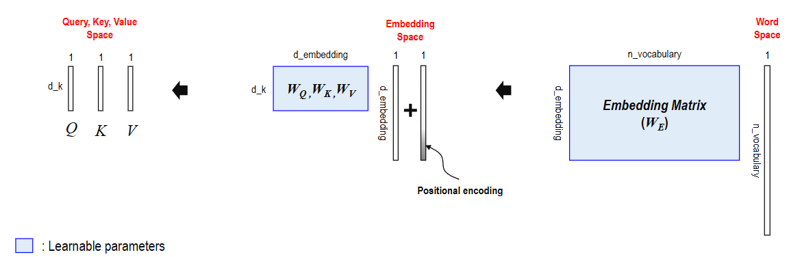

그림은 **오른쪽에서 왼쪽으로** 읽습니다.


| 단계                  | 쉬운 설명                                                   |
| ------------------- | ------------------------------------------------------- |
| Word Space          | 어휘 목록에서 토큰 하나를 나타냄. 그림의 긴 벡터는 해당 위치만 1인 원핫 벡터로 이해할 수 있음 |
| Embedding Matrix    | 토큰을 학습 가능한 조밀한 벡터로 변환. 실제 코드에서는 보통 토큰 ID로 임베딩을 조회       |
| Positional Encoding | 임베딩에 같은 차원의 위치 벡터를 더해 순서 정보를 제공                         |
| Linear Projection   | 서로 다른 가중치 행렬 W\_Q, W\_K, W\_V로 같은 입력 표현을 각각 변환          |
| Q·K·V               | 찾을 정보(Q), 비교 기준(K), 가져올 내용(V)이라는 서로 다른 역할로 사용           |


그림처럼 토큰을 **열벡터**로 표현하면 다음과 같습니다.

$$
e = W_E t, \qquad x = e + p
$$

$$
q = W_Q x, \qquad k = W_K x, \qquad v = W_V x
$$

여기서 t는 토큰의 원핫 벡터, e는 임베딩, p는 위치 벡터입니다. **입력은 같아도 변환 행렬이 다르므로 Q·K·V는 일반적으로 다른 값**이 됩니다.


| 그림의 기호        | 의미                                     |
| ------------- | -------------------------------------- |
| n\_vocabulary | 어휘에 포함된 토큰 종류 수. 현재 문장의 길이와 다름         |
| d\_embedding  | 토큰 임베딩 벡터의 길이                          |
| d\_k          | Query·Key 벡터의 길이. 그림은 Value도 같은 길이로 표시 |
| 파란색 행렬        | 학습으로 갱신하는 임베딩 및 Q·K·V 변환 가중치           |


예를 들어 어휘가 10,000개이고 임베딩 차원이 512이면, 그림의 W_E는 `512 × 10,000`입니다. Head 하나의 Q·K 차원이 64이면 W_Q·W_K는 각각 `64 × 512`입니다. Value 차원은 별도로 정할 수도 있으며, 여러 Head는 각자 다른 변환을 학습합니다.

원 Transformer의 위치 인코딩은 고정된 사인·코사인 함수를 사용합니다. 위치 벡터를 학습하는 변형도 있습니다. 실제 구현에서는 벡터를 행으로 배치해 행렬 곱 순서가 반대로 보일 수 있지만 원리는 같습니다.

---

#### 2. Encoder 블록 내부 — 두 번째 그림

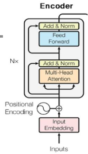

그림은 **아래에서 위로** 읽습니다.


| 순서  | 구성                                    | 역할                                     |
| --- | ------------------------------------- | -------------------------------------- |
| 1   | Input Embedding + Positional Encoding | 토큰의 표현과 위치 정보를 준비                      |
| 2   | Multi-Head Self-Attention             | 같은 시퀀스에서 Q·K·V를 만들고, 관련 토큰의 정보를 가중합    |
| 3   | Add &amp; Norm                        | Attention 입력을 결과에 더한 뒤 LayerNorm 적용    |
| 4   | Feed Forward                          | 각 위치에 동일한 작은 신경망을 적용해 표현을 비선형으로 가공     |
| 5   | Add &amp; Norm                        | Feed Forward 입력을 결과에 더한 뒤 LayerNorm 적용 |
| 6   | N개 블록 적층                              | 앞 블록의 출력을 다음 블록에 전달해 문맥 표현을 더 깊게 가공    |


예를 들어 “고양이가 소파에서 잔다”에서 각 토큰의 출력은 다른 토큰의 정보를 반영할 수 있습니다. **Self-Attention은 위치 사이의 정보를 섞고, Feed Forward는 각 위치의 특징을 가공**한다고 구분하면 됩니다.

N×는 서로 다른 가중치를 가진 블록을 여러 층 쌓는다는 뜻입니다. 임베딩·위치 정보는 입구에서 준비하고, 각 블록은 현재 표현으로 Q·K·V를 새로 계산합니다. 기본 Encoder는 미래 위치를 가리는 인과 마스크를 쓰지 않아 문장 양쪽을 참고할 수 있지만, 패딩 위치는 마스킹할 수 있습니다.

> 이 그림의 Add &amp; Norm은 잔차 덧셈 뒤 정규화를 하는 원래의 Post-LN 구조입니다. 정규화를 하위층 앞에 놓는 Pre-LN 변형도 있습니다. 여기의 Norm은 CNN에서 배운 BatchNorm이 아니라 LayerNorm입니다.

---

#### 3. 모든 토큰의 관계를 계산하고 Value를 모으기

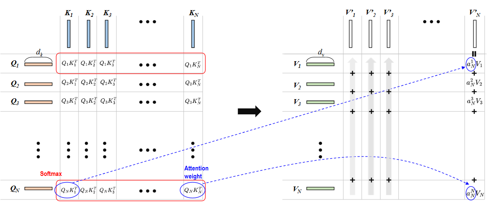

**왼쪽 표는 누가 누구를 얼마나 참고할지 계산하는 과정이고, 오른쪽은 그 비율로 정보를 모으는 과정**입니다. 여기서 N은 현재 시퀀스의 토큰 수이며, 앞의 N× 블록 반복 횟수와는 다른 의미입니다.


| 그림의 부분            | 의미                                      |
| ----------------- | --------------------------------------- |
| 왼쪽의 행 Q\_i        | 정보를 모을 기준이 되는 i번째 토큰의 Query             |
| 위쪽의 열 K\_j        | 비교 대상인 j번째 토큰의 Key                      |
| 각 칸 Q\_i K\_j^T   | 두 벡터의 내적으로 구한 관련도 점수. 아직 확률은 아님         |
| 한 행에 적용하는 Softmax | 해당 Query가 각 Key를 참고할 가중치로 변환. 한 행의 합이 1 |
| 오른쪽의 V\_j         | 가중치를 곱해 실제로 가져올 j번째 토큰의 정보              |
| 오른쪽의 출력 V′\_i     | i번째 Query의 가중치로 모든 Value를 합한 새로운 표현     |


그림 오른쪽은 **출력 하나를 한 열로** 그려 놓았습니다. 예를 들어 마지막 열 $V'_N$은 $Q_N$으로 계산한 가중치를 각 $V_j$에 곱해 더한 결과입니다. 그림의 $a_N^j$를 여기서는 $a_{Nj}$, 즉 N번째 Query가 j번째 Key에 주는 가중치로 표기하겠습니다.

$$
V'_i = \sum_{j=1}^{N} a_{ij}V_j
$$

토큰 세 개에 대한 가중치가 `0.7, 0.2, 0.1`이라면 다음과 같습니다.

$$
V'_i = 0.7V_1 + 0.2V_2 + 0.1V_3
$$

**각 토큰은 서로 다른 가중치를 계산하므로, 같은 Value들을 참고해도 서로 다른 문맥 표현을 얻습니다.** 위 그림은 원리를 단순화한 것으로, 실제 Scaled Dot-Product Attention에서는 Softmax 전에 아래의 Scale과 필요한 Mask도 적용합니다.

---

#### 4. Scaled Dot-Product Attention 공식 읽기

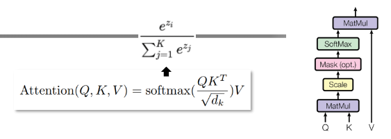

마스크가 없는 경우의 공식은 다음과 같습니다.

$$
\operatorname{Attention}(Q,K,V)
= \operatorname{softmax}\left(\frac{QK^T}{\sqrt{d_k}}\right)V
$$


| 순서  | 계산           | 쉬운 설명                              |
| --- | ------------ | ---------------------------------- |
| 1   | QK^T         | 모든 Query와 Key의 관련도 점수를 한 번에 계산     |
| 2   | 점수 ÷ √d\_k   | 벡터 차원이 커지면서 점수 규모가 커지는 것을 완화       |
| 3   | Mask (필요할 때) | 패딩 등 참고하면 안 되는 위치를 차단              |
| 4   | 행별 Softmax   | 각 Query에 대해 합이 1인 Attention 가중치 생성 |
| 5   | 가중치 행렬 × V   | Value의 가중합으로 토큰별 새 표현 생성           |


Softmax는 한 행의 점수 s_1, …, s_N을 다음과 같이 바꿉니다.

$$
a_{ij} = \frac{\exp(s_{ij})}{\sum_{\ell=1}^{N}\exp(s_{i\ell})}
$$

점수가 높은 위치에 더 큰 가중치를 주지만, 가장 높은 위치 하나만 고르는 것은 아닙니다. **이 가중치는 클래스 정답 확률이 아니라 정보를 섞는 비율**입니다.

행렬 크기를 보면 계산을 확인하기 쉽습니다. 아래는 배치와 Head 차원을 생략하고, 토큰을 행으로 배치한 표기입니다.


| 행렬                  | 크기       |
| ------------------- | -------- |
| Q, K                | N × d\_k |
| V                   | N × d\_v |
| QK^T와 Attention 가중치 | N × N    |
| Attention 출력        | N × d\_v |


즉, **N개 토큰의 관계를 계산한 뒤, 각 토큰에 대해 주변 문맥이 반영된 벡터 하나씩을 만듭니다.** N×N 관계를 직접 계산하는 전역 Self-Attention은 토큰 수가 늘면 관계 계산 비용도 제곱에 비례해 증가합니다.

---

### 가중합과 전역 Attention의 의미

수식과 행렬 크기를 확인했으므로, 이번에는 그 계산이 실제로 어떤 표현을 만드는지 벡터와 문장 예시로 살펴보겠습니다.

#### 1. Value 벡터의 가중합은 무엇일까?

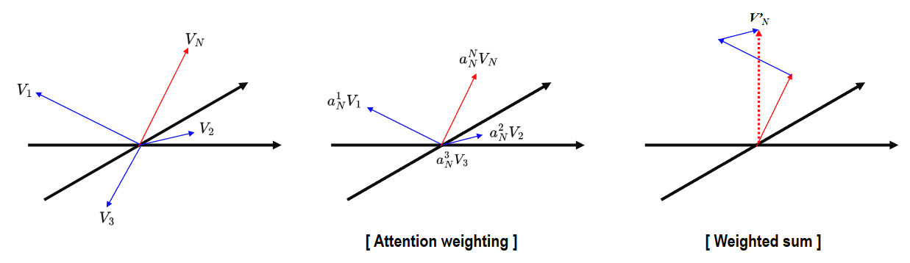

**Attention은 현재 Query에 필요한 정보를 Value 벡터들에서 모아 새로운 벡터를 만듭니다.** 그림은 마지막 토큰의 Query Q_N을 기준으로 이 과정을 보여줍니다.


| 그림                       | 의미                                             |
| ------------------------ | ---------------------------------------------- |
| 왼쪽: 원래 벡터                | 각 토큰의 정보가 방향과 크기를 가진 V\_1, V\_2, …, V\_N으로 표현됨 |
| 가운데: Attention weighting | Q\_N과 각 Key의 관련도로 구한 가중치를 해당 Value에 곱함         |
| 오른쪽: Weighted sum        | 가중치를 곱한 벡터들을 더해 새로운 표현 V′\_N을 만듦               |


$$
V'_N = \sum_{j=1}^{N} a_{Nj}V_j
$$

여기서 a\_{Nj}는 **N번째 Query가 j번째 토큰을 참고하는 비율**입니다. 그림의 a_N^j와 같은 의미이며, Softmax로 만든 가중치는 음수가 아니고 합이 1입니다. 가중치를 곱하면 각 화살표의 길이가 조절되고, 조절된 화살표를 머리와 꼬리가 이어지도록 더한 결과가 점선의 출력 벡터입니다.

즉, **가중치가 큰 토큰의 정보는 많이 반영하고, 작은 토큰의 정보는 적게 반영합니다.** 가장 중요한 토큰 하나만 선택하거나 Value를 단순히 이어 붙이는 연산은 아닙니다. 실제 Value는 고차원이며, 그림은 이를 이해하기 쉽게 낮은 차원으로 표현한 것입니다.

---

#### 2. Global Attention: 멀리 떨어진 단어도 직접 참고하기

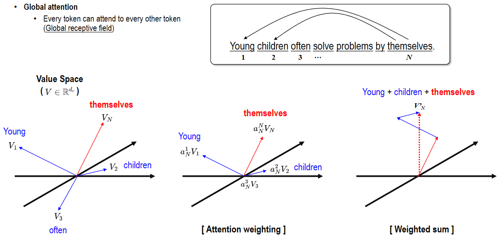

예문은 **“Young children often solve problems by themselves.”**, 즉 “어린아이들은 종종 스스로 문제를 해결한다”입니다. 그림은 마지막 단어 **themselves**가 문장 앞쪽의 **Young·children** 정보를 참고해 문맥을 반영하는 상황을 예시로 보여줍니다.


| 요소     | 예문에서의 역할                                     |
| ------ | -------------------------------------------- |
| Query  | themselves 위치에서 어떤 정보를 참고할지 결정               |
| Key    | Young, children, often 등 각 토큰과의 관련도를 비교하는 기준 |
| Value  | 각 토큰에서 실제로 가져와 섞을 정보                         |
| 가중합 결과 | 다른 토큰의 정보가 반영된 themselves 위치의 새로운 표현         |


**Global Attention은 한 토큰이 시퀀스 전체의 허용된 위치를 직접 참고할 수 있다는 뜻**입니다. Encoder의 전역 Self-Attention에서는 가까운 단어뿐 아니라 멀리 떨어진 단어와 자기 자신도 참고할 수 있어, 전체 시퀀스가 수용 영역이 됩니다. 모든 토큰에 동일한 비중을 준다는 뜻은 아닙니다.

그림의 “Young + children + themselves”는 이 단어들의 정보를 많이 반영한다는 직관적인 표현입니다. 실제로는 마스킹되지 않은 모든 Value를 학습된 비율로 가중합하며, 어떤 단어에 큰 비중을 줄지는 입력·Head·학습 결과에 따라 달라집니다. 특정 Head가 반드시 문법적 관계를 정확히 학습한다고 보장되지는 않습니다.

**CNN의 작은 필터가 주변 위치를 직접 보는 것과 달리, 전역 Attention은 한 층에서도 멀리 떨어진 위치를 연결할 수 있습니다.** 다만 토큰 수 N에 대해 N×N 관련도를 계산하므로 긴 시퀀스에서는 계산 비용이 커집니다.

---

## 2. Vision Transformer (ViT)

지금까지 문장 토큰으로 Attention을 설명했습니다. 이미지에서도 작은 영역을 토큰으로 표현하면 같은 원리를 적용할 수 있습니다. 이때 단어를 대신하는 것이 이미지 패치입니다.

**ViT는 이미지를 작은 패치로 나누고, 각 패치를 문장의 토큰처럼 Transformer Encoder에 넣는 모델**입니다. 패치 사이의 관계를 Self-Attention으로 학습해 이미지의 종류를 분류할 수 있습니다.

### 처리 흐름


| 단계                     | 하는 일                                | RGB 224×224 이미지, 16×16 패치 예시                 |
| ---------------------- | ----------------------------------- | -------------------------------------------- |
| 1. Patch 분할            | 이미지를 겹치지 않는 작은 조각으로 나눔              | 가로·세로 14개씩, 총 196개 패치                        |
| 2. Patch Embedding     | 각 패치를 펼친 뒤 같은 선형 변환을 적용해 D차원 벡터로 만듦 | 패치마다 16×16×3 = 768개 값 → D차원                  |
| 3. CLS 토큰 추가           | 이미지 분류에 사용할 학습 가능한 토큰을 맨 앞에 추가      | 패치 196개 + CLS 1개 = 197개 토큰                   |
| 4. 위치 정보 추가            | 각 토큰에 위치 임베딩을 더함                    | 원 ViT는 학습 가능한 위치 임베딩 사용                      |
| 5. Transformer Encoder | Attention과 MLP로 패치들의 관계와 특징을 가공     | 토큰 수와 벡터 차원을 유지하며 여러 블록 통과                   |
| 6. 분류 Head             | 마지막 CLS 표현을 받아 클래스별 점수를 계산          | 학습은 logits와 Cross Entropy, 추론 시 필요하면 Softmax |


위 예시에서 768은 **패치를 펼친 입력 길이**입니다. 임베딩 차원 D는 모델 설계로 정하며, 반드시 768일 필요는 없습니다. CLS 토큰 역시 최종 정답 라벨 자체가 아니라, 학습을 통해 분류에 필요한 정보를 모으는 표현입니다.

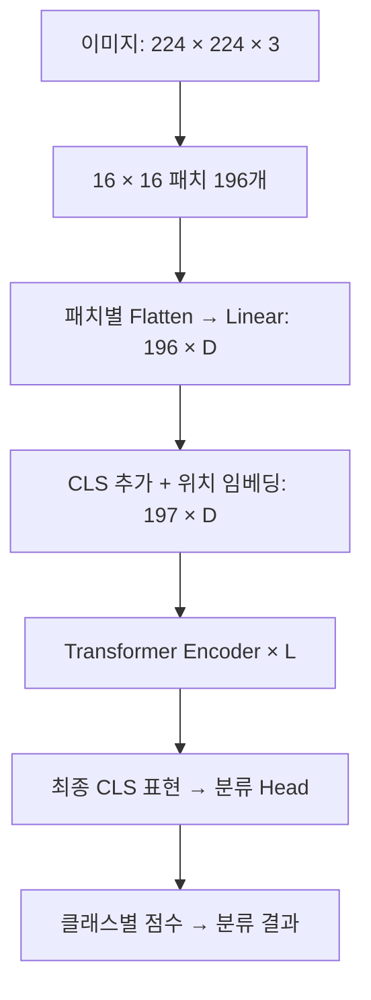

### 패치 사이의 Attention은 무엇을 할까?

고양이 사진이라면 귀가 있는 패치와 눈·몸통이 있는 패치의 정보를 함께 반영할 수 있습니다. **멀리 떨어진 패치도 한 Attention 층에서 직접 연결**할 수 있다는 것이 전역 Self-Attention의 특징입니다. 각 Head가 반드시 특정 부위를 담당하도록 정해져 있는 것은 아닙니다.

원 ViT의 Encoder 블록은 `LayerNorm → Multi-Head Self-Attention → 잔차 덧셈 → LayerNorm → MLP → 잔차 덧셈`의 **Pre-LN 구조**입니다. 앞서 본 원 Transformer의 Post-LN 그림과 정규화 위치가 다릅니다. 이미지 분류용 원 ViT에는 문장을 생성하는 Decoder나 미래 토큰을 가리는 인과 마스크가 필요하지 않습니다.

### CNN과 비교


| 항목       | 일반적인 CNN                          | 기본 ViT                         |
| -------- | --------------------------------- | ------------------------------ |
| 입력 처리    | 작은 필터로 주변 픽셀의 특징 추출               | 이미지를 패치 토큰으로 변환                |
| 위치 사이 관계 | 지역 연산을 여러 층 쌓아 넓은 영역으로 확장         | 전역 Attention으로 모든 패치 관계를 직접 계산 |
| 구조적 가정   | 지역성과 필터의 가중치 공유를 활용               | 상대적으로 적은 이미지 구조 가정, 데이터로 관계 학습 |
| 데이터      | 지역 구조를 활용해 비교적 적은 데이터에서도 유리할 수 있음 | 원 ViT는 대규모 사전학습에서 강점을 보임       |


### 기억할 점

- **패치는 이미지의 토큰**입니다. 패치를 나눴다고 관계를 잃는 것이 아니라, 위치 정보와 Attention으로 관계를 학습합니다.
- **패치가 작아지면 토큰 수가 늘어납니다.** 같은 이미지에서 패치 한 변을 절반으로 줄이면 패치 수는 4배, 패치 간 Attention 점수 수는 약 16배가 됩니다. 이는 모델 전체 연산량이 정확히 16배라는 뜻은 아닙니다.
- **ViT가 항상 CNN보다 좋은 것은 아닙니다.** 데이터 양, 사전학습, 모델 크기, 학습 방법에 따라 결과가 달라집니다.

출처: [ViT 원 논문 — An Image is Worth 16×16 Words](https://arxiv.org/abs/2010.11929)

---

### ViT Architecture

앞 절의 처리 흐름을 구조 그림과 수식에 대응시켜 보겠습니다. 먼저 CLS가 분류 결과로 이어지는 전체 경로를 살펴본 뒤, Encoder 내부의 잔차 연결과 계산식을 확인합니다.

---

#### 1. 전체 구조: 이미지를 토큰 시퀀스로 처리하기

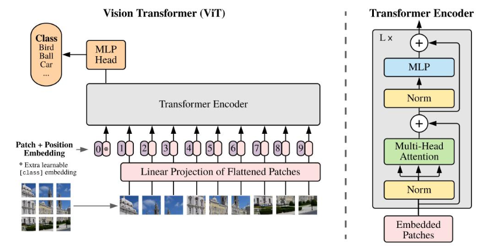

**이미지 → 패치 벡터 → 위치 정보 추가 → Encoder → CLS 출력 → 분류 Head** 순서입니다. 첫 그림은 이해를 위해 이미지를 9개 패치로 나눈 예시이며, 패치 수가 항상 9개인 것은 아닙니다.


| 그림의 구성                                 | 역할                                            |
| -------------------------------------- | --------------------------------------------- |
| 이미지 패치                                 | 이미지를 일정한 크기로 나눈 조각. 각 조각이 토큰 하나가 됨            |
| Linear Projection of Flattened Patches | 각 패치를 한 줄로 펼친 뒤, 동일한 학습 행렬로 D차원 벡터로 변환        |
| 0번 \[CLASS\] 토큰                        | 이미지 분류를 위해 맨 앞에 추가하는 학습 가능한 벡터. 실제 이미지 조각이 아님 |
| Patch + Position Embedding             | 각 패치의 내용과 위치 정보를 결합. CLS에도 위치 임베딩을 더함         |
| Transformer Encoder                    | 모든 토큰 사이의 관계를 계산해 문맥이 반영된 표현을 생성              |
| MLP Head                               | 마지막 CLS 표현을 클래스별 점수(logits)로 변환               |


그림의 0~9는 토큰 위치를 설명하기 위한 표시입니다. 위치 정보를 단순한 정수로 더하는 것이 아니라, **각 위치에 해당하는 D차원 위치 임베딩 벡터를 더합니다.**

CLS는 Attention을 통해 패치 정보를 모으도록 학습되며, 단순히 모든 패치의 평균을 낸 값은 아닙니다. Encoder는 CLS와 패치 토큰을 모두 출력하지만, 이 분류 구조에서는 **최종 CLS 표현을 분류 Head에 사용**합니다.

##### 출력은 10개인데 MLP Head에는 무엇이 들어갈까?

그림처럼 패치가 9개이고 CLS가 1개이면, **Encoder는 D차원 벡터 10개를 출력합니다.** 여기서 10개는 **토큰별 특징 벡터의 개수**이며, 클래스 수와는 별개입니다. 각 벡터는 Attention을 거치며 다른 토큰의 정보를 반영합니다.


| 위치       | Encoder 출력                        | 분류 Head에 사용하는가?          |
| -------- | --------------------------------- | ------------------------ |
| 0번 CLS   | 패치들과 상호작용하며 분류에 필요한 정보를 모은 D차원 벡터 | 이 벡터를 최종 LayerNorm 후 사용  |
| 1\~9번 패치 | 각 패치에 다른 위치의 문맥이 반영된 D차원 벡터 9개    | 이 그림의 분류 Head에는 직접 넣지 않음 |


즉, **10개 출력 중 CLS 위치의 벡터 하나를 선택**합니다. 원래 넣었던 CLS 초기값을 사용하는 것이 아니라, 모든 Encoder 블록을 통과해 이미지 정보가 반영된 **최종 CLS 표현**을 사용합니다. 패치 출력이 Head에 직접 들어가지 않아도, 패치 정보는 Attention을 통해 CLS의 최종 표현에 영향을 줍니다.

```text
Encoder 출력: [최종 CLS, 최종 패치1, …, 최종 패치9] → 10 × D
                    ↓ 0번 위치 선택
                최종 CLS → D
                    ↓ LayerNorm
                  MLP Head
                    ↓
            클래스별 점수 → 클래스 수 C개
```

예를 들어 D가 768이고 클래스가 새·공·자동차의 3개라면, 크기는 **`10×768 → CLS 선택으로 768 → Head 출력 3`**입니다. 토큰 10개를 전부 펼쳐 7,680개 값으로 Head에 넣는 구조가 아닙니다. 배치가 B장이면 각각 `B×10×768 → B×768 → B×3`입니다.

**출력 클래스 수는 토큰 수와 독립적**입니다. 그림의 9개 패치를 사용해도 1,000개 클래스로 분류할 수 있으며, 이때 Head는 CLS의 D차원 표현을 1,000개 점수로 바꿉니다. 패치 표현을 평균 내어 분류하는 ViT 변형도 있지만, 이 그림은 CLS를 선택하는 방식입니다.

##### 그림 오른쪽의 Skip connection

오른쪽 Encoder에서 **오른편으로 돌아가 원 안의 + 기호에 연결되는 화살표**가 Skip connection입니다. Encoder 블록 하나에 두 개가 있으며, 각각 원래 표현에 Attention 또는 MLP의 계산 결과를 더합니다.


| 위치     | 계산                               | 역할                          |
| ------ | -------------------------------- | --------------------------- |
| 아래쪽 연결 | x′ = x + Attention(LayerNorm(x)) | 원래 토큰 표현에 다른 토큰에서 모은 정보를 더함 |
| 위쪽 연결  | 출력 = x′ + MLP(LayerNorm(x′))     | 앞의 표현에 MLP가 가공한 특징을 더함      |


**원래 정보를 그대로 전달하는 길을 두고, 필요한 수정량을 추가한다**고 이해하면 됩니다. 역전파 때도 기울기가 흐를 직접 경로를 제공해 Encoder를 여러 층 쌓아 학습하기 쉽게 합니다.

덧셈은 같은 토큰·같은 특징 위치의 값끼리 더하는 연산이며, 벡터를 이어 붙이는 Concat과 다릅니다. 따라서 Attention과 MLP의 최종 출력은 입력과 같은 `(토큰 수) × D` 형태를 유지합니다. 이 그림은 Norm을 계산 경로 앞에 두는 Pre-LN 구조로, 지름길에는 Norm을 거치지 않은 입력이 흐릅니다.

---

#### 2. 수식으로 보는 데이터 흐름

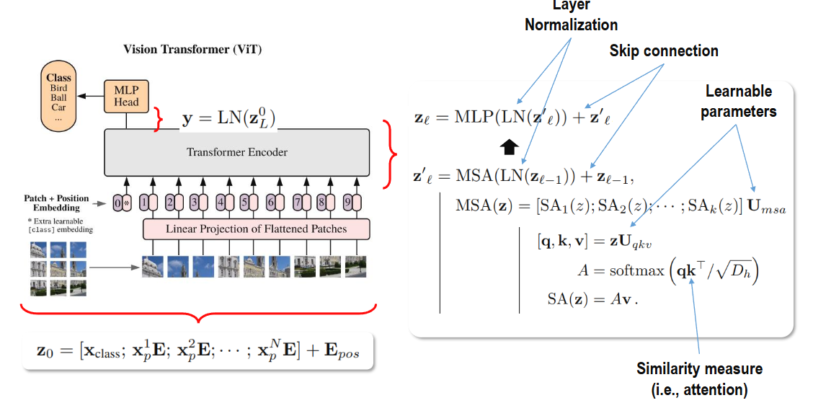

##### 입력 시퀀스 만들기

$$
z_0 = [x_{\mathrm{class}};\;x_p^1E;\;x_p^2E;\;\cdots;\;x_p^NE] + E_{\mathrm{pos}}
$$

- **x_p^i**: i번째 패치를 펼친 벡터. RGB 패치 크기가 P×P이면 길이는 P²×3입니다.
- **E**: 모든 패치에 공유하는 학습 가능한 투영 행렬입니다.
- **x_class**: 학습 가능한 CLS 토큰입니다.
- **[ ; ]**: 토큰들을 시퀀스 방향으로 이어 붙이는 연산입니다.
- **E_pos**: 각 토큰 위치의 학습 가능한 위치 임베딩입니다.
- **z_0**: Encoder에 들어갈 전체 시퀀스입니다. 배치를 제외하면 `(N+1) × D`입니다.

##### Encoder 블록을 L번 쌓기

$$
z'_\ell = \operatorname{MSA}(\operatorname{LN}(z_{\ell-1})) + z_{\ell-1}
$$

$$
z_\ell = \operatorname{MLP}(\operatorname{LN}(z'_\ell)) + z'_\ell
$$


| 기호·구성     | 의미                                                        |
| --------- | --------------------------------------------------------- |
| LN        | Layer Normalization. 각 토큰의 특징 차원을 정규화                     |
| MSA       | Multi-Head Self-Attention. 서로 다른 토큰의 정보를 조합               |
| 블록 내부 MLP | 각 토큰에 같은 신경망을 적용해 특징을 비선형으로 가공. 보통 Linear → GELU → Linear |
| + 입력      | Skip connection. 원래 표현에 새로 계산한 수정량을 더함                    |
| ℓ, L      | 현재 블록 번호와 전체 블록 수                                         |


이 구조는 **정규화를 Attention·MLP 앞에 두는 Pre-LN**입니다. Attention은 토큰 사이의 정보를 섞고, 내부 MLP는 각 토큰의 특징을 가공합니다. 블록 내부 MLP와 마지막 분류용 MLP Head는 역할이 다릅니다.

##### ViT는 왜 Norm을 먼저 적용할까?

**주된 이유는 깊은 Transformer의 학습을 안정화하기 위해서입니다.** 다만 “LLM은 Post-Norm, Vision은 Pre-Norm”이라는 구분은 정확하지 않습니다. 앞서 본 그림은 **원 Transformer의 Post-LN과 원 ViT의 Pre-LN 설계 차이**를 보여줍니다. LLaMA처럼 정규화를 먼저 적용하는 언어 모델도 있습니다.


| 방식        | 계산 — F는 Attention 또는 MLP | 특징                                 |
| --------- | ------------------------ | ---------------------------------- |
| Post-Norm | y = LN(x + F(x))         | 잔차 덧셈 결과 전체에 정규화 적용                |
| Pre-Norm  | y = x + F(LN(x))         | 계산 경로의 입력을 정규화하고, 원래 x는 지름길로 직접 전달 |


Pre-Norm의 이점은 다음과 같습니다.

1. **하위층 입력의 규모를 정돈합니다.** Q·K·V를 만들거나 MLP를 적용하기 전에 토큰의 특징을 정규화해, 입력 규모 변화의 영향을 완화합니다. Attention 점수를 √D_h로 나누는 Scale과는 별개의 과정입니다.
2. **직접적인 기울기 경로를 유지합니다.** 잔차 경로의 x가 블록 내부의 Norm을 거치지 않고 전달되므로, 역전파에서도 그 경로를 활용할 수 있습니다. Post-Norm에서는 덧셈 뒤 Norm의 미분까지 거쳐야 합니다.
3. **초기 학습의 불안정성을 완화합니다.** 초기화 시 기울기 규모를 분석한 연구에서는 Pre-LN이 더 안정적인 기울기를 보였습니다. 그렇다고 모든 모델에서 warm-up이 불필요하거나 Pre-Norm이 항상 더 좋은 것은 아닙니다. [정규화 위치에 관한 연구](https://arxiv.org/abs/2002.04745)

LLaMA는 이와 같은 **Pre-Norm 배치에 RMSNorm을 사용**합니다. 즉, **정규화의 위치(Pre/Post)**와 **정규화의 종류(LayerNorm/RMSNorm)**는 별개의 선택입니다. 여기서 설명하는 Norm은 이미지 픽셀의 전처리 정규화나 CNN의 BatchNorm이 아닙니다. [LLaMA 원 논문](https://arxiv.org/abs/2302.13971)

##### Attention 내부 계산

$$
[Q,K,V] = ZU_{qkv}, \qquad
A = \operatorname{softmax}\left(\frac{QK^T}{\sqrt{D_h}}\right), \qquad
\operatorname{SA}(Z) = AV
$$

U_qkv는 Q·K·V를 만드는 학습 가중치이고, D_h는 Head 하나의 Query·Key 차원입니다. A는 각 토큰이 다른 토큰을 얼마나 참고할지 정하는 가중치 행렬입니다. Softmax는 각 Query의 Key 방향으로 적용합니다.

여러 Head의 결과를 이어 붙이고 출력 투영 행렬로 조합합니다.

$$
\operatorname{MSA}(Z)
= \operatorname{Concat}(\operatorname{SA}_1(Z),\ldots,\operatorname{SA}_h(Z))U_{\mathrm{msa}}
$$

##### 최종 CLS로 분류하기

$$
y = \operatorname{LN}(z_L^{(0)}), \qquad
\mathrm{logits} = \operatorname{Head}(y)
$$

z_L의 **0번 토큰이 CLS**입니다. 그림의 y는 정규화된 이미지 표현이며, 아직 클래스별 확률이 아닙니다. Head가 logits를 만들고, 확률이 필요할 때 Softmax를 적용합니다. CrossEntropyLoss로 학습할 때는 Softmax 전 logits를 사용합니다.

---

#### 학습되는 값과 설계하는 값


| 구분      | 예시                                                                         |
| ------- | -------------------------------------------------------------------------- |
| 학습 파라미터 | 패치 투영 E, CLS 토큰, 위치 임베딩, Q·K·V 및 출력 투영 가중치, MLP·Head 가중치, LayerNorm의 배율·편향 |
| 하이퍼파라미터 | 패치 크기 P, 임베딩 차원 D, Head 수 h, Encoder 블록 수 L                                |


**학습 중 패치별 Attention 가중치 A도 달라지지만, A 자체를 고정 파라미터로 저장해 학습하는 것은 아닙니다.** A는 현재 입력과 학습된 Q·K 변환으로 매번 계산하는 중간 결과입니다.

---

### Patch Embedding

전체 구조를 확인했으므로, 이제 이미지가 분류 결과로 바뀌는 경로를 입력부터 다시 따라가겠습니다. 첫 단계는 이미지를 패치로 나누고, 각 패치를 일정한 길이의 토큰으로 표현하는 것입니다.

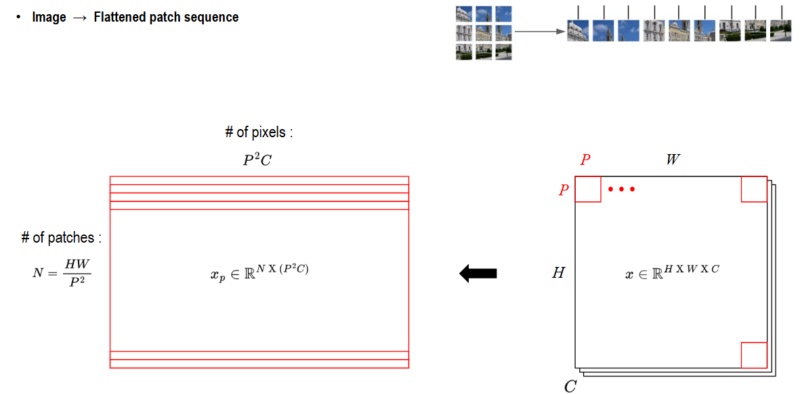

**Patch Embedding은 이미지의 작은 조각 하나를 Transformer가 처리할 토큰 벡터 하나로 바꾸는 과정**입니다. 그림은 그중 **패치 분할과 Flatten 단계**를 보여주며, 완전한 임베딩을 만들려면 뒤에 학습 가능한 선형 변환이 추가됩니다.

#### 그림의 크기 읽기


| 기호   | 의미                                              |
| ---- | ----------------------------------------------- |
| H, W | 이미지의 높이와 너비                                     |
| C    | 입력 채널 수. RGB이면 3                                |
| P    | 정사각형 패치 한 변의 길이                                 |
| N    | 패치 개수. 겹치지 않게 나누고 H·W가 P로 나누어떨어지면 (H/P) × (W/P) |
| P²C  | 패치 하나를 펼친 벡터의 길이. 공간 픽셀 수 P²에 채널 수 C를 곱한 값      |
| D    | 선형 변환 후 토큰 하나의 임베딩 차원                           |


이미지 전체를 한 번에 펼치는 것이 아니라 **각 패치를 따로 펼쳐 한 행으로 배치**합니다. 따라서 그림 왼쪽의 행렬은 `N × (P²C)`이며, 행 하나가 패치 하나입니다.

#### 예시: RGB 224×224 이미지와 16×16 패치


| 단계          | 계산 또는 크기                             |
| ----------- | ------------------------------------ |
| 이미지         | 224 × 224 × 3                        |
| 패치 개수       | (224/16) × (224/16) = 14 × 14 = 196개 |
| 패치 하나의 값 개수 | 16 × 16 × 3 = 768개                   |
| 패치별 Flatten | 196 × 768                            |
| 선형 변환 후     | 196 × D. 예를 들어 D=512이면 196 × 512     |
| CLS 추가 후    | 197 × D                              |
| 위치 임베딩 추가 후 | 197 × D. 덧셈이므로 크기는 그대로               |


**Flatten은 값의 배치 형태만 바꾸며, 학습하는 가중치가 없습니다.** 그다음 Linear가 각 패치의 픽셀·채널 값을 조합해 특징을 학습합니다. D는 설계자가 정하므로 패치를 펼친 길이인 P²C와 같을 필요가 없습니다.

#### 선형 변환으로 임베딩 만들기

행벡터를 사용하는 표기에서 패치 시퀀스 X_p와 학습 가중치 E의 크기는 다음과 같습니다.

$$
X_p \in \mathbb{R}^{N \times (P^2C)}, \qquad
E \in \mathbb{R}^{(P^2C) \times D}, \qquad
Z = X_pE \in \mathbb{R}^{N \times D}
$$

구현에서는 편향을 더할 수도 있습니다. **모든 패치에 같은 변환 행렬 E를 공유**하며, 이후 CLS와 위치 임베딩을 추가해 Encoder에 넣습니다. 이 단계는 각 패치 내부의 정보를 변환하고, 서로 다른 패치의 정보를 섞는 역할은 뒤의 Attention이 맡습니다.

#### CNN과 연결해서 이해하기

기본적인 비중첩 패치의 `Flatten → Linear`는 **kernel_size=P, stride=P, 입력 채널 C, 출력 채널 D인 Conv2d**로도 같은 연산을 구현할 수 있습니다. Conv2d 출력의 공간 격자를 토큰 순서로 펼치면 `N × D`가 됩니다. 따라서 ViT의 Patch Embedding에 합성곱 연산을 사용하는 구현도 가능합니다.

**패치를 작게 나누면 세밀한 공간 정보를 더 많은 토큰으로 표현하지만, Attention 계산 비용도 증가합니다.** 입력 크기가 패치 크기로 나누어떨어지지 않는 경우에는 전처리나 Padding 등의 처리 방식도 정해야 합니다.

---

### Linear Projection

패치를 펼치면 픽셀 값을 행렬로 정리할 수 있지만, 아직 Transformer에서 사용할 특징을 학습한 것은 아닙니다. Patch Embedding의 두 번째 단계인 Linear Projection이 이 변환을 담당합니다.

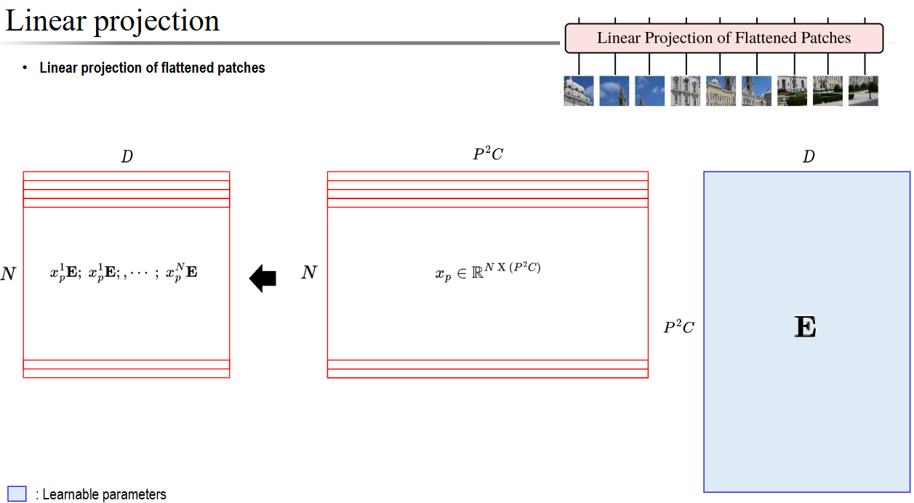

**Linear Projection은 패치의 픽셀 값들을 학습된 가중치로 조합해, Transformer가 사용할 D차원 특징 벡터로 바꾸는 단계**입니다. 그림에서는 가운데 패치 행렬과 오른쪽 가중치 E를 곱해 왼쪽 결과를 만듭니다.


| 그림의 부분       | 크기        | 의미                        |
| ------------ | --------- | ------------------------- |
| 가운데 X\_p     | N × (P²C) | 패치 N개를 각각 한 행으로 펼친 픽셀 값   |
| 오른쪽 E — 파란색  | (P²C) × D | 모든 패치에 공유하는 학습 가능한 변환 가중치 |
| 왼쪽 Z = X\_pE | N × D     | 패치마다 만들어진 D차원 토큰 벡터       |


$$
\underbrace{X_p}_{N \times (P^2C)}
\underbrace{E}_{(P^2C) \times D}
= \underbrace{Z}_{N \times D}
$$

#### 무엇이 바뀌고, 무엇이 유지될까?

- **패치 수 N은 유지됩니다.** 패치 하나가 토큰 하나로 변환됩니다.
- **패치별 벡터 길이는 P²C에서 D로 바뀝니다.** D는 설계값이며, 차원을 줄이거나 늘리거나 같게 둘 수 있습니다.
- **E는 학습으로 바뀝니다.** 손실에서 역전파된 기울기로 갱신되며, 모든 패치 위치에 같은 E를 적용합니다.
- **이 단계는 패치끼리 정보를 섞지 않습니다.** 한 패치 내부의 픽셀·채널을 조합하고, 패치 사이의 관계는 뒤의 Attention이 처리합니다.

예를 들어 RGB 224×224 이미지를 16×16 패치로 나누고 D=512로 설정하면 다음과 같습니다.

```text
펼친 패치 X_p       학습 가중치 E       패치 임베딩 Z
  196 × 768    ×      768 × 512    =      196 × 512
```

출력 특징 하나는 해당 패치의 768개 입력값에 서로 다른 가중치를 곱해 더한 값입니다. E의 열마다 다른 조합을 학습하므로, 한 패치에서 512개 특징을 만들 수 있습니다. 구현에 따라 D개 편향을 더할 수도 있습니다.

**Flatten이 숫자의 배치만 바꾼다면, Linear Projection은 숫자를 실제로 계산해 새로운 특징으로 바꿉니다.** 예시의 가중치 수는 768×512 = 393,216개이며, 편향을 쓰면 512개가 추가됩니다. 패치 196개마다 별도 가중치를 만드는 것은 아닙니다.

이후 CLS 토큰을 추가하고 위치 임베딩을 더하면 Encoder 입력이 됩니다. 이 단계의 E는 Attention 내부에서 Q·K·V를 만드는 가중치와는 별개입니다.

---

### Position Embedding

Linear Projection은 각 패치의 내용을 벡터로 만들었습니다. 여기에 분류용 CLS를 추가하고, 각 패치가 이미지의 어느 위치에서 왔는지 알려주면 Encoder 입력이 완성됩니다.

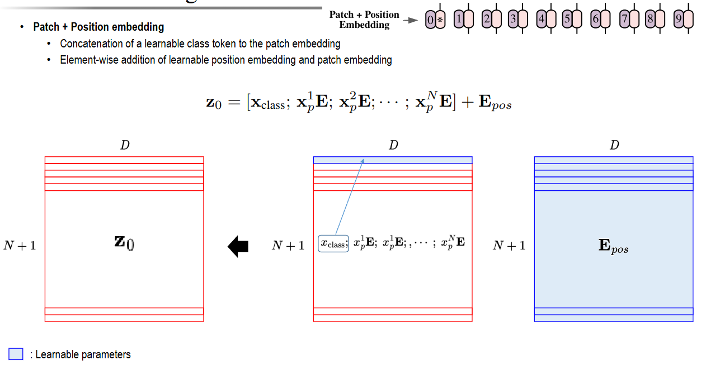

**Position Embedding은 패치의 내용 벡터에 ‘어느 위치에서 온 패치인지’를 알려주는 벡터를 더하는 방법**입니다. 패치 임베딩이 내용 정보라면, 위치 임베딩은 위치 정보입니다.

#### 왜 위치 정보가 필요할까?

기본 Self-Attention은 위치 정보가 없으면 벡터의 내용으로 관계를 계산할 뿐, 배열 순서만으로 왼쪽·오른쪽이나 위·아래를 구별하지 못합니다. 토큰 순서를 바꾸면 출력도 같은 순서로 바뀌는 성질이 있으므로, **이미지의 공간 배치를 활용하려면 위치 정보가 필요**합니다.

#### 그림의 계산 순서


| 순서  | 연산                               | 크기 변화               |
| --- | -------------------------------- | ------------------- |
| 1   | Linear Projection으로 패치 N개를 임베딩   | N × D               |
| 2   | 학습 가능한 CLS 벡터를 맨 앞에 추가           | (N+1) × D           |
| 3   | 같은 형태의 위치 임베딩 E\_pos를 원소별로 더함    | (N+1) × D 유지        |
| 4   | 결과 z\_0를 Transformer Encoder에 전달 | 토큰마다 내용과 위치가 함께 반영됨 |


$$
z_0 = [x_{\mathrm{class}};\;x_p^1E;\;\cdots;\;x_p^NE] + E_{\mathrm{pos}}
$$

그림 가운데의 첫 행은 CLS이며, 오른쪽 E_pos는 **각 토큰 위치에 대응하는 D차원 벡터를 한 행씩 가진 학습 파라미터**입니다. 0번 CLS에도 별도의 위치 벡터가 대응합니다.

#### CLS 추가와 위치 정보 추가는 다른 연산

- **CLS는 시퀀스에 이어 붙입니다.** 토큰이 한 개 늘어나지만 D는 그대로입니다.
- **위치 임베딩은 같은 자리끼리 더합니다.** 토큰 수와 D 모두 바뀌지 않습니다.
- 그림의 **0, 1, 2, …는 위치를 설명하는 번호**입니다. 그 정수 자체를 모든 특징 값에 더하는 것은 아닙니다.

예를 들어 한 패치의 내용 벡터가 `[0.2, 0.5, -0.1]`, 그 위치의 벡터가 `[0.1, -0.2, 0.3]`이면 Encoder에 넣는 벡터는 `[0.3, 0.3, 0.2]`입니다. 실제 값은 학습으로 정해집니다.

RGB 224×224 이미지를 16×16 패치로 나누고 D=512라면, **196×512 → CLS 추가로 197×512 → 위치 벡터를 더해도 197×512**입니다. 이때 위치 임베딩은 197×512 = 100,864개의 학습 가능한 값을 가지며, CLS 자체의 512개 값과는 별개입니다.

#### 학습과 이미지 크기 변경

원 ViT는 각 위치에 대응하는 **학습 가능한 절대 위치 임베딩**을 사용합니다. 같은 위치의 벡터를 여러 이미지에 공유하며, 학습 중 역전파로 갱신합니다. 단순한 2차원 좌표 자체가 아니라, 패치를 일정한 순서로 나열한 위치에 대응하는 벡터입니다.

입력 해상도를 바꿔 패치 격자 크기가 달라지면 기존 위치 임베딩의 길이도 맞춰야 합니다. 사전학습한 ViT를 다른 해상도로 사용할 때는 패치 위치 임베딩을 2차원 격자로 해석해 보간하는 방법을 사용할 수 있으며, CLS 위치 벡터는 따로 유지합니다.

---

### Query/Key/Value

내용과 위치를 담은 토큰 시퀀스가 준비되면 Encoder가 토큰 사이의 관계를 계산합니다. 이를 위해 먼저 현재 토큰 표현에서 Q·K·V를 만듭니다.

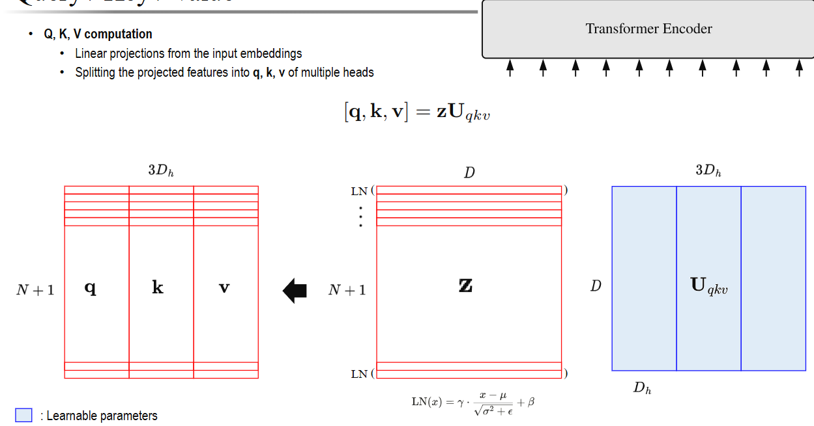

**Q·K·V는 같은 토큰 표현을 서로 다른 목적에 맞게 선형 변환한 결과**입니다. ViT의 Self-Attention에서는 CLS와 패치 토큰 모두에서 Q·K·V를 만듭니다.


| 요소       | 역할                   | 다음 계산에서의 용도        |
| -------- | -------------------- | ------------------ |
| Query(Q) | 이 위치에서 어떤 정보를 찾을지 표현 | 각 Key와 비교          |
| Key(K)   | 각 위치의 정보를 비교하기 위한 표현 | Query와 내적해 관련도 계산  |
| Value(V) | 실제로 모아서 사용할 내용       | Attention 가중치로 가중합 |


#### 그림의 계산 과정

가운데 Z는 CLS를 포함한 토큰 N+1개의 표현입니다. 각 행이 토큰 하나이고 길이는 D입니다. Pre-LN 구조에서는 **각 토큰의 D개 특징을 LayerNorm으로 정규화한 뒤** Q·K·V 변환에 사용합니다.

$$
\widetilde{Z} = \operatorname{LN}(Z), \qquad
[Q,K,V] = \widetilde{Z}U_{qkv}
$$

그림의 식은 간단히 zU_qkv로 표시하지만, 이 블록에서는 실제로 Norm을 통과한 표현을 사용합니다. LayerNorm의 평균·분산은 각 토큰의 특징 차원에서 계산하며, 정규화만으로 행렬 크기는 바뀌지 않습니다.

#### 왜 3D_h일까?

**Head 하나에서 길이 D_h인 Q·K·V를 각각 하나씩 만들기 때문**입니다.

```text
Q: D_h개 값 + K: D_h개 값 + V: D_h개 값 = 총 3D_h개 값
```


| 그림의 행렬             | Head 하나 기준 크기   |
| ------------------ | --------------- |
| 입력 Z 및 LN(Z)       | (N+1) × D       |
| 가중치 U\_qkv         | D × (3D\_h)     |
| 한 번에 계산한 \[Q,K,V\] | (N+1) × (3D\_h) |
| 나눈 뒤 Q, K, V 각각    | (N+1) × D\_h    |


이는 **토큰이 3배가 된다는 뜻이 아니라, 각 토큰의 특징 방향으로 Q·K·V를 나란히 계산했다는 뜻**입니다. 이후 세 부분으로 나누어 사용합니다. Q와 K를 비교해 가중치를 만들고, 그 가중치로 V를 합합니다.

U_qkv는 서로 다른 세 행렬을 옆으로 붙인 것으로 이해할 수 있습니다.

$$
U_{qkv} = [U_Q\;U_K\;U_V], \qquad
Q=\widetilde{Z}U_Q,\quad
K=\widetilde{Z}U_K,\quad
V=\widetilde{Z}U_V
$$

**Q·K·V를 각각 계산하는 것과 같은 선형 변환을 하나의 행렬 곱으로 묶은 방식**입니다. 가중치가 서로 다르므로 같은 입력에서도 서로 다른 Q·K·V를 얻습니다.

#### 여러 Head를 한 번에 계산하면?

일반적인 구성에서 Head 수를 h라 하면 D_h = D/h입니다. 그림의 **3D_h는 Head 하나 기준**이고, 모든 Head의 Q·K·V를 한 번에 계산하는 구현에서는 **3hD_h = 3D**개 값이 필요합니다.

예를 들어 D=768, h=12이면 D_h=64입니다.


| 범위          | 토큰 하나당 Q·K·V 값 개수 | 투영 가중치 크기   |
| ----------- | ----------------- | ----------- |
| Head 하나     | 3 × 64 = 192      | 768 × 192   |
| 12개 Head 전체 | 12 × 192 = 2,304  | 768 × 2,304 |


배치 크기가 B, 토큰 수가 T=N+1이면, 전체 QKV 출력은 `B × T × 3D`입니다. 이를 Q·K·V와 Head별로 나누면 **각각 `B × h × T × D_h`** 형태로 Attention을 계산할 수 있습니다. 토큰을 Head별로 나누는 것이 아니라, **각 Head가 모든 토큰의 서로 다른 표현을 처리**합니다.

> 3D_h는 Q·K·V 차원을 모두 같게 둔 이 그림의 조건입니다. 일반적으로 Q·K 차원이 d_k, V 차원이 d_v라면 합친 길이는 2d_k+d_v입니다. 또한 파란색 U_qkv는 학습 파라미터이고, Q·K·V는 입력에 따라 매번 계산되는 중간 결과입니다.

---

### Attention among patches

Q·K·V를 얻었으므로, 먼저 Q와 K로 토큰 사이의 관련도를 계산합니다. 이 단계에서는 어떤 토큰의 정보를 얼마나 참고할지 정하고, 실제 정보의 조합은 다음 단계에서 수행합니다.

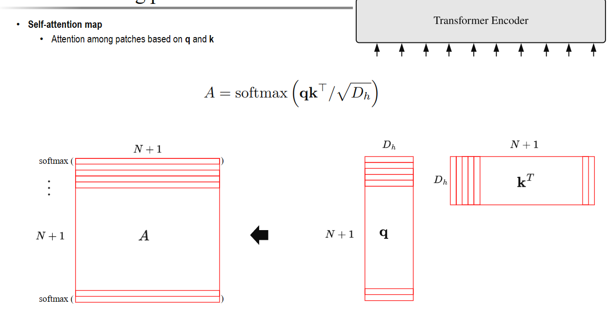

**각 패치가 다른 패치의 정보를 얼마나 참고할지 Q와 K로 계산하는 단계**입니다. 제목은 패치 간 Attention이지만, 그림의 N+1에는 패치 N개와 CLS 토큰 1개가 모두 포함됩니다. 아래는 Head 하나 기준이며 배치 차원은 생략했습니다.

$$
A = \operatorname{softmax}\left(\frac{QK^T}{\sqrt{D_h}}\right)
$$


| 그림의 행렬 | 크기            | 역할                                   |
| ------ | ------------- | ------------------------------------ |
| Q      | (N+1) × D\_h  | 각 토큰이 정보를 찾기 위한 Query                |
| K^T    | D\_h × (N+1)  | 모든 Key를 비교할 수 있도록 전치                 |
| QK^T   | (N+1) × (N+1) | 모든 Query–Key 쌍의 관련도 점수               |
| A      | (N+1) × (N+1) | Scale 후 행별 Softmax로 만든 Attention 가중치 |


#### A의 한 칸과 한 행은 무엇일까?

**A의 i행 j열은 i번째 토큰이 j번째 토큰의 Value를 얼마나 반영할지 나타내는 가중치**입니다. 행은 정보를 모으는 Query, 열은 참고 대상인 Key에 대응합니다.

- **0행**: CLS가 자기 자신과 모든 패치를 참고하는 비율입니다.
- **i행**: i번째 패치가 CLS 및 다른 패치·자기 자신을 참고하는 비율입니다.
- **행별 합은 1**입니다. 열의 합까지 1이어야 하는 것은 아닙니다.
- **서로 참고하는 비율은 다를 수 있습니다.** A_ij와 A_ji가 같다는 보장은 없습니다.

예를 들어 패치 9개와 CLS가 있으면 Q·K는 각각 `10 × D_h`, A는 `10 × 10`입니다. **100개의 관계 가중치를 계산하는 것이며, 이미지 클래스 100개를 예측한다는 뜻은 아닙니다.**

#### 왜 Scale과 Softmax를 적용할까?

1. **QK^T**: 학습된 표현에서 관련도 점수를 구합니다. 단순히 원본 픽셀 색상이 비슷한지만 비교하는 것은 아닙니다.
2. **√D_h로 나누기**: Head 차원이 커지면서 내적 점수의 규모가 커지는 것을 완화합니다.
3. **행별 Softmax**: 각 Query의 점수들을 음수가 아니고 합이 1인 정보 조합 비율로 바꿉니다.

**이 단계의 A는 어디를 참고할지 정한 지도이며, 아직 Value를 모은 결과가 아닙니다.** 다음 단계에서 A에 V를 곱하면 각 토큰의 새로운 표현이 만들어집니다.

$$
O = AV, \qquad
O \in \mathbb{R}^{(N+1) \times D_h}
$$

기본 ViT Encoder는 전역 Self-Attention을 사용하므로 멀리 떨어진 패치도 한 층에서 직접 참고할 수 있습니다. 각 Head와 각 층은 서로 다른 A를 계산하며, A 자체는 고정된 학습 파라미터가 아니라 현재 입력으로 계산하는 중간 결과입니다.

---

### Self-attention

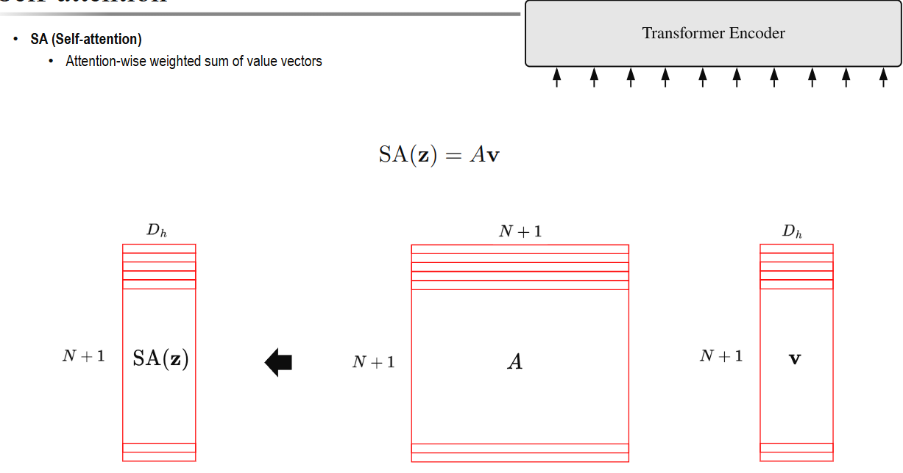

**Self-Attention은 같은 시퀀스에서 만든 Q·K·V를 사용해, 각 토큰에 다른 토큰의 정보를 반영하는 연산**입니다. ‘Self’는 자기 토큰만 본다는 뜻이 아니라, Q·K·V의 출처가 같은 시퀀스라는 뜻입니다.

앞 항목에서 Q·K로 만든 A가 **얼마나 참고할지**를 나타냈다면, 이 그림은 A로 V를 조합해 **실제로 정보를 가져오는 단계**입니다. Head 하나 기준이며, N은 패치 수이고 CLS까지 포함한 토큰 수는 N+1입니다.

$$
\operatorname{SA}(Z) = AV
$$


| 그림의 행렬   | 크기            | 의미                      |
| -------- | ------------- | ----------------------- |
| 가운데 A    | (N+1) × (N+1) | 각 토큰이 모든 토큰을 참고하는 비율    |
| 오른쪽 V    | (N+1) × D\_h  | 각 토큰에서 가져올 정보           |
| 왼쪽 SA(Z) | (N+1) × D\_h  | 다른 위치의 정보를 반영한 토큰별 새 표현 |


#### 행 하나를 계산하면?

출력의 i번째 행은 A의 i번째 행을 가중치로 사용해, 모든 Value 벡터를 더한 결과입니다.

$$
O_i = \sum_{j=0}^{N} A_{ij}V_j
$$

여기서는 0번이 CLS, 1~N번이 패치입니다. 예를 들어 세 토큰의 Value와 한 Query의 가중치가 다음과 같다고 하겠습니다.

```text
V_0 = [2, 0], V_1 = [0, 4], V_2 = [2, 2]
가중치 = [0.5, 0.3, 0.2]

출력 = 0.5[2, 0] + 0.3[0, 4] + 0.2[2, 2]
     = [1.4, 1.6]
```

이처럼 **여러 토큰의 정보를 벡터 하나로 모으되, 각 Query마다 다른 비율로 모읍니다.** 모든 토큰을 하나의 벡터로 합쳐 없애는 것이 아니라, 토큰 수만큼 출력 벡터를 만듭니다.

#### ViT에서의 크기 예시와 다음 단계

패치가 9개이고 CLS가 1개, Head 차원이 64라면 **`A: 10×10`과 `V: 10×64`를 곱해 `출력: 10×64`**를 얻습니다. 0번 출력은 CLS가 모은 정보이고, 다른 출력들은 각 패치가 모은 정보입니다.

여기까지는 **Head 하나의 결과**입니다. 이후 여러 Head의 출력을 Concat하고 출력 Linear로 조합한 다음, 잔차 연결과 MLP를 거쳐 Encoder 처리가 이어집니다. SA(Z) 자체는 클래스 확률이나 최종 분류 결과가 아닙니다.

---

### Multi-Head Self-Attention

앞 절에서는 Head 하나가 Value를 모으는 과정을 확인했습니다. 이제 여러 Head의 결과를 합쳐 Encoder가 사용할 하나의 표현으로 되돌립니다.

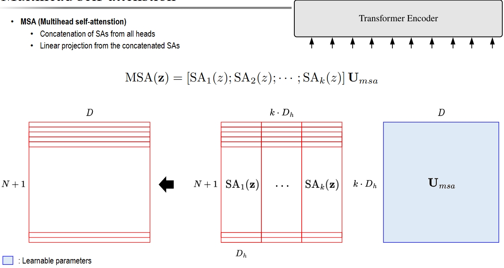

**여러 Head가 서로 다른 관계로 모은 정보를 이어 붙이고, 하나의 토큰 표현으로 조합하는 단계**입니다. 그림의 k는 Head 수이며, 앞 항목의 h와 같은 의미입니다. Key 행렬 K와는 구분합니다.

$$
\operatorname{MSA}(Z)
= \operatorname{Concat}(\operatorname{SA}_1(Z),\ldots,\operatorname{SA}_h(Z))U_{\mathrm{msa}}
$$


| 순서  | 연산                                    | 크기 — 배치 생략            |
| --- | ------------------------------------- | --------------------- |
| 1   | Head마다 서로 다른 Q·K·V로 Self-Attention 계산 | Head 하나당 (N+1) × D\_h |
| 2   | 같은 토큰의 Head별 출력을 특징 방향으로 Concat       | (N+1) × (hD\_h)       |
| 3   | 학습 가능한 출력 가중치 U\_msa로 선형 변환           | 가중치: (hD\_h) × D      |
| 4   | 원래 모델 차원의 표현을 출력                      | (N+1) × D             |


#### Concat과 출력 Linear는 왜 필요할까?

**Concat은 정보를 나란히 놓고, Linear는 서로 섞습니다.** Head마다 학습한 표현을 그대로 보관하는 데서 끝내지 않고, 출력 가중치가 여러 Head의 정보를 조합합니다. 출력 차원을 D로 맞추면 블록 입력과 잔차 덧셈도 할 수 있습니다.

예를 들어 패치 9개와 CLS 1개, D=768, Head 12개, D_h=64이면 다음과 같습니다.

```text
Head별 출력 12개: 각각 10 × 64
         ↓ 같은 토큰의 특징을 Concat
10 × (12 × 64) = 10 × 768
         ↓ 출력 Linear: 768 × 768
최종 MSA 출력: 10 × 768
```

토큰이 120개가 되는 것이 아니라 **토큰 10개 각각의 Head별 특징을 합치는 것**입니다. hD_h가 이미 D와 같더라도, 출력 Linear는 학습을 통해 Head들의 정보를 섞는 역할을 합니다. 여러 Head의 Attention 가중치를 단순히 평균 내는 과정과도 다릅니다.

#### Encoder에서 이어지는 처리

Pre-LN ViT 블록에서는 `입력 → LN → MSA → 원래 입력과 더하기 → LN → MLP → 다시 더하기` 순서로 진행합니다. 이런 블록을 L개 통과한 뒤 최종 CLS를 분류에 사용합니다. Head별 결과가 각각 별도의 이미지 분류 결과인 것은 아닙니다.

---

### Classification

여러 Head의 결과는 잔차 연결과 MLP를 거치고, 다음 Encoder 블록으로 전달됩니다. 이 과정을 모든 블록에서 반복한 뒤에는 최종 CLS 표현을 선택해 이미지 분류를 수행합니다.

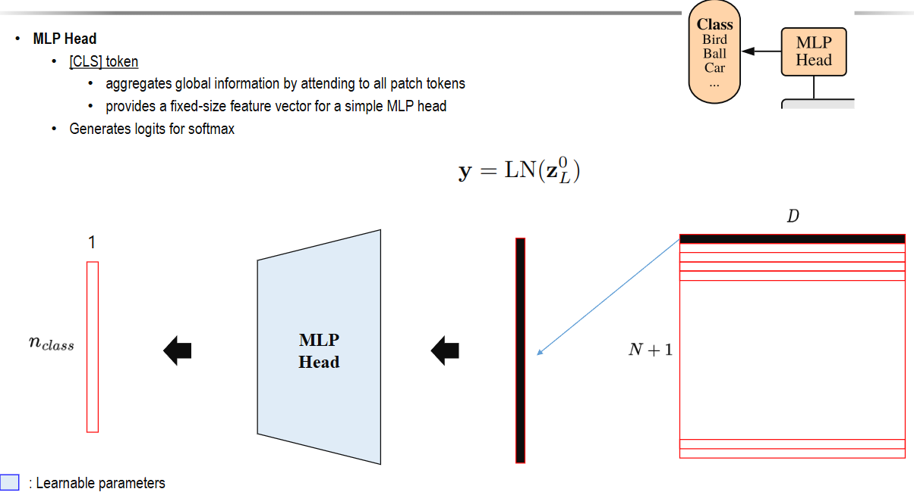

**Encoder의 전체 출력 중 0번 CLS 벡터를 골라, 이미지의 클래스별 점수로 바꾸는 단계**입니다. 그림은 오른쪽에서 왼쪽으로 읽습니다.

$$
y = \operatorname{LN}(z_L^{(0)}), \qquad
\mathrm{logits} = \operatorname{Head}(y)
$$


| 단계                  | 크기 — 배치 생략 | 의미                        |
| ------------------- | ---------- | ------------------------- |
| 최종 Encoder 출력 z\_L  | (N+1) × D  | CLS와 모든 패치의 문맥 표현         |
| 0번 CLS 선택           | D          | 이미지 분류에 사용할 특징 벡터 하나      |
| LayerNorm           | D          | 최종 CLS 표현을 정규화. 그림의 y에 해당 |
| 분류 Head             | n\_class   | 클래스마다 점수(logit) 하나 계산     |
| Softmax — 확률이 필요할 때 | n\_class   | 점수를 합이 1인 클래스 확률로 변환      |


#### 왜 CLS 하나만 사용할까?

CLS는 각 블록의 Self-Attention에서 패치들과 상호작용하며 **분류에 필요한 정보를 모으도록 학습**됩니다. 그래서 패치 수와 별개로 Head에 D차원 벡터 하나를 전달할 수 있습니다. 패치 출력들이 직접 Head에 들어가지 않아도, Attention을 통해 CLS 표현과 분류 결과에 영향을 줍니다.

그림의 MLP Head는 분류용 신경망을 가리킵니다. 구성에 따라 여러 층일 수도 있고, 파인튜닝 시에는 Linear 한 층을 사용할 수도 있습니다. Encoder 내부에서 토큰별 특징을 가공하는 MLP와는 별개의 모듈입니다.

#### 숫자로 보는 분류 예시

패치 9개, CLS 1개, D=768, 클래스가 새·공·자동차 3개이면 다음과 같습니다.

```text
Encoder 출력 10 × 768
→ 최종 CLS 선택 및 LayerNorm: 768
→ 분류 Head: 점수 3개
→ Softmax 예시: [새 0.7, 공 0.2, 자동차 0.1]
→ 가장 높은 확률의 '새' 선택
```

**토큰 수 10과 클래스 수 3은 서로 다른 개념**입니다. 배치가 B장이면 흐름은 `B × 10 × 768 → B × 768 → B × 3`입니다. 그림에서 클래스 출력이 세로 벡터로 그려진 것은 시각화 방식이며, 코드에서는 보통 배치마다 클래스 점수를 한 행으로 배치합니다.

#### 학습과 추론에서 주의할 점

- **학습:** CrossEntropyLoss에 Softmax 전 logits와 정수 정답 라벨을 넣습니다. 손실은 Head뿐 아니라 Encoder·패치 투영·CLS·위치 임베딩까지 역전파됩니다. 단, 학습 대상으로 설정된 파라미터에 한합니다.
- **추론:** 확률을 표시하려면 Softmax를 사용합니다. 가장 높은 점수의 클래스만 필요하면 logits에 바로 argmax를 적용해도 결과가 같습니다.
- **Attention 가중치와 클래스 확률은 다릅니다.** Attention은 어느 토큰의 정보를 섞을지 정하고, 최종 Softmax는 어느 클래스일지 나타냅니다.

---

### ViT 실험과 학습된 표현

이제 입력부터 분류까지의 계산 흐름을 확인했습니다. 다음 실험은 이러한 구조가 학습을 통해 어떤 시각적 특징과 공간 관계를 얻는지, 그리고 사전학습 데이터의 규모가 왜 중요한지를 보여줍니다.

#### 1. 학습된 ViT 내부를 살펴보기

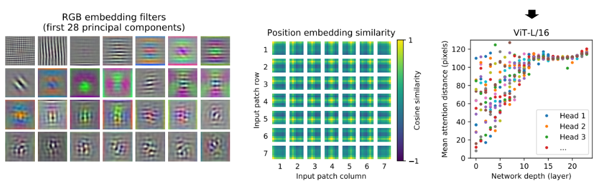

**이 그림은 학습 후 ViT가 어떤 특징과 공간 관계를 표현하는지 분석한 결과입니다.** 왼쪽·가운데는 ViT-L/32, 오른쪽은 표시된 ViT-L/16의 분석입니다. 모델 이름의 `/32`와 `/16`은 패치 한 변의 픽셀 크기를 뜻합니다.


| 부분                                 | 무엇을 보여주는가?                              | 쉬운 해석                                                |
| ---------------------------------- | --------------------------------------- | ---------------------------------------------------- |
| 왼쪽: RGB embedding filters          | 학습된 패치 투영 필터의 주요 변화를 PCA로 요약한 첫 28개 주성분 | 선·방향·색 변화 같은 패턴을 표현하는 기초가 학습됨                        |
| 가운데: Position embedding similarity | 기준 위치와 다른 모든 위치의 위치 벡터 간 코사인 유사도        | 가까운 위치나 같은 행·열의 위치 사이에 유사한 표현이 나타남                   |
| 오른쪽: Mean attention distance       | 각 층·Head에서 Attention 가중치로 평균한 공간 거리     | 초기 층은 가까운 곳과 먼 곳을 보는 Head가 섞이고, 깊은 층은 넓은 영역을 참고하는 경향 |


##### 왼쪽: 필터 그림을 읽는 방법

작은 그림은 이미지 패치 원본이나 클래스별 대표 이미지가 아니라 **학습한 투영 가중치를 주성분으로 요약한 시각화**입니다. CNN의 초기 필터와 비슷한 선·색 패턴이 보이지만, 이것만으로 CNN과 완전히 같은 표현을 배웠다고 단정하지는 않습니다.

##### 가운데: 위치 정보는 무엇을 배웠을까?

7×7의 작은 타일 각각은 그 위치의 임베딩을 기준으로, 모든 패치 위치와의 유사도를 그린 지도입니다. 밝은 쪽은 코사인 유사도가 높고, 어두운 쪽은 낮습니다. **패치 위치마다 다른 벡터를 학습했는데도, 결과에는 이미지의 2차원 공간 관계가 나타났다는 점**이 중요합니다. 이 지도는 Q·K로 계산한 Attention 가중치 행렬이 아닙니다.

##### 오른쪽: Attention 거리가 의미하는 것

가로축은 층의 깊이, 세로축은 픽셀 단위의 평균 Attention 거리입니다. 점 하나는 **한 층의 Head 하나를 여러 이미지에 걸쳐 평균한 값**입니다. 가까운 패치에 큰 비중을 주면 거리가 작고, 먼 패치까지 비중을 주면 커집니다.

**모든 층은 구조상 전역 Attention이 가능하지만, 실제로 참고하는 거리의 분포는 학습에 따라 달라집니다.** 따라서 평균 거리는 참고 영역을 요약하는 지표로 읽어야 하며, 필터 크기나 최대 참고 거리로 해석할 수는 없습니다. Attention 가중치 역시 모델의 판단 과정 중 일부를 보여줍니다.

---

#### 2. 사전학습과 평가에 사용한 데이터

이러한 표현은 학습 데이터로부터 얻어집니다. 원 ViT 연구가 어떤 규모의 데이터로 모델을 사전학습하고 평가했는지 확인하면 실험의 의미를 더 정확히 이해할 수 있습니다.


| 데이터셋         | 대략적인 규모                     | 원 ViT 실험에서의 역할                 |
| ------------ | --------------------------- | ------------------------------ |
| ImageNet-1K  | 학습 이미지 약 128만 장, 1,000클래스   | 직접 학습 비교 및 사전학습 모델의 파인튜닝·평가    |
| ImageNet-21K | 이미지 약 1,400만 장, 약 2만 1천 클래스 | 더 큰 규모의 사전학습                   |
| JFT-300M     | 이미지 약 3억 장, 약 1만 8천 라벨      | 대규모 사전학습. 해당 실험의 Google 내부 데이터 |


표의 규모는 원 논문 실험을 설명하기 위한 근삿값입니다. JFT는 이미지 하나에 여러 라벨이 붙을 수 있으므로 라벨 수와 단일 정답 클래스 수를 구분해야 합니다. 또한 데이터별로 접근·이용 조건이 다릅니다.

**사전학습은 큰 데이터로 일반적인 시각 표현을 배우는 단계이고, 파인튜닝은 목표 데이터와 클래스에 맞춰 모델을 조정하는 단계**입니다. 예를 들어 큰 데이터로 학습한 Encoder를 가져와 ImageNet-1K의 1,000클래스에 맞는 분류 Head와 함께 조정할 수 있습니다.

#### 핵심 결론

원 논문에서는 CNN보다 지역성 등의 구조적 가정이 적은 ViT가 **충분한 규모의 사전학습을 통해 유용한 시각 특징과 공간 관계를 배울 수 있음**을 보였습니다. 작은 데이터에서 학습한 기본 ViT가 항상 CNN보다 좋다는 결론은 아닙니다. 내부 표현 그림과 데이터셋 표 자체에는 정확도 수치가 없으므로, 성능 우열은 별도의 평가 결과와 학습 조건으로 판단해야 합니다.

출처: [ViT 원 논문 — 실험 및 내부 표현 분석](https://arxiv.org/html/2010.11929v2#S4)

---

### ViT Variant

기본 ViT의 성능은 데이터뿐 아니라 패치 크기와 모델 규모, 학습 방법에 따라서도 달라집니다. 이를 바탕으로 모델 이름의 차이를 먼저 정리하고, 이후 연구가 어떤 방향으로 확장되었는지 살펴보겠습니다.

**ViT Variant는 기본 ViT를 목적에 맞게 변형한 모델이나 구성을 뜻합니다.**

크게 두 가지 의미로 사용됩니다.


| 구분              | 예시                     | 바뀌는 점                            |
| --------------- | ---------------------- | -------------------------------- |
| **규모·패치 크기 변경** | ViT-B/16, ViT-L/32     | 층 수, 임베딩 차원, Head 수, 패치 크기       |
| **구조·학습 방법 변경** | DeiT, Swin Transformer | 데이터 효율을 높이거나 Attention 계산 방식을 변경 |


예를 들어 **ViT-B/16**에서 **B(Base)는 모델 규모**, **16은 `16×16` 픽셀의 패치 크기**를 뜻합니다.

**ViT-L/16**은 같은 패치 크기를 사용하면서 더 큰 모델이고, **ViT-B/32**는 Base 규모에 더 큰 패치를 사용해 토큰 수를 줄인 구성입니다.

따라서 모델 이름을 비교할 때는 규모와 패치 크기를 함께 확인해야 합니다. 다음에 살펴볼 방법들은 이 설정의 변경을 넘어, 학습 목표나 Attention 구조까지 확장합니다.

---

## 3. Post-ViT 연구 방향

ViT 이후의 연구는 **데이터·계산 비용을 줄이거나, 라벨 의존도를 낮추고 활용 범위를 넓히는 방향**으로 발전했습니다. 여기서는 DeiT·Swin·CLIP·DINO를 비교한 뒤, 이 문서의 학습 흐름과 직접 이어지는 DeiT와 Swin을 자세히 살펴봅니다. 네 방법은 각각 학습 전략, 모델 구조, 학습 데이터와 목표 등 서로 다른 부분을 개선합니다.


| 방법                   | 해결하려던 문제                                       | 핵심 방법                                                                                | 쉽게 기억하기                            |
| -------------------- | ---------------------------------------------- | ------------------------------------------------------------------------------------ | ---------------------------------- |
| **DeiT**             | 초기 ViT가 좋은 성능을 내려면 대규모 외부 데이터와 학습 자원을 많이 요구    | 데이터 증강·규제 등 학습 방법을 개선하고, 증류 버전에서는 교사 모델의 예측을 배우는 Distillation token 사용               | **더 적은 데이터로 잘 학습하기**               |
| **Swin Transformer** | 전역 Attention의 계산 부담과, 검출·분할에 필요한 여러 해상도 특징의 부족 | 작은 Window 안에서 Attention을 계산하고, Window 위치를 이동해 영역 간 정보를 연결. Patch merging으로 계층적 특징 생성 | **작은 창으로 효율적으로 보고, 여러 크기의 특징 만들기** |
| **CLIP**             | 고정된 클래스 라벨로 학습한 모델은 새로운 개념·작업에 추가 라벨과 학습이 필요   | 이미지·텍스트 쌍을 대조 학습해, 맞는 이미지와 설명의 표현을 가깝게 정렬                                            | **이미지와 언어를 연결해 새 분류 기준에도 활용하기**    |
| **DINO**             | 사람이 붙인 정답 라벨 없이도 유용한 시각 특징을 학습하고 싶음            | 같은 이미지의 다른 뷰에서 Student가 Teacher의 출력을 맞추는 자기증류. Teacher는 Student 가중치의 이동평균으로 갱신       | **라벨 없이 이미지 자체에서 특징 배우기**          |


**CLIP은 이미지 Encoder와 텍스트 Encoder를 함께 학습하는 방법**이며, 이미지 Encoder로 ViT뿐 아니라 ResNet도 사용할 수 있습니다. 분류할 때 “고양이 사진”, “강아지 사진” 같은 설명과 이미지의 유사도를 비교하면 해당 과제의 별도 학습 없이 사용하는 Zero-shot 분류가 가능합니다.

**여기서 DINO는 원래의 자기지도 시각 표현 학습 방법**을 뜻합니다. 이후의 DINOv2나 이름이 같은 객체 검출 모델 DINO와는 구분합니다. 라벨 없이 특징을 배우는 것이지, 학습 후 클래스 이름까지 자동으로 붙여 주는 것은 아닙니다.

원 논문: [DeiT](https://arxiv.org/abs/2012.12877), [Swin](https://arxiv.org/abs/2103.14030), [CLIP](https://arxiv.org/abs/2103.00020), [DINO](https://arxiv.org/abs/2104.14294)

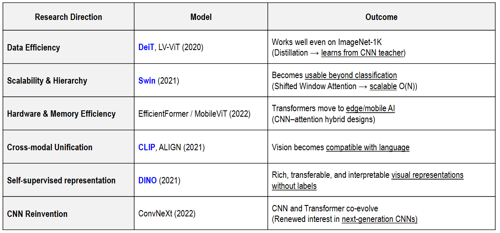

---

## 4. DeiT

---

### Overview


먼저 학습 전략의 관점에서 ViT를 개선한 DeiT를 살펴보겠습니다. 앞서 원 ViT의 실험에서 확인한 대규모 사전학습 의존을 완화하는 것이 출발점입니다.

**DeiT(Data-efficient Image Transformers)는 대규모 외부 데이터 없이도 ViT를 효과적으로 학습하도록 만든 학습 방법과 모델 계열**입니다. 원 ViT의 대규모 사전학습 의존을 줄여, ImageNet-1K만으로 경쟁력 있는 성능을 내는 것이 목표였습니다. 원 ViT도 ImageNet-1K로 학습할 수는 있지만, 원 논문의 조건에서는 큰 데이터로 사전학습했을 때 강점이 뚜렷했습니다.

#### 어떻게 데이터 효율을 높일까?


| 방법                 | 하는 일                                    | 의미                                |
| ------------------ | --------------------------------------- | --------------------------------- |
| 학습 전략 개선           | 데이터 증강, Mixup·CutMix, 규제, 최적화 등의 조합을 조정 | 같은 데이터로 더 잘 학습                    |
| 지식 증류 — 증류 버전      | 교사 모델의 예측을 학생 Transformer에 전달           | 정답 라벨 외에 교사가 배운 판단도 활용            |
| Distillation token | CLS와 별도로 교사의 예측을 배우는 토큰 추가              | Attention을 통해 교사 신호가 패치 표현 학습에 반영 |


**DeiT의 개선이 전부 지식 증류 때문인 것은 아닙니다.** 증류 없는 DeiT도 개선된 학습 전략을 사용하며, 증류를 추가한 모델은 성능을 더 높입니다. CNN 교사를 사용하면 CNN이 배운 시각적 판단을 학생 ViT에 전달할 수 있지만, 학생의 기본 구조 자체가 CNN으로 바뀌는 것은 아닙니다.

---

#### CLS와 Distillation token의 차이


| 토큰                 | 학습에서 맞추는 대상 | 역할                   |
| ------------------ | ----------- | -------------------- |
| CLS                | 데이터의 정답 클래스 | 일반적인 분류 예측           |
| Distillation token | 교사 모델의 예측   | 교사의 판단을 배우는 별도 분류 예측 |


증류 버전의 입력은 **`CLS + 패치 N개 + Distillation token`으로 총 N+2개 토큰**입니다. 토큰 모두가 Encoder에서 상호작용하고, 최종 CLS와 증류 토큰에는 각각 분류 Head를 연결합니다. 원 논문에서는 교사가 고른 클래스 자체를 목표로 사용하는 Hard distillation이 효과적이었습니다. 추론할 때는 두 Head의 예측 확률을 평균해 사용할 수 있으며 교사 모델은 필요하지 않습니다.

---

#### 그림: 학습 전략과 증류의 효과

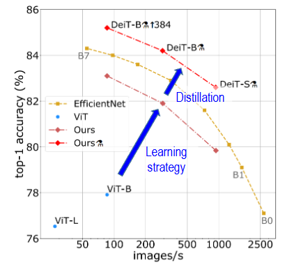


| 그래프 표시             | 읽는 방법                                     |
| ------------------ | ----------------------------------------- |
| 가로축 images/s       | 초당 처리 이미지 수. 오른쪽일수록 빠름. 학습에 사용한 이미지 수가 아님 |
| 세로축 Top-1 accuracy | 가장 높은 점수의 클래스가 정답인 비율. 위쪽일수록 좋음           |
| ViT — 파란 점         | 비교 대상인 기본 ViT 결과                          |
| Ours — 빨간 계열       | DeiT 학습 전략을 적용한 결과                        |
| 증류 표시가 붙은 Ours     | Transformer용 지식 증류까지 적용한 결과               |


그림의 **Learning strategy 화살표는 학습 방법 개선**, **Distillation 화살표는 교사 지식 추가 전달**에 따른 정확도 향상을 강조합니다. 특히 DeiT-B와 ViT-B는 기본 모델 구조가 같아, 차이가 단순한 모델 크기 증가 때문은 아님을 보여줍니다.

가장 위의 **384** 표시는 입력 해상도 384×384 조건입니다. 해상도가 높아지면 토큰 수와 계산량이 늘 수 있으므로, 서로 다른 해상도의 점을 같은 계산 조건으로 해석하면 안 됩니다. 처리량은 원 그림의 V100 GPU 측정 조건에 해당하며 다른 기기에서 그대로 보장되지 않습니다.

**“외부 데이터 없음”은 원 DeiT 실험에서 추가 데이터셋 없이 학습했다는 뜻이며, 정답 라벨 없이 학습했다는 뜻은 아닙니다.** ImageNet 라벨과, 증류 버전에서는 교사 예측을 함께 활용합니다. 라벨 없는 자기지도 학습인 DINO와 구별해야 합니다.

출처: [DeiT 원 논문 — Training data-efficient image transformers &amp; distillation through attention](https://arxiv.org/abs/2012.12877)

---

### Architecture &amp; Loss

학습 전략의 효과를 확인했으므로, 이제 증류 버전에서 교사의 판단이 학생에게 전달되는 경로를 살펴보겠습니다. 구조에서는 두 토큰과 Head를, 손실에서는 각각의 학습 목표를 구분하는 것이 핵심입니다.

#### 1. 구조: 정답과 교사를 함께 배우는 학생 모델

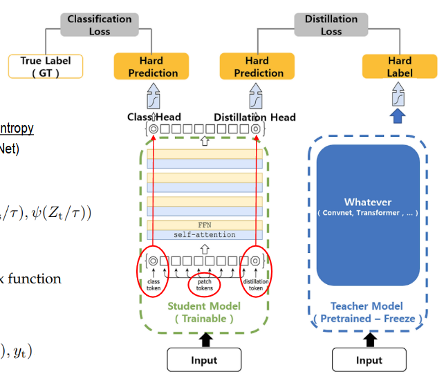

**학생 Transformer는 실제 정답과 교사의 판단을 두 경로로 학습합니다.** 같은 이미지가 학생과 교사에 입력되며, 학생만 역전파로 갱신하고 사전학습한 교사는 고정합니다.


| 구성                                     | 학습 대상              | 역할               |
| -------------------------------------- | ------------------ | ---------------- |
| CLS token → Class Head                 | 실제 정답 라벨 y         | 정답을 맞히는 분류 능력 학습 |
| Distillation token → Distillation Head | 교사의 예측             | 교사가 배운 판단을 전달받음  |
| Teacher model                          | 학생의 증류 손실로 갱신하지 않음 | 학생이 따라 배울 목표 제공  |


입력은 **패치 N개 + CLS + Distillation token = N+2개 토큰**입니다. 두 특수 토큰은 같은 Encoder 안에서 패치들과 상호작용하되, 마지막에 서로 다른 Head로 점수를 만듭니다. 두 토큰의 최종 값이 반드시 같아지는 것은 아닙니다.

교사는 CNN이나 Transformer일 수 있습니다. 원 DeiT 연구는 특히 **RegNet 계열의 강한 CNN 교사**를 활용했습니다. RegNet과 EfficientNet은 서로 다른 모델 계열입니다.

---

#### 2. 손실: Soft distillation과 Hard distillation

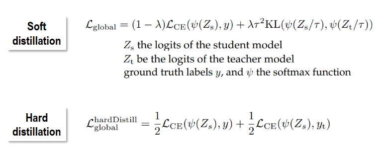

아래는 두 Head를 가진 증류 토큰 모델에서 **정답 라벨로 계산한 분류 손실과 교사 예측으로 계산한 증류 손실을 결합하는 방식**입니다. 두 Head를 구분하기 위해 학생 점수를 z_cls와 z_dist, 교사 점수를 z_t로 표기합니다. 뒤의 실험 표에는 교사의 목표만 사용하는 일반 증류 비교도 포함되므로, 그 설정과 구분해서 읽어야 합니다.


| 방식                | 교사가 제공하는 목표      | 학생이 맞추는 내용                          |
| ----------------- | ---------------- | ----------------------------------- |
| Soft distillation | 전체 클래스의 확률분포     | 예: 고양이 0.7, 강아지 0.2, 토끼 0.1의 상대적 관계 |
| Hard distillation | 가장 높은 점수의 클래스 하나 | 위 예시에서는 정수 라벨 ‘고양이’                 |


---

##### Soft distillation

온도 τ로 부드럽게 만든 교사·학생 분포를 비교합니다. 여기서는 KL의 첫 인자를 목표 분포로 정의합니다.

$$
p_t^{(\tau)} = \operatorname{softmax}(z_t/\tau), \qquad
p_s^{(\tau)} = \operatorname{softmax}(z_{\mathrm{dist}}/\tau)
$$

$$
\mathcal{L}_{\mathrm{soft}}
= (1-\lambda)\operatorname{CE}(z_{\mathrm{cls}},y)
+ \lambda\tau^2 D_{\mathrm{KL}}\left(p_t^{(\tau)}\;\Vert\;p_s^{(\tau)}\right)
$$

- **λ**: 정답 손실과 증류 손실의 비중입니다.
- **τ(Temperature)**: 클수록 분포가 부드러워져 정답 외 클래스의 상대적 정보도 전달하기 쉽습니다.
- **τ²**: 온도 사용에 따른 증류 기울기 규모 변화를 보정하는 계수입니다.
- **KL**: 교사와 학생 분포의 차이를 측정합니다. 방향에 따라 값이 달라지므로 목표·예측의 정의와 구현의 인자 순서를 확인해야 합니다.

---

##### Hard distillation

교사의 최고 점수 클래스를 정수 라벨 y_t로 사용합니다.

$$
y_t = \operatorname*{argmax}_c z_{t,c}
$$

$$
\mathcal{L}_{\mathrm{hard}}
= \frac{1}{2}\operatorname{CE}(z_{\mathrm{cls}},y)
+ \frac{1}{2}\operatorname{CE}(z_{\mathrm{dist}},y_t)
$$

첫 항은 **CLS Head가 실제 정답을 맞히도록**, 둘째 항은 **Distillation Head가 교사의 선택을 맞히도록** 합니다. 교사가 틀릴 수도 있으므로 y와 y_t가 항상 같은 것은 아닙니다. 원 DeiT 실험에서는 Hard distillation이 효과적이었습니다.

---

##### 그림의 ‘Hard Prediction’ 표기를 해석할 때 주의

학생의 예측을 먼저 argmax로 바꿔 손실에 넣는다는 뜻으로 읽으면 안 됩니다. **학생은 미분 가능한 logits로 손실을 계산**하고, Hard distillation에서는 교사의 예측에만 argmax를 적용해 목표 라벨을 만듭니다. PyTorch의 `CrossEntropyLoss`는 위 식의 CE에 logits와 정수 라벨을 전달하는 방식으로 사용할 수 있습니다.

---

#### 학습과 추론

```text
학습: 같은 이미지 → 학생의 두 Head / 고정된 교사
      → 정답 분류 손실 + 교사 증류 손실
      → 학생 Encoder·두 토큰·두 Head 등을 갱신

추론: 이미지 → 학생의 두 Head → 예측 확률 평균 → 클래스 선택
      교사는 필요 없음
```

**두 Head가 있어도 최종적으로 서로 다른 정답 두 개를 요구하는 것이 아닙니다.** 같은 클래스 집합을 예측하되 학습 목표의 출처가 다르며, 추론에서 예측을 결합할 수 있습니다.

출처: [DeiT 원 논문](https://arxiv.org/abs/2012.12877)

---

### DeiT Experiments

구조와 손실을 이해했다면, 이제 교사의 종류와 증류 방식이 실제 결과에 어떤 차이를 만드는지 확인할 수 있습니다.

두 표는 **어떤 교사를 쓰는지, 어떤 증류 목표와 출력 Head를 쓰는지**에 따라 학생 DeiT의 성능이 어떻게 달라지는지 비교합니다. 수치는 ImageNet **Top-1 정확도(%)**이며, 높을수록 좋습니다. Ti·S·B는 Tiny·Small·Base 모델, 224·384는 입력 이미지 한 변의 픽셀 수입니다.

---

#### 1. 교사 모델에 따른 학생 성능


| 교사 모델        | 교사 정확도 (%) | 학생 DeiT-B 증류 모델 — 사전학습, 224 (%) | 학생 — 384 해상도 파인튜닝 후 (%) |
| ------------ | ---------- | ------------------------------- | ----------------------- |
| DeiT-B       | 81.8       | 81.9                            | 83.1                    |
| RegNetY-4GF  | 80.0       | 82.7                            | 83.6                    |
| RegNetY-8GF  | 81.7       | 82.7                            | 83.8                    |
| RegNetY-12GF | 82.4       | 83.1                            | 84.1                    |
| RegNetY-16GF | 82.9       | 83.1                            | 84.2                    |


##### 결과 해석

이 표에서는 **교사의 정확도만으로 학생 성능이 결정되지는 않는다**는 점이 드러납니다. RegNetY-4GF 교사의 정확도는 80.0%로 DeiT-B 교사의 81.8%보다 낮지만, 학생은 각각 82.7%와 81.9%를 기록했습니다. 이 조건에서는 CNN 교사가 학생에게 더 유용한 학습 신호를 제공한 것입니다.

이는 CNN의 지역성 같은 구조적 가정(inductive bias)에서 얻은 시각적 판단을 ViT에 전달하는 것이 도움이 된다는 해석을 뒷받침합니다. 다만 이 결과를 모든 CNN 교사와 Transformer 교사의 우열로 일반화할 수는 없습니다. 학생은 교사의 판단을 참고하면서도 자신의 구조와 학습 과정을 통해 학습하므로, 교사보다 높은 정확도를 얻을 수도 있습니다.

오른쪽 열은 384 해상도로 파인튜닝한 별도의 조건입니다. 높은 해상도로 세부 정보를 더 활용할 수 있지만 계산량도 늘어나므로, 같은 비용에서 정확도만 높아진 것으로 해석해서는 안 됩니다. 다음 표에서는 교사보다 **증류 목표와 출력의 사용 방식**에 초점을 맞춥니다.

---

#### 2. 증류 방식과 출력 Head 비교


| 방법                             | 정답 라벨 사용 | 교사 목표   | Ti 224 (%) | S 224 (%) | B 224 (%) | B → 384 (%) |
| ------------------------------ | -------- | ------- | ---------- | --------- | --------- | ----------- |
| DeiT — 증류 없음                   | ✓        | 없음      | 72.2       | 79.8      | 81.8      | 83.1        |
| DeiT — 일반적인 Soft 증류            | ✗        | Soft 분포 | 72.2       | 79.8      | 81.8      | 83.2        |
| DeiT — Hard 증류                 | ✗        | Hard 라벨 | 74.3       | 80.9      | 83.0      | 84.0        |
| 증류 토큰 모델 — CLS 출력만 사용          | ✓        | Hard 라벨 | 73.9       | 80.9      | 83.0      | 84.2        |
| 증류 토큰 모델 — Distillation 출력만 사용 | ✓        | Hard 라벨 | 74.6       | 81.1      | 83.1      | 84.4        |
| 증류 토큰 모델 — 두 출력 결합             | ✓        | Hard 라벨 | 74.5       | 81.2      | 83.4      | 84.5        |


원 표는 **300 epochs 사전학습** 조건을 제시합니다. ‘정답 라벨 사용’은 해당 행의 **학생 학습 목표**에 관한 표시이며, 교사가 라벨 없이 학습됐다는 뜻은 아닙니다. 마지막 세 행은 같은 증류 토큰 학습 방식에서 평가에 사용할 출력을 달리한 비교이고, 마지막 행은 두 분류기의 예측을 결합하는 Late fusion입니다.

##### 결과 해석

먼저 B 224에서 증류 없음과 Soft 증류는 모두 81.8%, Hard 증류는 83.0%입니다. **이 조건에서는 Hard 증류가 더 효과적**이었으며, 교사의 전체 확률분포를 배우는 것이 언제나 더 좋은 것은 아님을 보여줍니다.

다음으로 증류 토큰 모델의 마지막 세 행은 CLS가 실제 정답을, Distillation token이 교사의 Hard 라벨을 학습한 결과입니다. 두 목표를 별도로 배우는 방식이므로, 토큰 하나를 추가한 효과만으로 해석해서는 안 됩니다. B 224에서는 CLS 출력 83.0%, 증류 출력 83.1%, 두 출력 결합 83.4%로 **두 Head의 상호 보완 가능성**이 나타났습니다. 다만 Ti 224에서는 증류 출력만 사용한 74.6%가 결합한 74.5%보다 조금 높아, 결합이 언제나 최고인 것은 아닙니다.

개선량은 퍼센트포인트로 읽습니다. B 224의 81.8% → 83.4%는 +1.6%p, B 384의 83.1% → 84.5%는 +1.4%p입니다. 두 표는 비교 목적과 설정이 다르므로 비슷한 이름의 수치를 무조건 같은 실험으로 취급해서는 안 됩니다. 반복 실험의 분산도 제시되지 않았으므@로 0.1%p 정도의 차이를 확정적인 우열로 과장하지 않는 것이 좋습니다.

결국 DeiT의 성능을 이해하려면 **교사의 정확도와 함께, 어떤 목표로 지식을 전달하고 두 예측을 어떻게 활용하는지**를 살펴봐야 합니다.

출처: [DeiT 원 논문 — 표 2·3](https://arxiv.org/abs/2012.12877)

---

### DeiT Summary

지금까지 살펴본 학습 전략, 두 토큰의 역할, 실험 결과를 연결하면 DeiT의 기여를 다음과 같이 정리할 수 있습니다.

#### Key contributions — 핵심 기여


| Contribution                  | Description                                    |
| ----------------------------- | ---------------------------------------------- |
| Knowledge Distillation        | CNN 교사가 학습한 시각적 판단을 학생 Transformer에 전달합니다.     |
| Distillation Token            | 교사의 예측을 배우는 별도 토큰을 두고 Attention으로 패치와 상호작용합니다. |
| Pure Transformer Architecture | 학생은 기본 ViT의 Transformer 구조를 유지합니다.             |
| Optimized Training Recipe     | 데이터 증강·규제·최적화 전략을 조합해 같은 데이터를 더 잘 활용합니다.       |


**DeiT는 수억 장 규모의 외부 데이터 없이도, 학습 방법을 개선하면 Transformer를 효과적으로 학습할 수 있음을 보여줬습니다.** 여기서 데이터 효율적이라는 말은 극소량의 데이터만으로 충분하다는 뜻이 아니라, ImageNet-1K 규모에서도 경쟁력 있는 결과를 얻었다는 의미입니다.

#### 쉽게 정리하면

- **지식 증류:** CNN 교사의 예측을 활용해 교사가 학습한 시각적 판단을 학생 Transformer에 전달합니다.
- **증류 토큰:** CLS는 실제 정답을, 별도 Distillation token은 교사의 예측을 배우도록 합니다. 추론에서는 두 Head의 예측을 결합할 수 있습니다.
- **Transformer 구조 유지:** 학생은 CNN 특징 추출기를 붙인 하이브리드 구조가 아니라, 기본 ViT 구조를 유지합니다. CNN 교사를 쓴다고 학생 자체가 CNN이 되는 것은 아닙니다.
- **학습 전략 개선:** 강한 데이터 증강·규제·최적화 전략을 함께 사용합니다. 증류 없는 DeiT도 이 학습 전략의 효과를 얻습니다.

**핵심은 모델을 무조건 크게 만드는 대신, 같은 데이터를 더 잘 활용하는 학습 전략과 교사 지식 전달로 ViT의 실용성을 높였다는 점**입니다. DINO와 달리 정답 라벨을 사용하는 지도학습이며, 원 실험의 ‘외부 데이터 없음’과 ‘라벨 없음’은 구분해야 합니다.

---

## 5. Swin Transformer

DeiT가 같은 데이터로 더 잘 학습하는 방법에 초점을 맞췄다면, Swin은 Attention의 계산 범위와 특징의 해상도를 바꿉니다. 특히 고해상도 이미지를 처리하고 검출·분할에 필요한 여러 크기의 특징을 만드는 문제로 이어집니다.

**Swin Transformer는 작은 윈도우 안에서 Attention을 계산하고, 단계별로 공간 크기를 줄이는 계층형 Vision Transformer**입니다. Swin은 Shifted Window에서 온 이름입니다.

### 어떤 문제를 해결하려 했을까?


| 기본 ViT의 부담                       | Swin의 방법                       | 효과                           |
| -------------------------------- | ------------------------------ | ---------------------------- |
| 모든 토큰 쌍의 Attention은 토큰 수의 제곱에 비례 | Window 안에서만 Attention 계산       | 고해상도 입력의 계산 부담 완화            |
| 기본 구조는 여러 층에서 같은 토큰 격자를 유지       | Patch Merging으로 격자를 줄이고 채널을 늘림 | 여러 해상도의 특징 맵 생성              |
| 작은 물체부터 큰 물체까지 다뤄야 하는 검출·분할      | 계층별 특징을 해당 작업의 Head에 제공        | 분류 외 작업에도 쓸 수 있는 Backbone 구성 |


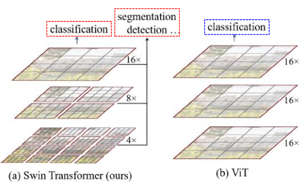

그림 왼쪽 Swin은 **세밀한 격자 → 중간 격자 → 거친 격자**로 진행하며, 각 단계의 특징을 검출·분할에 활용할 수 있습니다. 4×·8×·16×는 입력 대비 공간 축소 배율입니다. 오른쪽의 기본 ViT는 같은 패치 격자를 유지하며 깊어지는 모습을 보여줍니다. 이 비교는 계층적 특징을 만드는 구조의 차이를 나타내며, ViT도 별도의 구성을 통해 검출·분할에 사용할 수 있습니다.

### Patch Merging은 어떻게 할까?

인접한 **2×2 토큰을 특징 방향으로 이어 붙인 뒤 선형 변환**합니다. 기본 구성의 크기 변화는 `H×W×C → (H/2)×(W/2)×4C → (H/2)×(W/2)×2C`입니다. 즉, 공간 토큰 수는 1/4로 줄이고 채널은 2배로 늘립니다. 여기서 H·W는 현재 토큰 격자의 높이와 너비를 뜻합니다.

기본 Swin은 이 과정을 거친 최종 특징을 전역 평균해 분류에 사용합니다. 검출·분할에서는 여러 단계의 특징을 해당 작업의 Head와 연결합니다. 원 ViT의 CLS를 선택하는 방식과 최종 특징을 모으는 방식에도 차이가 있습니다.

---

### Swin의 Window와 Shift

계층적 특징을 만드는 방법을 확인했으므로, 이번에는 각 단계 안에서 Attention을 어떻게 효율적으로 계산하면서 윈도우 사이의 정보를 연결하는지 살펴보겠습니다.

**윈도우 안에서만 계산하면 효율적이지만, 같은 경계를 계속 쓰면 다른 윈도우와 정보가 단절됩니다.** Swin은 연속한 블록에서 윈도우 경계를 이동해 이 문제를 완화합니다.


| 연산     | 계산 방식                                        | 효과                   |
| ------ | -------------------------------------------- | -------------------- |
| W-MSA  | 겹치지 않는 일반 윈도우 안에서 Self-Attention             | 효율적인 지역 정보 조합        |
| SW-MSA | 윈도우 경계를 대략 반 윈도우만큼 이동한 뒤 내부에서 Self-Attention | 이전 윈도우의 경계를 넘어 정보 교환 |


원 표의 `Window size / 2`는 토큰 단위에서 정수로 처리합니다. 예를 들어 7×7 토큰 윈도우이면 보통 각 축으로 3칸 이동합니다. **윈도우 크기는 원본 이미지 픽셀 수가 아니라 현재 특징 격자의 토큰 수 기준**입니다.

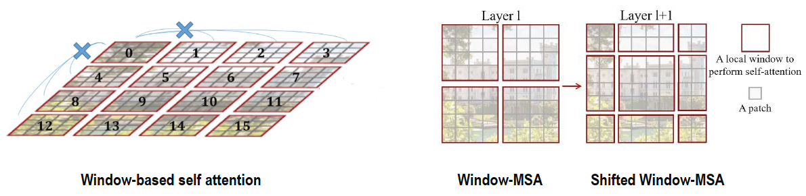

#### 그림 읽는 방법

- **왼쪽:** 떨어진 윈도우 사이를 직접 연결하지 않고 각 윈도우 안에서 계산합니다.
- **가운데 Layer ℓ:** 빨간 경계가 일반 윈도우이며, 작은 칸 하나가 패치 토큰입니다.
- **오른쪽 Layer ℓ+1:** 경계를 이동하면 원래 다른 윈도우에 있던 토큰들이 같은 새 윈도우에 들어가 서로 참고할 수 있습니다.

**원본 이미지나 물체를 실제로 움직이는 것이 아니라, Attention을 함께 계산할 토큰 묶음을 바꾸는 것**입니다. W-MSA와 SW-MSA를 번갈아 쌓으면 여러 블록에 걸쳐 더 넓은 영역의 정보가 전달됩니다. 한 층에서 모든 토큰 쌍을 직접 비교하는 전역 Attention과는 다릅니다.

#### 계산량과 경계 처리

토큰이 T개이고 윈도우가 M×M이면, 전역 Attention의 점수 수는 T²개인 반면 윈도우 방식은 대략 **(T/M²) × M⁴ = TM²개**입니다. 따라서 윈도우 크기를 고정하면 이 관계 계산 비용은 토큰 수 T에 선형으로 증가합니다. 모델 전체의 계산량과 실제 실행 시간은 다른 연산과 구현에도 영향을 받습니다.

효율적인 구현에서는 특징 맵을 순환 이동한 뒤 윈도우로 나누고, **이동으로 반대편 가장자리가 인위적으로 붙은 부분은 Attention Mask로 차단**합니다. 필요한 경우 크기를 맞추는 Padding도 처리합니다.

**기억하기: Window는 계산 범위를 줄이고, Shift는 윈도우 사이를 연결하며, Patch Merging은 계층적 해상도를 만듭니다.**

출처: [Swin Transformer 원 논문](https://arxiv.org/abs/2103.14030)

---

### Swin Architecture

지금까지 Window, Shift, Patch Merging을 각각 살펴봤다면, 이번에는 이 연산들이 실제 네트워크에서 어떻게 연결되는지 확인하겠습니다. Swin은 **같은 Stage 안에서는 크기를 유지하며 블록을 반복하고, Stage 사이에서는 Patch Merging으로 공간 크기와 채널 수를 바꿉니다.** 먼저 연속한 두 블록을 살펴본 뒤 전체 Stage 구조로 확장합니다.

---

#### 1. 연속한 두 블록: W-MSA → SW-MSA

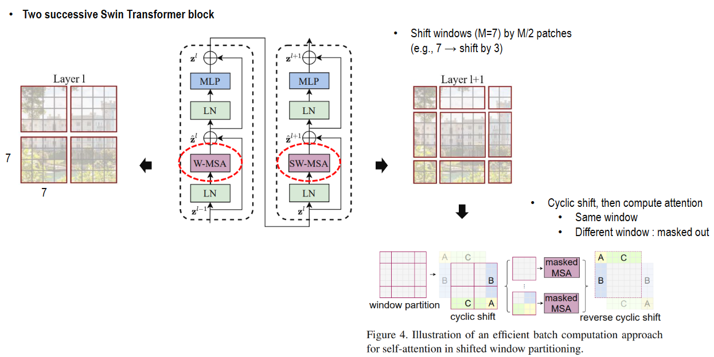

첫 그림의 점선 상자 하나가 Swin 블록 하나이며, 두 블록을 아래에서 위로 읽습니다.


| 블록    | 흐름                                     | 역할                          |
| ----- | -------------------------------------- | --------------------------- |
| 첫 블록  | LN → W-MSA → 잔차 덧셈 → LN → MLP → 잔차 덧셈  | 일반 윈도우 안에서 정보 조합            |
| 다음 블록 | LN → SW-MSA → 잔차 덧셈 → LN → MLP → 잔차 덧셈 | 이동한 윈도우 안에서 이전 경계를 넘는 정보 조합 |


이 그림은 **원 Swin의 Pre-LN 구조**입니다. 지름길로 원래 표현을 전달하고, Attention·MLP 결과를 더해 학습을 돕습니다. W-MSA에서 SW-MSA로 바뀌어도 토큰 격자 크기와 채널 수는 유지됩니다.

윈도우가 7×7이면 **한 윈도우의 토큰은 49개**입니다. (그림은 4x4처럼 보인다.)

각 토큰은 현재 Stage의 채널 수만큼 특징을 가지며, Head 하나의 Attention 점수 행렬은 `49×49`입니다. Shift는 각 축으로 3토큰을 이동하는 방식입니다.

오른쪽 아래는 SW-MSA를 효율적으로 구현하는 과정입니다.

1. **Cyclic shift:** 특징 격자를 순환 이동해 이동 윈도우를 일정한 크기로 묶습니다.
2. **Masked Attention:**
   1. 순환 이동 때문에 인위적으로 붙은 영역끼리는 Attention을 차단합니다.
   2. 새 이동 윈도우 안에서 정상적으로 연결되는 토큰은 서로 참고합니다.
   3. -무한대의 값으로 마스킹처리한다. (0미만이면 attention을 안하게 된다)
3. **Reverse cyclic shift:** 계산 결과를 원래 격자 위치로 되돌립니다.

이미지 내용을 바꾸는 데이터 증강이 아니라, **같이 Attention을 계산할 토큰의 묶음을 효율적으로 바꾸는 구현**입니다.

---

#### 2. 전체 구조: 4개의 Stage와 Patch Merging

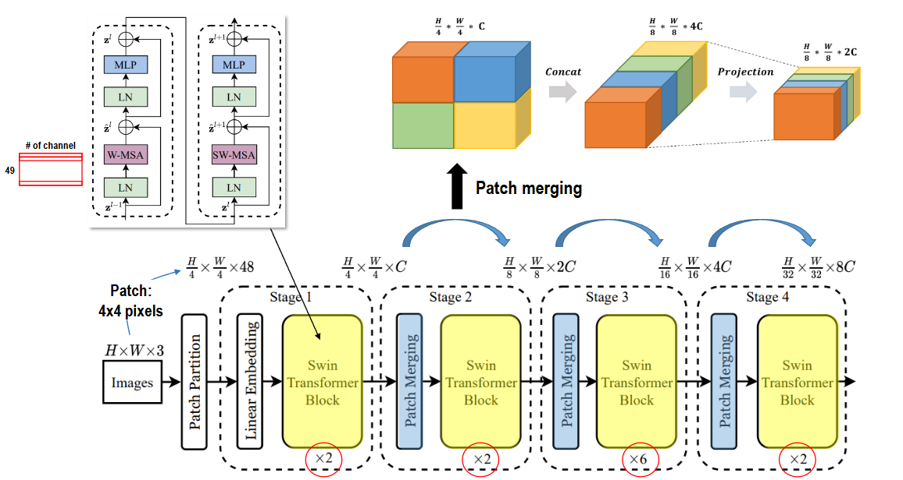

두 블록의 연결을 전체 모델로 확장하면 아래의 네 Stage 구조가 됩니다. 아래 표의 H·W는 원본 이미지 크기, C는 첫 Stage의 임베딩 채널 수입니다. 앞서 Patch Merging의 일반식을 설명할 때 H·W를 현재 토큰 격자 크기로 썼던 것과 표기의 기준이 다릅니다. 그림의 블록 수 `[2, 2, 6, 2]`는 **Swin-T** 구성에 해당하며, 다른 Swin 변형은 블록 수·채널·Head 수 등이 달라질 수 있습니다.


| 단계               | 연산                      | 출력 크기 — 높이 × 너비 × 채널 | 224×224 입력, C=96 예시 |
| ---------------- | ----------------------- | -------------------- | ------------------- |
| 입력               | RGB 이미지                 | H × W × 3            | 224 × 224 × 3       |
| Patch Partition  | 4×4 패치별 Flatten         | H/4 × W/4 × 48       | **56 × 56** × 48    |
| Linear Embedding | 패치당 48개 값을 **C차원으로 변환** | H/4 × W/4 × C        | 56 × 56 × 96        |
| Stage 1          | Swin 블록 ×2              | H/4 × W/4 × C        | **56 × 56** × 96    |
| Stage 2          | Patch Merging → 블록 ×2   | H/8 × W/8 × 2C       | 28 × 28 × 192       |
| Stage 3          | Patch Merging → 블록 ×6   | H/16 × W/16 × 4C     | 14 × 14 × 384       |
| Stage 4          | Patch Merging → 블록 ×2   | H/32 × W/32 × 8C     | 7 × 7 × 768         |


처음의 48은 `4×4×3`으로 계산한 패치 하나의 픽셀·채널 값 개수입니다. 이 값을 C차원으로 임베딩한 뒤 Stage 1을 시작하고, Stage가 바뀔 때마다 토큰 격자는 줄어들고 특징 채널은 늘어납니다. 그 변환을 담당하는 Patch Merging을 수치로 확인해 보겠습니다.

---

#### 3. Patch Merging에서 어떤 변화가 일어날까?

그림 위쪽은 인접한 2×2 토큰을 한 묶음으로 만드는 과정입니다.

```text
2×2의 각 토큰이 C차원
→ 특징 방향으로 Concat해 4C차원
→ LayerNorm과 Linear로 2C차원으로 변환
```

Stage 1에서 Stage 2로 넘어가는 예시는 `56×56×96 → 28×28×384 → 28×28×192`입니다. 인접 토큰의 특징을 이어 붙인 뒤 학습 가능한 변환으로 조합하므로 단순한 평균 Pooling과 계산 방식이 다릅니다. 이렇게 얻은 여러 해상도의 특징을 작업에 맞는 Head와 연결합니다.

---

#### 4. 분류·검출·분할에 연결하기

분류에서는 보통 최종 Stage의 특징을 정규화하고 공간 방향으로 평균한 뒤 분류 Head에 전달합니다. 위 예시에서는 `7×7×768 → 768 → 클래스별 logits`이며, CLS 토큰은 사용하지 않습니다.

검출·분할에서는 여러 Stage의 특징을 활용해 작은 물체의 위치와 큰 물체의 문맥을 함께 다루기 쉬워집니다. 이것이 앞 항목에서 설명한 계층 구조의 이점입니다.

**블록에서는 Window와 Shift를 번갈아 사용해 정보를 전달하고, Stage 사이에서는 Patch Merging으로 더 넓은 범위를 다루는 계층을 만듭니다.**

처음의 CNN과 연결해 보면, Swin은 지역 단위의 계산과 계층적 특징이라는 장점을 Attention 구조에 반영한 모델로 이해할 수 있습니다. 이 문서에서 살펴본 흐름은 **Attention의 가중합 → Transformer의 문맥 표현 → ViT의 이미지 토큰 처리 → DeiT의 학습 전략 개선 → Swin의 계산 범위와 계층 구조 개선**으로 이어집니다. 각 모델을 비교할 때는 관계를 계산하는 방식, 학습 목표, 데이터와 계산 조건을 함께 살펴보면 됩니다.

---

### Complexity

ViT와 Swin의 계산량 차이는 **한 토큰이 몇 개의 토큰을 참고하는가**에서 시작합니다. 전역 Attention은 모든 토큰 쌍을 비교하고, Window Attention은 같은 윈도우 안의 토큰만 비교합니다.

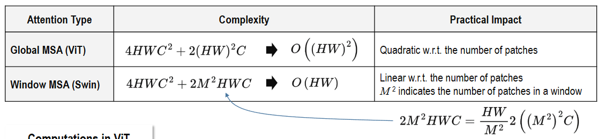

#### 1. 식의 기호와 계산 범위

이 절에서 H·W는 **현재 특징 격자의 높이와 너비**, N=HW는 토큰 수, C는 채널 수, M은 윈도우 한 변의 토큰 수입니다. 원본 이미지의 픽셀 크기와 구분해야 합니다. 아래 식은 Q·K·V 및 출력 Linear와 두 Attention 행렬 곱의 주요 연산량이며, MLP·정규화·Softmax 등은 생략합니다. CLS 토큰과 경계 Padding도 생략한 비교입니다.


| Attention 방식      | 주요 연산량           | 토큰 수 N에 따른 증가    |
| ----------------- | ---------------- | ---------------- |
| 전역 MSA — ViT      | $4NC^2 + 2N^2C$  | C를 고정하면 이차 증가    |
| Window MSA — Swin | $4NC^2 + 2NM^2C$ | C와 M을 고정하면 선형 증가 |


공통 항 **4NC²**는 Q·K·V를 만드는 세 Linear와 결과를 조합하는 출력 Linear에서 나옵니다. 차이를 만드는 항은 **관련도 QKᵀ와 가중합 AV**입니다. 전역 방식은 N×N 관계를 계산하지만, 윈도우 방식은 윈도우 하나당 M²×M² 관계를 N/M²개 윈도우에서 계산합니다.

$$
\frac{N}{M^2}\times 2(M^2)^2C = 2NM^2C
$$

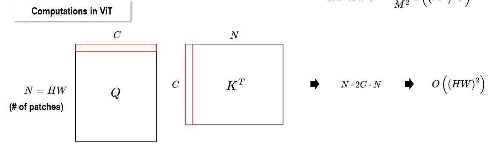

#### 2. 토큰 수가 늘어나면 어떤 차이가 날까?

같은 특징 격자가 56×56이면 N=3,136입니다. 7×7 윈도우에서는 토큰마다 49개 토큰을 참고하므로, Head 하나의 관련도 점수 수는 전역 방식의 **3,136²=9,834,496개**에서 윈도우 방식의 **3,136×49=153,664개**로 줄어듭니다. 관계 계산 부분만 비교하면 64배 차이입니다. Q·K·V 변환과 MLP는 그대로 필요하므로 전체 모델이 64배 빨라진다는 뜻은 아닙니다.

패치 크기를 유지하고 이미지의 가로·세로를 각각 2배로 늘리면 토큰 수는 4배가 됩니다. 이때 전역 Attention의 **N² 항은 16배**, 고정 윈도우 Attention의 **NM² 항은 4배**가 됩니다. 따라서 ‘Swin은 이미지 크기에 선형’이라는 말의 기준은 이미지 한 변의 길이가 아니라 **픽셀 수 또는 그에 비례하는 토큰 수**입니다.

#### 3. Patch Merging과 실제 속도까지 연결하기

Patch Merging으로 N이 1/4, C가 2배가 되면 NC² 항은 그대로이고, 고정 M에서 NM²C 항은 절반이 됩니다. 토큰 수가 줄어도 채널이 늘어나므로 모든 계산이 1/4이 되지는 않습니다. Stage별 블록 수도 전체 비용에 영향을 줍니다.

**계산량(FLOPs), 중간 활성값 메모리, 실행 시간은 구분해야 합니다.** 일반적인 구현에서 저장하는 Attention 점수의 크기도 전역 방식은 Head당 N², 윈도우 방식은 NM²에 비례합니다. 다만 메모리 효율적인 Attention 구현은 전체 점수 행렬 저장을 피할 수 있으며, 실제 속도는 GPU·배치 크기·메모리 이동·Shift와 Padding 구현에도 좌우됩니다.

출처: [Swin 원 논문 §3.2 — Window Attention의 복잡도](https://arxiv.org/html/2103.14030v2#S3.SS2)

---

### Experiments

이번에는 **ViT-L/16과 Swin-L이 같은 입력 해상도에서 어떤 정확도와 실행 비용을 보이는지** 비교합니다. 아래 그림의 오른쪽 (b), **ImageNet-22K 사전학습 모델**에 있는 두 행을 기준으로 읽습니다. 두 모델 모두 384×384 입력으로 ImageNet-1K 분류 성능을 평가한 결과입니다.

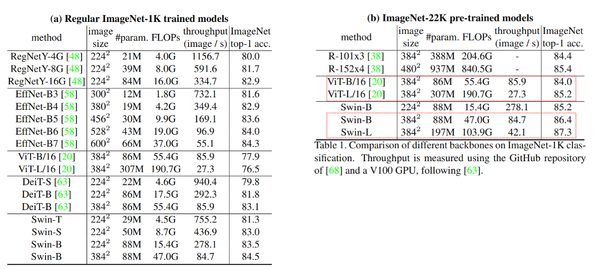

#### 1. 같은 평가 조건에서 결과 비교


| 비교 항목                 | ViT-L/16     | Swin-L       | Swin-L의 차이           |
| --------------------- | ------------ | ------------ | -------------------- |
| 사전학습 데이터              | ImageNet-22K | ImageNet-22K | 같은 데이터셋 범주           |
| 평가 입력                 | 384×384      | 384×384      | 같은 해상도               |
| 파라미터 수                | 307M         | 197M         | 110M 감소, 약 35.8% 적음  |
| FLOPs                 | 190.7G       | 103.9G       | 86.8G 감소, 약 45.5% 적음 |
| Throughput — images/s | 27.3         | 42.1         | 약 1.54배, 약 54.2% 높음  |
| ImageNet-1K Top-1 정확도 | 85.2%        | 87.3%        | +2.1%p               |


수치는 **첨부 그림 및 Swin 원 논문 v2의 표 1** 기준입니다. M은 백만 개의 파라미터, G는 표의 집계 기준에 따른 십억 단위 연산량입니다. Throughput은 논문에서 V100 GPU로 측정한 초당 처리 이미지 수이며, 높을수록 같은 시간에 더 많은 이미지를 처리합니다.

#### 2. 정확도: 더 작은 모델이 더 높은 성능을 보인다

ViT-L/16은 307M 파라미터로 85.2%, Swin-L은 197M 파라미터로 87.3%의 Top-1 정확도를 기록합니다. **Swin-L은 파라미터가 약 36% 적으면서 정확도는 2.1%p 높습니다.** 이 비교에서는 파라미터를 더 많이 가진 모델이 반드시 더 정확하지 않다는 점을 확인할 수 있습니다.

오분류율로 바꾸면 ViT-L/16은 14.8%, Swin-L은 12.7%입니다. 오분류율의 상대 감소는 약 14.2%이지만, 정확도 차이를 표현할 때는 **+2.1%p**로 적어야 합니다. ‘정확도가 14.2% 높다’는 의미는 아닙니다.

#### 3. 계산량과 처리량: 이론적 절감이 실제 속도에서도 나타난다

Swin-L의 FLOPs는 103.9G로 ViT-L/16의 190.7G보다 약 45.5% 적습니다. 이 값은 해당 해상도에서 **이미지 한 장을 처리하는 연산량**이며, 모델이 저장하는 가중치 개수인 파라미터 수와는 다른 지표입니다.

실제 처리량도 27.3→42.1 images/s로 약 1.54배 높습니다. 따라서 이 측정 조건에서는 Swin-L이 더 적은 연산으로 더 많은 이미지를 처리합니다. 다만 연산량 비율인 190.7/103.9≈1.84가 그대로 속도 비율이 되지는 않습니다. 메모리 접근, 연산 종류, 윈도우 분할과 Shift 구현 등이 실행 시간에 영향을 주기 때문입니다. 또한 처리량은 배치 처리 성능이므로 이 수치만으로 이미지 한 장의 응답 지연 시간을 단정할 수는 없습니다.

#### 4. 구조와 연결해 결과 해석하기

ViT-L/16은 16×16 패치를 사용하고, Encoder에서 같은 토큰 격자를 유지하며 전역 Attention을 계산합니다. Swin-L은 작은 패치에서 시작해 **윈도우 내부 Attention으로 관계 계산을 제한하고, Shift로 윈도우 사이를 연결하며, Patch Merging으로 단계별 토큰 수를 줄입니다.** 이 구조는 고해상도 입력의 계산 부담을 관리하면서 여러 크기의 특징을 표현하는 데 도움이 됩니다.

다만 위 결과는 **모델 전체의 비교**입니다. 두 모델은 폭·깊이·패치 크기·위치 정보와 학습 설정 등이 다릅니다. 따라서 정확도 향상 전체가 Shift 하나 때문이거나, 파라미터 감소 전체가 Window Attention 때문이라고 해석할 수는 없습니다. 특히 Window Attention의 주된 절감 대상은 토큰 사이의 관계 계산이며, QKV·MLP 가중치 수는 주로 채널 폭과 블록 수에 의해 결정됩니다.

이 표가 보여주는 결론은 **ImageNet-22K 사전학습과 384 입력의 해당 분류 실험에서, Swin-L이 ViT-L/16보다 적은 파라미터와 연산량으로 더 높은 정확도와 처리량을 달성했다**는 것입니다. 검출·분할 성능이나 다른 하드웨어에서의 속도는 해당 작업과 환경에서 별도로 비교해야 합니다.

출처: [Swin 원 논문 v2 — 표 1 및 ImageNet 분류 실험 조건](https://arxiv.org/html/2103.14030v2#S4.SS1)

---

### Summary

ViT와 Swin은 모두 **이미지를 토큰으로 바꾸고 Attention으로 토큰의 정보를 조합**합니다. 차이는 토큰 격자를 유지하는 방식과, 한 블록에서 정보를 주고받는 범위에 있습니다.

#### 1. Swin의 구성 요소를 역할별로 정리하기

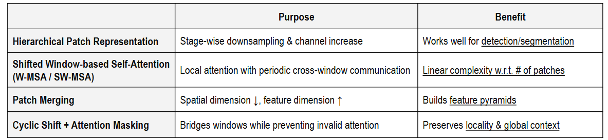


| 구성                  | 하는 일                             | 얻는 이점                       |
| ------------------- | -------------------------------- | --------------------------- |
| W-MSA               | 작은 윈도우 안에서 Attention 계산          | 토큰 수 증가에 따른 관계 계산 부담 완화     |
| SW-MSA              | 다음 블록에서 윈도우 경계를 이동               | 이전에 다른 윈도우에 있던 토큰 사이에 정보 전달 |
| Cyclic Shift + Mask | 이동 윈도우를 효율적으로 묶고 잘못 연결된 가장자리를 차단 | 이동 윈도우 계산을 배치로 처리           |
| Patch Merging       | 인접 2×2 토큰을 합쳐 격자를 줄이고 채널 확대      | 여러 해상도의 계층적 특징 생성           |


그림의 ‘global context’는 **여러 블록을 거치며 더 넓은 문맥을 반영한다**는 의미로 읽어야 합니다. Shift 한 번으로 모든 토큰 사이에 전역 Attention을 계산하는 것은 아닙니다. 계층 구조는 Patch Merging에서, 윈도우 사이 연결은 Shift에서 나옵니다.

#### 2. ViT와 Swin을 같은 기준으로 비교하기

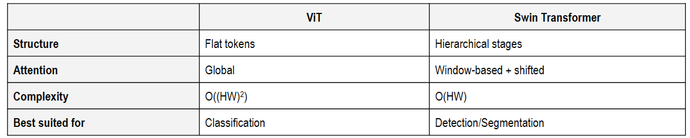


| 비교 기준     | 기본 ViT                       | Swin Transformer               |
| --------- | ---------------------------- | ------------------------------ |
| 시작 토큰     | 예: 16×16 픽셀 패치               | 기본 구성은 4×4 픽셀 패치               |
| 공간 구조     | 블록을 지나도 같은 토큰 격자 유지          | Stage 사이 Patch Merging으로 격자 축소 |
| 정보 교환     | 한 Attention 층에서 모든 토큰을 직접 비교 | 윈도우 내부 계산과 Shift를 반복하며 범위 확대   |
| 특징 차원     | 보통 전체 Encoder에서 같은 차원 유지     | Stage가 바뀔 때 채널 증가              |
| 위치 정보     | 학습 가능한 절대 위치 임베딩             | 기본 Swin은 윈도우 내 상대 위치 바이어스      |
| 분류 출력     | 최종 CLS 표현 사용                 | 최종 공간 특징의 전역 평균 사용             |
| 해상도 증가 부담 | 전역 관계 계산이 토큰 수의 제곱에 비례       | 고정 윈도우에서 토큰 수에 선형 비례           |
| 검출·분할 연결  | 여러 크기의 특징이 필요하면 별도 구성 가능     | 여러 Stage의 특징을 바로 활용하기 편리       |


표는 원래의 대표 구성을 비교합니다. **ViT도 검출·분할에 사용할 수 있고, Swin도 분류에 사용할 수 있습니다.** 그림의 ‘Best suited for’는 적용 가능 여부를 나누는 경계가 아니라, 기본 구조가 제공하는 특징의 차이로 이해하면 됩니다.

#### 3. ViT → DeiT → Swin의 흐름

- **ViT:** 이미지 패치 시퀀스를 표준 Transformer Encoder에 넣어 이미지 분류를 수행합니다.
- **DeiT:** 기본 ViT를 바탕으로 학습 전략과 지식 증류를 개선해 ImageNet-1K 규모의 데이터를 효과적으로 활용합니다.
- **Swin:** Attention의 범위와 특징 격자를 바꾸어 고해상도 입력과 여러 크기의 물체를 다루기 편한 Backbone을 만듭니다.

모델을 고를 때는 **학습 데이터와 사전학습 가중치, 입력 해상도, 필요한 특징 해상도, 정확도·메모리·실행 시간**을 함께 비교해야 합니다. 파라미터 수가 같아도 계산 방식이 다르면 실제 사용 비용은 달라집니다.

출처: [ViT 원 논문 — 구조와 학습 설정](https://arxiv.org/html/2010.11929v2#S3), [Swin 원 논문 — 전체 구조](https://arxiv.org/html/2103.14030v2#S3)

---

## 6. Parameter Count — 모델별 파라미터 수 비교

파라미터 수는 **학습으로 갱신하는 가중치와 바이어스의 개수**입니다. 입력에 따라 계산되는 Q·K·V, Attention 점수, 특징 맵의 원소 수와 다릅니다. M은 백만 개를 뜻하므로 86M은 약 8,600만 개입니다.

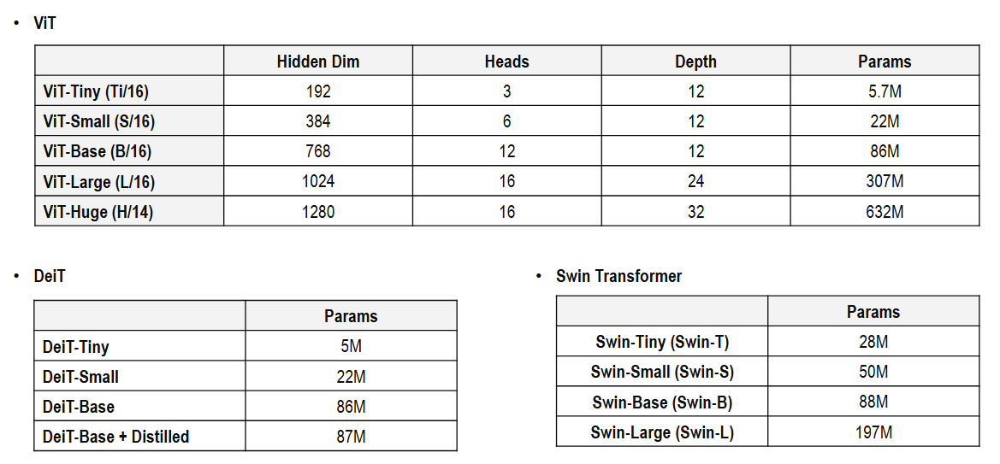

### 1. ViT: 깊이보다 폭이 커질 때도 빠르게 증가한다


| 모델        | Hidden dimension D | Head 수 | 블록 수 L | 대략적인 파라미터 수 |
| --------- | ------------------ | ------ | ------ | ----------- |
| ViT-Ti/16 | 192                | 3      | 12     | 5.7M        |
| ViT-S/16  | 384                | 6      | 12     | 22M         |
| ViT-B/16  | 768                | 12     | 12     | 86M         |
| ViT-L/16  | 1,024              | 16     | 24     | 307M        |
| ViT-H/14  | 1,280              | 16     | 32     | 632M        |


위는 그림의 반올림 값입니다. Tiny·Small은 후속 구현에서 널리 쓰이는 규모이며 원 ViT 논문의 대표 규모는 Base·Large·Huge입니다. 실제 개수는 분류 클래스 수, Head 구성과 입력 해상도에 따른 위치 임베딩 크기 등에 따라 조금 달라집니다.

MLP의 중간 차원이 4D라면 블록 하나의 주요 가중치 수는 다음과 같습니다. 바이어스와 LayerNorm은 작은 항으로 생략합니다.

$$
\underbrace{3D^2+D^2}_{\text{QKV 및 출력 Linear}}
+\underbrace{D(4D)+(4D)D}_{\text{MLP}}
=12D^2
$$

따라서 Encoder의 주요 파라미터 수는 **약 12LD²**입니다. 같은 12블록인 Small에서 Base로 D가 384→768, 즉 2배가 되면 주요 가중치는 약 4배가 됩니다. Base→Large는 차원과 블록 수가 함께 증가합니다.

**Head 수가 2배라고 파라미터가 반드시 2배가 되지는 않습니다.** 전체 D를 고정한 채 Head 수를 늘리면 Head당 차원이 줄어들기 때문입니다. 주요 QKV 가중치의 합계 크기는 그대로입니다.

### 2. DeiT: 비슷한 크기의 학생을 더 잘 학습시키기


| 모델 — 224 입력 기준 공개 표 | 파라미터 수 | 비교 의미                |
| ------------------- | ------ | -------------------- |
| DeiT-Tiny           | 약 5M   | 작은 차원의 ViT 계열 학생     |
| DeiT-Small          | 약 22M  | ViT-S 규모             |
| DeiT-Base           | 약 86M  | ViT-B 규모             |
| DeiT-Base distilled | 약 87M  | 별도 증류 토큰과 분류 Head 추가 |


그림의 ViT-Tiny 5.7M과 DeiT-Tiny 5M은 정밀도가 다른 요약 값이므로 그 차이를 구조적인 압축 효과로 해석하면 안 됩니다. 증류 모델에서는 토큰·위치 임베딩과 추가 분류 Head가 늘어나지만 Encoder의 기본 폭과 깊이는 유지됩니다.

DeiT-B 증류 모델은 약 1M 증가만으로 두 학습 목표를 활용합니다. **교사 CNN의 파라미터는 학생의 추론 파라미터 수에 합산하지 않습니다.** 다만 학습 시에는 교사 예측을 만드는 계산과 메모리 비용이 추가되므로, 학생 모델 크기가 비슷해도 전체 학습 비용은 같지 않습니다.

### 3. Swin: 채널과 Stage별 깊이가 모델 크기를 결정한다


| 모델     | 첫 Stage 채널 C | Stage별 블록 수     | 대략적인 파라미터 수 |
| ------ | ------------ | --------------- | ----------- |
| Swin-T | 96           | \[2, 2, 6, 2\]  | 28M         |
| Swin-S | 96           | \[2, 2, 18, 2\] | 50M         |
| Swin-B | 128          | \[2, 2, 18, 2\] | 88M         |
| Swin-L | 192          | \[2, 2, 18, 2\] | 197M        |


수치는 그림 및 공식 Swin-V1 공개 모델 표 기준이며, 앞 실험 그림의 Swin-T는 29M으로 표기되어 있습니다. 기본 채널은 Stage마다 C→2C→4C→8C가 됩니다. T→S는 주로 세 번째 Stage의 깊이를 늘리고, S→B→L은 같은 깊이에서 채널 폭을 늘립니다. 채널 수의 제곱에 비례하는 Linear·MLP 가중치가 많아 폭 증가가 파라미터 수에 크게 반영됩니다.

Window Attention에서도 QKV와 출력 Linear의 가중치는 여러 윈도우에 공유됩니다. **윈도우 수가 늘어난다고 윈도우마다 새 파라미터를 만드는 것은 아닙니다.** Shift와 Mask 자체도 학습 가중치를 추가하지 않습니다. 반면 상대 위치 바이어스와 Patch Merging의 선형 변환에는 학습 파라미터가 있습니다.

### 4. 파라미터가 비슷해도 계산량은 다르다

ViT-B·DeiT-B·Swin-B는 모두 약 86~88M이지만, 토큰 수와 Attention 범위가 달라 FLOPs와 활성값 메모리는 다릅니다. 해상도를 높이면 Linear 가중치를 그대로 재사용해도 계산할 토큰과 관계의 수가 증가합니다. ViT의 절대 위치 임베딩처럼 크기가 달라질 수 있는 일부 파라미터는 전체의 작은 부분입니다.

또한 **Tiny·Small·Base는 각 계열 내부의 이름**이므로 서로 같은 크기를 보장하지 않습니다. DeiT-Tiny 약 5M과 Swin-T 약 28M을 이름만 보고 같은 규모로 비교하면 안 됩니다.

예를 들어 86M개 가중치를 FP32로 저장하면 가중치 자체만 약 344MB입니다. 학습에는 그래디언트·옵티마이저 상태·활성값 등이 더 필요합니다. 따라서 파라미터 수는 저장 공간을 가늠하는 기준이며, GPU 메모리나 실행 시간을 단독으로 결정하는 값은 아닙니다.

출처: [ViT 원 논문 — 모델 규모](https://arxiv.org/html/2010.11929v2#S4.SS1), [DeiT 공식 모델별 파라미터 수](https://github.com/facebookresearch/deit/blob/main/README_deit.md#model-zoo), [Swin 공식 모델별 파라미터 수](https://github.com/microsoft/Swin-Transformer#main-results-on-imagenet-with-pretrained-models)

---

## 7. CLIP

**CLIP(Contrastive Language-Image Pre-training)은 이미지와 텍스트를 같은 의미 공간의 벡터로 표현하도록 학습하는 모델**입니다. 예를 들어 고양이 사진과 “고양이 사진”이라는 문장은 유사도가 높아지도록 학습합니다.

### 어떻게 학습할까?


| 구성                           | 역할                                                    |
| ---------------------------- | ----------------------------------------------------- |
| Image Encoder                | 이미지를 벡터로 변환. ViT 또는 ResNet 사용 가능                      |
| Text Encoder                 | 이미지에 대한 설명 문장을 벡터로 변환                                 |
| 대조 학습 — Contrastive Learning | 배치 안에서 올바른 이미지·설명 쌍의 유사도는 높이고, 짝이 아닌 조합의 유사도는 낮추도록 학습 |


핵심은 고정된 클래스 번호만 예측하는 대신, **어떤 이미지와 어떤 설명이 서로 어울리는지** 배우는 것입니다. 이미지·텍스트 쌍이 학습 신호가 되므로, 사람이 작성한 클래스 라벨이 없어도 자연어 설명을 활용할 수 있습니다.

### 학습한 뒤에는 어떻게 사용할까?

고양이 사진을 분류한다면 다음 순서로 사용할 수 있습니다.

1. 사진을 Image Encoder로 벡터화합니다.
2. “고양이 사진”, “강아지 사진”, “자동차 사진” 같은 후보 설명을 Text Encoder로 벡터화합니다.
3. 이미지 벡터와 가장 유사한 설명을 선택합니다.

이처럼 **해당 분류 과제의 별도 추가 학습 없이, 텍스트로 분류 후보를 지정하는 방식**을 Zero-shot 분류라고 합니다. CLIP 자체의 사전학습이 없었다는 뜻은 아닙니다. 같은 원리로 문장에 맞는 이미지를 찾는 이미지 검색에도 활용할 수 있습니다.

앞서 배운 **ViT가 이미지 특징을 추출하는 구조라면, CLIP은 이미지와 언어의 표현을 연결하는 학습 방식**입니다. CLIP의 Image Encoder로 ViT를 사용할 수 있으며, 결과는 후보 문구와 데이터 특성에 따라 달라질 수 있습니다.

출처: [OpenAI — CLIP: Connecting text and images](https://openai.com/index/clip/)

---

### Overview

#### 1. Motivation — 고정된 클래스 라벨의 한계

기존 지도학습 이미지 분류는 사람이 정한 클래스와 라벨에 의존합니다. 예를 들어 고양이·강아지를 구분하도록 학습한 분류기는 새로운 클래스를 추가하려면 보통 출력 Head를 바꾸고 추가 학습을 해야 합니다. 데이터를 늘릴 때도 라벨 작성 비용이 들고, 표현할 수 있는 개념이 미리 정한 클래스 목록에 묶입니다.

CLIP은 이 문제를 **이미지에 함께 붙어 있는 자연어 설명을 학습 신호로 활용**하는 방향으로 접근합니다.

#### 2. Key Insight — 자연어를 시각 개념의 학습 신호로 사용

인터넷에는 이미지와 제목·설명 같은 텍스트가 함께 존재합니다. 자연어는 “고양이”라는 이름뿐 아니라 “소파 위에 앉아 있는 고양이”처럼 속성과 상황도 표현할 수 있습니다. CLIP은 이런 이미지·텍스트 쌍에서 두 표현의 대응 관계를 배웁니다. 원 CLIP은 인터넷에서 수집한 **4억 개의 이미지·텍스트 쌍**으로 학습했습니다.

별도의 클래스 번호가 없어도 텍스트가 감독 신호를 제공하므로, 이를 **자연어 감독 학습(Natural Language Supervision)**이라고 이해할 수 있습니다.

#### 3. Main Idea — 올바른 이미지·문장 쌍을 찾는 대조 학습

CLIP은 Image Encoder와 Text Encoder의 출력을 비교 가능한 벡터로 만들고, 배치 안에서 **원래 짝인 이미지와 문장의 유사도는 높이며 다른 조합의 유사도는 낮추도록** 학습합니다. 아래 그림은 그 바탕이 되는 대조 학습의 표현 공간을 개념적으로 보여줍니다.

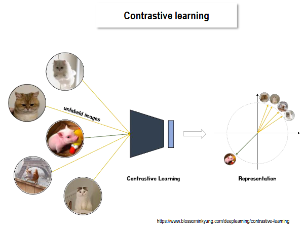

**그림 읽기:** 왼쪽 이미지는 Encoder를 통과해 오른쪽의 벡터로 표현됩니다. 비슷한 방향에 모인 벡터는 서로 유사한 표현을 뜻합니다. 다만 이 그림은 이미지 중심의 일반적인 대조 학습 설명이며, CLIP의 Text Encoder는 생략되어 있습니다. CLIP에서는 실제 이미지와 대응 설명의 관계가 학습 기준이 됩니다.

즉, CLIP은 고양이 이미지끼리만 모으도록 직접 클래스 라벨을 주는 방식이 아니라, **고양이 사진과 그 사진에 대응하는 문장을 연결하는 방식**으로 시각 개념을 배웁니다.

#### 4. Goal — 텍스트로 분류 기준을 지정하는 Zero-shot 활용

학습 후에는 후보 클래스의 설명을 Text Encoder에 넣고 이미지와 유사도를 비교합니다. 따라서 새 분류 기준을 **출력층 재학습 대신 후보 문구로 지정**할 수 있습니다. 이것이 CLIP의 Zero-shot 분류로 이어집니다.

Zero-shot은 해당 과제에 대한 추가 학습이 없다는 뜻입니다. 모든 새로운 개념을 정확하게 이해한다는 보장은 없으며, 후보 문구와 사전학습 데이터에 따라 결과가 달라집니다.

출처: [CLIP 원 논문 — 연구 동기와 자연어 감독 학습](https://arxiv.org/html/2103.00020v1#S2), [OpenAI — CLIP의 학습과 Zero-shot 활용](https://openai.com/index/clip/)

---

### New dataset

CLIP 연구진은 **다양한 시각 개념을 자연어로 학습하기 위해, 4억 개의 이미지·텍스트 쌍으로 구성된 WIT(WebImageText)**를 구축했습니다. 여기서 4억은 클래스 수가 아니라 학습에 사용하는 **쌍의 수**입니다.

#### 1. 기존 데이터셋만으로는 왜 부족했을까?


| 데이터셋                  | 장점               | CLIP 연구에서 본 한계                              |
| --------------------- | ---------------- | ------------------------------------------- |
| MS-COCO·Visual Genome | 사람이 작성한 품질 높은 주석 | 각각 학습 사진 약 10만 장 규모로, 대규모 사전학습에는 상대적으로 작음   |
| YFCC100M              | 약 1억 규모의 대규모 자료  | 제목·설명의 품질이 일정하지 않고, 파일명이나 촬영 설정만 포함된 경우도 있음 |


연구진이 YFCC100M에서 **영어 자연어 제목 또는 설명이 있는 이미지**를 남기자 약 1,500만 장으로 줄었습니다. 즉, 이미지가 많다는 사실만으로 유용한 이미지·텍스트 학습 쌍이 충분한 것은 아닙니다.

#### 2. WIT는 어떻게 구성했을까?

- **수집 대상:** 공개적으로 접근 가능한 여러 인터넷 출처의 이미지·텍스트 쌍을 활용했습니다.
- **개념 범위:** 약 50만 개의 검색어를 사용해, 해당 표현이 텍스트에 포함된 쌍을 찾았습니다. 검색어는 Wikipedia·WordNet 등을 바탕으로 구성했습니다.
- **분포 조정:** 특정 검색어에만 자료가 몰리지 않도록 검색어당 최대 2만 쌍을 포함했습니다. 이는 대략적인 균형 조정이며 완전한 균등 분포를 보장하지는 않습니다.

**‘수동 라벨링이 필요 없다’는 말은 각 이미지에 새 클래스 번호를 일일이 붙이지 않는다는 뜻**입니다. 이미 존재하는 사람이 작성한 텍스트가 감독 신호를 제공합니다. 데이터 수집·선별 과정까지 없다는 의미는 아닙니다.

#### 3. CLIP 학습과 Zero-shot 활용에 어떻게 연결될까?

예를 들어 “눈밭에서 뛰는 개”라는 설명은 물체뿐 아니라 행동과 배경도 담습니다. CLIP은 이런 쌍의 대응 관계를 대조 학습해, 이미지 특징을 다양한 자연어 표현과 연결합니다. 이후 후보 설명을 비교하는 Zero-shot 분류로 활용할 수 있습니다.

다만 **데이터 규모만으로 일반화가 보장되지는 않습니다.** 웹 설명의 오류·불완전함과 개념별 불균형이 학습 결과에 영향을 줄 수 있으며, Zero-shot 성능은 실제 평가로 확인해야 합니다.

출처: [CLIP 원 논문 §2.2 — 기존 데이터셋의 한계와 WIT 구축](https://arxiv.org/html/2103.00020v1#S2.SS2)

---

### Architecture

CLIP은 **이미지와 텍스트를 각각 인코딩한 뒤, 같은 차원의 벡터로 변환해 유사도를 비교하는 두 인코더 구조**입니다. 그림은 왼쪽의 입력 쌍에서 가운데 유사도 행렬, 오른쪽의 학습된 표현 공간 순서로 읽으면 됩니다.

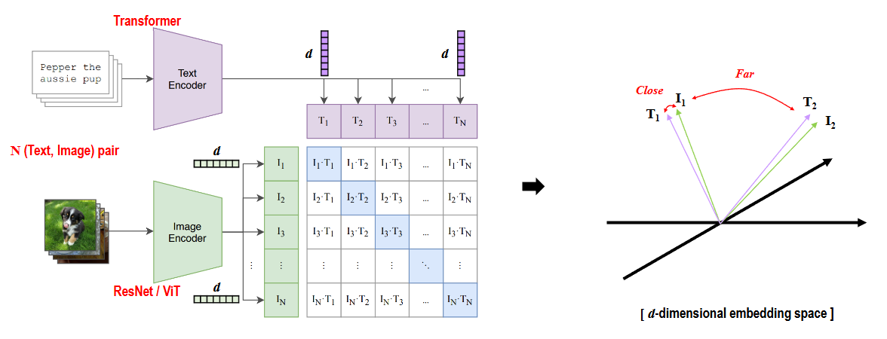

값의 범위 : -1 부터 1까지


#### 1. 왼쪽: 이미지와 문장을 각각 벡터로 변환

한 배치에 N개의 **이미지·설명 쌍**이 들어갑니다. i번째 이미지와 i번째 문장은 원래 함께 수집된 한 쌍입니다.


| 경로            | 처리 과정                                        | 그림의 출력            |
| ------------- | -------------------------------------------- | ----------------- |
| Image Encoder | ResNet 또는 ViT로 이미지 특징 추출 → 공통 공간으로 투영        | 이미지당 d차원 벡터 $I_i$ |
| Text Encoder  | 문장 토큰화 → Transformer → 문장 특징 추출 → 공통 공간으로 투영 | 문장당 d차원 벡터 $T_i$  |


원 CLIP의 Text Encoder는 문장 끝 토큰(EOT)의 최종 표현을 사용합니다. 두 인코더의 내부 특징 차원이 같을 필요는 없지만, **최종 비교에 쓰는 임베딩 차원 d는 같아야** 합니다. 선형 투영은 각 인코더의 특징을 이 공통 공간으로 옮기는 학습 가능한 변환입니다.

마지막에는 벡터 길이를 1로 맞추는 **L2 정규화**를 적용합니다. 이때 두 벡터의 내적은 코사인 유사도가 되어, 벡터 크기보다 방향의 유사성을 비교합니다. 여기의 d는 공통 임베딩 차원이며, 이미지 패치 수나 문장 토큰 수가 아닙니다.

#### 2. 가운데: N×N 유사도 행렬 만들기

이미지 벡터 N개와 텍스트 벡터 N개를 각각 행으로 쌓으면 두 행렬의 크기는 모두 N×d입니다. 서로 곱하면 N×N 비교 결과를 얻습니다.

$$
S = \alpha IT^T, \qquad S_{ij}=\alpha I_i^T T_j
$$

여기서 $\alpha$는 학습 가능한 양의 스케일이며, 온도 $\tau$를 사용하면 $\alpha=1/\tau$로 표현할 수 있습니다. 그림은 이 스케일을 생략하고 내적만 표시했습니다.


| 행렬의 위치              | 의미                         |
| ------------------- | -------------------------- |
| i번째 행               | 이미지 i와 배치의 모든 문장을 비교       |
| j번째 열               | 문장 j와 배치의 모든 이미지를 비교       |
| 대각선 $S_{ii}$ — 파란 칸 | 원래 짝인 이미지·문장: 학습에서 정답으로 지정 |
| 비대각선 $S_{ij}$       | 다른 쌍에서 가져온 조합: 대조 대상으로 사용  |


예를 들어 N=3이면 **9개 조합 중 대각선 3개가 정답 쌍**입니다. 비대각선 6개는 학습상 대조 대상이지만, 서로 다른 사진에 비슷한 설명이 붙어 있을 수도 있으므로 의미가 언제나 완전히 반대라는 뜻은 아닙니다.

#### 3. 학습: 행과 열 양쪽에서 올바른 짝 찾기

CLIP은 같은 유사도 행렬을 두 방향으로 사용합니다.

1. **이미지 → 텍스트:** 각 행에 Softmax를 적용해, 이미지 i의 정답 문장 i를 찾도록 Cross-Entropy를 계산합니다.
2. **텍스트 → 이미지:** 각 열에 Softmax를 적용해, 문장 j의 정답 이미지 j를 찾도록 Cross-Entropy를 계산합니다.
3. **두 손실을 평균**하고, 두 인코더·투영 가중치·유사도 스케일을 함께 학습합니다.

따라서 이 Softmax는 **배치 안에서 짝을 고르는 연산**입니다. 앞서 Self-Attention에서 토큰 정보를 섞던 Softmax와 역할이 다릅니다. 기본 CLIP은 이미지·텍스트를 각각 처리하며, 두 모달리티 사이의 Cross-Attention 없이 최종 임베딩의 유사도로 연결합니다.

#### 4. 오른쪽: 같은 쌍의 표현이 가까워지는 공간

오른쪽 그림에서 $I_1$과 $T_1$, $I_2$와 $T_2$가 비슷한 방향에 놓인 것은 **맞는 이미지·설명의 유사도가 높아지도록 학습한 결과**를 뜻합니다. 실제 공간은 d차원이지만 그림에서는 이해를 위해 단순화했습니다. 서로 다른 쌍이 반드시 특정 각도나 일정한 거리를 유지해야 하는 것은 아닙니다.

추론에서는 학습 배치의 N×N 행렬 대신, **입력 이미지와 K개의 후보 설명**을 비교할 수 있습니다. 예를 들어 고양이·강아지·자동차 설명 벡터 중 이미지와 가장 유사한 것을 고르면 Zero-shot 분류가 됩니다. 후보 설명 벡터는 미리 계산해 재사용할 수 있습니다.

출처: [CLIP 원 논문 — 대조 학습과 선형 투영](https://arxiv.org/html/2103.00020v1#S2.SS3), [공식 구현 — 인코더 출력·정규화·유사도 계산](https://github.com/openai/CLIP/blob/main/clip/model.py)

---

### Training

CLIP은 **이미지에 맞는 설명과 설명에 맞는 이미지를 배치 안에서 찾는 문제**로 두 인코더를 함께 훈련합니다. 원 CLIP은 ImageNet이나 언어 모델의 사전학습 가중치를 가져오지 않고, 이미지·텍스트 쌍으로 처음부터 학습했습니다.

#### 1. 첫 번째 그림: 한 번의 학습 단계

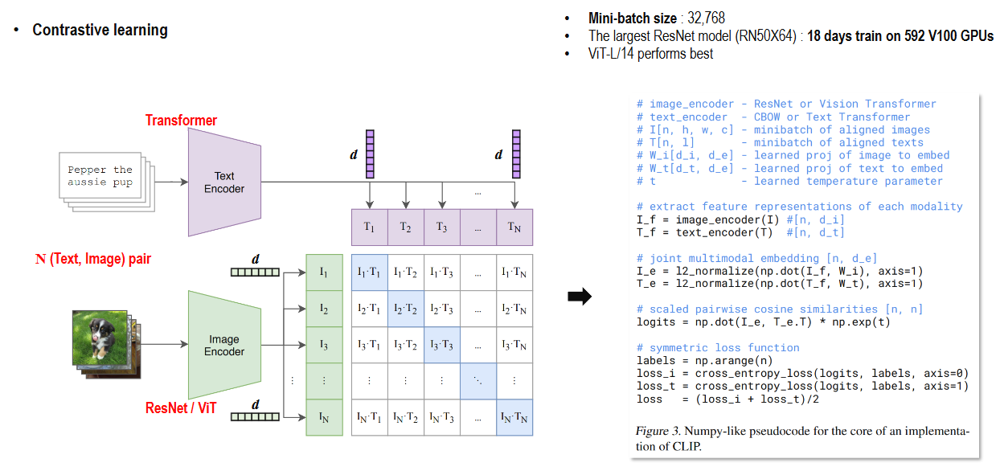

그림 오른쪽 코드는 왼쪽 구조를 다음 순서로 계산한 것입니다.


| 단계       | 코드의 주요 표현                       | 실제로 하는 일                         |
| -------- | ------------------------------- | -------------------------------- |
| 배치 구성    | 정렬된 이미지 I와 문장 T                 | 같은 인덱스가 정답 쌍이 되도록 N쌍 준비          |
| 특징 추출    | `image_encoder`, `text_encoder` | 각 입력을 해당 인코더로 처리                 |
| 투영·정규화   | `W_i`, `W_t`, `l2_normalize`    | 같은 차원의 공통 공간으로 변환하고 벡터 길이를 1로 맞춤 |
| 전체 조합 비교 | `I_e @ T_e.T`                   | 이미지 N개와 문장 N개의 N×N 코사인 유사도 계산    |
| 점수 조정    | `exp(t)`                        | 학습 가능한 양의 스케일을 곱해 logits 생성      |
| 정답 지정    | `arange(n)`                     | 각 행·열에서 같은 인덱스의 대각선 위치를 정답으로 설정  |
| 손실·업데이트  | 두 Cross-Entropy의 평균             | 역전파로 두 인코더와 투영 가중치, 스케일을 함께 갱신   |


정답은 ‘고양이=0’ 같은 고정 클래스 번호가 아니라 **이 배치에서 어느 문장이 어느 이미지와 짝인가**입니다. N개 정답 쌍 외의 N²−N개 조합이 대조 대상으로 사용됩니다. 이 과정을 새로운 배치에 반복합니다.

#### 2. 두 번째 그림: 대각선의 선택 확률을 높이는 손실

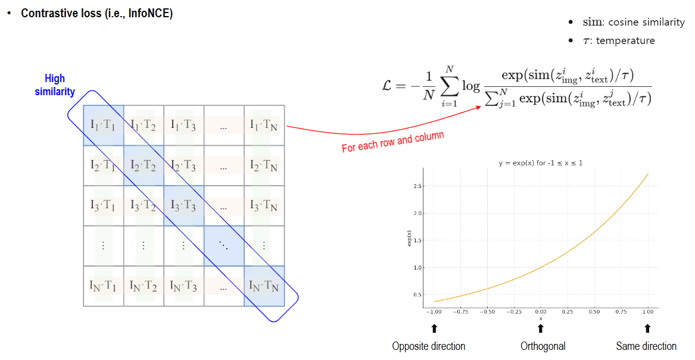

정규화된 이미지·텍스트 임베딩을 $I_i$, $T_j$라 하고, 점수를 $S_{ij}=I_i^TT_j/\tau$로 두겠습니다. 이미지 i가 문장 i를 선택할 확률은 **i번째 행에 Softmax**를 적용해 구합니다.

$$
p(T_i\mid I_i)=\frac{\exp(S_{ii})}{\sum_{j=1}^{N}\exp(S_{ij})},
\qquad
\mathcal{L}_{I\to T}=-\frac{1}{N}\sum_{i=1}^{N}\log p(T_i\mid I_i)
$$

그림의 식은 이 **이미지 → 텍스트 방향**을 나타냅니다. CLIP은 열 방향으로도 같은 계산을 하여, 문장 i에서 정답 이미지 i를 고르는 손실을 구합니다.

$$
p(I_i\mid T_i)=\frac{\exp(S_{ii})}{\sum_{j=1}^{N}\exp(S_{ji})},
\qquad
\mathcal{L}_{T\to I}=-\frac{1}{N}\sum_{i=1}^{N}\log p(I_i\mid T_i)
$$

$$
\mathcal{L}=\frac{\mathcal{L}_{I\to T}+\mathcal{L}_{T\to I}}{2}
$$

예를 들어 정답 쌍의 선택 확률이 0.2이면 그 항의 손실은 $-\log(0.2)\approx1.61$, 0.8이면 약 0.22입니다. 따라서 손실을 줄이면 **같은 행·열의 다른 후보보다 정답 쌍을 더 잘 구분**하게 됩니다. 대각선 값을 무조건 1, 나머지를 무조건 −1로 만드는 회귀 문제는 아닙니다.

#### 3. 코사인 유사도와 온도는 어떤 역할을 할까?

두 번째 그림의 곡선은 지수 함수가 높은 점수를 더 크게 반영하는 모습을 보여줍니다. 실제 선택 확률은 지수 값을 후보 전체의 합으로 나눈 **Softmax 결과**입니다.

- **코사인 유사도:** 범위는 −1~1입니다. 값이 클수록 벡터 방향이 유사합니다.
- **온도 τ:** 양수이며, 작을수록 점수 차이를 확대해 Softmax 분포를 더 뾰족하게 만듭니다. 크면 분포가 완만해집니다.
- **스케일이 적용된 logits:** 유사도에 $1/\tau$를 곱한 값이므로 범위가 −1~1에 제한되지 않습니다. 코드의 `exp(t)`가 이 양의 스케일에 해당합니다.

#### 4. 원 논문의 실제 훈련 설정


| 항목         | 설정과 의미                                                          |
| ---------- | --------------------------------------------------------------- |
| 학습 데이터     | WIT의 4억 이미지·텍스트 쌍                                               |
| 전체 미니배치 크기 | 32,768쌍. 한 이미지당 정답 문장 1개와 다른 문장 32,767개 비교                      |
| 학습 기간      | 기본 모델을 32 epochs 학습                                             |
| 최적화        | Adam에 분리된 Weight Decay 적용, Cosine 학습률 스케줄 사용                    |
| 이미지 증강     | 크기 조정한 이미지에서 무작위 정사각형 Crop                                      |
| 온도 초기화     | τ=0.07에 해당하는 스케일로 시작해 학습. 논문은 스케일 상한 100을 명시                    |
| 대규모 학습 구현  | 혼합 정밀도, Gradient Checkpointing, GPU별 유사도 계산 분할 등으로 메모리·계산 비용 관리 |


배치를 크게 만들면 한 번에 비교하는 후보가 많아집니다. 다만 같은 의미의 설명이 다른 쌍에도 있을 수 있으므로, 모든 대조 대상이 의미상 완전히 다른 것은 아닙니다.

첫 그림의 **592개 V100 GPU·18일**은 가장 큰 ResNet인 RN50x64의 학습 비용입니다. 가장 큰 ViT인 ViT-L/14는 **256개 V100 GPU·12일**이 걸렸습니다. ViT-L/14는 336 해상도에서 1 epoch를 추가 학습한 변형도 있으며, 논문의 대표 CLIP 결과는 주로 이 **ViT-L/14@336px**를 사용합니다. 모델별 자원과 결과를 구분해서 읽어야 합니다.

출처: [CLIP 원 논문 §2.3 — 학습 목표와 의사 코드](https://arxiv.org/html/2103.00020v1#S2.SS3), [§2.5 — 배치 크기·최적화·학습 자원](https://arxiv.org/html/2103.00020v1#S2.SS5)


---

### Inference

CLIP의 추론은 **입력 이미지와 후보 클래스 설명의 유사도를 비교해 가장 잘 맞는 설명을 고르는 과정**입니다. 학습된 인코더와 스케일을 고정한 채 사용하며, Zero-shot 분류에서는 해당 데이터셋의 정답 예제로 추가 학습하지 않습니다.

#### 1. 첫 번째 그림: 텍스트로 분류기 만들기

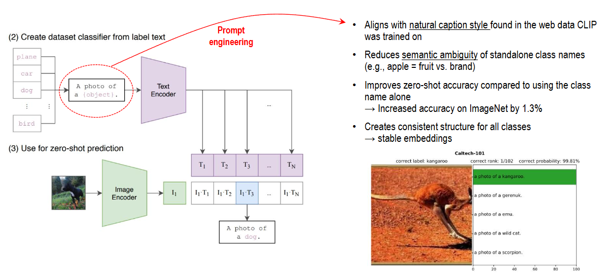

그림 왼쪽은 먼저 후보 설명을 벡터로 만들고, 새 이미지가 들어올 때 그 벡터들과 비교하는 순서입니다. 여기서는 학습 배치 크기 N과 구분해 **후보 클래스 수를 K**로 표기합니다.

1. **후보 문장 작성:** 클래스 이름을 `A photo of a {label}.` 같은 틀에 넣습니다. 예: `dog` → `A photo of a dog.`
2. **텍스트 벡터 준비:** Text Encoder와 투영을 거친 K개의 벡터를 각각 L2 정규화합니다. 후보가 같으면 미리 계산해 재사용할 수 있습니다.
3. **이미지 벡터 계산:** 입력 이미지를 모델의 평가용 전처리·Image Encoder·투영으로 처리하고 L2 정규화합니다.
4. **유사도 비교:** 이미지 벡터와 각 텍스트 벡터의 내적에 학습된 스케일을 곱합니다.
5. **최종 예측:** 가장 높은 점수의 후보를 선택합니다. 필요하면 K개 점수에 Softmax를 적용합니다.

정규화된 이미지 벡터를 $I$, 후보 k의 텍스트 벡터를 $T_k$라 하면 다음과 같습니다.

$$
s_k=\alpha I^TT_k, \qquad
p_k=\frac{\exp(s_k)}{\sum_{j=1}^{K}\exp(s_j)}, \qquad
\hat{k}=\operatorname*{arg\,max}_{k}s_k
$$

**Top-1 후보만 고를 때는 Softmax 전후의 순위가 같습니다.** Softmax의 출력은 주어진 후보 안에서 정규화한 값이므로, 후보 목록이나 문구가 바뀌면 값도 달라집니다. 이를 실제 정답일 확률로 그대로 해석해서는 안 됩니다.

#### 2. 왜 Zero-shot linear classifier라고 할까?

텍스트 벡터를 열로 쌓은 행렬을 $W=[T_1,\ldots,T_K]$라고 하면, 점수는 $s=\alpha W^TI$입니다. **텍스트 벡터가 클래스별 선형 분류 가중치 역할**을 하므로 이렇게 부릅니다. 정규화된 이미지 특징 위에 편향 없는 선형 점수 함수를 적용하는 형태입니다.

일반적인 분류 Head는 정답 라벨로 가중치를 학습하지만, 여기서는 **클래스 설명을 Text Encoder에 넣어 가중치를 구성**합니다. 따라서 후보를 바꾸어 새 분류 기준을 지정할 수 있습니다. 다만 이 절차 자체가 이미지 설명 문장을 자유롭게 생성하는 것은 아니며, 준비한 후보 중 하나를 선택합니다.

#### 3. Prompt engineering: 클래스 이름에 문맥 더하기

`boxer`만 넣으면 개 품종인지 운동선수인지 모호할 수 있습니다. 문장에 과제의 범주를 넣으면 의도한 의미를 전달하고, 사전학습에서 접한 자연어 설명 형식에도 가까워집니다.


| 과제               | 후보 문장 구성 예시                            | 목적                       |
| ---------------- | -------------------------------------- | ------------------------ |
| 일반 물체 분류         | `A photo of a {label}.`                | 클래스가 사진 속 대상을 뜻함을 명시     |
| Oxford-IIIT Pets | `A photo of a {label}, a type of pet.` | 품종 이름의 의미를 반려동물로 한정      |
| Food101          | 음식 종류라는 문맥 추가                          | 음식 이름이 다른 뜻으로 해석될 가능성 완화 |
| FGVC Aircraft    | 항공기 종류라는 문맥 추가                         | 기종 이름의 의미를 명확하게 전달       |
| OCR              | 인식할 문자·숫자에 따옴표 사용                      | 문자 자체를 비교 대상으로 제시        |


첫 그림의 **ImageNet +1.3%는 논문에서 보고한 정확도 +1.3%p**로 읽습니다. 클래스 이름만 사용하는 기준에서 기본 사진 문장 틀을 적용한 결과이며, 모든 데이터셋에서 같은 향상을 보장하지는 않습니다.

#### 4. Prompt ensembling: 여러 문장의 임베딩 합치기

같은 클래스에도 `A photo of a big {label}.`, `A photo of a small {label}.`처럼 여러 문장을 사용할 수 있습니다. 각 문장의 정규화된 텍스트 임베딩을 **클래스별로 평균한 뒤 다시 정규화**해 대표 벡터 하나를 만듭니다.

이 방식은 여러 모델의 예측 확률을 평균하는 대신 **임베딩 공간에서 합치는 앙상블**입니다. 대표 벡터를 미리 저장하면 이미지마다 문장을 다시 처리할 필요가 없고, 단일 문장 방식과 같이 클래스당 벡터 하나만 비교할 수 있습니다. 초기 텍스트 벡터 준비 비용은 늘어납니다.

#### 5. 두 번째 그림: 같은 이미지 모델에서도 성능이 달라진다

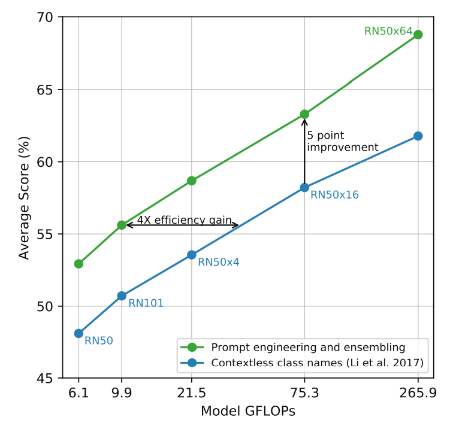

- **가로축:** 이미지 모델의 GFLOPs로, 오른쪽일수록 큰 연산량을 사용하는 모델입니다.
- **세로축:** 36개 데이터셋의 평균 점수입니다. ImageNet 하나의 정확도가 아닙니다.
- **파란색:** 문맥 없이 클래스 이름만 사용한 결과입니다.
- **초록색:** Prompt engineering과 임베딩 앙상블을 적용한 결과입니다.

같은 가로 위치에서 초록색이 더 높은 것은 **이미지 모델을 키우지 않아도 텍스트 후보를 구성하는 방법으로 성능을 개선할 수 있음**을 보여줍니다. 논문은 36개 데이터셋에서 평균 약 5포인트 향상을 보고합니다. 그림의 ‘4× efficiency gain’은 비슷한 점수에 필요한 모델 연산량을 비교한 의미이며, 실행 속도가 자동으로 4배 빨라진다는 뜻은 아닙니다.

**훈련에서는 배치 안의 정답 쌍을 맞히도록 가중치를 갱신하고, 추론에서는 고정된 모델로 사용자가 정한 K개 후보를 비교합니다.** 후보에 정답 개념이 없으면 다른 후보가 선택될 수 있으므로, 결과를 해석할 때는 후보 목록과 문구를 함께 확인해야 합니다.

출처: [CLIP 원 논문 §3.1.2 — Zero-shot 선형 분류기](https://arxiv.org/html/2103.00020v1#S3.SS1.SSS2), [§3.1.4 및 그림 4 — Prompt engineering과 앙상블](https://arxiv.org/html/2103.00020v1#S3.SS1.SSS4)


---

### Zero-shot experiments

세 실험은 각각 **정답 라벨로 학습한 기준 모델과의 경쟁력**, **추가 라벨이 적을 때의 성능**, **데이터 분포가 바뀌었을 때의 견고함**을 살펴봅니다. 여기서 Zero-shot은 평가 과제의 정답 예제로 추가 학습하지 않는다는 뜻이며, CLIP의 대규모 사전학습과 클래스 설명은 사용합니다.

#### 1. 지도학습 기준과 비교: 27개 중 16개 데이터셋에서 우세

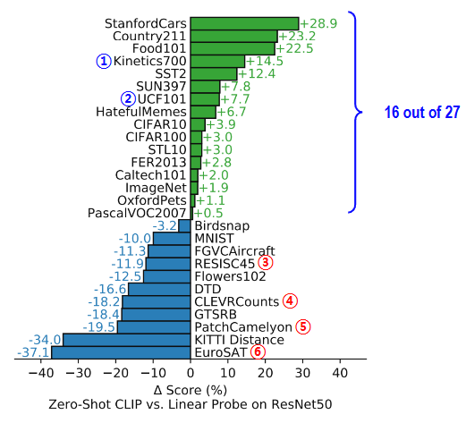

비교 대상은 **ImageNet으로 사전학습한 ResNet-50의 특징을 고정하고, 각 평가 과제의 학습 라벨로 학습한 선형 분류기**입니다. 모든 층을 해당 과제에 맞게 미세조정한 모델이나 각 분야의 최고 모델을 뜻하지는 않습니다.

가로축은 `Zero-shot CLIP 점수 − 기준 분류기 점수`입니다. 오른쪽 초록 막대는 CLIP이 우세하고, 왼쪽 파란 막대는 기준 분류기가 우세합니다. 정확도 지표의 차이는 %p로 읽습니다.


| 대표 과제                    | 그림의 점수 차이   | 결과 해석                    |
| ------------------------ | ----------- | ------------------------ |
| StanfordCars·Food101     | +28.9·+22.5 | 자동차·음식 같은 세부 범주에서도 강한 결과 |
| Kinetics700 — ①          | +14.5       | 행동 분류 과제에서 우세            |
| UCF101 — ②               | +7.7        | 다른 행동 분류 과제에서도 우세        |
| ImageNet                 | +1.9        | 일반 물체 분류에서도 기준보다 약간 높음   |
| RESISC45 — ③·EuroSAT — ⑥ | −11.9·−37.1 | 위성·항공 영상에서는 크게 뒤처짐       |
| CLEVRCounts — ④          | −18.2       | 합성 장면의 물체 개수 세기에 취약      |
| PatchCamelyon — ⑤        | −19.5       | 병리 영상의 종양 판별에서 취약        |


전체적으로 **27개 중 16개에서 CLIP이 더 높지만, 과제별 편차가 큽니다.** 행동 분류의 강점에 대해 논문은 자연어가 물체 이름뿐 아니라 동작을 나타내는 표현도 제공하기 때문일 수 있다고 해석합니다. 이는 가능한 설명이며, 언어 감독의 효과만 분리해 입증한 결과는 아닙니다.

반면 전문 영상이나 수량·거리 판단에서는 큰 격차가 나타납니다. 세부 분류 안에서도 StanfordCars는 강하지만 FGVCAircraft는 −11.3, Flowers102는 −12.5이므로, ‘세부 분류에 항상 강하다’고 일반화할 수 없습니다. 사전학습에서 얻은 표현과 언어가 해당 과제를 얼마나 잘 다루는지가 중요합니다.

#### 2. Few-shot linear probe와 비교: 적은 라벨을 얼마나 대체할까?

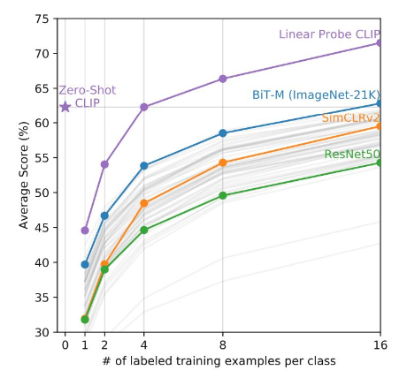

**Linear probe**는 이미지 인코더를 고정하고 그 위의 선형 분류기만 정답 라벨로 학습하는 평가입니다. **4-shot은 전체 4장이 아니라 클래스당 4장**을 뜻합니다. 그림은 클래스당 16개 이상의 예제가 있는 **20개 데이터셋의 평균 점수**를 사용합니다.


| 그래프 요소 | 의미                                               |
| ------ | ------------------------------------------------ |
| 가로축    | 선형 분류기 학습에 사용한 클래스당 라벨 이미지 수                     |
| 세로축    | 20개 데이터셋의 평균 점수                                  |
| 별 표시   | 추가 라벨 없이 설명 문장으로 분류한 Zero-shot CLIP              |
| 보라색 곡선 | 같은 CLIP 이미지 특징 위에 소량 라벨로 학습한 선형 분류기              |
| 다른 곡선  | BiT-M·SimCLRv2·ResNet-50 등 다른 모델의 특징을 사용한 선형 분류기 |


핵심 결과는 **Zero-shot CLIP이 같은 CLIP 특징의 4-shot 선형 분류기와 평균적으로 비슷한 성능**을 보인다는 것입니다. 또한 이 평가에 포함된 다른 공개 모델 중 가장 좋은 16-shot 결과에도 근접합니다. 그러나 CLIP 자체의 선형 분류기는 라벨이 8·16개로 늘어나면서 Zero-shot보다 높은 점수에 도달합니다.

라벨 1~2장만으로는 이미지의 어느 속성이 분류 기준인지 모호할 수 있습니다. 예를 들어 개 사진 한 장은 품종·색·배경 등 여러 단서를 담지만, 클래스 설명은 구분하려는 개념을 직접 지정합니다. 따라서 적은 예제에서의 과적합 가능성뿐 아니라 **텍스트가 과제를 명확하게 전달하는 효과**도 생각해야 합니다.

이 결과는 모든 과제에서 라벨 4장을 대체한다는 뜻은 아닙니다. 평균에 가려진 과제별 차이가 있으며, 라벨이 충분하면 해당 과제에 맞춘 분류기 학습이 더 유리할 수 있습니다.

#### 3. Distribution shift: 같은 ImageNet 성능이어도 변화에 대한 견고함은 다르다

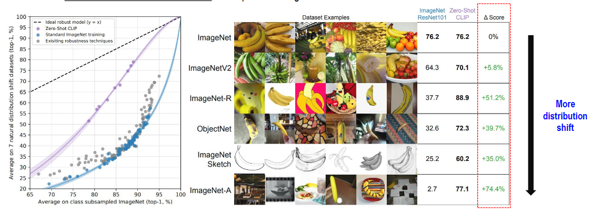

분포 변화는 같은 대상을 다루더라도 촬영 조건·배경·그림 스타일 등이 달라지는 상황입니다. 왼쪽 그래프는 **가로축의 ImageNet 성능이 비슷한 모델끼리 세로축의 분포 변화 성능을 비교**합니다. 점선 y=x에 가까울수록 두 평가 사이의 성능 격차가 작습니다. 그래프는 공통 클래스에 맞춘 ImageNet 평가와 7개 분포 변화 평가의 평균을 사용합니다.

보라색 CLIP 경향선이 일반 ImageNet 학습 모델의 파란색 경향선보다 높으므로, ImageNet 정확도가 비슷해도 CLIP이 변화된 이미지에서 더 높은 성능을 유지하는 경향이 나타납니다. 두 모델이 단순히 원래 정확도부터 달랐기 때문인지 확인하는 것이 이 비교의 핵심입니다.

오른쪽 표는 ImageNet 정확도가 모두 **76.2%**인 ResNet-101과 Zero-shot CLIP ViT-L/14@336px를 비교합니다. 아래 값은 그림에 제시된 해당 평가 설정의 결과입니다.


| 평가 데이터          | ImageNet ResNet-101 | Zero-shot CLIP | 차이      |
| --------------- | ------------------- | -------------- | ------- |
| ImageNet        | 76.2                | 76.2           | 0.0%p   |
| ImageNetV2      | 64.3                | 70.1           | +5.8%p  |
| ImageNet-R      | 37.7                | 88.9           | +51.2%p |
| ObjectNet       | 32.6                | 72.3           | +39.7%p |
| ImageNet Sketch | 25.2                | 60.2           | +35.0%p |
| ImageNet-A      | 2.7                 | 77.1           | +74.4%p |


예를 들어 스케치에서 25.2→60.2는 **+35.0%p**입니다. 다만 데이터셋마다 클래스 범위와 평가 설정이 달라, 각 행의 절대 점수를 서로 같은 난이도의 시험 점수처럼 비교해서는 안 됩니다. 그림의 예시는 분포 차이를 보여주며, 위에서 아래로의 순서를 보편적인 난이도 척도로 볼 수도 없습니다.

이 결과는 **논문의 자연적인 분포 변화 평가에서 CLIP의 견고함이 더 높았다**는 근거입니다. 모든 도메인 변화나 인위적인 공격에서도 안전하게 일반화한다는 보장은 아닙니다. 앞의 위성·병리 영상 결과처럼 전이 성능이 낮은 분야도 함께 확인해야 합니다.

세 실험을 연결하면 CLIP의 장점은 **많은 과제에서 추가 라벨 없이 출발할 수 있고, 적은 라벨과 일부 분포 변화 조건에서 강한 기준점을 제공한다는 것**입니다. 실제 사용 성능은 해당 과제의 데이터·후보 문구·평가 조건으로 확인해야 합니다.

출처: [CLIP 원 논문 §3.1.5 — 지도학습·Few-shot 비교, 그림 5·6](https://arxiv.org/html/2103.00020v1#S3.SS1.SSS5), [§3.3 — 자연적인 분포 변화에 대한 견고함, 그림 13](https://arxiv.org/html/2103.00020v1#S3.SS3)

---

### Summary

**CLIP의 핵심은 이미지와 자연어를 연결해, 하나의 사전학습 모델을 다양한 분류 기준과 검색 작업에 활용할 수 있도록 만든 것**입니다. 클래스별 출력층을 매번 학습하는 대신, 텍스트로 원하는 개념을 지정하고 이미지와의 유사도를 비교합니다.

#### 1. 무엇을 어떻게 배웠을까?


| 핵심 요소        | 정리                                                 |
| ------------ | -------------------------------------------------- |
| 자연어 감독       | WIT의 4억 이미지·텍스트 쌍에서 설명 문장을 학습 신호로 활용               |
| 두 인코더        | Image Encoder와 Text Encoder가 각각 입력을 공통 임베딩 공간으로 변환 |
| 대조 학습        | 배치 안에서 올바른 이미지·문장 쌍을 행·열 양방향으로 찾도록 학습              |
| Zero-shot 추론 | 고정된 모델로 이미지와 후보 설명의 유사도를 비교해 클래스 선택                |
| Prompt 활용    | 문맥을 담은 설명과 여러 문장의 임베딩 앙상블로 분류 기준을 더 잘 전달           |


**ViT는 이미지 특징을 추출하는 구조이고, CLIP은 그 특징을 언어의 표현과 연결하는 학습 방식**입니다. 따라서 CLIP의 이미지 인코더로 ViT를 사용할 수 있으며, 두 개념은 함께 쓰일 수 있습니다.

#### 2. 실험에서 확인한 장점과 한계

- **추가 라벨 없이도 경쟁력 있는 출발점:** 27개 평가 데이터셋 중 16개에서 ResNet-50 특징 기반 지도학습 선형 분류기보다 높은 점수를 기록했습니다.
- **적은 라벨에 대한 효율:** 20개 데이터셋의 평균에서 Zero-shot 성능이 같은 CLIP 특징의 4-shot 선형 분류기와 비슷했습니다. 모든 과제에서 클래스당 라벨 4장을 대체한다는 뜻은 아닙니다.
- **일부 분포 변화에 대한 견고함:** ImageNet 성능이 비슷한 모델과 비교했을 때, 논문의 자연적인 분포 변화 평가에서 더 높은 성능을 유지하는 경향을 보였습니다.
- **과제별 편차:** 위성·병리 영상, 개수·거리 판단 등에서는 취약했습니다. 충분한 라벨로 학습한 분류기가 더 높은 성능을 얻을 수도 있습니다.

#### 3. 기억할 점

Zero-shot은 **해당 평가 과제의 정답 예제로 추가 학습하지 않는다**는 뜻입니다. 대규모 사전학습과 자연어 설명은 사용하므로, 학습 비용이나 감독 신호 자체가 사라지는 것은 아닙니다. CLIP은 새 과제마다 필요한 수동 클래스 라벨을 줄일 수 있지만, 결과는 사전학습 데이터·후보 클래스·설명 문구에 영향을 받습니다.

앞선 ViT·DeiT·Swin과 연결하면, **ViT는 이미지의 토큰 처리, DeiT는 데이터 효율적인 학습, Swin은 계층 구조와 계산 범위, CLIP은 이미지·언어의 정렬과 과제 간 전이**에 초점을 맞춥니다. CLIP의 기여는 모든 작업을 해결하는 보장보다, 자연어로 지정한 여러 과제에 재사용할 수 있는 시각 표현을 학습했다는 데 있습니다.

출처: [Learning Transferable Visual Models From Natural Language Supervision — CLIP 원 논문, ICML 2021](https://arxiv.org/abs/2103.00020)

---

## 8. DINO

**DINO(self-DIstillation with NO labels)는 같은 이미지의 서로 다른 뷰가 일관된 표현을 만들도록, Student와 Teacher를 함께 사용하는 자기지도 학습 방법**입니다. 사람의 클래스 라벨이나 텍스트 설명 대신, Teacher가 만든 출력 분포를 Student의 학습 목표로 사용합니다.

아래 내용은 [강의 PDF 50~59쪽](03_00_Attention.pdf#page=50)을 페이지 순서대로 설명합니다. 여기서 다루는 것은 2021년의 원 DINO이며, 슬라이드의 DINOv2 데모 링크는 후속 연구의 예시입니다.

### Overview — 라벨 없이도 물체를 구분하는 표현 배우기

자료: PDF 50쪽.

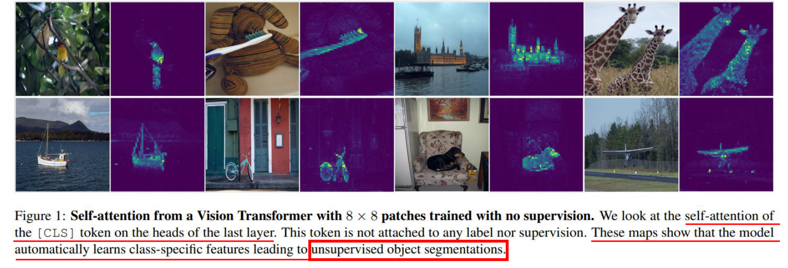

그림은 원본 사진과 Self-Attention 시각화를 번갈아 보여줍니다. 신발·기린·비행기처럼 주요 물체가 놓인 부분에 강한 반응이 나타납니다. **물체의 클래스나 분할 마스크를 정답으로 주지 않았는데도, 학습한 표현에 물체의 공간적 구조가 드러난다**는 것이 이 절의 관찰입니다.

기존 지도학습에서는 많은 이미지에 정답 라벨을 붙여야 합니다. DINO는 이를 줄이기 위해 이미지 자체에서 여러 학습 입력을 만들고, 같은 장면을 다르게 보아도 유용한 공통 표현을 만들도록 학습합니다. 다만 Attention 그림이 물체 이름을 알려 주거나, 모든 이미지에서 정확한 분할을 보장하는 것은 아닙니다.

앞서 배운 방법들과 학습 신호를 비교하면 다음과 같습니다.


| 방법          | 학습 목표를 만드는 정보                       |
| ----------- | ----------------------------------- |
| 지도학습 ViT    | 사람이 지정한 클래스 라벨                      |
| DeiT의 증류 모델 | 실제 클래스 라벨과 별도 교사 모델의 예측             |
| CLIP        | 이미지와 함께 수집한 자연어 설명                  |
| DINO        | 같은 이미지의 다른 뷰에 대한 EMA Teacher의 출력 분포 |


---

### Self-attention map — CLS가 어느 패치를 참고할까?

자료: PDF 51쪽.

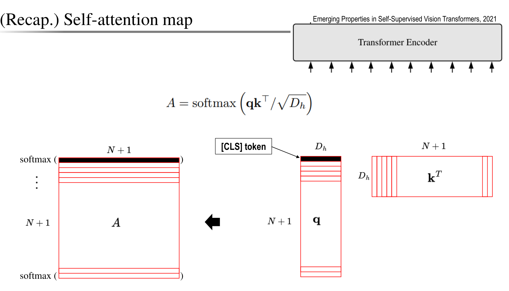

그림에서 N은 이미지 패치 수입니다. CLS를 포함한 토큰 수는 N+1이며, Head 하나의 Query와 Key 차원을 $d_h$라고 하면 Attention 행렬은 다음과 같습니다.

$$
A=\operatorname{softmax}\left(\frac{QK^T}{\sqrt{d_h}}\right),
\qquad A\in\mathbb{R}^{(N+1)\times(N+1)}
$$

**빨간색으로 표시한 CLS Query의 행**은 CLS가 각 토큰을 얼마나 참고하는지를 나타냅니다. 여기서 CLS 자신에 해당하는 칸을 제외하면 패치별 가중치 N개가 남습니다. 이를 패치 격자로 재배열하고 원본 크기로 확대하면 앞의 Attention map이 됩니다.

예를 들어 224×224 이미지를 16×16 패치로 나누면 패치는 14×14=196개입니다. Head 하나의 Attention 행렬은 197×197이고, CLS→패치 가중치 196개를 14×14로 되돌릴 수 있습니다.

이 그림은 **Attention 가중치를 시각화한 것**입니다. 최종 CLS 특징 벡터를 그대로 이미지로 펼친 것도 아니고, 픽셀별 클래스 확률을 출력한 것도 아닙니다. Head별로 참고하는 위치가 달라 서로 다른 물체나 부위가 드러날 수 있습니다.

---

### Architecture (1/6) — Student–Teacher와 자기 증류

자료: PDF 52쪽.

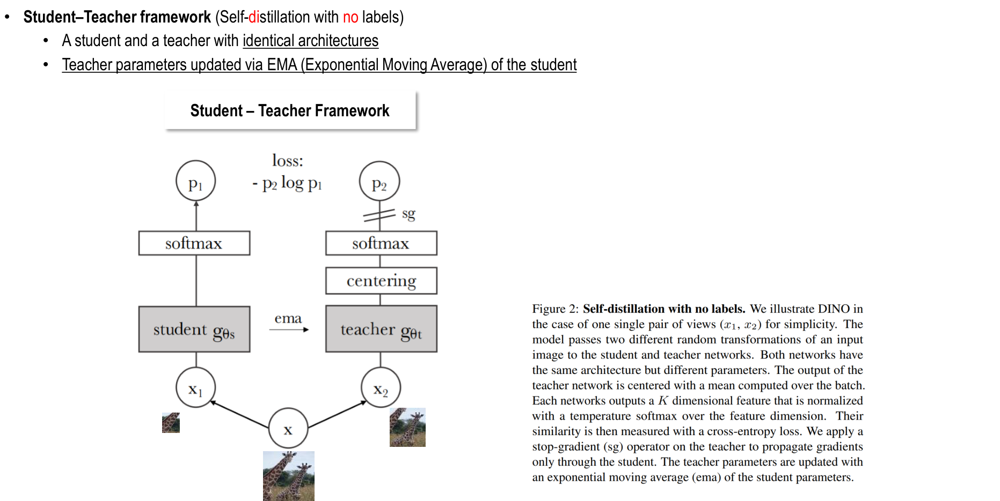

그림은 **아래에서 위로** 읽습니다. 원본 x에 서로 다른 증강을 적용해 뷰 $x_1$, $x_2$를 만들고, 각각 Student와 Teacher에 넣습니다. 두 네트워크는 Backbone과 Projection Head를 거쳐 출력 분포 $p_s$, $p_t$를 만듭니다. Student는 Teacher 분포를 맞히도록 학습합니다.


| 구성      | 학습에서의 역할                      | 갱신 방법                       |
| ------- | ----------------------------- | --------------------------- |
| Student | 다른 뷰에서도 Teacher와 일관된 출력을 예측   | 손실의 역전파와 옵티마이저              |
| Teacher | Student가 따라갈 목표 분포 제공         | Student 가중치의 지수 이동 평균 — EMA |
| Center  | Teacher 출력의 특정 차원 쏠림을 완화하는 통계 | Teacher logits의 이동 평균       |


두 네트워크는 같은 기본 구조로 시작합니다. Teacher가 더 큰 사전학습 모델인 DeiT의 증류와 달리, **DINO의 Teacher는 Student의 과거 가중치를 평균하며 함께 발전**합니다. 그림의 EMA 화살표는 특징 벡터를 전달하는 경로가 아니라 파라미터를 갱신하는 경로입니다.

Student와 Teacher가 같은 출력을 내기만 하면 손실을 낮출 수 있어, 모든 이미지에 똑같은 분포를 출력하는 **표현 붕괴(Collapse)**가 문제가 됩니다. DINO는 Teacher의 느린 갱신, Centering, Sharpening과 Stop-gradient를 조합해 이를 방지합니다.

---

### Architecture (2/6) — ViT Backbone과 Multi-crop

자료: PDF 53쪽.

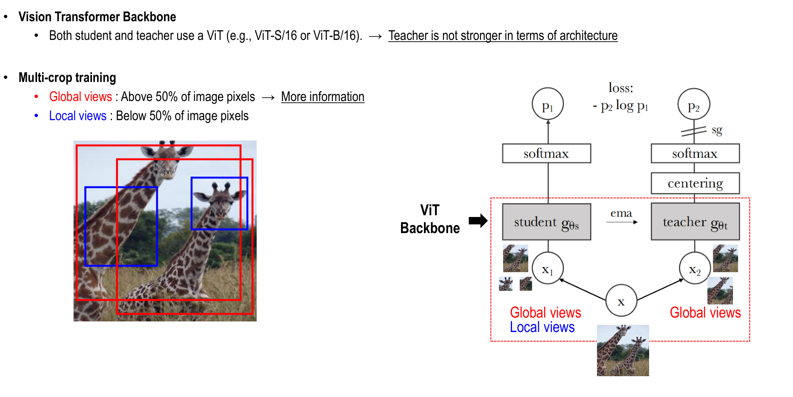

왼쪽 기린 사진의 큰 빨간 박스는 Global view, 작은 파란 박스는 Local view입니다. 오른쪽 구조에서 **Student는 Global·Local 뷰를 모두 보고, Teacher는 Global 뷰만 봅니다.** Student가 부분적인 단서에서도 큰 장면을 본 Teacher와 일관된 표현을 만들도록 하는 구성입니다.


| 구분          | 입력 내용         | 공식 구현의 기본 예시       |
| ----------- | ------------- | ------------------ |
| Global view | 원본의 비교적 큰 영역  | 2개, 각각 224×224로 변환 |
| Local view  | 원본의 비교적 작은 영역 | 8개, 각각 96×96으로 변환  |


슬라이드의 ‘50% 이상·미만’은 큰 뷰와 작은 뷰를 나누는 직관적인 설명입니다. 실제 Crop 비율은 설정할 수 있으며, 공식 코드의 기본 면적 범위는 Global 0.4~~1.0, Local 0.05~~0.4입니다. **Crop한 원본 영역의 비율과, Crop을 Resize한 뒤의 입력 픽셀 크기는 구분**해야 합니다.

예를 들어 기린 몸 일부만 보는 Student가 더 넓은 장면을 보는 Teacher의 표현을 배우는 방식입니다. 같은 뷰를 자기 자신과 비교하는 조합은 제외하고, Teacher의 각 Global view를 다른 Student 뷰들과 비교합니다. Local 뷰가 임의의 정답 물체 마스크인 것은 아닙니다.

원 DINO는 ResNet 같은 Backbone에도 적용할 수 있지만, 이 자료는 물체의 공간적 구조가 잘 드러나는 ViT를 중심으로 설명합니다.

보충 출처: [DINO 공식 구현 — Crop 설정과 뷰 조합](https://github.com/facebookresearch/dino/blob/main/main_dino.py)

---

### Architecture (3/6) — EMA와 Centering의 역할

자료: PDF 54쪽.

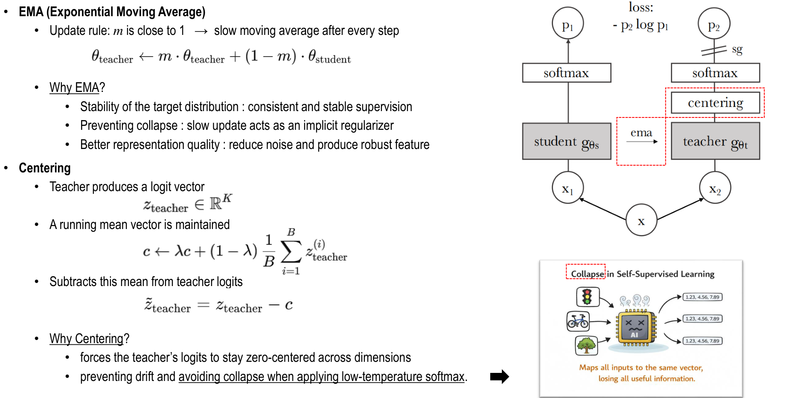

#### EMA: Teacher가 너무 급격하게 바뀌지 않게 하기

Student를 옵티마이저로 갱신한 뒤 Teacher 파라미터를 다음처럼 바꿉니다.

$$
\theta_t\leftarrow m\theta_t+(1-m)\theta_s
$$

m이 1에 가까우면 Teacher가 현재 Student를 조금씩 반영합니다. 예를 들어 m=0.996이면 기존 Teacher의 비중은 99.6%, 현재 Student는 0.4%입니다. 이는 이미지별 예측을 평균하는 것이 아니라 **네트워크 가중치를 시간에 걸쳐 평균**하는 연산입니다.

EMA는 학습 목표가 매번 크게 요동치는 것을 줄입니다. 다만 EMA 하나만으로 모든 붕괴 문제가 해결된다고 이해하면 안 됩니다.

#### Centering: 특정 출력 차원의 독점을 완화하기

Teacher의 Softmax 이전 출력인 logits를 $z_t\in\mathbb{R}^{K}$라고 하면, Center c도 K차원 벡터입니다. 배치 평균을 이동 평균으로 누적하고 Teacher logits에서 뺍니다.

$$
c\leftarrow\lambda c+(1-\lambda)\frac{1}{B}\sum_{b=1}^{B}z_t^{(b)},
\qquad \widetilde z_t=z_t-c
$$

여기서 B는 통계에 포함한 Teacher 뷰의 수이며, K는 Projection Head의 출력 차원입니다. 특정 출력 차원이 여러 입력에서 계속 크게 나오면 그 성분의 Center도 커져, 이후 점수에서 더 많이 차감됩니다.

**Centering은 각 이미지 벡터의 성분 평균을 무조건 0으로 만드는 연산이 아닙니다.** 차원별로 배치·시간에 걸친 평균을 빼는 것입니다. Teacher 파라미터를 평균하는 EMA와 Teacher 출력 통계를 평균하는 Center는 대상도 갱신 계수도 다릅니다.

---

### Architecture (4/6) — 두 Softmax와 Temperature

자료: PDF 55쪽.

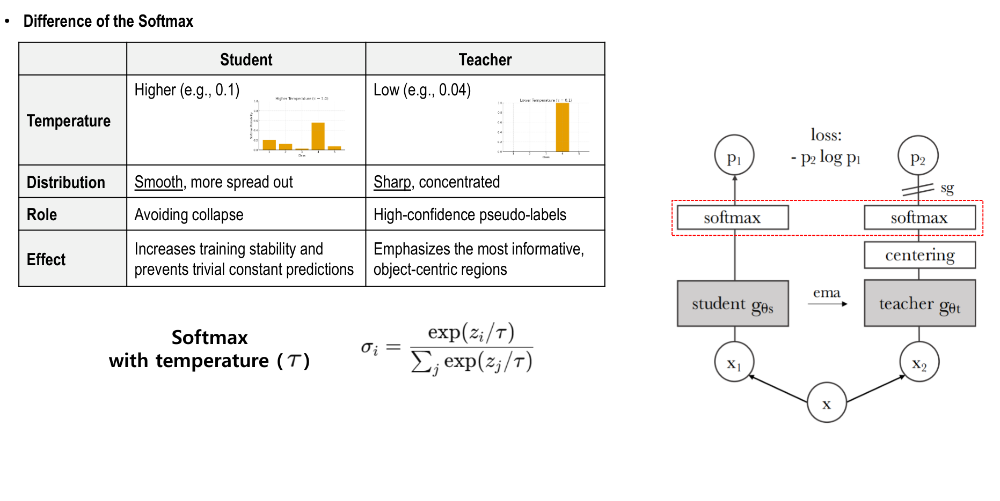

두 네트워크 모두 출력 차원 방향으로 Softmax를 적용하지만, Teacher에는 먼저 Centering을 적용하고 상대적으로 낮은 온도를 사용합니다.

$$
p_s^{(k)}=\frac{\exp(z_s^{(k)}/\tau_s)}{\sum_j\exp(z_s^{(j)}/\tau_s)},
\qquad
p_t^{(k)}=\frac{\exp((z_t^{(k)}-c^{(k)})/\tau_t)}{\sum_j\exp((z_t^{(j)}-c^{(j)})/\tau_t)}
$$


| 구분          | Student         | Teacher               |
| ----------- | --------------- | --------------------- |
| 온도 예시       | 0.1             | 0.04                  |
| 비교적 나타나는 분포 | 완만한 분포          | 더 뾰족한 분포 — Sharpening |
| 역할          | 목표 분포를 따라가도록 학습 | 구분 가능한 학습 목표 제공       |
| Centering   | 적용하지 않음         | Softmax 전에 적용         |


온도가 낮으면 같은 logits의 차이가 더 확대됩니다. **Centering은 한 차원에 몰리는 경향을, Sharpening은 모든 입력이 균일한 분포를 내는 경향을 억제**하도록 함께 작동합니다. Student의 높은 온도만으로 Collapse를 막는다고 보거나, Teacher의 낮은 온도가 곧바로 물체 위치를 선택한다고 해석하면 안 됩니다. 이 분포의 축은 패치 위치가 아니라 Head의 출력 차원입니다.

슬라이드의 온도는 예시이며, 실제 실험에서는 Teacher 온도의 Warm-up 등 학습 설정에 따라 달라질 수 있습니다.

---

### Architecture (5/6) — CLS, Projection Head, Cross-Entropy

자료: PDF 56쪽.

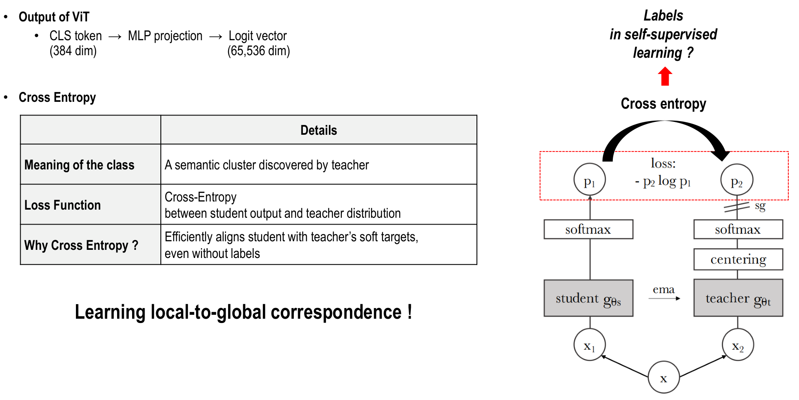

ViT는 CLS 토큰의 특징을 만들고, 학습용 Projection Head가 이를 K차원 logits로 바꿉니다. 슬라이드의 **384→65,536**은 ViT-S 특징 차원과 Head 출력 차원의 예입니다. **65,536개가 사람이 정의한 물체 클래스 수라는 뜻은 아닙니다.**


| 값                         | 의미                       | 서로 다른 점                        |
| ------------------------- | ------------------------ | ------------------------------ |
| CLS 특징 — 예: 384차원         | 이미지 전체를 나타내는 Backbone 표현 | 이미지 검색·분류 등의 평가에 활용            |
| Head logits — 예: 65,536차원 | 자기지도 학습 목표를 만드는 출력 점수    | 사람의 클래스 이름과 직접 대응하지 않음         |
| Softmax 출력                | K개 차원에 대한 확률분포           | Teacher와 Student 사이의 손실 계산에 활용 |


슬라이드의 ‘semantic cluster’는 학습 중 생긴 묶음으로 이해할 수 있지만, 각 차원에 항상 고양이·자동차 같은 이름이 붙는 것은 아닙니다.

Teacher가 본 뷰를 u, Student가 본 다른 뷰를 v라 하면 손실은 다음과 같습니다.

$$
H(p_t(u),p_s(v))=-\sum_{k=1}^{K}p_t^{(k)}(u)\log p_s^{(k)}(v)
$$

Cross-Entropy는 사람의 One-hot 라벨이 있어야만 쓸 수 있는 손실이 아닙니다. 여기서는 **Teacher의 Soft target 분포가 정답 역할**을 합니다. Teacher가 높은 비중을 둔 차원을 Student도 잘 예측하도록 학습합니다.

Multi-crop에서는 Teacher의 두 Global view와, 같은 뷰를 제외한 Student의 모든 뷰 사이 손실을 평균합니다. 기본 예시처럼 전체 뷰가 10개라면 이미지당 비교 조합은 2×9=18개입니다. 이는 부분 뷰와 전체 뷰의 표현을 연결하는 학습이지, 픽셀별 위치 대응을 정답으로 준 학습은 아닙니다.

CLIP과 달리 서로 다른 이미지들을 명시적인 Negative pair로 밀어내는 항을 사용하지 않습니다. 따라서 일관성을 배우면서도 출력의 다양성을 유지하도록 설계한 Centering·Sharpening 등이 중요합니다.

---

### Architecture (6/6) — Stop-gradient

자료: PDF 57쪽.

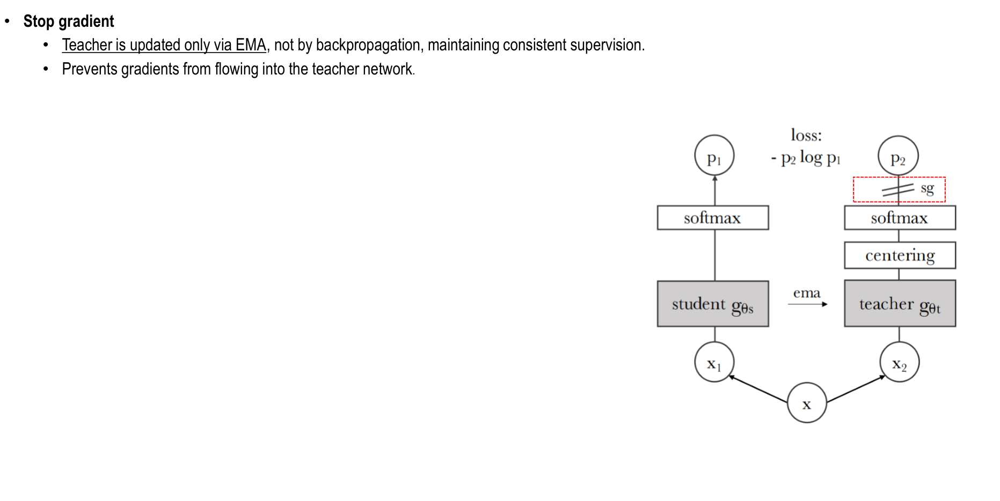

그림의 **sg는 Stop-gradient**입니다. 손실을 계산할 때 Teacher 출력 분포는 고정된 목표처럼 취급하고, 그 경로로는 그래디언트를 전달하지 않습니다.

1. Teacher가 Global view의 목표 분포를 계산합니다.
2. Student가 다른 뷰의 출력으로 목표를 따라가도록 손실을 계산합니다.
3. 역전파·옵티마이저는 Student의 Backbone과 Projection Head를 갱신합니다.
4. Teacher는 새 Student 가중치를 EMA로 반영합니다.

따라서 **Teacher는 ‘그래디언트로 학습하지 않지만, 가중치는 계속 변하는’ 모델**입니다. Stop-gradient가 Teacher를 학습 내내 고정한다는 뜻은 아닙니다. 이 비대칭 갱신이 Teacher를 안정적인 학습 목표로 사용하는 핵심입니다.

---

### Architecture summary — 한 학습 단계를 연결하기

자료: PDF 58쪽.


앞서 따로 살펴본 구성 요소를 실제 한 Step으로 연결하면 다음과 같습니다.


| 순서  | 수행 내용                                          | 갱신되는 대상             |
| --- | ---------------------------------------------- | ------------------- |
| 1   | 같은 이미지에서 Global·Local 뷰 생성                     | 입력 뷰                |
| 2   | Student는 모든 뷰, Teacher는 Global 뷰 처리            | 특징·logits 계산        |
| 3   | 이전 Center로 Teacher logits를 보정하고 낮은 온도로 Softmax | Teacher 목표 분포       |
| 4   | 다른 뷰끼리 Cross-Entropy를 계산하고 평균                  | 손실                  |
| 5   | Teacher 경로를 차단한 채 역전파·옵티마이저 적용                 | Student 가중치         |
| 6   | 갱신한 Student를 EMA로 반영                           | Teacher 가중치         |
| 7   | 이번 Teacher logits의 배치 통계를 이동 평균에 반영            | 다음 Step에 사용할 Center |


Center 통계 갱신은 손실 계산 중에 수행할 수도 있지만, **현재 목표 분포를 만들 때 사용한 Center와 다음 단계용 통계 갱신을 구분**하면 이해하기 쉽습니다. Center에는 Softmax 확률이 아니라 Teacher logits의 평균을 반영합니다.

오른쪽 의사 코드는 설명을 위해 **두 Global view만 사용하는 경우**입니다. `H(t1, s2)`와 `H(t2, s1)`은 서로 다른 뷰끼리 목표를 맞추는 두 방향입니다. 실제 Multi-crop은 같은 원리를 Local view들까지 확장합니다.

아래 Attention map은 학습 손실의 정답 마스크가 아니라 **학습 후 내부 Attention을 살펴본 결과**입니다. 마지막 층의 CLS→패치 가중치를 격자로 바꾸고 확대하는 별도 시각화 과정이며, 65,536차원 Head 출력을 이미지 격자로 바꾸는 것은 아닙니다.

---

### Experiments — Attention과 Teacher 업데이트 분석

자료: PDF 59쪽.

#### 1. 여러 Head가 물체와 부위를 다르게 참고한다


왼쪽 사진과 짝지어진 색상 지도는 **DINO로 학습한 ViT-S/8의 마지막 층에서 CLS Query의 Attention을 Head별로 표시**한 것입니다. 서로 다른 색은 다른 Head를 구분합니다. 식탁·새·자동차처럼 장면 속 대상이나 부위가 서로 다른 Head에서 두드러집니다.

이 그림은 클래스 라벨 없이 학습해도 **표현에 물체의 위치와 경계에 관한 정보가 드러날 수 있다**는 정성적 근거입니다. 색을 사람이 지정한 의미 클래스나 픽셀별 정답으로 해석하면 안 됩니다. Attention 시각화 자체가 완성된 분할 모델의 정확도를 뜻하지도 않습니다.

#### 2. Teacher는 같은 구조여도 Student보다 좋은 표현을 제공한다


그래프의 가로축은 학습 Epoch, 세로축은 **ImageNet 검증 세트의 k-NN Top-1 정확도**입니다. 주황색 EMA Teacher가 파란색 Student보다 학습 중 대체로 높습니다. 같은 기본 구조여도 시간에 걸친 가중치 평균이 더 좋은 특징을 만들 수 있으며, Student가 이를 목표로 따라가는 자기 증류의 근거가 됩니다.

**k-NN 평가는 학습된 이미지 특징의 가까운 이웃을 찾아 그 라벨로 분류**합니다. 특징 추출기는 고정하고 새 선형 Head는 학습하지 않습니다. 다만 이웃의 클래스 라벨은 사용하므로, ‘사전학습에 라벨을 쓰지 않았다’와 ‘평가에도 라벨이 전혀 필요 없다’는 구분해야 합니다.

#### 3. Teacher를 갱신하는 방법에 따라 결과가 크게 달라진다


| Teacher 구성               | ImageNet k-NN Top-1 | 해석                            |
| ------------------------ | ------------------- | ----------------------------- |
| 현재 Student를 그대로 복사       | 0.1%                | 이 실험 설정에서는 붕괴                 |
| 직전 Iteration의 Student 사용 | 0.1%                | 한 Step 지연만으로는 안정적인 목표를 만들지 못함 |
| 이전 Epoch의 Student 사용     | 66.6%               | 더 느린 목표 갱신으로 유의미한 표현 학습       |
| Momentum Teacher — EMA   | 72.8%               | 비교한 방법 중 가장 높은 결과             |


ImageNet은 1,000개 클래스이므로 균등 무작위 수준이 약 0.1%입니다. 위의 두 0.1% 결과는 그림의 설정에서 표현 학습이 실패했음을 나타냅니다. EMA 방식은 이전 Epoch 방식보다 **+6.2%p** 높습니다.

이 표는 논문의 **ViT-S/16, 300 Epoch 구성에서 Teacher 선택을 비교한 실험**입니다. 72.8%는 이 조건의 k-NN 결과이며, DINO의 모든 모델에서 얻는 고정 성능이나 선형 평가 정확도가 아닙니다. 또 이전 Epoch Teacher도 학습되므로, EMA만이 어떤 자기지도 학습에서도 가능한 유일한 갱신 방식이라는 결론은 아닙니다.

보충 출처: [DINO 원 논문 §5.2·그림 6 — Teacher 선택과 학습 동작](https://arxiv.org/html/2104.14294v2#S5.SS2)

---

### Summary

**DINO는 같은 이미지의 다른 뷰를 일관되게 표현하도록, 느리게 갱신되는 Teacher를 Student의 학습 목표로 사용하는 방법**입니다. 클래스 라벨이나 텍스트 설명 없이도 재사용할 수 있는 시각 특징을 배웁니다. 이 절은 PDF 50~59쪽의 내용을 종합한 정리입니다.


| 핵심 요소                  | 하는 일                        | 기억할 점                             |
| ---------------------- | --------------------------- | --------------------------------- |
| Multi-crop             | Global·Local 뷰의 표현 연결       | Teacher는 Global, Student는 모든 뷰 처리 |
| Self-distillation      | Teacher 분포를 Student가 따라가게 함 | 별도의 큰 사전학습 교사가 필요하지 않음            |
| EMA Teacher            | 과거 Student 가중치를 누적해 목표 안정화  | 현재 예측의 단순 평균과 다름                  |
| Centering + Sharpening | 출력 차원 쏠림과 균일한 예측을 함께 억제     | 두 연산의 균형이 중요                      |
| Stop-gradient          | 손실이 Teacher 경로로 역전파되는 것을 차단 | Teacher는 EMA로 계속 갱신               |
| CLS Attention 시각화      | 물체·부위의 공간적 구조를 관찰           | 분할 정답이나 물체 이름을 직접 출력하는 것은 아님      |


실험에서는 Head별 Attention에 물체나 부위가 나타나고, EMA Teacher가 좋은 특징을 제공하는 모습을 확인했습니다. 그러나 물체의 의미를 자연어로 지정하는 기능은 원 DINO에 없습니다. **CLIP은 이미지와 언어를 정렬하고, DINO는 이미지의 여러 뷰를 정렬**한다는 차이가 있습니다.


| 앞선 방법과의 연결 | 초점                               |
| ---------- | -------------------------------- |
| ViT        | 이미지를 패치 토큰으로 처리하는 Backbone 구조    |
| DeiT       | 정답 라벨과 교사 지식을 활용한 데이터 효율적 학습     |
| Swin       | 계층적 특징과 윈도우 Attention으로 계산 범위 조절 |
| CLIP       | 이미지·텍스트 쌍으로 학습해 자연어 기반 전이·검색 지원  |
| DINO       | 이미지 뷰 사이 자기 증류로 라벨 없는 시각 표현 학습   |


DINO의 ‘라벨 없음’은 **사전학습 손실에 사람의 클래스 정답을 사용하지 않는다**는 뜻입니다. 다운스트림 분류나 성능 평가에서는 라벨이 필요할 수 있습니다. 학습한 특징은 검색·k-NN·선형 분류·미세조정 등에 활용하되, 과제별 성능과 평가 조건을 함께 확인해야 합니다.

출처: [강의 PDF — DINO 50~59쪽](03_00_Attention.pdf#page=50), [Emerging Properties in Self-Supervised Vision Transformers — DINO 원 논문, ICCV 2021](https://arxiv.org/abs/2104.14294), [공식 구현](https://github.com/facebookresearch/dino)
