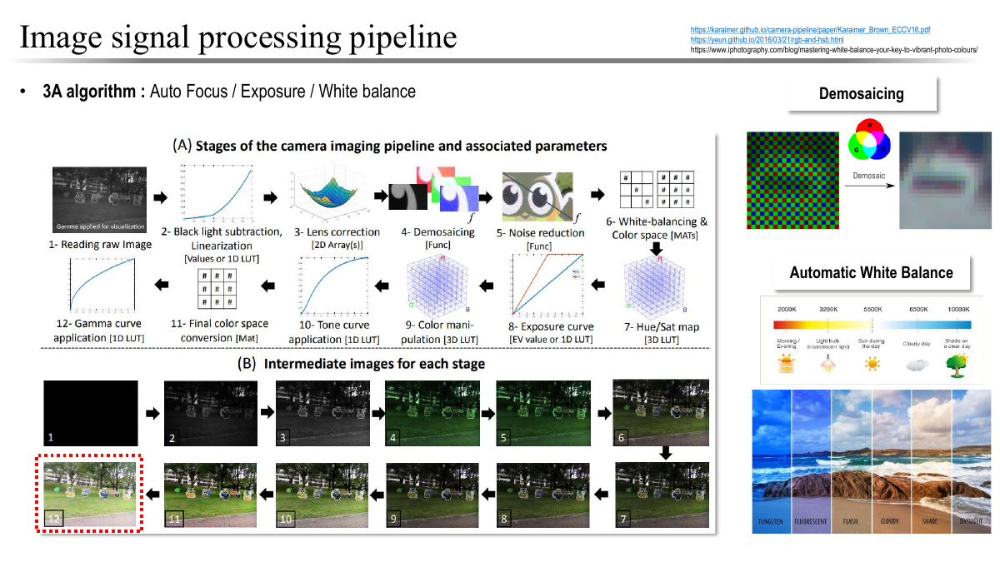

# 비전 입문: 사진을 숫자로 표현하고 예측을 평가하기

[전체 학습 안내](00_학습안내.md) · 다음: [DNN](02_01_DNN_Note.md)

컴퓨터 비전(Computer Vision)은 이미지나 영상에서 필요한 정보를 계산하는 분야다. 사람에게는 바로 보이는 ‘고양이가 어디에 있는가’를 컴퓨터에 맡기려면, 사진을 숫자로 표현하고, 원하는 답을 정하고, 그 답을 새 사진에서도 맞히는지 확인해야 한다. 이 문서는 **촬영 → 이미지와 텐서 → 예측 과업 → 학습 → 새 데이터에서 평가**라는 연결을 설명한다.

**읽기 경로:** 처음이라면 1~5.3절을 읽고 6절과 8절 기본 문제로 이어가자. 5.4절은 확률 용어 지도이고, [5.5절 선택 심화](#55-선택-심화-확률에서-추정까지-직접-계산하기)는 필요할 때 따로 읽는다. 복습할 때는 입력 모양이 헷갈리면 2절, 행렬 계산은 3절, 학습 용어는 5절, 성능 수치 해석은 6절로 돌아간다. 7절은 교안의 기술·데이터셋 이름을 찾는 참고 자료다.

**선수지식:** 덧셈·곱셈·나눗셈, 제곱과 제곱근, 표의 행과 열을 읽을 수 있으면 시작할 수 있다. 미분과 확률을 먼저 끝낼 필요는 없다. 이 장을 읽은 뒤에는 다음을 할 수 있어야 한다.

- 이미지의 높이·너비·채널·배치 축을 구별하고 원소 수를 계산한다.
- 분류·검출·분할·추적을 출력의 형태로 구별한다.
- 작은 행렬의 가중합, 벡터의 거리와 유사도를 계산한다.
- 학습과 추론, 지도·반지도·자기지도 학습을 구별한다.
- epoch당 배치 수를 계산하고, 데이터 누수와 잘못된 평가를 지적한다.

**원문과 보충의 경계:** [입문 교안](../교안/01_Intro.pdf)의 실제 PDF 1~31쪽을 바탕으로 재구성했다. 1~4쪽의 일정·강의 운영·과정 소개는 9절에서 범위를 밝히고 줄였다. 이미지·벡터·학습 유형 설명은 교안 내용을 풀어 썼으며,본문의 작은 수치 예제와 6절의 데이터 분리·평가는 **자습을 위한 교육용 보충**이다. 기댓값·조건부확률·독립·베이즈·MLE/MAP의 정의와 계산은 [5.5절 선택 심화](#55-선택-심화-확률에서-추정까지-직접-계산하기)에, 손실함수·미분·역전파의 기준 설명은 [DNN](02_01_DNN_Note.md)에 둔다. 이 장은 시험 출제 범위를 새로 정하지 않는다.

## 목차

1. [입력과 원하는 답부터 정하기](#1-입력과-원하는-답부터-정하기)
2. [빛에서 이미지와 텐서까지](#2-빛에서-이미지와-텐서까지)
3. [텐서를 계산하는 최소 선형대수](#3-텐서를-계산하는-최소-선형대수)
4. [특징을 설계하는 방법과 학습하는 방법](#4-특징을-설계하는-방법과-학습하는-방법)
5. [무엇을 보고 어떻게 학습하는가](#5-무엇을-보고-어떻게-학습하는가)
6. [새 데이터에서도 맞는지 평가하기](#6-새-데이터에서도-맞는지-평가하기)
7. [교안의 모델과 데이터셋을 찾아가는 지도](#7-교안의-모델과-데이터셋을-찾아가는-지도)
8. [스스로 설명하고 계산하기](#8-스스로-설명하고-계산하기)
9. [원문 범위와 다음 학습](#9-원문-범위와-다음-학습)

## 1. 입력과 원하는 답부터 정하기

**핵심:** 같은 사진이라도 무엇을 출력할지에 따라 다른 과업이 된다. 모델 이름을 고르기 전에 답의 형태를 정해야 정답 데이터와 평가 방법을 정할 수 있다.

고양이 두 마리가 있는 사진 한 장을 생각하자. 이미지 분류는 사진 전체에 ‘고양이’라는 범주를 붙일 수 있지만, 그것만으로 두 마리의 위치를 알 수 없다. 위치가 필요하면 각 개체를 둘러싼 사각형을 출력하는 객체 검출을 사용한다. 윤곽까지 필요하면 각 픽셀이 어떤 대상에 속하는지를 출력하는 분할을 사용한다.

| 과업 | 입력 | 원하는 출력 | 고양이 예시 |
| --- | --- | --- | --- |
| 분류(classification) | 이미지 | 범주 또는 범주별 점수 | 사진의 대표 범주는 고양이 |
| 위치 회귀(regression) | 이미지 또는 특징 | 연속적인 수치 | 고양이 중심의 좌표 |
| 객체 검출(detection) | 이미지 | 개체별 범주·박스·점수 | 두 마리 각각의 박스 |
| 의미 분할(semantic segmentation) | 이미지 | 픽셀마다 범주 | 모든 고양이 픽셀에 같은 범주 |
| 개체 분할(instance segmentation) | 이미지 | 개체별 픽셀 마스크 | 고양이 A와 B의 영역을 따로 표시 |
| 추적(tracking) | 시간 순서의 여러 프레임 | 시간에 걸쳐 이어지는 대상 ID와 위치 | 다음 장면의 고양이가 앞 장면의 A인지 연결 |
| 자세 추정(pose estimation) | 이미지 또는 영상 | 관절 등 핵심 지점의 위치 | 사람의 어깨·팔꿈치 위치 |
| 생성(generation) | 텍스트·이미지 등의 조건, 또는 잡음 | 새 이미지 | ‘창가의 고양이’ 이미지 생성 |

여기서 **픽셀(pixel)**은 이미지 격자의 한 위치이고, **마스크(mask)**는 각 위치의 소속을 표시한 배열이다. **범주(class)**는 고양이·개처럼 구별하려는 답의 종류다. 한 개의 범주만 고르는 분류와 여러 범주를 동시에 표시하는 분류도 구분해야 한다.

검출의 박스는 예를 들어 `(x, y, w, h)=(10, 20, 30, 40)`으로 표현할 수 있다. 이 예에서는 왼쪽 위를 원점으로 잡고, 오른쪽이 x 증가 방향, 아래쪽이 y 증가 방향이며 단위는 픽셀이다. `(x,y)`가 박스의 왼쪽 위라면 오른쪽 아래 경계는 `(40,60)`이다. 중심점 표현이나 0~1로 나눈 좌표를 쓰는 자료도 있으므로 숫자 네 개만 보고 의미를 단정하지 않는다. 검출기는 범주 분류와 위치 회귀를 함께 수행할 수 있다.

**이어지는 질문:** 모델은 고양이를 보기 전에 어떤 숫자를 입력받을까? 다음 절에서 사진을 배열로 바꾼다.

## 2. 빛에서 이미지와 텐서까지

### 2.1 카메라의 값은 장면을 그대로 복사한 것이 아니다

교안 14~16쪽은 빛이 센서를 거쳐 RGB 이미지가 되는 과정을 설명한다. 렌즈는 빛을 모으고, 마이크로렌즈는 센서의 감광부로 들어가는 빛을 모으는 데 도움을 준다. 포토다이오드는 빛에 반응해 전기적 신호를 만든다. 흔히 사용하는 Bayer 컬러 필터 배열에서는 센서의 위치마다 특정 색 대역의 빛을 주로 측정한다. 따라서 센서의 한 위치에서 완성된 R·G·B 세 값을 모두 직접 얻었다고 보면 안 된다.

**디모자이킹(demosaicing)**은 주변 측정값을 이용해 위치별로 부족한 색 성분을 추정하는 과정이다. **ISP(Image Signal Processing)**는 이러한 처리와 노이즈 감소, 색 보정, 밝기 변환 등을 포함하는 영상 처리 과정이다. 교안의 **3A**는 자동 초점(Auto Focus), 자동 노출(Auto Exposure), 자동 화이트밸런스(Auto White Balance)를 뜻한다. 초점은 선명도에, 노출은 센서에 들어오는 빛의 양에, 화이트밸런스는 조명에 따른 색 치우침 보정에 관계한다.

그림은 ‘원시 센서 값과 최종 이미지가 같은가’를 확인하는 용도다. 왼쪽 위의 원시 이미지에서 보정·색 복원·노이즈 감소를 거치며 중간 이미지가 달라지고, 아래 행의 마지막 출력에 도달한다. 오른쪽은 디모자이킹과 조명에 따른 색 변화의 예다.



이 그림의 핵심은 **입력이 이미 촬영 장치와 처리 설정의 영향을 받는다**는 것이다. 어두운 사진을 밝히더라도 포화되어 사라진 밝은 영역의 정보를 자동으로 되찾는 것은 아니다. 학습 때와 사용 때 카메라·조명·압축 조건이 달라지면 같은 물체도 다른 값으로 들어올 수 있다. 교안이 인용한 [Karaimer와 Brown의 카메라 파이프라인 연구](https://karaimer.github.io/camera-pipeline/)도 중간 처리 단계와 설정이 최종 출력에 미치는 영향을 다룬다. 그림의 처리 순서를 모든 카메라의 고정 규격으로 외우지는 않는다.

### 2.2 이미지의 축과 값

**RGB 이미지**는 위치마다 빨강(R), 초록(G), 파랑(B) 성분의 값을 가진다. 높이 H는 행 수, 너비 W는 열 수, 채널 C는 위치별 성분 수다. 채널을 마지막에 두는 표현이면 모양(shape)은 `(H,W,C)`이고 RGB의 C는 3이다. 8비트 채널의 정수 표현에서는 각 값이 0~255다. 이것은 이 예제의 표현 조건이며 모든 이미지의 자료형·범위가 같다는 뜻은 아니다.

예를 들어 높이 2, 너비 2인 RGB 이미지에는 위치가 4개이고 숫자는 `2×2×3=12`개다. 왼쪽 위 픽셀을 `[255,0,0]`으로 두면 해당 표현에서 빨강 성분만 최대다. R 채널만 꺼낸 2×2 표는 각 위치의 빨강 성분 크기를 담는다. 채널을 회색조로 보여주는 그림에서 밝은 곳은 그 성분 값이 크다는 뜻이지, 원래 물체가 흰색이라는 뜻은 아니다.

**스칼라**는 숫자 하나, **벡터**는 순서 있는 숫자 묶음, **행렬**은 행과 열을 가진 2차원 배열이다. 딥러닝에서 **텐서(tensor)**라는 말은 이들을 포함한 다차원 수치 배열을 가리킬 때 흔히 쓴다. 이미지의 `(2,2,3)`은 축이 3개인 텐서다. ‘3차원 텐서’는 축의 개수이지, 장면의 3D 깊이를 측정했다는 뜻이 아니다.

### 2.3 값을 바꾸는 연산과 축을 바꾸는 연산

모델은 입력의 축 순서·자료형·값 범위에 관한 약속을 요구한다. 다음은 교안 17쪽을 풀어 쓴 **수학적 처리 예시**다. 특정 라이브러리 API 사용법은 아니다.

| 단계 | 하는 일 | 예시 모양 | 왼쪽 위 R 값 |
| --- | --- | --- | --- |
| 읽기 | 8비트 RGB 배열 읽기 | `(2,2,3)` | 255 |
| 실수 변환 | 소수를 표현할 자료형으로 바꾸기 | `(2,2,3)` | 255.0 |
| 스케일 조정 | 각 값을 255로 나누기 | `(2,2,3)` | 1.0 |
| 축 재배열 | HWC를 CHW로 바꾸기 | `(3,2,2)` | 1.0 |
| 채널별 정규화 | 각 채널에 `(값-평균)/표준편차` 적용 | `(3,2,2)` | 예시 설정에 따라 달라짐 |
| 배치로 묶기 | 같은 모양의 이미지 B개를 쌓기 | `(B,3,2,2)` | 이미지별 값 유지 |

평균을 μ, 표준편차를 σ라고 쓸 때 정규화된 값은 `z=(x-μ)/σ`다. **설명용**으로 R 채널의 μ=0.5, σ=0.25를 쓰면, 빨강 값 1.0은 `(1.0-0.5)/0.25=2.0`이 된다. 값 0은 `(0-0.5)/0.25=-2.0`이다. 정규화 뒤의 값은 0~1을 벗어날 수 있다. σ는 0이면 안 된다. 이 숫자들은 어떤 모델의 권장 설정도 아니다.

축 재배열은 같은 값을 다른 인덱스 위치로 옮긴다. `[행,열,채널]`의 값이 `[채널,행,열]`로 이동할 뿐 색이나 원소 수가 바뀌지 않는다. 모양 숫자만 강제로 바꾸는 reshape와 축의 의미를 바꾸는 재배열은 일반적으로 같은 연산이 아니다.

**배치(batch)**는 한 번에 처리하려고 묶은 여러 샘플이다. 이미지 두 장을 묶으면 `(2,3,2,2)`이고 숫자는 24개다. 한 장에 길이 1인 축을 추가하면 `(1,3,2,2)`가 된다. 교안의 ‘배치 축 추가’ 예시는 이 한 장의 경우이며, 축 추가만으로 여러 이미지가 생성되지는 않는다. 다른 크기의 사진들은 단순히 하나의 직사각 배열로 쌓을 수 없으므로 크기 조정·잘라내기·빈 공간 채우기 등 처리 방식을 정해야 한다. 비율을 무시한 크기 조정은 물체 모양을 왜곡할 수 있다.

**주의:** 정규화 통계를 직접 구할 때는 훈련 데이터에서 계산하고 검증·테스트에도 같은 값을 적용한다. 이미 학습된 모델을 사용할 때는 그 모델이 요구하는 입력 처리를 따른다. 이 이유는 6절의 데이터 누수와 연결된다.

## 3. 텐서를 계산하는 최소 선형대수

이 절은 교안 18~22쪽의 수식을 작은 숫자로 연결한다. 핵심은 **가중합과 모양 확인**이고, 거리·코사인은 뒤에서 표현을 비교할 때 다시 찾을 보충 개념이다.

### 3.1 가중합과 행렬 곱

가중합은 각 값에 중요도를 나타내는 수를 곱한 뒤 더하는 계산이다. 벡터 `a=(1,2)`, `b=(3,0)`에 가중치 0.25와 0.75를 주면 `0.25a+0.75b=(0.25+2.25, 0.5+0)=(2.5,0.5)`다. 같은 위치끼리 계산하므로 두 벡터 길이가 같아야 한다. 두 가중치가 0 이상이고 합이 1이면 두 벡터 사이를 섞은 결과다. 일반적인 신경망 가중치는 음수일 수도 있고 합이 1일 필요도 없다.

행렬 곱은 여러 가중합을 한 번에 계산한다. 행렬 A와 열벡터 x를 다음처럼 두자.

```text
A = [1  2]       x = [2]
    [3  4]           [1]

Ax = [1×2 + 2×1] = [4]
     [3×2 + 4×1]   [10]
```

첫 번째 행은 출력의 첫 값을, 두 번째 행은 둘째 값을 만든다. 같은 결과를 **열의 가중합**으로 읽을 수도 있다. A의 첫 열 `(1,3)`에 x의 첫 값 2를 곱하고, 둘째 열 `(2,4)`에 둘째 값 1을 곱하면 `(2,6)+(2,4)=(4,10)`이다. 신경망의 선형층은 이와 같은 계산에 편향이라는 추가 값을 더한다. 그 값이 어떻게 학습되는지는 DNN에서 다룬다.

일반적으로 `(m,k)` 행렬과 `(k,n)` 행렬의 곱은 `(m,n)`이다. 가운데 길이 k가 같아야 대응하는 값들을 곱해 더할 수 있다. `(2,3)`과 `(3,4)`를 곱하면 `(2,4)`이고, `(2,3)`과 `(2,4)`는 이 순서로 곱할 수 없다. 원소별 곱과 행렬 곱을 혼동하지 않는다.

**전치(transpose)**는 행과 열을 바꾸는 연산이다. A의 전치 Aᵀ는 `[[1,3],[2,4]]`다. 위 계산을 행벡터로 적으면 `(Ax)ᵀ=xᵀAᵀ=(4,10)`이다. 곱 전체를 전치하면 곱의 순서도 뒤집힌다. **단위행렬 I**는 대각선이 1, 나머지가 0이라 호환되는 벡터에 곱해도 값을 유지한다. A가 `(m,n)`이라면 `I_m A=A I_n=A`로 단위행렬 크기를 각각 맞춰야 한다.

### 3.2 크기와 거리

**노름(norm)**은 벡터의 크기를 하나의 수로 측정하는 규칙이다. `v=(3,-4)`에 대해 다음을 계산할 수 있다.

| 규칙 | 계산 | 결과 |
| --- | --- | --- |
| L1 노름 | 절댓값의 합: `3+4` | 7 |
| L2 노름 | 제곱합의 제곱근: `√(9+16)` | 5 |
| L∞ 노름 | 절댓값 중 최댓값: `max(3,4)` | 4 |

벡터 하나의 노름은 원점에서의 크기다. 두 벡터 a와 b 사이의 거리를 원하면 **차이 a-b의 노름**을 구한다. a=(3,4), b=(0,0)이면 L2 거리는 5이고, b가 (3,0)으로 바뀌면 차이는 (0,4)이므로 거리는 4다. 이 구분은 특징 벡터가 얼마나 다른지 비교할 때 필요하다. 단위나 스케일이 다른 성분을 그대로 섞으면 숫자 범위가 큰 성분이 거리를 지배할 수 있다.

### 3.3 내적과 코사인 유사도

**내적(dot product)**은 같은 위치끼리 곱해 더한 수다. a=(1,2), b=(2,4)이면 `a·b=1×2+2×4=10`이다. **코사인 유사도**는 내적을 두 벡터의 L2 노름 곱으로 나눈 값이다. 여기서는 `10/(√5×√20)=10/10=1`이다. b의 크기가 두 배여도 방향이 같아서 1이 나온다.

내적은 방향과 크기의 영향을 모두 받고, 코사인 유사도는 크기를 제거한 방향 비교다. 0은 직교, -1은 반대 방향, 1은 같은 방향이며 값의 범위는 -1~1이다. 영벡터는 길이가 0이므로 이 식의 분모가 0이 되어 코사인이 정의되지 않는다. 코사인 0을 ‘두 개념에 아무 관계도 없다’라고 단정해서도 안 된다. 의미적 유사도는 그 벡터를 만든 표현에 달려 있다. 이 계산은 뒤의 Attention과 CLIP을 이해하는 연결점이다.

## 4. 특징을 설계하는 방법과 학습하는 방법

**특징(feature)**은 예측에 쓰기 위해 입력에서 뽑은 수치 표현이다. 예를 들어 경계선 방향이나 국소적인 무늬를 숫자로 나타낼 수 있다. 교안 7~9쪽의 역사는 ‘누가 특징을 정하는가’라는 질문으로 읽으면 좋다.

| 접근 | 처리의 핵심 | 대표 예 | 조건과 한계 |
| --- | --- | --- | --- |
| 사람이 특징을 설계 | 미리 정한 규칙으로 경계·모서리·방향 등을 추출하고 예측기에 전달 | Sobel, Canny, SIFT, HOG와 분류기 | 설계한 특징이 문제에 맞아야 함 |
| 깊은 신경망으로 특징 학습 | 여러 층의 표현과 예측을 데이터에 맞춰 조정 | DNN, CNN, ResNet | 학습 데이터·목표·계산 자원의 영향 |
| Attention과 여러 종류의 데이터 결합 | 이미지 영역 사이 관계 또는 이미지·언어 표현의 관계를 학습 | ViT, CLIP | 구조가 새롭다는 이유만으로 모든 조건에서 우월하지 않음 |

**DNN**은 여러 학습 층을 가진 신경망, **CNN**은 공간의 국소 영역에 같은 연산을 반복 적용하는 합성곱을 활용하는 신경망이다. **Transformer**는 입력 요소 사이의 관계를 Attention으로 처리하는 구조이고, **ViT**는 이미지를 패치라는 작은 영역들로 나누어 이러한 처리를 적용하는 대표 접근이다. 자세한 구조는 다음 장들에서 배운다.

‘종단 간(end-to-end) 학습’은 최종 목표의 오차가 앞쪽 특징 추출 부분의 조정에도 연결된다는 뜻이다. 사람이 데이터·모델 구조·목표를 정할 필요가 없어졌다는 뜻은 아니다. 전통 기법과 학습 기반 기법은 한 시스템에서 함께 쓸 수도 있다.

교안 12쪽은 사람의 시각과 컴퓨터 비전을 입력 수집, 전처리, 단순 특징, 통합, 해석, 행동, 학습이라는 기능 단계로 나란히 놓는다. 이 비교는 복잡한 처리의 역할을 이해하는 **비유**로 읽는다. CNN의 한 층이 특정 뇌 영역과 동일하다거나, 범주 점수를 출력하면 인간과 같은 방식으로 의미를 이해한다는 증거로 읽지 않는다. 특히 컴퓨터가 반드시 사람이 붙인 정답만으로 배우는 것은 아니다. 다음 절에서 정답의 출처를 구별한다.

## 5. 무엇을 보고 어떻게 학습하는가

### 5.1 학습과 추론

모델을 `예측=f_θ(입력)`으로 쓰자. θ는 학습 중 바꿀 수 있는 **파라미터(parameter)**, 즉 가중치와 편향 같은 수들의 묶음이다. **학습(training)**은 예측이 목적에 더 맞도록 θ를 조정하는 과정이다. **추론(inference)**은 학습한 θ를 사용해 새 입력의 답을 계산하는 과정이다. 일반적인 배포 추론에서는 입력마다 가중치를 다시 학습하지 않는다.

지도 학습 한 단계는 ‘배치 입력 → 예측 → 정답과 비교해 손실 계산 → 파라미터 조정’으로 이어진다. **손실(loss)**은 학습 목표에서 얼마나 벗어났는지를 수치로 나타내는 함수다. 예를 들어 위치 목표가 10이고 예측이 8인 간단한 회귀 문제에서 제곱오차는 `(8-10)²=4`다. 다음 예측이 9라면 오차는 1로 작아진다. 다만 어떤 파라미터를 얼마나 바꿀지는 이 숫자 하나만으로 알 수 없다.

그래서 **미분**으로 한 입력의 작은 변화에 따른 함수 변화율을 보고, **편미분**으로 다른 변수들을 고정한 채 한 변수의 영향을 계산한다. **기울기(gradient)**는 각 파라미터에 대한 편미분을 묶은 벡터다. 역전파는 여러 층을 거쳐 이 변화율을 계산하는 방법이다. 이 장에서는 역할만 연결하고, 실제 계산·학습률·기울기 하강법은 [DNN](02_01_DNN_Note.md)에서 이어간다. 손실을 줄였다는 것과 새 데이터에서 좋은 성능을 얻었다는 것은 6절에서 따로 검사한다.

### 5.2 정답 신호가 어디서 오는가

**레이블(label)**은 학습 목표에 맞춘 정답 정보다. 사진 전체의 범주, 개체별 박스, 픽셀별 영역처럼 과업마다 모양이 다르다. 레이블이 있다고 언제나 완벽한 진실인 것은 아니며, 잘못 붙거나 판단이 모호할 수 있다.

| 유형 | 학습 신호의 출처 | 작은 예시 | 필요한 구분 |
| --- | --- | --- | --- |
| 지도 학습 | 외부에서 제공한 목표 답 | 고양이·개 정답을 가진 사진으로 분류 학습 | 분류뿐 아니라 좌표 회귀도 가능 |
| 반지도 학습 | 일부 정답과 많은 무레이블 입력 | 정답 100장과 무레이블 900장을 함께 활용 | 무레이블 입력도 학습 목적에 실제 활용해야 함 |
| 자기지도 학습 | 데이터 자체에서 구성한 목표 | 일부 영역을 가리고 원래 내용을 맞히기 | 사람이 과업별 정답을 붙이지 않아도 목표·손실은 있음 |

반지도 학습에서는 같은 이미지의 변형들에 대해 일관된 예측을 요구하거나, 모델의 예측을 임시 정답인 **의사 레이블(pseudo-label)**로 사용할 수 있다. 임시 정답이 틀리면 잘못된 판단을 강화할 수 있으므로 ‘정답을 공짜로 얻는다’고 생각하지 않는다.

자기지도 학습의 **사전 과제(pretext task)**는 유용한 표현을 배우기 위해 만든 학습 문제다. 그 표현을 실제 목표인 **후속 과업(downstream task)**에 사용할 수 있다. 앞서 배운 파라미터를 출발점으로 사용하는 것을 전이 학습이라 하고, 후속 데이터로 일부 또는 전체 파라미터를 다시 조정하는 것을 **미세조정(fine-tuning)**이라 한다. 사전학습과 미세조정은 학습의 시점·역할 구분이고, 지도·자기지도는 신호의 출처 구분이므로 함께 쓰일 수 있다.

**원문 표현 보완:** 교안 11쪽의 자기지도 학습 ‘Labeling Cost: None’은 해당 사전 과제를 위해 사람이 과업별 정답을 붙이지 않는다는 의미로 한정한다. 데이터 수집·정제·계산 비용, 후속 지도 학습에 필요한 정답 비용까지 0이라는 뜻이 아니다. 지도 학습도 정의상 반드시 거대 데이터셋을 요구하는 것은 아니다.

### 5.3 epoch, batch, step을 계산하기

**epoch**은 훈련 데이터 전체를 한 번 사용하는 단위다. **배치 크기(batch size)**는 한 묶음의 샘플 수다. 여기서는 한 배치로 순전파·역전파 후 한 번 파라미터를 갱신하는 것을 **step**이라고 약속한다.

설명용으로 훈련 이미지 N=10장, 배치 크기 B=4를 두자. 마지막 작은 배치를 남기면 배치는 4장, 4장, 2장이므로 epoch당 3 step이다. 계산식은 `ceil(N/B)=ceil(10/4)=3`이며 ceil은 올림이다. 5 epoch이면 `3×5=15`번 갱신한다. 마지막 2장을 버리는 설정이면 epoch당 2 step이다. 따라서 교안 28쪽의 `N/B`는 나누어떨어지는 경우의 간단한 식으로 읽어야 한다.

배치가 커지면 대체로 한 번에 저장할 중간 계산이 많아져 메모리 요구가 커진다. 작은 배치에서는 어떤 샘플을 뽑았는지에 따라 기울기 추정이 더 흔들릴 수 있다. 이것만으로 작은 배치가 항상 더 좋은 해를 찾거나, 큰 배치가 항상 더 높은 정확도를 낸다고 결론 내릴 수는 없다. 여러 배치의 기울기를 모아서 한 번 갱신하는 설정에서는 배치 처리 횟수와 갱신 step 수도 다르다.

### 5.4 심화로 넘어갈 때 만날 확률 용어

교안 24~27쪽은 학습과 추론을 확률의 언어로 연결한다. 다음은 원문 용어를 찾기 위한 지도다. 기댓값·조건부확률·독립·베이즈·MLE/MAP의 완결된 계산은 [5.5절](#55-선택-심화-확률에서-추정까지-직접-계산하기)에 있다. 출력 확률·교차 엔트로피·KL과 역전파는 [DNN](02_01_DNN_Note.md)으로 이어진다. 기본 경로에서는 이 두 심화 절을 건너뛰어 [평가](#6-새-데이터에서도-맞는지-평가하기)로 가도 된다.

| 용어 | 어떤 질문에 답하는가 |
| --- | --- |
| 확률변수와 샘플링 | 가능한 결과를 수치에 대응시키는 것이 확률변수이며, 정한 분포를 따라 관측값을 뽑는 것이 샘플링이다. |
| PMF와 PDF | 이산값은 값별 확률을 PMF로 나타낸다. 연속값의 PDF는 밀도이므로 구간에 걸쳐 누적한 면적이 확률이다. 밀도 높이 자체를 확률로 읽지 않는다. |
| 기댓값 | 가능한 값들을 그 발생 가능성으로 가중해 평균하면 무엇인가? 실제 관측에서 반드시 나오는 값일 필요는 없다. |
| 조건부확률과 독립 | 어떤 정보가 주어졌을 때 확률이 어떻게 달라지는가? 독립은 한 사건의 정보가 다른 사건의 확률을 바꾸지 않는 관계다. |
| 우도와 MLE | 관측 자료를 고정하고 후보 파라미터를 비교할 때, 어느 파라미터가 그 자료에 높은 확률 또는 밀도를 주는가? 이를 최대화하는 추정이 MLE다. 우도는 파라미터 전체에 걸쳐 합이 1인 확률분포일 필요가 없다. |
| 베이즈 규칙과 MAP | 사전 믿음과 관측 자료의 우도를 결합해 사후분포를 얻는다. MAP는 사후확률 또는 사후밀도가 가장 큰 파라미터를 고르며, 사전분포의 선택은 결과에 영향을 준다. |
| 엔트로피·교차 엔트로피·KL | 분포 자체의 불확실성, 정답 분포를 다른 예측 분포로 표현할 때의 비용, 두 분포 사이의 차이를 각각 다룬다. 로그 밑과 분포의 방향을 정한 정확한 식은 DNN에서 확인한다. |

이 용어들은 테스트 데이터 분리의 필요성을 대신하지 않는다. 우도를 높이거나 손실을 낮추더라도 새 데이터에서 평가해야 한다.

### 5.5 선택 심화: 확률에서 추정까지 직접 계산하기

**이 절의 목표:** 조건으로 남긴 집단을 분모로 삼고, 관측 전후의 확률을 계산하며, 가장 가능성 높은 값과 평균을 구별한다. 필요한 선수지식은 분수·가중평균뿐이다. 기본 학습 경로는 [6절](#6-새-데이터에서도-맞는지-평가하기)로 바로 이어가도 된다.

**원문과 교육용 보충:** 교안 24쪽의 기댓값, 25쪽의 조건부확률·독립과 공장 예시, 26쪽의 베이즈·MLE/MAP를 풀어 쓴다. 원문의 공장 A 불량률 0.02, B 불량률 0.10을 사용한다. 아래의 **출처 비율 A 90%, B 10%와 1,000개 표는 교육용으로 추가한 가정**이며 실제 공장 측정값이 아니다. 27쪽의 엔트로피·교차 엔트로피·KL 상세 계산은 DNN에 유지한다.

#### 조건부확률: 분모를 먼저 정하기

무작위로 고른 제품의 출처가 A인 사건을 A, B인 사건을 B, 불량인 사건을 D라고 쓰자. 이 예에서 출처는 두 공장 중 정확히 하나다. `P(A)=0.9`, `P(B)=0.1`, `P(D|A)=0.02`, `P(D|B)=0.10`을 가정한다. 세로 막대 `|` 오른쪽은 **이미 주어진 조건**이다. 예를 들어 `P(D|A)`는 A 출처라고 알려진 제품 안에서 불량일 확률이다.

가정을 한눈에 계산하도록 다음과 같은 1,000개짜리 가상 모집단을 구성할 수 있다. 실제 1,000개 무작위 표본의 빈도가 반드시 이 표와 같다는 뜻은 아니다.

| 출처 | 불량 D | 정상 | 합계 |
| --- | --- | --- | --- |
| A | 18 | 882 | 900 |
| B | 10 | 90 | 100 |
| 합계 | 28 | 972 | 1,000 |

조건부확률의 정의는 `P(D|A)=P(D∩A)/P(A)`이고 **P(A)>0**일 때 적용한다. `∩`는 두 사건이 함께 일어남을 뜻한다. 표에서는 `(18/1000)/(900/1000)=18/900=0.02`다. 반대로 `P(A|D)=18/28≈0.6429`다. 앞 계산의 분모는 A 제품 900개, 뒤 계산의 분모는 불량 제품 28개다. 같은 두 사건이라도 조건을 뒤집으면 분모와 답이 달라진다. 확률 0인 조건에 이 비율식을 그대로 적용할 수는 없다.

전체 불량 확률은 서로 겹치지 않는 두 출처의 불량을 합쳐 얻는다. `P(D)=P(D|A)P(A)+P(D|B)P(B)=0.02×0.9+0.10×0.1=0.018+0.010=0.028`이다. 불량률 0.02와 0.10의 단순 평균 0.06을 쓰면 출처 비율을 무시한 계산이 된다.

#### 독립: 조건을 알아도 확률이 바뀌지 않는가

두 사건 A와 D가 **독립**이라는 정확한 조건은 `P(A∩D)=P(A)P(D)`다. P(A)>0이면 이것은 `P(D|A)=P(D)`와 같다. 위 예에서는 `0.018 ≠ 0.9×0.028=0.0252`이고, `0.02 ≠ 0.028`이므로 독립이 아니다. 출처를 아는 것이 불량 확률을 바꾼다.

독립인 상황과 비교하려면 **조건을 바꾸어** 두 공장의 불량률이 모두 0.02라고 가정하자. 이때 전체 불량률도 `0.9×0.02+0.1×0.02=0.02`이고 `P(A∩D)=0.018=P(A)P(D)`이므로 A 여부와 불량 여부가 독립이다. 서로 다른 이름의 사건이라서 독립인 것이 아니라 이 관계를 만족해서 독립이다.

독립은 **동시에 일어나지 않음**과 다르다. 원래 예에서 A와 B는 서로 배타적이라 `P(A∩B)=0`이지만 `P(A)P(B)=0.09`이므로 독립이 아니다. 또한 여러 관측값이 독립이라는 가정은 별도로 필요하다. 같은 공정에서 연속 생산한 제품을 보았다는 이유만으로 관측들의 우도를 무조건 곱하면 안 된다.

#### 기댓값: 가장 자주 나오는 값과 다른 가중평균

원래 불량률 0.02와 0.10의 예로 돌아가자. 제품 하나가 불량이면 X=1, 정상이면 X=0으로 대응시키면 X는 **확률변수**다. 그 **PMF(확률질량함수)**는 `P(X=1)=0.028`, `P(X=0)=0.972`이며 두 확률의 합은 1이다. 이렇게 가능한 값과 각 확률을 정한 뒤 그 분포에서 값을 뽑는 것을 샘플링이라 한다.

이산 확률변수의 **기댓값**은 `E[X]=Σ_x xP(X=x)`다. Σ는 가능한 모든 x에 대해 더한다는 뜻이다. 이 예에서는 `E[X]=0×0.972+1×0.028=0.028`이다. X가 실제로 0.028이라는 값을 갖는다는 뜻이 아니다. 불량 횟수를 반복해서 평균할 때 기준이 되는 값이다. 같은 조건의 제품 100개에서 불량 개수의 기댓값은 `100×0.028=2.8`개지만 실제 불량 개수는 정수다. 기댓값의 이 합산에는 각 제품의 불량 확률이 같다는 조건을 썼으며 독립성 자체가 필요한 것은 아니다.

가장 높은 확률을 가진 값인 **최빈값(mode)**은 0이다. 확률 0.972가 0.028보다 크기 때문이다. 따라서 ‘평균적인 크기’를 묻는 기댓값 0.028과 ‘가장 가능성 높은 한 값’을 고르는 최빈값 0은 다른 질문의 답이다.

**연속값 보충:** 교안 24쪽의 PDF(확률밀도함수)는 값별 확률이 아니라 면적을 누적해 확률을 구하는 함수다. 예를 들어 0~0.5 사이의 균일분포는 밀도가 2이지만 전체 면적은 `2×0.5=1`이다. 0~0.1 구간 확률은 `2×0.1=0.2`, 대칭인 이 분포의 기댓값은 0.25다. 밀도는 1을 넘을 수 있으며, 이런 연속분포의 한 점의 확률은 0이다. 일반 연속분포의 기댓값은 `∫x f(x)dx`처럼 밀도에 값을 곱해 누적하며, 여기의 f는 밀도이고 ∫는 적분이다. 본 절의 유한 예시에서는 기댓값이 존재하지만 모든 확률분포에 유한 기댓값이 존재하는 것은 아니다.

#### 베이즈 규칙: 불량을 본 뒤 출처의 확률 갱신하기

**베이즈 규칙**은 `P(A|D)=P(D|A)P(A)/P(D)`다. 조건부확률 정의의 분자 `P(A∩D)`를 `P(D|A)P(A)`로 바꾸면 얻는다. 역시 **P(D)>0**이어야 한다.

- 사전확률(prior) `P(A)=0.9`: 제품 상태를 보기 전 A 출처일 확률.
- 우도(likelihood) `P(D|A)=0.02`: A라는 가정 아래 지금 관측한 불량이 나올 가능성.
- 증거(evidence) `P(D)=0.028`: 모든 가능한 출처를 합쳐 관측 D가 나올 확률.
- 사후확률(posterior) `P(A|D)=0.018/0.028=9/14≈0.6429`: 불량을 관측한 뒤 A 출처일 확률.

B의 사후확률은 `0.10×0.1/0.028=5/14≈0.3571`이다. 둘을 더하면 1이다. B가 A보다 불량률이 높아도, A 제품이 훨씬 많이 들어온다는 사전확률 때문에 불량품의 출처로 A가 더 가능성 높다. 이는 불량 사진을 보고 원인을 추정할 때도 관측과 가설의 방향을 구별해야 하는 이유다.

#### MLE와 MAP: 무엇을 가장 크게 만드는가

위 사례를 **두 후보만 허용하는 파라미터 추정 문제**로 읽어 보자. 알 수 없는 출처의 불량률 θ가 θ_A=0.02 또는 θ_B=0.10 중 하나이고, 제품 하나의 불량 D를 관측했다고 가정한다. 후보의 사전확률은 각각 0.9와 0.1이다. 여기서 후보 공장을 고르는 계산은 일반 신경망의 연속 가중치 추정을 이해하기 위한 작은 예다.

| 비교 | θ_A=0.02 | θ_B=0.10 | 선택 |
| --- | --- | --- | --- |
| 우도 `L(θ)=P(D|θ)` | 0.02 | 0.10 | MLE는 θ_B |
| 우도×사전확률 | `0.02×0.9=0.018` | `0.10×0.1=0.010` | MAP는 θ_A |
| 사후확률 | `9/14≈0.6429` | `5/14≈0.3571` | 위 MAP 선택과 동일 |

**MLE(최대우도추정)**는 관측을 고정하고 우도가 최대인 파라미터를 고른다. **MAP(최대사후추정)**는 사후확률이 최대인 파라미터를 고른다. 베이즈 식의 분모 P(D)는 두 후보에 공통이라 MAP를 비교할 때는 우도×사전확률만 비교해도 된다. 여기서 우도 두 개의 합 `0.02+0.10=0.12`는 1이 아니다. 우도는 후보에 대한 확률분포로 정규화된 함수가 아니기 때문이다.

MLE와 MAP 모두 **최댓값을 주는 파라미터를 선택**한다. 특히 MAP는 사후분포의 최빈 추정이며 사후 기댓값이 아니다. 이 예에서 사후 기댓값은 `E[θ|D]=0.02×9/14+0.10×5/14=0.68/14≈0.04857`이다. 이는 MAP 0.02, MLE 0.10과 다르고 허용한 두 후보 중 하나도 아니다. 평균을 결과로 쓸지 한 후보를 고를지는 추정 목적에 따라 결정한다.

**조건과 한계:** 위 MLE 결과 0.10은 후보가 두 개로 제한되었기 때문에 나온다. θ를 0~1 전체에서 고를 수 있고 불량 하나만 관측했다면 우도는 θ이므로 MLE는 θ=1이다. 표본 하나는 안정적인 불량률 추정 근거가 되기 어렵다. 연속 파라미터의 MAP는 확률질량이 아니라 사후밀도를 최대화하며, 동점이면 최댓값을 주는 후보가 여러 개일 수 있다. 사전확률을 달리하면 MAP도 바뀔 수 있다. 여러 관측의 우도를 곱하는 조건과 음의 로그우도에서 손실로 이어지는 과정은 [DNN](02_01_DNN_Note.md)에서 이어간다.

#### 선택 심화 확인문제와 해설

먼저 위 계산을 가리고 풀자. 이 문제들은 8절 기본 문제의 선수조건이 아니다.

1. 원래 가상 모집단에서 `P(B|D)`와 `P(D|B)`를 각각 구하고 분모가 왜 다른지 설명하라.
2. 원래 예에서 A와 D가 독립인지 곱셈 조건으로 판정하라. A와 B가 서로 겹치지 않으므로 독립이라는 설명은 맞는가?
3. X의 기댓값 0.028을 ‘가장 많이 관측될 값’이라고 설명하면 왜 틀리는가? 사후 θ의 평균과 MAP도 같은 방식으로 구별하라.
4. 불량률은 유지하되 사전확률을 A와 B 각각 0.5로 바꾸고 불량 하나를 관측했다. P(D), 두 사후확률, MLE와 MAP를 구하라.

**해설 1.** `P(B|D)=10/28=5/14≈0.3571`, `P(D|B)=10/100=0.10`이다. 불량이라고 알려진 28개와 B라고 알려진 100개가 각각 분모다. → [조건부확률](#조건부확률-분모를-먼저-정하기)

**해설 2.** `P(A∩D)=0.018`이지만 `P(A)P(D)=0.0252`이므로 독립이 아니다. A와 B도 교집합 확률 0과 곱 0.09가 다르므로 독립이 아니다. 배타성과 독립성을 혼동한 설명이다. → [독립](#독립-조건을-알아도-확률이-바뀌지-않는가)

**해설 3.** 기댓값은 값에 확률을 곱한 평균이고 최빈값은 확률이 가장 큰 값이다. X의 최빈값은 0, 기댓값은 0.028이다. 사후 θ의 최빈값인 MAP는 0.02, 사후 평균은 약 0.04857이다. 어느 경우도 평균이 실제 가능한 값 중 하나일 필요는 없다. → [기댓값](#기댓값-가장-자주-나오는-값과-다른-가중평균), [MLE와 MAP](#mle와-map-무엇을-가장-크게-만드는가)

**해설 4.** `P(D)=0.02×0.5+0.10×0.5=0.06`. A의 사후확률은 `0.01/0.06=1/6`, B는 `0.05/0.06=5/6`이다. MLE는 여전히 우도가 큰 θ_B=0.10이며, MAP도 이제 θ_B=0.10이다. 사전확률이 동일하면 이 두 후보의 MAP 순위는 우도 순위와 같아진다. → [베이즈 규칙](#베이즈-규칙-불량을-본-뒤-출처의-확률-갱신하기), [MLE와 MAP](#mle와-map-무엇을-가장-크게-만드는가)

심화를 마쳤으면 [6절: 새 데이터에서 평가하기](#6-새-데이터에서도-맞는지-평가하기)로 돌아가자. 정확한 확률 계산도 독립적인 평가 데이터를 대신하지는 않는다.

## 6. 새 데이터에서도 맞는지 평가하기

이 절은 교안의 학습·데이터셋 소개를 실제 실험으로 연결하는 **교육용 보충**이다.

### 6.1 훈련·검증·테스트의 역할

학습한 사진만 다시 맞히는 능력과 새 사진을 맞히는 능력은 다르다. 새 입력에도 성능이 유지되는 성질을 **일반화(generalization)**라고 한다. 훈련 사진의 우연한 무늬나 배경까지 외워 훈련에서는 좋지만 새 데이터에서는 나쁜 상태를 **과적합(overfitting)**이라 한다.

| 분리 | 용도 | 이 결과로 바꿀 수 있는 것 |
| --- | --- | --- |
| 훈련(train) | 손실을 이용해 파라미터 학습 | 모델 가중치, 훈련 데이터에서 추정한 전처리 통계 |
| 검증(validation) | 후보·설정 비교, 멈출 시점 선택 | 학습률·모델 선택·판정 기준 등의 설정 |
| 테스트(test) | 선택을 끝낸 절차의 최종 성능 추정 | 이 점수를 보고 반복 조정하면 더는 독립적인 최종 평가가 아님 |

**하이퍼파라미터**는 학습률·배치 크기처럼 학습 절차를 정하는 설정이다. 예를 들어 학습률 후보 세 개를 훈련하고 검증 결과로 하나를 선택한 뒤 테스트를 평가한다. 테스트는 가중치 갱신에 넣지 않았더라도, 그 점수를 반복 보며 모델을 고르면 선택 과정에 이미 사용한 셈이다.

설명용 100장을 60·20·20장으로 나누는 것은 가능하지만 이 비율이 보편적 정답은 아니다. 공식 분할이 있는 벤치마크는 해당 규칙을 먼저 확인한다. 같은 원본 사진을 자른 두 조각, 같은 동영상의 바로 옆 프레임, 같은 사람의 거의 같은 사진을 임의로 나누면 분리 이름만 다르고 정보는 겹칠 수 있다. 새로운 사람이나 새로운 영상에 적용하려는 목적이면 사람·영상 단위로 나누는 방식을 검토한다.

**데이터 누수(data leakage)**는 평가에서 알 수 없어야 하는 정보가 학습 또는 선택에 흘러들어오는 것이다. 이미지 증강을 한 뒤 사본들을 무작위로 나누지 말고, 원본을 먼저 분리한 뒤 훈련 쪽에 필요한 증강을 적용한다. 검증·테스트를 포함해 평균·표준편차를 미리 추정하는 것도 독립 평가의 조건을 훼손할 수 있다. 촬영 시기나 장소가 다른 실제 사용 환경에서는 분리된 테스트에서도 성능이 다를 수 있다. 이러한 입력 분포의 변화를 **분포 변화(domain/distribution shift)**라고 부른다.

### 6.2 정확도와 놓친 사례를 함께 보기

분류의 **정확도(accuracy)**는 전체 평가 샘플 중 맞힌 비율이다. 20장 중 16장을 맞혔다면 `16/20=0.8=80%`다. 분모가 이미지 수인지, 픽셀 수인지부터 확인해야 한다. 80%라는 숫자만으로 검출·추적·분할 성능과 직접 비교할 수 없다.

희귀한 대상을 찾는 문제에서는 정확도만 보면 실패를 놓칠 수 있다. 설명용으로 고양이가 있는 사진 10장과 없는 사진 90장이 있다고 하자. 무조건 ‘없다’라고 하면 90% 정확도지만 고양이를 한 번도 찾지 못한다.

다른 모델의 결과가 다음과 같다고 하자. 여기서 **양성**은 ‘고양이 있음’이다.

| 실제 / 예측 | 고양이 있음 | 고양이 없음 | 합계 |
| --- | --- | --- | --- |
| 실제 고양이 있음 | 8 (TP) | 2 (FN) | 10 |
| 실제 고양이 없음 | 3 (FP) | 87 (TN) | 90 |
| 합계 | 11 | 89 | 100 |

TP는 찾아야 할 대상을 맞게 찾은 수, FN은 놓친 수, FP는 없는데 있다고 한 수, TN은 없음을 맞힌 수다. 이 표에서 정확도는 `(8+87)/100=95%`다. **정밀도(precision)**는 있다고 예측한 것 중 실제로 있는 비율 `8/(8+3)=8/11≈72.7%`이고, **재현율(recall)**은 실제 있는 것 중 찾아낸 비율 `8/(8+2)=80%`다. 분모가 다르므로 두 값을 바꿔 읽으면 안 된다. 해당 분모가 0인 경우에는 계산 처리 규칙을 명시해야 한다.

검출은 범주뿐 아니라 박스 위치도 맞아야 하고, 분할은 영역의 겹침도 평가해야 한다. 예를 들어 정답 영역이 6픽셀, 예측 영역이 5픽셀, 겹친 영역이 4픽셀이면 합집합은 `6+5-4=7`픽셀이다. **IoU(Intersection over Union)**는 교집합/합집합이므로 `4/7≈0.571`이다. 둘 다 빈 영역이면 분모가 0이므로 평가 규칙을 확인한다. 여러 개체를 짝짓는 방법, 여러 범주를 평균하는 방법 등은 응용 장에서 다룬다.

**평가를 읽는 질문:** 어떤 데이터 분할에서, 어떤 전처리와 판정 기준으로, 무엇을 분모로 삼았는가? 틀린 예시가 특정 범주·조명·크기에 몰려 있는가? 이 질문을 확인한 뒤 모델을 비교해야 한다.

## 7. 교안의 모델과 데이터셋을 찾아가는 지도

### 7.1 기술 이름은 역할에 연결해서 읽기

교안 7~9쪽의 연대 구분은 큰 흐름을 설명하는 구성이다. 개별 방법의 정확한 발표 연도나 현재 성능 순위로 읽지 않는다. 다음 표는 원문에 나온 이름을 빠뜨리지 않고 역할별로 정리한 **참고용 지도**다. 이 이름들을 모두 먼저 외울 필요는 없다.

| 역할 | 교안의 예 | 이후 학습과의 연결 |
| --- | --- | --- |
| 경계·국소 특징·움직임 | Sobel, Canny, SIFT, HOG, optical flow | 사람이 정한 표현과 학습 표현 비교; flow는 영상 내 위치별 움직임 추정 |
| 특징에 기초한 예측기 | SVM, AdaBoost | 특징 추출과 분류기를 구분 |
| 이미지 특징 학습 구조 | AlexNet, VGGNet, ResNet | [CNN](02_02_CNN_Note.md), [ResNet-18](02_03_CNN_ResNet_18Layer.md) |
| 검출 | R-CNN, Fast R-CNN, Faster R-CNN, YOLO, SSD, DETR | [객체 검출](04_02_객체_검출.md) |
| 분할 | FCN, U-Net, Mask R-CNN, DeepLab, SAM | [영상 분할](04_04_영상_분할.md) |
| Attention 기반 이미지 표현 | ViT | [Attention과 ViT](03_02_Attention과_ViT.md) |
| 이미지·언어 연결 | CLIP, ALIGN, BLIP, Flamingo | [CLIP과 DINO](03_04_CLIP과_DINO.md)에서 표현 학습으로 연결; 모든 열거 모델의 상세 해설을 포함한다는 뜻은 아님 |
| 생성·복원과 표현 | Autoencoder, VAE, GAN, DALL-E, Stable Diffusion | 입문에서는 목적만 구분; 생성 모델의 상세 원리는 본 학습 경로 범위 밖 |
| 여러 종류의 입력과 대화 | GPT, Gemini | 원문에 제시된 서비스·모델군 예시; 현행 제품 기능 비교는 다루지 않음 |

**멀티모달(multimodal)**은 이미지·텍스트 등 서로 다른 종류의 데이터를 함께 다루는 것을 뜻한다. 이미지와 문장을 대응시키는 학습과 이미지를 생성하는 학습은 목적이 다르므로 한 줄의 성능 순위로 묶지 않는다. 원문 10쪽의 BERT/GPT는 데이터 자체에서 학습 신호를 얻는 언어 모델 예시로 읽고, 이미지의 입력 형태와 동일하다고 보지 않는다.

### 7.2 데이터셋은 이름보다 구성과 분할을 확인하기

**데이터셋(dataset)**은 입력과 관련 정답·메타데이터를 모은 자료다. **벤치마크(benchmark)**는 비교를 위한 데이터와 과업·평가 규칙의 조합이다. 교안 29~31쪽에는 다음 묶음이 소개된다.

| 원문 묶음 | 데이터셋 이름 | 읽을 때 확인할 것 |
| --- | --- | --- |
| 이미지 분류·장면·세부 범주 | MNIST, Fashion-MNIST, CIFAR-10, CIFAR-100, SVHN, STL-10, Tiny ImageNet, ImageNet-1K, ImageNet-21K, Places365, iNaturalist | 범주 정의, 채널·해상도, 훈련/검증/테스트 수, 범주별 불균형 |
| 대규모 사전학습·이미지와 텍스트 | JFT-300M, OpenImages, YFCC100M, LAION-400M, LAION-5B | 실제 입력 형태, 정답 신호의 출처, 접근·사용 조건, 중복·노이즈 |
| 검출·분할 | PASCAL VOC, MS COCO, Cityscapes, ADE20K, LVIS | 박스와 마스크 등 주석 종류, 평가 범주, 버전별 분할 |

원문의 `#Images` 숫자는 학습용만 센 것인지, 평가용이나 무레이블 자료까지 합친 것인지 확인해야 한다. 예를 들어 원문 STL-10의 113K는 **113,000장의 지도 학습 데이터**라는 뜻이 아니다. [공식 STL-10 안내](https://cs.stanford.edu/~acoates/stl10/)에 따르면 10개 범주에 범주당 훈련 500장과 테스트 800장이 있고, 별도로 무레이블 100,000장이 있다. 따라서 `10×500 + 10×800 + 100,000 = 113,000`장이다. 무레이블 자료는 더 넓은 분포의 대상도 포함한다. 같은 총수라도 학습에 쓸 수 있는 정답 양은 크게 다를 수 있다.

교안 표의 모델 입력 크기처럼 보이는 값, 근사 총수, 버전에 따라 달라지는 범주 수를 고정 규격으로 옮기지 않았다. 실제 실험에서는 선택한 데이터셋의 공식 버전과 평가 규칙을 확인해야 한다. ‘자료가 크다’는 사실만으로 현재 문제와 맞거나 일반화가 좋다는 결론을 내릴 수는 없다.

## 8. 스스로 설명하고 계산하기

먼저 답을 가리고 풀자. 결과만 적지 말고 무엇을 곱했는지, 분모가 무엇인지, 어떤 조건을 가정했는지를 설명한다.

### 질문

1. 높이 4, 너비 5인 RGB 이미지 2장을 BCHW 형식으로 묶었다. 모양과 전체 숫자 수는? 한 장에 배치 축만 추가하면 모양은?
2. 8비트 값 255를 255로 나눈 뒤 μ=0.5, σ=0.25로 정규화하면 얼마인가? 축 순서를 바꾸면 그 값도 변하는가?
3. `A=[[1,2],[3,4]]`, `x=(2,1)`일 때 Ax를 행별 계산과 열별 가중합으로 각각 구하라.
4. a=(1,2), b=(2,4)를 b 대신 (4,8)로 바꾸면 내적과 코사인 유사도는 어떻게 달라지는가?
5. 사진 속 고양이 두 마리를 구별해 각각의 윤곽을 얻고, 다음 프레임에서도 같은 ID를 유지하려면 어떤 출력들이 필요한가?
6. 이미지 10장, 배치 크기 4, 마지막 작은 배치를 유지하며 3 epoch를 학습한다. 배치당 한 번 갱신하면 총 몇 번 갱신하는가? 마지막 배치를 버리면?
7. 자기지도 사전학습 후 정답이 있는 사진으로 미세조정했다. 이것을 ‘자기지도 또는 지도 중 하나만 선택해야 한다’고 설명하면 왜 틀리는가?
8. 원본 사진을 5개씩 변형한 뒤 무작위로 훈련과 테스트로 나누었다. 무엇이 문제이며 분리 순서를 어떻게 바꿀까?
9. 6절의 혼동행렬에서 정확도·정밀도·재현율을 계산하라. 무조건 ‘고양이 없음’ 모델의 정확도 90%만 보고 좋은 모델이라고 할 수 있는가?
10. 같은 모델을 테스트한 뒤 테스트 점수가 낮을 때마다 학습률을 바꾸고 다시 테스트했다. 마지막 점수를 독립적인 최종 평가라고 볼 수 있는가?

### 해설과 돌아갈 곳

1. **`(2,3,4,5)`, 120개.** B=2, C=3, H=4, W=5이므로 `2×3×4×5=120`이다. 한 장에만 축을 추가하면 `(1,3,4,5)`이고 60개다. 축 추가는 이미지를 복제하지 않는다. → [2절](#2-빛에서-이미지와-텐서까지)
2. **2.0.** `255/255=1`, `(1-0.5)/0.25=2`다. 축 재배열은 위치의 해석만 바꾸므로 대응하는 값은 그대로다. 정규화와 축 재배열은 역할이 다르다. → [2절](#2-빛에서-이미지와-텐서까지)
3. **(4,10).** 행별로 `1×2+2×1=4`, `3×2+4×1=10`이다. 열별로 `2×(1,3)+1×(2,4)=(2,6)+(2,4)=(4,10)`이다. → [3절](#3-텐서를-계산하는-최소-선형대수)
4. **내적 10→20, 코사인 1 유지.** 새 내적은 `1×4+2×8=20`, 노름 곱은 `√5×√80=20`이다. 방향은 같고 크기만 커졌기 때문이다. → [3절](#3-텐서를-계산하는-최소-선형대수)
5. **개체별 마스크와 시간에 걸친 ID 대응.** 의미 분할만 하면 두 고양이의 픽셀을 한 범주로 표시할 뿐 둘을 나누지 못한다. 개체 분할 결과를 시간에 걸쳐 연결하는 추적이 추가로 필요하다. → [1절](#1-입력과-원하는-답부터-정하기)
6. **9번, 버리면 6번.** 유지하면 epoch마다 4·4·2의 세 배치이므로 `3×3=9`다. 버리면 두 배치씩 세 epoch라 `2×3=6`이다. 10/4=2.5번 갱신한다고 계산하지 않는다. → [5절](#5-무엇을-보고-어떻게-학습하는가)
7. **단계마다 신호의 출처가 다르다.** 사전학습은 데이터 자체의 목표로, 후속 미세조정은 제공된 정답으로 할 수 있다. ‘사전학습’은 역할 구분이고 ‘자기지도’는 학습 신호 구분이다. → [5절](#5-무엇을-보고-어떻게-학습하는가)
8. **같은 원본의 정보가 양쪽에 들어갈 수 있다.** 원본과 필요한 그룹 단위로 먼저 나누고 그 뒤 훈련 자료를 증강한다. 파일명이 다르다고 독립 샘플이 되는 것은 아니다. → [6절](#6-새-데이터에서도-맞는지-평가하기)
9. **95%, 약 72.7%, 80%.** 정확도는 `(8+87)/100`, 정밀도는 `8/11`, 재현율은 `8/10`이다. 무조건 없음 모델은 실제 양성 10장을 모두 놓쳐 재현율이 0이므로 목적을 충족하지 못한다. → [6절](#6-새-데이터에서도-맞는지-평가하기)
10. **아니다.** 테스트 결과가 설정 선택에 쓰였다. 검증 자료로 설정을 선택하고 선택 과정에 쓰지 않은 평가 자료가 필요하다. → [6절](#6-새-데이터에서도-맞는지-평가하기)

## 9. 원문 범위와 다음 학습

원문은 「AI Specialist 양성과정 - 1. Introduction」이며 PDF 메타데이터 생성일은 2026-09-01이다. 이 문서에서 페이지 번호는 파일의 첫 페이지를 1로 센 **실제 PDF 페이지**다.

| 원문 범위 | 이 문서에서의 처리 |
| --- | --- |
| 1~4쪽 표지·시간표·강의/실습/시험 안내·과정 위치 | 운영 정보이므로 본문에서 상세 재현하지 않음. 원문은 기본 구조→Attention→응용과 실습을 안내하며, 이 자습 자료는 개념의 의존관계에 따라 읽도록 재구성 |
| 5~12쪽 역사·비전 정의·학습 방식·사람 시각과 비교 | 1·4·5·7절에 통합. 모델 그림은 구조 강의 대신 역할 지도로 연결 |
| 13~17쪽 배경 구분·센서·ISP·RGB·텐서 | 2절에서 원리와 수치 예시로 설명 |
| 18~22쪽 벡터·행렬·노름·내적 | 3절에서 작은 계산과 조건 보충 |
| 23쪽 미분·편미분·기울기 | 5절에서 역할 소개; 계산 상세는 DNN |
| 24~26쪽 확률변수·PMF/PDF·기댓값·조건부확률·독립·우도·베이즈·MLE/MAP | [5.5절 선택 심화](#55-선택-심화-확률에서-추정까지-직접-계산하기)에서 정의·조건·수치 계산. 25쪽 공장 불량률에 교육용 출처 비율을 추가해 완결된 예제로 구성 |
| 27쪽 엔트로피·교차 엔트로피·KL | 5.4절의 역할 지도와 [DNN](02_01_DNN_Note.md)의 손실 계산으로 연결 |
| 28쪽 epoch·batch·iteration | 5절에서 나누어떨어지지 않는 예까지 설명 |
| 29~31쪽 데이터셋 목록 | 7절에 모든 이름과 역할 보존; 총수·크기·현행 접근 조건을 고정 사실로 반복하지 않음 |

교안 2쪽은 생성 모델 부분을 흐리게 표시하고 3쪽은 당시 실습 코드 중심의 시험 안내를 제시한다. 그 표현을 근거로 다른 장 전체의 시험 포함·제외나 현재 운영 규칙을 단정하지 않는다. 데모 링크·발표용 사진·하드웨어 사양·역사 속 모델의 세부 구성은 입문의 선수지식 목표와 직접 관계가 작아 재현을 줄였으며, 필요한 원문은 [PDF](../교안/01_Intro.pdf)에서 확인할 수 있다.

다음은 [DNN: 신경망의 출력과 학습](02_01_DNN_Note.md)이다. 이 장에서 만든 숫자 입력에 가중합을 적용하고, 손실을 계산해 파라미터를 바꾸는 과정을 배운다. 이어 [CNN](02_02_CNN_Note.md)에서 이미지의 공간 구조를 활용하는 방법을 배우고, [Attention과 ViT](03_02_Attention과_ViT.md)에서 영역 사이 관계를 배운다. 위치·시간·영역별 출력은 [검출](04_02_객체_검출.md), [추적](04_03_객체_추적.md), [분할](04_04_영상_분할.md)로 이어진다.
