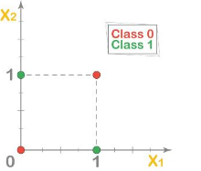
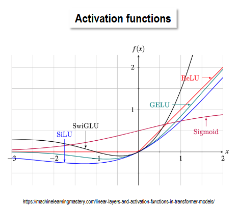
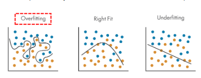
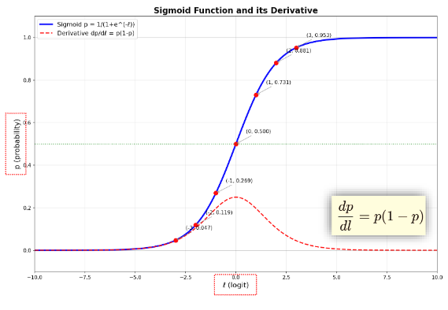
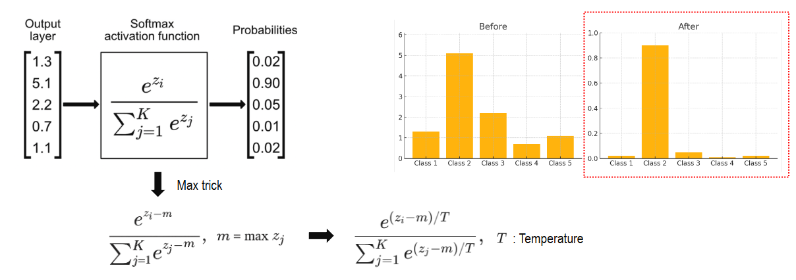

# DNN: 예측 확률에서 손실과 가중치 업데이트까지

이미지 분류 신경망의 학습은 **입력 → 특징 → 점수 → 확률 → 손실 → 기울기 → 가중치 수정**의 반복입니다. 이 노트에서는 각 단계가 넘겨주는 값을 손으로 계산하고, 왜 틀린 예측이 다음 학습에서 달라지는지 설명합니다.

[앞: 비전 입문](01_비전_입문.md) · [다음: CNN](02_02_CNN_Note.md) · [원문: Basic Architecture](../교안/02_00_DNN_CNN.pdf)

**범위와 선수지식.** 이미지의 픽셀·채널, 지도학습의 입력과 정답은 입문에서 배웁니다. 여기서는 완전연결 신경망으로 공통 학습 원리를 배우며, CNN의 커널·stride·padding·ResNet은 다음 노트에서 다룹니다. 벡터의 성분별 곱과 합, 지수·로그를 알면 시작할 수 있습니다. 미분은 §5에서 “값을 조금 바꾸었을 때 손실의 변화율”로 설명합니다. 노름과 이미지 배경이 낯설면 §9를 먼저 읽으세요.

**학습 목표.** (1) 은닉층과 비선형성이 필요한 이유를 XOR로 설명한다. (2) 로짓을 확률로 바꾸고 BCE·CE를 계산한다. (3) 작은 MLP의 전방계산·역전파·업데이트를 한 번 수행한다. (4) 회귀와 분류의 출력·손실을 선택하고, 학습 손실 감소와 일반화를 구분한다.

**읽는 순서.** 처음에는 §1부터 §6까지 순서대로 읽은 뒤 §8의 확인 문제를 풀어 보세요. §7은 구조와 작업을 비교하고 다음 CNN 노트로 넘어갈 때 읽으세요. 복습할 때는 확률·손실은 §3–4, 기울기는 §5, 과적합은 §6, 구조 비교는 §7을 찾으면 됩니다. ‘심화’와 §9는 선택 읽기입니다. 계산 예제는 별도 표시가 없으면 교육용으로 구성한 수치이고, 자연로그를 쓰며 소수 넷째 자리 부근에서 반올림합니다.

## 목차

- [1. 학습의 전체 흐름과 기호](#1-학습의-전체-흐름과-기호)
- [2. 입력에서 특징으로: 퍼셉트론과 MLP](#2-입력에서-특징으로-퍼셉트론과-mlp)
- [3. 특징에서 확률로: 출력층 선택](#3-특징에서-확률로-출력층-선택)
- [4. 확률을 손실로 바꾸기](#4-확률을-손실로-바꾸기)
- [5. 한 예제로 전방계산부터 업데이트까지](#5-한-예제로-전방계산부터-업데이트까지)
- [6. 언제 학습이 잘되었다고 할 수 있는가](#6-언제-학습이-잘되었다고-할-수-있는가)
- [7. 구조와 작업을 구분하고 CNN으로 연결하기](#7-구조와-작업을-구분하고-cnn으로-연결하기)
- [8. 직접 풀어 보는 확인 문제와 해설](#8-직접-풀어-보는-확인-문제와-해설)
- [9. 보충: 입문 배경을 짧게 복습하기](#9-보충-입문-배경을-짧게-복습하기)
- [10. 원문과 보충 근거](#10-원문과-보충-근거)

## 1. 학습의 전체 흐름과 기호

교안 실제 3쪽의 역사 그림은 퍼셉트론, XOR의 한계, 다층망과 역전파, 깊은 표현 학습을 연결합니다. 연도 암기보다 **한 개 경계의 한계 → 비선형 변환의 조합 → 그 조합을 학습할 기울기 계산**이라는 관계를 읽는 것이 이 노트의 목적입니다. 그림에 함께 나오는 ADALINE·SVM의 개별 알고리즘은 여기서 전개하지 않습니다.

| 기호 | 뜻과 형태 | 다음 단계에서의 역할 |
| --- | --- | --- |
| $x$ | 한 입력의 $d$개 성분을 담은 열벡터 | 픽셀 또는 미리 계산한 특징 |
| $W,b$ | 학습할 가중치 행렬과 편향 벡터 | 입력을 어떤 비율로 조합할지 결정 |
| $a=Wx+b$ | 활성화 전 가중합 | 비선형 함수에 전달 |
| $h=\phi(a)$ | 은닉층 활성값, 즉 중간 특징 | 다음 층의 입력 |
| $z$ | 클래스별 로짓, 합이 1일 필요 없는 실수 점수 | sigmoid 또는 softmax의 입력 |
| $q$ | 모델의 예측 확률 | 정답과 비교 |
| $y$ 또는 $p$ | 라벨 또는 정답 분포 | 손실의 기준 |
| $L$ | 한 표본의 손실 스칼라 | 기울기 계산의 출발점 |
| $\theta$ | 모든 가중치와 편향을 모은 기호 | 업데이트의 대상 |

가령 입력이 3개, 은닉 뉴런이 2개이면 $W$의 형태는 $2\times3$, $b$와 $h$의 형태는 $2\times1$입니다. 각 행이 뉴런 하나의 가중합을 만듭니다. **전방계산**은 현재 $\theta$를 고정하고 $x$에서 $L$까지 값을 구하는 과정입니다. **역전파**는 반대 방향으로 각 $\theta$가 손실에 미친 변화율을 구합니다. **최적화**는 그 기울기를 이용해 실제 값을 바꿉니다. 역전파 자체가 업데이트는 아닙니다.

훈련 때에는 정답을 이용해 손실과 기울기를 구합니다. 예측만 하는 추론 때에는 보통 입력에서 출력까지만 계산하며 정답과 업데이트가 필요 없습니다.

## 2. 입력에서 특징으로: 퍼셉트론과 MLP


### Perceptron — 퍼셉트론

퍼셉트론은 입력에 가중치를 곱해 더하고 편향을 더한 뒤, **계단 함수(Step function)**로 두 클래스 중 하나를 선택하는 기본적인 인공 뉴런입니다. 이진 분류를 수행할 수 있지만 단일 퍼셉트론의 결정 경계는 직선이나 초평면 형태입니다.

따라서 XOR처럼 하나의 직선으로 나눌 수 없는 문제는 단일 퍼셉트론으로 해결할 수 없습니다. 이는 계단 함수 자체가 선형 함수여서가 아니라, 그 앞에서 계산한 가중합을 하나의 기준으로 나누기 때문입니다.

그림의 가로축은 $x_1$, 세로축은 $x_2$입니다. Class 0은 (0,0)·(1,1), Class 1은 (0,1)·(1,0)에 있어 직선 하나로 두 묶음을 나눌 수 없습니다. 색을 보지 않아도 이 좌표 관계로 XOR의 한계를 확인할 수 있습니다.



### MLP (Multi-Layer Perceptron) — 다층 퍼셉트론

이 한계를 확장한 구조가 **입력층과 출력층 사이에 은닉층을 둔 MLP**입니다. 각 층에서 가중합과 비선형 활성화 함수를 적용하면 여러 뉴런의 출력을 조합해 더 복잡한 결정 경계를 표현할 수 있습니다.

중요한 점은 층을 추가하는 것과 함께 **비선형성**을 도입해야 한다는 것입니다. 선형 연산만 여러 번 쌓으면 결국 하나의 선형 연산과 같아지므로, XOR 같은 문제를 해결하려면 비선형 활성화 함수가 필요합니다.

아래는 망의 연결도가 아니라 활성화 함수들의 입력 $x$와 출력 $f(x)$를 비교한 그림입니다. 우선 ReLU가 음수 입력을 0으로 만들고 양수 입력을 통과시키는 부분과, sigmoid가 양끝에서 평평해지는 부분을 보세요. 나머지 곡선은 비선형 함수에 여러 선택지가 있다는 참고이며 이 노트의 필수 계산 대상은 아닙니다.



표현력이 커지면 복잡한 패턴을 학습할 수 있지만, 학습 데이터의 우연한 특징까지 따라가는 **과적합(Overfitting)**도 발생할 수 있습니다. 아래 그림처럼 학습 데이터에 지나치게 맞춘 경계는 새로운 데이터에서 잘 작동하지 않을 수 있으므로 검증 데이터로 일반화 성능을 확인해야 합니다.




### 작은 계산: 왜 층 사이에 비선형 함수가 필요한가

가중합의 예로 $x=(1,2)$, $w=(2,-1)$, $b=0.5$이면 $a=2\cdot1-1\cdot2+0.5=0.5$입니다. 출력이 $a>0$일 때 1인 계단 함수라면 결과는 1입니다. 계단 함수는 경계를 넘는지 판정하지만 대부분의 위치에서 미분이 0이므로 일반적인 기울기 기반 MLP 학습에는 그대로 쓰기 어렵습니다.

활성화 없이 두 층을 쌓으면 $W_2(W_1x+b_1)+b_2=(W_2W_1)x+(W_2b_1+b_2)$입니다. 결국 한 번의 affine 변환(선형 변환에 편향을 더한 것)으로 합쳐집니다. 반면 ReLU는 $\max(0,a)$로 음수는 0, 양수는 그대로 내보내어 구간별 다른 동작을 만듭니다.

교육용 XOR 구성은 $h_1=\mathrm{ReLU}(x_1-x_2)$, $h_2=\mathrm{ReLU}(x_2-x_1)$, 출력 $h_1+h_2$입니다. 입력을 0 또는 1로 제한하면 다음과 같습니다.

| 입력 $(x_1,x_2)$ | $h_1$ | $h_2$ | 출력 |
| --- | --- | --- | --- |
| (0,0) | 0 | 0 | 0 |
| (0,1) | 0 | 1 | 1 |
| (1,0) | 1 | 0 | 1 |
| (1,1) | 0 | 0 | 0 |

두 입력이 다를 때만 1입니다. 이는 그런 가중치가 **존재한다**는 표현력 예시이지, 임의 초기화와 학습 설정이 반드시 그 해를 찾는다는 보장은 아닙니다. 이제 은닉층이 만든 특징을 클래스별 확률로 바꿉니다.

## 3. 특징에서 확률로: 출력층 선택

### Sigmoid

신경망의 비선형 함수 중 하나인 Sigmoid는 입력값을 **0과 1 사이의 값**으로 변환합니다.

$$
\sigma(z) = \frac{1}{1+e^{-z}}
$$

입력 $z$가 커질수록 출력은 1에 가까워지고, 작아질수록 0에 가까워집니다. 이 특성 때문에 이진 분류의 출력층에서 특정 클래스에 속할 확률을 표현할 때 사용할 수 있습니다. 예를 들어 출력이 0.8이라면 설정한 임계값에 따라 최종 클래스를 결정합니다.

그림의 파란 실선은 확률, 빨간 점선은 그 확률의 입력에 대한 미분입니다. 입력 0에서 확률은 0.5이고 미분은 0.25이며, 두 값은 서로 다른 양입니다.



Sigmoid는 과거 은닉층에서도 널리 사용되었지만 입력의 절댓값이 커지는 구간에서 기울기가 작아집니다. 깊은 신경망에서는 이로 인해 기울기 소실이 발생하기 쉬워, 은닉층에는 ReLU 같은 다른 활성화 함수도 사용합니다.

### Softmax — 다중 클래스 분류

Sigmoid로 이진 분류의 확률을 표현할 수 있다면, 서로 배타적인 여러 클래스의 확률은 **Softmax**로 표현할 수 있습니다. Softmax는 모델이 출력한 클래스별 점수인 **로짓(Logits)**을 받아 각 값이 양수이고 전체 합이 1인 확률분포로 변환합니다.

$$
q_i = \frac{e^{z_i}}{\sum_j e^{z_j}}
$$

예를 들어 고양이·강아지·토끼 중 하나를 고르는 모델은 세 로짓을 Softmax로 변환하고, 가장 높은 확률의 클래스를 최종 예측으로 선택할 수 있습니다. 학습할 때는 이 예측 분포와 정답을 다음 §4에서 배울 교차 엔트로피로 비교합니다.

아래 그림은 왼쪽 점수 벡터를 확률 벡터로 바꾼 뒤 오른쪽 막대그래프로 비교합니다. 가장 큰 두 번째 점수가 가장 높은 확률을 얻습니다. 표시 확률은 반올림된 값이며, 분포가 집중되는 정도는 점수 차이에 달려 있습니다.



Softmax를 계산할 때 사용하는 **Max trick**은 모든 로짓에서 최댓값을 먼저 빼는 방법입니다. 결과 확률은 그대로 유지하면서 지수 계산에서 너무 큰 값이 발생하는 것을 줄입니다. [Softmax와 수치 안정성 설명](https://cs231n.github.io/linear-classify/)

또한 로짓을 양수인 **온도(Temperature) $T$**로 나누어 분포의 뾰족함을 조절할 수 있습니다. $T=1$이면 기본 Softmax이며, $T$를 낮추면 높은 점수의 클래스에 확률이 더 집중되고 높이면 분포가 더 부드러워집니다. $T=1$이라고 해서 나머지 클래스의 확률이 자동으로 0에 가까워지는 것은 아닙니다.


### 출력의 수치를 읽는 법

이진 분류에서 $q=0.8$의 odds는 $q/(1-q)=4$, logit은 $z=\ln4\approx1.3863$입니다. 따라서 sigmoid는 로그 오즈를 확률로 되돌리는 함수입니다. 미분은 $q(1-q)$여서 $z=0$에서 0.25, 양끝으로 갈수록 0에 가까워집니다. 이는 **sigmoid 함수의 미분**이며, sigmoid와 BCE를 결합한 로짓에 대한 손실 미분은 §5처럼 $q-y$로 단순해진다는 점을 구분하세요.

세 클래스의 로짓이 $(\ln2,0,0)$이면 지수값은 $(2,1,1)$, 합은 4이므로 $q=(0.5,0.25,0.25)$입니다. 모든 로짓에 1000을 더해도 공통 지수 인자가 분자·분모에서 약분되므로 확률은 같습니다. 큰 양수를 직접 지수화하지 않도록 최댓값을 빼면 같은 계산을 $(0,-\ln2,-\ln2)$로 할 수 있습니다. 이는 확률의 의미를 바꾸는 정규화가 아니라 수치 안정화를 위한 동일식입니다.

온도 $T=0.5$에서는 같은 예제의 지수 비율이 $(4,1,1)$로 변해 $q=(2/3,1/6,1/6)$이 됩니다. 양의 유한한 온도에서는 점수 순서가 유지되지만 확률의 집중도는 달라집니다. 최댓값이 여럿이면 $T\to0^+$에서도 하나로만 모이지 않습니다. softmax 확률이 높다고 실제 정답률이 그 값과 일치하는 것은 아니므로 확률 보정 여부는 따로 평가해야 합니다.

| 문제의 조건 | 출력 선택 | 이유 |
| --- | --- | --- |
| 고양이인가 아닌가 | sigmoid 하나 | 두 결과를 $q,1-q$로 표현 |
| 고양이·개·새 중 정확히 하나 | softmax | 클래스 간 합을 1로 제한 |
| 고양이와 자동차가 동시에 있는가 | 클래스별 sigmoid | 여러 라벨이 동시에 참일 수 있음 |
| 물체 좌표는 얼마인가 | 보통 실수 출력 | 합이 1인 분포로 제한할 필요 없음 |

argmax는 최종 라벨 선택에 쓰지만, 학습 손실에는 부드러운 확률 또는 그에 대응하는 로짓 식을 사용합니다. argmax 결과만 남기면 점수가 얼마나 틀렸는지에 관한 정보와 유용한 기울기를 잃기 때문입니다.

## 4. 확률을 손실로 바꾸기


거리로 수치 간 차이를 측정할 수 있다면, 분류 모델이 출력하는 확률분포의 차이는 어떻게 측정할 수 있을까요? 이를 이해하기 위해 엔트로피, 교차 엔트로피, KL 발산을 순서대로 살펴보겠습니다.

### Entropy — 엔트로피

엔트로피는 **확률분포의 불확실성**을 나타냅니다. 정보 부호화 관점에서는 사건을 표현하는 데 필요한 평균 정보량으로 해석할 수 있습니다. 자주 발생하는 사건에 짧은 부호를, 드물게 발생하는 사건에 긴 부호를 배정하면 평균 부호 길이를 줄일 수 있습니다.

로그의 밑을 2로 사용하면 단위는 비트입니다. 이때 엔트로피는 이상적인 부호화에서 평균 부호 길이의 이론적 기준이 됩니다.

### Cross Entropy — 교차 엔트로피

엔트로피가 실제 분포 자체의 불확실성을 나타낸다면, 교차 엔트로피는 **실제 분포의 데이터를 다른 예측 분포로 부호화할 때 필요한 평균 비용**을 나타냅니다. 따라서 교차 엔트로피 전체가 추가 비용인 것은 아닙니다.

분류에서는 정답 분포를 기준으로 모델의 예측 확률을 평가하는 손실 함수로 사용합니다. 정답이 하나의 클래스에만 해당하는 경우 모델이 정답 클래스에 높은 확률을 줄수록 교차 엔트로피 손실은 작아집니다.

### KL Divergence — KL 발산

교차 엔트로피에서 실제 분포의 엔트로피를 뺀 값이 **KL 발산**입니다. 실제 분포를 $p$, 예측 분포를 $q$라고 하면 다음 관계가 성립합니다.

$$
H(p,q) = H(p) + D_{\mathrm{KL}}(p\Vert q)
$$

즉, KL 발산은 분포 $p$ 대신 $q$를 사용할 때 발생하는 추가 비용으로 해석할 수 있습니다. 비교 대상은 엔트로피와 교차 엔트로피라는 두 분포가 아니라 **실제 분포와 예측 분포**입니다. 또한 두 분포의 순서를 바꾸면 일반적으로 값이 달라지므로 보통의 대칭적인 거리와는 다릅니다.

이제 이 관계를 실제 손실 계산과 연결하고, 그 손실을 줄일 기울기를 구하겠습니다.


### 정의를 숫자로 확인하기

$K$개 클래스의 정답 분포를 $p$, 모델 분포를 $q$라 하면 각 성분은 음수가 아니고 각각 합이 1입니다.

$$
H(p)=-\sum_{k=1}^K p_k\ln p_k,\quad
H(p,q)=-\sum_{k=1}^K p_k\ln q_k,\quad
D_{\mathrm{KL}}(p\Vert q)=\sum_{k=1}^Kp_k\ln\frac{p_k}{q_k}.
$$

자연로그의 단위는 nat입니다. $p_k=0$인 항은 극한으로 0으로 처리하며, $p_k>0$인데 $q_k=0$이면 CE와 KL은 무한대입니다. $p=(0.5,0.5)$, $q=(0.8,0.2)$이면 $H(p)=\ln2\approx0.6931$, $H(p,q)=-0.5\ln0.8-0.5\ln0.2\approx0.9163$, KL은 $0.9163-0.6931=0.2231$입니다. 고정된 $p$에 대해 CE를 줄이는 것과 KL을 줄이는 것은 같은 최적화입니다.

정답이 첫 클래스인 one-hot $y=(1,0,0)$에서는 $H(y)=0$이고 $L=-\ln q_1$입니다. §3의 $q=(0.5,0.25,0.25)$를 대입하면 $L=0.6931$입니다. one-hot은 정답 성분 하나만 1이고 나머지는 0이라는 **라벨 표현**이지 모델이 내야 할 정확한 유한 로짓 값이 아닙니다.

### 교안 예제: BCE와 CE는 무엇을 더하는가

이진 라벨 $y\in\{0,1\}$과 양성 확률 $q$의 BCE는

$$L=-[y\ln q+(1-y)\ln(1-q)]$$

입니다. 교안 12쪽의 $y=1,q=0.8$이면 $L=-\ln0.8=0.2231$입니다. 같은 예측에 정답만 $y=0$으로 바꾸면 $L=-\ln0.2=1.6094$로 커집니다. 높은 확신으로 틀린 예측을 더 크게 벌주는 것입니다.

교안의 네 클래스 정답 $(1,0,0,0)$과 예측 $(0.7,0.2,0.05,0.05)$에서는 CE가 $-\ln0.7=0.3567$입니다. 다른 클래스 항의 계수가 0이어도, softmax 분모에 모든 로짓이 들어가므로 다른 로짓도 학습에서 영향을 받습니다. 표본이 $N$개이면 보통 표본별 손실을 더해 $N$으로 나눕니다. 합과 평균은 값과 기울기 배율이 다르므로 학습률과 함께 일관되게 써야 합니다.

### 심화: 우도에서 손실을 선택하는 이유

우도(likelihood)는 입력과 정답을 고정한 채, 현재 파라미터가 그 정답에 얼마나 높은 확률 또는 밀도를 주는지 보는 함수입니다. 독립 표본들의 우도를 곱해 최대화하는 최대우도추정(MLE)은 음의 로그를 취한 NLL을 최소화하는 것과 같습니다. 로그는 곱을 합으로 바꾸므로 계산과 최적화에 편리합니다. 연속값의 밀도는 확률 자체가 아니며 1보다 클 수도 있습니다.

| 정답의 확률 모형 | 한 표본의 NLL | 대응 손실과 조건 |
| --- | --- | --- |
| Bernoulli: 결과 0 또는 1 | $-y\ln q-(1-y)\ln(1-q)$ | BCE |
| Categorical: $K$개 중 하나 | $-\sum_k y_k\ln q_k$ | CE |
| 정규분포: 평균 $\hat y$, 분산 $\sigma^2$ | $(y-\hat y)^2/(2\sigma^2)+\tfrac12\ln(2\pi\sigma^2)$ | 분산이 고정이면 MSE와 같은 최소점 |
| Laplace: 위치 $\hat y$, 척도 $b>0$ | $|y-\hat y|/b+\ln(2b)$ | 척도가 고정이면 MAE와 같은 최소점 |

MSE는 제곱 오차의 평균, MAE는 절대 오차의 평균입니다. 두 표본의 오차가 1과 3이면 MSE는 $(1+9)/2=5$, MAE는 $(1+3)/2=2$, RMSE는 $\sqrt5\approx2.2361$입니다. 제곱은 큰 오차의 비중을 더 높입니다. 분산이나 척도도 모델이 학습한다면 표의 로그 항을 상수라며 버릴 수 없습니다. 교안 11쪽의 분포 대응은 이러한 조건 아래 해석해야 합니다.

## 5. 한 예제로 전방계산부터 업데이트까지

이 절은 교안 10쪽의 순환도와 연쇄법칙을 **교육용 작은 MLP**로 풀어 쓴 것입니다. 큰 이미지 대신 입력 $x=1$ 하나, ReLU 은닉 뉴런 하나, 두 클래스 출력 두 개만 사용합니다. 두 클래스에 softmax를 쓰므로 이진 문제를 sigmoid 하나로 나타내는 방식과 표현만 다릅니다.

### 5.1 전방계산: 입력부터 손실까지

학습할 값은 $w,b,v_1,v_2,c_1,c_2$ 여섯 개입니다. 초기값은 $w=1,b=0,v_1=\ln2,v_2=0,c_1=c_2=0$이고 정답은 $y=(1,0)$입니다.

| 단계 | 계산 | 값 |
| --- | --- | --- |
| 은닉 가중합 | $a=wx+b$ | $1\cdot1+0=1$ |
| 은닉 활성값 | $h=\mathrm{ReLU}(a)$ | 1 |
| 출력 로짓 | $z_1=v_1h+c_1,\ z_2=v_2h+c_2$ | $(\ln2,0)$ |
| softmax | $q_i=e^{z_i}/(e^{z_1}+e^{z_2})$ | $(2/3,1/3)$ |
| 정답 CE | $L=-\ln q_1$ | $\ln(3/2)=0.4055$ |

현재 분류 라벨은 이미 맞지만 손실은 0이 아닙니다. 정확도는 맞음/틀림만 구분하고, CE는 정답에 부여한 확률도 평가하기 때문입니다.

### 5.2 역전파: 어느 값을 어느 방향으로 바꿀까

편미분 $\partial L/\partial w$는 나머지 파라미터를 고정하고 $w$만 아주 조금 바꿀 때 손실이 얼마나 변하는지 나타냅니다. 양수이면 $w$를 조금 줄이는 방향, 음수이면 늘리는 방향이 국소적으로 손실을 줄입니다. 여러 단계를 거친 영향은 **연쇄법칙**, 즉 경로를 따라 변화율을 곱하고 여러 경로의 결과는 더하는 법칙으로 계산합니다.

softmax와 CE를 합쳐 쓰면 한 표본에서

$$
L=-\sum_i y_i z_i+\ln\sum_j e^{z_j},\qquad
\frac{\partial L}{\partial z_i}=q_i-y_i
$$

입니다. 여기서 $\sum_i y_i=1$입니다. 첫 항의 미분은 $-y_i$, 두 번째 항의 미분은 softmax 확률 $q_i$이므로 둘을 더합니다. 따라서 $(\partial L/\partial z_1,\partial L/\partial z_2)=(-1/3,+1/3)$입니다.

출력층부터 앞쪽으로 이어 계산합니다. 모든 값은 **업데이트 전 값**을 사용합니다.

$$
\frac{\partial L}{\partial v_i}=(q_i-y_i)h,\quad
\frac{\partial L}{\partial c_i}=q_i-y_i,
$$

$$
\frac{\partial L}{\partial h}=v_1(-1/3)+v_2(1/3)=-\frac{\ln2}{3}=-0.2310.
$$

$a=1>0$에서 ReLU 미분은 1입니다. 따라서 $\partial L/\partial a=-0.2310$, $\partial L/\partial w=(\partial L/\partial a)x=-0.2310$, $\partial L/\partial b=-0.2310$입니다. ReLU는 $a<0$에서 미분이 0이므로 그 경로의 기울기는 막히며, 정확히 0에서는 미분 불가능하여 구현에서 사용할 값을 정합니다. 이번 예제는 그 경계를 피했습니다.

sigmoid 하나와 BCE를 쓰는 경우도 $L=\ln(1+e^z)-yz$에서 $\partial L/\partial z=\sigma(z)-y$입니다. 이런 결합식을 사용하면 확률에 로그를 따로 취할 때 발생하는 수치 문제를 줄일 수 있습니다. 실제 구현은 큰 지수를 직접 만들지 않는 안정적인 연산을 사용합니다.

### 5.3 업데이트: 기울기를 실제 파라미터 변경으로 바꾸기

경사하강법은 $\theta_{\text{new}}=\theta-\eta\nabla_\theta L$을 사용합니다. $\eta>0$는 보폭인 학습률입니다. $\eta=0.1$로 여섯 값을 동시에 갱신하면 다음과 같습니다.

| 파라미터 | 초기값 | 기울기 | 갱신값 |
| --- | --- | --- | --- |
| $w$ | 1 | -0.231049 | 1.023105 |
| $b$ | 0 | -0.231049 | 0.023105 |
| $v_1$ | 0.693147 | -0.333333 | 0.726481 |
| $v_2$ | 0 | +0.333333 | -0.033333 |
| $c_1$ | 0 | -0.333333 | 0.033333 |
| $c_2$ | 0 | +0.333333 | -0.033333 |

다시 전방계산하면 $h'=1.046210$, $z'\approx(0.793384,-0.068207)$, $q'_1\approx0.7030$, $L'\approx0.3524$입니다. 정답 확률이 올라가며 손실이 내려갑니다. 이것은 **이 표본·초기값·학습률의 한 번 업데이트 결과**이지 모든 배치에서 손실이 반드시 감소한다는 보장이 아닙니다.

### 5.4 재현 코드와 계산 계약

아래는 외부 패키지 없는 Python 예제입니다. 위의 한 표본, 여섯 파라미터, 평균을 내지 않은 단일 CE를 계산합니다. 난수·데이터 다운로드·훈련 프레임워크가 없습니다. 출력은 반올림 전 수치로 계산되며, 중앙차분으로 분석적 기울기도 점검합니다. 실제 실행 및 출력은 담당 검토 기록에 남겼습니다.

```python
import math

names = ('w', 'b', 'v1', 'v2', 'c1', 'c2')
theta = [1.0, 0.0, math.log(2), 0.0, 0.0, 0.0]

def forward(t):
    w, b, v1, v2, c1, c2 = t
    a = w + b                 # x = 1
    h = max(0.0, a)
    z = [v1*h + c1, v2*h + c2]
    m = max(z)
    e = [math.exp(u-m) for u in z]
    q = [u/sum(e) for u in e]
    loss = m + math.log(sum(e)) - z[0]  # y = (1, 0)
    return a, h, q, loss

a, h, q, before = forward(theta)
d1, d2 = q[0]-1.0, q[1]
da = (theta[2]*d1 + theta[3]*d2) * (1.0 if a > 0 else 0.0)
grad = [da, da, d1*h, d2*h, d1, d2]
for i, name in enumerate(names):
    plus, minus = theta.copy(), theta.copy()
    plus[i] += 1e-6
    minus[i] -= 1e-6
    numeric = (forward(plus)[3] - forward(minus)[3]) / 2e-6
    assert abs(numeric-grad[i]) < 1e-7, (name, numeric, grad[i])
updated = [t-0.1*g for t, g in zip(theta, grad)]
print('before', before, 'after', forward(updated)[3])
print('updated', updated, 'probability', forward(updated)[2])
```

기울기 검사의 핵심은 구현을 같은 식으로 반복하는 대신, 파라미터를 실제로 조금 바꾸어 측정한 손실의 변화율과 비교하는 것입니다. ReLU의 0 같은 미분 불가능 지점에서는 이 비교를 그대로 해석하면 안 됩니다.

## 6. 언제 학습이 잘되었다고 할 수 있는가

**배치와 반복.** 실제로는 표본 여러 개의 평균 손실로 기울기를 구하고 미니배치마다 업데이트합니다. 훈련 데이터를 한 번 모두 사용한 것을 epoch라고 합니다. 보통 매 단계 기울기를 새로 계산하며, 프레임워크가 기울기를 누적하는 경우 의도하지 않은 누적을 초기화해야 합니다. Momentum·Adam 같은 최적화는 이전 상태를 저장하지만, 기본 경사하강법에 기울기 이력 전체 저장이 필수인 것은 아닙니다. 교안 10쪽의 메모리 목록은 구현과 최적화 방법에 따라 달라집니다.

**기울기 소실.** 앞층 기울기는 여러 미분의 곱을 포함합니다. 예를 들어 경로의 미분이 0.25인 구간을 5개 지나면 곱은 $0.25^5=0.0009765625$입니다. 이것은 단순화한 경로 예시이며 실제 기울기는 가중치와 여러 경로에도 영향을 받습니다. ReLU·적절한 초기화·정규화·잔차 연결은 문제를 완화할 수 있지만 모든 망에서 소실을 없애는 보장은 아닙니다. 잔차 연결의 구체적 계산은 CNN/ResNet 노트로 이어집니다.

**과적합과 일반화.** 학습 손실이 내려가도 새로운 이미지에서 잘 맞는다는 뜻은 아닙니다. 학습에는 훈련 데이터를, 구조·학습률·중단 시점 선택에는 검증 데이터를 쓰고, 최종 평가는 분리한 테스트 데이터로 합니다. 같은 사람의 거의 동일한 사진이 여러 분할에 섞이면 평가가 지나치게 쉬워질 수 있습니다. 손실이 거의 멈춘 이유도 좋은 해, 너무 작은 학습률, 포화된 활성값 등 여러 가지이므로 한 수치만으로 결론내리지 않습니다.

**규제의 역할.** L2 규제는 예를 들어 $L+\lambda\sum_j w_j^2$로 큰 가중치에 비용을 더합니다. 이 정의에서는 추가 기울기가 $2\lambda w_j$이며 $1/2$를 붙이는 정의와 계수가 다릅니다. Dropout은 학습 중 일부 활성값을 무작위로 제외해 특정 경로에 대한 의존을 줄이려는 방법입니다. Batch normalization은 활성값의 통계를 이용해 학습을 돕는 연산이며, 규제와 동일한 개념은 아닙니다. 모델의 깊이만으로 규제의 필요성이나 GPU 필요 여부를 결정할 수 없습니다.

## 7. 구조와 작업을 구분하고 CNN으로 연결하기


지금까지 신경망이 예측을 만들고 손실을 통해 가중치를 바꾸는 과정을 연결해 보았습니다. 이를 바탕으로 퍼셉트론에서 깊은 신경망으로 확장될 때 무엇이 달라지는지 정리하겠습니다.

### Perceptron, MLP, DNN의 차이

| 항목 | Perceptron | MLP (Multi-Layer Perceptron) | DNN (Deep Neural Network) |
| --- | --- | --- | --- |
| 정의 | 기본적인 단일 분류 뉴런 | 은닉층을 둔 완전연결 신경망 | 여러 층으로 표현을 학습하는 심층 신경망 |
| 깊이 | 기본 구조는 입력에서 출력으로 연결 | 은닉층을 얕거나 깊게 구성 가능 | 여러 은닉층을 사용하며 보편적인 층 수 기준은 없음 |
| 활성화 함수 | 주로 Step function | Sigmoid, ReLU, Tanh 등 | ReLU, GELU 등, 출력층은 작업에 따라 선택 |
| 학습 방법 | 퍼셉트론 학습 규칙 | 역전파로 기울기를 구한 뒤 최적화 | 역전파와 최적화 알고리즘 활용 |
| 표현력 | 선형 분리 가능한 문제에 제한 | 비선형 결정 경계 표현 | 특징을 여러 단계로 조합 |
| 활용 | 단순한 이진 분류 | 분류·회귀 등 | 이미지·음성·자연어 등 |
| 계산량 | 매우 적음 | 층 수와 너비에 따라 증가 | 규모가 크면 GPU·TPU 등을 활용 |
| 해석 가능성 | 비교적 이해하기 쉬움 | 구조가 복잡해질수록 해석이 어려워질 수 있음 | 복잡한 판단 근거를 해석하기 어려울 수 있음 |
| 확장성 | 복잡한 문제를 표현하는 데 한계 | 데이터와 문제에 맞게 깊이·너비 조절 | 대규모 데이터와 다양한 구조로 확장 가능 |
| 과적합 관리 | 데이터 조건에 따라 필요 | Dropout, L2 등을 활용 가능 | 규모와 데이터에 맞는 규제 전략 필요 |
| 역사적 의미 | 인공 신경망의 초기 모델 | 다층 비선형 학습의 기본 구조 | 다양한 현대 딥러닝 모델의 기반 |

이 표의 핵심은 **은닉층과 비선형 활성화 함수가 표현력을 확장한다는 점**입니다. 퍼셉트론은 단순한 경계를 만들고, MLP는 여러 뉴런을 조합해 비선형 경계를 학습하며, 깊은 신경망은 특징을 여러 단계로 조합합니다. 다만 표현력이 높다고 언제나 성능이 좋은 것은 아니므로 데이터의 양과 품질에 맞는 구조를 선택해야 합니다.

여기서 **MLP와 DNN은 서로 완전히 분리된 분류가 아닙니다.** MLP도 깊게 쌓으면 DNN이 될 수 있고, DNN에는 CNN이나 Transformer 같은 다양한 구조도 포함됩니다. 층 수를 셀 때 입력층을 포함하는지에 따라 숫자가 달라질 수 있으므로 단순한 층 수보다 실제 구조를 확인하는 것이 중요합니다.

활성화 함수나 규제 방법도 모델 이름만으로 정해지지 않습니다. MLP와 DNN 모두 여러 활성화 함수를 사용할 수 있고, Softmax는 주로 다중 클래스 분류의 출력에서 사용합니다. Dropout과 L2는 과적합을 줄이는 대표적인 방법이며, Batch normalization은 학습 안정화에 활용되고 규제 효과도 나타날 수 있습니다. 모든 DNN에 이 기법들이 필수인 것은 아니며 작은 모델은 CPU로도 실행할 수 있습니다.

### Regression(회귀)과 Classification(분류) 비교

신경망의 구조를 정한 다음에는 **어떤 출력을 예측할지에 맞춰 출력층·손실 함수·평가 지표를 선택**해야 합니다. 처음 소개한 회귀와 분류를 이 관점에서 다시 비교하면 다음과 같습니다.

| 항목 | Regression(회귀) | Classification(분류) |
| --- | --- | --- |
| Output(출력) | 연속적인 수치 | 구분된 클래스 라벨 |
| Activation(출력층 활성화 함수) | 일반적으로 선형 출력 | Sigmoid / Softmax |
| Loss(손실 함수) | MSE, MAE | Cross Entropy(BCE 포함) |
| Metrics(평가 지표) | RMSE | Accuracy, F1-score, mAP |
| Representation(표현) | 실수값 | 클래스별 확률 또는 확률분포 |
| Applications(활용) | 수치 추정, 관절 좌표 추정, 바운딩 박스 좌표 예측 | 물체 종류 분류, 이미지 분할(Segmentation) |

**회귀는 “얼마인가?”를 예측**합니다. 집값, 온도, 물체의 위치처럼 수치로 답하며 MSE·MAE는 예측값과 정답의 수치 차이를 측정합니다. RMSE도 오차를 나타내므로 보통 작을수록 좋습니다. 표의 선형 출력은 출력층에 별도 활성화 함수를 적용하지 않는다는 뜻이며 모델 전체가 선형이라는 뜻은 아닙니다.

**분류는 “무엇인가?”를 예측**합니다. Sigmoid나 Softmax로 얻은 확률에 임계값이나 최댓값 기준을 적용해 클래스를 선택하고, 교차 엔트로피로 학습할 수 있습니다. Accuracy와 F1-score는 대표적인 분류 평가 지표이며 mAP는 주로 물체 검출 등에서 활용합니다.

실제 비전 작업은 둘을 함께 사용하기도 합니다. 물체 검출에서 물체의 종류는 분류로, 바운딩 박스 좌표는 회귀로 예측합니다. 이미지 분할은 각 픽셀의 클래스를 예측하는 작업입니다.

이제 신경망 학습의 기본 요소를 갖추었습니다. 다음 CNN 노트에서는 이미지를 완전연결 신경망에 넣을 때의 부담을 살펴보고, **가까운 픽셀의 관계와 반복되는 시각적 특징을 구조적으로 활용하는 합성곱 신경망**으로 이어가겠습니다.

완전연결층의 비용도 다음 구조를 선택할 근거가 됩니다. 100×100 흑백 이미지를 10,000개 성분으로 펴고 은닉 뉴런 1,000개에 연결하면 가중치는 10,000×1,000=10,000,000개이고 편향까지 10,001,000개입니다. 각 픽셀 위치에 별도 가중치가 생기므로 이미지의 이웃 관계와 같은 패턴의 반복을 구조적으로 활용하기 어렵습니다. CNN은 국소 연결과 가중치 공유를 도입합니다. CNN에서도 이 노트의 전방계산·손실·역전파·업데이트 원리는 그대로 쓰이며, 바뀌는 것은 주로 특징을 계산하는 연결 구조입니다.

## 8. 직접 풀어 보는 확인 문제와 해설

먼저 문제만 풀고, 아래 해설과 비교하세요. 계산기 사용은 괜찮지만 다음 단계에 어떤 값을 넘기는지 말로 설명해 보세요.

1. 활성화 없이 완전연결층을 세 개 쌓으면 왜 XOR의 한계가 남을까요?
2. 세 클래스 로짓이 $(\ln3,0,0)$이고 정답이 두 번째이면 확률과 CE는 얼마인가요? 모든 로짓에 10을 더하면 어떻게 되나요?
3. $y=0,q=0.8$인 이진 분류에서 BCE와 로짓에 대한 기울기는 얼마인가요? 경사하강법은 로짓을 어느 방향으로 바꾸려 하나요?
4. §5의 $v_2$ 기울기를 구할 때 $v_2=0$이라고 기울기도 0이라고 하면 왜 틀리나요? 업데이트한 $v_1$을 은닉층 기울기에 즉시 써도 되나요?
5. 사진 속 고양이·자동차의 동시 존재와 자동차 중심 좌표를 예측한다면 출력과 손실을 어떻게 선택하나요?
6. 훈련 손실은 감소하지만 검증 손실이 증가합니다. 학습을 무조건 더 오래 해야 하나요?
7. 정규분포 NLL에서 분산도 예측할 때 제곱 오차만 최소화하면 같은 문제인가요?

### 해설과 돌아갈 위치

1. affine 변환의 합성은 다시 affine입니다. §2의 두 층 전개를 한 번 더 적용하면 됩니다. 비선형 특징이 추가되지 않으므로 최종 한 경계의 제한이 남습니다. **복귀: §2 작은 계산.**
2. 지수값은 $(3,1,1)$, 합은 5, 확률은 $(0.6,0.2,0.2)$입니다. 정답 확률이 0.2이므로 $L=-\ln0.2=1.6094$입니다. 공통 인자 $e^{10}$이 약분되어 확률과 손실은 그대로입니다. **복귀: §3 출력의 수치, §4 one-hot.**
3. $L=-\ln(1-0.8)=1.6094$, $\partial L/\partial z=q-y=0.8$입니다. 양수 기울기의 반대쪽으로 이동하므로 직접 최적화하는 로짓은 작아져 양성 확률이 낮아집니다. 실제 가중치 기울기에는 그 앞의 입력과 연쇄법칙도 필요합니다. **복귀: §4 BCE, §5.2.**
4. $z_2=v_2h+c_2$이므로 $\partial z_2/\partial v_2=h=1$입니다. 따라서 $\partial L/\partial v_2=(1/3)\cdot1=1/3$이고 가중치의 현재 값과 다릅니다. 한 전방계산에 대한 기울기는 모두 그 시점의 파라미터로 계산해야 합니다. 중간에 갱신값을 섞으면 같은 손실의 기울기가 아니게 됩니다. **복귀: §5.2–5.3.**
5. 존재 여부는 둘 다 참일 수 있으므로 두 sigmoid와 각각의 BCE, 좌표는 회귀 출력과 MSE 또는 MAE 등이 가능합니다. 단일 softmax로 존재를 표현하면 둘을 경쟁시키는 잘못된 제약이 생깁니다. 검출에서는 분류와 회귀를 함께 쓰되 손실의 배율도 정합니다. **복귀: §3 선택표, §4 분포 표, §7.**
6. 과적합의 신호일 수 있습니다. 검증 기준으로 중단 시점·규제·모델 크기·데이터를 검토하고 테스트 데이터를 반복 튜닝에 사용하지 않습니다. 한 번의 변동만으로 단정하지 말고 추세와 분할을 확인합니다. **복귀: §6.**
7. 아닙니다. $1/(2\sigma^2)$의 가중치와 $\ln\sigma^2$ 항이 더 이상 상수가 아닙니다. 이를 빼면 예측한 분산의 적절성을 학습하는 원래 우도 목적이 사라집니다. **복귀: §4 심화.**

**복습 문장:** 가중치는 특징과 점수를 만들고, 출력 함수는 작업에 맞는 확률을 만들며, 손실은 정답과의 차이를 수치화합니다. 역전파는 손실의 기울기를 구하고 최적화는 가중치를 바꿉니다. 검증 데이터는 이 변화가 새 입력에도 도움이 되는지 확인합니다.

## 9. 보충: 입문 배경을 짧게 복습하기

입문 전체는 [비전 입문](01_비전_입문.md)이 기준입니다. 아래는 기존 노트의 유익한 배경 설명을 남긴 선택 복습이며, 이 문서의 기본 경로에서는 건너뛰어도 됩니다.

### Vision History

컴퓨터 비전에서는 사람이 특징을 설계하는 방법에서, 모델이 입력부터 최종 예측까지 특징을 함께 학습하는 **End-to-end 학습**으로 접근 방식이 확장되었습니다. 이후 Transformer 기반 비전 모델, 이미지와 언어를 함께 다루는 Vision-language 모델, 이미지를 생성하거나 사용자와 상호작용하는 모델로 연구 범위가 넓어졌습니다.

이러한 모델들은 구조와 목적이 다르지만 데이터에서 유용한 표현을 학습한다는 공통점이 있습니다. 먼저 학습에 정답을 어떻게 활용하는지에 따라 접근 방법을 구분해 보겠습니다.

### Vision Concept

#### Supervised Learning — 지도학습

지도학습은 **입력 데이터와 그에 대응하는 정답 라벨**을 함께 제공하는 방법입니다. 모델은 예측과 정답의 차이를 줄이면서 입력과 출력의 관계를 학습합니다.

대표적인 작업은 분류(Classification)와 회귀(Regression)입니다. 분류는 사진 속 동물이 강아지인지 고양이인지처럼 종류를 예측하고, 회귀는 물체를 감싸는 사각형의 좌표처럼 수치를 예측합니다. 물체 검출에서는 이 두 작업을 결합해 무엇이 어디에 있는지 판단합니다.

#### Semi-supervised Learning — 준지도학습

준지도학습은 **라벨이 있는 데이터와 라벨이 없는 데이터를 함께 활용**합니다. 모든 이미지에 사람이 정답을 붙이기 어려울 때, 일부 라벨로 학습한 모델을 활용해 라벨이 없는 데이터에서도 학습 신호를 얻습니다.

예를 들어 모델의 예측을 임시 정답인 의사 라벨(Pseudo-label)로 사용하거나, 같은 이미지를 조금 변형해도 일관된 예측을 하도록 학습할 수 있습니다. 단순히 데이터별로 지도학습과 라벨링을 나누는 것이 아니라, 두 종류의 데이터를 하나의 학습 과정에서 활용한다는 점이 핵심입니다.

#### Self-supervised Learning — 자기지도학습

자기지도학습은 **데이터 자체에서 학습 목표를 구성**합니다. 사람이 붙인 정답 라벨이 없어도 이미지의 가린 부분을 예측하거나, 같은 이미지의 서로 다른 변형을 연결하는 문제를 만들 수 있습니다.

이처럼 사전학습(Pretraining)에서 풀도록 구성한 문제를 Pretext task라고 합니다. 사전학습으로 얻은 표현은 이후 강아지와 고양이 분류 같은 Downstream task에 전이학습(Transfer learning)으로 활용할 수 있습니다. 따라서 사전학습에서 수동 라벨을 사용하지 않았더라도 후속 작업에서는 라벨을 사용할 수 있습니다.

### Background Knowledge — 이미지의 수치 표현

학습 방법을 정했다면 모델에 들어가는 이미지가 어떤 데이터인지 이해해야 합니다. 컬러 이미지는 일반적으로 빨강(R), 초록(G), 파랑(B) 채널의 값으로 표현합니다. 이 값을 밝기 성분으로 바꿀 때 사용하는 대표적인 근사식은 다음과 같습니다.

$$
Y' = 0.299R' + 0.587G' + 0.114B'
$$

여기서 가중치는 각 색 성분이 밝기에 기여하는 정도를 나타냅니다. 이 식은 흔히 쓰는 밝기 성분 변환의 한 예이며, 모든 색 공간에 동일하게 적용되는 공식은 아닙니다.

한편 **Bayer 방식 이미지 센서**는 일반적인 2×2 배열에 초록 2개, 빨강 1개, 파랑 1개의 색 필터를 배치합니다. 이는 센서의 색 샘플링 구조이며, 완성된 RGB 이미지의 픽셀 하나가 네 개의 픽셀로 구성된다는 뜻은 아닙니다. 측정하지 않은 색 성분은 주변 정보를 이용해 보간합니다. 밝기 변환식과 센서의 필터 배열은 서로 구분해서 이해해야 합니다. [Bayer 패턴 설명](https://support.pixelink.com/support/solutions/articles/3000122383-bayer-patterns)

### Image Processing — 촬영과 보정

이미지의 수치 표현은 촬영 조건에도 영향을 받습니다. 카메라는 선명도, 밝기, 색 균형을 조절하기 위해 다음과 같은 **3A 알고리즘**을 사용합니다.

- **Auto Focus(AF):** 초점을 조절합니다.
- **Auto Exposure(AE):** 노출을 조절해 적절한 밝기를 확보합니다.
- **Auto White Balance(AWB):** 조명의 영향을 보정해 흰색과 전체 색 균형을 조절합니다.

어두운 영역의 기준값을 다루는 **Black level 보정**도 이미지 처리에 포함됩니다. 원 메모의 “Black light subtraction”은 문맥상 Black level 보정을 가리키는 것으로 보입니다. 정확한 원 용어는 강의 자료와 대조할 필요가 있으며, 여기서는 검정 수준을 조절하는 처리로 이해하겠습니다. [Black level 설명](https://docs.baslerweb.com/black-level)

### Vector Norm — 수치의 크기와 거리

이렇게 얻은 이미지는 모델 안에서 벡터나 텐서로 처리됩니다. 벡터의 여러 성분을 하나의 크기로 요약하는 함수가 **노름(Norm)**이며, 그 결과는 스칼라입니다.

예를 들어 L2 노름은 벡터 성분의 제곱합에 제곱근을 취한 값입니다. 두 벡터의 차이에 노름을 적용하면 거리를 측정할 수 있으므로 특징 간 차이나 예측 오차를 수치로 표현할 때 활용할 수 있습니다.


## 10. 원문과 보충 근거

- [강의 PDF](../교안/02_00_DNN_CNN.pdf): 실제 3–9쪽은 역사·퍼셉트론·MLP·DNN·출력 함수·비교, 10–13쪽은 역전파·분포별 손실·계산·작업 비교입니다. 실제 14쪽부터 CNN 범위로 넘어갑니다. 본문은 발표 순서 대신 입력→출력→손실→업데이트 순서로 재구성했습니다.
- **교육용 보충:** XOR 수치표, 엔트로피 계산, 전체 MLP 업데이트 예제와 코드, 문제·해설은 원문 수치를 옮긴 것이 아니라 이 노트를 위해 구성했습니다. 교안 12쪽의 BCE/CE 예제는 원문 수치를 유지했습니다.
- **조건 보완:** 교안 9쪽의 MLP 층 수·규제·장치 표는 일반적 정의나 필수 조건으로 읽지 않습니다. MLP도 깊을 수 있으며, DNN은 CNN·RNN·Transformer를 포괄하는 용어로 쓰입니다. 근거: 저자 공개 교재 [Deep Learning, 6장](https://www.deeplearningbook.org/contents/mlp.html), 특히 feedforward network의 정의와 깊이 설명.
- **수치 안정성 보충:** softmax의 공통 상수 이동과 손실 계산은 Stanford 강의의 [CS231n: Linear Classification](https://cs231n.github.io/linear-classify/)을 함께 확인했습니다. 두 보충 출처 확인일은 2026-11-09입니다. 특정 최신 프레임워크 API에 의존하지 않는 수학·표준 Python 예제입니다.
