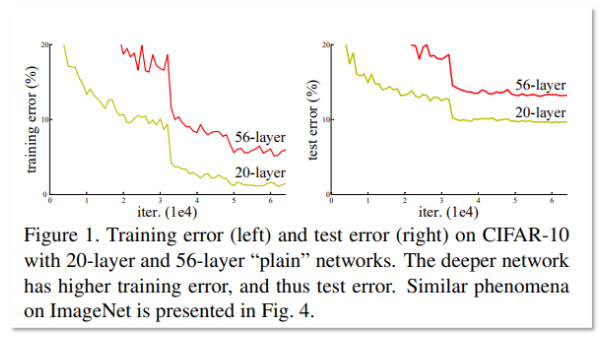
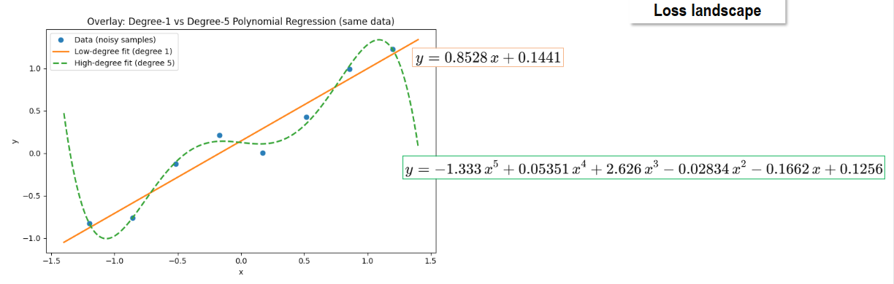
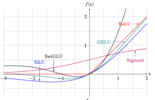
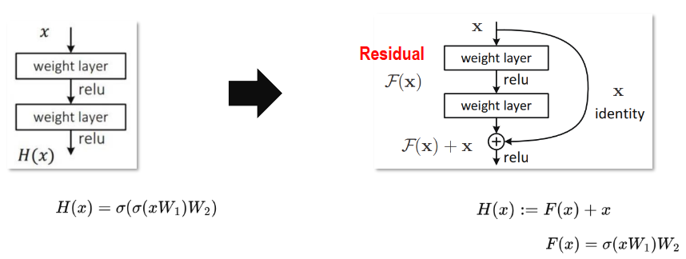
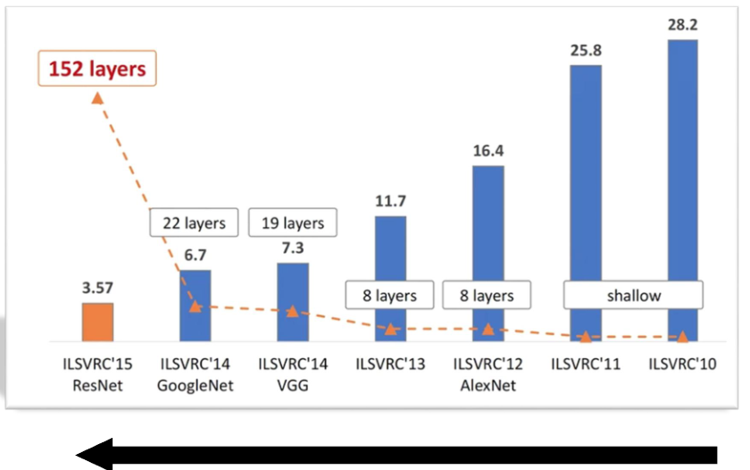
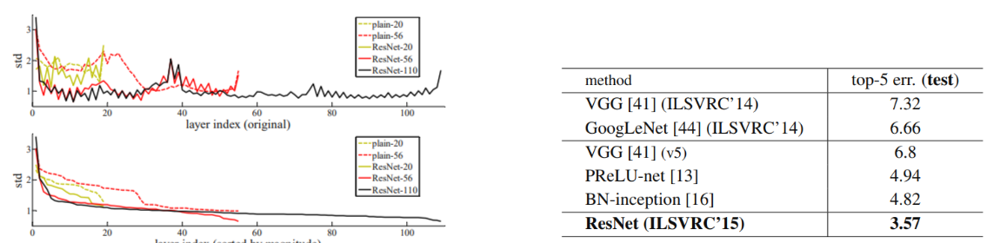
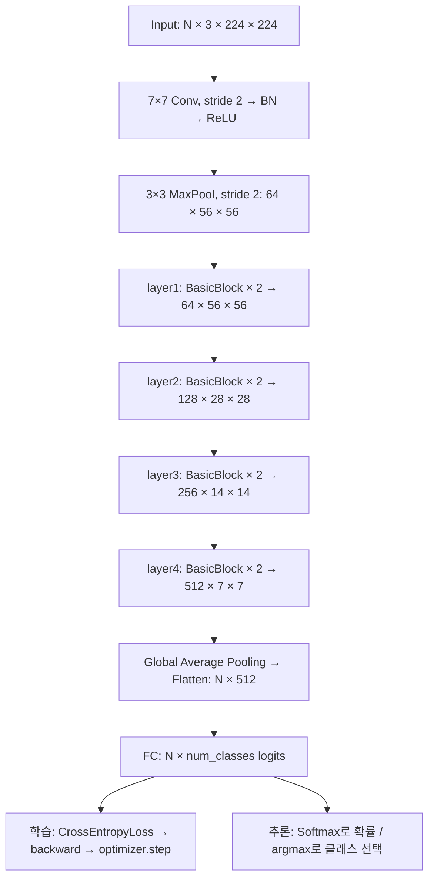
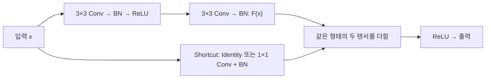

# ResNet-18: 잔차를 이해하고 차원을 추적하며 구현하기

깊은 CNN은 표현력을 늘리지만 최적화가 어려워질 수 있습니다. **ResNet은 입력을 직접 전달하는 경로와 학습한 수정량을 더해 이 어려움을 완화합니다.** 이 문서는 왜 잔차가 필요한지에서 시작해 18층 모델을 직접 구현하는 데까지 연결합니다.

**목표:** degradation과 과적합을 구별하고, projection이 필요한 조건을 판단하며, 224×224 입력의 단계별 차원과 학습 한 번의 흐름을 설명합니다. 선수지식은 [CNN의 출력 크기·수용영역](02_02_CNN_Note.md#cnn-convolution)과 [DNN의 손실·역전파](02_01_DNN_Note.md)입니다.

**기본 경로:** 1절 원리 → 2절 덧셈 조건 → 3절 차원 → 4절 실습 → 5절 질문. 성과 그래프와 미분식은 심화로 다시 읽어도 됩니다. 다음 학습은 [Attention 안내](03_01_Attention_Note.md)입니다.

- [1. 왜 잔차가 필요한가](#resnet-principle)
- [2. 두 경로를 더할 조건](#resnet-projection)
- [3. ResNet-18 차원 추적](#resnet-shape)
- [4. 구현과 검증 실습](#resnet-code)
- [5. 확인 질문과 해설](#resnet-review)

원문: [DNN·CNN 교안](../교안/02_00_DNN_CNN.pdf), 실제 PDF 37~42쪽. 18층 상세 추적과 Python 실습은 교안 40쪽 구조를 확장한 **교육용 보충**입니다. 아래 규제·초기화 관련 주의는 교안 38~39쪽 설명의 정정입니다.

<a id="resnet-principle"></a>
## 1. ResNet — Degradation과 잔차 학습

VGGNet처럼 작은 필터를 반복해 층을 늘리면 표현력을 높일 수 있습니다. 그러나 층 수를 늘리는 것만으로 성능이 좋아지지는 않습니다. 다음 실험은 깊은 모델에서 최적화가 왜 중요한지 보여줍니다.



이 그림은 CIFAR-10에서 **잔차 연결이 없는 일반 신경망(plain network)**의 20층 모델과 56층 모델을 비교한 결과입니다. 가로축은 학습 반복 횟수, 세로축은 분류 오차율이며 **낮을수록 좋습니다.** 빨간색은 56층, 노란색은 20층입니다.

| 그래프                | 관찰 결과                 | 의미                             |
| ------------------ | --------------------- | ------------------------------ |
| 왼쪽: Training error | 56층이 20층보다 학습 오차가 높음  | 깊은 모델이 학습 데이터조차 충분히 잘 맞히지 못함   |
| 오른쪽: Test error    | 56층이 20층보다 테스트 오차도 높음 | 이 실험에서는 깊게 쌓는 것만으로 성능이 좋아지지 않음 |

**층을 추가했는데 학습 오차가 오히려 커지는 현상을 degradation 문제라고 합니다.** 과적합은 학습 데이터는 잘 맞히지만 새로운 데이터에서 성능이 떨어지는 현상입니다. 이 그림은 학습 오차부터 높으므로, 단순한 과적합보다 **깊은 모델의 최적화가 어렵다는 점**을 보여줍니다. 그래프만으로 원인을 기울기 소실 하나로 단정할 수는 없습니다.

### ResNet은 어떻게 도움을 줄까?

ResNet은 여러 층의 계산 결과에 원래 입력을 더하는 **잔차 연결**을 사용합니다.

$$
y = F(x) + x
$$

입력을 그대로 전달하는 경로가 있어 정보와 기울기가 흐르기 쉬워집니다. 입력을 바꿀 필요가 없는 블록은 F(x)를 0에 가깝게 학습하면 입력을 그대로 전달할 수 있어, 깊은 모델의 학습 부담을 줄입니다. 위 그래프 자체는 ResNet의 결과가 아니라 **ResNet이 해결하려 했던 문제를 보여주는 비교**입니다.

### 항등변환을 학습하기 어려운 이유

ResNet 맥락에서 **항등행렬(identity matrix)을 학습한다**는 것은, 입력을 그대로 출력하는 **항등함수 H(x)=x**를 학습한다는 뜻입니다.

일반 신경망에서는 입력이 여러 가중치와 ReLU를 통과합니다. 입력을 그대로 보존하려 해도 **여러 층의 가중치가 함께 맞아야 하고, ReLU는 음수 정보를 제거할 수 있어** 학습이 쉽지 않습니다. 역전파도 각 층의 최종 가중치를 직접 알려주는 것이 아니라 조금씩 수정할 방향만 알려줍니다.

ResNet은 이를 다음처럼 바꿉니다.

H(x)=F(x)+x

**입력 x는 지름길로 그대로 전달하고, 추가로 바꿀 부분 F(x)만 학습**합니다. 항등함수가 필요하면 F(x)를 0에 가깝게 만들면 됩니다.

| 구조     | 입력을 그대로 전달하려면                |
| ------ | ---------------------------- |
| 일반 신경망 | 여러 층이 함께 항등변환을 구현해야 함        |
| ResNet | 직접 연결된 입력에 더하는 잔차를 0으로 만들면 됨 |

항등행렬 자체가 복잡해서가 아니라, **여러 층을 거쳐 항등변환을 찾아가는 최적화가 어려웠던 것**입니다.

### Skip Connection: 잔차 학습의 의미

항등변환의 관점에서 잔차 연결의 역할을 더 구체적으로 살펴보겠습니다. 아래 세 그림은 각각 모델의 복잡도, 활성화 함수, 일반 연결과 잔차 연결을 보여줍니다. 서로 다른 개념이 섞이지 않도록 구분해서 읽어야 합니다.







**Skip connection은 입력을 그대로 전달하는 지름길을 만들어, 여러 층이 입력에 더할 변화량(잔차)만 학습하도록 돕는 연결**입니다.

| 그림                 | 설명                                                                                          |
| ------------------ | ------------------------------------------------------------------------------------------- |
| 첫 번째: 직선과 구불구불한 곡선 | 복잡한 모델은 데이터의 잡음까지 따라가 과적합할 수 있다는 예시입니다. 이 그림 자체가 Skip connection의 효과나 손실 지형을 비교한 실험은 아닙니다.  |
| 두 번째: 활성화 함수       | ReLU, Sigmoid 등 함수별 입력·출력 관계를 보여줍니다. 함수마다 기울기와 포화 구간이 다르므로, 0 근처가 항상 학습하기 좋다고 일반화할 수는 없습니다. |
| 세 번째: 일반 연결과 잔차 연결 | 일반 연결은 원하는 출력 전체를 학습하지만, 잔차 연결은 원래 입력에 더할 변화량을 학습합니다.                                       |

| 구조              | 학습 목표              | 입력을 그대로 전달하려면                |
| --------------- | ------------------ | ---------------------------- |
| 일반 연결           | 원하는 변환 H(x)        | 여러 층이 함께 H(x) = x를 구현해야 함    |
| Skip connection | 잔차 F(x) = H(x) − x | 잔차 F(x)를 0으로 만들면 됨. 덧셈 직후 기준 |

예를 들어 입력이 10이고 원하는 출력이 11이면, 잔차 경로는 추가할 값 1을 학습합니다.

$$
y = x + F(x) = 10 + 1 = 11
$$

지름길은 역전파 때 기울기가 전달되는 직접 경로도 제공하므로, 깊은 신경망의 학습을 돕습니다. 입력과 잔차를 그대로 더하려면 두 값의 형태가 같아야 하며, 다르면 1×1 합성곱 등으로 맞출 수 있습니다.

첫 다항식 그림의 x·y축은 입력과 예측값이며 손실 지형의 좌표축이 아닙니다. 고차 곡선이 더 흔들리는 예시는 모델 복잡성의 직관일 뿐 skip connection이 가중치를 규제한다는 증거가 아닙니다. 활성화 곡선 그림도 개략 비교입니다. 특히 SwiGLU 같은 게이트 구조는 단일 스칼라 곡선만으로 완전히 정의할 수 없으므로 여기서는 ReLU가 음수를 제거한다는 점만 사용합니다.

#### 위 설명에서 주의할 점

- **Skip connection과 가중치 규제는 다릅니다.** 가중치 변화가 크다는 사실만으로 과적합을 판단할 수 없으며, 작은 변화만으로 과적합이 방지되는 것도 아닙니다. Skip connection의 핵심은 최적화를 쉽게 해 degradation 문제를 완화하는 것입니다.
- **0 중심 초기화가 잔차 출력을 자동으로 0으로 만들지는 않습니다.** Xavier·He 초기화는 주로 신호와 기울기의 규모를 적절히 유지하도록 설계된 방법입니다. 잔차 연결은 항등변환이 필요할 때 잔차를 0으로 학습할 수 있는 구조를 제공합니다.
- **마지막 그림에는 덧셈 뒤 ReLU도 있습니다.** 따라서 실제 블록 출력은 아래 식과 같으며, F(x)가 0이어도 음수 입력은 그대로 통과하지 않습니다. 입력이 비음수라면 그대로 전달됩니다.

$$
y = \operatorname{ReLU}(F(x) + x)
$$

### ResNet의 성과: 깊은 모델을 실제로 학습하기

잔차 연결의 의미를 이해했다면, 이번에는 이를 적용한 모델의 성과를 살펴보겠습니다. 아래 결과는 깊은 구조를 학습할 수 있게 된 효과를 보여주되, 서로 다른 평가 조건을 구분해 읽어야 합니다.



**첫 번째 그림은 이미지 분류 기술이 발전하며 대회 오차율이 낮아진 흐름**을 보여줍니다. 시간은 오른쪽의 2010년에서 왼쪽의 2015년 방향으로 흐르며, 막대가 낮을수록 좋습니다.

| 대표 모델            | 그림의 층 수 | 그림의 Top-5 오차율 |
| ---------------- | ------- | ------------- |
| AlexNet — 2012   | 8       | 16.4%         |
| VGG — 2014       | 19      | 약 7.3%        |
| GoogLeNet — 2014 | 22      | 약 6.7%        |
| ResNet — 2015    | 152     | 3.57%         |

Top-5 오차율은 **모델이 고른 상위 5개 후보에 정답이 없는 비율**입니다. 3.57%는 약 100장 중 3~4장에서 상위 5개 안에 정답이 없다는 뜻이며, Top-1 정확도가 96.43%라는 뜻은 아닙니다.

잔차 연결은 매우 깊은 모델을 학습할 수 있게 하는 중요한 요소였습니다. 다만 이 그림은 연도별 대회 결과이므로, 성능 향상을 층 수 증가만의 효과로 해석하면 안 됩니다. 또한 **3.57%는 단일 152층 모델 하나의 점수가 아니라 여러 ResNet을 결합한 앙상블 결과**입니다.

### 잔차 경로는 어떤 출력을 학습할까?



두 번째 이미지의 왼쪽 그래프는 CIFAR-10에서 **각 층의 반응값이 얼마나 퍼져 있는지 나타내는 표준편차(std)**를 비교합니다. 가중치나 기울기 자체의 크기를 그린 그래프는 아닙니다.

| 구분                   | 읽는 방법                     |
| -------------------- | ------------------------- |
| 위 그래프                | 원래 층 순서에 따라 반응의 표준편차를 표시  |
| 아래 그래프               | 같은 값을 표준편차가 큰 순서대로 정렬해 비교 |
| plain-20 / plain-56  | 잔차 연결이 없는 20층·56층 모델      |
| ResNet-20 / 56 / 110 | 잔차 연결을 사용하는 모델            |

실험에서는 ResNet의 잔차 경로가 일반 신경망보다 대체로 작은 반응을 보였고, 깊은 ResNet에서는 반응이 더 작아지는 경향이 관찰됐습니다. 이는 **원래 입력 전체를 새로 만들기보다 필요한 수정량을 학습한다**는 잔차 학습의 해석을 뒷받침합니다. 다만 표준편차가 작다는 사실만으로 평균이 0이거나, 학습이 잘됐다고 단정할 수는 없습니다.

오른쪽 표는 ImageNet 테스트의 Top-5 오차율을 비교합니다. 표시된 방법 중 ResNet의 3.57%가 가장 낮습니다. **왼쪽은 CIFAR-10의 내부 반응 분석, 오른쪽은 ImageNet의 분류 성능 비교**로 서로 다른 실험입니다.

출처: [ResNet 원 논문 — Deep Residual Learning for Image Recognition](https://arxiv.org/abs/1512.03385)

### ResNet이 역전파를 돕는 원리

앞의 결과를 학습 과정과 연결하려면, 잔차 연결을 따라 기울기가 어떻게 전달되는지 보면 됩니다.

**Skip connection은 기울기가 전달될 직접 경로를 제공하고, 잔차 블록이 입력에 필요한 수정량을 학습하도록 돕습니다.** 역전파 알고리즘 자체를 바꾸는 것이 아니라, 신경망의 연결 구조를 바꿔 깊은 모델을 학습하기 쉽게 만듭니다.

| 구분              | 일반 신경망                         | ResNet                        |
| --------------- | ------------------------------ | ----------------------------- |
| 역전파             | 여러 층의 미분값을 곱하면서 기울기가 약해질 수 있음  | 입력을 그대로 전달하는 경로가 기울기 전달에도 기여  |
| 블록의 학습 목표       | 원하는 변환 전체를 학습                  | 입력에 더할 수정량인 잔차를 학습            |
| 입력을 바꿀 필요가 없을 때 | 여러 층이 함께 항등변환을 구현해야 함          | 잔차를 0에 가깝게 만들면 덧셈 결과가 입력과 같아짐 |
| 깊은 구조의 활용       | 층을 늘려도 최적화가 어려워 학습 오차가 커질 수 있음 | 최적화 부담을 줄여 깊은 구조를 활용하기 쉬워짐    |

잔차 블록의 덧셈 부분을 간단한 스칼라 예로 보면 다음과 같습니다.

$$
y = x + F(x)
$$

손실 L에서 입력 x로 전달되는 기울기는 연쇄법칙에 따라 다음과 같습니다.

$$
\frac{\partial L}{\partial x}
= \frac{\partial L}{\partial y}
\left(1 + \frac{\partial F(x)}{\partial x}\right)
$$

여기서 **1은 입력을 그대로 전달하는 경로에서 생깁니다.** 잔차 경로의 미분값이 작아도 직접 경로를 통해 기울기가 전달될 수 있습니다. 실제 특징 맵처럼 벡터를 다루면 1에 해당하는 역할을 항등행렬이 합니다.

위 식은 덧셈 직후를 기준으로 하며, 덧셈 뒤에 ReLU가 있으면 그 미분도 역전파에 반영됩니다. 따라서 잔차 연결이 모든 상황에서 기울기 소실을 완전히 없앤다는 뜻은 아닙니다.

**여기서 효율이 좋아진다는 것은 학습과 최적화가 쉬워진다는 의미입니다.** Skip connection 자체가 합성곱의 계산량을 줄이는 것은 아니며, 층을 더 쌓으면 연산량과 메모리 사용량이 증가할 수 있습니다.

<a id="resnet-projection"></a>
## 2. 잔차와 지름길은 언제 더할 수 있을까?

잔차(residual)는 원하는 전체 변환 H(x)와 기준 입력 x의 차이입니다. `F(x)=H(x)-x`로 생각하면 `H(x)=F(x)+x`입니다. 학습에서 H(x)의 정답 특징을 따로 제공하는 것은 아니며, 최종 분류 손실을 역전파해 F의 가중치를 학습합니다.

덧셈은 두 텐서의 **N, C, H, W가 모두 일치**해야 의미가 맞습니다. PyTorch가 허용하는 broadcasting에 기대어 다른 채널을 자동 확장하면 의도한 잔차 블록이 아닙니다. 구현에서는 두 경로의 shape를 확인합니다.

| 입력 → 잔차 출력 | 지름길 | 이유 |
| --- | --- | --- |
| N×64×56×56 → 같은 크기 | Identity | 각 위치를 그대로 더할 수 있음 |
| N×64×56×56 → N×128×56×56 | 1×1 Conv, S=1 + BN | 공간이 같아도 채널 수가 다름 |
| N×64×56×56 → N×64×28×28 | 1×1 Conv, S=2 + BN | 채널이 같아도 공간 크기가 다름 |
| N×64×56×56 → N×128×28×28 | 1×1 Conv, S=2 + BN | 채널과 공간 크기가 모두 다름 |

이 표는 아래 구현의 기본 블록을 기준으로 합니다. **Projection(투영)**은 입력을 학습 가능한 선형 변환으로 출력 형태에 맞추는 것입니다. 원 논문에는 다른 shortcut 선택지도 있지만, 여기서는 TorchVision 방식인 1×1 Conv+BN을 사용합니다. projection이면 덧셈은 `F(x)+P(x)`이고, 기울기의 직접 항도 항등행렬 I 대신 P의 미분이므로 앞 절의 ‘1+F′’를 그대로 적용하지 않습니다.

layer2 첫 블록을 계산해 봅시다. 주 경로의 첫 3×3은 `floor((56+2-3)/2)+1=28`, 두 번째 3×3은 stride 1이므로 28을 유지합니다. 지름길 1×1은 `floor((56-1)/2)+1=28`입니다. 두 경로 모두 128채널을 만들므로 덧셈 결과는 N×128×28×28입니다. 주 경로 가중치는 `64×128×9 + 128×128×9=221,184`, 지름길은 `64×128=8,192`개이며 bias는 사용하지 않습니다. BN의 학습 파라미터는 별도입니다.

BN(Batch Normalization)은 학습 중 채널별로 배치·공간 방향의 평균과 분산을 이용해 값의 규모를 조정하고 학습 가능한 배율·이동을 적용합니다. 평가에서는 축적한 통계를 사용하므로 `eval()`이 필요합니다. Conv 뒤 BN을 쓸 때 이 구현은 Conv bias를 없애고 BN의 이동 파라미터를 사용합니다.

BasicBlock은 `3×3 → 3×3`이고 확장 배율은 1입니다. 심화인 Bottleneck(ResNet-50 등)은 `1×1로 채널 축소 → 3×3 공간 처리 → 1×1로 채널 확장`의 세 합성곱을 사용합니다. 예를 들어 내부 64채널을 출력 256채널로 확장하는 블록을 BasicBlock의 64채널 출력과 혼동하지 않습니다. ‘18층’ 설명에 Bottleneck의 세 합성곱을 넣으면 층 수와 차원이 어긋납니다.

<a id="resnet-shape"></a>
## 3. ResNet-18의 구조와 차원

### 구조와 출력 크기

**ResNet-18은 3×3 합성곱 두 개로 이루어진 BasicBlock을 총 8개 쌓은 모델**입니다. 네 단계(layer1~layer4)에 블록을 각각 2개씩 배치합니다. 아래는 ImageNet 방식의 RGB 224×224 입력 기준이며, 크기는 `채널 × 높이 × 너비`입니다. 배치 차원 N은 생략했습니다.


| 단계                     | 구성                                              | 출력 크기          |
| ---------------------- | ----------------------------------------------- | -------------- |
| Input                  | RGB 이미지                                         | 3 × 224 × 224  |
| Stem                   | 7×7 Conv, 64채널, Stride 2, Padding 3 → BN → ReLU | 64 × 112 × 112 |
| MaxPool                | 3×3, Stride 2, Padding 1                        | 64 × 56 × 56   |
| layer1 (conv2\_x)      | BasicBlock × 2, 64채널                            | 64 × 56 × 56   |
| layer2 (conv3\_x)      | BasicBlock × 2, 128채널, 첫 블록에서 Stride 2          | 128 × 28 × 28  |
| layer3 (conv4\_x)      | BasicBlock × 2, 256채널, 첫 블록에서 Stride 2          | 256 × 14 × 14  |
| layer4 (conv5\_x)      | BasicBlock × 2, 512채널, 첫 블록에서 Stride 2          | 512 × 7 × 7    |
| Global Average Pooling | 채널마다 7×7 값의 평균                                  | 512 × 1 × 1    |
| Flatten                | 공간 차원을 펼침                                       | 512            |
| Fully Connected        | 512개 특징 → 클래스별 점수                               | num\_classes   |


**18층 = 처음 합성곱 1개 + (BasicBlock 8개 × 합성곱 2개) + 마지막 FC 1개**입니다. BN·ReLU·Pooling과 지름길의 투영 합성곱은 이 명칭의 층 수에 포함하지 않습니다. ResNet-50의 Bottleneck 블록과 달리, ResNet-18의 기본 블록은 `3×3 → 3×3`입니다.

### 입력 크기를 바꾸면 어떻게 될까?

아래는 **같은 ImageNet stem**을 유지한 비교입니다. 32×32용으로 설계한 별도 CIFAR ResNet과 구분합니다.

| 입력 한 변 | 첫 Conv | MaxPool/layer1 | layer2 | layer3 | layer4 | 평균 후 |
| ---: | ---: | ---: | ---: | ---: | ---: | ---: |
| 224 | 112 | 56 | 28 | 14 | 7 | 1 |
| 32 | 16 | 8 | 4 | 2 | 1 | 1 |
| 225 | 113 | 57 | 29 | 15 | 8 | 1 |

홀수 크기에서는 단순히 2로 나누지 말고 내림 공식에 padding을 먼저 반영합니다. AdaptiveAvgPool2d는 들어온 공간 전체를 채널별 한 값으로 요약하므로 FC 입력은 언제나 512개입니다. 공간 정보를 모두 보존하지는 않습니다. 32×32 입력은 이 stem에서 아주 빨리 작아지므로 실제 CIFAR 학습에서는 3×3 stride 1 stem과 MaxPool 제거 같은 설계를 검토합니다. 이 실습은 그 변경을 자동으로 수행하지 않습니다.

18층 명칭과 학습 파라미터 수도 다른 개념입니다. 아래 10클래스 구현은 BN의 배율·이동과 projection을 포함해 11,181,642개 파라미터를 갖도록 설계했습니다. 마지막 FC는 `512×10+10=5,130`개입니다. 1,000클래스로 바꾸면 `512×1000+1000=513,000`개이므로 전체 11,689,512개가 됩니다. BN의 이동 평균·분산은 buffer이며 학습 파라미터 합에 넣지 않습니다. 이 숫자는 아래 검산 스크립트의 구조별 합으로 확인했으며 PyTorch 런타임 확인 여부는 실습 검증 범위를 따릅니다.

### 전체 Flowchart



### BasicBlock 내부 Flowchart



같은 크기이면 Shortcut은 입력을 그대로 전달합니다. layer2~layer4의 첫 블록처럼 공간 크기와 채널 수가 바뀌면, Shortcut에도 **1×1 Conv, Stride 2 + BN**을 적용해 형태를 맞춥니다. 덧셈은 채널을 이어 붙이는 Concatenate가 아니라 **같은 위치의 값끼리 더하는 연산**입니다.

<a id="resnet-code"></a>
## 4. Python 예제: 직접 구현하고 한 번 학습하기

**실행 계약:** Python 3와 PyTorch가 필요합니다. 저장소 루트에서 `python 05_VISION/학습자료/assets/cnn-selfstudy/resnet18_lab.py`로 실행합니다. CUDA·torchvision·데이터 다운로드는 필요하지 않습니다. `python -c "import torch; print(torch.__version__)"`로 설치 버전을 먼저 확인합니다. import가 실패하면 [공식 설치 안내](https://pytorch.org/get-started/locally/)에 맞는 환경을 준비해야 합니다.

**검증 상태:** 현재 집필 환경은 `torch` 미설치로 이 실습의 forward/backward를 실행하지 못했습니다. Python 문법과 공식 구조를 대조했고, 별도 표준 라이브러리 스크립트로 차원·파라미터를 검산했습니다. 아래 출력 모양은 기대값이며 실행 관측값이 아닙니다. 무작위 데이터의 정확도나 실제 학습 성능은 검증하지 않았습니다.

아래 예제는 `torch`만 사용합니다. ImageNet 방식의 구조를 유지하고 출력 클래스 수만 10개로 설정했습니다. 무작위 입력·라벨로 실행 흐름을 확인하는 코드이므로 실제 분류 성능을 학습하는 예시는 아닙니다.

```python
import torch
from torch import nn


class BasicBlock(nn.Module):
    def __init__(self, in_channels, out_channels, stride=1):
        super().__init__()
        self.residual = nn.Sequential(
            nn.Conv2d(in_channels, out_channels, 3,
                      stride=stride, padding=1, bias=False),
            nn.BatchNorm2d(out_channels),
            nn.ReLU(),
            nn.Conv2d(out_channels, out_channels, 3,
                      padding=1, bias=False),
            nn.BatchNorm2d(out_channels),
        )
        # 덧셈 전에 채널 수와 공간 크기를 일치시킨다.
        if stride != 1 or in_channels != out_channels:
            self.shortcut = nn.Sequential(
                nn.Conv2d(in_channels, out_channels, 1,
                          stride=stride, bias=False),
                nn.BatchNorm2d(out_channels),
            )
        else:
            self.shortcut = nn.Identity()
        self.relu = nn.ReLU()

    def forward(self, x):
        residual = self.residual(x)
        shortcut = self.shortcut(x)
        assert residual.shape == shortcut.shape
        return self.relu(residual + shortcut)


class ResNet18(nn.Module):
    def __init__(self, num_classes=10):
        super().__init__()
        self.stem = nn.Sequential(
            nn.Conv2d(3, 64, 7, stride=2, padding=3, bias=False),
            nn.BatchNorm2d(64),
            nn.ReLU(),
            nn.MaxPool2d(3, stride=2, padding=1),
        )
        self.layer1 = self.make_stage(64, 64, stride=1)
        self.layer2 = self.make_stage(64, 128, stride=2)
        self.layer3 = self.make_stage(128, 256, stride=2)
        self.layer4 = self.make_stage(256, 512, stride=2)
        self.avgpool = nn.AdaptiveAvgPool2d((1, 1))
        self.fc = nn.Linear(512, num_classes)

        for module in self.modules():
            if isinstance(module, nn.Conv2d):
                nn.init.kaiming_normal_(module.weight, mode="fan_out",
                                        nonlinearity="relu")
            elif isinstance(module, nn.BatchNorm2d):
                nn.init.ones_(module.weight)
                nn.init.zeros_(module.bias)

    @staticmethod
    def make_stage(in_channels, out_channels, stride):
        return nn.Sequential(
            BasicBlock(in_channels, out_channels, stride),
            BasicBlock(out_channels, out_channels),
        )

    def forward(self, x):
        x = self.stem(x)
        x = self.layer1(x)
        x = self.layer2(x)
        x = self.layer3(x)
        x = self.layer4(x)
        x = self.avgpool(x)
        x = torch.flatten(x, start_dim=1)  # N × 512: 배치 차원은 유지한다.
        return self.fc(x)  # Softmax 전 점수(logits)를 반환한다.


torch.manual_seed(0)
model = ResNet18(num_classes=10)
print("torch version:", torch.__version__)
assert sum(p.numel() for p in model.parameters()) == 11_181_642
# forward hook으로 실제 중간 형태를 출력한다. 첫 forward 뒤 제거한다.
handles = []
for name in ("stem", "layer1", "layer2", "layer3", "layer4", "avgpool", "fc"):
    def show_shape(module, inputs, output, stage=name):
        print(stage, tuple(output.shape))
    handles.append(getattr(model, name).register_forward_hook(show_shape))
images = torch.randn(2, 3, 224, 224)  # NCHW: RGB 이미지 2장
labels = torch.tensor([1, 3], dtype=torch.long)
criterion = nn.CrossEntropyLoss()
optimizer = torch.optim.SGD(model.parameters(), lr=0.01, momentum=0.9)

# 학습: 예측 → 손실 → 기울기 → 가중치 수정
model.train()
optimizer.zero_grad()
logits = model(images)
for handle in handles:
    handle.remove()
assert logits.shape == (2, 10)
before = model.fc.weight.detach().clone()
loss = criterion(logits, labels)  # Softmax를 먼저 적용하지 않는다.
assert torch.isfinite(loss)
loss.backward()
assert model.fc.weight.grad is not None
assert torch.isfinite(model.fc.weight.grad).all()
optimizer.step()
assert not torch.equal(before, model.fc.weight.detach())
print("logits shape:", logits.shape)  # torch.Size([2, 10])
print("loss:", loss.item())

# 추론: BatchNorm을 평가 모드로 전환한다.
model.eval()
with torch.no_grad():
    logits = model(images)
    probabilities = torch.softmax(logits, dim=1)
    predictions = logits.argmax(dim=1)
assert torch.allclose(probabilities.sum(dim=1), torch.ones(2), atol=1e-5)
print("probability sums:", probabilities.sum(dim=1))  # 약 [1, 1]
print("predictions:", predictions)
```

### 실습 결과를 읽는 방법

- **NCHW**: PyTorch 이미지 텐서는 `배치 수 × 채널 × 높이 × 너비`입니다.
- **[2, 2, 2, 2]**: 네 단계의 블록 개수입니다. 단계마다 합성곱이 2개라는 뜻은 아닙니다.
- **Global Average Pooling**: `512×7×7 → 512×1×1`로 요약하므로, VGG처럼 25,088개 값을 그대로 FC에 넣지 않습니다.
- **CrossEntropyLoss**: 정수 클래스 라벨과 Softmax 전 점수인 logits를 받습니다. 확률이 필요할 때 추론에서 Softmax를 적용합니다.
- **train / eval**: BN의 동작이 달라집니다. `no_grad()`만으로 평가 모드가 되지는 않습니다.

구조 참고: [TorchVision ResNet 공식 구현](https://github.com/pytorch/vision/blob/main/torchvision/models/resnet.py)

학습 한 번은 `zero_grad → forward → loss → backward → step`입니다. zero_grad를 생략하면 기울기가 누적되며, backward만 호출하면 가중치는 아직 바뀌지 않습니다. `eval()`은 BN의 동작을 바꾸고 `no_grad()`는 미분 기록을 끕니다. 두 기능은 서로 대체하지 않습니다. [CrossEntropyLoss 공식 설명](https://docs.pytorch.org/docs/2.15/generated/torch.nn.CrossEntropyLoss.html)에 따라 이 실습은 N×10 logits와 N개의 long형 클래스 인덱스(0~9)를 사용합니다.

CPU에서는 시간이 걸릴 수 있습니다. 빠른 형태 확인에는 images를 (2,3,32,32)로 바꿀 수 있으며 위 비교표처럼 중간 크기가 바뀝니다. 훈련 모드에서 배치 1·마지막 1×1처럼 BN에 채널당 관측값 하나만 남으면 오류가 날 수 있으므로 이 실습의 배치 2를 유지합니다. 한 번의 손실 감소나 임의 예측 클래스는 성공 조건이 아닙니다. 출력 차원·유한 기울기·가중치 변경을 먼저 확인합니다.

**실제 데이터로 확장하기(후속 과제, 미실행):** 학습/검증 데이터를 분리하고 동일한 채널 순서·크기·정규화를 적용합니다. 여러 배치에서 손실과 검증 정확도를 기록하고, 훈련 정확도만으로 일반화를 판단하지 않습니다. 임의 라벨 실습을 실제 CIFAR-10 성능 결과로 보고하지 않습니다.

<a id="resnet-review"></a>
## 5. 확인 질문과 해설

먼저 답을 작성한 뒤 아래 해설과 비교하세요.

1. 깊은 모델의 학습 오차와 테스트 오차가 모두 높으면 왜 단순 과적합이라고 말할 수 없나요?
2. 채널 64→128, 공간 56→56이면 projection이 필요한가요?
3. layer3 출력이 N×256×14×14일 때 layer4와 FC 직전 형태는 무엇인가요?
4. F(x)=0이면 post-activation 블록은 언제나 x를 반환하나요?
5. logits에 Softmax를 적용한 뒤 CrossEntropyLoss에 넣어도 같은 학습인가요?

**해설 1:** 학습 데이터조차 더 잘 맞히지 못했으므로 최적화 어려움을 먼저 의심합니다. 과적합은 보통 학습 오차는 낮고 일반화가 나쁜 패턴입니다. 원인은 추가 실험 없이 확정하지 않습니다. [1절](#resnet-principle)로 돌아갑니다.

**해설 2:** 필요합니다. N×64×56×56과 N×128×56×56은 채널별 원소 덧셈이 맞지 않습니다. 1×1, S=1로 128채널을 만들고 BN을 적용합니다. stride 2를 넣으면 공간까지 28로 줄여 오답입니다. [2절](#resnet-projection)을 복습합니다.

**해설 3:** 첫 블록의 stride 2로 한 변은 `floor((14+2-3)/2)+1=7`, 출력 N×512×7×7입니다. 평균 후 N×512×1×1, flatten 후 N×512입니다. FC 출력은 N×클래스 수입니다. [3절](#resnet-shape)로 돌아갑니다.

**해설 4:** 아니요. y=ReLU(x)이므로 x=-2라면 0입니다. 입력이 비음수이고 identity shortcut인 경우에만 그대로 전달됩니다. projection이 있으면 기준도 x 자체가 아닙니다. [1절](#resnet-principle)의 ReLU 주의를 확인합니다.

**해설 5:** 아닙니다. 이 손실은 logits에서 내부적으로 log-softmax에 해당하는 계산을 합니다. 확률을 다시 logits처럼 처리하면 목적이 바뀝니다. 추론에서 확률을 보여줄 때만 별도로 Softmax를 사용합니다. [4절](#resnet-code)로 돌아갑니다.

공식 구현 대조: [TorchVision ResNet](https://docs.pytorch.org/vision/stable/_modules/torchvision/models/resnet.html) 문서 표시 버전 0.29, PyTorch API 문서 표시 버전 2.15, 확인일 2026-11-09. 원 논문과 실습 코드의 구조는 연결되지만 특정 GPU에서의 속도·정확도를 재현한 결과는 아닙니다.
