# Attention과 ViT: 관계 계산에서 이미지 분류까지

CNN은 지역 특징을 쌓아 넓은 영역을 이해합니다. Attention은 현재 위치가 다른 위치의 정보를 얼마나 가져올지 입력마다 계산합니다. ViT는 이미지를 패치 벡터로 바꾸어 이 계산을 이미지 분류에 사용합니다.

**목표:** Q·K·V에서 가중합까지 직접 계산하고, 이미지 크기와 패치 크기로 토큰·Attention 행렬의 shape를 구하며, CLS·위치 임베딩·잔차 연결의 역할을 구별합니다.

**선수지식:** 행렬 곱, Softmax, 역전파, CNN의 특징 맵. 행렬과 분류 손실이 낯설면 [DNN](02_01_DNN_Note.md), 지역 연산과 잔차 연결이 낯설면 [CNN](02_02_CNN_Note.md)과 [ResNet](02_03_CNN_ResNet_18Layer.md)으로 돌아갑니다.

**핵심 경로:** [관계 계산](#attention) → [손계산](#qkv-example) → [이미지 토큰화](#vit) → [확인 문제](#check).
**심화 경로:** Transformer 전체 구조, ViT Architecture의 정규화 비교, 패치별 세부 계산, 실험·모델 변형을 필요할 때 읽습니다. 기존의 그림 해설과 차원 전개는 아래 상세 절에 보존했습니다.

| 질문 | 설명 위치 |
| --- | --- |
| 누구의 정보를 얼마나 가져오는가? | 1절 Attention과 Transformer |
| 행렬 하나를 직접 계산할 수 있는가? | 2절 QKV 수치 예제 |
| 이미지가 어떻게 클래스 점수가 되는가? | 3절 ViT의 입력·관계 계산·출력 |
| 데이터와 패치 크기를 바꾸면 무엇이 달라지는가? | 3절 실험·모델 변형과 4절 확인 문제 |

원문: [Attention 교안 3~22쪽](../교안/03_00_Attention.pdf#page=3). 수치 예제와 확인 문제는 **교육용 보충**이며 논문 실험 결과가 아닙니다. 코드 모양의 블록은 형태 추적 또는 의사 코드이며 모델 학습을 실행한 결과가 아닙니다.

<a id="attention"></a>
## 1. 관계를 계산하고 정보를 모으는 Attention

### Attention의 기본 원리

**Attention(어텐션)은 여러 정보 중에서 현재 작업에 중요한 정보에 더 큰 가중치를 주는 방식**입니다.

예를 들어 사진에서 고양이를 찾는다면, 배경보다 **귀·눈·수염 같은 정보**를 더 많이 반영하는 식입니다. 다만 반드시 사람이 보는 위치처럼 눈에 보이는 영역만 선택하는 것은 아닙니다.

계산은 다음 순서로 이해하면 됩니다.

1. **관련도 계산:** 지금 필요한 정보와 각 정보가 얼마나 관련 있는지 점수를 구합니다.
2. **가중치 생성:** 보통 Softmax로 점수를 합이 1인 가중치로 바꿉니다.
3. **정보 조합:** 각 정보에 가중치를 곱한 뒤 더합니다.

Transformer에서는 이를 세 요소로 표현합니다.


| 요소           | 쉬운 의미                 |
| ------------ | --------------------- |
| **Query(Q)** | 지금 무엇을 찾고 있는가?        |
| **Key(K)**   | 각 정보가 어떤 특징을 가지고 있는가? |
| **Value(V)** | 실제로 가져와 조합할 정보        |


**Q와 K를 비교해 가중치를 정하고, 그 가중치로 V를 섞습니다.** Q·K·V는 보통 입력에서 학습된 변환으로 만들어집니다.

앞서 본 CNN은 작은 필터의 지역 연산을 여러 층에 걸쳐 조합합니다. 이와 비교하면 **전역 Attention은 멀리 떨어진 위치 사이의 관계도 한 층에서 직접 계산할 수 있습니다.** 이 계산을 핵심 구성 요소로 사용하는 구조가 다음의 Transformer입니다.

---

### Transformer의 기본 구성

**Transformer는 Attention을 중심으로, 데이터 요소 사이의 관계를 학습하는 신경망 구조**입니다. 문장에서는 단어·토큰 사이의 관계를, 이미지에서는 작은 조각인 패치 사이의 관계를 파악합니다.

예를 들어 **“고양이가 소파 위에서 잠을 잔다”**라는 문장에서, “잔다”를 해석할 때 “고양이”의 정보를 반영할 수 있습니다.


| 구성 요소                    | 역할                                     |
| ------------------------ | -------------------------------------- |
| **Embedding**            | 단어나 이미지 패치를 숫자 벡터로 변환                  |
| **위치 정보**                | 단어의 순서나 패치의 위치를 알려줌                    |
| **Self-Attention**       | 같은 입력 안에서 각 요소가 다른 요소의 정보를 얼마나 반영할지 계산 |
| **Feed Forward Network** | Attention으로 모은 정보를 추가로 가공              |
| **잔차 연결·정규화**            | 정보를 전달하고 깊은 모델의 학습을 안정화                |


이 구성 요소를 하나의 블록으로 묶고 여러 층 쌓으면, 각 요소의 표현에 문맥 정보를 반복해서 반영하며 복잡한 관계를 학습할 수 있습니다.

**Attention이 ‘정보를 가중합하는 계산 방식’이라면, Transformer는 그것을 핵심 부품으로 사용하는 전체 모델 구조**입니다.

이미지에 Transformer를 적용한 대표적인 모델이 **ViT(Vision Transformer)**입니다. ViT로 넘어가기 전에 원래의 Transformer 구조를 살펴보면, Encoder와 Attention이 각각 어떤 역할을 하는지 구분하기 쉽습니다.

---

### Transformer 구조 그림 설명

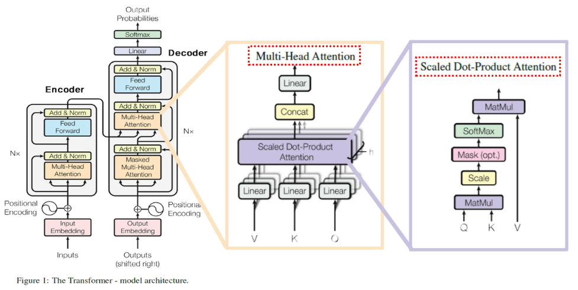

이 그림은 원래의 **Encoder–Decoder Transformer**입니다. 왼쪽에서 전체 입력·출력 흐름을 살펴본 뒤, 오른쪽의 Attention 계산과 가운데의 Multi-Head 구성을 차례로 확인하겠습니다.

#### 1. 왼쪽: 입력을 이해하는 Encoder와 출력을 만드는 Decoder

번역을 예로 들면 Encoder는 원문 정보를 표현하고, Decoder는 그 정보를 참고해 번역문을 생성합니다.


| 구성                            | 쉬운 설명                                         |
| ----------------------------- | --------------------------------------------- |
| Input / Output Embedding      | 토큰을 학습 가능한 숫자 벡터로 변환                          |
| Positional Encoding           | 벡터에 순서 정보를 더함. Attention만으로는 토큰 순서를 알 수 없기 때문 |
| Encoder Self-Attention        | 입력 안의 각 토큰이 다른 입력 토큰의 정보를 얼마나 반영할지 계산         |
| Decoder Masked Self-Attention | 생성 위치에서 미래 토큰을 보지 못하도록 가리고, 앞선 출력 정보를 참고      |
| Decoder Cross-Attention       | Decoder의 현재 표현으로 Encoder 출력에서 필요한 정보를 가져옴     |
| Feed Forward                  | 각 위치에 같은 작은 신경망을 적용해 특징을 추가로 가공               |
| Add &amp; Norm                | 잔차 연결로 원래 표현을 더한 뒤 LayerNorm을 적용해 학습을 안정화     |
| Linear → Softmax              | 다음 토큰 후보들의 점수를 구하고, 합이 1인 확률분포로 변환            |
| N×                            | 블록을 N층 쌓는다는 뜻. 같은 가중치로 되돌아가는 순환은 아님           |


**Outputs (shifted right)**는 학습 시 정답 출력 앞에 시작 토큰을 넣고 한 칸 밀어 입력한다는 뜻입니다. 예를 들어 Decoder 입력이 `[시작, 나는, 학생]`이면 각 위치의 예측 목표는 `[나는, 학생, 종료]`입니다. 추론에서는 정답 대신 지금까지 생성한 토큰으로 다음 토큰을 예측합니다.

---

#### 2. 오른쪽: Scaled Dot-Product Attention

전체 구조에서 정보를 모으는 핵심 계산은 **관련도 계산 → 가중치 생성 → 정보 가중합** 순서로 이루어집니다. 앞서 소개한 Q·K·V가 이 과정에서 어떻게 쓰이는지 수식과 연결해 보겠습니다.


| 요소       | 쉬운 의미                 |
| -------- | --------------------- |
| Query(Q) | 지금 어떤 정보를 찾는가?        |
| Key(K)   | 비교할 각 정보의 특징은 무엇인가?   |
| Value(V) | 실제로 가져와 조합할 내용은 무엇인가? |


Q·K·V는 보통 입력 벡터에 각각 학습된 선형 변환을 적용해 만듭니다.

$$
\operatorname{Attention}(Q,K,V)
= \operatorname{softmax}\left(\frac{QK^T}{\sqrt{d_k}} + M\right)V
$$


| 그림 속 단계        | 역할                                                                   |
| -------------- | -------------------------------------------------------------------- |
| MatMul: Q와 K   | 각 Query와 Key의 내적으로 관련도 점수를 구함                                        |
| Scale          | Key 벡터 차원 d\_k의 제곱근으로 나눠 점수가 과도하게 커지는 것을 완화                          |
| Mask (선택)      | 참고하면 안 되는 위치의 점수를 차단. 마스크 M은 허용 위치에 0, 차단 위치에 음의 무한대를 더하는 방식으로 표현 가능 |
| Softmax        | 각 Query에 대해 참고할 Key 위치들의 가중치 합을 1로 만듦                                |
| MatMul: 가중치와 V | 중요한 위치의 Value를 더 많이 반영해 새로운 표현을 만듦                                   |


예를 들어 세 위치의 가중치가 `0.7, 0.2, 0.1`이면 결과는 `0.7V₁ + 0.2V₂ + 0.1V₃`입니다. 여기의 Softmax는 **어느 위치를 참고할지**를 정하며, 모델 최상단의 **다음 토큰 확률**을 만드는 Softmax와 역할이 다릅니다.

---

#### 3. 가운데: Multi-Head Attention

하나의 Attention이 한 가지 표현 공간에서 정보를 모은다면, **Multi-Head Attention은 여러 Scaled Dot-Product Attention을 병렬로 계산해 다양한 관계를 함께 표현**합니다. Head 수는 토큰 수나 블록 반복 횟수와 구분하도록 h로 표기합니다.

- **Head마다 다른 Q·K·V 변환을 학습합니다.** 같은 입력도 서로 다른 표현 공간으로 변환하므로, 각 Head가 다른 관련도와 가중합을 계산할 수 있습니다.
- **Head들은 병렬로 계산합니다.** 앞 Head의 결과를 다음 Head에 넣는 순차 구조가 아닙니다. 서로 다른 관계를 함께 표현할 수 있지만, 특정 Head의 역할이 미리 정해지는 것은 아닙니다.
- **결과를 합쳐 출력합니다.** h개 Head의 결과를 Concat으로 이어 붙인 뒤, 학습 가능한 출력 Linear 변환으로 조합합니다.

예를 들어 모델 차원이 512이고 Head가 8개이면, 일반적인 구성에서 Head마다 Q·K·V를 64차원으로 만듭니다. 각 Head는 **전체 토큰을 64차원 표현으로 비교**하며, 토큰을 8그룹으로 나누는 것이 아닙니다. Head별 64차원 출력을 이어 붙이면 512차원이 됩니다.

```text
같은 입력 → 서로 다른 Q·K·V 변환 → Attention Head 8개를 병렬 계산
         → Head별 64차원 출력 → Concat으로 512차원 → 출력 Linear
```

같은 Attention 계산도 Q·K·V의 출처에 따라 Self-Attention 또는 Cross-Attention으로 구분됩니다. 전체 구조에서의 차이는 다음과 같습니다.


| 사용 위치                           | Q의 출처             | K·V의 출처          |
| ------------------------------- | ----------------- | ---------------- |
| Encoder Self-Attention          | Encoder의 현재 입력 표현 | 같은 표현            |
| Decoder Masked Self-Attention   | Decoder의 현재 입력 표현 | 같은 표현. 미래 위치는 차단 |
| Encoder–Decoder Cross-Attention | Decoder의 앞 하위층 출력 | Encoder의 최종 출력   |


#### 핵심 요약과 Vision 연결

**Encoder는 입력 정보를 표현하고, Decoder는 입력과 앞선 출력을 참고해 다음 토큰을 예측합니다. 그 중심에서 Attention이 관련 정보에 가중치를 줍니다.**

모든 Transformer가 이 전체 구조를 사용하는 것은 아닙니다. 이미지 분류용 ViT는 대표적으로 이미지를 패치로 나누어 벡터로 만든 뒤, 위치 정보를 더해 Transformer Encoder에 넣습니다. 전역 Self-Attention은 멀리 떨어진 패치 사이의 관계도 직접 계산할 수 있습니다.

출처: [Attention Is All You Need — Transformer 원 논문](https://arxiv.org/abs/1706.03762)

---

### Encoder의 내부 계산

앞 절에서 전체 구조를 확인했으므로, 이제 ViT에서도 사용하는 Encoder를 자세히 살펴보겠습니다. 입력 토큰을 벡터로 바꾸는 단계부터 문맥이 반영된 출력을 만드는 단계까지 차례로 연결합니다.

**Encoder는 각 토큰의 표현에 다른 토큰의 정보를 반영해, 문맥을 담은 벡터를 만드는 부분**입니다. 문장 전체를 반드시 벡터 하나로 압축하는 것은 아니며, 보통 토큰마다 출력 벡터가 하나씩 나옵니다.

---

#### 1. 토큰에서 Q·K·V까지 — 첫 번째 그림

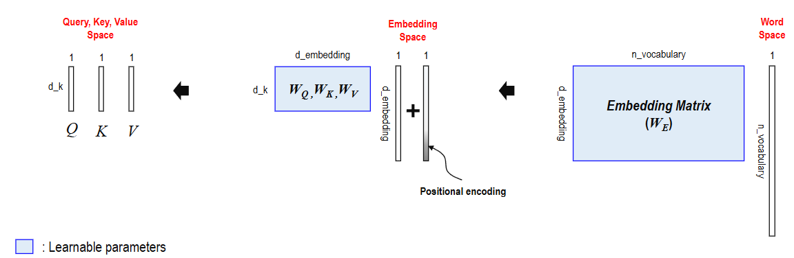

그림은 **오른쪽에서 왼쪽으로** 읽습니다.


| 단계                  | 쉬운 설명                                                   |
| ------------------- | ------------------------------------------------------- |
| Word Space          | 어휘 목록에서 토큰 하나를 나타냄. 그림의 긴 벡터는 해당 위치만 1인 원핫 벡터로 이해할 수 있음 |
| Embedding Matrix    | 토큰을 학습 가능한 조밀한 벡터로 변환. 실제 코드에서는 보통 토큰 ID로 임베딩을 조회       |
| Positional Encoding | 임베딩에 같은 차원의 위치 벡터를 더해 순서 정보를 제공                         |
| Linear Projection   | 서로 다른 가중치 행렬 W\_Q, W\_K, W\_V로 같은 입력 표현을 각각 변환          |
| Q·K·V               | 찾을 정보(Q), 비교 기준(K), 가져올 내용(V)이라는 서로 다른 역할로 사용           |


그림처럼 토큰을 **열벡터**로 표현하면 다음과 같습니다.

$$
e = W_E t, \qquad x = e + p
$$

$$
q = W_Q x, \qquad k = W_K x, \qquad v = W_V x
$$

여기서 t는 토큰의 원핫 벡터, e는 임베딩, p는 위치 벡터입니다. **입력은 같아도 변환 행렬이 다르므로 Q·K·V는 일반적으로 다른 값**이 됩니다.


| 그림의 기호        | 의미                                     |
| ------------- | -------------------------------------- |
| n\_vocabulary | 어휘에 포함된 토큰 종류 수. 현재 문장의 길이와 다름         |
| d\_embedding  | 토큰 임베딩 벡터의 길이                          |
| d\_k          | Query·Key 벡터의 길이. 그림은 Value도 같은 길이로 표시 |
| 파란색 행렬        | 학습으로 갱신하는 임베딩 및 Q·K·V 변환 가중치           |


예를 들어 어휘가 10,000개이고 임베딩 차원이 512이면, 그림의 W_E는 `512 × 10,000`입니다. Head 하나의 Q·K 차원이 64이면 W_Q·W_K는 각각 `64 × 512`입니다. Value 차원은 별도로 정할 수도 있으며, 여러 Head는 각자 다른 변환을 학습합니다.

원 Transformer의 위치 인코딩은 고정된 사인·코사인 함수를 사용합니다. 위치 벡터를 학습하는 변형도 있습니다. 실제 구현에서는 벡터를 행으로 배치해 행렬 곱 순서가 반대로 보일 수 있지만 원리는 같습니다.

---

#### 2. Encoder 블록 내부 — 두 번째 그림

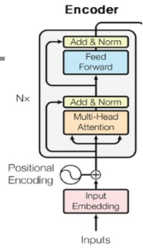

그림은 **아래에서 위로** 읽습니다.


| 순서  | 구성                                    | 역할                                     |
| --- | ------------------------------------- | -------------------------------------- |
| 1   | Input Embedding + Positional Encoding | 토큰의 표현과 위치 정보를 준비                      |
| 2   | Multi-Head Self-Attention             | 같은 시퀀스에서 Q·K·V를 만들고, 관련 토큰의 정보를 가중합    |
| 3   | Add &amp; Norm                        | Attention 입력을 결과에 더한 뒤 LayerNorm 적용    |
| 4   | Feed Forward                          | 각 위치에 동일한 작은 신경망을 적용해 표현을 비선형으로 가공     |
| 5   | Add &amp; Norm                        | Feed Forward 입력을 결과에 더한 뒤 LayerNorm 적용 |
| 6   | N개 블록 적층                              | 앞 블록의 출력을 다음 블록에 전달해 문맥 표현을 더 깊게 가공    |


예를 들어 “고양이가 소파에서 잔다”에서 각 토큰의 출력은 다른 토큰의 정보를 반영할 수 있습니다. **Self-Attention은 위치 사이의 정보를 섞고, Feed Forward는 각 위치의 특징을 가공**한다고 구분하면 됩니다.

N×는 서로 다른 가중치를 가진 블록을 여러 층 쌓는다는 뜻입니다. 임베딩·위치 정보는 입구에서 준비하고, 각 블록은 현재 표현으로 Q·K·V를 새로 계산합니다. 기본 Encoder는 미래 위치를 가리는 인과 마스크를 쓰지 않아 문장 양쪽을 참고할 수 있지만, 패딩 위치는 마스킹할 수 있습니다.

> 이 그림의 Add &amp; Norm은 잔차 덧셈 뒤 정규화를 하는 원래의 Post-LN 구조입니다. 정규화를 하위층 앞에 놓는 Pre-LN 변형도 있습니다. 여기의 Norm은 CNN에서 배운 BatchNorm이 아니라 LayerNorm입니다.

---

#### 3. 모든 토큰의 관계를 계산하고 Value를 모으기

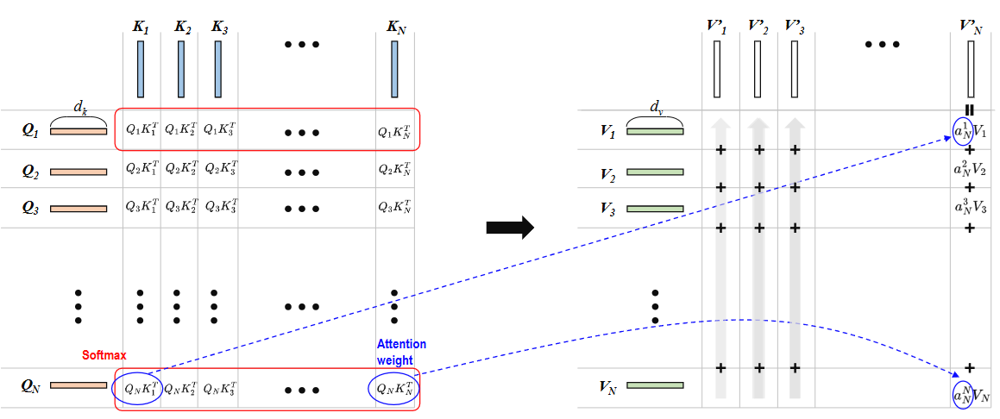

**왼쪽 표는 누가 누구를 얼마나 참고할지 계산하는 과정이고, 오른쪽은 그 비율로 정보를 모으는 과정**입니다. 여기서 N은 현재 시퀀스의 토큰 수이며, 앞의 N× 블록 반복 횟수와는 다른 의미입니다.


| 그림의 부분            | 의미                                      |
| ----------------- | --------------------------------------- |
| 왼쪽의 행 Q\_i        | 정보를 모을 기준이 되는 i번째 토큰의 Query             |
| 위쪽의 열 K\_j        | 비교 대상인 j번째 토큰의 Key                      |
| 각 칸 Q\_i K\_j^T   | 두 벡터의 내적으로 구한 관련도 점수. 아직 확률은 아님         |
| 한 행에 적용하는 Softmax | 해당 Query가 각 Key를 참고할 가중치로 변환. 한 행의 합이 1 |
| 오른쪽의 V\_j         | 가중치를 곱해 실제로 가져올 j번째 토큰의 정보              |
| 오른쪽의 출력 V′\_i     | i번째 Query의 가중치로 모든 Value를 합한 새로운 표현     |


그림 오른쪽은 **출력 하나를 한 열로** 그려 놓았습니다. 예를 들어 마지막 열 $V'_N$은 $Q_N$으로 계산한 가중치를 각 $V_j$에 곱해 더한 결과입니다. 그림의 $a_N^j$를 여기서는 $a_{Nj}$, 즉 N번째 Query가 j번째 Key에 주는 가중치로 표기하겠습니다.

$$
V'_i = \sum_{j=1}^{N} a_{ij}V_j
$$

토큰 세 개에 대한 가중치가 `0.7, 0.2, 0.1`이라면 다음과 같습니다.

$$
V'_i = 0.7V_1 + 0.2V_2 + 0.1V_3
$$

**각 토큰은 서로 다른 가중치를 계산하므로, 같은 Value들을 참고해도 서로 다른 문맥 표현을 얻습니다.** 위 그림은 원리를 단순화한 것으로, 실제 Scaled Dot-Product Attention에서는 Softmax 전에 아래의 Scale과 필요한 Mask도 적용합니다.

---

#### 4. Scaled Dot-Product Attention 공식 읽기

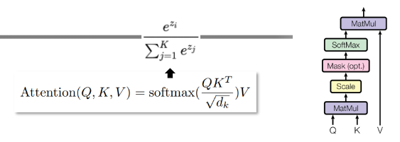

마스크가 없는 경우의 공식은 다음과 같습니다.

$$
\operatorname{Attention}(Q,K,V)
= \operatorname{softmax}\left(\frac{QK^T}{\sqrt{d_k}}\right)V
$$


| 순서  | 계산           | 쉬운 설명                              |
| --- | ------------ | ---------------------------------- |
| 1   | QK^T         | 모든 Query와 Key의 관련도 점수를 한 번에 계산     |
| 2   | 점수 ÷ √d\_k   | 벡터 차원이 커지면서 점수 규모가 커지는 것을 완화       |
| 3   | Mask (필요할 때) | 패딩 등 참고하면 안 되는 위치를 차단              |
| 4   | 행별 Softmax   | 각 Query에 대해 합이 1인 Attention 가중치 생성 |
| 5   | 가중치 행렬 × V   | Value의 가중합으로 토큰별 새 표현 생성           |


Softmax는 한 행의 점수 s_1, …, s_N을 다음과 같이 바꿉니다.

$$
a_{ij} = \frac{\exp(s_{ij})}{\sum_{\ell=1}^{N}\exp(s_{i\ell})}
$$

점수가 높은 위치에 더 큰 가중치를 주지만, 가장 높은 위치 하나만 고르는 것은 아닙니다. **이 가중치는 클래스 정답 확률이 아니라 정보를 섞는 비율**입니다.

행렬 크기를 보면 계산을 확인하기 쉽습니다. 아래는 배치와 Head 차원을 생략하고, 토큰을 행으로 배치한 표기입니다.


| 행렬                  | 크기       |
| ------------------- | -------- |
| Q, K                | N × d\_k |
| V                   | N × d\_v |
| QK^T와 Attention 가중치 | N × N    |
| Attention 출력        | N × d\_v |


즉, **N개 토큰의 관계를 계산한 뒤, 각 토큰에 대해 주변 문맥이 반영된 벡터 하나씩을 만듭니다.** N×N 관계를 직접 계산하는 전역 Self-Attention은 토큰 수가 늘면 관계 계산 비용도 제곱에 비례해 증가합니다.

---

### 가중합과 전역 Attention의 의미

수식과 행렬 크기를 확인했으므로, 이번에는 그 계산이 실제로 어떤 표현을 만드는지 벡터와 문장 예시로 살펴보겠습니다.

#### 1. Value 벡터의 가중합은 무엇일까?

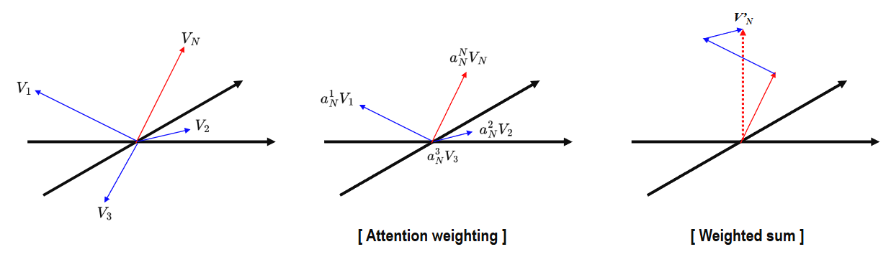

**Attention은 현재 Query에 필요한 정보를 Value 벡터들에서 모아 새로운 벡터를 만듭니다.** 그림은 마지막 토큰의 Query Q_N을 기준으로 이 과정을 보여줍니다.


| 그림                       | 의미                                             |
| ------------------------ | ---------------------------------------------- |
| 왼쪽: 원래 벡터                | 각 토큰의 정보가 방향과 크기를 가진 V\_1, V\_2, …, V\_N으로 표현됨 |
| 가운데: Attention weighting | Q\_N과 각 Key의 관련도로 구한 가중치를 해당 Value에 곱함         |
| 오른쪽: Weighted sum        | 가중치를 곱한 벡터들을 더해 새로운 표현 V′\_N을 만듦               |


$$
V'_N = \sum_{j=1}^{N} a_{Nj}V_j
$$

여기서 a\_{Nj}는 **N번째 Query가 j번째 토큰을 참고하는 비율**입니다. 그림의 a_N^j와 같은 의미이며, Softmax로 만든 가중치는 음수가 아니고 합이 1입니다. 가중치를 곱하면 각 화살표의 길이가 조절되고, 조절된 화살표를 머리와 꼬리가 이어지도록 더한 결과가 점선의 출력 벡터입니다.

즉, **가중치가 큰 토큰의 정보는 많이 반영하고, 작은 토큰의 정보는 적게 반영합니다.** 가장 중요한 토큰 하나만 선택하거나 Value를 단순히 이어 붙이는 연산은 아닙니다. 실제 Value는 고차원이며, 그림은 이를 이해하기 쉽게 낮은 차원으로 표현한 것입니다.

---

#### 2. Global Attention: 멀리 떨어진 단어도 직접 참고하기

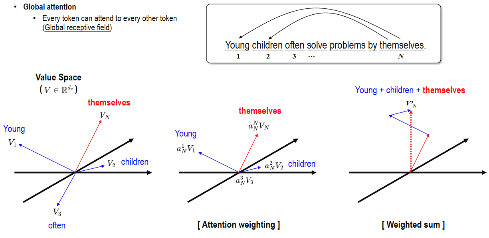

예문은 **“Young children often solve problems by themselves.”**, 즉 “어린아이들은 종종 스스로 문제를 해결한다”입니다. 그림은 마지막 단어 **themselves**가 문장 앞쪽의 **Young·children** 정보를 참고해 문맥을 반영하는 상황을 예시로 보여줍니다.


| 요소     | 예문에서의 역할                                     |
| ------ | -------------------------------------------- |
| Query  | themselves 위치에서 어떤 정보를 참고할지 결정               |
| Key    | Young, children, often 등 각 토큰과의 관련도를 비교하는 기준 |
| Value  | 각 토큰에서 실제로 가져와 섞을 정보                         |
| 가중합 결과 | 다른 토큰의 정보가 반영된 themselves 위치의 새로운 표현         |


**Global Attention은 한 토큰이 시퀀스 전체의 허용된 위치를 직접 참고할 수 있다는 뜻**입니다. Encoder의 전역 Self-Attention에서는 가까운 단어뿐 아니라 멀리 떨어진 단어와 자기 자신도 참고할 수 있어, 전체 시퀀스가 수용 영역이 됩니다. 모든 토큰에 동일한 비중을 준다는 뜻은 아닙니다.

그림의 “Young + children + themselves”는 이 단어들의 정보를 많이 반영한다는 직관적인 표현입니다. 실제로는 마스킹되지 않은 모든 Value를 학습된 비율로 가중합하며, 어떤 단어에 큰 비중을 줄지는 입력·Head·학습 결과에 따라 달라집니다. 특정 Head가 반드시 문법적 관계를 정확히 학습한다고 보장되지는 않습니다.

**CNN의 작은 필터가 주변 위치를 직접 보는 것과 달리, 전역 Attention은 한 층에서도 멀리 떨어진 위치를 연결할 수 있습니다.** 다만 토큰 수 N에 대해 N×N 관련도를 계산하므로 긴 시퀀스에서는 계산 비용이 커집니다.

---

<a id="qkv-example"></a>
## 2. QKV를 끝까지 계산하는 작은 예제 — 핵심

두 토큰의 현재 표현이 행벡터로 $X=[[1,0],[0,1]]$이라고 합시다. 정규화·잔차·편향은 생략하고 Attention 한 Head만 계산하는 교육용 예제입니다. $W_Q=W_K=I_2$, $W_V=[[2,0],[0,4]]$로 정하면 $Q=XW_Q=I_2$, $K=XW_K=I_2$, $V=XW_V=[[2,0],[0,4]]$입니다. Q와 K가 같은 것은 이 예제의 선택이며 실제 학습에서 같아야 할 조건은 아닙니다.

| 단계 | 중간값 | shape |
| --- | --- | --- |
| Q·K·V 생성 | 위 세 행렬 | 각각 2×2 |
| 내적 QKᵀ | [[1,0],[0,1]] | 2×2 |
| d_k=2로 Scale | [[0.707107,0],[0,0.707107]] | 2×2 |
| 각 행 Softmax | [[0.669762,0.330238],[0.330238,0.669762]] | 2×2 |
| AV | [[1.339523,1.320954],[0.660477,2.679046]] | 2×2 |

첫 행의 첫 가중치는 $e^{1/\sqrt2}/(e^{1/\sqrt2}+e^0)\approx0.669762$입니다. 첫 출력은 $0.669762[2,0]+0.330238[0,4]$이므로 약 `[1.339523,1.320954]`입니다. 첫 토큰이 두 번째 토큰을 덜 참고해도 그 Value의 두 번째 성분이 4라서 출력에 상당히 반영됩니다. Attention 가중치만 보고 최종 분류 기여도를 단정할 수 없는 이유이기도 합니다.

첫 Query에서 두 번째 Key를 막으면 첫 점수 행은 `[0.707107,-∞]`, Softmax는 `[1,0]`, 출력은 `[2,0]`입니다. 점수가 단지 음수인 경우에는 지수 값이 양수이므로 완전히 차단되지 않습니다. 한 행의 모든 Key를 막는 경우는 유효한 확률분포를 만들 수 없어 별도 처리가 필요합니다.

**shape 연결:** 일반 배치에서 입력은 `B×T×D`, 각 Q·K·V는 `B×h×T×d_h`, Attention은 `B×h×T×T`, Head별 출력은 `B×h×T×d_h`입니다. `D=h·d_h`일 때 Head 결합과 출력 투영 뒤 다시 `B×T×D`가 되어 입력과 잔차 덧셈을 합니다. 여기서 T는 CLS를 포함한 전체 토큰 수이고, 뒤 ViT 절의 N은 패치 수라서 T=N+1입니다.

<a id="vit"></a>
## 3. 이미지 토큰을 분류 표현으로 바꾸는 ViT

지금까지 문장 토큰으로 Attention을 설명했습니다. 이미지에서도 작은 영역을 토큰으로 표현하면 같은 원리를 적용할 수 있습니다. 이때 단어를 대신하는 것이 이미지 패치입니다.

**ViT는 이미지를 작은 패치로 나누고, 각 패치를 문장의 토큰처럼 Transformer Encoder에 넣는 모델**입니다. 패치 사이의 관계를 Self-Attention으로 학습해 이미지의 종류를 분류할 수 있습니다.

세부 탐색: [패치 수와 임베딩](#patch) · [Head별 QKV shape](#vit-qkv) · [분류 출력](#classification) · [실험 근거](#vit-evaluation).

### 처리 흐름


| 단계                     | 하는 일                                | RGB 224×224 이미지, 16×16 패치 예시                 |
| ---------------------- | ----------------------------------- | -------------------------------------------- |
| 1. Patch 분할            | 이미지를 겹치지 않는 작은 조각으로 나눔              | 가로·세로 14개씩, 총 196개 패치                        |
| 2. Patch Embedding     | 각 패치를 펼친 뒤 같은 선형 변환을 적용해 D차원 벡터로 만듦 | 패치마다 16×16×3 = 768개 값 → D차원                  |
| 3. CLS 토큰 추가           | 이미지 분류에 사용할 학습 가능한 토큰을 맨 앞에 추가      | 패치 196개 + CLS 1개 = 197개 토큰                   |
| 4. 위치 정보 추가            | 각 토큰에 위치 임베딩을 더함                    | 원 ViT는 학습 가능한 위치 임베딩 사용                      |
| 5. Transformer Encoder | Attention과 MLP로 패치들의 관계와 특징을 가공     | 토큰 수와 벡터 차원을 유지하며 여러 블록 통과                   |
| 6. 분류 Head             | 마지막 CLS 표현을 받아 클래스별 점수를 계산          | 학습은 logits와 Cross Entropy, 추론 시 필요하면 Softmax |


위 예시에서 768은 **패치를 펼친 입력 길이**입니다. 임베딩 차원 D는 모델 설계로 정하며, 반드시 768일 필요는 없습니다. CLS 토큰 역시 최종 정답 라벨 자체가 아니라, 학습을 통해 분류에 필요한 정보를 모으는 표현입니다.

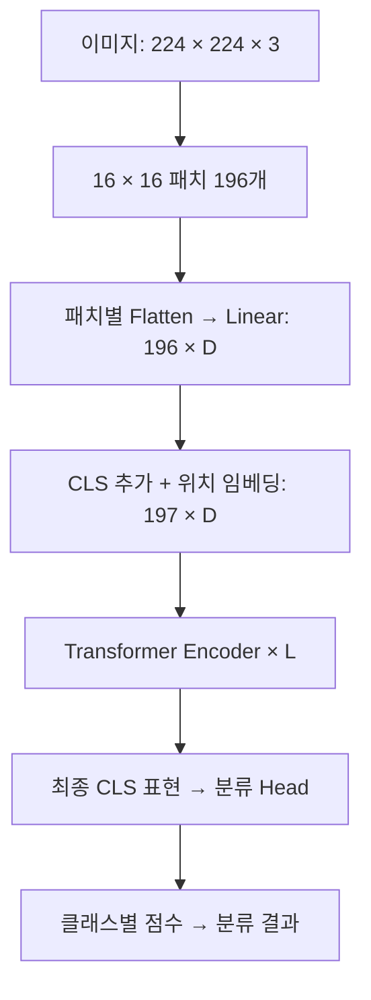

### 패치 사이의 Attention은 무엇을 할까?

고양이 사진이라면 귀가 있는 패치와 눈·몸통이 있는 패치의 정보를 함께 반영할 수 있습니다. **멀리 떨어진 패치도 한 Attention 층에서 직접 연결**할 수 있다는 것이 전역 Self-Attention의 특징입니다. 각 Head가 반드시 특정 부위를 담당하도록 정해져 있는 것은 아닙니다.

원 ViT의 Encoder 블록은 `LayerNorm → Multi-Head Self-Attention → 잔차 덧셈 → LayerNorm → MLP → 잔차 덧셈`의 **Pre-LN 구조**입니다. 앞서 본 원 Transformer의 Post-LN 그림과 정규화 위치가 다릅니다. 이미지 분류용 원 ViT에는 문장을 생성하는 Decoder나 미래 토큰을 가리는 인과 마스크가 필요하지 않습니다.

### CNN과 비교


| 항목       | 일반적인 CNN                          | 기본 ViT                         |
| -------- | --------------------------------- | ------------------------------ |
| 입력 처리    | 작은 필터로 주변 픽셀의 특징 추출               | 이미지를 패치 토큰으로 변환                |
| 위치 사이 관계 | 지역 연산을 여러 층 쌓아 넓은 영역으로 확장         | 전역 Attention으로 모든 패치 관계를 직접 계산 |
| 구조적 가정   | 지역성과 필터의 가중치 공유를 활용               | 상대적으로 적은 이미지 구조 가정, 데이터로 관계 학습 |
| 데이터      | 지역 구조를 활용해 비교적 적은 데이터에서도 유리할 수 있음 | 원 ViT는 대규모 사전학습에서 강점을 보임       |


### 기억할 점

- **패치는 이미지의 토큰**입니다. 패치를 나눴다고 관계를 잃는 것이 아니라, 위치 정보와 Attention으로 관계를 학습합니다.
- **패치가 작아지면 토큰 수가 늘어납니다.** 같은 이미지에서 패치 한 변을 절반으로 줄이면 패치 수는 4배, 패치 간 Attention 점수 수는 약 16배가 됩니다. 이는 모델 전체 연산량이 정확히 16배라는 뜻은 아닙니다.
- **ViT가 항상 CNN보다 좋은 것은 아닙니다.** 데이터 양, 사전학습, 모델 크기, 학습 방법에 따라 결과가 달라집니다.

출처: [ViT 원 논문 — An Image is Worth 16×16 Words](https://arxiv.org/abs/2010.11929)

---

### ViT Architecture

앞 절의 처리 흐름을 구조 그림과 수식에 대응시켜 보겠습니다. 먼저 CLS가 분류 결과로 이어지는 전체 경로를 살펴본 뒤, Encoder 내부의 잔차 연결과 계산식을 확인합니다.

---

#### 1. 전체 구조: 이미지를 토큰 시퀀스로 처리하기

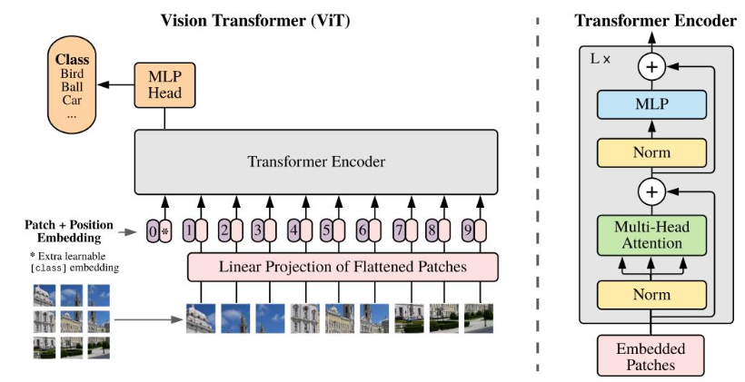

**이미지 → 패치 벡터 → 위치 정보 추가 → Encoder → CLS 출력 → 분류 Head** 순서입니다. 첫 그림은 이해를 위해 이미지를 9개 패치로 나눈 예시이며, 패치 수가 항상 9개인 것은 아닙니다.


| 그림의 구성                                 | 역할                                            |
| -------------------------------------- | --------------------------------------------- |
| 이미지 패치                                 | 이미지를 일정한 크기로 나눈 조각. 각 조각이 토큰 하나가 됨            |
| Linear Projection of Flattened Patches | 각 패치를 한 줄로 펼친 뒤, 동일한 학습 행렬로 D차원 벡터로 변환        |
| 0번 \[CLASS\] 토큰                        | 이미지 분류를 위해 맨 앞에 추가하는 학습 가능한 벡터. 실제 이미지 조각이 아님 |
| Patch + Position Embedding             | 각 패치의 내용과 위치 정보를 결합. CLS에도 위치 임베딩을 더함         |
| Transformer Encoder                    | 모든 토큰 사이의 관계를 계산해 문맥이 반영된 표현을 생성              |
| MLP Head                               | 마지막 CLS 표현을 클래스별 점수(logits)로 변환               |


그림의 0~9는 토큰 위치를 설명하기 위한 표시입니다. 위치 정보를 단순한 정수로 더하는 것이 아니라, **각 위치에 해당하는 D차원 위치 임베딩 벡터를 더합니다.**

CLS는 Attention을 통해 패치 정보를 모으도록 학습되며, 단순히 모든 패치의 평균을 낸 값은 아닙니다. Encoder는 CLS와 패치 토큰을 모두 출력하지만, 이 분류 구조에서는 **최종 CLS 표현을 분류 Head에 사용**합니다.

##### 출력은 10개인데 MLP Head에는 무엇이 들어갈까?

그림처럼 패치가 9개이고 CLS가 1개이면, **Encoder는 D차원 벡터 10개를 출력합니다.** 여기서 10개는 **토큰별 특징 벡터의 개수**이며, 클래스 수와는 별개입니다. 각 벡터는 Attention을 거치며 다른 토큰의 정보를 반영합니다.


| 위치       | Encoder 출력                        | 분류 Head에 사용하는가?          |
| -------- | --------------------------------- | ------------------------ |
| 0번 CLS   | 패치들과 상호작용하며 분류에 필요한 정보를 모은 D차원 벡터 | 이 벡터를 최종 LayerNorm 후 사용  |
| 1\~9번 패치 | 각 패치에 다른 위치의 문맥이 반영된 D차원 벡터 9개    | 이 그림의 분류 Head에는 직접 넣지 않음 |


즉, **10개 출력 중 CLS 위치의 벡터 하나를 선택**합니다. 원래 넣었던 CLS 초기값을 사용하는 것이 아니라, 모든 Encoder 블록을 통과해 이미지 정보가 반영된 **최종 CLS 표현**을 사용합니다. 패치 출력이 Head에 직접 들어가지 않아도, 패치 정보는 Attention을 통해 CLS의 최종 표현에 영향을 줍니다.

```text
Encoder 출력: [최종 CLS, 최종 패치1, …, 최종 패치9] → 10 × D
                    ↓ 0번 위치 선택
                최종 CLS → D
                    ↓ LayerNorm
                  MLP Head
                    ↓
            클래스별 점수 → 클래스 수 C개
```

예를 들어 D가 768이고 클래스가 새·공·자동차의 3개라면, 크기는 **`10×768 → CLS 선택으로 768 → Head 출력 3`**입니다. 토큰 10개를 전부 펼쳐 7,680개 값으로 Head에 넣는 구조가 아닙니다. 배치가 B장이면 각각 `B×10×768 → B×768 → B×3`입니다.

**출력 클래스 수는 토큰 수와 독립적**입니다. 그림의 9개 패치를 사용해도 1,000개 클래스로 분류할 수 있으며, 이때 Head는 CLS의 D차원 표현을 1,000개 점수로 바꿉니다. 패치 표현을 평균 내어 분류하는 ViT 변형도 있지만, 이 그림은 CLS를 선택하는 방식입니다.

##### 그림 오른쪽의 Skip connection

오른쪽 Encoder에서 **오른편으로 돌아가 원 안의 + 기호에 연결되는 화살표**가 Skip connection입니다. Encoder 블록 하나에 두 개가 있으며, 각각 원래 표현에 Attention 또는 MLP의 계산 결과를 더합니다.


| 위치     | 계산                               | 역할                          |
| ------ | -------------------------------- | --------------------------- |
| 아래쪽 연결 | x′ = x + Attention(LayerNorm(x)) | 원래 토큰 표현에 다른 토큰에서 모은 정보를 더함 |
| 위쪽 연결  | 출력 = x′ + MLP(LayerNorm(x′))     | 앞의 표현에 MLP가 가공한 특징을 더함      |


**원래 정보를 그대로 전달하는 길을 두고, 필요한 수정량을 추가한다**고 이해하면 됩니다. 역전파 때도 기울기가 흐를 직접 경로를 제공해 Encoder를 여러 층 쌓아 학습하기 쉽게 합니다.

덧셈은 같은 토큰·같은 특징 위치의 값끼리 더하는 연산이며, 벡터를 이어 붙이는 Concat과 다릅니다. 따라서 Attention과 MLP의 최종 출력은 입력과 같은 `(토큰 수) × D` 형태를 유지합니다. 이 그림은 Norm을 계산 경로 앞에 두는 Pre-LN 구조로, 지름길에는 Norm을 거치지 않은 입력이 흐릅니다.

---

#### 2. 수식으로 보는 데이터 흐름

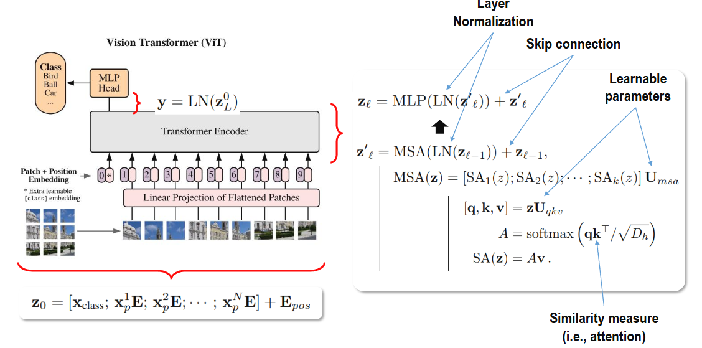

##### 입력 시퀀스 만들기

$$
z_0 = [x_{\mathrm{class}};\;x_p^1E;\;x_p^2E;\;\cdots;\;x_p^NE] + E_{\mathrm{pos}}
$$

- **x_p^i**: i번째 패치를 펼친 벡터. RGB 패치 크기가 P×P이면 길이는 P²×3입니다.
- **E**: 모든 패치에 공유하는 학습 가능한 투영 행렬입니다.
- **x_class**: 학습 가능한 CLS 토큰입니다.
- **[ ; ]**: 토큰들을 시퀀스 방향으로 이어 붙이는 연산입니다.
- **E_pos**: 각 토큰 위치의 학습 가능한 위치 임베딩입니다.
- **z_0**: Encoder에 들어갈 전체 시퀀스입니다. 배치를 제외하면 `(N+1) × D`입니다.

##### Encoder 블록을 L번 쌓기

$$
z'_\ell = \operatorname{MSA}(\operatorname{LN}(z_{\ell-1})) + z_{\ell-1}
$$

$$
z_\ell = \operatorname{MLP}(\operatorname{LN}(z'_\ell)) + z'_\ell
$$


| 기호·구성     | 의미                                                        |
| --------- | --------------------------------------------------------- |
| LN        | Layer Normalization. 각 토큰의 특징 차원을 정규화                     |
| MSA       | Multi-Head Self-Attention. 서로 다른 토큰의 정보를 조합               |
| 블록 내부 MLP | 각 토큰에 같은 신경망을 적용해 특징을 비선형으로 가공. 보통 Linear → GELU → Linear |
| + 입력      | Skip connection. 원래 표현에 새로 계산한 수정량을 더함                    |
| ℓ, L      | 현재 블록 번호와 전체 블록 수                                         |


이 구조는 **정규화를 Attention·MLP 앞에 두는 Pre-LN**입니다. Attention은 토큰 사이의 정보를 섞고, 내부 MLP는 각 토큰의 특징을 가공합니다. 블록 내부 MLP와 마지막 분류용 MLP Head는 역할이 다릅니다.

##### ViT는 왜 Norm을 먼저 적용할까?

**주된 이유는 깊은 Transformer의 학습을 안정화하기 위해서입니다.** 다만 “LLM은 Post-Norm, Vision은 Pre-Norm”이라는 구분은 정확하지 않습니다. 앞서 본 그림은 **원 Transformer의 Post-LN과 원 ViT의 Pre-LN 설계 차이**를 보여줍니다. LLaMA처럼 정규화를 먼저 적용하는 언어 모델도 있습니다.


| 방식        | 계산 — F는 Attention 또는 MLP | 특징                                 |
| --------- | ------------------------ | ---------------------------------- |
| Post-Norm | y = LN(x + F(x))         | 잔차 덧셈 결과 전체에 정규화 적용                |
| Pre-Norm  | y = x + F(LN(x))         | 계산 경로의 입력을 정규화하고, 원래 x는 지름길로 직접 전달 |


Pre-Norm의 이점은 다음과 같습니다.

1. **하위층 입력의 규모를 정돈합니다.** Q·K·V를 만들거나 MLP를 적용하기 전에 토큰의 특징을 정규화해, 입력 규모 변화의 영향을 완화합니다. Attention 점수를 √D_h로 나누는 Scale과는 별개의 과정입니다.
2. **직접적인 기울기 경로를 유지합니다.** 잔차 경로의 x가 블록 내부의 Norm을 거치지 않고 전달되므로, 역전파에서도 그 경로를 활용할 수 있습니다. Post-Norm에서는 덧셈 뒤 Norm의 미분까지 거쳐야 합니다.
3. **초기 학습의 불안정성을 완화합니다.** 초기화 시 기울기 규모를 분석한 연구에서는 Pre-LN이 더 안정적인 기울기를 보였습니다. 그렇다고 모든 모델에서 warm-up이 불필요하거나 Pre-Norm이 항상 더 좋은 것은 아닙니다. [정규화 위치에 관한 연구](https://arxiv.org/abs/2002.04745)

LLaMA는 이와 같은 **Pre-Norm 배치에 RMSNorm을 사용**합니다. 즉, **정규화의 위치(Pre/Post)**와 **정규화의 종류(LayerNorm/RMSNorm)**는 별개의 선택입니다. 여기서 설명하는 Norm은 이미지 픽셀의 전처리 정규화나 CNN의 BatchNorm이 아닙니다. [LLaMA 원 논문](https://arxiv.org/abs/2302.13971)

##### Attention 내부 계산

$$
[Q,K,V] = ZU_{qkv}, \qquad
A = \operatorname{softmax}\left(\frac{QK^T}{\sqrt{D_h}}\right), \qquad
\operatorname{SA}(Z) = AV
$$

U_qkv는 Q·K·V를 만드는 학습 가중치이고, D_h는 Head 하나의 Query·Key 차원입니다. A는 각 토큰이 다른 토큰을 얼마나 참고할지 정하는 가중치 행렬입니다. Softmax는 각 Query의 Key 방향으로 적용합니다.

여러 Head의 결과를 이어 붙이고 출력 투영 행렬로 조합합니다.

$$
\operatorname{MSA}(Z)
= \operatorname{Concat}(\operatorname{SA}_1(Z),\ldots,\operatorname{SA}_h(Z))U_{\mathrm{msa}}
$$

##### 최종 CLS로 분류하기

$$
y = \operatorname{LN}(z_L^{(0)}), \qquad
\mathrm{logits} = \operatorname{Head}(y)
$$

z_L의 **0번 토큰이 CLS**입니다. 그림의 y는 정규화된 이미지 표현이며, 아직 클래스별 확률이 아닙니다. Head가 logits를 만들고, 확률이 필요할 때 Softmax를 적용합니다. CrossEntropyLoss로 학습할 때는 Softmax 전 logits를 사용합니다.

---

#### 학습되는 값과 설계하는 값


| 구분      | 예시                                                                         |
| ------- | -------------------------------------------------------------------------- |
| 학습 파라미터 | 패치 투영 E, CLS 토큰, 위치 임베딩, Q·K·V 및 출력 투영 가중치, MLP·Head 가중치, LayerNorm의 배율·편향 |
| 하이퍼파라미터 | 패치 크기 P, 임베딩 차원 D, Head 수 h, Encoder 블록 수 L                                |


**학습 중 패치별 Attention 가중치 A도 달라지지만, A 자체를 고정 파라미터로 저장해 학습하는 것은 아닙니다.** A는 현재 입력과 학습된 Q·K 변환으로 매번 계산하는 중간 결과입니다.

---

<a id="patch"></a>
### Patch Embedding

전체 구조를 확인했으므로, 이제 이미지가 분류 결과로 바뀌는 경로를 입력부터 다시 따라가겠습니다. 첫 단계는 이미지를 패치로 나누고, 각 패치를 일정한 길이의 토큰으로 표현하는 것입니다.

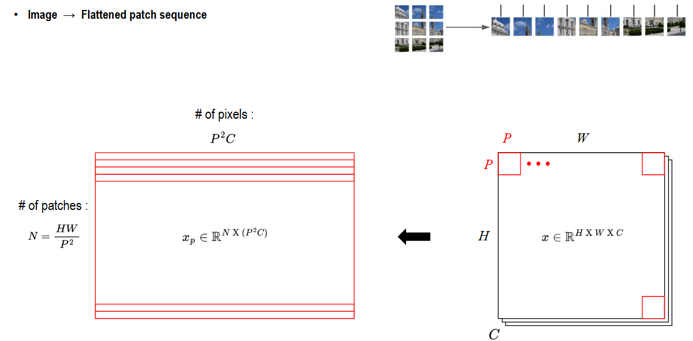

**Patch Embedding은 이미지의 작은 조각 하나를 Transformer가 처리할 토큰 벡터 하나로 바꾸는 과정**입니다. 그림은 그중 **패치 분할과 Flatten 단계**를 보여주며, 완전한 임베딩을 만들려면 뒤에 학습 가능한 선형 변환이 추가됩니다.

#### 그림의 크기 읽기


| 기호   | 의미                                              |
| ---- | ----------------------------------------------- |
| H, W | 이미지의 높이와 너비                                     |
| C    | 입력 채널 수. RGB이면 3                                |
| P    | 정사각형 패치 한 변의 길이                                 |
| N    | 패치 개수. 겹치지 않게 나누고 H·W가 P로 나누어떨어지면 (H/P) × (W/P) |
| P²C  | 패치 하나를 펼친 벡터의 길이. 공간 픽셀 수 P²에 채널 수 C를 곱한 값      |
| D    | 선형 변환 후 토큰 하나의 임베딩 차원                           |


이미지 전체를 한 번에 펼치는 것이 아니라 **각 패치를 따로 펼쳐 한 행으로 배치**합니다. 따라서 그림 왼쪽의 행렬은 `N × (P²C)`이며, 행 하나가 패치 하나입니다.

#### 예시: RGB 224×224 이미지와 16×16 패치


| 단계          | 계산 또는 크기                             |
| ----------- | ------------------------------------ |
| 이미지         | 224 × 224 × 3                        |
| 패치 개수       | (224/16) × (224/16) = 14 × 14 = 196개 |
| 패치 하나의 값 개수 | 16 × 16 × 3 = 768개                   |
| 패치별 Flatten | 196 × 768                            |
| 선형 변환 후     | 196 × D. 예를 들어 D=512이면 196 × 512     |
| CLS 추가 후    | 197 × D                              |
| 위치 임베딩 추가 후 | 197 × D. 덧셈이므로 크기는 그대로               |


**Flatten은 값의 배치 형태만 바꾸며, 학습하는 가중치가 없습니다.** 그다음 Linear가 각 패치의 픽셀·채널 값을 조합해 특징을 학습합니다. D는 설계자가 정하므로 패치를 펼친 길이인 P²C와 같을 필요가 없습니다.

#### 선형 변환으로 임베딩 만들기

행벡터를 사용하는 표기에서 패치 시퀀스 X_p와 학습 가중치 E의 크기는 다음과 같습니다.

$$
X_p \in \mathbb{R}^{N \times (P^2C)}, \qquad
E \in \mathbb{R}^{(P^2C) \times D}, \qquad
Z = X_pE \in \mathbb{R}^{N \times D}
$$

구현에서는 편향을 더할 수도 있습니다. **모든 패치에 같은 변환 행렬 E를 공유**하며, 이후 CLS와 위치 임베딩을 추가해 Encoder에 넣습니다. 이 단계는 각 패치 내부의 정보를 변환하고, 서로 다른 패치의 정보를 섞는 역할은 뒤의 Attention이 맡습니다.

#### CNN과 연결해서 이해하기

기본적인 비중첩 패치의 `Flatten → Linear`는 **kernel_size=P, stride=P, 입력 채널 C, 출력 채널 D인 Conv2d**로도 같은 연산을 구현할 수 있습니다. Conv2d 출력의 공간 격자를 토큰 순서로 펼치면 `N × D`가 됩니다. 따라서 ViT의 Patch Embedding에 합성곱 연산을 사용하는 구현도 가능합니다.

**패치를 작게 나누면 세밀한 공간 정보를 더 많은 토큰으로 표현하지만, Attention 계산 비용도 증가합니다.** 입력 크기가 패치 크기로 나누어떨어지지 않는 경우에는 전처리나 Padding 등의 처리 방식도 정해야 합니다.

---

### Linear Projection

패치를 펼치면 픽셀 값을 행렬로 정리할 수 있지만, 아직 Transformer에서 사용할 특징을 학습한 것은 아닙니다. Patch Embedding의 두 번째 단계인 Linear Projection이 이 변환을 담당합니다.

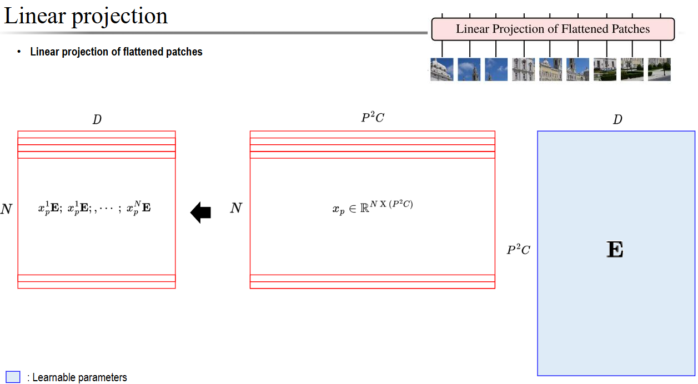

**Linear Projection은 패치의 픽셀 값들을 학습된 가중치로 조합해, Transformer가 사용할 D차원 특징 벡터로 바꾸는 단계**입니다. 그림에서는 가운데 패치 행렬과 오른쪽 가중치 E를 곱해 왼쪽 결과를 만듭니다.


| 그림의 부분       | 크기        | 의미                        |
| ------------ | --------- | ------------------------- |
| 가운데 X\_p     | N × (P²C) | 패치 N개를 각각 한 행으로 펼친 픽셀 값   |
| 오른쪽 E — 파란색  | (P²C) × D | 모든 패치에 공유하는 학습 가능한 변환 가중치 |
| 왼쪽 Z = X\_pE | N × D     | 패치마다 만들어진 D차원 토큰 벡터       |


$$
\underbrace{X_p}_{N \times (P^2C)}
\underbrace{E}_{(P^2C) \times D}
= \underbrace{Z}_{N \times D}
$$

#### 무엇이 바뀌고, 무엇이 유지될까?

- **패치 수 N은 유지됩니다.** 패치 하나가 토큰 하나로 변환됩니다.
- **패치별 벡터 길이는 P²C에서 D로 바뀝니다.** D는 설계값이며, 차원을 줄이거나 늘리거나 같게 둘 수 있습니다.
- **E는 학습으로 바뀝니다.** 손실에서 역전파된 기울기로 갱신되며, 모든 패치 위치에 같은 E를 적용합니다.
- **이 단계는 패치끼리 정보를 섞지 않습니다.** 한 패치 내부의 픽셀·채널을 조합하고, 패치 사이의 관계는 뒤의 Attention이 처리합니다.

예를 들어 RGB 224×224 이미지를 16×16 패치로 나누고 D=512로 설정하면 다음과 같습니다.

```text
펼친 패치 X_p       학습 가중치 E       패치 임베딩 Z
  196 × 768    ×      768 × 512    =      196 × 512
```

출력 특징 하나는 해당 패치의 768개 입력값에 서로 다른 가중치를 곱해 더한 값입니다. E의 열마다 다른 조합을 학습하므로, 한 패치에서 512개 특징을 만들 수 있습니다. 구현에 따라 D개 편향을 더할 수도 있습니다.

**Flatten이 숫자의 배치만 바꾼다면, Linear Projection은 숫자를 실제로 계산해 새로운 특징으로 바꿉니다.** 예시의 가중치 수는 768×512 = 393,216개이며, 편향을 쓰면 512개가 추가됩니다. 패치 196개마다 별도 가중치를 만드는 것은 아닙니다.

이후 CLS 토큰을 추가하고 위치 임베딩을 더하면 Encoder 입력이 됩니다. 이 단계의 E는 Attention 내부에서 Q·K·V를 만드는 가중치와는 별개입니다.

---

### Position Embedding

Linear Projection은 각 패치의 내용을 벡터로 만들었습니다. 여기에 분류용 CLS를 추가하고, 각 패치가 이미지의 어느 위치에서 왔는지 알려주면 Encoder 입력이 완성됩니다.

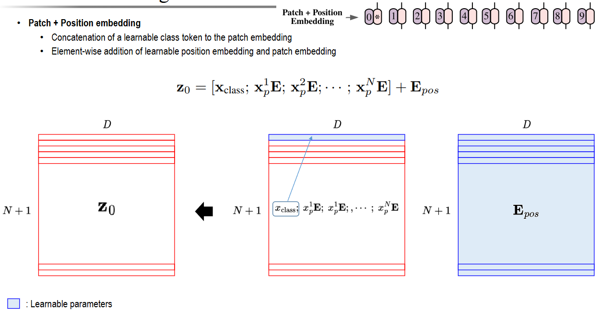

**Position Embedding은 패치의 내용 벡터에 ‘어느 위치에서 온 패치인지’를 알려주는 벡터를 더하는 방법**입니다. 패치 임베딩이 내용 정보라면, 위치 임베딩은 위치 정보입니다.

#### 왜 위치 정보가 필요할까?

기본 Self-Attention은 위치 정보가 없으면 벡터의 내용으로 관계를 계산할 뿐, 배열 순서만으로 왼쪽·오른쪽이나 위·아래를 구별하지 못합니다. 토큰 순서를 바꾸면 출력도 같은 순서로 바뀌는 성질이 있으므로, **이미지의 공간 배치를 활용하려면 위치 정보가 필요**합니다.

#### 그림의 계산 순서


| 순서  | 연산                               | 크기 변화               |
| --- | -------------------------------- | ------------------- |
| 1   | Linear Projection으로 패치 N개를 임베딩   | N × D               |
| 2   | 학습 가능한 CLS 벡터를 맨 앞에 추가           | (N+1) × D           |
| 3   | 같은 형태의 위치 임베딩 E\_pos를 원소별로 더함    | (N+1) × D 유지        |
| 4   | 결과 z\_0를 Transformer Encoder에 전달 | 토큰마다 내용과 위치가 함께 반영됨 |


$$
z_0 = [x_{\mathrm{class}};\;x_p^1E;\;\cdots;\;x_p^NE] + E_{\mathrm{pos}}
$$

그림 가운데의 첫 행은 CLS이며, 오른쪽 E_pos는 **각 토큰 위치에 대응하는 D차원 벡터를 한 행씩 가진 학습 파라미터**입니다. 0번 CLS에도 별도의 위치 벡터가 대응합니다.

#### CLS 추가와 위치 정보 추가는 다른 연산

- **CLS는 시퀀스에 이어 붙입니다.** 토큰이 한 개 늘어나지만 D는 그대로입니다.
- **위치 임베딩은 같은 자리끼리 더합니다.** 토큰 수와 D 모두 바뀌지 않습니다.
- 그림의 **0, 1, 2, …는 위치를 설명하는 번호**입니다. 그 정수 자체를 모든 특징 값에 더하는 것은 아닙니다.

예를 들어 한 패치의 내용 벡터가 `[0.2, 0.5, -0.1]`, 그 위치의 벡터가 `[0.1, -0.2, 0.3]`이면 Encoder에 넣는 벡터는 `[0.3, 0.3, 0.2]`입니다. 실제 값은 학습으로 정해집니다.

RGB 224×224 이미지를 16×16 패치로 나누고 D=512라면, **196×512 → CLS 추가로 197×512 → 위치 벡터를 더해도 197×512**입니다. 이때 위치 임베딩은 197×512 = 100,864개의 학습 가능한 값을 가지며, CLS 자체의 512개 값과는 별개입니다.

#### 학습과 이미지 크기 변경

원 ViT는 각 위치에 대응하는 **학습 가능한 절대 위치 임베딩**을 사용합니다. 같은 위치의 벡터를 여러 이미지에 공유하며, 학습 중 역전파로 갱신합니다. 단순한 2차원 좌표 자체가 아니라, 패치를 일정한 순서로 나열한 위치에 대응하는 벡터입니다.

입력 해상도를 바꿔 패치 격자 크기가 달라지면 기존 위치 임베딩의 길이도 맞춰야 합니다. 사전학습한 ViT를 다른 해상도로 사용할 때는 패치 위치 임베딩을 2차원 격자로 해석해 보간하는 방법을 사용할 수 있으며, CLS 위치 벡터는 따로 유지합니다.

---

<a id="vit-qkv"></a>
### Query/Key/Value

내용과 위치를 담은 토큰 시퀀스가 준비되면 Encoder가 토큰 사이의 관계를 계산합니다. 이를 위해 먼저 현재 토큰 표현에서 Q·K·V를 만듭니다.

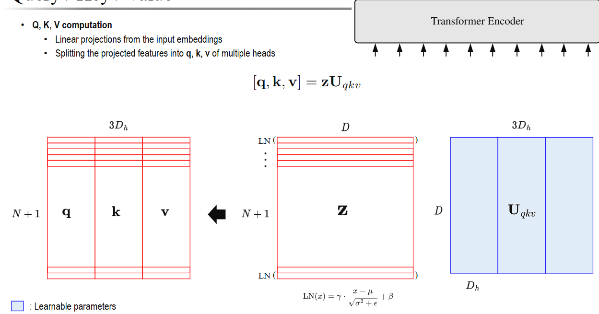

**Q·K·V는 같은 토큰 표현을 서로 다른 목적에 맞게 선형 변환한 결과**입니다. ViT의 Self-Attention에서는 CLS와 패치 토큰 모두에서 Q·K·V를 만듭니다.


| 요소       | 역할                   | 다음 계산에서의 용도        |
| -------- | -------------------- | ------------------ |
| Query(Q) | 이 위치에서 어떤 정보를 찾을지 표현 | 각 Key와 비교          |
| Key(K)   | 각 위치의 정보를 비교하기 위한 표현 | Query와 내적해 관련도 계산  |
| Value(V) | 실제로 모아서 사용할 내용       | Attention 가중치로 가중합 |


#### 그림의 계산 과정

가운데 Z는 CLS를 포함한 토큰 N+1개의 표현입니다. 각 행이 토큰 하나이고 길이는 D입니다. Pre-LN 구조에서는 **각 토큰의 D개 특징을 LayerNorm으로 정규화한 뒤** Q·K·V 변환에 사용합니다.

$$
\widetilde{Z} = \operatorname{LN}(Z), \qquad
[Q,K,V] = \widetilde{Z}U_{qkv}
$$

그림의 식은 간단히 zU_qkv로 표시하지만, 이 블록에서는 실제로 Norm을 통과한 표현을 사용합니다. LayerNorm의 평균·분산은 각 토큰의 특징 차원에서 계산하며, 정규화만으로 행렬 크기는 바뀌지 않습니다.

#### 왜 3D_h일까?

**Head 하나에서 길이 D_h인 Q·K·V를 각각 하나씩 만들기 때문**입니다.

```text
Q: D_h개 값 + K: D_h개 값 + V: D_h개 값 = 총 3D_h개 값
```


| 그림의 행렬             | Head 하나 기준 크기   |
| ------------------ | --------------- |
| 입력 Z 및 LN(Z)       | (N+1) × D       |
| 가중치 U\_qkv         | D × (3D\_h)     |
| 한 번에 계산한 \[Q,K,V\] | (N+1) × (3D\_h) |
| 나눈 뒤 Q, K, V 각각    | (N+1) × D\_h    |


이는 **토큰이 3배가 된다는 뜻이 아니라, 각 토큰의 특징 방향으로 Q·K·V를 나란히 계산했다는 뜻**입니다. 이후 세 부분으로 나누어 사용합니다. Q와 K를 비교해 가중치를 만들고, 그 가중치로 V를 합합니다.

U_qkv는 서로 다른 세 행렬을 옆으로 붙인 것으로 이해할 수 있습니다.

$$
U_{qkv} = [U_Q\;U_K\;U_V], \qquad
Q=\widetilde{Z}U_Q,\quad
K=\widetilde{Z}U_K,\quad
V=\widetilde{Z}U_V
$$

**Q·K·V를 각각 계산하는 것과 같은 선형 변환을 하나의 행렬 곱으로 묶은 방식**입니다. 가중치가 서로 다르므로 같은 입력에서도 서로 다른 Q·K·V를 얻습니다.

#### 여러 Head를 한 번에 계산하면?

일반적인 구성에서 Head 수를 h라 하면 D_h = D/h입니다. 그림의 **3D_h는 Head 하나 기준**이고, 모든 Head의 Q·K·V를 한 번에 계산하는 구현에서는 **3hD_h = 3D**개 값이 필요합니다.

예를 들어 D=768, h=12이면 D_h=64입니다.


| 범위          | 토큰 하나당 Q·K·V 값 개수 | 투영 가중치 크기   |
| ----------- | ----------------- | ----------- |
| Head 하나     | 3 × 64 = 192      | 768 × 192   |
| 12개 Head 전체 | 12 × 192 = 2,304  | 768 × 2,304 |


배치 크기가 B, 토큰 수가 T=N+1이면, 전체 QKV 출력은 `B × T × 3D`입니다. 이를 Q·K·V와 Head별로 나누면 **각각 `B × h × T × D_h`** 형태로 Attention을 계산할 수 있습니다. 토큰을 Head별로 나누는 것이 아니라, **각 Head가 모든 토큰의 서로 다른 표현을 처리**합니다.

> 3D_h는 Q·K·V 차원을 모두 같게 둔 이 그림의 조건입니다. 일반적으로 Q·K 차원이 d_k, V 차원이 d_v라면 합친 길이는 2d_k+d_v입니다. 또한 파란색 U_qkv는 학습 파라미터이고, Q·K·V는 입력에 따라 매번 계산되는 중간 결과입니다.

---

### Attention among patches

Q·K·V를 얻었으므로, 먼저 Q와 K로 토큰 사이의 관련도를 계산합니다. 이 단계에서는 어떤 토큰의 정보를 얼마나 참고할지 정하고, 실제 정보의 조합은 다음 단계에서 수행합니다.

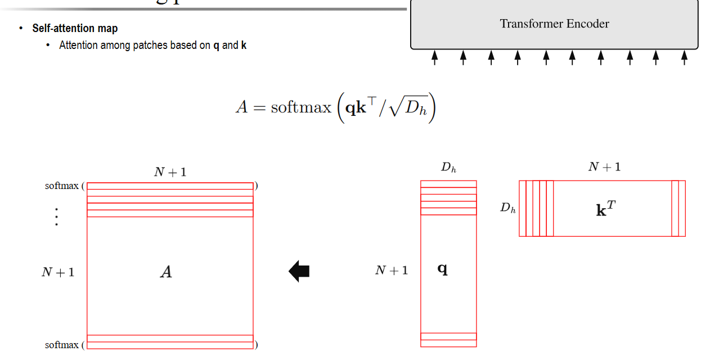

**각 패치가 다른 패치의 정보를 얼마나 참고할지 Q와 K로 계산하는 단계**입니다. 제목은 패치 간 Attention이지만, 그림의 N+1에는 패치 N개와 CLS 토큰 1개가 모두 포함됩니다. 아래는 Head 하나 기준이며 배치 차원은 생략했습니다.

$$
A = \operatorname{softmax}\left(\frac{QK^T}{\sqrt{D_h}}\right)
$$


| 그림의 행렬 | 크기            | 역할                                   |
| ------ | ------------- | ------------------------------------ |
| Q      | (N+1) × D\_h  | 각 토큰이 정보를 찾기 위한 Query                |
| K^T    | D\_h × (N+1)  | 모든 Key를 비교할 수 있도록 전치                 |
| QK^T   | (N+1) × (N+1) | 모든 Query–Key 쌍의 관련도 점수               |
| A      | (N+1) × (N+1) | Scale 후 행별 Softmax로 만든 Attention 가중치 |


#### A의 한 칸과 한 행은 무엇일까?

**A의 i행 j열은 i번째 토큰이 j번째 토큰의 Value를 얼마나 반영할지 나타내는 가중치**입니다. 행은 정보를 모으는 Query, 열은 참고 대상인 Key에 대응합니다.

- **0행**: CLS가 자기 자신과 모든 패치를 참고하는 비율입니다.
- **i행**: i번째 패치가 CLS 및 다른 패치·자기 자신을 참고하는 비율입니다.
- **행별 합은 1**입니다. 열의 합까지 1이어야 하는 것은 아닙니다.
- **서로 참고하는 비율은 다를 수 있습니다.** A_ij와 A_ji가 같다는 보장은 없습니다.

예를 들어 패치 9개와 CLS가 있으면 Q·K는 각각 `10 × D_h`, A는 `10 × 10`입니다. **100개의 관계 가중치를 계산하는 것이며, 이미지 클래스 100개를 예측한다는 뜻은 아닙니다.**

#### 왜 Scale과 Softmax를 적용할까?

1. **QK^T**: 학습된 표현에서 관련도 점수를 구합니다. 단순히 원본 픽셀 색상이 비슷한지만 비교하는 것은 아닙니다.
2. **√D_h로 나누기**: Head 차원이 커지면서 내적 점수의 규모가 커지는 것을 완화합니다.
3. **행별 Softmax**: 각 Query의 점수들을 음수가 아니고 합이 1인 정보 조합 비율로 바꿉니다.

**이 단계의 A는 어디를 참고할지 정한 지도이며, 아직 Value를 모은 결과가 아닙니다.** 다음 단계에서 A에 V를 곱하면 각 토큰의 새로운 표현이 만들어집니다.

$$
O = AV, \qquad
O \in \mathbb{R}^{(N+1) \times D_h}
$$

기본 ViT Encoder는 전역 Self-Attention을 사용하므로 멀리 떨어진 패치도 한 층에서 직접 참고할 수 있습니다. 각 Head와 각 층은 서로 다른 A를 계산하며, A 자체는 고정된 학습 파라미터가 아니라 현재 입력으로 계산하는 중간 결과입니다.

---

### Self-attention

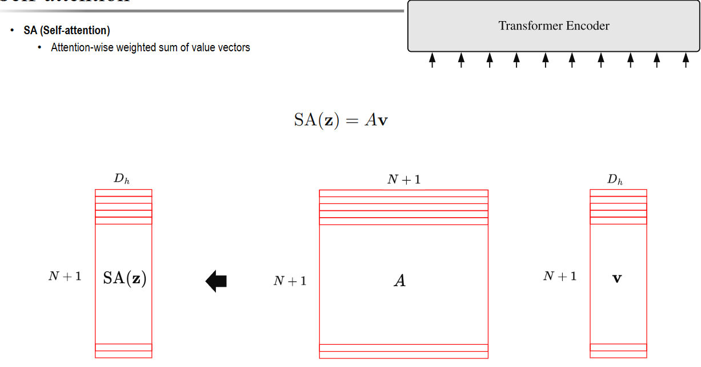

**Self-Attention은 같은 시퀀스에서 만든 Q·K·V를 사용해, 각 토큰에 다른 토큰의 정보를 반영하는 연산**입니다. ‘Self’는 자기 토큰만 본다는 뜻이 아니라, Q·K·V의 출처가 같은 시퀀스라는 뜻입니다.

앞 항목에서 Q·K로 만든 A가 **얼마나 참고할지**를 나타냈다면, 이 그림은 A로 V를 조합해 **실제로 정보를 가져오는 단계**입니다. Head 하나 기준이며, N은 패치 수이고 CLS까지 포함한 토큰 수는 N+1입니다.

$$
\operatorname{SA}(Z) = AV
$$


| 그림의 행렬   | 크기            | 의미                      |
| -------- | ------------- | ----------------------- |
| 가운데 A    | (N+1) × (N+1) | 각 토큰이 모든 토큰을 참고하는 비율    |
| 오른쪽 V    | (N+1) × D\_h  | 각 토큰에서 가져올 정보           |
| 왼쪽 SA(Z) | (N+1) × D\_h  | 다른 위치의 정보를 반영한 토큰별 새 표현 |


#### 행 하나를 계산하면?

출력의 i번째 행은 A의 i번째 행을 가중치로 사용해, 모든 Value 벡터를 더한 결과입니다.

$$
O_i = \sum_{j=0}^{N} A_{ij}V_j
$$

여기서는 0번이 CLS, 1~N번이 패치입니다. 예를 들어 세 토큰의 Value와 한 Query의 가중치가 다음과 같다고 하겠습니다.

```text
V_0 = [2, 0], V_1 = [0, 4], V_2 = [2, 2]
가중치 = [0.5, 0.3, 0.2]

출력 = 0.5[2, 0] + 0.3[0, 4] + 0.2[2, 2]
     = [1.4, 1.6]
```

이처럼 **여러 토큰의 정보를 벡터 하나로 모으되, 각 Query마다 다른 비율로 모읍니다.** 모든 토큰을 하나의 벡터로 합쳐 없애는 것이 아니라, 토큰 수만큼 출력 벡터를 만듭니다.

#### ViT에서의 크기 예시와 다음 단계

패치가 9개이고 CLS가 1개, Head 차원이 64라면 **`A: 10×10`과 `V: 10×64`를 곱해 `출력: 10×64`**를 얻습니다. 0번 출력은 CLS가 모은 정보이고, 다른 출력들은 각 패치가 모은 정보입니다.

여기까지는 **Head 하나의 결과**입니다. 이후 여러 Head의 출력을 Concat하고 출력 Linear로 조합한 다음, 잔차 연결과 MLP를 거쳐 Encoder 처리가 이어집니다. SA(Z) 자체는 클래스 확률이나 최종 분류 결과가 아닙니다.

---

### Multi-Head Self-Attention

앞 절에서는 Head 하나가 Value를 모으는 과정을 확인했습니다. 이제 여러 Head의 결과를 합쳐 Encoder가 사용할 하나의 표현으로 되돌립니다.

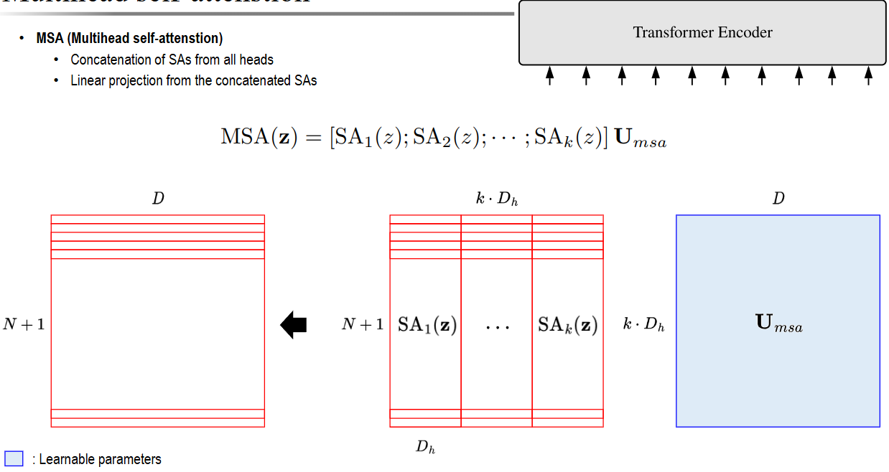

**여러 Head가 서로 다른 관계로 모은 정보를 이어 붙이고, 하나의 토큰 표현으로 조합하는 단계**입니다. 그림의 k는 Head 수이며, 앞 항목의 h와 같은 의미입니다. Key 행렬 K와는 구분합니다.

$$
\operatorname{MSA}(Z)
= \operatorname{Concat}(\operatorname{SA}_1(Z),\ldots,\operatorname{SA}_h(Z))U_{\mathrm{msa}}
$$


| 순서  | 연산                                    | 크기 — 배치 생략            |
| --- | ------------------------------------- | --------------------- |
| 1   | Head마다 서로 다른 Q·K·V로 Self-Attention 계산 | Head 하나당 (N+1) × D\_h |
| 2   | 같은 토큰의 Head별 출력을 특징 방향으로 Concat       | (N+1) × (hD\_h)       |
| 3   | 학습 가능한 출력 가중치 U\_msa로 선형 변환           | 가중치: (hD\_h) × D      |
| 4   | 원래 모델 차원의 표현을 출력                      | (N+1) × D             |


#### Concat과 출력 Linear는 왜 필요할까?

**Concat은 정보를 나란히 놓고, Linear는 서로 섞습니다.** Head마다 학습한 표현을 그대로 보관하는 데서 끝내지 않고, 출력 가중치가 여러 Head의 정보를 조합합니다. 출력 차원을 D로 맞추면 블록 입력과 잔차 덧셈도 할 수 있습니다.

예를 들어 패치 9개와 CLS 1개, D=768, Head 12개, D_h=64이면 다음과 같습니다.

```text
Head별 출력 12개: 각각 10 × 64
         ↓ 같은 토큰의 특징을 Concat
10 × (12 × 64) = 10 × 768
         ↓ 출력 Linear: 768 × 768
최종 MSA 출력: 10 × 768
```

토큰이 120개가 되는 것이 아니라 **토큰 10개 각각의 Head별 특징을 합치는 것**입니다. hD_h가 이미 D와 같더라도, 출력 Linear는 학습을 통해 Head들의 정보를 섞는 역할을 합니다. 여러 Head의 Attention 가중치를 단순히 평균 내는 과정과도 다릅니다.

#### Encoder에서 이어지는 처리

Pre-LN ViT 블록에서는 `입력 → LN → MSA → 원래 입력과 더하기 → LN → MLP → 다시 더하기` 순서로 진행합니다. 이런 블록을 L개 통과한 뒤 최종 CLS를 분류에 사용합니다. Head별 결과가 각각 별도의 이미지 분류 결과인 것은 아닙니다.

---

<a id="classification"></a>
### Classification

여러 Head의 결과는 잔차 연결과 MLP를 거치고, 다음 Encoder 블록으로 전달됩니다. 이 과정을 모든 블록에서 반복한 뒤에는 최종 CLS 표현을 선택해 이미지 분류를 수행합니다.

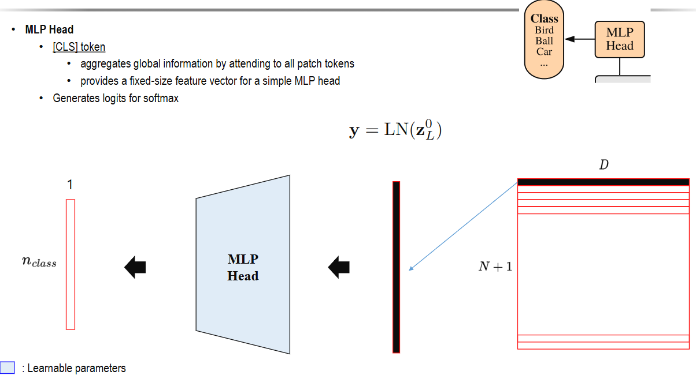

**Encoder의 전체 출력 중 0번 CLS 벡터를 골라, 이미지의 클래스별 점수로 바꾸는 단계**입니다. 그림은 오른쪽에서 왼쪽으로 읽습니다.

$$
y = \operatorname{LN}(z_L^{(0)}), \qquad
\mathrm{logits} = \operatorname{Head}(y)
$$


| 단계                  | 크기 — 배치 생략 | 의미                        |
| ------------------- | ---------- | ------------------------- |
| 최종 Encoder 출력 z\_L  | (N+1) × D  | CLS와 모든 패치의 문맥 표현         |
| 0번 CLS 선택           | D          | 이미지 분류에 사용할 특징 벡터 하나      |
| LayerNorm           | D          | 최종 CLS 표현을 정규화. 그림의 y에 해당 |
| 분류 Head             | n\_class   | 클래스마다 점수(logit) 하나 계산     |
| Softmax — 확률이 필요할 때 | n\_class   | 점수를 합이 1인 클래스 확률로 변환      |


#### 왜 CLS 하나만 사용할까?

CLS는 각 블록의 Self-Attention에서 패치들과 상호작용하며 **분류에 필요한 정보를 모으도록 학습**됩니다. 그래서 패치 수와 별개로 Head에 D차원 벡터 하나를 전달할 수 있습니다. 패치 출력들이 직접 Head에 들어가지 않아도, Attention을 통해 CLS 표현과 분류 결과에 영향을 줍니다.

그림의 MLP Head는 분류용 신경망을 가리킵니다. 구성에 따라 여러 층일 수도 있고, 파인튜닝 시에는 Linear 한 층을 사용할 수도 있습니다. Encoder 내부에서 토큰별 특징을 가공하는 MLP와는 별개의 모듈입니다.

#### 숫자로 보는 분류 예시

패치 9개, CLS 1개, D=768, 클래스가 새·공·자동차 3개이면 다음과 같습니다.

```text
Encoder 출력 10 × 768
→ 최종 CLS 선택 및 LayerNorm: 768
→ 분류 Head: 점수 3개
→ Softmax 예시: [새 0.7, 공 0.2, 자동차 0.1]
→ 가장 높은 확률의 '새' 선택
```

**토큰 수 10과 클래스 수 3은 서로 다른 개념**입니다. 배치가 B장이면 흐름은 `B × 10 × 768 → B × 768 → B × 3`입니다. 그림에서 클래스 출력이 세로 벡터로 그려진 것은 시각화 방식이며, 코드에서는 보통 배치마다 클래스 점수를 한 행으로 배치합니다.

#### 학습과 추론에서 주의할 점

- **학습:** CrossEntropyLoss에 Softmax 전 logits와 정수 정답 라벨을 넣습니다. 손실은 Head뿐 아니라 Encoder·패치 투영·CLS·위치 임베딩까지 역전파됩니다. 단, 학습 대상으로 설정된 파라미터에 한합니다.
- **추론:** 확률을 표시하려면 Softmax를 사용합니다. 가장 높은 점수의 클래스만 필요하면 logits에 바로 argmax를 적용해도 결과가 같습니다.
- **Attention 가중치와 클래스 확률은 다릅니다.** Attention은 어느 토큰의 정보를 섞을지 정하고, 최종 Softmax는 어느 클래스일지 나타냅니다.

---

<a id="vit-evaluation"></a>
### ViT 실험과 학습된 표현

이제 입력부터 분류까지의 계산 흐름을 확인했습니다. 다음 실험은 이러한 구조가 학습을 통해 어떤 시각적 특징과 공간 관계를 얻는지, 그리고 사전학습 데이터의 규모가 왜 중요한지를 보여줍니다.

#### 1. 학습된 ViT 내부를 살펴보기

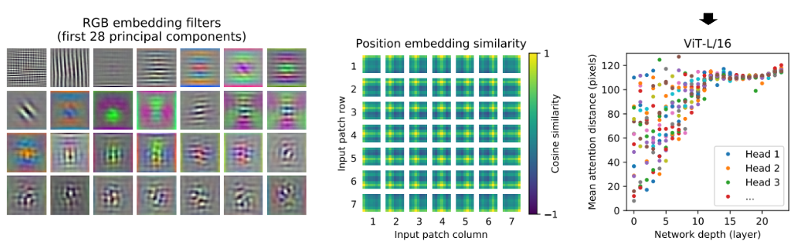

**이 그림은 학습 후 ViT가 어떤 특징과 공간 관계를 표현하는지 분석한 결과입니다.** 왼쪽·가운데는 ViT-L/32, 오른쪽은 표시된 ViT-L/16의 분석입니다. 모델 이름의 `/32`와 `/16`은 패치 한 변의 픽셀 크기를 뜻합니다.


| 부분                                 | 무엇을 보여주는가?                              | 쉬운 해석                                                |
| ---------------------------------- | --------------------------------------- | ---------------------------------------------------- |
| 왼쪽: RGB embedding filters          | 학습된 패치 투영 필터의 주요 변화를 PCA로 요약한 첫 28개 주성분 | 선·방향·색 변화 같은 패턴을 표현하는 기초가 학습됨                        |
| 가운데: Position embedding similarity | 기준 위치와 다른 모든 위치의 위치 벡터 간 코사인 유사도        | 가까운 위치나 같은 행·열의 위치 사이에 유사한 표현이 나타남                   |
| 오른쪽: Mean attention distance       | 각 층·Head에서 Attention 가중치로 평균한 공간 거리     | 초기 층은 가까운 곳과 먼 곳을 보는 Head가 섞이고, 깊은 층은 넓은 영역을 참고하는 경향 |


##### 왼쪽: 필터 그림을 읽는 방법

작은 그림은 이미지 패치 원본이나 클래스별 대표 이미지가 아니라 **학습한 투영 가중치를 주성분으로 요약한 시각화**입니다. CNN의 초기 필터와 비슷한 선·색 패턴이 보이지만, 이것만으로 CNN과 완전히 같은 표현을 배웠다고 단정하지는 않습니다.

##### 가운데: 위치 정보는 무엇을 배웠을까?

7×7의 작은 타일 각각은 그 위치의 임베딩을 기준으로, 모든 패치 위치와의 유사도를 그린 지도입니다. 밝은 쪽은 코사인 유사도가 높고, 어두운 쪽은 낮습니다. **패치 위치마다 다른 벡터를 학습했는데도, 결과에는 이미지의 2차원 공간 관계가 나타났다는 점**이 중요합니다. 이 지도는 Q·K로 계산한 Attention 가중치 행렬이 아닙니다.

##### 오른쪽: Attention 거리가 의미하는 것

가로축은 층의 깊이, 세로축은 픽셀 단위의 평균 Attention 거리입니다. 점 하나는 **한 층의 Head 하나를 여러 이미지에 걸쳐 평균한 값**입니다. 가까운 패치에 큰 비중을 주면 거리가 작고, 먼 패치까지 비중을 주면 커집니다.

**모든 층은 구조상 전역 Attention이 가능하지만, 실제로 참고하는 거리의 분포는 학습에 따라 달라집니다.** 따라서 평균 거리는 참고 영역을 요약하는 지표로 읽어야 하며, 필터 크기나 최대 참고 거리로 해석할 수는 없습니다. Attention 가중치 역시 모델의 판단 과정 중 일부를 보여줍니다.

---

#### 2. 사전학습과 평가에 사용한 데이터

이러한 표현은 학습 데이터로부터 얻어집니다. 원 ViT 연구가 어떤 규모의 데이터로 모델을 사전학습하고 평가했는지 확인하면 실험의 의미를 더 정확히 이해할 수 있습니다.


| 데이터셋         | 대략적인 규모                     | 원 ViT 실험에서의 역할                 |
| ------------ | --------------------------- | ------------------------------ |
| ImageNet-1K  | 학습 이미지 약 128만 장, 1,000클래스   | 직접 학습 비교 및 사전학습 모델의 파인튜닝·평가    |
| ImageNet-21K | 이미지 약 1,400만 장, 약 2만 1천 클래스 | 더 큰 규모의 사전학습                   |
| JFT-300M     | 이미지 약 3억 장, 약 1만 8천 라벨      | 대규모 사전학습. 해당 실험의 Google 내부 데이터 |


표의 규모는 원 논문 실험을 설명하기 위한 근삿값입니다. JFT는 이미지 하나에 여러 라벨이 붙을 수 있으므로 라벨 수와 단일 정답 클래스 수를 구분해야 합니다. 또한 데이터별로 접근·이용 조건이 다릅니다.

**사전학습은 큰 데이터로 일반적인 시각 표현을 배우는 단계이고, 파인튜닝은 목표 데이터와 클래스에 맞춰 모델을 조정하는 단계**입니다. 예를 들어 큰 데이터로 학습한 Encoder를 가져와 ImageNet-1K의 1,000클래스에 맞는 분류 Head와 함께 조정할 수 있습니다.

#### 보충: 데이터 규모 실험의 두 그래프 읽기

[교안 20쪽](../교안/03_00_Attention.pdf#page=20)은 서로 다른 평가를 나란히 놓습니다. 왼쪽은 사전학습 데이터셋(ImageNet, ImageNet-21k, JFT-300M)을 바꾼 뒤 ImageNet으로 전이한 Top-1 정확도입니다. 오른쪽은 JFT 사전학습 표본 수(10M~300M)에 따른 ImageNet **5-shot 선형 평가**입니다. 가로축 범주·평가 방식이 다르므로 두 세로축 값을 같은 실험처럼 직접 비교하지 않습니다.

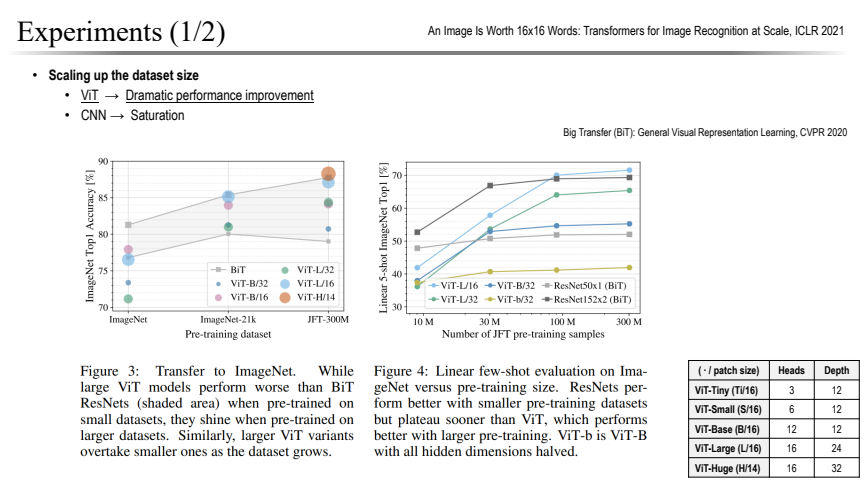

작은 데이터 조건에서는 CNN 계열 BiT가 유리하고, 더 큰 사전학습 데이터에서는 큰 ViT의 개선이 두드러집니다. 이는 해당 실험에서의 관찰이며 CNN의 성능에 보편적인 상한이 있다는 증명은 아닙니다. **귀납적 편향(inductive bias)**은 모델이 데이터를 보기 전부터 가진 구조적 가정입니다. CNN의 지역 연결과 가중치 공유는 작은 데이터에서 도움이 될 수 있고, ViT는 상대적으로 적은 공간 가정을 더 많은 데이터로 학습할 수 있습니다. CNN도 층을 쌓으면 넓은 문맥을 보므로 ‘지역 정보만 영원히 본다’는 뜻은 아닙니다. 교안의 translation equivalence는 통상 **이동 등변성(equivariance)**을 가리키며, 입력을 옮기면 특징도 함께 옮겨지는 성질입니다. 패딩·stride 등의 조건에 따라 정확한 등변성은 달라집니다.

#### 핵심 결론

원 논문에서는 CNN보다 지역성 등의 구조적 가정이 적은 ViT가 **충분한 규모의 사전학습을 통해 유용한 시각 특징과 공간 관계를 배울 수 있음**을 보였습니다. 작은 데이터에서 학습한 기본 ViT가 항상 CNN보다 좋다는 결론은 아닙니다. 내부 표현 그림과 데이터셋 표 자체에는 정확도 수치가 없으므로, 성능 우열은 별도의 평가 결과와 학습 조건으로 판단해야 합니다.

출처: [ViT 원 논문 — 실험 및 내부 표현 분석](https://arxiv.org/html/2010.11929v2#S4)

---

### ViT Variant

기본 ViT의 성능은 데이터뿐 아니라 패치 크기와 모델 규모, 학습 방법에 따라서도 달라집니다. 이를 바탕으로 모델 이름의 차이를 먼저 정리하고, 이후 연구가 어떤 방향으로 확장되었는지 살펴보겠습니다.

**ViT Variant는 기본 ViT를 목적에 맞게 변형한 모델이나 구성을 뜻합니다.**

크게 두 가지 의미로 사용됩니다.


| 구분              | 예시                     | 바뀌는 점                            |
| --------------- | ---------------------- | -------------------------------- |
| **규모·패치 크기 변경** | ViT-B/16, ViT-L/32     | 층 수, 임베딩 차원, Head 수, 패치 크기       |
| **구조·학습 방법 변경** | DeiT, Swin Transformer | 데이터 효율을 높이거나 Attention 계산 방식을 변경 |


예를 들어 **ViT-B/16**에서 **B(Base)는 모델 규모**, **16은 `16×16` 픽셀의 패치 크기**를 뜻합니다.

**ViT-L/16**은 같은 패치 크기를 사용하면서 더 큰 모델이고, **ViT-B/32**는 Base 규모에 더 큰 패치를 사용해 토큰 수를 줄인 구성입니다.

따라서 모델 이름을 비교할 때는 규모와 패치 크기를 함께 확인해야 합니다. 다음에 살펴볼 방법들은 이 설정의 변경을 넘어, 학습 목표나 Attention 구조까지 확장합니다.

---

<a id="check"></a>
## 4. 확인 문제와 해설

먼저 답을 가리고 계산하세요.

1. 위 예제에서 V만 두 배로 만들면 Attention 가중치와 출력은 어떻게 바뀌나요?
2. 224×224 RGB, P=8, D=384, Head=6일 때 패치 수, CLS 포함 토큰 수, Head 차원, Attention shape(배치 2)를 구하세요.
3. CLS를 추가하는 연산과 위치 임베딩을 더하는 연산은 각각 어느 차원을 바꾸나요? 최종 클래스 수가 10이면 출력은 무엇인가요?
4. 같은 해상도에서 P=16을 P=8로 바꾸면 Attention 점수 원소 수는 정확히 16배인가요?

<details>
<summary>해설과 돌아갈 위치</summary>

1. Q·K가 같으므로 가중치는 그대로입니다. AV의 V만 두 배가 되어 출력도 두 배입니다. 막히면 [QKV 예제](#qkv-example)의 마지막 두 행을 대조하세요.
2. N=(224/8)²=784, T=785, d_h=384/6=64입니다. Q는 `2×6×785×64`, Attention은 `2×6×785×785`입니다. Head마다 모든 토큰을 처리합니다. [ViT](#vit)의 Query/Key/Value 절로 돌아가세요.
3. CLS를 이어 붙이면 N→N+1이고 D는 같습니다. 위치 임베딩은 같은 shape끼리 덧셈하므로 shape가 유지됩니다. 최종 CLS만 고르면 `2×384`, 분류 Head 뒤는 `2×10`입니다. [ViT](#vit)의 Position Embedding·Classification을 확인하세요.
4. 패치만 비교하면 784²/196²=16입니다. CLS를 포함하면 785²/197²≈15.878배입니다. 모델 전체 FLOPs에는 Linear·MLP도 있으므로 이 비율을 그대로 적용하지 않습니다. [ViT](#vit)의 기억할 점으로 돌아가세요.

</details>

다음은 같은 구조를 더 잘 학습하는 [DeiT와 계산 범위를 바꾸는 Swin](03_03_DeiT와_Swin.md)입니다. [학습 지도](03_01_Attention_Note.md)로 돌아갈 수도 있습니다.
