# DeiT와 Swin: 데이터 효율과 계산 효율

ViT를 실용적으로 만드는 두 질문을 나눠 봅니다. **DeiT는 같은 데이터에서 더 좋은 학습 신호를 얻고, Swin은 한 번에 비교할 토큰 범위와 특징 해상도를 바꿉니다.** 두 방법은 서로 다른 설계 축을 다룹니다.

**목표:** 정답·교사 예측·두 Head의 손실을 구별하고, Window·Shift·Mask·Patch Merging의 역할과 계산량을 연결하며, 파라미터 수와 실행 비용을 분리해 설명합니다.

선수지식은 [Attention과 ViT](03_02_Attention과_ViT.md)의 QKV, CLS, 패치와 잔차 연결입니다. [학습 지도](03_01_Attention_Note.md)에서 전체 순서를 확인할 수 있습니다.

**핵심 경로:** [문제 지도](#directions) → [DeiT의 두 학습 목표](#deit) → [Swin의 연결 범위](#swin) → [손계산과 확인](#check).
**심화:** 두 모델의 Experiments와 [파라미터 수](#parameters)는 평가 조건을 비교할 때 읽습니다. 기본 학습 중에는 실험의 모든 수치를 외우지 않아도 됩니다.

원문: [교안 23~37쪽](../교안/03_00_Attention.pdf#page=23). 추가 손계산·문제는 교육용 보충입니다. 표의 논문 성능은 재현 실험 결과가 아니라 원문 보고값입니다.

<a id="directions"></a>
## 1. 어떤 병목을 바꾸는가

ViT 이후의 연구는 **데이터·계산 비용을 줄이거나, 라벨 의존도를 낮추고 활용 범위를 넓히는 방향**으로 발전했습니다. 여기서는 DeiT·Swin·CLIP·DINO를 비교한 뒤, 이 문서의 학습 흐름과 직접 이어지는 DeiT와 Swin을 자세히 살펴봅니다. 네 방법은 각각 학습 전략, 모델 구조, 학습 데이터와 목표 등 서로 다른 부분을 개선합니다.


| 방법                   | 해결하려던 문제                                       | 핵심 방법                                                                                | 쉽게 기억하기                            |
| -------------------- | ---------------------------------------------- | ------------------------------------------------------------------------------------ | ---------------------------------- |
| **DeiT**             | 초기 ViT가 좋은 성능을 내려면 대규모 외부 데이터와 학습 자원을 많이 요구    | 데이터 증강·규제 등 학습 방법을 개선하고, 증류 버전에서는 교사 모델의 예측을 배우는 Distillation token 사용               | **더 적은 데이터로 잘 학습하기**               |
| **Swin Transformer** | 전역 Attention의 계산 부담과, 검출·분할에 필요한 여러 해상도 특징의 부족 | 작은 Window 안에서 Attention을 계산하고, Window 위치를 이동해 영역 간 정보를 연결. Patch merging으로 계층적 특징 생성 | **작은 창으로 효율적으로 보고, 여러 크기의 특징 만들기** |
| **CLIP**             | 고정된 클래스 라벨로 학습한 모델은 새로운 개념·작업에 추가 라벨과 학습이 필요   | 이미지·텍스트 쌍을 대조 학습해, 맞는 이미지와 설명의 표현을 가깝게 정렬                                            | **이미지와 언어를 연결해 새 분류 기준에도 활용하기**    |
| **DINO**             | 사람이 붙인 정답 라벨 없이도 유용한 시각 특징을 학습하고 싶음            | 같은 이미지의 다른 뷰에서 Student가 Teacher의 출력을 맞추는 자기증류. Teacher는 Student 가중치의 이동평균으로 갱신       | **라벨 없이 이미지 자체에서 특징 배우기**          |


**CLIP은 이미지 Encoder와 텍스트 Encoder를 함께 학습하는 방법**이며, 이미지 Encoder로 ViT뿐 아니라 ResNet도 사용할 수 있습니다. 분류할 때 “고양이 사진”, “강아지 사진” 같은 설명과 이미지의 유사도를 비교하면 해당 과제의 별도 학습 없이 사용하는 Zero-shot 분류가 가능합니다.

**여기서 DINO는 원래의 자기지도 시각 표현 학습 방법**을 뜻합니다. 이후의 DINOv2나 이름이 같은 객체 검출 모델 DINO와는 구분합니다. 라벨 없이 특징을 배우는 것이지, 학습 후 클래스 이름까지 자동으로 붙여 주는 것은 아닙니다.

원 논문: [DeiT](https://arxiv.org/abs/2012.12877), [Swin](https://arxiv.org/abs/2103.14030), [CLIP](https://arxiv.org/abs/2103.00020), [DINO](https://arxiv.org/abs/2104.14294)

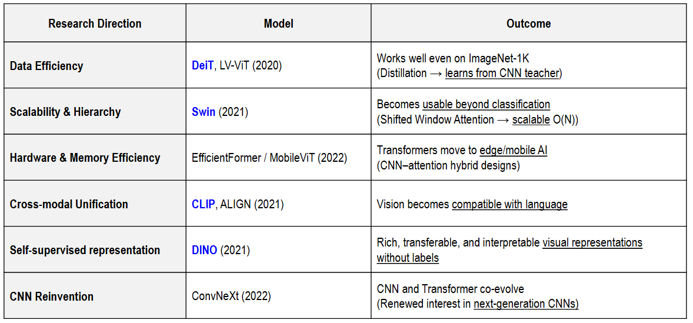

---


교안 24쪽은 이 밖에 LV-ViT(데이터 효율), EfficientFormer·MobileViT(장치·메모리 효율), ALIGN(이미지·언어 정렬), ConvNeXt(CNN 구조 재설계)를 연구 방향의 예로 듭니다. 이 장은 그 지도를 보존하되 구조 상세는 교안이 전개하는 DeiT·Swin에 집중합니다. 연도나 이름을 발전 순위로 외우기보다 데이터·계산·감독 신호 중 어느 축을 바꾸는지 구별하세요.

<a id="deit"></a>
## 2. 교사의 예측을 학습 신호로 쓰는 DeiT

---

### Overview


먼저 학습 전략의 관점에서 ViT를 개선한 DeiT를 살펴보겠습니다. 앞서 원 ViT의 실험에서 확인한 대규모 사전학습 의존을 완화하는 것이 출발점입니다.

**DeiT(Data-efficient Image Transformers)는 대규모 외부 데이터 없이도 ViT를 효과적으로 학습하도록 만든 학습 방법과 모델 계열**입니다. 원 ViT의 대규모 사전학습 의존을 줄여, ImageNet-1K만으로 경쟁력 있는 성능을 내는 것이 목표였습니다. 원 ViT도 ImageNet-1K로 학습할 수는 있지만, 원 논문의 조건에서는 큰 데이터로 사전학습했을 때 강점이 뚜렷했습니다.

교안 26쪽의 화학 증류 장치는 이름을 설명하는 비유입니다. 지식 증류는 모델의 가중치를 물리적으로 추출하거나 그대로 복사하는 연산이 아니라, 교사의 출력으로 학생의 손실 목표를 만드는 학습입니다.

#### 어떻게 데이터 효율을 높일까?


| 방법                 | 하는 일                                    | 의미                                |
| ------------------ | --------------------------------------- | --------------------------------- |
| 학습 전략 개선           | 데이터 증강, Mixup·CutMix, 규제, 최적화 등의 조합을 조정 | 같은 데이터로 더 잘 학습                    |
| 지식 증류 — 증류 버전      | 교사 모델의 예측을 학생 Transformer에 전달           | 정답 라벨 외에 교사가 배운 판단도 활용            |
| Distillation token | CLS와 별도로 교사의 예측을 배우는 토큰 추가              | Attention을 통해 교사 신호가 패치 표현 학습에 반영 |


**DeiT의 개선이 전부 지식 증류 때문인 것은 아닙니다.** 증류 없는 DeiT도 개선된 학습 전략을 사용하며, 증류를 추가한 모델은 성능을 더 높입니다. CNN 교사를 사용하면 CNN이 배운 시각적 판단을 학생 ViT에 전달할 수 있지만, 학생의 기본 구조 자체가 CNN으로 바뀌는 것은 아닙니다.

---

#### CLS와 Distillation token의 차이


| 토큰                 | 학습에서 맞추는 대상 | 역할                   |
| ------------------ | ----------- | -------------------- |
| CLS                | 데이터의 정답 클래스 | 일반적인 분류 예측           |
| Distillation token | 교사 모델의 예측   | 교사의 판단을 배우는 별도 분류 예측 |


증류 버전의 입력은 **`CLS + 패치 N개 + Distillation token`으로 총 N+2개 토큰**입니다. 토큰 모두가 Encoder에서 상호작용하고, 최종 CLS와 증류 토큰에는 각각 분류 Head를 연결합니다. 원 논문에서는 교사가 고른 클래스 자체를 목표로 사용하는 Hard distillation이 효과적이었습니다. 추론할 때는 두 Head의 예측 확률을 평균해 사용할 수 있으며 교사 모델은 필요하지 않습니다.

---

#### 그림: 학습 전략과 증류의 효과

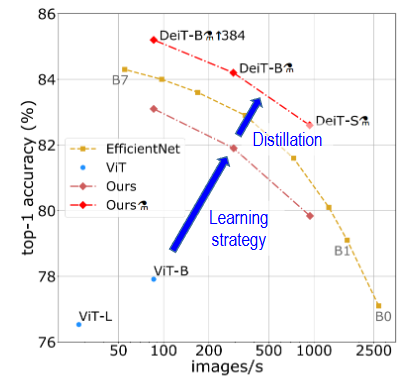


| 그래프 표시             | 읽는 방법                                     |
| ------------------ | ----------------------------------------- |
| 가로축 images/s       | 초당 처리 이미지 수. 오른쪽일수록 빠름. 학습에 사용한 이미지 수가 아님 |
| 세로축 Top-1 accuracy | 가장 높은 점수의 클래스가 정답인 비율. 위쪽일수록 좋음           |
| ViT — 파란 점         | 비교 대상인 기본 ViT 결과                          |
| Ours — 빨간 계열       | DeiT 학습 전략을 적용한 결과                        |
| 증류 표시가 붙은 Ours     | Transformer용 지식 증류까지 적용한 결과               |


그림의 **Learning strategy 화살표는 학습 방법 개선**, **Distillation 화살표는 교사 지식 추가 전달**에 따른 정확도 향상을 강조합니다. 특히 DeiT-B와 ViT-B는 기본 모델 구조가 같아, 차이가 단순한 모델 크기 증가 때문은 아님을 보여줍니다.

가장 위의 **384** 표시는 입력 해상도 384×384 조건입니다. 해상도가 높아지면 토큰 수와 계산량이 늘 수 있으므로, 서로 다른 해상도의 점을 같은 계산 조건으로 해석하면 안 됩니다. 처리량은 원 그림의 V100 GPU 측정 조건에 해당하며 다른 기기에서 그대로 보장되지 않습니다.

**“외부 데이터 없음”은 원 DeiT 실험에서 추가 데이터셋 없이 학습했다는 뜻이며, 정답 라벨 없이 학습했다는 뜻은 아닙니다.** ImageNet 라벨과, 증류 버전에서는 교사 예측을 함께 활용합니다. 라벨 없는 자기지도 학습인 DINO와 구별해야 합니다.

출처: [DeiT 원 논문 — Training data-efficient image transformers &amp; distillation through attention](https://arxiv.org/abs/2012.12877)

---

### Architecture &amp; Loss

학습 전략의 효과를 확인했으므로, 이제 증류 버전에서 교사의 판단이 학생에게 전달되는 경로를 살펴보겠습니다. 구조에서는 두 토큰과 Head를, 손실에서는 각각의 학습 목표를 구분하는 것이 핵심입니다.

#### 1. 구조: 정답과 교사를 함께 배우는 학생 모델

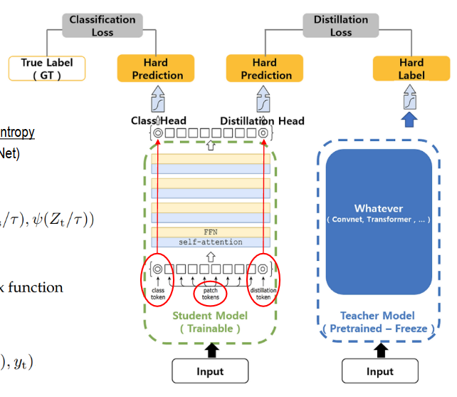

**학생 Transformer는 실제 정답과 교사의 판단을 두 경로로 학습합니다.** 같은 이미지가 학생과 교사에 입력되며, 학생만 역전파로 갱신하고 사전학습한 교사는 고정합니다.


| 구성                                     | 학습 대상              | 역할               |
| -------------------------------------- | ------------------ | ---------------- |
| CLS token → Class Head                 | 실제 정답 라벨 y         | 정답을 맞히는 분류 능력 학습 |
| Distillation token → Distillation Head | 교사의 예측             | 교사가 배운 판단을 전달받음  |
| Teacher model                          | 학생의 증류 손실로 갱신하지 않음 | 학생이 따라 배울 목표 제공  |


입력은 **패치 N개 + CLS + Distillation token = N+2개 토큰**입니다. 두 특수 토큰은 같은 Encoder 안에서 패치들과 상호작용하되, 마지막에 서로 다른 Head로 점수를 만듭니다. 두 토큰의 최종 값이 반드시 같아지는 것은 아닙니다.

교사는 CNN이나 Transformer일 수 있습니다. 원 DeiT 연구는 특히 **RegNet 계열의 강한 CNN 교사**를 활용했습니다. RegNet과 EfficientNet은 서로 다른 모델 계열입니다.

---

#### 2. 손실: Soft distillation과 Hard distillation

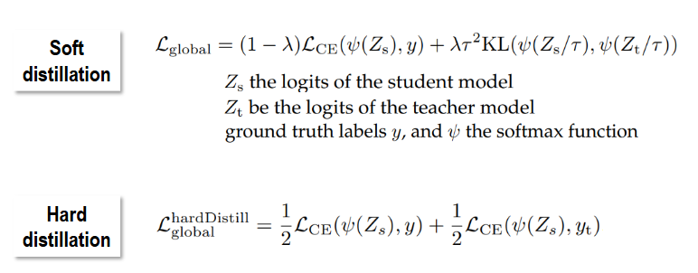

아래는 두 Head를 가진 증류 토큰 모델에서 **정답 라벨로 계산한 분류 손실과 교사 예측으로 계산한 증류 손실을 결합하는 방식**입니다. 두 Head를 구분하기 위해 학생 점수를 z_cls와 z_dist, 교사 점수를 z_t로 표기합니다. 뒤의 실험 표에는 교사의 목표만 사용하는 일반 증류 비교도 포함되므로, 그 설정과 구분해서 읽어야 합니다.


| 방식                | 교사가 제공하는 목표      | 학생이 맞추는 내용                          |
| ----------------- | ---------------- | ----------------------------------- |
| Soft distillation | 전체 클래스의 확률분포     | 예: 고양이 0.7, 강아지 0.2, 토끼 0.1의 상대적 관계 |
| Hard distillation | 가장 높은 점수의 클래스 하나 | 위 예시에서는 정수 라벨 ‘고양이’                 |


---

##### Soft distillation

온도 τ로 부드럽게 만든 교사·학생 분포를 비교합니다. 여기서는 KL의 첫 인자를 목표 분포로 정의합니다.

$$
p_t^{(\tau)} = \operatorname{softmax}(z_t/\tau), \qquad
p_s^{(\tau)} = \operatorname{softmax}(z_{\mathrm{dist}}/\tau)
$$

$$
\mathcal{L}_{\mathrm{soft}}
= (1-\lambda)\operatorname{CE}(z_{\mathrm{cls}},y)
+ \lambda\tau^2 D_{\mathrm{KL}}\left(p_t^{(\tau)}\;\Vert\;p_s^{(\tau)}\right)
$$

- **λ**: 정답 손실과 증류 손실의 비중입니다.
- **τ(Temperature)**: 클수록 분포가 부드러워져 정답 외 클래스의 상대적 정보도 전달하기 쉽습니다.
- **τ²**: 온도 사용에 따른 증류 기울기 규모 변화를 보정하는 계수입니다.
- **KL**: 교사와 학생 분포의 차이를 측정합니다. 방향에 따라 값이 달라지므로 목표·예측의 정의와 구현의 인자 순서를 확인해야 합니다.

---

##### Hard distillation

교사의 최고 점수 클래스를 정수 라벨 y_t로 사용합니다.

$$
y_t = \operatorname*{argmax}_c z_{t,c}
$$

$$
\mathcal{L}_{\mathrm{hard}}
= \frac{1}{2}\operatorname{CE}(z_{\mathrm{cls}},y)
+ \frac{1}{2}\operatorname{CE}(z_{\mathrm{dist}},y_t)
$$

첫 항은 **CLS Head가 실제 정답을 맞히도록**, 둘째 항은 **Distillation Head가 교사의 선택을 맞히도록** 합니다. 교사가 틀릴 수도 있으므로 y와 y_t가 항상 같은 것은 아닙니다. 원 DeiT 실험에서는 Hard distillation이 효과적이었습니다.

---

##### 그림의 ‘Hard Prediction’ 표기를 해석할 때 주의

학생의 예측을 먼저 argmax로 바꿔 손실에 넣는다는 뜻으로 읽으면 안 됩니다. **학생은 미분 가능한 logits로 손실을 계산**하고, Hard distillation에서는 교사의 예측에만 argmax를 적용해 목표 라벨을 만듭니다. PyTorch의 `CrossEntropyLoss`는 위 식의 CE에 logits와 정수 라벨을 전달하는 방식으로 사용할 수 있습니다.

---

#### 학습과 추론

```text
학습: 같은 이미지 → 학생의 두 Head / 고정된 교사
      → 정답 분류 손실 + 교사 증류 손실
      → 학생 Encoder·두 토큰·두 Head 등을 갱신

추론: 이미지 → 학생의 두 Head → 예측 확률 평균 → 클래스 선택
      교사는 필요 없음
```

**두 Head가 있어도 최종적으로 서로 다른 정답 두 개를 요구하는 것이 아닙니다.** 같은 클래스 집합을 예측하되 학습 목표의 출처가 다르며, 추론에서 예측을 결합할 수 있습니다.

출처: [DeiT 원 논문](https://arxiv.org/abs/2012.12877)

---

### DeiT Experiments

구조와 손실을 이해했다면, 이제 교사의 종류와 증류 방식이 실제 결과에 어떤 차이를 만드는지 확인할 수 있습니다.

두 표는 **어떤 교사를 쓰는지, 어떤 증류 목표와 출력 Head를 쓰는지**에 따라 학생 DeiT의 성능이 어떻게 달라지는지 비교합니다. 수치는 ImageNet **Top-1 정확도(%)**이며, 높을수록 좋습니다. Ti·S·B는 Tiny·Small·Base 모델, 224·384는 입력 이미지 한 변의 픽셀 수입니다.

---

#### 1. 교사 모델에 따른 학생 성능


| 교사 모델        | 교사 정확도 (%) | 학생 DeiT-B 증류 모델 — 사전학습, 224 (%) | 학생 — 384 해상도 파인튜닝 후 (%) |
| ------------ | ---------- | ------------------------------- | ----------------------- |
| DeiT-B       | 81.8       | 81.9                            | 83.1                    |
| RegNetY-4GF  | 80.0       | 82.7                            | 83.6                    |
| RegNetY-8GF  | 81.7       | 82.7                            | 83.8                    |
| RegNetY-12GF | 82.4       | 83.1                            | 84.1                    |
| RegNetY-16GF | 82.9       | 83.1                            | 84.2                    |


##### 결과 해석

이 표에서는 **교사의 정확도만으로 학생 성능이 결정되지는 않는다**는 점이 드러납니다. RegNetY-4GF 교사의 정확도는 80.0%로 DeiT-B 교사의 81.8%보다 낮지만, 학생은 각각 82.7%와 81.9%를 기록했습니다. 이 조건에서는 CNN 교사가 학생에게 더 유용한 학습 신호를 제공한 것입니다.

이는 CNN의 지역성 같은 구조적 가정(inductive bias)에서 얻은 시각적 판단을 ViT에 전달하는 것이 도움이 된다는 해석을 뒷받침합니다. 다만 이 결과를 모든 CNN 교사와 Transformer 교사의 우열로 일반화할 수는 없습니다. 학생은 교사의 판단을 참고하면서도 자신의 구조와 학습 과정을 통해 학습하므로, 교사보다 높은 정확도를 얻을 수도 있습니다.

오른쪽 열은 384 해상도로 파인튜닝한 별도의 조건입니다. 높은 해상도로 세부 정보를 더 활용할 수 있지만 계산량도 늘어나므로, 같은 비용에서 정확도만 높아진 것으로 해석해서는 안 됩니다. 다음 표에서는 교사보다 **증류 목표와 출력의 사용 방식**에 초점을 맞춥니다.

---

#### 2. 증류 방식과 출력 Head 비교


| 방법                             | 정답 라벨 사용 | 교사 목표   | Ti 224 (%) | S 224 (%) | B 224 (%) | B → 384 (%) |
| ------------------------------ | -------- | ------- | ---------- | --------- | --------- | ----------- |
| DeiT — 증류 없음                   | ✓        | 없음      | 72.2       | 79.8      | 81.8      | 83.1        |
| DeiT — 일반적인 Soft 증류            | ✗        | Soft 분포 | 72.2       | 79.8      | 81.8      | 83.2        |
| DeiT — Hard 증류                 | ✗        | Hard 라벨 | 74.3       | 80.9      | 83.0      | 84.0        |
| 증류 토큰 모델 — CLS 출력만 사용          | ✓        | Hard 라벨 | 73.9       | 80.9      | 83.0      | 84.2        |
| 증류 토큰 모델 — Distillation 출력만 사용 | ✓        | Hard 라벨 | 74.6       | 81.1      | 83.1      | 84.4        |
| 증류 토큰 모델 — 두 출력 결합             | ✓        | Hard 라벨 | 74.5       | 81.2      | 83.4      | 84.5        |


원 표는 **300 epochs 사전학습** 조건을 제시합니다. ‘정답 라벨 사용’은 해당 행의 **학생 학습 목표**에 관한 표시이며, 교사가 라벨 없이 학습됐다는 뜻은 아닙니다. 마지막 세 행은 같은 증류 토큰 학습 방식에서 평가에 사용할 출력을 달리한 비교이고, 마지막 행은 두 분류기의 예측을 결합하는 Late fusion입니다.

##### 결과 해석

먼저 B 224에서 증류 없음과 Soft 증류는 모두 81.8%, Hard 증류는 83.0%입니다. **이 조건에서는 Hard 증류가 더 효과적**이었으며, 교사의 전체 확률분포를 배우는 것이 언제나 더 좋은 것은 아님을 보여줍니다.

다음으로 증류 토큰 모델의 마지막 세 행은 CLS가 실제 정답을, Distillation token이 교사의 Hard 라벨을 학습한 결과입니다. 두 목표를 별도로 배우는 방식이므로, 토큰 하나를 추가한 효과만으로 해석해서는 안 됩니다. B 224에서는 CLS 출력 83.0%, 증류 출력 83.1%, 두 출력 결합 83.4%로 **두 Head의 상호 보완 가능성**이 나타났습니다. 다만 Ti 224에서는 증류 출력만 사용한 74.6%가 결합한 74.5%보다 조금 높아, 결합이 언제나 최고인 것은 아닙니다.

개선량은 퍼센트포인트로 읽습니다. B 224의 81.8% → 83.4%는 +1.6%p, B 384의 83.1% → 84.5%는 +1.4%p입니다. 두 표는 비교 목적과 설정이 다르므로 비슷한 이름의 수치를 무조건 같은 실험으로 취급해서는 안 됩니다. 반복 실험의 분산도 제시되지 않았으므로 0.1%p 정도의 차이를 확정적인 우열로 과장하지 않는 것이 좋습니다.

결국 DeiT의 성능을 이해하려면 **교사의 정확도와 함께, 어떤 목표로 지식을 전달하고 두 예측을 어떻게 활용하는지**를 살펴봐야 합니다.

출처: [DeiT 원 논문 — 표 2·3](https://arxiv.org/abs/2012.12877)

---

### DeiT Summary

지금까지 살펴본 학습 전략, 두 토큰의 역할, 실험 결과를 연결하면 DeiT의 기여를 다음과 같이 정리할 수 있습니다.

#### Key contributions — 핵심 기여


| Contribution                  | Description                                    |
| ----------------------------- | ---------------------------------------------- |
| Knowledge Distillation        | CNN 교사가 학습한 시각적 판단을 학생 Transformer에 전달합니다.     |
| Distillation Token            | 교사의 예측을 배우는 별도 토큰을 두고 Attention으로 패치와 상호작용합니다. |
| Pure Transformer Architecture | 학생은 기본 ViT의 Transformer 구조를 유지합니다.             |
| Optimized Training Recipe     | 데이터 증강·규제·최적화 전략을 조합해 같은 데이터를 더 잘 활용합니다.       |


**DeiT는 수억 장 규모의 외부 데이터 없이도, 학습 방법을 개선하면 Transformer를 효과적으로 학습할 수 있음을 보여줬습니다.** 여기서 데이터 효율적이라는 말은 극소량의 데이터만으로 충분하다는 뜻이 아니라, ImageNet-1K 규모에서도 경쟁력 있는 결과를 얻었다는 의미입니다.

#### 쉽게 정리하면

- **지식 증류:** CNN 교사의 예측을 활용해 교사가 학습한 시각적 판단을 학생 Transformer에 전달합니다.
- **증류 토큰:** CLS는 실제 정답을, 별도 Distillation token은 교사의 예측을 배우도록 합니다. 추론에서는 두 Head의 예측을 결합할 수 있습니다.
- **Transformer 구조 유지:** 학생은 CNN 특징 추출기를 붙인 하이브리드 구조가 아니라, 기본 ViT 구조를 유지합니다. CNN 교사를 쓴다고 학생 자체가 CNN이 되는 것은 아닙니다.
- **학습 전략 개선:** 강한 데이터 증강·규제·최적화 전략을 함께 사용합니다. 증류 없는 DeiT도 이 학습 전략의 효과를 얻습니다.

**핵심은 모델을 무조건 크게 만드는 대신, 같은 데이터를 더 잘 활용하는 학습 전략과 교사 지식 전달로 ViT의 실용성을 높였다는 점**입니다. DINO와 달리 정답 라벨을 사용하는 지도학습이며, 원 실험의 ‘외부 데이터 없음’과 ‘라벨 없음’은 구분해야 합니다.

---

<a id="swin"></a>
## 3. 지역 계산과 윈도우 간 전달을 결합하는 Swin

DeiT가 같은 데이터로 더 잘 학습하는 방법에 초점을 맞췄다면, Swin은 Attention의 계산 범위와 특징의 해상도를 바꿉니다. 특히 고해상도 이미지를 처리하고 검출·분할에 필요한 여러 크기의 특징을 만드는 문제로 이어집니다.

**Swin Transformer는 작은 윈도우 안에서 Attention을 계산하고, 단계별로 공간 크기를 줄이는 계층형 Vision Transformer**입니다. Swin은 Shifted Window에서 온 이름입니다.

### 어떤 문제를 해결하려 했을까?


| 기본 ViT의 부담                       | Swin의 방법                       | 효과                           |
| -------------------------------- | ------------------------------ | ---------------------------- |
| 모든 토큰 쌍의 Attention은 토큰 수의 제곱에 비례 | Window 안에서만 Attention 계산       | 고해상도 입력의 계산 부담 완화            |
| 기본 구조는 여러 층에서 같은 토큰 격자를 유지       | Patch Merging으로 격자를 줄이고 채널을 늘림 | 여러 해상도의 특징 맵 생성              |
| 작은 물체부터 큰 물체까지 다뤄야 하는 검출·분할      | 계층별 특징을 해당 작업의 Head에 제공        | 분류 외 작업에도 쓸 수 있는 Backbone 구성 |


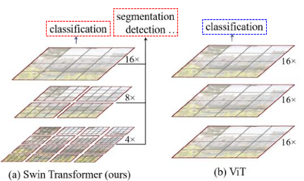

그림 왼쪽 Swin은 **세밀한 격자 → 중간 격자 → 거친 격자**로 진행하며, 각 단계의 특징을 검출·분할에 활용할 수 있습니다. 4×·8×·16×는 입력 대비 공간 축소 배율입니다. 오른쪽의 기본 ViT는 같은 패치 격자를 유지하며 깊어지는 모습을 보여줍니다. 이 비교는 계층적 특징을 만드는 구조의 차이를 나타내며, ViT도 별도의 구성을 통해 검출·분할에 사용할 수 있습니다.

### Patch Merging은 어떻게 할까?

인접한 **2×2 토큰을 특징 방향으로 이어 붙인 뒤 선형 변환**합니다. 기본 구성의 크기 변화는 `H×W×C → (H/2)×(W/2)×4C → (H/2)×(W/2)×2C`입니다. 즉, 공간 토큰 수는 1/4로 줄이고 채널은 2배로 늘립니다. 여기서 H·W는 현재 토큰 격자의 높이와 너비를 뜻합니다.

기본 Swin은 이 과정을 거친 최종 특징을 전역 평균해 분류에 사용합니다. 검출·분할에서는 여러 단계의 특징을 해당 작업의 Head와 연결합니다. 원 ViT의 CLS를 선택하는 방식과 최종 특징을 모으는 방식에도 차이가 있습니다.

---

### Swin의 Window와 Shift

계층적 특징을 만드는 방법을 확인했으므로, 이번에는 각 단계 안에서 Attention을 어떻게 효율적으로 계산하면서 윈도우 사이의 정보를 연결하는지 살펴보겠습니다.

**윈도우 안에서만 계산하면 효율적이지만, 같은 경계를 계속 쓰면 다른 윈도우와 정보가 단절됩니다.** Swin은 연속한 블록에서 윈도우 경계를 이동해 이 문제를 완화합니다.


| 연산     | 계산 방식                                        | 효과                   |
| ------ | -------------------------------------------- | -------------------- |
| W-MSA  | 겹치지 않는 일반 윈도우 안에서 Self-Attention             | 효율적인 지역 정보 조합        |
| SW-MSA | 윈도우 경계를 대략 반 윈도우만큼 이동한 뒤 내부에서 Self-Attention | 이전 윈도우의 경계를 넘어 정보 교환 |


원 표의 `Window size / 2`는 토큰 단위에서 정수로 처리합니다. 예를 들어 7×7 토큰 윈도우이면 보통 각 축으로 3칸 이동합니다. **윈도우 크기는 원본 이미지 픽셀 수가 아니라 현재 특징 격자의 토큰 수 기준**입니다.

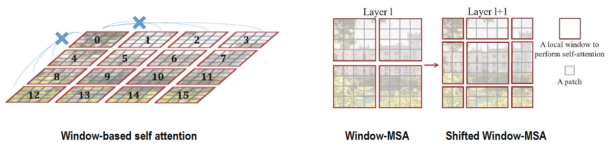

#### 그림 읽는 방법

- **왼쪽:** 떨어진 윈도우 사이를 직접 연결하지 않고 각 윈도우 안에서 계산합니다.
- **가운데 Layer ℓ:** 빨간 경계가 일반 윈도우이며, 작은 칸 하나가 패치 토큰입니다.
- **오른쪽 Layer ℓ+1:** 경계를 이동하면 원래 다른 윈도우에 있던 토큰들이 같은 새 윈도우에 들어가 서로 참고할 수 있습니다.

**원본 이미지나 물체를 실제로 움직이는 것이 아니라, Attention을 함께 계산할 토큰 묶음을 바꾸는 것**입니다. W-MSA와 SW-MSA를 번갈아 쌓으면 여러 블록에 걸쳐 더 넓은 영역의 정보가 전달됩니다. 한 층에서 모든 토큰 쌍을 직접 비교하는 전역 Attention과는 다릅니다.

#### 계산량과 경계 처리

토큰이 T개이고 윈도우가 M×M이면, 전역 Attention의 점수 수는 T²개인 반면 윈도우 방식은 대략 **(T/M²) × M⁴ = TM²개**입니다. 따라서 윈도우 크기를 고정하면 이 관계 계산 비용은 토큰 수 T에 선형으로 증가합니다. 모델 전체의 계산량과 실제 실행 시간은 다른 연산과 구현에도 영향을 받습니다.

효율적인 구현에서는 특징 맵을 순환 이동한 뒤 윈도우로 나누고, **이동으로 반대편 가장자리가 인위적으로 붙은 부분은 Attention Mask로 차단**합니다. 필요한 경우 크기를 맞추는 Padding도 처리합니다.

**기억하기: Window는 계산 범위를 줄이고, Shift는 윈도우 사이를 연결하며, Patch Merging은 계층적 해상도를 만듭니다.**

출처: [Swin Transformer 원 논문](https://arxiv.org/abs/2103.14030)

---

### Swin Architecture

지금까지 Window, Shift, Patch Merging을 각각 살펴봤다면, 이번에는 이 연산들이 실제 네트워크에서 어떻게 연결되는지 확인하겠습니다. Swin은 **같은 Stage 안에서는 크기를 유지하며 블록을 반복하고, Stage 사이에서는 Patch Merging으로 공간 크기와 채널 수를 바꿉니다.** 먼저 연속한 두 블록을 살펴본 뒤 전체 Stage 구조로 확장합니다.

---

#### 1. 연속한 두 블록: W-MSA → SW-MSA

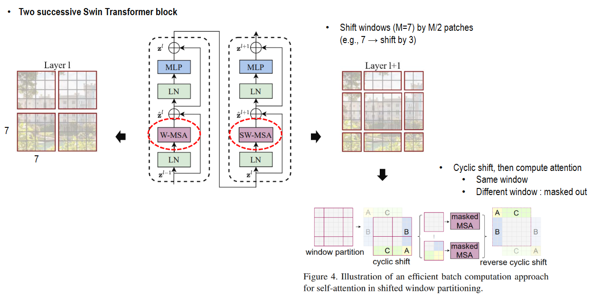

첫 그림의 점선 상자 하나가 Swin 블록 하나이며, 두 블록을 아래에서 위로 읽습니다.


| 블록    | 흐름                                     | 역할                          |
| ----- | -------------------------------------- | --------------------------- |
| 첫 블록  | LN → W-MSA → 잔차 덧셈 → LN → MLP → 잔차 덧셈  | 일반 윈도우 안에서 정보 조합            |
| 다음 블록 | LN → SW-MSA → 잔차 덧셈 → LN → MLP → 잔차 덧셈 | 이동한 윈도우 안에서 이전 경계를 넘는 정보 조합 |


이 그림은 **원 Swin의 Pre-LN 구조**입니다. 지름길로 원래 표현을 전달하고, Attention·MLP 결과를 더해 학습을 돕습니다. W-MSA에서 SW-MSA로 바뀌어도 토큰 격자 크기와 채널 수는 유지됩니다.

윈도우가 7×7이면 **한 윈도우의 토큰은 49개**입니다. 도식의 작은 칸 수는 구조를 단순화한 그림일 수 있으므로, 수치 예제의 M=7과 구별합니다.

각 토큰은 현재 Stage의 채널 수만큼 특징을 가지며, Head 하나의 Attention 점수 행렬은 `49×49`입니다. Shift는 각 축으로 3토큰을 이동하는 방식입니다.

오른쪽 아래는 SW-MSA를 효율적으로 구현하는 과정입니다.

1. **Cyclic shift:** 특징 격자를 순환 이동해 이동 윈도우를 일정한 크기로 묶습니다.
2. **Masked Attention:**
   1. 순환 이동 때문에 인위적으로 붙은 영역끼리는 Attention을 차단합니다.
   2. 새 이동 윈도우 안에서 정상적으로 연결되는 토큰은 서로 참고합니다.
   3. 차단할 점수에는 음의 무한대를 더해 Softmax 가중치가 0이 되게 합니다. 단순히 0보다 작은 점수는 여전히 양의 가중치를 가집니다. 공식 구현의 -100 같은 큰 음수는 이를 수치적으로 근사합니다.
3. **Reverse cyclic shift:** 계산 결과를 원래 격자 위치로 되돌립니다.

**정정 근거:** [Swin 공식 구현의 attention mask](https://github.com/microsoft/Swin-Transformer/blob/main/models/swin_transformer.py).

이미지 내용을 바꾸는 데이터 증강이 아니라, **같이 Attention을 계산할 토큰의 묶음을 효율적으로 바꾸는 구현**입니다.

---

#### 2. 전체 구조: 4개의 Stage와 Patch Merging

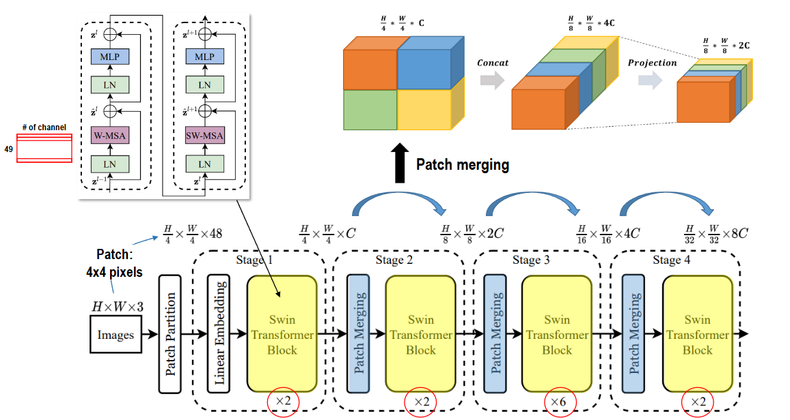

두 블록의 연결을 전체 모델로 확장하면 아래의 네 Stage 구조가 됩니다. 아래 표의 H·W는 원본 이미지 크기, C는 첫 Stage의 임베딩 채널 수입니다. 앞서 Patch Merging의 일반식을 설명할 때 H·W를 현재 토큰 격자 크기로 썼던 것과 표기의 기준이 다릅니다. 그림의 블록 수 `[2, 2, 6, 2]`는 **Swin-T** 구성에 해당하며, 다른 Swin 변형은 블록 수·채널·Head 수 등이 달라질 수 있습니다.


| 단계               | 연산                      | 출력 크기 — 높이 × 너비 × 채널 | 224×224 입력, C=96 예시 |
| ---------------- | ----------------------- | -------------------- | ------------------- |
| 입력               | RGB 이미지                 | H × W × 3            | 224 × 224 × 3       |
| Patch Partition  | 4×4 패치별 Flatten         | H/4 × W/4 × 48       | **56 × 56** × 48    |
| Linear Embedding | 패치당 48개 값을 **C차원으로 변환** | H/4 × W/4 × C        | 56 × 56 × 96        |
| Stage 1          | Swin 블록 ×2              | H/4 × W/4 × C        | **56 × 56** × 96    |
| Stage 2          | Patch Merging → 블록 ×2   | H/8 × W/8 × 2C       | 28 × 28 × 192       |
| Stage 3          | Patch Merging → 블록 ×6   | H/16 × W/16 × 4C     | 14 × 14 × 384       |
| Stage 4          | Patch Merging → 블록 ×2   | H/32 × W/32 × 8C     | 7 × 7 × 768         |


처음의 48은 `4×4×3`으로 계산한 패치 하나의 픽셀·채널 값 개수입니다. 이 값을 C차원으로 임베딩한 뒤 Stage 1을 시작하고, Stage가 바뀔 때마다 토큰 격자는 줄어들고 특징 채널은 늘어납니다. 그 변환을 담당하는 Patch Merging을 수치로 확인해 보겠습니다.

---

#### 3. Patch Merging에서 어떤 변화가 일어날까?

그림 위쪽은 인접한 2×2 토큰을 한 묶음으로 만드는 과정입니다.

```text
2×2의 각 토큰이 C차원
→ 특징 방향으로 Concat해 4C차원
→ LayerNorm과 Linear로 2C차원으로 변환
```

Stage 1에서 Stage 2로 넘어가는 예시는 `56×56×96 → 28×28×384 → 28×28×192`입니다. 인접 토큰의 특징을 이어 붙인 뒤 학습 가능한 변환으로 조합하므로 단순한 평균 Pooling과 계산 방식이 다릅니다. 이렇게 얻은 여러 해상도의 특징을 작업에 맞는 Head와 연결합니다.

---

#### 4. 분류·검출·분할에 연결하기

분류에서는 보통 최종 Stage의 특징을 정규화하고 공간 방향으로 평균한 뒤 분류 Head에 전달합니다. 위 예시에서는 `7×7×768 → 768 → 클래스별 logits`이며, CLS 토큰은 사용하지 않습니다.

검출·분할에서는 여러 Stage의 특징을 활용해 작은 물체의 위치와 큰 물체의 문맥을 함께 다루기 쉬워집니다. 이것이 앞 항목에서 설명한 계층 구조의 이점입니다.

**블록에서는 Window와 Shift를 번갈아 사용해 정보를 전달하고, Stage 사이에서는 Patch Merging으로 더 넓은 범위를 다루는 계층을 만듭니다.**

처음의 CNN과 연결해 보면, Swin은 지역 단위의 계산과 계층적 특징이라는 장점을 Attention 구조에 반영한 모델로 이해할 수 있습니다. 이 문서에서 살펴본 흐름은 **Attention의 가중합 → Transformer의 문맥 표현 → ViT의 이미지 토큰 처리 → DeiT의 학습 전략 개선 → Swin의 계산 범위와 계층 구조 개선**으로 이어집니다. 각 모델을 비교할 때는 관계를 계산하는 방식, 학습 목표, 데이터와 계산 조건을 함께 살펴보면 됩니다.

---

### Complexity

ViT와 Swin의 계산량 차이는 **한 토큰이 몇 개의 토큰을 참고하는가**에서 시작합니다. 전역 Attention은 모든 토큰 쌍을 비교하고, Window Attention은 같은 윈도우 안의 토큰만 비교합니다.

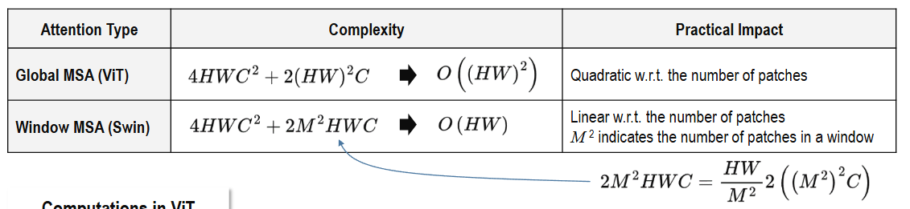

#### 1. 식의 기호와 계산 범위

이 절에서 H·W는 **현재 특징 격자의 높이와 너비**, N=HW는 토큰 수, C는 채널 수, M은 윈도우 한 변의 토큰 수입니다. 원본 이미지의 픽셀 크기와 구분해야 합니다. 아래 식은 Q·K·V 및 출력 Linear와 두 Attention 행렬 곱의 주요 연산량이며, MLP·정규화·Softmax 등은 생략합니다. CLS 토큰과 경계 Padding도 생략한 비교입니다.


| Attention 방식      | 주요 연산량           | 토큰 수 N에 따른 증가    |
| ----------------- | ---------------- | ---------------- |
| 전역 MSA — ViT      | $4NC^2 + 2N^2C$  | C를 고정하면 이차 증가    |
| Window MSA — Swin | $4NC^2 + 2NM^2C$ | C와 M을 고정하면 선형 증가 |


공통 항 **4NC²**는 Q·K·V를 만드는 세 Linear와 결과를 조합하는 출력 Linear에서 나옵니다. 차이를 만드는 항은 **관련도 QKᵀ와 가중합 AV**입니다. 전역 방식은 N×N 관계를 계산하지만, 윈도우 방식은 윈도우 하나당 M²×M² 관계를 N/M²개 윈도우에서 계산합니다.

$$
\frac{N}{M^2}\times 2(M^2)^2C = 2NM^2C
$$

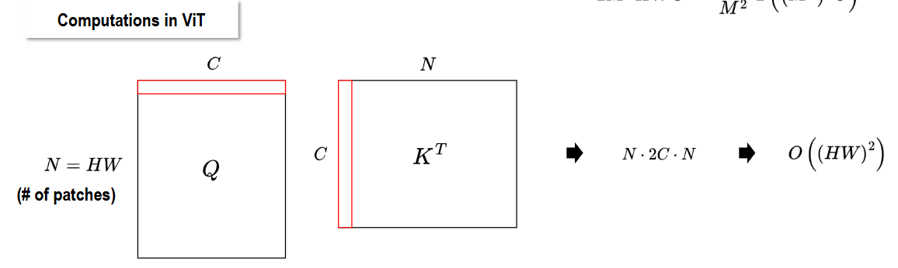

#### 2. 토큰 수가 늘어나면 어떤 차이가 날까?

같은 특징 격자가 56×56이면 N=3,136입니다. 7×7 윈도우에서는 토큰마다 49개 토큰을 참고하므로, Head 하나의 관련도 점수 수는 전역 방식의 **3,136²=9,834,496개**에서 윈도우 방식의 **3,136×49=153,664개**로 줄어듭니다. 관계 계산 부분만 비교하면 64배 차이입니다. Q·K·V 변환과 MLP는 그대로 필요하므로 전체 모델이 64배 빨라진다는 뜻은 아닙니다.

패치 크기를 유지하고 이미지의 가로·세로를 각각 2배로 늘리면 토큰 수는 4배가 됩니다. 이때 전역 Attention의 **N² 항은 16배**, 고정 윈도우 Attention의 **NM² 항은 4배**가 됩니다. 따라서 ‘Swin은 이미지 크기에 선형’이라는 말의 기준은 이미지 한 변의 길이가 아니라 **픽셀 수 또는 그에 비례하는 토큰 수**입니다.

#### 3. Patch Merging과 실제 속도까지 연결하기

Patch Merging으로 N이 1/4, C가 2배가 되면 NC² 항은 그대로이고, 고정 M에서 NM²C 항은 절반이 됩니다. 토큰 수가 줄어도 채널이 늘어나므로 모든 계산이 1/4이 되지는 않습니다. Stage별 블록 수도 전체 비용에 영향을 줍니다.

**계산량(FLOPs), 중간 활성값 메모리, 실행 시간은 구분해야 합니다.** 일반적인 구현에서 저장하는 Attention 점수의 크기도 전역 방식은 Head당 N², 윈도우 방식은 NM²에 비례합니다. 다만 메모리 효율적인 Attention 구현은 전체 점수 행렬 저장을 피할 수 있으며, 실제 속도는 GPU·배치 크기·메모리 이동·Shift와 Padding 구현에도 좌우됩니다.

출처: [Swin 원 논문 §3.2 — Window Attention의 복잡도](https://arxiv.org/html/2103.14030v2#S3.SS2)

---

### Experiments

이번에는 **ViT-L/16과 Swin-L이 같은 입력 해상도에서 어떤 정확도와 실행 비용을 보이는지** 비교합니다. 아래 그림의 오른쪽 (b), **ImageNet-22K 사전학습 모델**에 있는 두 행을 기준으로 읽습니다. 두 모델 모두 384×384 입력으로 ImageNet-1K 분류 성능을 평가한 결과입니다.

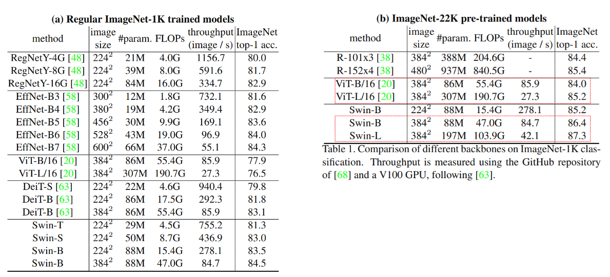

#### 1. 같은 평가 조건에서 결과 비교


| 비교 항목                 | ViT-L/16     | Swin-L       | Swin-L의 차이           |
| --------------------- | ------------ | ------------ | -------------------- |
| 사전학습 데이터              | ImageNet-22K | ImageNet-22K | 같은 데이터셋 범주           |
| 평가 입력                 | 384×384      | 384×384      | 같은 해상도               |
| 파라미터 수                | 307M         | 197M         | 110M 감소, 약 35.8% 적음  |
| FLOPs                 | 190.7G       | 103.9G       | 86.8G 감소, 약 45.5% 적음 |
| Throughput — images/s | 27.3         | 42.1         | 약 1.54배, 약 54.2% 높음  |
| ImageNet-1K Top-1 정확도 | 85.2%        | 87.3%        | +2.1%p               |


수치는 **첨부 그림 및 Swin 원 논문 v2의 표 1** 기준입니다. M은 백만 개의 파라미터, G는 표의 집계 기준에 따른 십억 단위 연산량입니다. Throughput은 논문에서 V100 GPU로 측정한 초당 처리 이미지 수이며, 높을수록 같은 시간에 더 많은 이미지를 처리합니다.

#### 2. 정확도: 더 작은 모델이 더 높은 성능을 보인다

ViT-L/16은 307M 파라미터로 85.2%, Swin-L은 197M 파라미터로 87.3%의 Top-1 정확도를 기록합니다. **Swin-L은 파라미터가 약 36% 적으면서 정확도는 2.1%p 높습니다.** 이 비교에서는 파라미터를 더 많이 가진 모델이 반드시 더 정확하지 않다는 점을 확인할 수 있습니다.

오분류율로 바꾸면 ViT-L/16은 14.8%, Swin-L은 12.7%입니다. 오분류율의 상대 감소는 약 14.2%이지만, 정확도 차이를 표현할 때는 **+2.1%p**로 적어야 합니다. ‘정확도가 14.2% 높다’는 의미는 아닙니다.

#### 3. 계산량과 처리량: 이론적 절감이 실제 속도에서도 나타난다

Swin-L의 FLOPs는 103.9G로 ViT-L/16의 190.7G보다 약 45.5% 적습니다. 이 값은 해당 해상도에서 **이미지 한 장을 처리하는 연산량**이며, 모델이 저장하는 가중치 개수인 파라미터 수와는 다른 지표입니다.

실제 처리량도 27.3→42.1 images/s로 약 1.54배 높습니다. 따라서 이 측정 조건에서는 Swin-L이 더 적은 연산으로 더 많은 이미지를 처리합니다. 다만 연산량 비율인 190.7/103.9≈1.84가 그대로 속도 비율이 되지는 않습니다. 메모리 접근, 연산 종류, 윈도우 분할과 Shift 구현 등이 실행 시간에 영향을 주기 때문입니다. 또한 처리량은 배치 처리 성능이므로 이 수치만으로 이미지 한 장의 응답 지연 시간을 단정할 수는 없습니다.

#### 4. 구조와 연결해 결과 해석하기

ViT-L/16은 16×16 패치를 사용하고, Encoder에서 같은 토큰 격자를 유지하며 전역 Attention을 계산합니다. Swin-L은 작은 패치에서 시작해 **윈도우 내부 Attention으로 관계 계산을 제한하고, Shift로 윈도우 사이를 연결하며, Patch Merging으로 단계별 토큰 수를 줄입니다.** 이 구조는 고해상도 입력의 계산 부담을 관리하면서 여러 크기의 특징을 표현하는 데 도움이 됩니다.

다만 위 결과는 **모델 전체의 비교**입니다. 두 모델은 폭·깊이·패치 크기·위치 정보와 학습 설정 등이 다릅니다. 따라서 정확도 향상 전체가 Shift 하나 때문이거나, 파라미터 감소 전체가 Window Attention 때문이라고 해석할 수는 없습니다. 특히 Window Attention의 주된 절감 대상은 토큰 사이의 관계 계산이며, QKV·MLP 가중치 수는 주로 채널 폭과 블록 수에 의해 결정됩니다.

이 표가 보여주는 결론은 **ImageNet-22K 사전학습과 384 입력의 해당 분류 실험에서, Swin-L이 ViT-L/16보다 적은 파라미터와 연산량으로 더 높은 정확도와 처리량을 달성했다**는 것입니다. 검출·분할 성능이나 다른 하드웨어에서의 속도는 해당 작업과 환경에서 별도로 비교해야 합니다.

출처: [Swin 원 논문 v2 — 표 1 및 ImageNet 분류 실험 조건](https://arxiv.org/html/2103.14030v2#S4.SS1)

---

### Summary

ViT와 Swin은 모두 **이미지를 토큰으로 바꾸고 Attention으로 토큰의 정보를 조합**합니다. 차이는 토큰 격자를 유지하는 방식과, 한 블록에서 정보를 주고받는 범위에 있습니다.

#### 1. Swin의 구성 요소를 역할별로 정리하기

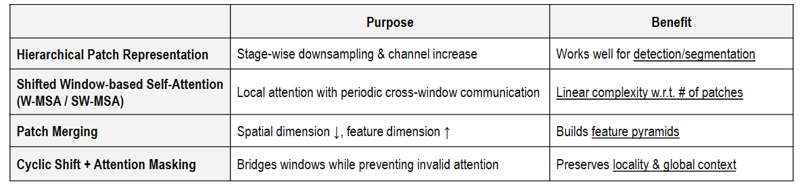


| 구성                  | 하는 일                             | 얻는 이점                       |
| ------------------- | -------------------------------- | --------------------------- |
| W-MSA               | 작은 윈도우 안에서 Attention 계산          | 토큰 수 증가에 따른 관계 계산 부담 완화     |
| SW-MSA              | 다음 블록에서 윈도우 경계를 이동               | 이전에 다른 윈도우에 있던 토큰 사이에 정보 전달 |
| Cyclic Shift + Mask | 이동 윈도우를 효율적으로 묶고 잘못 연결된 가장자리를 차단 | 이동 윈도우 계산을 배치로 처리           |
| Patch Merging       | 인접 2×2 토큰을 합쳐 격자를 줄이고 채널 확대      | 여러 해상도의 계층적 특징 생성           |


그림의 ‘global context’는 **여러 블록을 거치며 더 넓은 문맥을 반영한다**는 의미로 읽어야 합니다. Shift 한 번으로 모든 토큰 사이에 전역 Attention을 계산하는 것은 아닙니다. 계층 구조는 Patch Merging에서, 윈도우 사이 연결은 Shift에서 나옵니다.

#### 2. ViT와 Swin을 같은 기준으로 비교하기

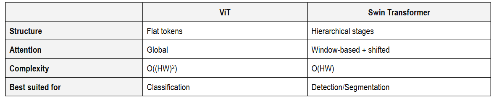


| 비교 기준     | 기본 ViT                       | Swin Transformer               |
| --------- | ---------------------------- | ------------------------------ |
| 시작 토큰     | 예: 16×16 픽셀 패치               | 기본 구성은 4×4 픽셀 패치               |
| 공간 구조     | 블록을 지나도 같은 토큰 격자 유지          | Stage 사이 Patch Merging으로 격자 축소 |
| 정보 교환     | 한 Attention 층에서 모든 토큰을 직접 비교 | 윈도우 내부 계산과 Shift를 반복하며 범위 확대   |
| 특징 차원     | 보통 전체 Encoder에서 같은 차원 유지     | Stage가 바뀔 때 채널 증가              |
| 위치 정보     | 학습 가능한 절대 위치 임베딩             | 기본 Swin은 윈도우 내 상대 위치 바이어스      |
| 분류 출력     | 최종 CLS 표현 사용                 | 최종 공간 특징의 전역 평균 사용             |
| 해상도 증가 부담 | 전역 관계 계산이 토큰 수의 제곱에 비례       | 고정 윈도우에서 토큰 수에 선형 비례           |
| 검출·분할 연결  | 여러 크기의 특징이 필요하면 별도 구성 가능     | 여러 Stage의 특징을 바로 활용하기 편리       |


표는 원래의 대표 구성을 비교합니다. **ViT도 검출·분할에 사용할 수 있고, Swin도 분류에 사용할 수 있습니다.** 그림의 ‘Best suited for’는 적용 가능 여부를 나누는 경계가 아니라, 기본 구조가 제공하는 특징의 차이로 이해하면 됩니다.

#### 3. ViT → DeiT → Swin의 흐름

- **ViT:** 이미지 패치 시퀀스를 표준 Transformer Encoder에 넣어 이미지 분류를 수행합니다.
- **DeiT:** 기본 ViT를 바탕으로 학습 전략과 지식 증류를 개선해 ImageNet-1K 규모의 데이터를 효과적으로 활용합니다.
- **Swin:** Attention의 범위와 특징 격자를 바꾸어 고해상도 입력과 여러 크기의 물체를 다루기 편한 Backbone을 만듭니다.

모델을 고를 때는 **학습 데이터와 사전학습 가중치, 입력 해상도, 필요한 특징 해상도, 정확도·메모리·실행 시간**을 함께 비교해야 합니다. 파라미터 수가 같아도 계산 방식이 다르면 실제 사용 비용은 달라집니다.

출처: [ViT 원 논문 — 구조와 학습 설정](https://arxiv.org/html/2010.11929v2#S3), [Swin 원 논문 — 전체 구조](https://arxiv.org/html/2103.14030v2#S3)

---

<a id="parameters"></a>
## 4. 파라미터·연산량·처리량을 따로 읽기 — 심화

파라미터 수는 **학습으로 갱신하는 가중치와 바이어스의 개수**입니다. 입력에 따라 계산되는 Q·K·V, Attention 점수, 특징 맵의 원소 수와 다릅니다. M은 백만 개를 뜻하므로 86M은 약 8,600만 개입니다.

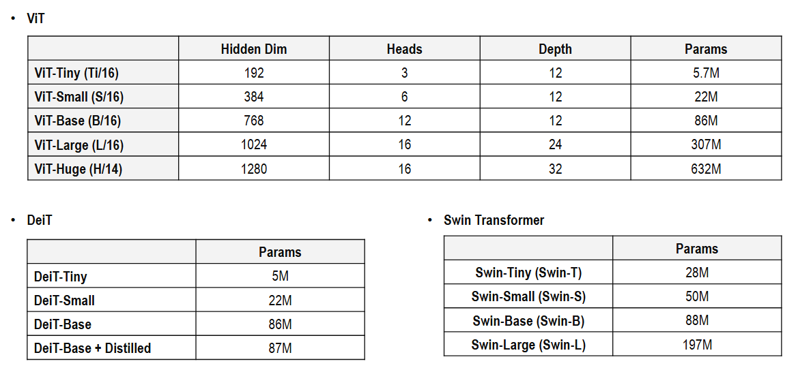

### 1. ViT: 깊이보다 폭이 커질 때도 빠르게 증가한다


| 모델        | Hidden dimension D | Head 수 | 블록 수 L | 대략적인 파라미터 수 |
| --------- | ------------------ | ------ | ------ | ----------- |
| ViT-Ti/16 | 192                | 3      | 12     | 5.7M        |
| ViT-S/16  | 384                | 6      | 12     | 22M         |
| ViT-B/16  | 768                | 12     | 12     | 86M         |
| ViT-L/16  | 1,024              | 16     | 24     | 307M        |
| ViT-H/14  | 1,280              | 16     | 32     | 632M        |


위는 그림의 반올림 값입니다. Tiny·Small은 후속 구현에서 널리 쓰이는 규모이며 원 ViT 논문의 대표 규모는 Base·Large·Huge입니다. 실제 개수는 분류 클래스 수, Head 구성과 입력 해상도에 따른 위치 임베딩 크기 등에 따라 조금 달라집니다.

MLP의 중간 차원이 4D라면 블록 하나의 주요 가중치 수는 다음과 같습니다. 바이어스와 LayerNorm은 작은 항으로 생략합니다.

$$
\underbrace{3D^2+D^2}_{\text{QKV 및 출력 Linear}}
+\underbrace{D(4D)+(4D)D}_{\text{MLP}}
=12D^2
$$

따라서 Encoder의 주요 파라미터 수는 **약 12LD²**입니다. 같은 12블록인 Small에서 Base로 D가 384→768, 즉 2배가 되면 주요 가중치는 약 4배가 됩니다. Base→Large는 차원과 블록 수가 함께 증가합니다.

**Head 수가 2배라고 파라미터가 반드시 2배가 되지는 않습니다.** 전체 D를 고정한 채 Head 수를 늘리면 Head당 차원이 줄어들기 때문입니다. 주요 QKV 가중치의 합계 크기는 그대로입니다.

### 2. DeiT: 비슷한 크기의 학생을 더 잘 학습시키기


| 모델 — 224 입력 기준 공개 표 | 파라미터 수 | 비교 의미                |
| ------------------- | ------ | -------------------- |
| DeiT-Tiny           | 약 5M   | 작은 차원의 ViT 계열 학생     |
| DeiT-Small          | 약 22M  | ViT-S 규모             |
| DeiT-Base           | 약 86M  | ViT-B 규모             |
| DeiT-Base distilled | 약 87M  | 별도 증류 토큰과 분류 Head 추가 |


그림의 ViT-Tiny 5.7M과 DeiT-Tiny 5M은 정밀도가 다른 요약 값이므로 그 차이를 구조적인 압축 효과로 해석하면 안 됩니다. 증류 모델에서는 토큰·위치 임베딩과 추가 분류 Head가 늘어나지만 Encoder의 기본 폭과 깊이는 유지됩니다.

DeiT-B 증류 모델은 약 1M 증가만으로 두 학습 목표를 활용합니다. **교사 CNN의 파라미터는 학생의 추론 파라미터 수에 합산하지 않습니다.** 다만 학습 시에는 교사 예측을 만드는 계산과 메모리 비용이 추가되므로, 학생 모델 크기가 비슷해도 전체 학습 비용은 같지 않습니다.

### 3. Swin: 채널과 Stage별 깊이가 모델 크기를 결정한다


| 모델     | 첫 Stage 채널 C | Stage별 블록 수     | 대략적인 파라미터 수 |
| ------ | ------------ | --------------- | ----------- |
| Swin-T | 96           | \[2, 2, 6, 2\]  | 28M         |
| Swin-S | 96           | \[2, 2, 18, 2\] | 50M         |
| Swin-B | 128          | \[2, 2, 18, 2\] | 88M         |
| Swin-L | 192          | \[2, 2, 18, 2\] | 197M        |


수치는 그림 및 공식 Swin-V1 공개 모델 표 기준이며, 앞 실험 그림의 Swin-T는 29M으로 표기되어 있습니다. 기본 채널은 Stage마다 C→2C→4C→8C가 됩니다. T→S는 주로 세 번째 Stage의 깊이를 늘리고, S→B→L은 같은 깊이에서 채널 폭을 늘립니다. 채널 수의 제곱에 비례하는 Linear·MLP 가중치가 많아 폭 증가가 파라미터 수에 크게 반영됩니다.

Window Attention에서도 QKV와 출력 Linear의 가중치는 여러 윈도우에 공유됩니다. **윈도우 수가 늘어난다고 윈도우마다 새 파라미터를 만드는 것은 아닙니다.** Shift와 Mask 자체도 학습 가중치를 추가하지 않습니다. 반면 상대 위치 바이어스와 Patch Merging의 선형 변환에는 학습 파라미터가 있습니다.

### 4. 파라미터가 비슷해도 계산량은 다르다

ViT-B·DeiT-B·Swin-B는 모두 약 86~88M이지만, 토큰 수와 Attention 범위가 달라 FLOPs와 활성값 메모리는 다릅니다. 해상도를 높이면 Linear 가중치를 그대로 재사용해도 계산할 토큰과 관계의 수가 증가합니다. ViT의 절대 위치 임베딩처럼 크기가 달라질 수 있는 일부 파라미터는 전체의 작은 부분입니다.

또한 **Tiny·Small·Base는 각 계열 내부의 이름**이므로 서로 같은 크기를 보장하지 않습니다. DeiT-Tiny 약 5M과 Swin-T 약 28M을 이름만 보고 같은 규모로 비교하면 안 됩니다.

예를 들어 86M개 가중치를 FP32로 저장하면 가중치 자체만 약 344MB입니다. 학습에는 그래디언트·옵티마이저 상태·활성값 등이 더 필요합니다. 따라서 파라미터 수는 저장 공간을 가늠하는 기준이며, GPU 메모리나 실행 시간을 단독으로 결정하는 값은 아닙니다.

출처: [ViT 원 논문 — 모델 규모](https://arxiv.org/html/2010.11929v2#S4.SS1), [DeiT 공식 모델별 파라미터 수](https://github.com/facebookresearch/deit/blob/main/README_deit.md#model-zoo), [Swin 공식 모델별 파라미터 수](https://github.com/microsoft/Swin-Transformer#main-results-on-imagenet-with-pretrained-models)

---

<a id="check"></a>
## 5. 작은 계산으로 연결하고 확인하기

**DeiT 교육용 계산:** 세 클래스 중 정답은 0, 교사가 고른 클래스는 1이라고 합시다. CLS Head 확률이 `[0.6,0.3,0.1]`, 증류 Head 확률이 `[0.2,0.7,0.1]`이면 Hard loss는 `(-ln 0.6-ln 0.7)/2≈0.433750`입니다. 교사와 정답이 달라도 각 Head는 자기 목표를 받습니다. 이는 이미 구한 확률로 손계산하는 예이며 실제 손실 API에는 logits를 넘깁니다. 교사는 고정하고 학생을 갱신합니다.

**Swin 교육용 연결:** 4×4 토큰 격자를 2×2 윈도우 네 개로 나누면 첫 블록에서 `(행 1,열 1)`과 `(행 1,열 2)`는 서로 다른 창에 있습니다(인덱스 0부터). 경계를 1칸 이동한 다음 블록에서는 내부의 행 1~2·열 1~2가 한 창이 되어 이 두 토큰이 연결됩니다. 순환 이동으로 맨 왼쪽과 맨 오른쪽이 붙는 인공 연결은 Mask가 막습니다. **이전 창 사이의 실제 내부 경계는 연결하고, 이미지 바깥을 감아 붙인 경계는 차단**한다는 차이가 핵심입니다.

1. 위 DeiT 예제에서 교사 argmax 대신 학생 argmax를 손실 입력으로 넣어도 될까요?
2. 4×4 토큰과 2×2 창에서 Head당 점수 수는 전역·윈도우 각각 몇 개인가요? Shift 자체로 토큰 수가 줄어드나요?
3. 56×56×96에서 Patch Merging의 중간·최종 shape는? 단순 평균과 무엇이 다른가요?
4. ViT-B와 Swin-B의 파라미터 수가 비슷하면 처리량도 같다고 할 수 있나요?

<details>
<summary>해설과 돌아갈 위치</summary>

1. 안 됩니다. 교사 argmax는 목표 라벨을 만들지만 학생 logits는 미분 가능한 손실에 연결되어야 합니다. `argmax`만 남기면 필요한 확률과 기울기 경로를 잃습니다. [DeiT](#deit)의 Architecture & Loss로 돌아가세요.
2. T=16이므로 전역은 16²=256개입니다. 창은 4개, 창당 4²=16개이므로 64개입니다. Shift는 묶음을 바꿀 뿐 16개 토큰을 유지합니다. [Swin](#swin)의 Window와 Shift를 확인하세요.
3. 2×2 이웃 네 개를 이어 붙여 `28×28×384`, 정규화·Linear 뒤 `28×28×192`입니다. 학습된 가중치로 특징을 조합하며 원소별 평균이 아닙니다. [Swin](#swin)의 Patch Merging으로 돌아가세요.
4. 아닙니다. 가중치를 같은 횟수로 사용하는 것이 아니며 토큰 수·관계 계산 범위·구현과 하드웨어도 다릅니다. [비용 비교](#parameters)와 Complexity의 4NC²+2NM²C를 대조하세요.

</details>

다음 [CLIP과 DINO](03_04_CLIP과_DINO.md)에서는 구조를 유지하면서 학습 목표의 출처를 바꿉니다. 특히 고정된 DeiT 교사와 EMA로 바뀌는 DINO 교사를 비교하세요.
