# CLIP과 DINO: 정답 신호를 어디서 얻을까

ViT는 이미지 특징을 만드는 구조입니다. **CLIP은 이미지·문장 쌍을 구별하도록, DINO는 같은 이미지의 다른 뷰가 일관된 출력을 내도록** 그 구조를 학습할 수 있습니다. 특징 추출 구조와 학습 목표를 분리하면 두 연구의 차이가 보입니다.

**목표:** CLIP의 행·열 대조 손실을 Zero-shot 후보 비교와 연결하고, DINO의 crop → logits → center·temperature → 교차 엔트로피 → student 갱신 → teacher EMA를 설명합니다. Attention map과 학습 목표의 분포도 구별합니다.

선수지식은 [Attention과 ViT](03_02_Attention과_ViT.md)의 CLS·Softmax와 [DeiT](03_03_DeiT와_Swin.md#deit)의 교사·학생·증류입니다. [학습 지도](03_01_Attention_Note.md)에서 앞뒤 순서를 확인하세요.

| 비교 기준 | CLIP | 원 DINO(2021) |
| --- | --- | --- |
| 학습 입력 | 이미지와 대응 문장 | 같은 이미지에서 얻은 여러 증강 뷰 |
| 목표 신호 | 배치의 올바른 이미지·문장 쌍 | 다른 global 뷰에 대한 Teacher 분포 |
| 비교 축 | 배치 안의 다른 쌍 | Projection Head의 출력 차원 |
| 대표 활용 | 자연어 후보로 분류·검색 | 이미지 특징으로 검색·k-NN·선형 평가 |
| 주의 | Zero-shot도 대규모 사전학습은 필요 | 라벨 없는 사전학습이 클래스 이름을 제공하지 않음 |

**핵심 경로:** [CLIP 학습과 추론](#clip) → [DINO 한 단계](#dino) → [수치 추적·확인](#check).
**심화:** New dataset, 실제 훈련 자원, Zero-shot experiments, DINO의 Attention·Teacher 실험은 근거와 적용 한계를 확인할 때 읽습니다. 모든 표 수치를 암기하기보다 무엇을 고정하고 비교했는지 설명하세요.

원문: [교안 38~59쪽](../교안/03_00_Attention.pdf#page=38). 새 수치 예제는 교육용 보충입니다. 그림의 훈련 의사 코드는 설명 대상으로 보존했으며 이 자료에서 대규모 학습을 실행하지 않았습니다.

## 1. 이미지와 언어를 같은 공간에 정렬하는 CLIP

**CLIP(Contrastive Language-Image Pre-training)은 이미지와 텍스트를 같은 의미 공간의 벡터로 표현하도록 학습하는 모델**입니다. 예를 들어 고양이 사진과 “고양이 사진”이라는 문장은 유사도가 높아지도록 학습합니다.

### 어떻게 학습할까?

| 구성                           | 역할                                                    |
| ---------------------------- | ----------------------------------------------------- |
| Image Encoder                | 이미지를 벡터로 변환. ViT 또는 ResNet 사용 가능                      |
| Text Encoder                 | 이미지에 대한 설명 문장을 벡터로 변환                                 |
| 대조 학습 — Contrastive Learning | 배치 안에서 올바른 이미지·설명 쌍의 유사도는 높이고, 짝이 아닌 조합의 유사도는 낮추도록 학습 |

핵심은 고정된 클래스 번호만 예측하는 대신, **어떤 이미지와 어떤 설명이 서로 어울리는지** 배우는 것입니다. 이미지·텍스트 쌍이 학습 신호가 되므로, 사람이 작성한 클래스 라벨이 없어도 자연어 설명을 활용할 수 있습니다.

### 학습한 뒤에는 어떻게 사용할까?

고양이 사진을 분류한다면 다음 순서로 사용할 수 있습니다.

1. 사진을 Image Encoder로 벡터화합니다.
2. “고양이 사진”, “강아지 사진”, “자동차 사진” 같은 후보 설명을 Text Encoder로 벡터화합니다.
3. 이미지 벡터와 가장 유사한 설명을 선택합니다.

이처럼 **해당 분류 과제의 별도 추가 학습 없이, 텍스트로 분류 후보를 지정하는 방식**을 Zero-shot 분류라고 합니다. CLIP 자체의 사전학습이 없었다는 뜻은 아닙니다. 같은 원리로 문장에 맞는 이미지를 찾는 이미지 검색에도 활용할 수 있습니다.

앞서 배운 **ViT가 이미지 특징을 추출하는 구조라면, CLIP은 이미지와 언어의 표현을 연결하는 학습 방식**입니다. CLIP의 Image Encoder로 ViT를 사용할 수 있으며, 결과는 후보 문구와 데이터 특성에 따라 달라질 수 있습니다.

출처: [OpenAI — CLIP: Connecting text and images](https://openai.com/index/clip/)

---

### Overview

#### 1. Motivation — 고정된 클래스 라벨의 한계

기존 지도학습 이미지 분류는 사람이 정한 클래스와 라벨에 의존합니다. 예를 들어 고양이·강아지를 구분하도록 학습한 분류기는 새로운 클래스를 추가하려면 보통 출력 Head를 바꾸고 추가 학습을 해야 합니다. 데이터를 늘릴 때도 라벨 작성 비용이 들고, 표현할 수 있는 개념이 미리 정한 클래스 목록에 묶입니다.

CLIP은 이 문제를 **이미지에 함께 붙어 있는 자연어 설명을 학습 신호로 활용**하는 방향으로 접근합니다.

#### 2. Key Insight — 자연어를 시각 개념의 학습 신호로 사용

인터넷에는 이미지와 제목·설명 같은 텍스트가 함께 존재합니다. 자연어는 “고양이”라는 이름뿐 아니라 “소파 위에 앉아 있는 고양이”처럼 속성과 상황도 표현할 수 있습니다. CLIP은 이런 이미지·텍스트 쌍에서 두 표현의 대응 관계를 배웁니다. 원 CLIP은 인터넷에서 수집한 **4억 개의 이미지·텍스트 쌍**으로 학습했습니다.

별도의 클래스 번호가 없어도 텍스트가 감독 신호를 제공하므로, 이를 **자연어 감독 학습(Natural Language Supervision)**이라고 이해할 수 있습니다.

#### 3. Main Idea — 올바른 이미지·문장 쌍을 찾는 대조 학습

CLIP은 Image Encoder와 Text Encoder의 출력을 비교 가능한 벡터로 만들고, 배치 안에서 **원래 짝인 이미지와 문장의 유사도는 높이며 다른 조합의 유사도는 낮추도록** 학습합니다. 아래 그림은 그 바탕이 되는 대조 학습의 표현 공간을 개념적으로 보여줍니다.

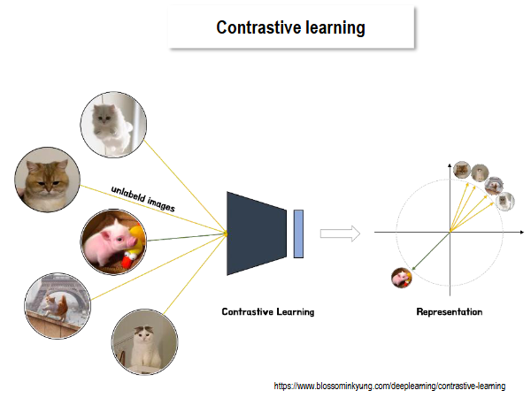

**그림 읽기:** 왼쪽 이미지는 Encoder를 통과해 오른쪽의 벡터로 표현됩니다. 비슷한 방향에 모인 벡터는 서로 유사한 표현을 뜻합니다. 다만 이 그림은 이미지 중심의 일반적인 대조 학습 설명이며, CLIP의 Text Encoder는 생략되어 있습니다. CLIP에서는 실제 이미지와 대응 설명의 관계가 학습 기준이 됩니다.

즉, CLIP은 고양이 이미지끼리만 모으도록 직접 클래스 라벨을 주는 방식이 아니라, **고양이 사진과 그 사진에 대응하는 문장을 연결하는 방식**으로 시각 개념을 배웁니다.

#### 4. Goal — 텍스트로 분류 기준을 지정하는 Zero-shot 활용

학습 후에는 후보 클래스의 설명을 Text Encoder에 넣고 이미지와 유사도를 비교합니다. 따라서 새 분류 기준을 **출력층 재학습 대신 후보 문구로 지정**할 수 있습니다. 이것이 CLIP의 Zero-shot 분류로 이어집니다.

Zero-shot은 해당 과제에 대한 추가 학습이 없다는 뜻입니다. 모든 새로운 개념을 정확하게 이해한다는 보장은 없으며, 후보 문구와 사전학습 데이터에 따라 결과가 달라집니다.

출처: [CLIP 원 논문 — 연구 동기와 자연어 감독 학습](https://arxiv.org/html/2103.00020v1#S2), [OpenAI — CLIP의 학습과 Zero-shot 활용](https://openai.com/index/clip/)

---

### New dataset

CLIP 연구진은 **다양한 시각 개념을 자연어로 학습하기 위해, 4억 개의 이미지·텍스트 쌍으로 구성된 WIT(WebImageText)**를 구축했습니다. 여기서 4억은 클래스 수가 아니라 학습에 사용하는 **쌍의 수**입니다.

#### 1. 기존 데이터셋만으로는 왜 부족했을까?

| 데이터셋                  | 장점               | CLIP 연구에서 본 한계                              |
| --------------------- | ---------------- | ------------------------------------------- |
| MS-COCO·Visual Genome | 사람이 작성한 품질 높은 주석 | 각각 학습 사진 약 10만 장 규모로, 대규모 사전학습에는 상대적으로 작음   |
| YFCC100M              | 약 1억 규모의 대규모 자료  | 제목·설명의 품질이 일정하지 않고, 파일명이나 촬영 설정만 포함된 경우도 있음 |

연구진이 YFCC100M에서 **영어 자연어 제목 또는 설명이 있는 이미지**를 남기자 약 1,500만 장으로 줄었습니다. 즉, 이미지가 많다는 사실만으로 유용한 이미지·텍스트 학습 쌍이 충분한 것은 아닙니다.

#### 2. WIT는 어떻게 구성했을까?

- **수집 대상:** 공개적으로 접근 가능한 여러 인터넷 출처의 이미지·텍스트 쌍을 활용했습니다.
- **개념 범위:** 약 50만 개의 검색어를 사용해, 해당 표현이 텍스트에 포함된 쌍을 찾았습니다. 검색어는 Wikipedia·WordNet 등을 바탕으로 구성했습니다.
- **분포 조정:** 특정 검색어에만 자료가 몰리지 않도록 검색어당 최대 2만 쌍을 포함했습니다. 이는 대략적인 균형 조정이며 완전한 균등 분포를 보장하지는 않습니다.

**‘수동 라벨링이 필요 없다’는 말은 각 이미지에 새 클래스 번호를 일일이 붙이지 않는다는 뜻**입니다. 이미 존재하는 사람이 작성한 텍스트가 감독 신호를 제공합니다. 데이터 수집·선별 과정까지 없다는 의미는 아닙니다.

#### 3. CLIP 학습과 Zero-shot 활용에 어떻게 연결될까?

예를 들어 “눈밭에서 뛰는 개”라는 설명은 물체뿐 아니라 행동과 배경도 담습니다. CLIP은 이런 쌍의 대응 관계를 대조 학습해, 이미지 특징을 다양한 자연어 표현과 연결합니다. 이후 후보 설명을 비교하는 Zero-shot 분류로 활용할 수 있습니다.

다만 **데이터 규모만으로 일반화가 보장되지는 않습니다.** 웹 설명의 오류·불완전함과 개념별 불균형이 학습 결과에 영향을 줄 수 있으며, Zero-shot 성능은 실제 평가로 확인해야 합니다.

출처: [CLIP 원 논문 §2.2 — 기존 데이터셋의 한계와 WIT 구축](https://arxiv.org/html/2103.00020v1#S2.SS2)

---

### Architecture

CLIP은 **이미지와 텍스트를 각각 인코딩한 뒤, 같은 차원의 벡터로 변환해 유사도를 비교하는 두 인코더 구조**입니다. 그림은 왼쪽의 입력 쌍에서 가운데 유사도 행렬, 오른쪽의 학습된 표현 공간 순서로 읽으면 됩니다.

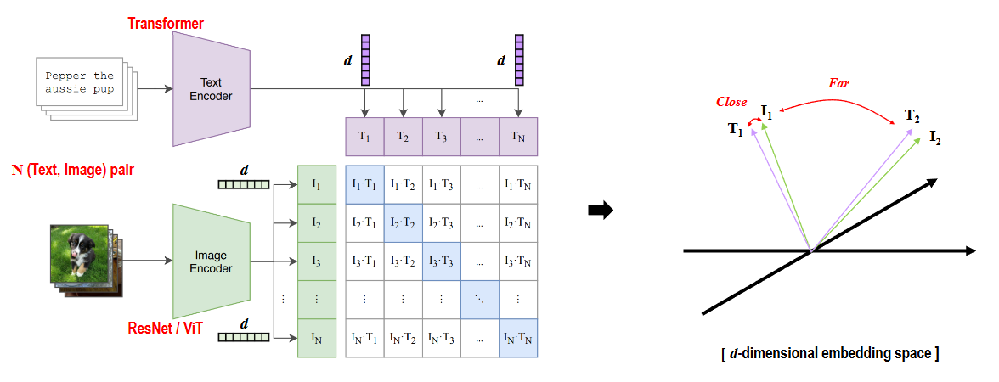

여기서 −1~1은 정규화된 벡터 사이의 코사인 유사도 범위입니다. 뒤에서 스케일을 곱한 logits의 범위와는 다릅니다.

#### 1. 왼쪽: 이미지와 문장을 각각 벡터로 변환

한 배치에 N개의 **이미지·설명 쌍**이 들어갑니다. i번째 이미지와 i번째 문장은 원래 함께 수집된 한 쌍입니다.

| 경로            | 처리 과정                                        | 그림의 출력            |
| ------------- | -------------------------------------------- | ----------------- |
| Image Encoder | ResNet 또는 ViT로 이미지 특징 추출 → 공통 공간으로 투영        | 이미지당 d차원 벡터 $I_i$ |
| Text Encoder  | 문장 토큰화 → Transformer → 문장 특징 추출 → 공통 공간으로 투영 | 문장당 d차원 벡터 $T_i$  |

원 CLIP의 Text Encoder는 문장 끝 토큰(EOT)의 최종 표현을 사용합니다. 두 인코더의 내부 특징 차원이 같을 필요는 없지만, **최종 비교에 쓰는 임베딩 차원 d는 같아야** 합니다. 선형 투영은 각 인코더의 특징을 이 공통 공간으로 옮기는 학습 가능한 변환입니다.

마지막에는 벡터 길이를 1로 맞추는 **L2 정규화**를 적용합니다. 이때 두 벡터의 내적은 코사인 유사도가 되어, 벡터 크기보다 방향의 유사성을 비교합니다. 여기의 d는 공통 임베딩 차원이며, 이미지 패치 수나 문장 토큰 수가 아닙니다.

#### 2. 가운데: N×N 유사도 행렬 만들기

이미지 벡터 N개와 텍스트 벡터 N개를 각각 행으로 쌓으면 두 행렬의 크기는 모두 N×d입니다. 서로 곱하면 N×N 비교 결과를 얻습니다.

$$
S = \alpha IT^T, \qquad S_{ij}=\alpha I_i^T T_j
$$

여기서 $\alpha$는 학습 가능한 양의 스케일이며, 온도 $\tau$를 사용하면 $\alpha=1/\tau$로 표현할 수 있습니다. 그림은 이 스케일을 생략하고 내적만 표시했습니다.

| 행렬의 위치              | 의미                         |
| ------------------- | -------------------------- |
| i번째 행               | 이미지 i와 배치의 모든 문장을 비교       |
| j번째 열               | 문장 j와 배치의 모든 이미지를 비교       |
| 대각선 $S_{ii}$ — 파란 칸 | 원래 짝인 이미지·문장: 학습에서 정답으로 지정 |
| 비대각선 $S_{ij}$       | 다른 쌍에서 가져온 조합: 대조 대상으로 사용  |

예를 들어 N=3이면 **9개 조합 중 대각선 3개가 정답 쌍**입니다. 비대각선 6개는 학습상 대조 대상이지만, 서로 다른 사진에 비슷한 설명이 붙어 있을 수도 있으므로 의미가 언제나 완전히 반대라는 뜻은 아닙니다.

#### 3. 학습: 행과 열 양쪽에서 올바른 짝 찾기

CLIP은 같은 유사도 행렬을 두 방향으로 사용합니다.

1. **이미지 → 텍스트:** 각 행에 Softmax를 적용해, 이미지 i의 정답 문장 i를 찾도록 Cross-Entropy를 계산합니다.
2. **텍스트 → 이미지:** 각 열에 Softmax를 적용해, 문장 j의 정답 이미지 j를 찾도록 Cross-Entropy를 계산합니다.
3. **두 손실을 평균**하고, 두 인코더·투영 가중치·유사도 스케일을 함께 학습합니다.

따라서 이 Softmax는 **배치 안에서 짝을 고르는 연산**입니다. 앞서 Self-Attention에서 토큰 정보를 섞던 Softmax와 역할이 다릅니다. 기본 CLIP은 이미지·텍스트를 각각 처리하며, 두 모달리티 사이의 Cross-Attention 없이 최종 임베딩의 유사도로 연결합니다.

#### 4. 오른쪽: 같은 쌍의 표현이 가까워지는 공간

오른쪽 그림에서 $I_1$과 $T_1$, $I_2$와 $T_2$가 비슷한 방향에 놓인 것은 **맞는 이미지·설명의 유사도가 높아지도록 학습한 결과**를 뜻합니다. 실제 공간은 d차원이지만 그림에서는 이해를 위해 단순화했습니다. 서로 다른 쌍이 반드시 특정 각도나 일정한 거리를 유지해야 하는 것은 아닙니다.

추론에서는 학습 배치의 N×N 행렬 대신, **입력 이미지와 K개의 후보 설명**을 비교할 수 있습니다. 예를 들어 고양이·강아지·자동차 설명 벡터 중 이미지와 가장 유사한 것을 고르면 Zero-shot 분류가 됩니다. 후보 설명 벡터는 미리 계산해 재사용할 수 있습니다.

출처: [CLIP 원 논문 — 대조 학습과 선형 투영](https://arxiv.org/html/2103.00020v1#S2.SS3), [공식 구현 — 인코더 출력·정규화·유사도 계산](https://github.com/openai/CLIP/blob/main/clip/model.py)

---

### Training

CLIP은 **이미지에 맞는 설명과 설명에 맞는 이미지를 배치 안에서 찾는 문제**로 두 인코더를 함께 훈련합니다. 원 CLIP은 ImageNet이나 언어 모델의 사전학습 가중치를 가져오지 않고, 이미지·텍스트 쌍으로 처음부터 학습했습니다.

#### 1. 첫 번째 그림: 한 번의 학습 단계

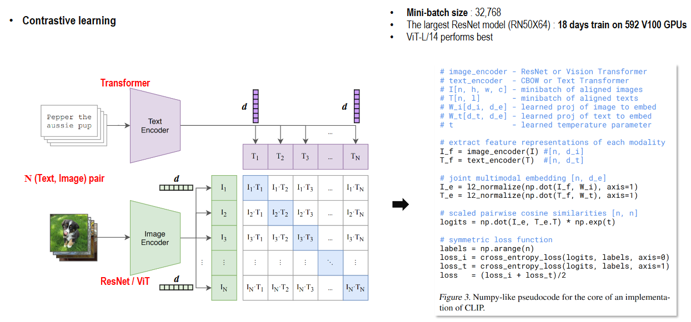

그림 오른쪽 코드는 왼쪽 구조를 다음 순서로 계산한 것입니다.

| 단계       | 코드의 주요 표현                       | 실제로 하는 일                         |
| -------- | ------------------------------- | -------------------------------- |
| 배치 구성    | 정렬된 이미지 I와 문장 T                 | 같은 인덱스가 정답 쌍이 되도록 N쌍 준비          |
| 특징 추출    | `image_encoder`, `text_encoder` | 각 입력을 해당 인코더로 처리                 |
| 투영·정규화   | `W_i`, `W_t`, `l2_normalize`    | 같은 차원의 공통 공간으로 변환하고 벡터 길이를 1로 맞춤 |
| 전체 조합 비교 | `I_e @ T_e.T`                   | 이미지 N개와 문장 N개의 N×N 코사인 유사도 계산    |
| 점수 조정    | `exp(t)`                        | 학습 가능한 양의 스케일을 곱해 logits 생성      |
| 정답 지정    | `arange(n)`                     | 각 행·열에서 같은 인덱스의 대각선 위치를 정답으로 설정  |
| 손실·업데이트  | 두 Cross-Entropy의 평균             | 역전파로 두 인코더와 투영 가중치, 스케일을 함께 갱신   |

정답은 ‘고양이=0’ 같은 고정 클래스 번호가 아니라 **이 배치에서 어느 문장이 어느 이미지와 짝인가**입니다. N개 정답 쌍 외의 N²−N개 조합이 대조 대상으로 사용됩니다. 이 과정을 새로운 배치에 반복합니다.

#### 2. 두 번째 그림: 대각선의 선택 확률을 높이는 손실

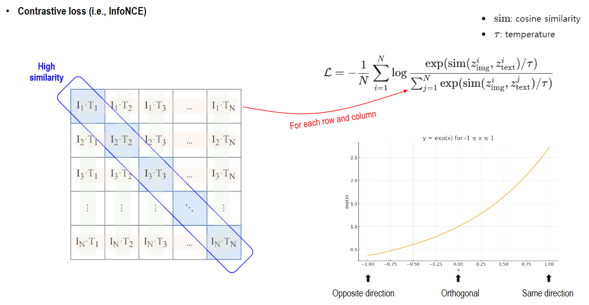

정규화된 이미지·텍스트 임베딩을 $I_i$, $T_j$라 하고, 점수를 $S_{ij}=I_i^TT_j/\tau$로 두겠습니다. 이미지 i가 문장 i를 선택할 확률은 **i번째 행에 Softmax**를 적용해 구합니다.

$$
p(T_i\mid I_i)=\frac{\exp(S_{ii})}{\sum_{j=1}^{N}\exp(S_{ij})},
\qquad
\mathcal{L}_{I\to T}=-\frac{1}{N}\sum_{i=1}^{N}\log p(T_i\mid I_i)
$$

그림의 식은 이 **이미지 → 텍스트 방향**을 나타냅니다. CLIP은 열 방향으로도 같은 계산을 하여, 문장 i에서 정답 이미지 i를 고르는 손실을 구합니다.

$$
p(I_i\mid T_i)=\frac{\exp(S_{ii})}{\sum_{j=1}^{N}\exp(S_{ji})},
\qquad
\mathcal{L}_{T\to I}=-\frac{1}{N}\sum_{i=1}^{N}\log p(I_i\mid T_i)
$$

$$
\mathcal{L}=\frac{\mathcal{L}_{I\to T}+\mathcal{L}_{T\to I}}{2}
$$

예를 들어 정답 쌍의 선택 확률이 0.2이면 그 항의 손실은 $-\log(0.2)\approx1.61$, 0.8이면 약 0.22입니다. 따라서 손실을 줄이면 **같은 행·열의 다른 후보보다 정답 쌍을 더 잘 구분**하게 됩니다. 대각선 값을 무조건 1, 나머지를 무조건 −1로 만드는 회귀 문제는 아닙니다.

#### 3. 코사인 유사도와 온도는 어떤 역할을 할까?

두 번째 그림의 곡선은 지수 함수가 높은 점수를 더 크게 반영하는 모습을 보여줍니다. 실제 선택 확률은 지수 값을 후보 전체의 합으로 나눈 **Softmax 결과**입니다.

- **코사인 유사도:** 범위는 −1~1입니다. 값이 클수록 벡터 방향이 유사합니다.
- **온도 τ:** 양수이며, 작을수록 점수 차이를 확대해 Softmax 분포를 더 뾰족하게 만듭니다. 크면 분포가 완만해집니다.
- **스케일이 적용된 logits:** 유사도에 $1/\tau$를 곱한 값이므로 범위가 −1~1에 제한되지 않습니다. 코드의 `exp(t)`가 이 양의 스케일에 해당합니다.

#### 4. 원 논문의 실제 훈련 설정

| 항목         | 설정과 의미                                                          |
| ---------- | --------------------------------------------------------------- |
| 학습 데이터     | WIT의 4억 이미지·텍스트 쌍                                               |
| 전체 미니배치 크기 | 32,768쌍. 한 이미지당 정답 문장 1개와 다른 문장 32,767개 비교                      |
| 학습 기간      | 기본 모델을 32 epochs 학습                                             |
| 최적화        | Adam에 분리된 Weight Decay 적용, Cosine 학습률 스케줄 사용                    |
| 이미지 증강     | 크기 조정한 이미지에서 무작위 정사각형 Crop                                      |
| 온도 초기화     | τ=0.07에 해당하는 스케일로 시작해 학습. 논문은 스케일 상한 100을 명시                    |
| 대규모 학습 구현  | 혼합 정밀도, Gradient Checkpointing, GPU별 유사도 계산 분할 등으로 메모리·계산 비용 관리 |

배치를 크게 만들면 한 번에 비교하는 후보가 많아집니다. 다만 같은 의미의 설명이 다른 쌍에도 있을 수 있으므로, 모든 대조 대상이 의미상 완전히 다른 것은 아닙니다.

첫 그림의 **592개 V100 GPU·18일**은 가장 큰 ResNet인 RN50x64의 학습 비용입니다. 가장 큰 ViT인 ViT-L/14는 **256개 V100 GPU·12일**이 걸렸습니다. ViT-L/14는 336 해상도에서 1 epoch를 추가 학습한 변형도 있으며, 논문의 대표 CLIP 결과는 주로 이 **ViT-L/14@336px**를 사용합니다. 모델별 자원과 결과를 구분해서 읽어야 합니다.

출처: [CLIP 원 논문 §2.3 — 학습 목표와 의사 코드](https://arxiv.org/html/2103.00020v1#S2.SS3), [§2.5 — 배치 크기·최적화·학습 자원](https://arxiv.org/html/2103.00020v1#S2.SS5)

---

### Inference

CLIP의 추론은 **입력 이미지와 후보 클래스 설명의 유사도를 비교해 가장 잘 맞는 설명을 고르는 과정**입니다. 학습된 인코더와 스케일을 고정한 채 사용하며, Zero-shot 분류에서는 해당 데이터셋의 정답 예제로 추가 학습하지 않습니다.

#### 1. 첫 번째 그림: 텍스트로 분류기 만들기

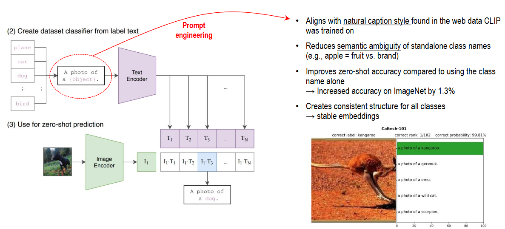

그림 왼쪽은 먼저 후보 설명을 벡터로 만들고, 새 이미지가 들어올 때 그 벡터들과 비교하는 순서입니다. 여기서는 학습 배치 크기 N과 구분해 **후보 클래스 수를 K**로 표기합니다.

1. **후보 문장 작성:** 클래스 이름을 `A photo of a {label}.` 같은 틀에 넣습니다. 예: `dog` → `A photo of a dog.`
2. **텍스트 벡터 준비:** Text Encoder와 투영을 거친 K개의 벡터를 각각 L2 정규화합니다. 후보가 같으면 미리 계산해 재사용할 수 있습니다.
3. **이미지 벡터 계산:** 입력 이미지를 모델의 평가용 전처리·Image Encoder·투영으로 처리하고 L2 정규화합니다.
4. **유사도 비교:** 이미지 벡터와 각 텍스트 벡터의 내적에 학습된 스케일을 곱합니다.
5. **최종 예측:** 가장 높은 점수의 후보를 선택합니다. 필요하면 K개 점수에 Softmax를 적용합니다.

정규화된 이미지 벡터를 $I$, 후보 k의 텍스트 벡터를 $T_k$라 하면 다음과 같습니다.

$$
s_k=\alpha I^TT_k, \qquad
p_k=\frac{\exp(s_k)}{\sum_{j=1}^{K}\exp(s_j)}, \qquad
\hat{k}=\operatorname*{arg\,max}_{k}s_k
$$

**Top-1 후보만 고를 때는 Softmax 전후의 순위가 같습니다.** Softmax의 출력은 주어진 후보 안에서 정규화한 값이므로, 후보 목록이나 문구가 바뀌면 값도 달라집니다. 이를 실제 정답일 확률로 그대로 해석해서는 안 됩니다.

#### 2. 왜 Zero-shot linear classifier라고 할까?

텍스트 벡터를 열로 쌓은 행렬을 $W=[T_1,\ldots,T_K]$라고 하면, 점수는 $s=\alpha W^TI$입니다. **텍스트 벡터가 클래스별 선형 분류 가중치 역할**을 하므로 이렇게 부릅니다. 정규화된 이미지 특징 위에 편향 없는 선형 점수 함수를 적용하는 형태입니다.

일반적인 분류 Head는 정답 라벨로 가중치를 학습하지만, 여기서는 **클래스 설명을 Text Encoder에 넣어 가중치를 구성**합니다. 따라서 후보를 바꾸어 새 분류 기준을 지정할 수 있습니다. 다만 이 절차 자체가 이미지 설명 문장을 자유롭게 생성하는 것은 아니며, 준비한 후보 중 하나를 선택합니다.

#### 3. Prompt engineering: 클래스 이름에 문맥 더하기

`boxer`만 넣으면 개 품종인지 운동선수인지 모호할 수 있습니다. 문장에 과제의 범주를 넣으면 의도한 의미를 전달하고, 사전학습에서 접한 자연어 설명 형식에도 가까워집니다.

| 과제               | 후보 문장 구성 예시                            | 목적                       |
| ---------------- | -------------------------------------- | ------------------------ |
| 일반 물체 분류         | `A photo of a {label}.`                | 클래스가 사진 속 대상을 뜻함을 명시     |
| Oxford-IIIT Pets | `A photo of a {label}, a type of pet.` | 품종 이름의 의미를 반려동물로 한정      |
| Food101          | 음식 종류라는 문맥 추가                          | 음식 이름이 다른 뜻으로 해석될 가능성 완화 |
| FGVC Aircraft    | 항공기 종류라는 문맥 추가                         | 기종 이름의 의미를 명확하게 전달       |
| OCR              | 인식할 문자·숫자에 따옴표 사용                      | 문자 자체를 비교 대상으로 제시        |

첫 그림의 **ImageNet +1.3%는 논문에서 보고한 정확도 +1.3%p**로 읽습니다. 클래스 이름만 사용하는 기준에서 기본 사진 문장 틀을 적용한 결과이며, 모든 데이터셋에서 같은 향상을 보장하지는 않습니다.

#### 4. Prompt ensembling: 여러 문장의 임베딩 합치기

같은 클래스에도 `A photo of a big {label}.`, `A photo of a small {label}.`처럼 여러 문장을 사용할 수 있습니다. 각 문장의 정규화된 텍스트 임베딩을 **클래스별로 평균한 뒤 다시 정규화**해 대표 벡터 하나를 만듭니다.

이 방식은 여러 모델의 예측 확률을 평균하는 대신 **임베딩 공간에서 합치는 앙상블**입니다. 대표 벡터를 미리 저장하면 이미지마다 문장을 다시 처리할 필요가 없고, 단일 문장 방식과 같이 클래스당 벡터 하나만 비교할 수 있습니다. 초기 텍스트 벡터 준비 비용은 늘어납니다.

#### 5. 두 번째 그림: 같은 이미지 모델에서도 성능이 달라진다

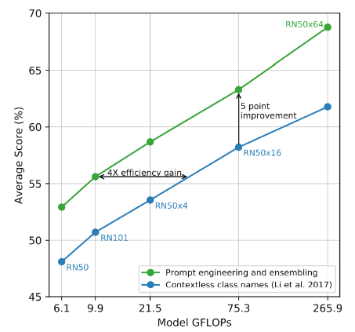

- **가로축:** 이미지 모델의 GFLOPs로, 오른쪽일수록 큰 연산량을 사용하는 모델입니다.
- **세로축:** 36개 데이터셋의 평균 점수입니다. ImageNet 하나의 정확도가 아닙니다.
- **파란색:** 문맥 없이 클래스 이름만 사용한 결과입니다.
- **초록색:** Prompt engineering과 임베딩 앙상블을 적용한 결과입니다.

같은 가로 위치에서 초록색이 더 높은 것은 **이미지 모델을 키우지 않아도 텍스트 후보를 구성하는 방법으로 성능을 개선할 수 있음**을 보여줍니다. 논문은 36개 데이터셋에서 평균 약 5포인트 향상을 보고합니다. 그림의 ‘4× efficiency gain’은 비슷한 점수에 필요한 모델 연산량을 비교한 의미이며, 실행 속도가 자동으로 4배 빨라진다는 뜻은 아닙니다.

**훈련에서는 배치 안의 정답 쌍을 맞히도록 가중치를 갱신하고, 추론에서는 고정된 모델로 사용자가 정한 K개 후보를 비교합니다.** 후보에 정답 개념이 없으면 다른 후보가 선택될 수 있으므로, 결과를 해석할 때는 후보 목록과 문구를 함께 확인해야 합니다.

출처: [CLIP 원 논문 §3.1.2 — Zero-shot 선형 분류기](https://arxiv.org/html/2103.00020v1#S3.SS1.SSS2), [§3.1.4 및 그림 4 — Prompt engineering과 앙상블](https://arxiv.org/html/2103.00020v1#S3.SS1.SSS4)

---

### Zero-shot experiments

세 실험은 각각 **정답 라벨로 학습한 기준 모델과의 경쟁력**, **추가 라벨이 적을 때의 성능**, **데이터 분포가 바뀌었을 때의 견고함**을 살펴봅니다. 여기서 Zero-shot은 평가 과제의 정답 예제로 추가 학습하지 않는다는 뜻이며, CLIP의 대규모 사전학습과 클래스 설명은 사용합니다.

#### 1. 지도학습 기준과 비교: 27개 중 16개 데이터셋에서 우세

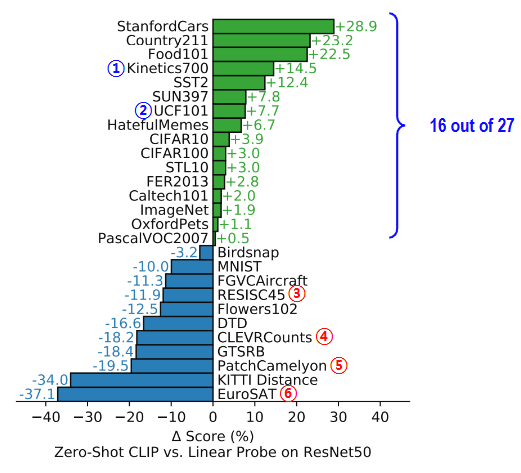

비교 대상은 **ImageNet으로 사전학습한 ResNet-50의 특징을 고정하고, 각 평가 과제의 학습 라벨로 학습한 선형 분류기**입니다. 모든 층을 해당 과제에 맞게 미세조정한 모델이나 각 분야의 최고 모델을 뜻하지는 않습니다.

가로축은 `Zero-shot CLIP 점수 − 기준 분류기 점수`입니다. 오른쪽 초록 막대는 CLIP이 우세하고, 왼쪽 파란 막대는 기준 분류기가 우세합니다. 정확도 지표의 차이는 %p로 읽습니다.

| 대표 과제                    | 그림의 점수 차이   | 결과 해석                    |
| ------------------------ | ----------- | ------------------------ |
| StanfordCars·Food101     | +28.9·+22.5 | 자동차·음식 같은 세부 범주에서도 강한 결과 |
| Kinetics700 — ①          | +14.5       | 행동 분류 과제에서 우세            |
| UCF101 — ②               | +7.7        | 다른 행동 분류 과제에서도 우세        |
| ImageNet                 | +1.9        | 일반 물체 분류에서도 기준보다 약간 높음   |
| RESISC45 — ③·EuroSAT — ⑥ | −11.9·−37.1 | 위성·항공 영상에서는 크게 뒤처짐       |
| CLEVRCounts — ④          | −18.2       | 합성 장면의 물체 개수 세기에 취약      |
| PatchCamelyon — ⑤        | −19.5       | 병리 영상의 종양 판별에서 취약        |

전체적으로 **27개 중 16개에서 CLIP이 더 높지만, 과제별 편차가 큽니다.** 행동 분류의 강점에 대해 논문은 자연어가 물체 이름뿐 아니라 동작을 나타내는 표현도 제공하기 때문일 수 있다고 해석합니다. 이는 가능한 설명이며, 언어 감독의 효과만 분리해 입증한 결과는 아닙니다.

반면 전문 영상이나 수량·거리 판단에서는 큰 격차가 나타납니다. 세부 분류 안에서도 StanfordCars는 강하지만 FGVCAircraft는 −11.3, Flowers102는 −12.5이므로, ‘세부 분류에 항상 강하다’고 일반화할 수 없습니다. 사전학습에서 얻은 표현과 언어가 해당 과제를 얼마나 잘 다루는지가 중요합니다.

#### 2. Few-shot linear probe와 비교: 적은 라벨을 얼마나 대체할까?

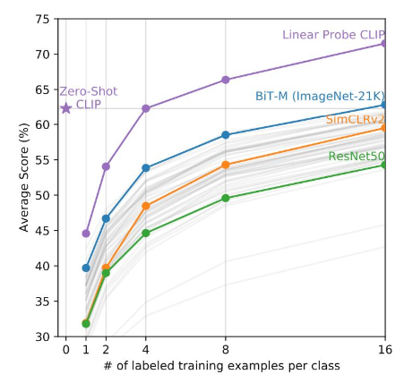

**Linear probe**는 이미지 인코더를 고정하고 그 위의 선형 분류기만 정답 라벨로 학습하는 평가입니다. **4-shot은 전체 4장이 아니라 클래스당 4장**을 뜻합니다. 그림은 클래스당 16개 이상의 예제가 있는 **20개 데이터셋의 평균 점수**를 사용합니다.

| 그래프 요소 | 의미                                               |
| ------ | ------------------------------------------------ |
| 가로축    | 선형 분류기 학습에 사용한 클래스당 라벨 이미지 수                     |
| 세로축    | 20개 데이터셋의 평균 점수                                  |
| 별 표시   | 추가 라벨 없이 설명 문장으로 분류한 Zero-shot CLIP              |
| 보라색 곡선 | 같은 CLIP 이미지 특징 위에 소량 라벨로 학습한 선형 분류기              |
| 다른 곡선  | BiT-M·SimCLRv2·ResNet-50 등 다른 모델의 특징을 사용한 선형 분류기 |

핵심 결과는 **Zero-shot CLIP이 같은 CLIP 특징의 4-shot 선형 분류기와 평균적으로 비슷한 성능**을 보인다는 것입니다. 또한 이 평가에 포함된 다른 공개 모델 중 가장 좋은 16-shot 결과에도 근접합니다. 그러나 CLIP 자체의 선형 분류기는 라벨이 8·16개로 늘어나면서 Zero-shot보다 높은 점수에 도달합니다.

라벨 1~2장만으로는 이미지의 어느 속성이 분류 기준인지 모호할 수 있습니다. 예를 들어 개 사진 한 장은 품종·색·배경 등 여러 단서를 담지만, 클래스 설명은 구분하려는 개념을 직접 지정합니다. 따라서 적은 예제에서의 과적합 가능성뿐 아니라 **텍스트가 과제를 명확하게 전달하는 효과**도 생각해야 합니다.

이 결과는 모든 과제에서 라벨 4장을 대체한다는 뜻은 아닙니다. 평균에 가려진 과제별 차이가 있으며, 라벨이 충분하면 해당 과제에 맞춘 분류기 학습이 더 유리할 수 있습니다.

#### 3. Distribution shift: 같은 ImageNet 성능이어도 변화에 대한 견고함은 다르다

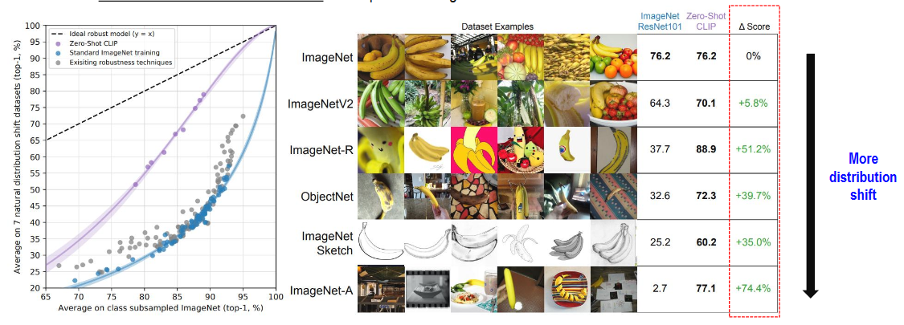

분포 변화는 같은 대상을 다루더라도 촬영 조건·배경·그림 스타일 등이 달라지는 상황입니다. 왼쪽 그래프는 **가로축의 ImageNet 성능이 비슷한 모델끼리 세로축의 분포 변화 성능을 비교**합니다. 점선 y=x에 가까울수록 두 평가 사이의 성능 격차가 작습니다. 그래프는 공통 클래스에 맞춘 ImageNet 평가와 7개 분포 변화 평가의 평균을 사용합니다.

보라색 CLIP 경향선이 일반 ImageNet 학습 모델의 파란색 경향선보다 높으므로, ImageNet 정확도가 비슷해도 CLIP이 변화된 이미지에서 더 높은 성능을 유지하는 경향이 나타납니다. 두 모델이 단순히 원래 정확도부터 달랐기 때문인지 확인하는 것이 이 비교의 핵심입니다.

오른쪽 표는 ImageNet 정확도가 모두 **76.2%**인 ResNet-101과 Zero-shot CLIP ViT-L/14@336px를 비교합니다. 아래 값은 그림에 제시된 해당 평가 설정의 결과입니다.

| 평가 데이터          | ImageNet ResNet-101 | Zero-shot CLIP | 차이      |
| --------------- | ------------------- | -------------- | ------- |
| ImageNet        | 76.2                | 76.2           | 0.0%p   |
| ImageNetV2      | 64.3                | 70.1           | +5.8%p  |
| ImageNet-R      | 37.7                | 88.9           | +51.2%p |
| ObjectNet       | 32.6                | 72.3           | +39.7%p |
| ImageNet Sketch | 25.2                | 60.2           | +35.0%p |
| ImageNet-A      | 2.7                 | 77.1           | +74.4%p |

예를 들어 스케치에서 25.2→60.2는 **+35.0%p**입니다. 다만 데이터셋마다 클래스 범위와 평가 설정이 달라, 각 행의 절대 점수를 서로 같은 난이도의 시험 점수처럼 비교해서는 안 됩니다. 그림의 예시는 분포 차이를 보여주며, 위에서 아래로의 순서를 보편적인 난이도 척도로 볼 수도 없습니다.

이 결과는 **논문의 자연적인 분포 변화 평가에서 CLIP의 견고함이 더 높았다**는 근거입니다. 모든 도메인 변화나 인위적인 공격에서도 안전하게 일반화한다는 보장은 아닙니다. 앞의 위성·병리 영상 결과처럼 전이 성능이 낮은 분야도 함께 확인해야 합니다.

세 실험을 연결하면 CLIP의 장점은 **많은 과제에서 추가 라벨 없이 출발할 수 있고, 적은 라벨과 일부 분포 변화 조건에서 강한 기준점을 제공한다는 것**입니다. 실제 사용 성능은 해당 과제의 데이터·후보 문구·평가 조건으로 확인해야 합니다.

출처: [CLIP 원 논문 §3.1.5 — 지도학습·Few-shot 비교, 그림 5·6](https://arxiv.org/html/2103.00020v1#S3.SS1.SSS5), [§3.3 — 자연적인 분포 변화에 대한 견고함, 그림 13](https://arxiv.org/html/2103.00020v1#S3.SS3)

---

### Summary

**CLIP의 핵심은 이미지와 자연어를 연결해, 하나의 사전학습 모델을 다양한 분류 기준과 검색 작업에 활용할 수 있도록 만든 것**입니다. 클래스별 출력층을 매번 학습하는 대신, 텍스트로 원하는 개념을 지정하고 이미지와의 유사도를 비교합니다.

#### 1. 무엇을 어떻게 배웠을까?

| 핵심 요소        | 정리                                                 |
| ------------ | -------------------------------------------------- |
| 자연어 감독       | WIT의 4억 이미지·텍스트 쌍에서 설명 문장을 학습 신호로 활용               |
| 두 인코더        | Image Encoder와 Text Encoder가 각각 입력을 공통 임베딩 공간으로 변환 |
| 대조 학습        | 배치 안에서 올바른 이미지·문장 쌍을 행·열 양방향으로 찾도록 학습              |
| Zero-shot 추론 | 고정된 모델로 이미지와 후보 설명의 유사도를 비교해 클래스 선택                |
| Prompt 활용    | 문맥을 담은 설명과 여러 문장의 임베딩 앙상블로 분류 기준을 더 잘 전달           |

**ViT는 이미지 특징을 추출하는 구조이고, CLIP은 그 특징을 언어의 표현과 연결하는 학습 방식**입니다. 따라서 CLIP의 이미지 인코더로 ViT를 사용할 수 있으며, 두 개념은 함께 쓰일 수 있습니다.

#### 2. 실험에서 확인한 장점과 한계

- **추가 라벨 없이도 경쟁력 있는 출발점:** 27개 평가 데이터셋 중 16개에서 ResNet-50 특징 기반 지도학습 선형 분류기보다 높은 점수를 기록했습니다.
- **적은 라벨에 대한 효율:** 20개 데이터셋의 평균에서 Zero-shot 성능이 같은 CLIP 특징의 4-shot 선형 분류기와 비슷했습니다. 모든 과제에서 클래스당 라벨 4장을 대체한다는 뜻은 아닙니다.
- **일부 분포 변화에 대한 견고함:** ImageNet 성능이 비슷한 모델과 비교했을 때, 논문의 자연적인 분포 변화 평가에서 더 높은 성능을 유지하는 경향을 보였습니다.
- **과제별 편차:** 위성·병리 영상, 개수·거리 판단 등에서는 취약했습니다. 충분한 라벨로 학습한 분류기가 더 높은 성능을 얻을 수도 있습니다.

#### 3. 기억할 점

Zero-shot은 **해당 평가 과제의 정답 예제로 추가 학습하지 않는다**는 뜻입니다. 대규모 사전학습과 자연어 설명은 사용하므로, 학습 비용이나 감독 신호 자체가 사라지는 것은 아닙니다. CLIP은 새 과제마다 필요한 수동 클래스 라벨을 줄일 수 있지만, 결과는 사전학습 데이터·후보 클래스·설명 문구에 영향을 받습니다.

앞선 ViT·DeiT·Swin과 연결하면, **ViT는 이미지의 토큰 처리, DeiT는 데이터 효율적인 학습, Swin은 계층 구조와 계산 범위, CLIP은 이미지·언어의 정렬과 과제 간 전이**에 초점을 맞춥니다. CLIP의 기여는 모든 작업을 해결하는 보장보다, 자연어로 지정한 여러 과제에 재사용할 수 있는 시각 표현을 학습했다는 데 있습니다.

출처: [Learning Transferable Visual Models From Natural Language Supervision — CLIP 원 논문, ICML 2021](https://arxiv.org/abs/2103.00020)

---

## 2. 다른 뷰의 표현을 맞추는 DINO

**DINO(self-DIstillation with NO labels)는 같은 이미지의 서로 다른 뷰가 일관된 표현을 만들도록, Student와 Teacher를 함께 사용하는 자기지도 학습 방법**입니다. 사람의 클래스 라벨이나 텍스트 설명 대신, Teacher가 만든 출력 분포를 Student의 학습 목표로 사용합니다.

아래 내용은 [강의 PDF 50~59쪽](../교안/03_00_Attention.pdf#page=50)을 입력 뷰 → 학습 목표 → 갱신 → 평가 순서로 연결합니다. 여기서 다루는 것은 2021년의 원 DINO이며, 슬라이드의 DINOv2 데모 링크는 후속 연구의 예시입니다.

세부 탐색: [Crop 입력](#crop) · [EMA와 Center](#ema-center) · [Temperature](#temperature) · [한 Step](#dino-step) · [Attention 관찰](#dino-map).

**원문 정정·보충:** 교안 53쪽의 50% 경계는 개념 설명이고 구현의 고정 규칙이 아닙니다. 54쪽 Centering은 샘플 내부 성분 평균을 0으로 만드는 정규화가 아니며, 55쪽의 낮은 온도는 패치 위치를 직접 고르는 연산이 아닙니다. 아래에서는 [원 DINO 논문 §3·§5.3](https://arxiv.org/html/2104.14294v2#S3)과 [공식 학습 코드](https://github.com/facebookresearch/dino/blob/main/main_dino.py)에 따라 대상 축과 갱신을 구별합니다.

### Overview — 라벨 없이도 물체를 구분하는 표현 배우기

자료: PDF 50쪽.

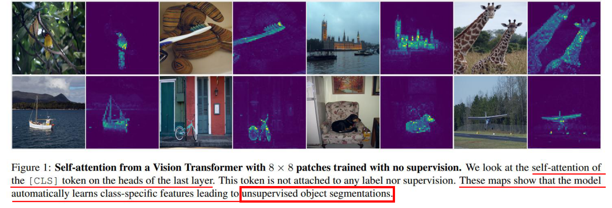

그림은 원본 사진과 Self-Attention 시각화를 번갈아 보여줍니다. 신발·기린·비행기처럼 주요 물체가 놓인 부분에 강한 반응이 나타납니다. **물체의 클래스나 분할 마스크를 정답으로 주지 않았는데도, 학습한 표현에 물체의 공간적 구조가 드러난다**는 것이 이 절의 관찰입니다.

기존 지도학습에서는 많은 이미지에 정답 라벨을 붙여야 합니다. DINO는 이를 줄이기 위해 이미지 자체에서 여러 학습 입력을 만들고, 같은 장면을 다르게 보아도 유용한 공통 표현을 만들도록 학습합니다. 다만 Attention 그림이 물체 이름을 알려 주거나, 모든 이미지에서 정확한 분할을 보장하는 것은 아닙니다.

앞서 배운 방법들과 학습 신호를 비교하면 다음과 같습니다.

| 방법          | 학습 목표를 만드는 정보                       |
| ----------- | ----------------------------------- |
| 지도학습 ViT    | 사람이 지정한 클래스 라벨                      |
| DeiT의 증류 모델 | 실제 클래스 라벨과 별도 교사 모델의 예측             |
| CLIP        | 이미지와 함께 수집한 자연어 설명                  |
| DINO        | 같은 이미지의 다른 뷰에 대한 EMA Teacher의 출력 분포 |

---

### 학습 목표의 출처: Student–Teacher와 자기 증류

자료: PDF 52쪽.

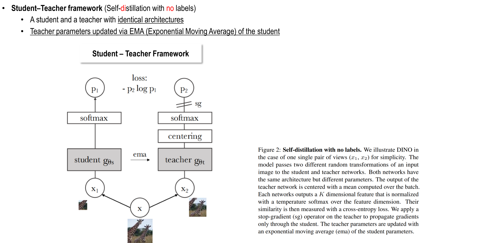

그림은 **아래에서 위로** 읽습니다. 원본 x에 서로 다른 증강을 적용해 뷰 $x_1$, $x_2$를 만들고, 각각 Student와 Teacher에 넣습니다. 두 네트워크는 Backbone과 Projection Head를 거쳐 출력 분포 $p_s$, $p_t$를 만듭니다. Student는 Teacher 분포를 맞히도록 학습합니다.

| 구성      | 학습에서의 역할                      | 갱신 방법                       |
| ------- | ----------------------------- | --------------------------- |
| Student | 다른 뷰에서도 Teacher와 일관된 출력을 예측   | 손실의 역전파와 옵티마이저              |
| Teacher | Student가 따라갈 목표 분포 제공         | Student 가중치의 지수 이동 평균 — EMA |
| Center  | Teacher 출력의 특정 차원 쏠림을 완화하는 통계 | Teacher logits의 이동 평균       |

두 네트워크는 같은 기본 구조로 시작합니다. 별도로 사전학습한 교사의 예측을 사용하는 DeiT의 증류와 달리, **DINO의 Teacher는 Student의 과거 가중치를 평균하며 함께 발전**합니다. 그림의 EMA 화살표는 특징 벡터를 전달하는 경로가 아니라 파라미터를 갱신하는 경로입니다.

Student와 Teacher가 같은 출력을 내기만 하면 손실을 낮출 수 있어, 모든 이미지에 똑같은 분포를 출력하는 **표현 붕괴(Collapse)**가 문제가 됩니다. DINO는 Teacher의 느린 갱신, Centering, Sharpening과 Stop-gradient를 조합해 이를 방지합니다.

---

### 입력 만들기: ViT Backbone과 Multi-crop

자료: PDF 53쪽.

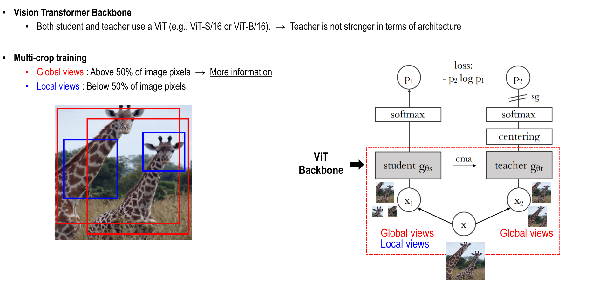

왼쪽 기린 사진의 큰 빨간 박스는 Global view, 작은 파란 박스는 Local view입니다. 오른쪽 구조에서 **Student는 Global·Local 뷰를 모두 보고, Teacher는 Global 뷰만 봅니다.** Student가 부분적인 단서에서도 큰 장면을 본 Teacher와 일관된 표현을 만들도록 하는 구성입니다.

| 구분          | 입력 내용         | 공식 구현의 기본 예시       |
| ----------- | ------------- | ------------------ |
| Global view | 원본의 비교적 큰 영역  | 2개, 각각 224×224로 변환 |
| Local view  | 원본의 비교적 작은 영역 | 8개, 각각 96×96으로 변환  |

슬라이드의 ‘50% 이상·미만’은 큰 뷰와 작은 뷰를 나누는 직관적인 설명입니다. 실제 Crop 비율은 설정할 수 있으며, 공식 코드의 기본 면적 범위는 Global 0.4~1.0, Local 0.05~0.4입니다. **Crop한 원본 영역의 비율과, Crop을 Resize한 뒤의 입력 픽셀 크기는 구분**해야 합니다.

예를 들어 기린 몸 일부만 보는 Student가 더 넓은 장면을 보는 Teacher의 표현을 배우는 방식입니다. 같은 뷰를 자기 자신과 비교하는 조합은 제외하고, Teacher의 각 Global view를 다른 Student 뷰들과 비교합니다. Local 뷰가 임의의 정답 물체 마스크인 것은 아닙니다.

원 DINO는 ResNet 같은 Backbone에도 적용할 수 있지만, 이 자료는 물체의 공간적 구조가 잘 드러나는 ViT를 중심으로 설명합니다.

보충 출처: [DINO 공식 구현 — Crop 설정과 뷰 조합](https://github.com/facebookresearch/dino/blob/main/main_dino.py)

---

### 비교할 출력 만들기: CLS, Projection Head, Cross-Entropy

자료: PDF 56쪽.

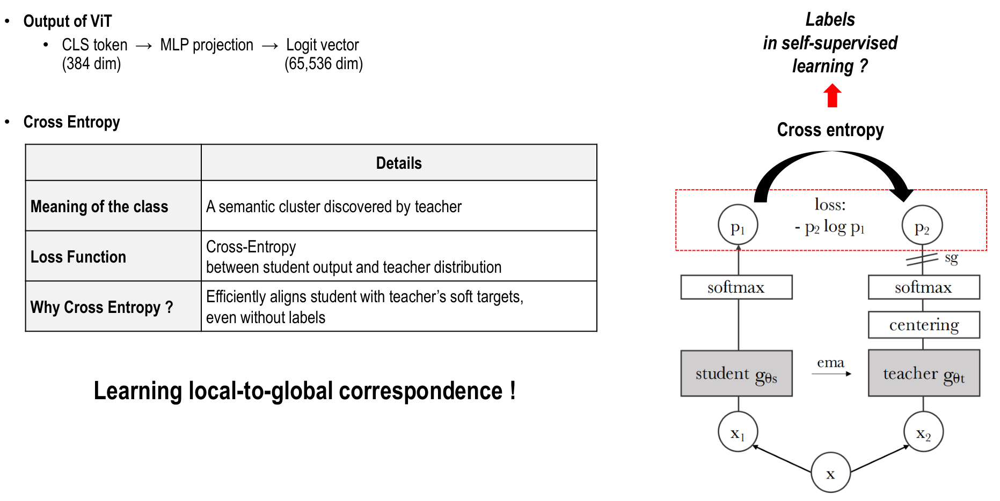

ViT는 CLS 토큰의 특징을 만들고, 학습용 Projection Head가 이를 K차원 logits로 바꿉니다. 슬라이드의 **384→65,536**은 ViT-S 특징 차원과 Head 출력 차원의 예입니다. **65,536개가 사람이 정의한 물체 클래스 수라는 뜻은 아닙니다.**

| 값                         | 의미                       | 서로 다른 점                        |
| ------------------------- | ------------------------ | ------------------------------ |
| CLS 특징 — 예: 384차원         | 이미지 전체를 나타내는 Backbone 표현 | 이미지 검색·분류 등의 평가에 활용            |
| Head logits — 예: 65,536차원 | 자기지도 학습 목표를 만드는 출력 점수    | 사람의 클래스 이름과 직접 대응하지 않음         |
| Softmax 출력                | K개 차원에 대한 확률분포           | Teacher와 Student 사이의 손실 계산에 활용 |

슬라이드의 ‘semantic cluster’는 학습 중 생긴 묶음으로 이해할 수 있지만, 각 차원에 항상 고양이·자동차 같은 이름이 붙는 것은 아닙니다.

Teacher가 본 뷰를 u, Student가 본 다른 뷰를 v라 하면 손실은 다음과 같습니다.

$$
H(p_t(u),p_s(v))=-\sum_{k=1}^{K}p_t^{(k)}(u)\log p_s^{(k)}(v)
$$

Cross-Entropy는 사람의 One-hot 라벨이 있어야만 쓸 수 있는 손실이 아닙니다. 여기서는 **Teacher의 Soft target 분포가 정답 역할**을 합니다. Teacher가 높은 비중을 둔 차원을 Student도 잘 예측하도록 학습합니다.

Multi-crop에서는 Teacher의 두 Global view와, 같은 뷰를 제외한 Student의 모든 뷰 사이 손실을 평균합니다. 기본 예시처럼 전체 뷰가 10개라면 이미지당 비교 조합은 2×9=18개입니다. 이는 부분 뷰와 전체 뷰의 표현을 연결하는 학습이지, 픽셀별 위치 대응을 정답으로 준 학습은 아닙니다.

CLIP과 달리 서로 다른 이미지들을 명시적인 Negative pair로 밀어내는 항을 사용하지 않습니다. 따라서 일관성을 배우면서도 출력의 다양성을 유지하도록 설계한 Centering·Sharpening 등이 중요합니다.

---

### 안정적인 목표 만들기: EMA와 Centering

자료: PDF 54쪽.

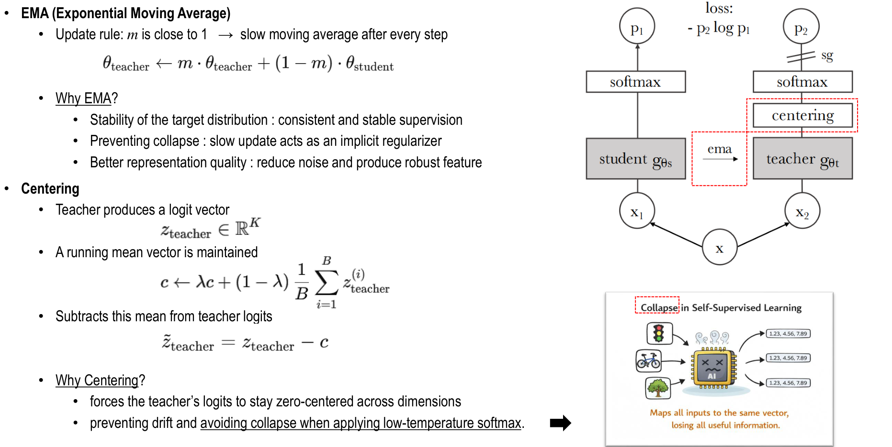

#### EMA: Teacher가 너무 급격하게 바뀌지 않게 하기

Student를 옵티마이저로 갱신한 뒤 Teacher 파라미터를 다음처럼 바꿉니다.

$$
\theta_t\leftarrow m\theta_t+(1-m)\theta_s
$$

m이 1에 가까우면 Teacher가 현재 Student를 조금씩 반영합니다. 예를 들어 m=0.996이면 기존 Teacher의 비중은 99.6%, 현재 Student는 0.4%입니다. 이는 이미지별 예측을 평균하는 것이 아니라 **네트워크 가중치를 시간에 걸쳐 평균**하는 연산입니다.

EMA는 학습 목표가 매번 크게 요동치는 것을 줄입니다. 다만 EMA 하나만으로 모든 붕괴 문제가 해결된다고 이해하면 안 됩니다.

#### Centering: 특정 출력 차원의 독점을 완화하기

Teacher의 Softmax 이전 출력인 logits를 $z_t\in\mathbb{R}^{K}$라고 하면, Center c도 K차원 벡터입니다. 배치 평균을 이동 평균으로 누적하고 Teacher logits에서 뺍니다.

$$
c\leftarrow\lambda c+(1-\lambda)\frac{1}{B}\sum_{b=1}^{B}z_t^{(b)},
\qquad \widetilde z_t=z_t-c
$$

여기서 B는 통계에 포함한 Teacher 뷰의 수이며, K는 Projection Head의 출력 차원입니다. 특정 출력 차원이 여러 입력에서 계속 크게 나오면 그 성분의 Center도 커져, 이후 점수에서 더 많이 차감됩니다.

**Centering은 각 이미지 벡터의 성분 평균을 무조건 0으로 만드는 연산이 아닙니다.** 차원별로 배치·시간에 걸친 평균을 빼는 것입니다. Teacher 파라미터를 평균하는 EMA와 Teacher 출력 통계를 평균하는 Center는 대상도 갱신 계수도 다릅니다.

---

### 목표의 선명도 조절: 두 Softmax와 Temperature

자료: PDF 55쪽.

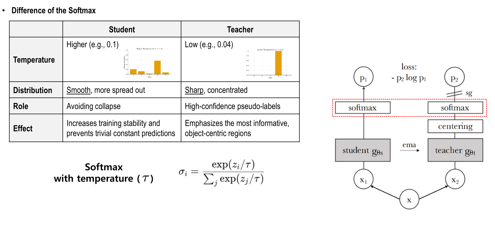

두 네트워크 모두 출력 차원 방향으로 Softmax를 적용하지만, Teacher에는 먼저 Centering을 적용하고 상대적으로 낮은 온도를 사용합니다.

$$
p_s^{(k)}=\frac{\exp(z_s^{(k)}/\tau_s)}{\sum_j\exp(z_s^{(j)}/\tau_s)},
\qquad
p_t^{(k)}=\frac{\exp((z_t^{(k)}-c^{(k)})/\tau_t)}{\sum_j\exp((z_t^{(j)}-c^{(j)})/\tau_t)}
$$

| 구분          | Student         | Teacher               |
| ----------- | --------------- | --------------------- |
| 온도 예시       | 0.1             | 0.04                  |
| 비교적 나타나는 분포 | 완만한 분포          | 더 뾰족한 분포 — Sharpening |
| 역할          | 목표 분포를 따라가도록 학습 | 구분 가능한 학습 목표 제공       |
| Centering   | 적용하지 않음         | Softmax 전에 적용         |

온도가 낮으면 같은 logits의 차이가 더 확대됩니다. **Centering은 한 차원에 몰리는 경향을, Sharpening은 모든 입력이 균일한 분포를 내는 경향을 억제**하도록 함께 작동합니다. Student의 높은 온도만으로 Collapse를 막는다고 보거나, Teacher의 낮은 온도가 곧바로 물체 위치를 선택한다고 해석하면 안 됩니다. 이 분포의 축은 패치 위치가 아니라 Head의 출력 차원입니다.

슬라이드의 온도는 예시이며, 실제 실험에서는 Teacher 온도의 Warm-up 등 학습 설정에 따라 달라질 수 있습니다.

---

### 갱신 경로 분리: Stop-gradient

자료: PDF 57쪽.

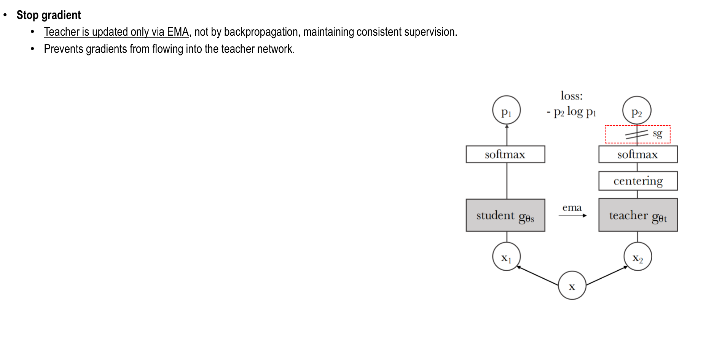

그림의 **sg는 Stop-gradient**입니다. 손실을 계산할 때 Teacher 출력 분포는 고정된 목표처럼 취급하고, 그 경로로는 그래디언트를 전달하지 않습니다.

1. Teacher가 Global view의 목표 분포를 계산합니다.
2. Student가 다른 뷰의 출력으로 목표를 따라가도록 손실을 계산합니다.
3. 역전파·옵티마이저는 Student의 Backbone과 Projection Head를 갱신합니다.
4. Teacher는 새 Student 가중치를 EMA로 반영합니다.

따라서 **Teacher는 ‘그래디언트로 학습하지 않지만, 가중치는 계속 변하는’ 모델**입니다. Stop-gradient가 Teacher를 학습 내내 고정한다는 뜻은 아닙니다. 이 비대칭 갱신이 Teacher를 안정적인 학습 목표로 사용하는 핵심입니다.

---

### 한 학습 단계: 입력부터 다음 Teacher까지

자료: PDF 58쪽.

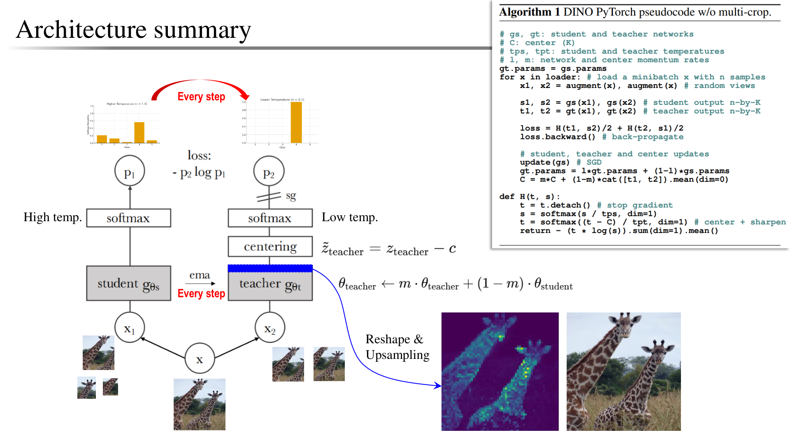

앞서 따로 살펴본 구성 요소를 실제 한 Step으로 연결하면 다음과 같습니다.

| 순서  | 수행 내용                                          | 갱신되는 대상             |
| --- | ---------------------------------------------- | ------------------- |
| 1   | 같은 이미지에서 Global·Local 뷰 생성                     | 입력 뷰                |
| 2   | Student는 모든 뷰, Teacher는 Global 뷰 처리            | 특징·logits 계산        |
| 3   | 이전 Center로 Teacher logits를 보정하고 낮은 온도로 Softmax | Teacher 목표 분포       |
| 4   | 다른 뷰끼리 Cross-Entropy를 계산하고 평균                  | 손실                  |
| 5   | Teacher 경로를 차단한 채 역전파·옵티마이저 적용                 | Student 가중치         |
| 6   | 갱신한 Student를 EMA로 반영                           | Teacher 가중치         |
| 7   | 이번 Teacher logits의 배치 통계를 이동 평균에 반영            | 다음 Step에 사용할 Center |

Center 통계 갱신은 손실 계산 중에 수행할 수도 있지만, **현재 목표 분포를 만들 때 사용한 Center와 다음 단계용 통계 갱신을 구분**하면 이해하기 쉽습니다. Center에는 Softmax 확률이 아니라 Teacher logits의 평균을 반영합니다.

오른쪽 의사 코드는 설명을 위해 **두 Global view만 사용하는 경우**입니다. `H(t1, s2)`와 `H(t2, s1)`은 서로 다른 뷰끼리 목표를 맞추는 두 방향입니다. 실제 Multi-crop은 같은 원리를 Local view들까지 확장합니다.

아래 Attention map은 학습 손실의 정답 마스크가 아니라 **학습 후 내부 Attention을 살펴본 결과**입니다. 마지막 층의 CLS→패치 가중치를 격자로 바꾸고 확대하는 별도 시각화 과정이며, 65,536차원 Head 출력을 이미지 격자로 바꾸는 것은 아닙니다.

---

### 학습 후 관찰: CLS가 어느 패치를 참고할까?

자료: PDF 51쪽.

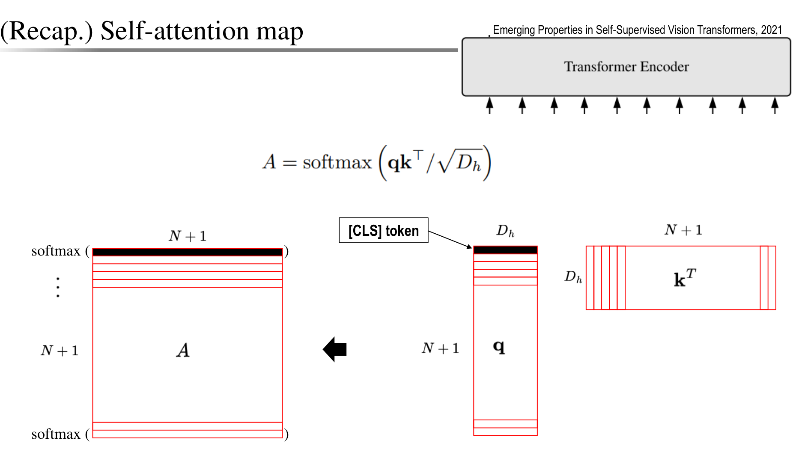

그림에서 N은 이미지 패치 수입니다. CLS를 포함한 토큰 수는 N+1이며, Head 하나의 Query와 Key 차원을 $d_h$라고 하면 Attention 행렬은 다음과 같습니다.

$$
A=\operatorname{softmax}\left(\frac{QK^T}{\sqrt{d_h}}\right),
\qquad A\in\mathbb{R}^{(N+1)\times(N+1)}
$$

**빨간색으로 표시한 CLS Query의 행**은 CLS가 각 토큰을 얼마나 참고하는지를 나타냅니다. 여기서 CLS 자신에 해당하는 칸을 제외하면 패치별 가중치 N개가 남습니다. 이를 패치 격자로 재배열하고 원본 크기로 확대하면 앞의 Attention map이 됩니다.

예를 들어 224×224 이미지를 16×16 패치로 나누면 패치는 14×14=196개입니다. Head 하나의 Attention 행렬은 197×197이고, CLS→패치 가중치 196개를 14×14로 되돌릴 수 있습니다.

이 그림은 **Attention 가중치를 시각화한 것**입니다. 최종 CLS 특징 벡터를 그대로 이미지로 펼친 것도 아니고, 픽셀별 클래스 확률을 출력한 것도 아닙니다. Head별로 참고하는 위치가 달라 서로 다른 물체나 부위가 드러날 수 있습니다.

---

### Experiments — Attention과 Teacher 업데이트 분석

자료: PDF 59쪽.

#### 1. 여러 Head가 물체와 부위를 다르게 참고한다

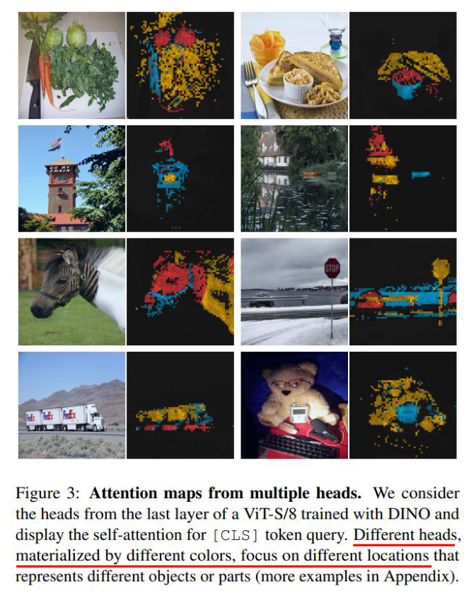

왼쪽 사진과 짝지어진 색상 지도는 **DINO로 학습한 ViT-S/8의 마지막 층에서 CLS Query의 Attention을 Head별로 표시**한 것입니다. 서로 다른 색은 다른 Head를 구분합니다. 식탁·새·자동차처럼 장면 속 대상이나 부위가 서로 다른 Head에서 두드러집니다.

이 그림은 클래스 라벨 없이 학습해도 **표현에 물체의 위치와 경계에 관한 정보가 드러날 수 있다**는 정성적 근거입니다. 색을 사람이 지정한 의미 클래스나 픽셀별 정답으로 해석하면 안 됩니다. Attention 시각화 자체가 완성된 분할 모델의 정확도를 뜻하지도 않습니다.

#### 2. Teacher는 같은 구조여도 Student보다 좋은 표현을 제공한다

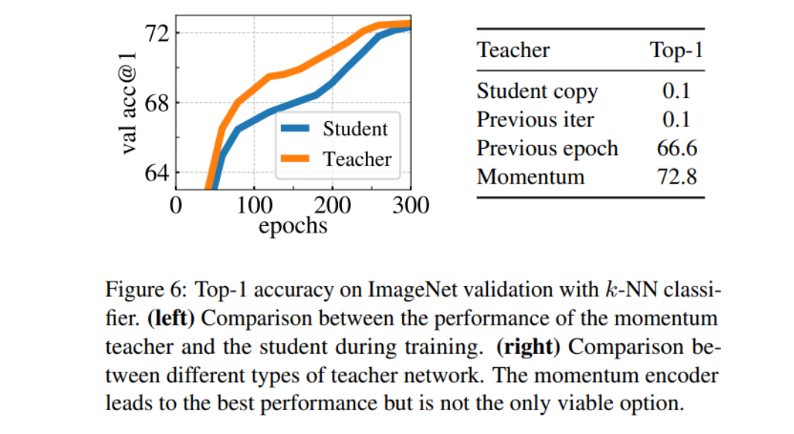

그래프의 가로축은 학습 Epoch, 세로축은 **ImageNet 검증 세트의 k-NN Top-1 정확도**입니다. 주황색 EMA Teacher가 파란색 Student보다 학습 중 대체로 높습니다. 같은 기본 구조여도 시간에 걸친 가중치 평균이 더 좋은 특징을 만들 수 있으며, Student가 이를 목표로 따라가는 자기 증류의 근거가 됩니다.

**k-NN 평가는 학습된 이미지 특징의 가까운 이웃을 찾아 그 라벨로 분류**합니다. 특징 추출기는 고정하고 새 선형 Head는 학습하지 않습니다. 다만 이웃의 클래스 라벨은 사용하므로, ‘사전학습에 라벨을 쓰지 않았다’와 ‘평가에도 라벨이 전혀 필요 없다’는 구분해야 합니다.

#### 3. Teacher를 갱신하는 방법에 따라 결과가 크게 달라진다

| Teacher 구성               | ImageNet k-NN Top-1 | 해석                            |
| ------------------------ | ------------------- | ----------------------------- |
| 현재 Student를 그대로 복사       | 0.1%                | 이 실험 설정에서는 붕괴                 |
| 직전 Iteration의 Student 사용 | 0.1%                | 한 Step 지연만으로는 안정적인 목표를 만들지 못함 |
| 이전 Epoch의 Student 사용     | 66.6%               | 더 느린 목표 갱신으로 유의미한 표현 학습       |
| Momentum Teacher — EMA   | 72.8%               | 비교한 방법 중 가장 높은 결과             |

ImageNet은 1,000개 클래스이므로 균등 무작위 수준이 약 0.1%입니다. 위의 두 0.1% 결과는 그림의 설정에서 표현 학습이 실패했음을 나타냅니다. EMA 방식은 이전 Epoch 방식보다 **+6.2%p** 높습니다.

이 표는 논문의 **ViT-S/16, 300 Epoch 구성에서 Teacher 선택을 비교한 실험**입니다. 72.8%는 이 조건의 k-NN 결과이며, DINO의 모든 모델에서 얻는 고정 성능이나 선형 평가 정확도가 아닙니다. 또 이전 Epoch Teacher도 학습되므로, EMA만이 어떤 자기지도 학습에서도 가능한 유일한 갱신 방식이라는 결론은 아닙니다.

보충 출처: [DINO 원 논문 §5.2·그림 6 — Teacher 선택과 학습 동작](https://arxiv.org/html/2104.14294v2#S5.SS2)

---

### Summary

**DINO는 같은 이미지의 다른 뷰를 일관되게 표현하도록, 느리게 갱신되는 Teacher를 Student의 학습 목표로 사용하는 방법**입니다. 클래스 라벨이나 텍스트 설명 없이도 재사용할 수 있는 시각 특징을 배웁니다. 이 절은 PDF 50~59쪽의 내용을 종합한 정리입니다.

| 핵심 요소                  | 하는 일                        | 기억할 점                             |
| ---------------------- | --------------------------- | --------------------------------- |
| Multi-crop             | Global·Local 뷰의 표현 연결       | Teacher는 Global, Student는 모든 뷰 처리 |
| Self-distillation      | Teacher 분포를 Student가 따라가게 함 | 별도의 큰 사전학습 교사가 필요하지 않음            |
| EMA Teacher            | 과거 Student 가중치를 누적해 목표 안정화  | 현재 예측의 단순 평균과 다름                  |
| Centering + Sharpening | 출력 차원 쏠림과 균일한 예측을 함께 억제     | 두 연산의 균형이 중요                      |
| Stop-gradient          | 손실이 Teacher 경로로 역전파되는 것을 차단 | Teacher는 EMA로 계속 갱신               |
| CLS Attention 시각화      | 물체·부위의 공간적 구조를 관찰           | 분할 정답이나 물체 이름을 직접 출력하는 것은 아님      |

실험에서는 Head별 Attention에 물체나 부위가 나타나고, EMA Teacher가 좋은 특징을 제공하는 모습을 확인했습니다. 그러나 물체의 의미를 자연어로 지정하는 기능은 원 DINO에 없습니다. **CLIP은 이미지와 언어를 정렬하고, DINO는 이미지의 여러 뷰를 정렬**한다는 차이가 있습니다.

| 앞선 방법과의 연결 | 초점                               |
| ---------- | -------------------------------- |
| ViT        | 이미지를 패치 토큰으로 처리하는 Backbone 구조    |
| DeiT       | 정답 라벨과 교사 지식을 활용한 데이터 효율적 학습     |
| Swin       | 계층적 특징과 윈도우 Attention으로 계산 범위 조절 |
| CLIP       | 이미지·텍스트 쌍으로 학습해 자연어 기반 전이·검색 지원  |
| DINO       | 이미지 뷰 사이 자기 증류로 라벨 없는 시각 표현 학습   |

DINO의 ‘라벨 없음’은 **사전학습 손실에 사람의 클래스 정답을 사용하지 않는다**는 뜻입니다. 다운스트림 분류나 성능 평가에서는 라벨이 필요할 수 있습니다. 학습한 특징은 검색·k-NN·선형 분류·미세조정 등에 활용하되, 과제별 성능과 평가 조건을 함께 확인해야 합니다.

출처: [강의 PDF — DINO 50~59쪽](../교안/03_00_Attention.pdf#page=50), [Emerging Properties in Self-Supervised Vision Transformers — DINO 원 논문, ICCV 2021](https://arxiv.org/abs/2104.14294), [공식 구현](https://github.com/facebookresearch/dino)

## 3. 손계산으로 학습 목표와 갱신을 연결하기

### CLIP: 배치 손실에서 후보 분류로 — 교육용 보충

두 정답 쌍의 정규화 임베딩을 `I=T=[[1,0],[0,1]]`, 스케일 α=2로 놓으면 logits는 `S=[[2,0],[0,2]]`입니다. 이미지 1이 정답 문장 1을 고를 확률은 `e²/(e²+1)≈0.880797`, 손실은 `-ln(0.880797)≈0.126928`입니다. 모든 행과 열이 대칭이므로 양방향 평균도 0.126928입니다. 이 정답은 클래스 이름이 아니라 **현재 배치의 짝 인덱스**입니다.

학습 후 후보 문장 벡터를 `[1,0]`(고양이), `[0,1]`(개)라고 가정하고 새 이미지 벡터가 `[0.8,0.6]`이면 길이는 1이고 유사도는 `[0.8,0.6]`입니다. α=2이면 점수는 `[1.6,1.2]`, 후보 내 확률은 약 `[0.598688,0.401312]`로 고양이를 선택합니다. 이 단계에는 가중치 업데이트가 없습니다. 후보를 추가하거나 문장을 바꾸면 분모와 벡터가 달라질 수 있어, 0.598688은 독립적으로 보장된 정답 확률이 아닙니다.

### DINO: 한 Step의 상태 추적 — 교육용 보충

실제 65,536차원 대신 두 차원을 사용합니다. Teacher의 이전 Center가 `[0.02,0]`, 한 global 뷰의 logits가 `[0.10,0]`, τ_t=0.04라고 합시다. 먼저 Center를 빼면 `[0.08,0]`, 온도로 나누면 `[2,0]`, 목표 분포는 약 `[0.880797,0.119203]`입니다. 다른 뷰의 Student logits가 `[0.10,0]`, τ_s=0.1이면 Student 분포는 Softmax(`[1,0]`)≈`[0.731059,0.268941]`입니다.

손실은 `-0.880797 ln(0.731059)-0.119203 ln(0.268941)≈0.432465`입니다. Teacher 분포는 **stop-gradient로 고정된 목표**로 취급하고 Student 쪽을 역전파합니다. Student 파라미터 하나가 업데이트 후 3, 이전 Teacher 파라미터가 2, m=0.9라면 다음 Teacher 파라미터는 `0.9×2+0.1×3=2.1`입니다. 실제 기본값에 가까운 m=0.996이면 2.004로 훨씬 느리게 움직입니다.

이번 Teacher logits의 배치 평균이 `[0.06,0.02]`, center momentum λ=0.9이면 다음 Center는 `0.9[0.02,0]+0.1[0.06,0.02]=[0.024,0.002]`입니다. **2.1은 모델 가중치의 평균, [0.024,0.002]는 출력 통계의 평균**입니다. 현재 목표에는 이전 Center를 사용했고 새 Center는 다음 Step에 씁니다. 숫자는 계산을 설명하려고 고른 값이며 실제 학습의 안정성을 입증한 실험이 아닙니다.

### 확인 문제

1. CLIP의 N×N 행렬과 ViT의 T×T 행렬은 같은 연산인가요? CLIP에 새 클래스가 들어오면 어떤 값을 새로 준비하나요?
2. DINO에 global 2개·local 6개를 쓰면 Student/Teacher 입력 뷰 수와 손실 비교 수는 얼마인가요?
3. Stop-gradient가 있으면 Teacher는 학습 내내 동일한가요? DeiT Teacher와 비교하세요.
4. Center를 확률에서 빼거나, 65,536차원 Head를 14×14로 reshape해 Attention map을 만들면 왜 잘못인가요?
5. Teacher 온도를 낮추기만 하면 붕괴를 항상 막을 수 있나요?

해설과 돌아갈 위치

1. CLIP은 이미지·문장 **샘플**의 짝을 찾는 손실용 점수이며, ViT는 한 이미지 안 **토큰**의 Value를 섞는 가중치입니다. 새 클래스 설명을 Text Encoder에 넣어 후보 벡터를 준비합니다. Zero-shot에서는 그 클래스의 라벨 예제로 가중치를 업데이트하지 않습니다. [CLIP](#clip)의 Architecture·Inference로 돌아가세요.
2. Student는 8개, Teacher는 global 2개를 봅니다. 같은 뷰 비교를 제외하므로 2×(8−1)=14개입니다. 같은 이미지의 뷰 사이 비교이며 다른 이미지 negative 14개가 아닙니다. [DINO](#dino)의 Multi-crop·Cross-Entropy를 확인하세요.
3. 역전파로는 갱신하지 않지만 Teacher 파라미터는 EMA로 바뀝니다. DeiT의 사전학습 교사는 학생 학습 중 고정됩니다. [DINO](#dino)의 갱신 경로 분리와 [DeiT](03_03_DeiT와_Swin.md#deit)를 대조하세요.
4. Center는 logits의 차원별 이동 평균으로 Softmax **이전**에 뺍니다. Head 출력은 공간 토큰 축이 아니므로 reshape로 물체 위치가 되지 않습니다. Attention map은 마지막 층의 CLS Query에서 패치 Key로 향하는 가중치입니다. [DINO](#dino)의 Centering·학습 후 관찰로 돌아가세요.
5. 아닙니다. 낮은 온도는 현재 큰 차원을 더 강조하므로 특정 차원 독점을 악화시킬 수도 있습니다. Centering과 Sharpening의 균형, EMA 목표, 비대칭 갱신을 함께 봐야 합니다. [DINO](#dino)의 목표 선명도 조절로 돌아가세요.

다음 [비전 응용 지도](04_01_Application_note.md)에서는 배운 특징을 검출·추적·분할의 출력과 평가에 연결합니다. 물체처럼 보이는 Attention map과 정답 마스크로 평가하는 분할 결과를 구분해 두세요.
