# 객체 검출: 박스를 만들고, 중복을 줄이고, 성능을 판단하기

[응용 학습 안내](04_01_Application_note.md) · 다음: [객체 추적](04_03_객체_추적.md) · 연결: [영상 분할](04_04_영상_분할.md)

객체 검출은 이미지에 있는 여러 물체를 **종류·박스·점수**로 표현하는 문제입니다. 이 장은 “어떤 박스를 정답으로 셀 것인가”를 먼저 정하고, 그 출력을 만드는 구조가 왜 달라졌는지 설명합니다. 중복 제거를 이해하면 집합 예측을 사용하는 DETR의 설계 이유도 연결됩니다.

선수지식은 [CNN의 특징 맵·Stride](02_02_CNN_Note.md), [분류 손실과 역전파](02_01_DNN_Note.md)입니다. DETR에 들어가기 전에는 [Attention과 ViT](03_02_Attention과_ViT.md)의 Query·Key·Value를 복습하세요. 위치가 있는 특징을 출력으로 바꾸는 과정이 이 장의 출발점입니다.

학습 목표는 (1) IoU·NMS·AP를 손으로 계산하기, (2) R-CNN→Fast→Faster의 병목 변화를 설명하기, (3) CenterNet의 세 출력으로 박스를 복원하기, (4) DETR의 학습 매칭과 추론을 구분하기입니다.

**기본 경로:** 1→2→3→5→6→7→8. **심화:** 4의 고전 검출기, 5의 손실·Anchor 상세, 7의 매칭 비용·GIoU. 복습할 때는 2의 계산 예제와 8의 질문부터 풀고 해설이 안내하는 절로 돌아갑니다.

| 절 | 답할 질문 |
| --- | --- |
| [1. 출력과 어려움](#detection-basics) | 무엇을 찾아야 하는가? |
| [2. 중복과 평가](#detection-metrics) | 박스를 어떤 조건에서 채택하고 정답으로 세는가? |
| [3. 설계 지도](#detection-design) | 병목을 어떤 표현으로 바꾸었는가? |
| [4. 고전 검출](#detection-classic) | 쉬운 배경을 어떻게 빨리 제외하는가? |
| [5. R-CNN 계열](#detection-rcnn) | 후보 계산을 어떻게 공유하는가? |
| [6. CenterNet](#detection-center) | 중심점에서 박스를 어떻게 복원하는가? |
| [7. DETR](#detection-detr) | 중복 없는 집합을 어떻게 학습하는가? |
| [8. 확인 질문](#detection-check) | 계산과 설계 이유를 설명할 수 있는가? |

원문 범위: [강의 PDF 실제 3–35쪽](../교안/04_00_Applications.pdf#page=3). 표지·구분은 1–2쪽이며 아래 쪽수는 인쇄 쪽수가 아닌 PDF의 1-based 순서입니다. 강의 기반 설명과 기존 노트의 유익한 상세를 유지하되, **교육용 보충**으로 표시한 계산·질문은 새 예시입니다. 실험 수치는 해당 슬라이드의 역사적 설정이며 최신 모델 순위가 아닙니다. 원문 그림은 각 항목의 접기 영역에서 확인할 수 있습니다.

## 1. 출력과 어려움

### Object detection — 무엇과 어디를 함께 예측하기

자료: [PDF 3쪽](../교안/04_00_Applications.pdf#page=3).

강의 원문 그림 펼치기

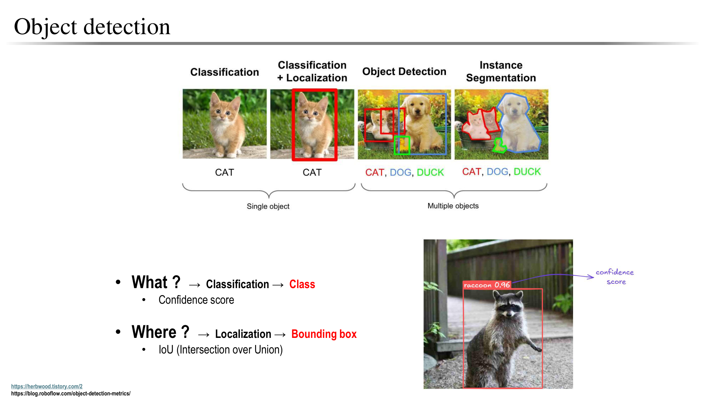

- **Classification**는 이미지에 고양이가 있다는 판단이고, 
- **Localization**은 한 대상의 위치까지 찾는 것입니다. 
- **Detection**은 한 이미지의 여러 물체에 대해 **클래스와 Bounding box를 각각 출력**합니다. 
- **Instance segmentation**은 여기서 물체의 윤곽까지 예측합니다.

검출 결과는 보통 `(클래스, 점수, 박스 좌표)`로 표현합니다. 

Confidence는 모델의 예측 점수이며 실제 정답 확률과 완전히 같다고 가정하면 안 됩니다. 박스의 위치 정확도는 정답 박스와의 IoU 등으로 별도 평가합니다.

---

### Applications — 검출 결과가 실제 판단으로 이어지는 방식

자료: [PDF 4쪽](../교안/04_00_Applications.pdf#page=4).

강의 원문 그림 펼치기

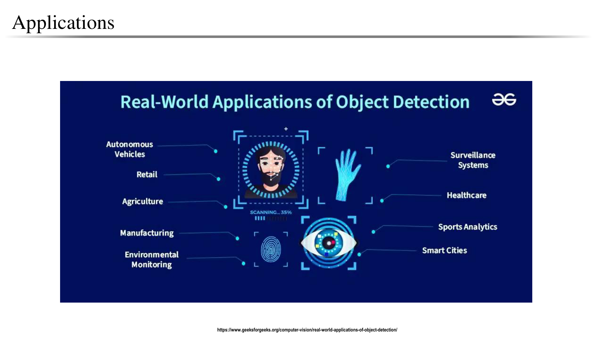

그림은 자율주행·유통·농업·제조·환경·보안·스포츠 등 검출의 활용 범위를 보여줍니다. 예를 들어 차량 검출은 ‘차가 있다’는 결과를 제공하고, 차선 침범이나 충돌 위험 판단에는 위치·시간·거리 정보가 추가로 필요합니다.

작은 결함을 찾는 제조 검사와 멀리 있는 사람을 찾는 영상 분석은 같은 검출 문제라도 필요한 해상도와 오검출·누락 비용이 다릅니다. **사용 목적에 따라 정확도, 지연 시간, 놓치면 안 되는 대상의 크기**를 함께 정해야 합니다.

---

### Challenges — 크기·가림·자세·배경 변화

자료: [PDF 5쪽](../교안/04_00_Applications.pdf#page=5).

강의 원문 그림 펼치기

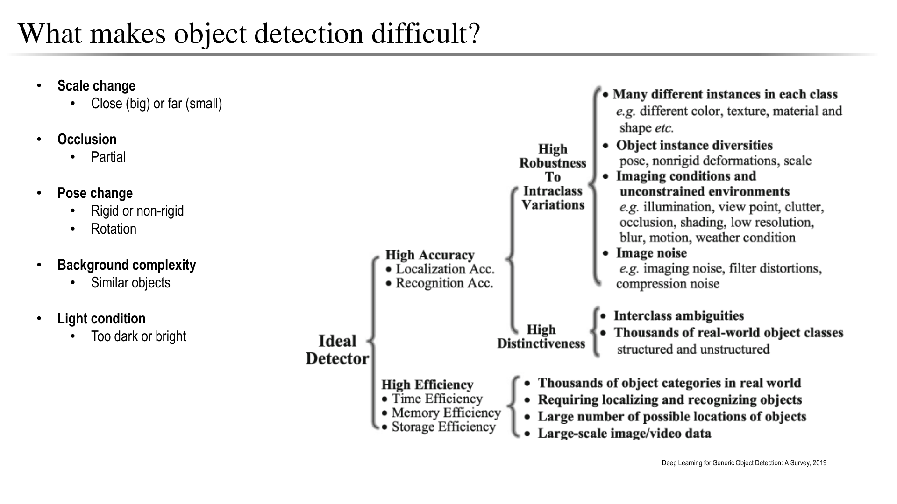

가까운 물체와 먼 물체는 픽셀 크기가 다르고, 가림이나 회전은 관찰 가능한 특징을 바꿉니다. 

비슷한 배경과 어두운 조명에서는 물체와 주변을 구분하기도 어려워집니다. 

그림의 이상적인 검출기는 이런 변화에 강하면서 클래스 간에는 잘 구분해야 합니다.

**다중 해상도 특징은 크기 차이, 증강은 관찰 조건 변화, 문맥 정보는 부분 가림**을 다루는 데 도움을 줍니다. 

다만 작은 물체의 정보가 입력에서 사라지면 구조를 바꾸는 것만으로 복구할 수 없으므로 입력 해상도와 데이터 품질도 중요합니다.

**Rigid는 물체 자체의 형태가 유지되는 변화**, **Non-rigid는 물체의 형태가 변하는 변화**를 뜻합니다.

| 구분                  | 의미                             |          | 예시                     |
| ------------------- | ------------------------------ | -------- | ---------------------- |
| **Rigid — 강체**      | 부분 사이의 거리와 각도를 유지한 채 위치·방향이 바뀜 | 자세·가림에 따라 난도가 달라짐 | 자동차가 회전하거나 상자가 기울어짐    |
| **Non-rigid — 비강체** | 부분들이 상대적으로 움직여 모양이 바뀜          | 형태 변화의 다양성도 학습해야 함 | 사람이 팔을 들거나, 강아지가 몸을 굽힘 |

객체 검출에서 보면, **자동차는 방향이 달라져 보이는 특징이 바뀌고**, **사람은 팔다리 자세까지 달라져 윤곽이 바뀝니다.** 모델은 이런 변화에도 같은 종류의 물체임을 알아봐야 합니다.

사람의 관절 움직임은 더 엄밀하게는 **관절형 변형(articulated deformation)**이라고 부릅니다.

---

## 2. 중복 제거와 평가

### Detection metric (1/4) — IoU

자료: [PDF 6쪽](../교안/04_00_Applications.pdf#page=6).

강의 원문 그림 펼치기

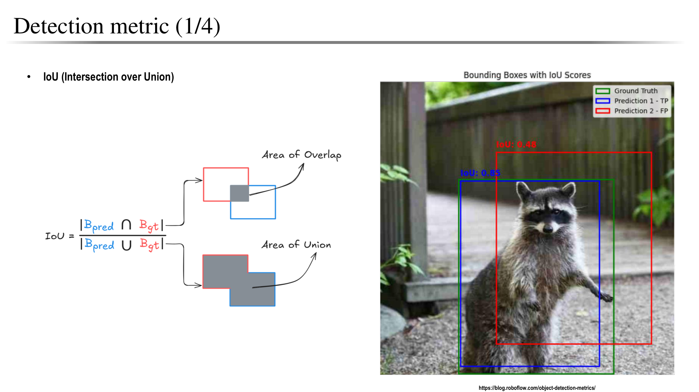

IoU는 예측 박스 P와 정답 박스 G가 겹치는 면적을 두 박스의 합집합 면적으로 나눈 값입니다.

$$
\operatorname{IoU}(P,G)=\frac{|P\cap G|}{|P\cup G|}
$$

완전히 일치하면 1, 겹치지 않으면 0입니다. 

그림의 녹색 정답과 더 잘 겹치는 예측 박스가 높은 값을 얻습니다. **IoU는 위치의 일치도이며 클래스의 정답 여부와는 별개**입니다. 

큰 박스로 물체를 대충 덮으면 교집합뿐 아니라 합집합도 커져 점수가 낮아집니다.

추론의 점수 임계값, 중복 제거의 IoU 임계값, 정답 평가의 IoU 임계값은 서로 다른 기준입니다. 다음 예제에서 각각 분리합니다.

---

### NMS — 같은 물체의 중복 박스 줄이기

자료: [PDF 14쪽](../교안/04_00_Applications.pdf#page=14).

강의 원문 그림 펼치기

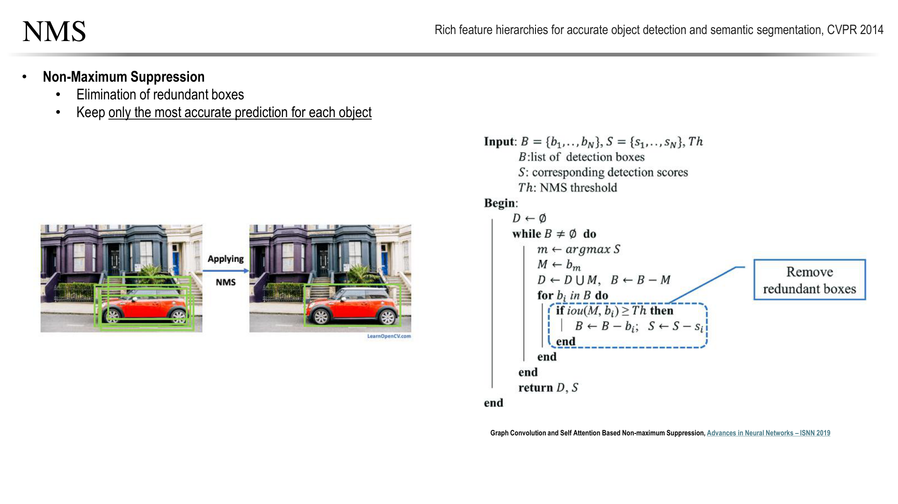

많은 후보가 동일 물체를 가리킬 수 있어 최종 결과에 중복이 생깁니다. **NMS의 목적은 중복 억제**이며 이미 수행한 후보별 CNN 계산을 되돌려 절약하지는 않습니다.

그래서 점수가 가장 높은 박스를 남기고, 그 박스와 IoU가 임계값보다 큰 같은 클래스의 나머지 박스를 제거합니다.

 남은 박스에서 이 과정을 반복하는 것이 기본적인 Greedy NMS입니다.

**NMS**는 실제 정답을 보고 ‘가장 정확한 박스’를 고르는 것이 아니라 **점수와 겹침만으로 선택**합니다. 

가까이 붙은 다른 물체까지 지울 수 있어 임계값이 중요합니다. 

점수 필터링과 NMS는 각각 약한 예측과 중복 예측을 다루는 별도 단계입니다.

---

### Detection metric (2/4) — TP·FP·FN과 중복 예측

자료: [PDF 7쪽](../교안/04_00_Applications.pdf#page=7).

강의 원문 그림 펼치기

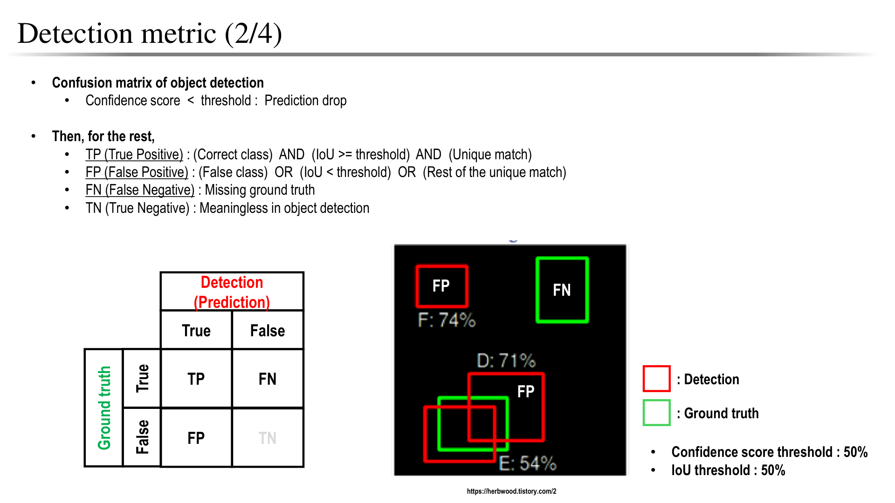

먼저 Confidence 임계값으로 예측을 선택하고, 클래스와 IoU를 기준으로 정답에 연결합니다. **같은 정답 물체에 여러 예측이 겹쳐도 정답과 연결되는 예측은 하나**이며, 나머지는 중복 FP가 됩니다.

| 결과  | 의미                                       |
| --- | ---------------------------------------- |
| TP  | 올바른 클래스이며 IoU 기준을 만족하고 아직 연결되지 않은 정답에 매칭 |
| FP  | 잘못된 클래스·위치, 배경 검출 또는 중복 예측               |
| FN  | 어떤 예측과도 매칭되지 않은 정답                       |

슬라이드의 점수 0.5와 IoU 0.5는 예시입니다. 

두 임계값은 역할이 다릅니다. 잘못된 클래스의 예측은 FP가 되면서 원래 정답이 FN으로 남을 수도 있습니다. 

배경 영역의 수를 유한하게 세기 어려워 검출에서는 TN을 중심 지표로 사용하지 않습니다.

- **Confidence threshold:** 
  - 예측 점수가 기준 이상인 박스를 검출 결과로 남깁니다. 
  - 점수 계산 방식은 모델마다 다르므로, 항상 ‘클래스 확률’이라고 부르기는 어렵습니다.
- **NMS(Non-Maximum Suppression)의 IoU threshold:** 
  - 남은 박스끼리 비교해 중복 검출을 제거합니다.
- **평가의 IoU threshold:** 
  - 예측 박스와 정답 박스를 비교해 위치가 맞는지 판정합니다. 
  - 실제 추론에서는 정답 박스를 모르므로 이 기준을 직접 사용할 수 없습니다.

다음처럼 설명하면 더 정확합니다.

> **추론에서는 Confidence 임계값으로 검출 후보를 선택하고, 필요한 경우 IoU 기반 NMS로 중복을 제거한다. 평가에서는 클래스 일치 여부와 정답 박스에 대한 IoU, 일대일 매칭 여부로 올바른 검출(TP)을 판정한다.**

또한 임계값은 점수나 확률분포 자체를 바꾸는 것이 아니라, **어떤 예측을 채택할지 결정하는 기준**입니다.

---

### Detection metric (3/4) — Precision·Recall·F1

자료: [PDF 8쪽](../교안/04_00_Applications.pdf#page=8).

강의 원문 그림 펼치기

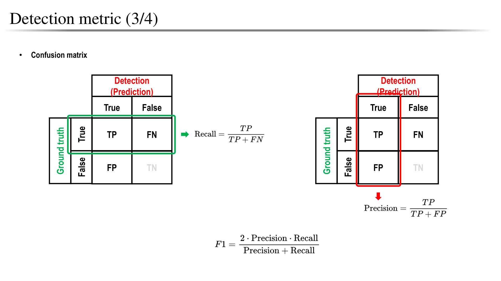

$$
\operatorname{Precision}=\frac{TP}{TP+FP},\qquad
\operatorname{Recall}=\frac{TP}{TP+FN},\qquad
F_1=\frac{2PR}{P+R}
$$

- **Precision**은 ‘검출했다고 한 것 중 얼마나 맞는가’, 
- **Recall**은 ‘실제 물체 중 얼마나 찾았는가’입니다.
  - 예: 작은 제조 결함의 누락 비용이 높다면 Recall을 중시하되, 재검사할 오검출 수와 함께 운영점을 정합니다.

정답 10개 중 8개를 찾고 잘못된 박스 2개를 추가하면 TP=8, FP=2, FN=2로 두 값 모두 0.8입니다.

점수 임계값을 낮추면 약한 예측도 남아 Recall이 높아질 수 있지만 FP도 늘 수 있습니다. 

**단일 임계값의 F1과 여러 점수 임계값을 훑는 AP는 다른 평가**입니다.

---

### Detection metric (4/4) — AP·mAP·COCO 평가

자료: [PDF 9쪽](../교안/04_00_Applications.pdf#page=9).

강의 원문 그림 펼치기

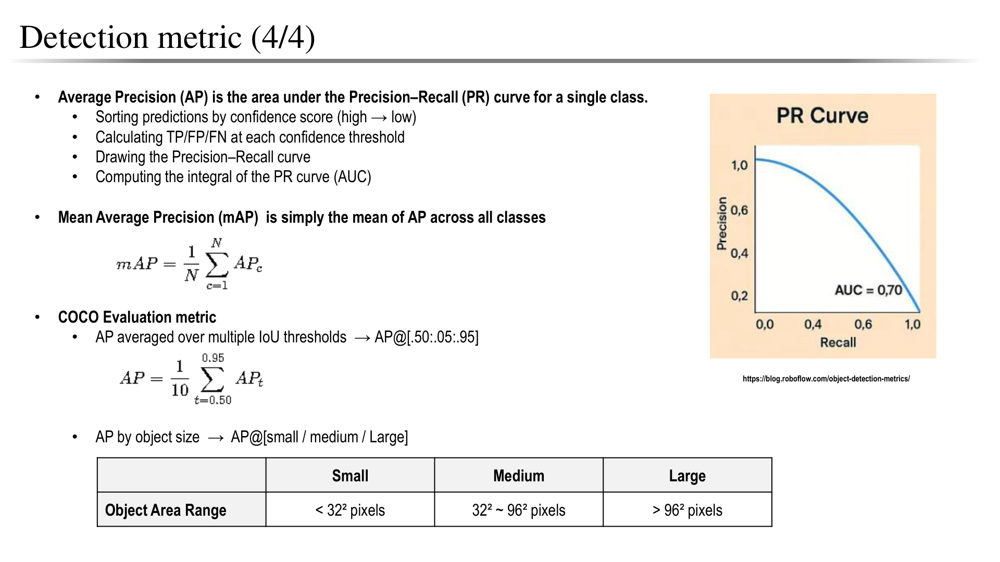

한 클래스의 예측을 점수순으로 정렬하고, 예측을 순차적으로 포함하며 Precision–Recall 곡선을 만듭니다.

PR 좌표 영역은 가로·세로가 0~1이지만, 실제 곡선 아래 면적이 항상 1인 것은 아닙니다. AP는 정해진 보간·샘플링 규칙으로 Precision–Recall 관계를 요약한 값이며 일반 분류 Accuracy와 다릅니다.

mAP는 클래스별 AP의 평균입니다. 평가 데이터셋과 IoU·보간 규칙을 함께 적어야 비교할 수 있습니다.

| 표기                    | 비교하는 조건                          |
| --------------------- | -------------------------------- |
| AP50                  | IoU 0.50에서의 AP                   |
| AP75                  | IoU 0.75에서의 AP로 더 정밀한 박스 요구      |
| COCO AP               | IoU 0.50\~0.95를 0.05 간격으로 평가해 평균 |
| AP small·medium·large | 물체 면적별 성능                        |

같은 ‘mAP’라도 VOC AP50과 COCO AP는 직접 비교할 수 없습니다. 

강의의 면적 구분은 small 약 32² 픽셀 미만, medium 약 32²~96², large 약 96² 초과입니다. 경계값의 포함·제외는 공식 평가기 규칙을 따르며 입력 Resize 후 임의 면적으로 재분류하지 않습니다.

작은 물체 성능이 낮아도 큰 물체가 많으면 전체 수치에 가려질 수 있으므로 크기별 지표도 확인합니다.

---

### 교육용 보충: 하나의 예시로 IoU → NMS → AP 계산하기

**조건:** 같은 이미지에 사람 정답 G1=`(0,0,10,10)`, G2=`(20,0,30,10)` 두 개가 있습니다. 박스는 `(xmin,ymin,xmax,ymax)`의 연속 좌표이며 면적은 `(xmax-xmin)×(ymax-ymin)`입니다. 픽셀 인덱스의 양끝을 포함하는 `+1` 규칙은 쓰지 않습니다. 넓이 0인 박스는 이 예제에서 제외합니다.

| 예측 | 사람 점수 | 좌표 | 평가에 필요한 사실 |
| --- | --- | --- | --- |
| A | 0.9 | (0,0,10,10) | G1과 IoU=1 |
| B | 0.8 | (1,0,11,10) | G1 및 A와 IoU=90/110 |
| C | 0.7 | (20,0,26,10) | G2와 IoU=60/100 |
| D | 0.6 | (40,0,50,10) | 모든 정답과 IoU=0 |

**IoU 중간 계산:** A와 B의 교집합 폭은 `min(10,11)-max(0,1)=9`, 높이는 10이므로 교집합 90입니다. 합집합은 `100+100-90=110`, IoU=`9/11≈0.818`입니다. C는 G2 안에 포함되므로 교집합 60, 합집합 100, IoU=0.6입니다. 단위는 면적의 비율이라 없습니다.

**Greedy NMS:** 점수 0.5 이상을 남기고, 같은 클래스끼리 IoU가 **0.5보다 크면** 제거한다고 정합니다. A를 먼저 채택하고 B를 제거합니다(0.818>0.5). 남은 C와 D는 A 및 서로와 겹치지 않으므로 최종 A,C,D를 남깁니다. 0.9로 NMS 임계값을 높이면 B도 살아남습니다. 낮은 임계값이 더 공격적으로 제거하며, 근접한 실제 사람까지 지울 수 있습니다. 동일 점수의 처리 순서는 구현에 따라 달라질 수 있으므로 재현 실험에서는 tie-break도 고정합니다.

**평가와 AP:** NMS 후 A,C,D를 점수순으로 평가합니다. 같은 클래스이며 **정답 IoU≥0.5**이고 아직 연결되지 않은 정답과만 매칭합니다. 정답은 이미지별로 매칭하고, 일반 데이터셋 AP에서는 해당 클래스의 모든 이미지 예측을 점수순으로 모읍니다. 이 예는 이미지 한 장, ignore/crowd 없는 경우입니다.

| 포함한 예측 | TP | FP | FN | Precision | Recall |
| --- | --- | --- | --- | --- | --- |
| A | 1 | 0 | 1 | 1/1=1 | 1/2=0.5 |
| A,C | 2 | 0 | 0 | 2/2=1 | 2/2=1 |
| A,C,D | 2 | 1 | 0 | 2/3 | 2/2=1 |

이후 Recall이 증가하지 않는 D는 거짓 양성이지만 이미 모든 정답을 높은 순위에서 찾았습니다. **연속 Recall 구간의 보간 면적 방식**으로 `p_interp(r)=max_{r'≥r}p(r')`를 쓰면 AP50=`0.5×1+0.5×1=1`입니다. 마지막 행의 Precision=2/3과 AP=1은 모순이 아닙니다. AP는 단일 운영점보다 순위 전체를 봅니다.

NMS를 생략하면 A,B,C,D의 판정은 TP,FP,TP,FP입니다. B는 G1과 잘 겹치지만 이미 A가 정답을 차지해 중복 FP입니다. Recall 0.5까지의 보간 Precision은 1, 그 다음 1까지는 2/3이므로 AP50=`0.5×1+0.5×(2/3)=5/6≈0.8333`입니다.

평가 IoU만 0.75로 올리면 C가 탈락하므로 NMS 후 TP,FP,FP이고 최대 Recall은 0.5입니다. 나머지 Recall 구간의 Precision을 0으로 두면 연속 면적 AP75=0.5입니다. **NMS는 그대로여도 평가가 더 엄격해져 결과가 변합니다.**

이 손계산은 COCO 공식 평가 숫자와 동일한 알고리즘이 아닙니다. COCO는 101개 Recall 지점(0,0.01,…,1)을 샘플링하므로 위 NMS 생략 예는 `(51×1+50×2/3)/101≈0.8350`, AP75 예는 `51/101≈0.5050`입니다. 공식 COCO AP는 IoU 10개와 클래스 평균뿐 아니라 이미지별 최대 검출 수, 영역 범위, ignore/crowd 처리도 따릅니다. 임의의 높은 점수 컷으로 AP를 계산하면 최대 Recall을 잘라 성능을 바꿀 수 있습니다. 분모가 0인 빈 예측/빈 정답의 집계도 평가기 규칙을 따라야 합니다. [COCO 공식 평가 구현](https://github.com/cocodataset/cocoapi/blob/master/PythonAPI/pycocotools/cocoeval.py).

## 3. 설계 변화의 지도

### Evolution — 특징 설계에서 집합 예측까지

자료: [PDF 10쪽](../교안/04_00_Applications.pdf#page=10).

강의 원문 그림 펼치기

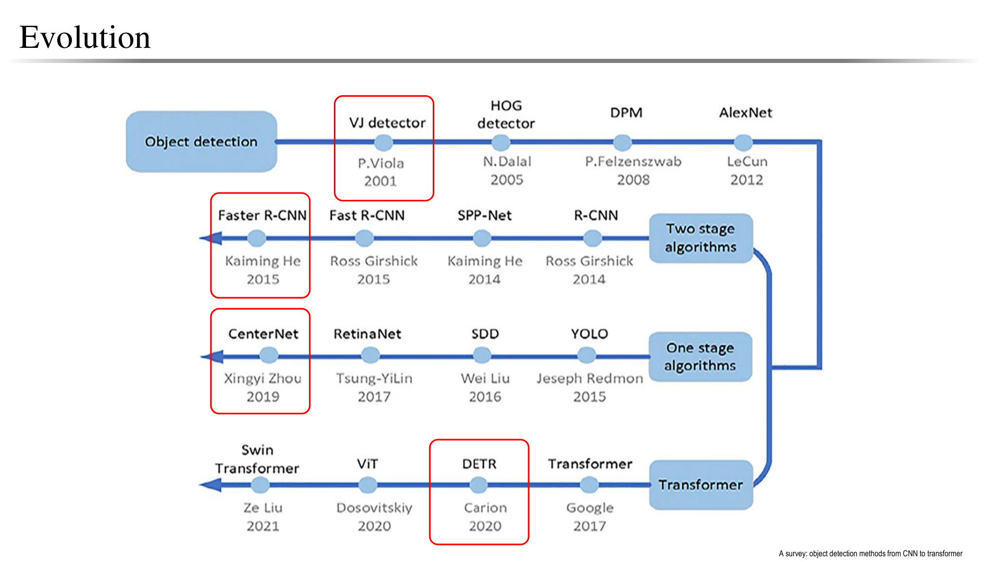

그림의 흐름은 사람이 특징을 설계하던 검출기에서 CNN 특징 학습, 계산 공유, 중심점 예측, Transformer 기반 집합 예측으로 이어집니다. 

이 노트는 **R-CNN의 후보별 계산 → Fast/Faster R-CNN의 계산 공유 → CenterNet의 중심점 → DETR의 Query 집합**을 중심으로 읽습니다.

연대표는 연구 방향의 개요입니다. 

발표·사전 공개·학회 출판 연도가 섞일 수 있으며, 나중에 나온 방식이 모든 데이터와 실행 환경에서 앞선 방식을 대체한다는 뜻은 아닙니다.

---

### One-stage vs. Two-stage — 후보 영역을 먼저 만들까?

자료: [PDF 11쪽](../교안/04_00_Applications.pdf#page=11).

강의 원문 그림 펼치기

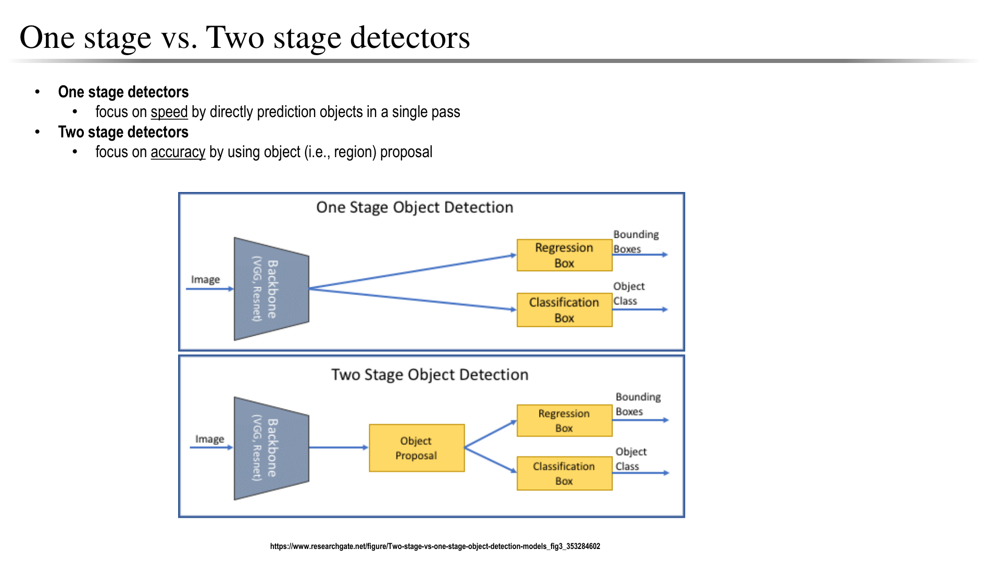

여기서 Two-stage는 **명시적인 후보 영역 생성과 후보별 정제**를 구분한다는 뜻입니다. 네트워크 층이나 실행 함수가 정확히 두 개라는 뜻은 아닙니다.

그림은 두 단계의 기능적 차이를 나타냅니다.

- Two-stage는 물체 후보 영역을 만든 뒤 각 후보의 클래스와 박스를 정교하게 예측합니다.
- One-stage는 특징 맵에서 클래스와 위치를 직접 예측합니다.

전통적으로 One-stage는 속도, Two-stage는 정확도가 강조됐지만 이는 절대 규칙이 아닙니다. 

Backbone·해상도·학습·구현에 따라 결과가 달라집니다. 또한 **One-stage가 반드시 Anchor 기반인 것은 아니며**, 뒤의 CenterNet은 Anchor-free 방식입니다.

---

### 설계 선택을 같은 기준으로 비교하기

| 방법 | 줄이려는 병목 | 핵심 설계 | 남는 조건·한계 |
| --- | --- | --- | --- |
| R-CNN | 수작업 특징의 표현 한계 | 후보별 CNN 특징 | 겹친 후보에서 CNN 반복 |
| Fast R-CNN | 후보별 특징 중복 계산 | 전체 특징 공유·RoI Pooling | 외부 후보 생성 병목 |
| Faster R-CNN | 비학습 후보 생성 비용 | 공유 특징 위 RPN | Anchor·후보 수·NMS 설정 |
| CenterNet | 다수 Anchor 설계와 후보 처리 | 중심 Heatmap·Offset·Size | 가까운 중심의 충돌·해상도 |
| DETR | 후보·Anchor·중복 제거의 복잡성 | Query 집합과 일대일 학습 | 학습 비용·작은 물체·슬롯 상한 |

속도 요구가 있다면 모델 이름으로 결정하지 말고 같은 입력·장비에서 전처리와 후처리까지 측정합니다. Anchor 유무와 One/Two-stage는 다른 분류축이므로 같은 열의 배타적 선택지로 섞지 않습니다.

## 4. 심화: 고전 검출의 계산 절약

### Viola–Jones — 빠르게 비얼굴 영역을 제외하기

자료: [PDF 12쪽](../교안/04_00_Applications.pdf#page=12).

강의 원문 그림 펼치기

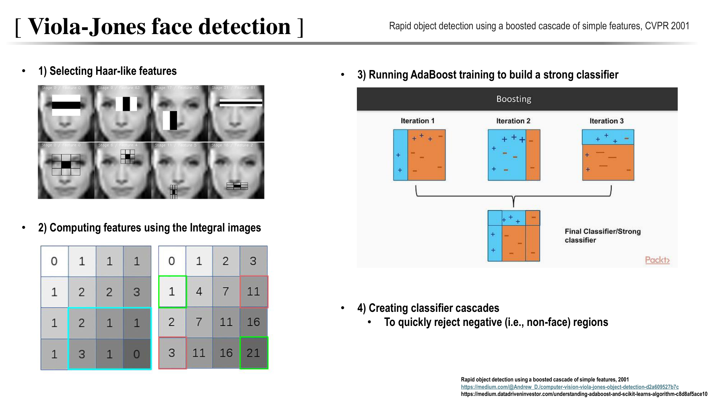

밝고 어두운 직사각형 영역의 차이를 나타내는 Haar-like 특징을 사용하고, Integral image로 영역 합을 빠르게 계산합니다. AdaBoost는 유용한 특징과 약한 분류기를 선택해 강한 분류기를 구성합니다.

Cascade는 쉬운 단계부터 적용해 **얼굴이 아닌 대부분의 영역을 일찍 탈락**시키고, 남은 후보에 더 많은 계산을 씁니다. CNN 이전 검출기의 대표적 설계이며, 정면 얼굴에서 효과적이지만 큰 자세·조명 변화에는 제약이 있습니다.

---

## 5. R-CNN 계열: 계산 공유와 학습형 후보

### R-CNN — 후보마다 CNN을 적용하기

자료: [PDF 13쪽](../교안/04_00_Applications.pdf#page=13).

강의 원문 그림 펼치기

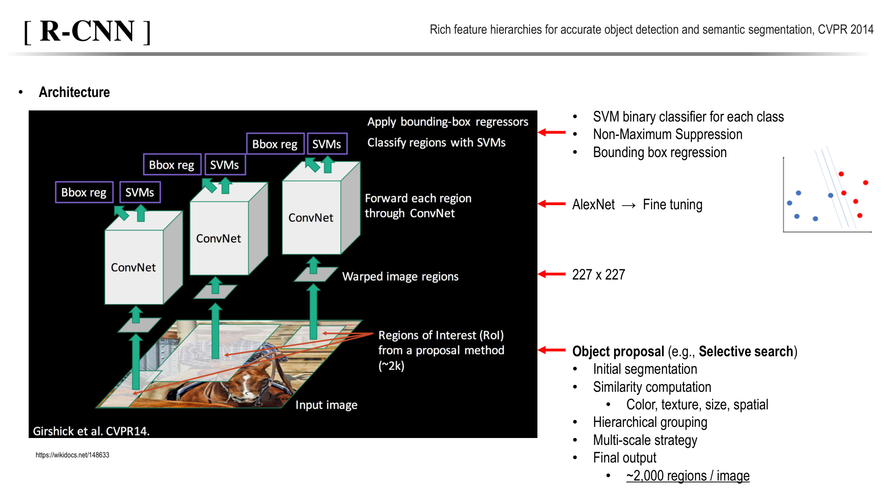

**Selective Search(Object proposal)**로 약 2,000개의 후보 영역을 찾고, 각 영역을 227×227로 변형해 CNN 특징을 추출합니다. 

클래스별 SVM이 물체를 분류하고, 박스 회귀기가 좌표를 보정한 뒤 NMS로 중복을 줄입니다.

Selective Search는 색·질감·크기 등의 유사성으로 작은 영역을 계층적으로 합치는 후보 생성법입니다. 

**서로 크게 겹치는 후보도 CNN을 각각 통과하므로 계산이 반복**되는 점이 R-CNN의 큰 비용입니다.

---

### Fast R-CNN — 이미지 특징을 한 번만 계산하기

자료: [PDF 15쪽](../교안/04_00_Applications.pdf#page=15).

강의 원문 그림 펼치기

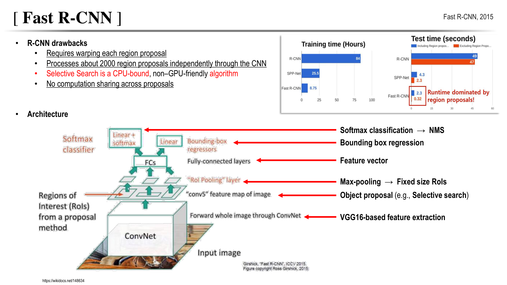

기존 R-CNN이 후보 데이터량이 많아 계산이 많아지는 문제점이 있으므로 이를 해결하기 위해

- 전체 이미지를 CNN에 한 번 넣어 특징 맵을 만든 뒤, 후보 영역을 이 맵 위로 옮깁니다.
- RoI Pooling이 서로 다른 크기의 후보를 고정 크기 특징으로 바꾸고, 분류와 박스 회귀를 함께 수행합니다.

**후보마다 원본 픽셀에서 CNN을 다시 돌리던 계산을 공유**하는 것이 핵심입니다. 

그러나 후보 생성은 여전히 외부 Selective Search에 의존합니다. 

그림의 실행 시간은 후보 생성 포함 여부에 따라 크게 달라지므로, CNN 부분의 속도만으로 전체 지연을 판단하면 안 됩니다.

정정: CPU 병목이라는 설명은 주로 외부 Selective Search를 가리킵니다. Fast R-CNN 전체가 CPU 전용이라는 뜻은 아닙니다. 배속은 후보 생성 포함 여부와 실험 설정에 따라 달라집니다.

---

### Faster R-CNN — 학습하는 후보 생성기 RPN

자료: [PDF 16쪽](../교안/04_00_Applications.pdf#page=16).

강의 원문 그림 펼치기

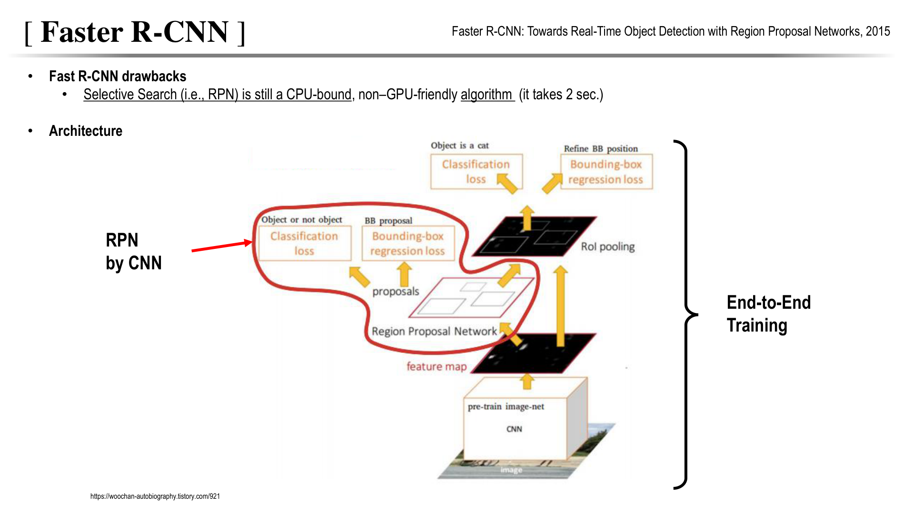

Faster R-CNN은 비학습 후보 생성기 Selective Search를 **공유 CNN 특징 위에서 동작하는 Region Proposal Network(RPN)**로 대체합니다. 단순한 CPU→GPU 이식이 아니라 후보 생성까지 학습하고 특징 계산을 공유하는 구조 변화입니다. 

RPN이 물체 가능성과 후보 박스를 예측하고, RoI 기반 검출 Head가 최종 클래스·좌표를 정합니다.

슬라이드의 ‘Selective Search (i.e., RPN)’은 두 방식이 같다는 뜻으로 읽으면 안 됩니다. 

Selective Search는 기존의 비학습 후보 생성이고, RPN은 이를 대체하는 학습 네트워크입니다. 핵심 이득은 후보 생성과 검출에서 특징을 공유하는 것입니다.

---

### RPN (1/2) — Objectness와 박스 보정 학습

자료: [PDF 17쪽](../교안/04_00_Applications.pdf#page=17).

강의 원문 그림 펼치기

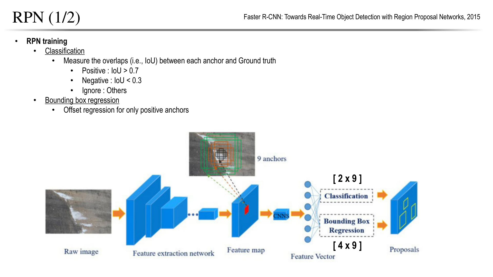

RPN은 Faster R-CNN의 주요 특징입니다.

**각 특징 맵 위치의 Anchor마다 물체/배경 분류와 네 좌표 보정값의 연속값 회귀**를 수행합니다. 예/아니오는 분류에만 해당합니다. 

Anchor가 9개라면 그림의 분류 출력은 2×9, 회귀 출력은 4×9입니다. 이는 최종 물체 종류 9개를 의미하지 않습니다.

Anchor와 정답의 IoU가 높은 경우 Positive, 낮으면 Negative로 삼고 애매한 경우는 제외합니다. 

슬라이드의 0.7·0.3 기준 외에도 원 방식은 **각 정답과 가장 높은 IoU를 갖는 Anchor를 Positive로 지정**합니다. 

회귀 손실은 Positive Anchor에만 적용합니다.

---

### RPN (2/2) — Anchor의 크기와 종횡비

자료: [PDF 18쪽](../교안/04_00_Applications.pdf#page=18).

강의 원문 그림 펼치기

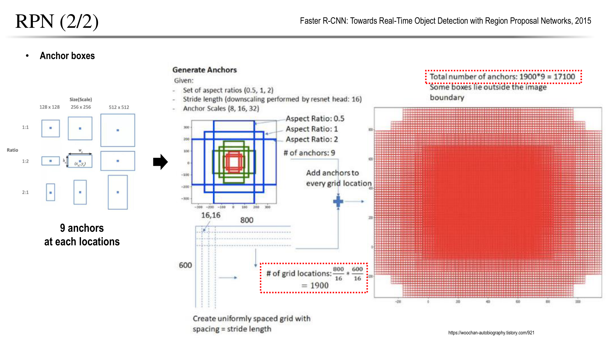

Anchor boxes 분류

내가 찾은 box가 객체인지 아닌지 예/아니오 로 분류.

- 서로 다른 크기와 가로세로 비율의 기준 박스를 각 격자 위치에 배치합니다. 
- 3개 크기×3개 비율이면 위치마다 9개입니다. 
- 물체가 어느 위치·모양에 가까운지 기준을 제공하고, 회귀가 그 기준에서 정답까지의 이동·크기 변화를 학습합니다.

Anchor 수는 `특징 맵 높이×너비×위치당 Anchor 수`입니다. 

입력 크기와 특징 맵의 Stride가 달라지면 총수도 달라지므로, 슬라이드의 17,100개는 해당 격자 예시의 값입니다.

---

### Faster R-CNN Loss — 분류와 위치를 함께 학습하기

자료: [PDF 19쪽](../교안/04_00_Applications.pdf#page=19).

강의 원문 그림 펼치기

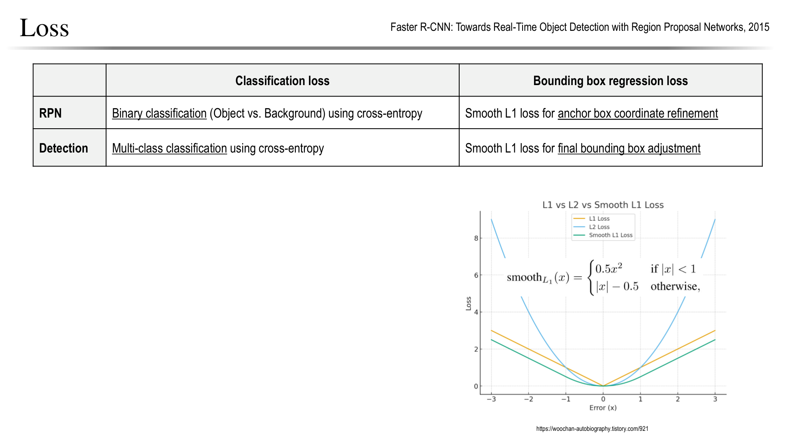

RPN은 Object/Background 분류와 후보 박스 회귀, 최종 검출 Head는 다중 클래스 분류와 최종 박스 회귀를 수행합니다.

 배경 후보에는 물체 좌표를 맞추는 회귀 손실을 적용하지 않습니다.

그림의 Smooth L1은 작은 오차에서 이차식, 큰 오차에서 일차식으로 동작합니다. 

L2보다 큰 오차의 영향을 완화하면서 작은 오차를 부드럽게 줄입니다. 

전체 손실은 각 항의 정규화와 가중치를 포함하므로 서로 다른 역할의 손실값을 단순 크기만으로 비교하면 안 됩니다.

---

### Faster R-CNN Experiments — 정성 결과 읽기

자료: [PDF 20쪽](../교안/04_00_Applications.pdf#page=20).

강의 원문 그림 펼치기

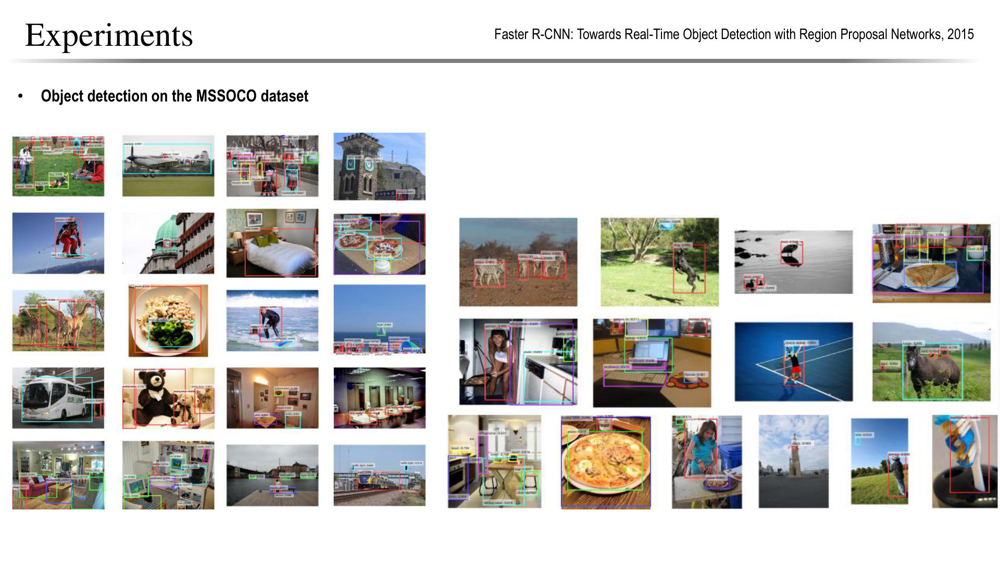

여러 장면에서 크기·배경·물체 수가 달라도 박스와 클래스가 생성되는 모습을 보여줍니다. 

작은 대상이나 겹친 물체의 박스가 있는지, 배경을 물체로 잘못 검출하는지, 하나를 여러 번 잡는지를 살펴보면 됩니다.

**이 페이지는 성공·실패 사례를 보는 정성 시각화**이며 AP나 속도 비교표는 아닙니다. 몇 장의 예시만으로 전체 정확도나 특정 크기의 물체 성능을 확정할 수는 없습니다. 슬라이드의 MSSOCO는 MS COCO를 가리킵니다.

---

### Two-stage Summary — 반복 계산을 없앤 두 번의 개선

자료: [PDF 21쪽](../교안/04_00_Applications.pdf#page=21).

강의 원문 그림 펼치기

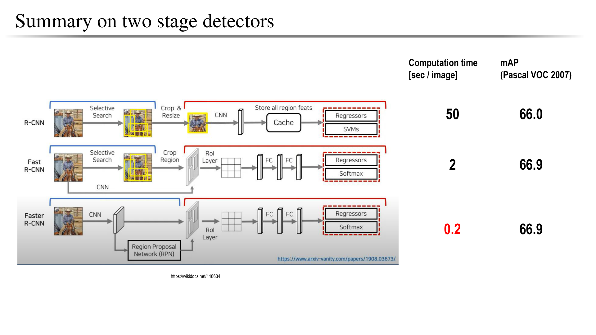

| 방식           | CNN 계산        | 후보 생성            | 슬라이드 시간·VOC 2007 mAP |
| ------------ | ------------- | ---------------- | -------------------- |
| R-CNN        | 후보마다 독립 계산    | Selective Search | 50초·66.0             |
| Fast R-CNN   | 전체 이미지의 특징 공유 | Selective Search | 2초·66.9              |
| Faster R-CNN | 특징 공유         | 학습형 RPN          | 0.2초·66.9            |

그림의 요점은 

- **Fast에서 후보별 CNN 중복을 줄이고,** 
- **Faster에서 후보 생성 병목을 줄였다**는 것입니다.

표의 시간은 강의에서 제시한 역사적 설정의 예이며 현대 장비의 보장 속도가 아닙니다. 같은 mAP가 모든 실험 조건에서 유지된다는 의미도 아닙니다.

---

## 6. CenterNet: 중심점에서 박스로

### CenterNet Overview — 물체를 중심점으로 표현하기

(One-stage)

자료: [PDF 22쪽](../교안/04_00_Applications.pdf#page=22).

강의 원문 그림 펼치기

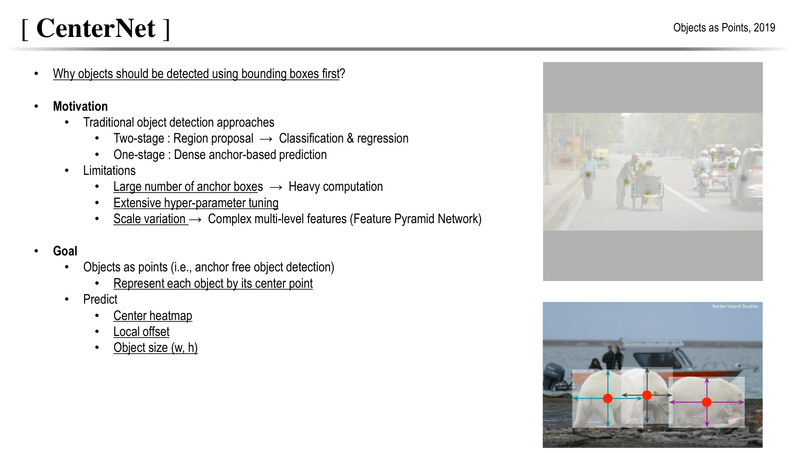

여기서 CenterNet은 **Objects as Points**의 방법입니다. 

미리 정한 Anchor를 다수 분류하는 대신 클래스별 중심점 Heatmap, Local offset, 물체 폭·높이를 예측합니다.

슬라이드의 **Predict 3개는 하나의 박스를 만들기 위한 서로 다른 예측**입니다.

- **Center heatmap:** “어떤 클래스의 물체 중심이 어디에 있는가?”
- **Local offset:** “거친 출력 격자에서 중심이 얼마나 어긋나 있는가?”
- **Object size:** “그 중심에 있는 물체의 박스 폭과 높이는 얼마인가?”

Heatmap으로 중심 후보와 클래스를 찾은 뒤, **같은 위치의 Offset과 Size를 읽어 최종 박스를 복원**합니다. 

세 값은 공통 특징 맵 위의 서로 다른 Head에서 예측합니다.

중심을 찾은 뒤 폭·높이로 박스를 복원하므로 Anchor 크기·비율 설계를 줄일 수 있습니다. 

다만 겹친 중심, 작은 물체, 출력 격자의 양자화는 여전히 어려운 문제입니다. 

‘박스를 쓰지 않는다’가 아니라 **박스를 중심점 기반으로 계산한다**는 뜻입니다.

---

### CenterNet Architecture — Heatmap·Offset·Size

자료: [PDF 23쪽](../교안/04_00_Applications.pdf#page=23).

강의 원문 그림 펼치기

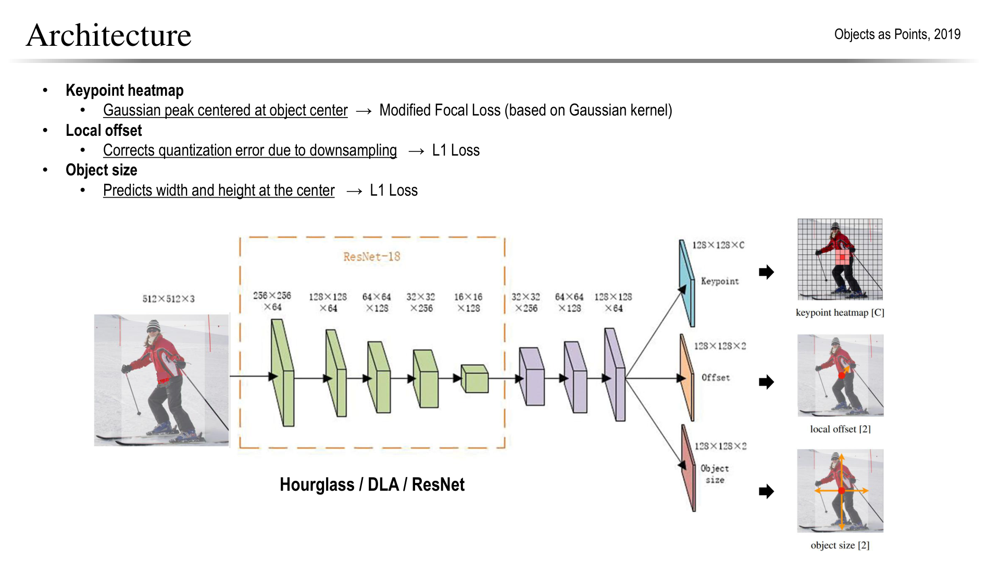

| Head             | 예측             | 학습 목적                           |
| ---------------- | -------------- | ------------------------------- |
| Keypoint heatmap | 클래스별 중심의 봉우리   | Gaussian 목표를 이용하는 수정 Focal Loss |
| Local offset     | 격자화로 사라진 소수 좌표 | 중심 위치의 L1 보정                    |
| Object size      | 중심에서의 폭·높이     | 정답 크기의 L1 회귀                    |

#### 1. Center heatmap — 중심 위치와 클래스

- 이미지의 각 출력 격자에서 **클래스별로 물체 중심일 가능성을 나타내는 점수**를 예측합니다. 
- 입력이 512×512, 출력 Stride가 4, 클래스가 80개이면 Heatmap 크기는 `128×128×80`입니다. 
- 물체의 전체 영역을 칠하는 분할 마스크가 아니라 중심 부근에 봉우리가 생기는 지도입니다.
- 학습 시 정답 박스의 중심을 출력 격자로 옮겨 Gaussian 모양의 목표를 만듭니다. 
- 수정 Focal Loss는 중심을 잘 찾게 하면서 중심 주변의 약간 어긋난 위치에 대한 Negative 벌점을 완화합니다. 
- 추론에서는 국소 최댓값인 봉우리들을 중심 후보로 선택합니다.
- 클래스별 점수는 Sigmoid로 계산하므로 **한 위치의 80개 점수 합이 1이 되는 Softmax 분포는 아닙니다.** 
- 봉우리의 채널이 물체 클래스, 값이 검출 점수 역할을 합니다.

#### 2. Local offset — 격자화로 생긴 중심 좌표 오차

- 출력 해상도를 줄이면 실제 중심 좌표를 정수 격자로 표현하면서 소수 부분을 잃습니다. 
- 예를 들어 입력 중심이 `(101, 79)`이고 Stride가 4이면 출력 좌표는 `(25.25, 19.75)`인데, 중심을 배치한 정수 격자는 `(25, 19)`입니다.
- Offset Head는 이때 잃어버린 **출력 격자 단위의 보정값 `(0.25, 0.75)`**를 예측합니다. 
- 출력 크기는 `128×128×2`이고 두 채널은 x·y 보정입니다. 
- 원 방식에서는 클래스별로 따로 만들지 않고 공유합니다. 
- 학습은 정답 중심 위치에서 L1 손실로 수행합니다.

$$
c_x=s(u+\delta_x),\qquad c_y=s(v+\delta_y)
$$

- 따라서 `4×(25+0.25)=101`, `4×(19+0.75)=79`로 중심을 복원합니다. Offset은 물체의 이동 속도나 박스 폭·높이를 뜻하지 않습니다.

#### 3. Object size — 중심에서 박스 폭·높이 예측

- Size Head는 해당 물체의 **축 정렬 Bounding box의 폭 w와 높이 h**를 예측합니다. 
- 이 예의 출력 크기도 `128×128×2`이지만, 두 채널의 의미는 x·y 보정이 아니라 폭·높이입니다. 
- 기본 방식에서는 크기도 클래스 간에 공유하고, 정답 중심 위치에서 L1 손실로 학습합니다.
- 원 논문의 2D 검출에서는 크기를 모델 입력 이미지 좌표계의 픽셀 단위로 회귀합니다. 
- 원본 이미지를 Resize하거나 Crop했다면 최종 박스를 원본 좌표계로 되돌리는 변환이 추가로 필요합니다.

$$
(x_{min},y_{min},x_{max},y_{max})=
\left(c_x-\frac w2,\ c_y-\frac h2,\ c_x+\frac w2,\ c_y+\frac h2\right)
$$

#### 세 예측을 합친 숫자 예시

| 단계      | 예측 또는 계산                        | 의미                    |
| ------- | ------------------------------- | --------------------- |
| Heatmap | 자동차 채널의 `(u,v)=(25,19)`, 점수 0.9 | 자동차 중심 후보 선택          |
| Offset  | `(δx,δy)=(0.25,0.75)`           | 중심의 소수 위치 보정          |
| 중심 복원   | Stride 4 → `(cx,cy)=(101,79)`   | 입력 이미지 좌표로 변환         |
| Size    | `(w,h)=(60,40)`                 | 박스 폭 60, 높이 40        |
| 최종 박스   | `(71,59,131,99)`                | 중심에서 좌우·상하로 반 크기만큼 확장 |

- 이 값들은 계산을 설명하기 위한 예시입니다. 
- **Heatmap은 중심·클래스, Offset은 중심 정밀도, Size는 박스 범위**를 담당하므로 세 출력의 역할을 구분하면 됩니다.

출처: [Objects as Points — §3·4의 Heatmap, Offset, Size 및 박스 복원](https://arxiv.org/html/1904.07850v2#S3).

---

### CenterNet Applications (1/2) — Pose와 3D 박스

자료: [PDF 24쪽](../교안/04_00_Applications.pdf#page=24).

강의 원문 그림 펼치기

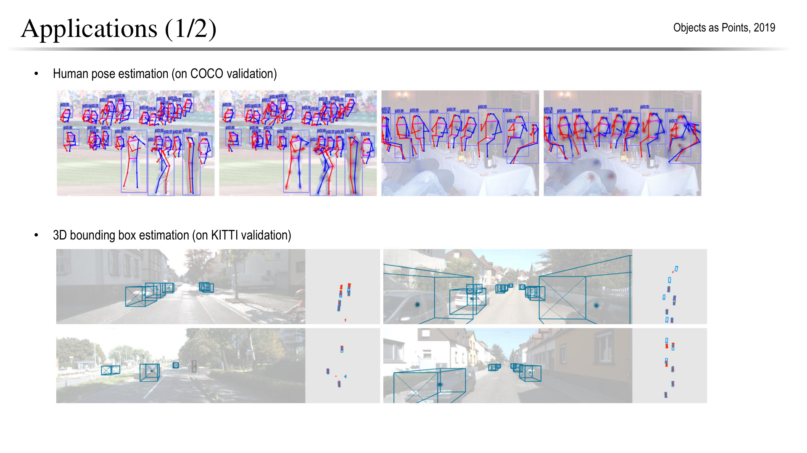

위쪽은 사람 관절을 예측하는 Pose estimation, 아래쪽은 도로 장면의 3D 박스 예시입니다.

- 중심점에서 추가 속성을 예측하는 틀을 관절 위치·깊이·회전 등으로 확장할 수 있음을 보여줍니다.
- **2D 중심·크기만으로 3D가 자동으로 복원되는 것은 아닙니다.** 
- 각 과제에 필요한 Head, 정답 주석과 손실이 추가됩니다. 
- 적용 사례를 공통 표현의 확장으로 읽되 학습 목표까지 같은 것으로 보지 않아야 합니다.

---

### CenterNet Applications (2/2) — Cuboid detection의 범위

자료: [PDF 25쪽](../교안/04_00_Applications.pdf#page=25). 실제 PDF에는 “Cuboid detection” 제목만 있고 정적 결과 그림·수치·복원식은 없습니다. 따라서 이 페이지에서 3D 복원 알고리즘이나 성능이 입증되었다고 해석하지 않습니다. 교육용 보충: Cuboid는 직육면체 형태의 3차원 박스를 뜻하며, 2D 축 정렬 박스와 달리 깊이·방향 등 추가 정보가 필요합니다. 24쪽의 3D 확장 설명과 함께 읽되 PDF에 없는 구현 세부는 추정하지 않습니다.

### CenterNet Experiments — 정확도와 시간의 교환

자료: [PDF 26쪽](../교안/04_00_Applications.pdf#page=26).

강의 원문 그림 펼치기

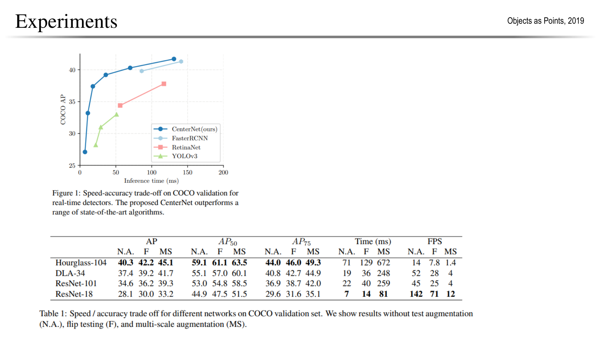

그래프는 가로축이 추론 시간(ms), 세로축이 COCO AP이므로 **왼쪽 위일수록 유리**합니다. 같은 CenterNet도 Backbone과 추론 증강에 따라 결과가 달라집니다.

| Backbone      | 증강 없음 AP / 시간 | Flip AP / 시간 | Multi-scale AP / 시간 |
| ------------- | ------------- | ------------ | ------------------- |
| ResNet-18     | 28.1 / 7ms    | 30.0 / 14ms  | 33.2 / 81ms         |
| ResNet-101    | 36.6 / 22ms   | 38.3 / 40ms  | 39.3 / 259ms        |
| DLA-34        | 37.4 / 19ms   | 39.2 / 36ms  | 41.7 / 248ms        |
| Hourglass-104 | 40.3 / 71ms   | 42.2 / 129ms | 45.1 / 672ms        |

- DLA-34는 ResNet-18보다 느리지만 더 정확합니다. 
- Hourglass의 Multi-scale은 높은 AP를 얻는 대신 단일 입력보다 훨씬 많은 시간이 듭니다. 
- **모델 구조와 추론 증강의 효과를 분리**하고, 동일 장비·입력 조건에서 선택해야 합니다.

---

## 7. DETR: 순서 없는 집합 예측

### DETR — 검출을 순서 없는 집합 예측으로 보기

자료: [PDF 27쪽](../교안/04_00_Applications.pdf#page=27).

강의 원문 그림 펼치기

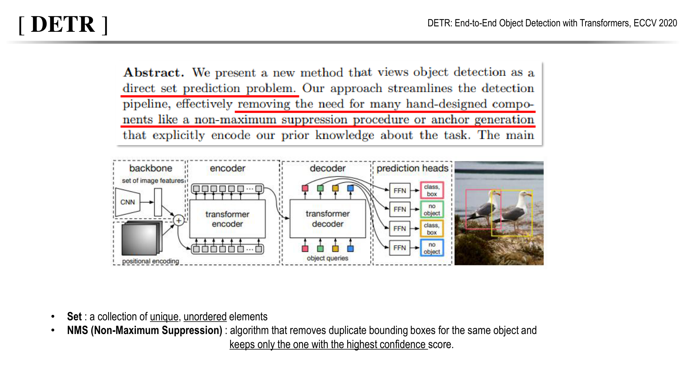

- DETR은 이미지의 물체들을 순서 없는 집합으로 예측합니다. 
- 고정 개수의 출력 슬롯이 각각 클래스·박스를 만들고, 물체가 없는 슬롯은 `no-object`를 예측합니다.

핵심은 **학습 시 예측과 정답을 일대일로 연결**해 하나의 물체를 여러 슬롯이 중복 설명하지 않게 하는 것입니다. 

기본 DETR은 별도 Anchor 설계나 박스 NMS를 필요로 하지 않습니다. 출력 개수의 상한은 Query 수에 의해 정해집니다.

---

### DETR Overview — 수작업 후처리를 학습 목표로 흡수하기

자료: [PDF 28쪽](../교안/04_00_Applications.pdf#page=28).

강의 원문 그림 펼치기

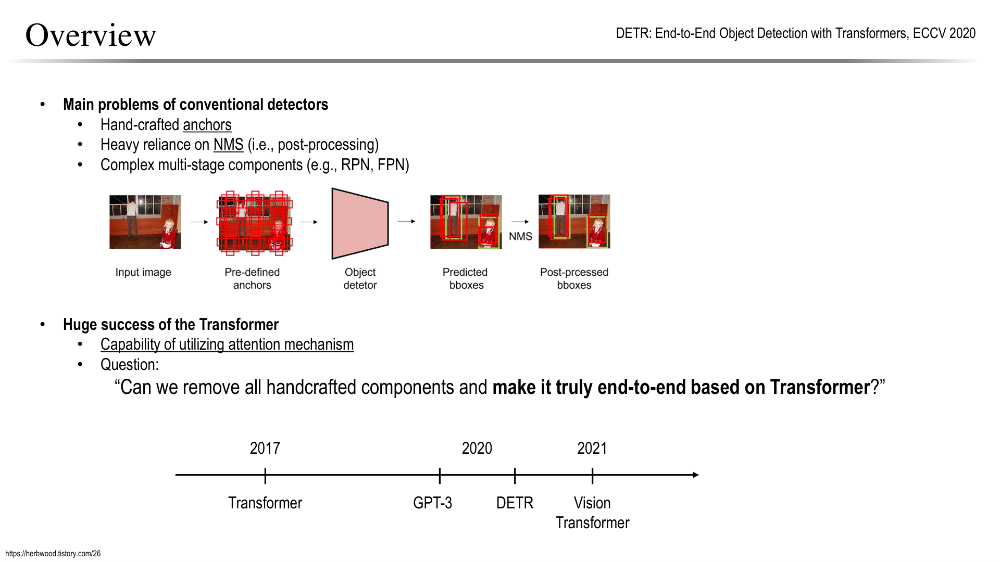

기존 검출기는 Anchor 설정, 후보 생성, 중복 제거가 복잡하게 얽혀 있습니다. 

DETR은 CNN 특징과 Transformer Encoder–Decoder, 집합 손실을 연결해 검출을 끝까지 학습합니다.

Transformer가 전체 특징의 관계를 다루고 Query가 각 물체를 찾습니다. 

**End-to-end라는 말은 전처리·점수 선택까지 모두 없다는 뜻은 아니며**, 별도 RPN과 Greedy NMS에 기대던 검출 구성을 단순화했다는 의미입니다.

---

### DETR Architecture (1/2) — Encoder·Decoder·Object queries

자료: [PDF 29쪽](../교안/04_00_Applications.pdf#page=29).

강의 원문 그림 펼치기

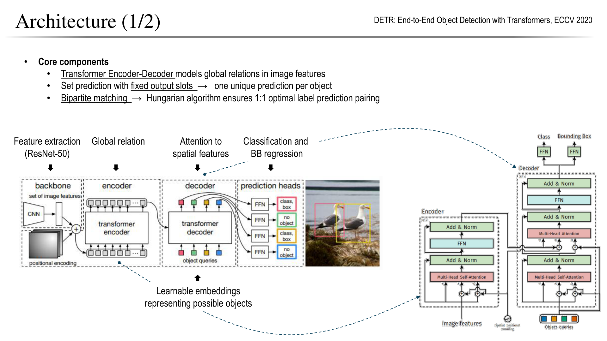

- CNN이 공간 특징을 추출하고, 위치 정보를 더한 특징이 Encoder를 통과합니다. 
- Decoder의 학습 가능한 Object query는 이미지 특징에 Cross-Attention하여 슬롯별 출력을 만듭니다. 
- 공통 Head가 이를 클래스와 정규화 박스 좌표로 바꿉니다.

#### Decoder에서 미리 정하는 것은 ‘객체’가 아니라 ‘Query 슬롯 수’

- DETR은 **고정 개수 N의 학습 가능한 Object query 벡터**를 사용합니다.
- 원 DETR의 대표 설정은 N=100이며, 각 Query는 한 물체의 예측을 담당할 수 있는 슬롯입니다. 
- ‘검출할 객체가 미리 정해져 있다’기보다 **예측을 담을 자리 100개를 미리 준비한다**고 이해하면 됩니다.

| 구분                          | 무엇이 정해지거나 달라질까?            |
| --------------------------- | -------------------------- |
| Query 개수 N과 차원 d            | 설계할 때 정하는 하이퍼파라미터          |
| N×d개의 Query embedding 값     | 학습 데이터와 손실을 통해 갱신되는 파라미터   |
| 학습 후 추론에 넣는 Query embedding | 이미지마다 새로 학습하지 않고 같은 값을 재사용 |
| Decoder가 출력하는 물체 표현·클래스·박스  | 현재 이미지 특징을 참고하므로 이미지마다 달라짐 |

예를 들어

1. 사람 2명과 자동차 1대가 있는 이미지에서도 100개 슬롯의 예측은 모두 계산합니다.
2. 학습에서는 그중 3개를 정답 물체에 일대일로 연결하고, 나머지는 `no-object`를 예측하도록 합니다.
3. 추론에서는 점수와 `no-object` 예측 등을 바탕으로 유효한 결과를 선택합니다.

**Query 1은 항상 사람, Query 2는 항상 자동차처럼 클래스를 미리 배정하지 않습니다.** 

같은 Query도 입력에 따라 다른 물체나 `no-object`를 예측할 수 있습니다. 

학습 과정에서 위치·크기에 대한 선호가 생길 수는 있지만, 사람이 지정한 고정 클래스·박스와는 다릅니다. 

검출 가능한 클래스 목록은 분류 Head의 학습 설정으로 정하며 Query 수와 별개입니다.

Decoder의 **Self-Attention은 슬롯 사이 관계를 조정하고, Cross-Attention은 각 슬롯이 현재 이미지의 정보를 참고**하게 합니다. 

기본 DETR은 이 슬롯들의 출력을 병렬로 계산합니다.

출처: [DETR 원 논문 §3.2 — Transformer Decoder와 Object queries](https://arxiv.org/html/2005.12872v3#S3.SS2).

---

### DETR Architecture (2/2) — 차원으로 데이터 흐름 확인하기

자료: [PDF 30쪽](../교안/04_00_Applications.pdf#page=30).

강의 원문 그림 펼치기

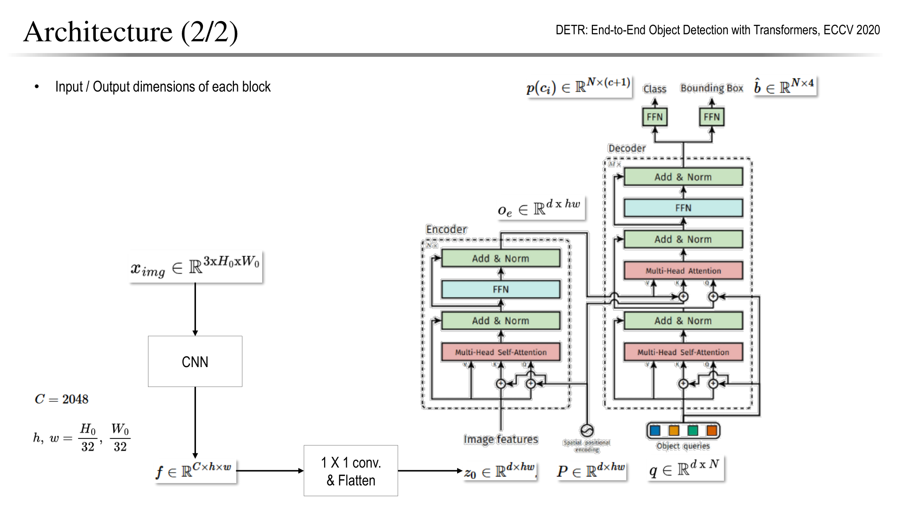

1. 입력이 `3×H0×W0`이면 CNN은 예를 들어 `2048×h×w` 특징을 만듭니다.
2. 1×1 Conv로 채널을 d로 줄이고 공간을 펼쳐 `hw×d` 토큰을 얻습니다.
3. 위치 정보는 펼친 뒤에도 원래 위치를 구분하게 합니다.
4. N개 Object query의 Decoder 출력은 `N×d`, 클래스 Head는 `N×(C+1)`, 박스 Head는 `N×4`입니다.
5. C+1의 추가 클래스는 no-object입니다.

**N은 이미지 패치 수가 아니라 출력 슬롯 수**이며, 이미지 토큰 수 hw와 구분합니다.

---

### DETR Loss (1/2) — 먼저 짝을 정하고 학습하기

자료: [PDF 31쪽](../교안/04_00_Applications.pdf#page=31).

강의 원문 그림 펼치기

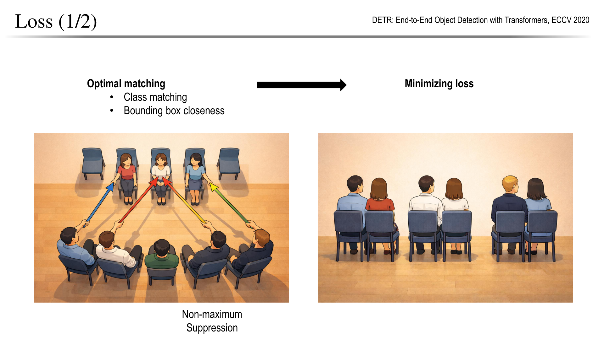

정답 물체와 예측 슬롯의 순서는 일치하지 않습니다. 

- 매칭
  - 그림의 의자 배치 비유처럼, 클래스와 위치가 가장 잘 맞는 일대일 배치를 먼저 찾습니다. 그 뒤 연결된 쌍의 오차를 줄입니다.
  - 일대일 Matching이 없으면 여러 슬롯이 같은 물체만 예측해도 유리할 수 있습니다.

**Hungarian matching은 학습용 정답 할당이고 NMS는 추론 후 중복 박스 제거**이므로 서로 같은 연산이 아닙니다.

---

### DETR Loss (2/2) — Hungarian matching과 집합 손실

자료: [PDF 32쪽](../교안/04_00_Applications.pdf#page=32).

강의 원문 그림 펼치기

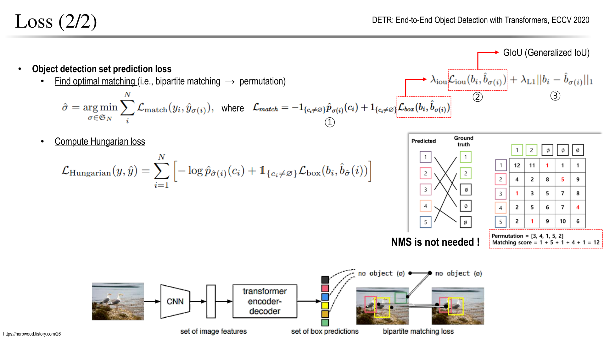

- Matching 비용은 클래스 적합도와 박스 L1·GIoU 비용을 결합합니다.
- 최적 매칭을 고른 뒤 클래스 Cross-Entropy와 박스 회귀 손실을 계산합니다.
- 답이 없는 슬롯에는 no-object 분류 목표를 줍니다.

#### 그림의 ①·②·③ — 어떤 예측을 어떤 정답에 연결할까?

세 번호는 위쪽 **Matching 비용을 구성하는 항**을 가리킵니다. 

정답 i의 클래스는 $c_i$, 박스는 $b_i$, 그 정답에 연결할 예측 슬롯은 $\sigma(i)$입니다. 

Hungarian algorithm은 각 쌍의 비용을 더했을 때 전체 합이 가장 작은 일대일 연결을 찾습니다.

| 번호  | 수식 항                                                | 비교하는 내용           | 비용이 작아지는 조건          |
| --- | --------------------------------------------------- | ----------------- | -------------------- |
| ①   | $-\hat p_{\sigma(i)}(c_i)$                          | 정답 클래스에 대한 예측 확률  | 정답 클래스 확률이 높음        |
| ②   | $\lambda_{iou}\mathcal L_{GIoU}$                    | 두 박스의 겹침과 공간적 배치  | 박스가 잘 겹치고 정답과 가까운 배치 |
| ③   | $\lambda_{L1}\lVert b_i-\hat b_{\sigma(i)}\rVert_1$ | 박스 좌표·크기의 직접적인 차이 | 중심 위치와 폭·높이의 오차가 작음  |

#### ① 클래스 비용 — 정답 종류를 잘 예측했는가?

- 정답이 사람이라면 각 슬롯의 **사람 클래스 확률**을 읽어 음수를 취합니다. 
- 예측 A가 0.9, B가 0.2라면 비용은 각각 −0.9와 −0.2입니다. 
- 최소화할 때 더 작은 −0.9가 유리하므로 A를 사람 정답에 연결하려는 방향으로 작동합니다.

그림의 지시 함수 $\mathbf1_{\{c_i\ne\varnothing\}}$는 **실제 물체가 있는 정답에만 해당 비용을 적용**한다는 표시입니다. $\varnothing$는 출력 슬롯 수를 맞추기 위해 채운 `no-object`입니다.

#### ② GIoU 비용 — 박스가 공간적으로 잘 맞는가?

- 두 박스의 겹침을 평가하되, 겹치지 않는 경우에도 두 박스를 감싸는 영역의 빈 공간을 반영합니다.
- 손실을 $1-GIoU$로 쓰면 완전히 일치할 때 0이고, 공간적으로 잘 맞지 않을수록 커집니다.
- 자세한 계산은 다음 `IoU vs. GIoU` 항목에서 설명합니다.

이 항은 **확률분포가 아니라 박스의 기하학적 관계**를 비교합니다. $\lambda_{iou}$는 전체 비용에서 이 항의 비중을 정합니다.

#### ③ L1 비용 — 중심과 크기가 얼마나 다른가?

DETR의 박스를 정규화된 `(cx, cy, w, h)`로 표현하면, 두 박스의 네 성분 차이에 절댓값을 취해 더합니다.

$$
\lVert b-\hat b\rVert_1=
|c_x-\hat c_x|+|c_y-\hat c_y|+|w-\hat w|+|h-\hat h|
$$

예를 들어 

- 정답이 `(0.5, 0.5, 0.4, 0.2)`, 
- 예측이 `(0.6, 0.5, 0.3, 0.2)`라면 
- L1 오차는 `0.1+0+0.1+0=0.2`입니다. 
- 여기에 $\lambda_{L1}$을 곱합니다. 
- GIoU는 영역의 관계를, L1은 좌표·크기의 차이를 직접 보므로 함께 사용합니다.

#### Matching 비용과 최종 학습 손실의 차이

- 위쪽의 ①은 **연결을 고르기 위한 음의 클래스 확률 $-p$**이고, 
- 아래 Hungarian loss의 분류 항은 **가중치를 학습하기 위한 음의 로그 확률 $-\log p$**입니다. 두 수식을 같은 값으로 읽으면 안 됩니다.

최적 연결 $\hat\sigma$를 정한 뒤에는 실제 물체 슬롯에 클래스·박스 손실을, `no-object` 슬롯에는 분류 손실을 적용합니다.

 즉, **클래스·겹침·좌표를 함께 고려해 짝을 고르고, 고른 짝의 예측 오차를 줄이는 두 단계**입니다.

$$
\mathcal L=\mathcal L_{cls}+\lambda_1\mathcal L_{L1}+\lambda_g\mathcal L_{GIoU}
$$

박스 항은 실제 물체와 연결된 슬롯에 적용합니다. 

기본 DETR에서는 이 학습 목표가 중복을 억제해 박스 NMS를 생략할 수 있습니다.

 추론에 Hungarian matching으로 정답을 찾는 단계가 있는 것은 아닙니다.

---

### IoU vs. GIoU — 겹치지 않는 박스에도 학습 신호 주기

자료: [PDF 33쪽](../교안/04_00_Applications.pdf#page=33).

강의 원문 그림 펼치기

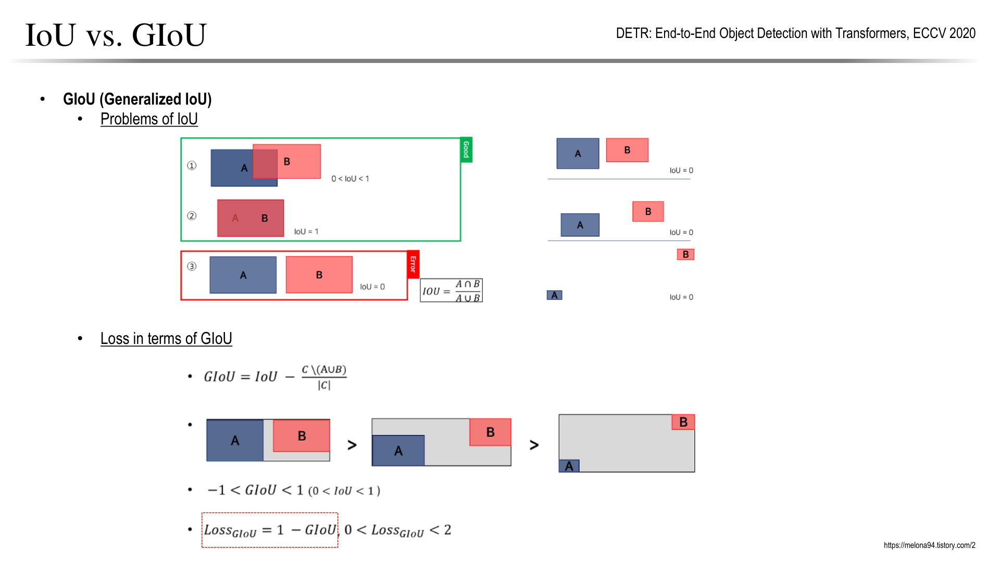

- IoU만 사용하면 두 박스가 겹치지 않을 때 모두 0이 되어 상대적인 거리를 표현하기 어렵습니다. 
- GIoU는 두 박스를 모두 감싸는 가장 작은 축 정렬 박스 C의 빈 공간을 벌점으로 반영합니다.

$$
GIoU=IoU-\frac{|C\setminus(P\cup G)|}{|C|},\qquad
\mathcal L_{GIoU}=1-GIoU
$$

GIoU는 음수가 될 수 있습니다. 

- 완전 일치에서는 1이므로 손실은 0입니다. 
- 비겹침에서 추가 신호를 제공하지만 모든 위치·크기 문제를 단독으로 해결하지는 않아 DETR은 L1과 함께 사용합니다.

---

### DETR Experiments (1/2) — Attention에서 무엇을 참고할까?

자료: [PDF 34쪽](../교안/04_00_Applications.pdf#page=34).

강의 원문 그림 펼치기

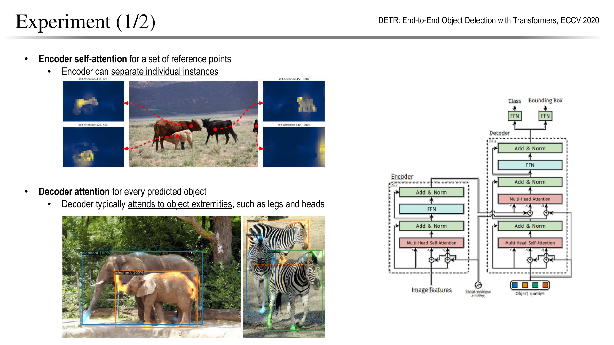

- Encoder의 기준 위치별 Attention은 같은 개체의 다른 부분을 참고하는 모습을, 
- Decoder의 물체별 Attention은 머리·다리·경계 같은 위치를 참고하는 모습을 보여줍니다. 
  - 그림에서는 객체의 끝부분을 참고하는 패턴이 보이지만, 모든 예측에서 반드시 같은 위치만 사용한다는 규칙은 아닙니다.

이는 전역 관계를 활용해 물체를 구분하는 동작을 살펴보는 **정성 시각화**입니다. 

Attention이 높다고 그 위치가 인과적으로 유일한 판단 근거인 것은 아닙니다. 이 페이지에는 AP 비교표가 없으므로 시각화로 정량 성능을 대신 판단하지 않습니다.

---

### DETR Experiments (2/2) — Panoptic segmentation으로 확장

자료: [PDF 35쪽](../교안/04_00_Applications.pdf#page=35).

강의 원문 그림 펼치기

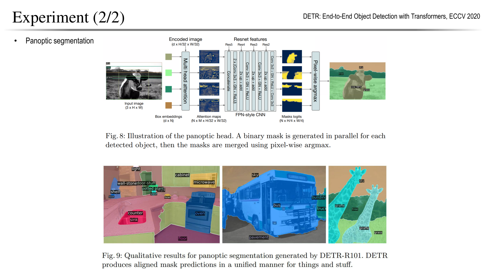

물체별 Decoder 표현과 공간 특징을 이용해 마스크를 생성하고, 개체인 Things와 배경 재질 영역인 Stuff를 하나의 장면 분할로 합칩니다.

 아래 그림은 물체 박스만으로는 담기 어려운 도로·벽·동물 윤곽까지 표현합니다.

**검출용 기본 DETR이 추가 학습 없이 픽셀 정답을 예측하는 것은 아닙니다.** 

마스크 Head와 분할 학습 목표를 추가한 확장입니다. 

뒤의 Semantic·Instance·Panoptic segmentation 구분과 연결해 이해하면 됩니다.

---

### 교육용 보충: DETR의 일대일 매칭과 GIoU 손계산

정답 g1,g2와 예측 q1,q2,q3 사이의 클래스·박스 합성 비용을 다음처럼 가정합니다. 숫자는 실제 모델 출력이 아닌 설명용 비용입니다.

| 예측 | g1 비용 | g2 비용 |
| --- | --- | --- |
| q1 | 1 | 2 |
| q2 | 2 | 100 |
| q3 | 9 | 9 |

g1부터 가장 싼 q1을 고르면 g2는 q3(9)가 되어 총비용 10입니다. 전체를 함께 최적화하면 g1→q2(2), g2→q1(2)로 총비용 4가 더 작습니다. 이것이 각 정답을 독립적으로 고르지 않고 전체 일대일 배치를 찾는 이유입니다. 남은 q3는 no-object 분류를 학습하며 정답 박스 회귀는 받지 않습니다. 매칭 선택 자체를 미분하는 것이 아니라 선택된 쌍에 대한 손실로 모델 파라미터를 갱신합니다.

GIoU도 손으로 확인할 수 있습니다. A=(0,0,2,2), B=(3,0,5,2)이면 각각 면적 4, 교집합 0, 합집합 8입니다. 둘을 감싸는 C=(0,0,5,2)의 면적은 10이므로 GIoU=`0-(10-8)/10=-0.2`, 손실=`1-(-0.2)=1.2`입니다. 두 박스를 떨어뜨린 정도가 달라도 IoU는 0이지만 GIoU는 감싸는 박스의 빈 공간을 반영합니다.

**조건과 한계:** 원 DETR은 많은 학습 epoch가 필요하고 작은 물체 처리에 제약이 있습니다. Query 수가 출력 상한이며, 표준 학습의 일대일 할당은 정답 수보다 충분한 Query가 있다는 조건을 전제합니다. Anchor-free라는 사실만으로 CenterNet과 DETR의 학습 목표가 같아지지는 않습니다. 전자는 위치별 중심점을 학습하고 후자는 출력 슬롯을 정답 집합에 할당합니다. [원 DETR 논문 §3–4](https://arxiv.org/html/2005.12872v3).

## 8. 스스로 확인하기: 계산에서 설계 선택까지

먼저 해설을 접은 채 답하세요. 다음 질문은 학습 목표를 확인하기 위한 것이며 실제 학습자의 이해도 실험을 수행했다는 뜻은 아닙니다.

1. 예제 B의 점수 0.8과 A와의 IoU 0.818은 각각 무엇을 뜻하는가? 추론 때 정답 IoU를 사용할 수 있는가?
2. NMS 임계값을 0.5에서 0.9로 바꾸면 B는 어떻게 되는가? 평가 IoU만 0.75로 바꾸면 C는 어떻게 되는가?
3. NMS 뒤 마지막 Precision이 2/3인데 AP50이 1인 이유는 무엇인가? NMS를 생략했을 때 연속 보간 AP를 계산하라.
4. Fast R-CNN에 남은 병목을 Faster R-CNN은 어떻게 바꾸는가? “CPU 코드를 GPU로 옮겼다”만으로 충분한 설명인가?
5. CenterNet에서 Stride=4, 격자=(10,5), Offset=(0.5,0.25), Size=(12,8)일 때 입력 좌표계의 박스를 구하라.
6. DETR Query가 100개이고 실제 물체가 3개라면 학습 때 나머지 97개는 어떤 목표를 받는가? Query 1을 사람 전용으로 지정하는가?
7. 같은 장비에서 CenterNet ResNet-18의 7ms와 다중 스케일 81ms 중 지연 20ms 이내 조건을 만족하는 쪽은? 그 표만으로 실제 서비스 지연을 보장할 수 있는가?

해설과 복귀 위치

1. 점수는 모델이 계산한 후보 신뢰도이고 IoU는 두 영역의 기하학적 겹침입니다. 점수가 실제 정답 확률과 같다고 보장되지 않습니다. 추론에서는 정답이 없으므로 정답과의 IoU를 사용할 수 없습니다. [2절](#detection-metrics)의 세 임계값을 복습하세요.
2. 0.818은 0.9보다 작으므로 B가 남습니다. 평가에서는 A가 G1을 차지해 B는 중복 FP가 됩니다. C의 정답 IoU는 0.6이므로 평가 임계값 0.75에서는 FP이고 G2가 FN입니다. [2절](#detection-metrics).
3. 낮은 점수의 D를 추가하기 전에 Recall=1, Precision=1에 도달했기 때문입니다. NMS 없이는 TP,FP,TP,FP 순서이고 보간 면적은 `0.5+0.5×2/3=5/6`입니다. 공식 COCO의 101점 평균과 연속 면적을 구분하세요. [2절](#detection-metrics).
4. Fast는 후보별 CNN을 전체 이미지 특징 공유로 바꾸지만 Selective Search가 남습니다. Faster는 후보 생성 자체를 RPN으로 학습하고 검출기와 특징을 공유합니다. 하드웨어 변경만으로는 구조·학습 목표의 변화를 설명하지 못합니다. [5절](#detection-rcnn).
5. 중심은 `(4×10.5,4×5.25)=(42,21)`이고 반 크기는 `(6,4)`입니다. 따라서 박스는 `(36,17,48,25)`입니다. Size는 이 설명에서 이미 입력 픽셀 단위이므로 Stride를 다시 곱하지 않습니다. Resize 전 원본 좌표는 별도 역변환이 필요합니다. [6절](#detection-center).
6. 연결되지 않은 97개는 no-object 분류 목표를 받습니다. 100은 클래스 수가 아니라 예측 슬롯 수이며 클래스와 박스는 현재 이미지에 따라 달라집니다. [7절](#detection-detr).
7. 표의 순수 추론값으로는 7ms만 만족합니다. 실제 서비스에는 전처리·전송·후처리·배치·장비 조건도 있어 같은 시간 보장은 불가합니다. [6절](#detection-center)의 실험 조건을 복습하세요.

이제 검출 결과를 시간에 걸쳐 연결하면 [객체 추적](04_03_객체_추적.md), 박스 내부의 정확한 픽셀 영역을 추가하면 [영상 분할](04_04_영상_분할.md)로 이어집니다. 같은 박스가 잘 나와도 ID 유지나 경계 품질이 자동으로 해결되지는 않습니다.

## 9. 원문과 보충 근거

강의의 정의·그림·역사적 실험 수치는 [Applications PDF](../교안/04_00_Applications.pdf)의 3–35쪽을 기준으로 했습니다. 그림 해설은 기존 노트를 대조·정정했고 위 수치 예제·질문은 교육용으로 작성했습니다. 실행용 모델 코드는 포함하지 않았고 모델 학습·추론은 실행하지 않았습니다.

- [R-CNN 원 논문](https://arxiv.org/abs/1311.2524), [Fast R-CNN 원 논문](https://arxiv.org/abs/1504.08083): 후보별 특징과 공유 특징의 차이.
- [Faster R-CNN 원 논문](https://arxiv.org/abs/1506.01497): Selective Search와 RPN의 구분, 특징 공유에 대한 정정 근거.
- [Objects as Points](https://arxiv.org/html/1904.07850v2): CenterNet의 중심·Offset·Size 좌표 의미 확인.
- [DETR 원 논문](https://arxiv.org/html/2005.12872v3): Query, 집합 매칭, no-object, 박스 손실과 원 모델의 한계 확인.
- [COCO 공식 평가기](https://github.com/cocodataset/cocoapi/blob/master/PythonAPI/pycocotools/cocoeval.py): 101 Recall 샘플·IoU별 평가와 예외 조건 확인(2026-11-09 열람). 이 장의 손계산은 별도 단순화 예제입니다.
