# 객체 추적 — 위치를 갱신하면서 같은 ID를 유지하기

추적은 영상의 각 프레임에서 **이 물체가 이전의 누구인지** 이어 붙이는 일입니다. 검출 박스가 모두 정확해도 두 사람의 ID가 바뀌면 이동 경로와 체류 시간은 틀립니다. 이 장은 관측이 잠깐 약해져도 동일성을 유지하는 원리와, 그 실패를 평가하는 방법을 다룹니다.

[응용 안내](04_01_Application_note.md) · 이전: [객체 검출](04_02_객체_검출.md) · 다음: [영상 분할](04_04_영상_분할.md)

**선수지식:** 박스 좌표, IoU, 검출 점수는 객체 검출 장에서 복습합니다. TrackFormer를 읽기 전에는 검출 장의 DETR와 [Attention과 ViT](03_02_Attention과_ViT.md)의 Query·Attention을 확인합니다.

**학습 목표:** 예측·매칭·갱신의 차이를 설명하고, 두 단계 연결에서 남은 Track의 처리를 결정하며, MOTA를 계산하고 IDF1·HOTA가 추가로 필요한 이유를 말할 수 있어야 합니다.

**읽는 경로:** 처음에는 1→2→3→5→7절, Transformer 연결은 4절, 고전 원리와 발전 맥락은 심화 6절입니다. 원문은 [교안 36–61쪽](../교안/04_00_Applications.pdf#page=36)이며 실제 PDF 페이지 번호를 사용합니다. 본문의 작은 계산·질문은 교육용 보충이고, 강의 실험 수치는 해당 실험 조건의 결과입니다. 교안의 축약·오기를 보완한 곳에는 정정 이유와 출처를 붙였습니다.

## 목차

- [1. 대상과 상태](#1-대상과-상태)
- [2. 한 프레임의 예측·매칭·갱신](#2-한-프레임의-예측매칭갱신)
- [3. ByteTrack](#3-bytetrack)
- [4. TrackFormer](#4-trackformer)
- [5. 추적의 오류와 평가](#5-추적의-오류와-평가)
- [6. 심화 — 고전 추적과 발전](#6-심화--고전-추적과-발전)
- [7. 스스로 확인하기](#7-스스로-확인하기)

## 1. 대상과 상태

**Detection(검출)**은 현재 영상에서 관찰한 클래스·점수·박스입니다. **Track(추적 상태)**은 여러 프레임에 걸쳐 유지하는 ID·위치·크기·속도 추정·생존 상태입니다. ID 7은 ‘일곱 번째 클래스’가 아니라 특정 대상에게 붙인 번호이며 정답 주석의 번호와 같을 필요는 없습니다.

단일 대상 추적(SOT)은 처음 지정한 대상 하나를 계속 찾는 문제입니다. 다중 대상 추적(MOT)은 여러 대상의 연결과 등장·퇴장까지 관리합니다. 이 장의 ByteTrack·TrackFormer는 MOT를 중심으로 읽습니다. 영상 속 인물을 실명으로 알아내는 것과 추적 번호를 유지하는 것도 다릅니다.

| 단계 | 입력 → 출력 | 실패하면 생기는 일 |
| --- | --- | --- |
| 검출 | 현재 프레임 → 관측 박스·점수 | 물체 누락 또는 배경 오검출 |
| 예측 | 이전 상태·시간 간격 → 현재 예상 상태 | 급가속·카메라 이동에서 위치 오차 |
| 매칭 | 예상 상태와 관측 → 일대일 연결 | 교차한 대상의 ID 교환 |
| 갱신 | 연결된 관측과 예상 상태 → 보정 상태 | 잘못 연결한 관측이 이후 예측도 오염 |
| 수명 관리 | 연결 여부·경과 시간 → 유지·보류·신규·종료 | 너무 짧으면 단절, 너무 길면 오래된 상태와 혼동 |

예측 위치가 있다는 것과 실제로 관측했다는 것은 다릅니다. 완전 가림에서는 운동 예측만 계속할 수 있지만 불확실성이 커집니다. 새 관측이 없는데 위치가 확실하다고 간주하면 안 됩니다.

## 2. 한 프레임의 예측·매칭·갱신

교육용으로 수평 중심만 계산해 봅니다. 프레임 간격은 1, 이전 중심 x=10픽셀, 속도 v=2픽셀/프레임이면 **예측**은 x⁻=10+2×1=12입니다. 현재 검출 중심 z=13을 같은 대상에 연결했다면 **갱신**은 x⁺=x⁻+K(z−x⁻)입니다. 보정 비율 K=0.75를 가정하면 잔차는 13−12=1, 새 중심은 12+0.75×1=12.75입니다. ID는 그대로 유지합니다.

여기서 K는 설명을 위해 정한 값입니다. 실제 Kalman filter는 상태와 관측의 불확실성으로 이득을 계산하고 속도·공분산도 함께 갱신합니다. 매칭은 ‘누구의 관측인가’, 갱신은 ‘그 관측을 반영해 상태를 어떻게 고칠까’라는 서로 다른 질문입니다.

### 연결 비용의 작은 계산

예측 Track A·B와 검출 D1·D2의 IoU가 다음과 같다고 합시다. 비용은 1−IoU이고 모든 쌍이 허용된 교육용 예입니다.

| IoU | D1 | D2 |
| --- | --- | --- |
| A | 0.8 | 0.3 |
| B | 0.4 | 0.7 |

A–D1, B–D2의 총비용은 0.2+0.3=0.5입니다. 반대 배정은 0.7+0.6=1.3이므로 첫 배정이 낫습니다. 둘 다 D1을 선택하게 해서는 안 됩니다. 일대일 할당은 이런 충돌을 막습니다. 실제로는 위치·클래스·외형 및 허용 임계값으로 불가능한 연결을 먼저 제한할 수 있습니다.

연결 기준을 IoU≥0.75로 바꾸면 B–D2=0.7도 허용되지 않습니다. 비용이 작은 쌍이라는 이유만으로 강제로 연결하지 말고 B를 미매칭 상태로 남겨야 합니다. 두 대상이 교차하거나 빠르게 이동하면 IoU만으로는 부족할 수 있습니다.

### 상태의 다음 목적지

확인된 Track은 연결되면 활성 상태로 갱신합니다. 연결되지 않으면 일정 기간 Lost로 보류하고, 허용 기간 안에 다시 연결되면 같은 ID를 재사용할 수 있습니다. 끝내 복귀하지 않으면 종료합니다. 어떤 기존 Track에도 연결되지 않은 신뢰할 만한 검출에는 새 ID를 부여합니다. 초기 확인 횟수와 대기 기간은 구현별 정책이며 길수록 무조건 좋은 값은 아닙니다.

이제 이 기본 순환에서 약한 관측을 언제 사용할지를 ByteTrack으로 살펴봅니다.

## 3. ByteTrack

### ByteTrack Overview — 낮은 점수의 검출도 시간 단서다

자료: [PDF 47쪽](../교안/04_00_Applications.pdf#page=47).

교안 그림 펼쳐 보기 — 본문 설명을 읽은 뒤 대조

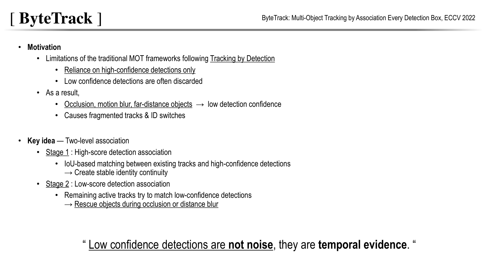

가려진 사람이나 흐린 물체는 실제로 존재해도 검출 점수가 낮아질 수 있습니다. 이런 박스를 일괄 제거하면 궤적이 끊깁니다. 

ByteTrack은 먼저 높은 점수 박스로 연결하고, 남은 Track을 낮은 점수 박스와 한 번 더 연결합니다.

낮은 점수를 모두 믿는 것이 아니라 **기존 궤적의 운동·위치 일관성으로 약한 검출을 선별**합니다. 

이것이 배경 박스를 추가하는 것과 구분되는 핵심입니다.

#### Key idea — 신뢰할 수 있는 검출부터 연결하고, 남은 Track을 구한다

이미지의 **Two-level association은 검출기를 두 번 실행한다는 뜻이 아니라, 한 번 얻은 검출 결과를 점수로 나누어 연결을 두 번 수행한다는 뜻**입니다. 

여기서 Detection은 현재 프레임의 박스이고, Track은 이전 프레임들에서 유지해 온 대상의 ID·박스·운동 상태입니다.

1. 먼저 Kalman filter로 각 Track의 현재 위치를 예측합니다.
2. 그다음 예측 박스와 검출 박스의 IoU를 비교하여, 위치가 일관된 쌍을 일대일로 연결합니다.

**Confidence는 어떤 단계에서 비교할지를 정하고, IoU는 어떤 Track과 연결할지를 판단하는 단서**입니다.

| 단계                               | 연결 대상                            | 목적                          | 남은 결과의 처리                                    |
| -------------------------------- | -------------------------------- | --------------------------- | -------------------------------------------- |
| Stage 1 — High-score association | 기존 Track의 예측 위치 ↔ 높은 점수 검출       | 신뢰할 수 있는 관측으로 ID와 위치를 먼저 갱신 | 남은 Track은 2차 연결 후보, 남은 높은 점수 검출은 신규 Track 후보 |
| Stage 2 — Low-score association  | 1차에서 연결되지 않은 적격 Track ↔ 낮은 점수 검출 | 가림·흐림 때문에 약해진 실제 관측을 회복     | 연결된 검출은 기존 ID 유지, 연결되지 않은 낮은 점수 검출은 버림       |

높은 점수와 낮은 점수를 한꺼번에 연결하면 배경의 약한 박스가 좋은 관측과 경쟁할 수 있습니다.

 **확실한 연결을 먼저 확보한 뒤, 아직 설명되지 않은 Track에만 약한 관측을 적용**하는 순서가 중요합니다. 

실제 구현은 Active/Lost 상태 등에 따라 2차 연결 대상을 제한합니다.

#### 예시 — 가려진 사람의 ID 7을 유지하기

이전 프레임에서 사람을 ID 7로 추적하고 있다고 가정하겠습니다. 

다음 프레임에서는 절반이 가려져 검출 점수가 0.35로 떨어졌습니다. 

높은 점수 기준은 0.6이고, 0.35는 낮은 점수 후보로 남길 수 있는 값이라고 하겠습니다.

1. **1차 연결:** ID 7에 해당하는 높은 점수 검출이 없어 연결되지 않습니다.
2. **2차 연결:** ID 7의 예측 박스와 점수 0.35 박스의 IoU가 0.8로 높고 연결 기준을 만족하면, 이를 같은 사람의 관측으로 받아들입니다.
3. **상태 갱신:** 새로운 ID를 만들지 않고 **ID 7의 위치와 운동 상태를 갱신**합니다.
4. **잡음 제외:** 점수는 비슷해도 예측 위치와 맞지 않는 배경 박스는 연결하지 않고 버립니다.

수치는 설명용 예시입니다.

낮은 점수 박스가 기존 Track과 맞지 않으면 새 ID를 무조건 만들지 않습니다.

 **새 Track 생성에는 보통 더 신뢰할 수 있는 높은 점수 검출과 별도 생성 기준**을 사용합니다.

#### 그림의 마지막 문장을 어떻게 이해할까?

‘낮은 점수 검출도 시간적 증거’라는 말은 **낮은 점수 안에도 진짜 물체가 있으므로 이전 궤적을 이용해 골라낼 수 있다**는 뜻입니다. 

모든 낮은 점수 검출이 진짜이거나 잡음이 없다는 의미는 아닙니다.

이 방식은 관측이 약해진 구간에서 궤적 단절과 이후 ID Switch를 줄이는 데 도움을 줍니다. 

다만 물체가 완전히 가려져 박스 자체가 없거나, 운동 예측이 크게 틀리면 2차 연결만으로 복구할 수 없습니다. 그런 경우는 Lost buffer와 이후의 재연결 정책이 관여합니다.

출처: [ByteTrack 원 논문 — §3의 두 단계 Association](https://arxiv.org/html/2110.06864v3#S3).

---

### ByteTrack Overall algorithm — 두 번의 Association

자료: [PDF 48쪽](../교안/04_00_Applications.pdf#page=48).

교안 그림 펼쳐 보기 — 본문 설명을 읽은 뒤 대조

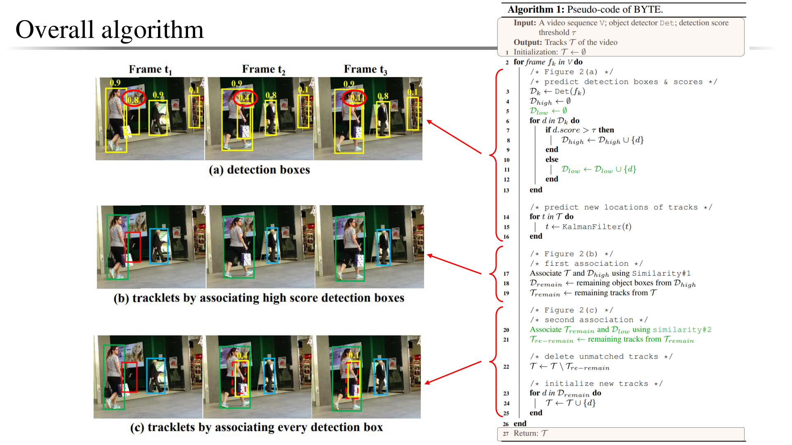

위쪽은 원 검출, 가운데는 높은 점수만 사용했을 때 끊긴 궤적, 아래는 낮은 점수까지 연결해 유지한 궤적입니다.

오른쪽 의사 코드는 **검출 분리**와 **운동 예측**, **두 번의 Matching**, **신규 Track 생성**을 연결합니다.

- BYTE는 Association 방법이고,
- ByteTrack은 검출기와 이를 결합한 시스템입니다.

**추적 알고리즘만 같아도 검출기를 바꾸면 성능과 FPS가 달라질 수 있음**을 기억해야 합니다.

---

### ByteTrack Algorithm (1/4) — 검출 분리와 운동 예측

자료: [PDF 49쪽](../교안/04_00_Applications.pdf#page=49).

교안 그림 펼쳐 보기 — 본문 설명을 읽은 뒤 대조

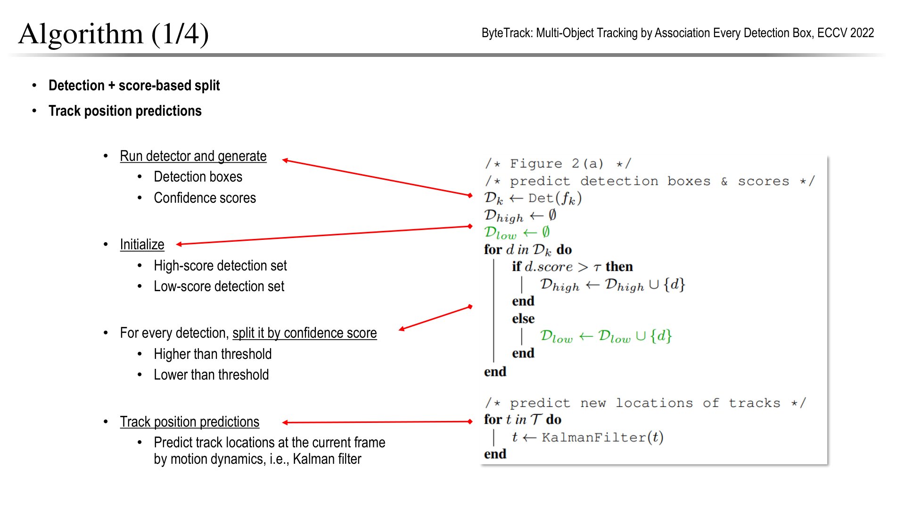

Kalman filter(칼만필터) : 과거의 위치정보를 바탕으로 앞으로의 위치정보를 예측한다.

검출기의 박스를 높은 점수 집합과 낮은 점수 집합으로 나눕니다.

 동시에 기존 Track의 상태를 Kalman filter로 현재 프레임까지 예측합니다. 이 예측 박스가 Association의 위치 기준이 됩니다.

높은/낮은 점수를 나누는 임계값과 아예 버릴 최소 점수는 구현에 따라 다를 수 있습니다. 

낮은 점수 박스가 곧 새 물체인 것은 아니며, 다음 단계에서 기존 Track과의 연결 근거를 확인합니다.

---

### ByteTrack Algorithm (2/4) — 높은 점수와 1차 연결

자료: [PDF 50쪽](../교안/04_00_Applications.pdf#page=50).

교안 그림 펼쳐 보기 — 본문 설명을 읽은 뒤 대조

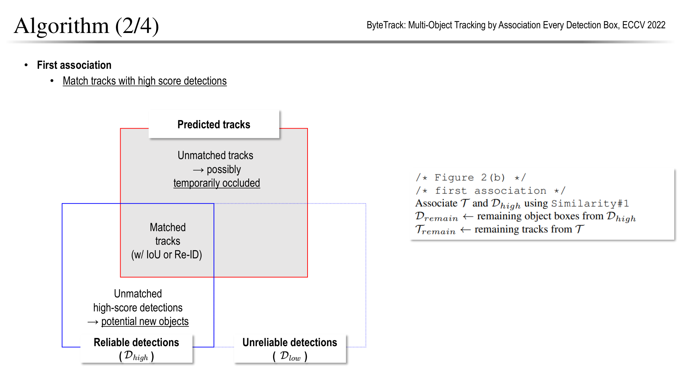

예측 Track과 높은 점수 검출의 IoU 등으로 비용 행렬을 만들고 일대일 Matching을 수행합니다. 잘 연결된 쌍은 Track 상태를 갱신합니다. 

남은 Track은 가림·누락일 수 있고, 남은 높은 점수 검출은 신규 대상 후보입니다.

#### 교집합의 Matched tracks — 예측과 현재 관측이 연결된 대상

- 그림의 **빨간 영역은 기존 Track의 현재 위치 예측**,
- **파란 실선 영역은 현재 프레임의 높은 점수 검출 **$D_{high}$**입니다.**
- 두 영역이 겹친 `Matched tracks`는 **기존 Track과 높은 점수 검출이 같은 대상이라고 판단되어 일대일로 연결된 결과**를 나타냅니다.

여기서 교집합은 연결 관계를 설명하는 비유입니다. **화면에서 두 박스가 실제로 겹친 픽셀 영역이나 IoU의 분자 자체를 뜻하지 않습니다.** 

Track과 Detection은 서로 다른 데이터이므로, 엄밀하게는 두 집합에서 선택한 `(Track, Detection)` 쌍들의 집합입니다.

| 그림의 영역               | 무엇을 뜻할까?                   | 다음 처리                         |
| -------------------- | -------------------------- | ----------------------------- |
| 빨간 영역과 파란 실선 영역의 교집합 | 높은 점수 검출과 연결된 기존 Track     | 기존 ID를 유지하고 관측으로 상태 갱신        |
| 빨간 영역에만 남은 부분        | 높은 점수 검출과 연결되지 않은 Track    | 조건에 맞는 Track을 낮은 점수 검출과 2차 연결 |
| 파란 실선 영역에만 남은 부분     | 기존 Track에 연결되지 않은 높은 점수 검출 | 별도 기준을 만족하면 신규 Track 생성 후보    |

#### 연결된 Track에는 무엇이 일어날까?

1. **ID 유지:** 이전에 ID 7이던 Track이 현재 검출과 연결되면 새 ID를 만들지 않고 ID 7을 이어갑니다.
2. **상태 보정:** Kalman filter의 예측 상태를 검출 박스라는 새 관측으로 보정합니다. 위치·크기와 속도 추정 등이 갱신되며, 단순히 예측 박스를 그대로 사용하는 단계가 아닙니다.
3. **중복 연결 방지:** 이 Track과 검출은 1차 연결에서 사용되었으므로 다른 대상에 다시 배정하지 않습니다. 2차 연결도 이미 연결된 Track이 아니라 남은 적격 Track을 대상으로 합니다.

예를 들어 

- 기존 Track이 `{ID 1, ID 2, ID 3}`, 높은 점수 검출이 `{A, B, C}`이고 `ID 1↔B`, `ID 3↔A`가 연결되었다면, **Matched tracks는 ID 1·ID 3에 대한 두 연결**입니다. 
- 남은 ID 2는 2차 연결 후보, 남은 검출 C는 신규 대상 후보가 됩니다.

IoU가 높다는 것은 연결의 근거이지 정답 ID임을 보장하는 것은 아닙니다. 가까이 교차하는 대상처럼 애매한 경우에는 1차 Matching도 잘못될 수 있습니다. 

또한 그림의 점선 $D_{low}$는 다음 단계에서 활용할 낮은 점수 검출이며, 이번 단계의 `Matched tracks`에 포함시키는 대상은 아닙니다.

그림은 확장 가능한 형태로 Re-ID도 표시하지만, **ByteTrack의 대표 구현은 간단한 운동·IoU 기반 연결이 중심**입니다. 외형 네트워크를 반드시 추가해야 하는 방식은 아닙니다.

---

### ByteTrack Algorithm (3/4) — 약한 검출로 기존 Track 구하기

자료: [PDF 51쪽](../교안/04_00_Applications.pdf#page=51).

교안 그림 펼쳐 보기 — 본문 설명을 읽은 뒤 대조

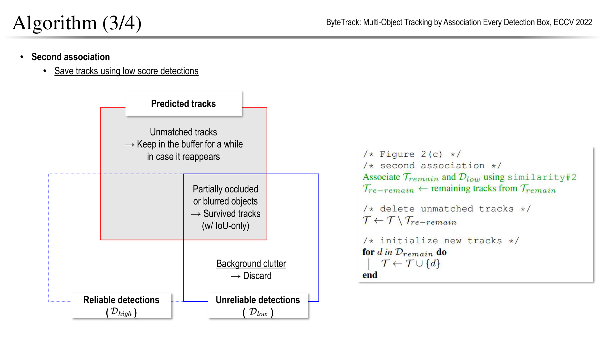

1차 연결에서 남은 Track을 낮은 점수 검출과 IoU 기반으로 다시 연결합니다. 가림 때문에 점수만 낮아진 대상이라면 기존 Track과 위치가 일관되어 살아남을 수 있습니다.

이 단계에 연결되지 않는 낮은 점수 검출은 **배경** 잡음일 가능성이 높아 버립니다. 연결되지 않은 Track은 일정 기간 Lost 상태로 보관할 수 있습니다.

 다만 버퍼 안에 있다는 사실만으로 실제 검출과 동일한 관측 증거가 생기는 것은 아닙니다.

---

### ByteTrack Algorithm (4/4) — 신규·활성·Lost Track 관리

자료: [PDF 52쪽](../교안/04_00_Applications.pdf#page=52).

교안 그림 펼쳐 보기 — 본문 설명을 읽은 뒤 대조

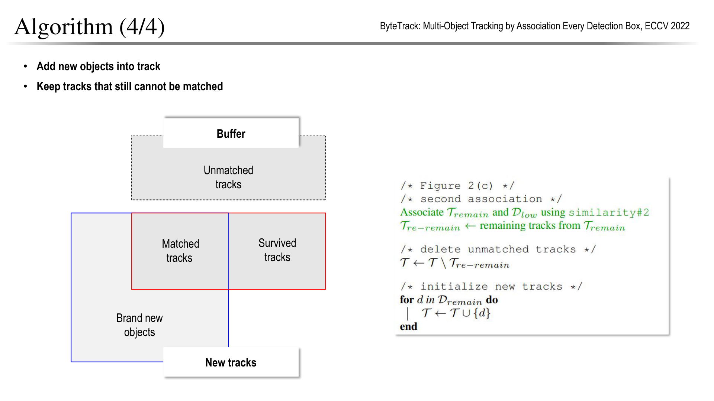

그림의 세 용어는 **이번 프레임에서 Track이 유지되거나 새로 생성되는 경로**를 구분합니다.

| 용어                    | 간략한 의미                                                 | ID 처리                |
| --------------------- | ------------------------------------------------------ | -------------------- |
| **Matched tracks**    | 1차 연결에서 **높은 점수 검출**과 연결된 기존 Track                     | 기존 ID 유지, 관측으로 상태 갱신 |
| **Survived tracks**   | 1차에서는 연결되지 않았지만, 2차에서 **낮은 점수 검출**과 연결되어 살아남은 기존 Track | 기존 ID 유지, 관측으로 상태 갱신 |
| **Brand new objects** | 기존 Track과 연결되지 않은 높은 점수 검출 중 **신규 생성 기준을 만족한 대상**      | 새 Track ID 부여        |

- **Matched·Survived는 기존 대상의 추적을 이어가는 경우**,
- **Brand new는 새로운 추적을 시작하는 경우**입니다. 
- 어느 검출과도 연결되지 않은 Lost Track을 버퍼에 보관하는 것은 `Survived tracks`와 구분합니다.

남은 높은 점수 검출 중 생성 기준을 만족하는 대상은 새 ID를 받습니다.

기존에 연결된 Track과 2차 연결로 회복한 Track은 유지하고, 오래 찾지 못한 Track은 제거합니다.

**낮은 점수 검출은 주로 기존 Track의 회복에 쓰고, 신규 Track은 더 엄격하게 생성**하는 비대칭이 중요합니다.

 이를 통해 Recall을 높이면서도 배경에서 가짜 ID가 늘어나는 것을 억제합니다.

---

### ByteTrack Experiments — MOTA·IDF1·FPS를 함께 읽기

자료: [PDF 53쪽](../교안/04_00_Applications.pdf#page=53).

교안 그림 펼쳐 보기 — 본문 설명을 읽은 뒤 대조

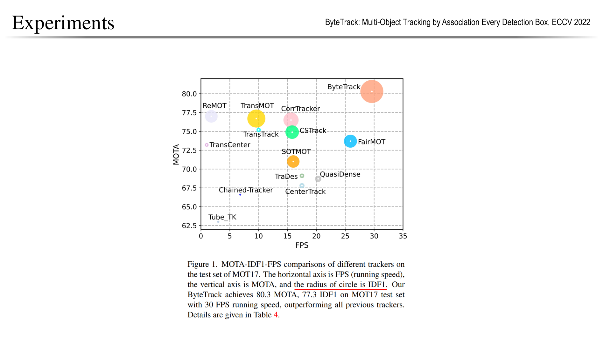

- 가로축은 FPS, 
- 세로축은 MOTA, 
- 원의 반지름은 IDF1입니다.

오른쪽 위에 큰 원이 있으면 처리 속도·검출 중심 오류·ID 일관성을 함께 만족합니다.

슬라이드의 MOT17 test 결과에서 ByteTrack은 **MOTA 80.3, IDF1 77.3, 약 30 FPS**입니다. 

이는 해당 검출기·장비·평가 설정의 결과이며 모든 입력의 보장 속도가 아닙니다. 다른 방법과 비교할 때 공개/자체 검출, 학습 데이터, 실행 환경을 맞춰야 합니다.

---

## 4. TrackFormer

### TrackFormer Overview — 시간에 따라 Query를 이어 주기

자료: [PDF 54쪽](../교안/04_00_Applications.pdf#page=54).

교안 그림 펼쳐 보기 — 본문 설명을 읽은 뒤 대조

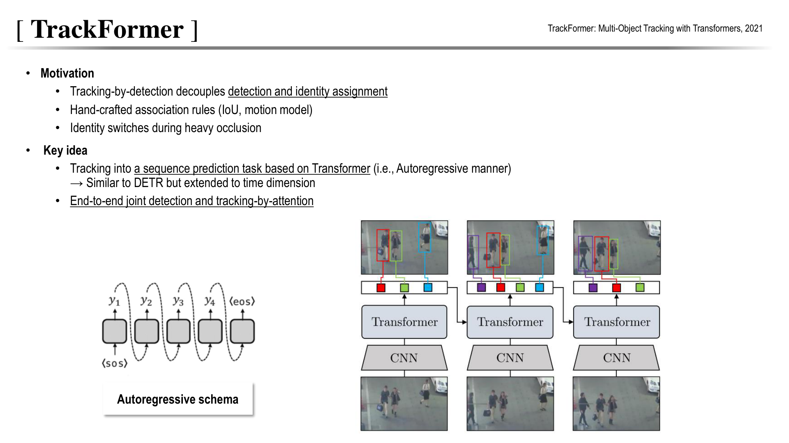

TrackFormer는 DETR의 물체 집합 예측을 시간축으로 확장합니다.

이전 프레임의 물체 표현을 Track query로 다음 프레임에 전달하고, 새 물체는 Object query로 찾습니다.

Autoregressive는 과거 결과를 다음 단계의 조건으로 사용한다는 뜻입니다. 

텍스트를 한 토큰씩 생성하는 모델과 출력 형식이 같은 것은 아닙니다.

**별도의 IoU·Re-ID Association 중심 설계 대신 Attention으로 물체의 연속성을 학습**합니다.

---

### TrackFormer Architecture (1/2) — 새 물체와 기존 ID

자료: [PDF 55쪽](../교안/04_00_Applications.pdf#page=55).

교안 그림 펼쳐 보기 — 본문 설명을 읽은 뒤 대조

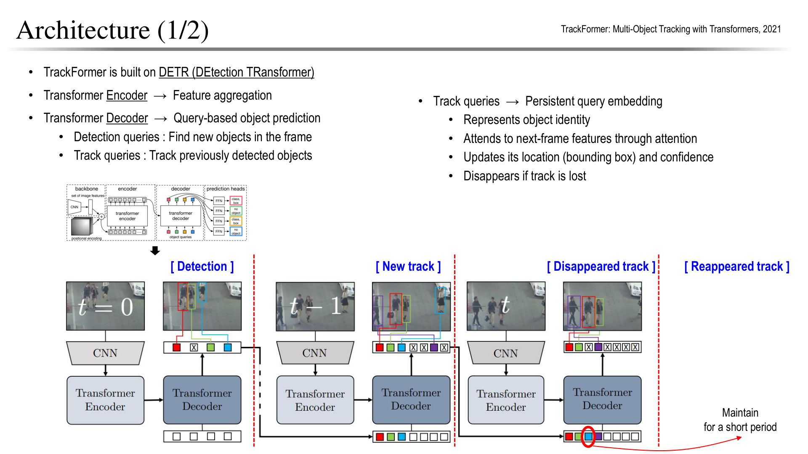

그림 아래의 시간 흐름을 **왼쪽에서 오른쪽으로** 읽으면 됩니다. 

각 프레임은 공통으로 `이미지 → CNN → Transformer Encoder → Decoder → 물체별 박스·점수` 순서로 처리합니다.

1. **Detection — 첫 프레임 t=0:** Detection query로 물체를 찾습니다. 검출된 빨강·초록·파랑 물체에 ID를 부여하고, 각 물체의 Decoder 출력 표현을 다음 프레임의 **Track query**로 전달합니다. X로 표시된 출력은 물체 없음입니다.
2. **New track — 다음 프레임 t=1:** 이전 Track query가 기존 물체의 위치를 갱신하며 ID를 이어갑니다. 동시에 Detection query가 새로 등장한 물체를 찾으면, 그림의 보라색처럼 **새 ID의 Track을 추가**합니다. 갱신된 물체 표현들은 다시 다음 프레임으로 전달합니다.
3. **Disappeared track — 일부 물체가 보이지 않는 프레임 t:** 보이는 물체는 계속 추적하고, 파란 물체처럼 사라진 대상은 즉시 상태를 버리지 않고 **짧은 대기 기간 동안 Track query를 유지**합니다. 그림 아래 빨간 원은 보관 중인 파란 Query를 강조합니다.
4. **Reappeared track — 대상 재등장:** 대기 기간 안에 대상이 다시 나타나고 보관한 Track query가 이를 찾아내면 **기존 ID로 추적을 재개**합니다. 끝내 찾지 못하고 대기 기간을 넘으면 해당 Track을 종료합니다.

`첫 검출 → 기존 ID 유지·새 Track 추가 → 사라진 Track 잠시 보관 → 재등장 시 기존 ID로 재개` 순서입니다.

---

### TrackFormer Architecture (2/2) — DETR에 더해진 입력

자료: [PDF 56쪽](../교안/04_00_Applications.pdf#page=56).

교안 그림 펼쳐 보기 — 본문 설명을 읽은 뒤 대조

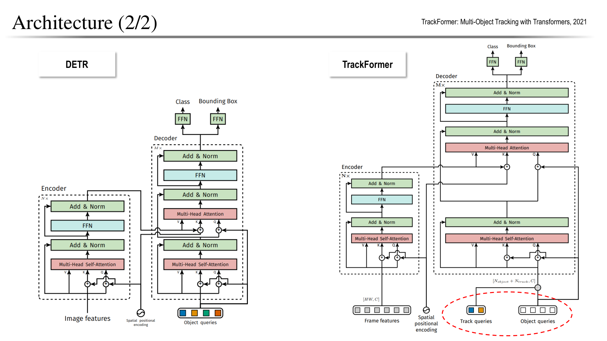

왼쪽 **DETR**의 **Object query만** 있는 Decoder와 달리, 

오른쪽 **TrackFormer**는 이전 프레임에서 전달된 **Track query도** 입력받습니다. 

Encoder는 현재 프레임의 특징을 만들고, Decoder는 두 종류 Query를 함께 갱신합니다.

- Self-Attention은 기존·신규 후보 사이 관계를 조정하고, 
- Cross-Attention은 현재 이미지에서 각 대상을 찾습니다.

**시간 정보는 Query 상태를 통해 전달**되므로 모든 과거 영상을 한 번에 다시 넣는 구성과 구분됩니다.

---

### TrackFormer Training (1/3) — ID로 연결하고 새 대상은 Matching

자료: [PDF 57쪽](../교안/04_00_Applications.pdf#page=57).

교안 그림 펼쳐 보기 — 본문 설명을 읽은 뒤 대조

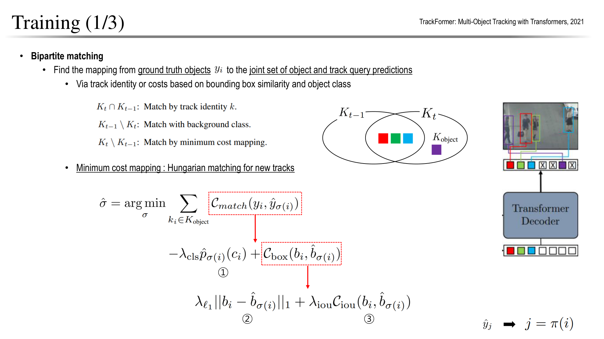

계속 존재하는 대상은 정답 Track identity를 이용해 이전 Track query와 연결합니다. 

- 사라진 대상의 Query는 배경을 예측하도록 하고, 
- 새 대상은 남은 Object query와 Hungarian matching합니다.

모든 기존 ID를 프레임마다 자유롭게 재배정하면 시간 일관성을 배우기 어렵습니다.

**기존 ID의 연결과 새로운 물체의 최소 비용 Matching을 구분**하는 것이 학습의 핵심입니다.

---

### TrackFormer Training (2/3) — Query별 분류·박스 손실

자료: [PDF 58쪽](../교안/04_00_Applications.pdf#page=58).

교안 그림 펼쳐 보기 — 본문 설명을 읽은 뒤 대조

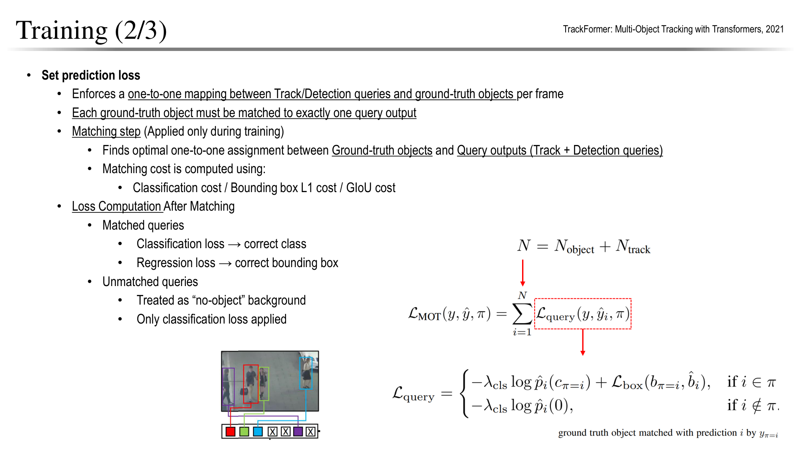

정답과 연결된 Query에는 올바른 클래스와 박스 L1·GIoU 손실을 적용합니다. 연결되지 않은 Query에는 no-object 분류 손실을 적용하고 박스 회귀는 강제하지 않습니다.

집합 예측 손실의 기본 틀은 DETR과 같지만 정답 할당은 Track ID를 반영합니다. 

Hungarian matching은 **훈련 중 정답과 출력을 연결하는 절차**이며, 추론에서 정답 Track을 알고 Matching하는 것은 아닙니다.

---

### TrackFormer Training (3/3) — Track augmentation

자료: [PDF 59쪽](../교안/04_00_Applications.pdf#page=59).

교안 그림 펼쳐 보기 — 본문 설명을 읽은 뒤 대조

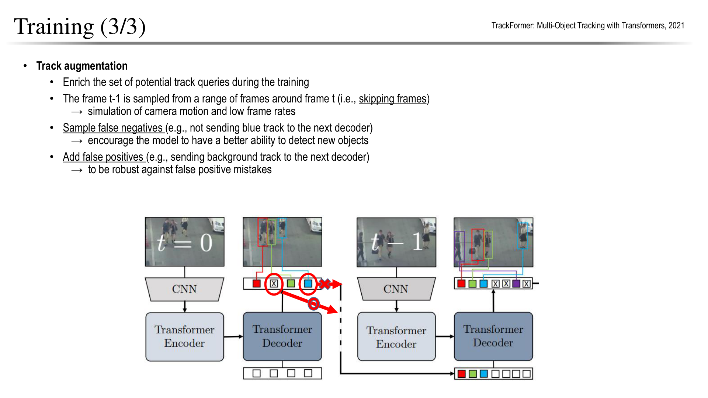

#### Augmentation이란?

**Augmentation(증강)은 기존 학습 자료에 변화를 주어 다양한 상황을 경험하도록 만드는 방법**입니다. 일반적인 이미지 증강은 뒤집기·색 변화·Crop 등을 사용합니다. 

TrackFormer의 **Track augmentation은 프레임의 시간 관계와 다음 Decoder에 넘기는 Track query 집합을 바꿉니다.**

학습 중 이전 Track이 항상 정확하게 주어지면, 실제 추론의 누락·가림·잘못된 Track에 대응하기 어렵습니다. 이를 모사하기 위해 다음 세 가지 변화를 줍니다.

| 증강                         | 바꾸는 것                           | 모사하는 상황                     | 학습할 행동                            |
| -------------------------- | ------------------------------- | --------------------------- | --------------------------------- |
| **프레임 간격 변화 — Range**      | 이전 프레임을 주변 시간 범위에서 선택           | 큰 위치 변화, 낮은 프레임률, 카메라 이동    | 떨어진 위치에서도 기존 대상을 찾아 연결            |
| **False Negative 증강 — FN** | 일부 실제 대상의 Track query를 확률적으로 제거 | 이전 단계에서 대상을 놓쳐 추적 상태가 없는 경우 | Object/Detection query로 대상을 다시 검출 |
| **False Positive 증강 — FP** | 이전 프레임의 배경 출력에서 얻은 Query를 추가    | 잘못된 대상이나 불필요한 Track이 전달된 경우 | 해당 Query를 `no-object`로 판단해 거부     |

#### 그림의 색상 Query와 두 동그라미의 의미

그림에서 **빨강·초록·파랑·보라색은 서로 다른 물체의 Track을 구분**합니다. 모두 사람일 수 있으므로, 색마다 서로 다른 의미 클래스가 지정된 것은 아닙니다. 네모 하나는 해당 Query의 출력이고, **네모 안의 X는 `no-object`로 예측된 출력**을 나타냅니다.

두 빨간 동그라미는 다음 프레임에 전달할 Query를 바꾸는 두 증강을 강조합니다.

| 강조된 표시             | 원래 의미                            | 증강에서 하는 일                      | 다음 프레임의 학습 목표                     |
| ------------------ | -------------------------------- | ------------------------------ | --------------------------------- |
| **X가 있는 네모의 동그라미** | 이전 프레임에서 배경·물체 없음으로 분류된 Query 출력 | 일부러 Track query로 추가 전달 — FP 증강 | 잘못 전달된 Track을 `no-object`로 거부     |
| **파란 네모의 동그라미**    | 실제 파란 대상에 대응하는 Query 출력          | 다음 프레임으로 전달하지 않음 — FN 증강       | 대상은 정답에 남겨 두고 Object query가 다시 검출 |

파란 Query 옆의 빨간 X 화살표는 **전달을 차단하는 동작**이고, 네모 안의 검은 X는 **모델의 `no-object` 예측**입니다. 모양이 비슷해도 역할이 다릅니다. 아래쪽으로 이어지는 화살표는 배경 Query도 다음 Decoder에 넣어 보는 증강 경로입니다.

동그라미는 설명을 위한 강조 표시이며 값 0을 뜻하지 않습니다. `no-object`는 분류 Head의 추가 범주 $\varnothing$로 표현하며, 그 클래스의 정수 인덱스가 반드시 0인 것은 아닙니다. 또한 Query를 제거하는 것은 **벡터를 `(0,0)`으로 바꾸는 것이 아니라, 다음 Decoder에 넘기는 Query 집합에서 제외**하는 것입니다.

#### 예시로 보는 세 가지 변화

1. **시간 간격 늘리기:**
   1. 바로 전 프레임 대신 몇 프레임 떨어진 영상을 짝으로 사용합니다.
   2. 같은 사람이 더 멀리 이동한 입력에서도 현재 위치를 찾아야 하므로 작은 이동만 외우는 것을 줄입니다.
2. **기존 Query 빼기:**
   1. 빨강·파랑 사람의 Track query가 있을 때 파랑 Query를 제거합니다.
   2. **현재 프레임의 파랑 사람 정답은 그대로 유지**하므로, 남은 Object query가 그 사람을 찾아야 합니다.
   3. 이미지에서 사람을 지우거나 정답 라벨을 삭제하는 증강이 아닙니다.
3. **가짜 Query 넣기:**
   1. 실제 사람의 Track query 외에 배경에서 나온 Query를 추가합니다.
   2. 모델은 이 Query까지 물체로 계속 유지하지 않고 배경으로 예측하도록 학습합니다.
   3. 임의의 숫자 벡터를 넣는 것보다 실제 모델이 만들 수 있는 잘못된 추적 상태를 모사합니다.

**FN 증강은 ‘놓친 대상을 찾는 연습’, FP 증강은 ‘잘못된 Track을 버리는 연습**’입니다. 

두 종류 Query를 함께 학습해 기존 대상 추적에만 의존하지 않도록 합니다. 이 변형은 **훈련 입력에 적용**합니다. 

추론할 때도 일부러 올바른 Query를 지우거나 가짜 Query를 넣는다는 뜻은 아닙니다. 학습에서 불완전한 상태를 경험해, 실제 추론의 오류에 더 잘 대응하도록 하는 목적입니다.

출처: [TrackFormer 원 논문 §3.3 — Track augmentations](https://arxiv.org/html/2101.02702v3#S3.SS3).

---

### TrackFormer Inference — Query 유지·생성·종료

자료: [PDF 60쪽](../교안/04_00_Applications.pdf#page=60).

교안 그림 펼쳐 보기 — 본문 설명을 읽은 뒤 대조

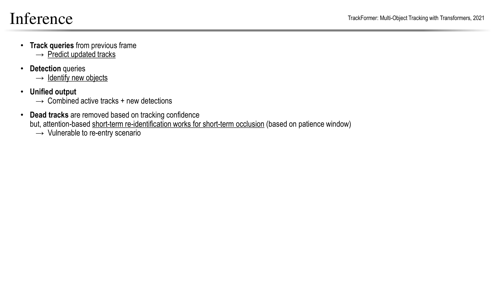

기존 Track query와 새 Object query를 현재 프레임에 적용해 박스·점수를 얻습니다. 

- 유지 기준을 만족하면 ID를 이어가고, 
- 신규 생성 기준에 맞는 결과에는 새 ID를 부여합니다.
- 잠시 약해진 Track은 Patience window 안에서 복귀를 기다릴 수 있습니다.

외부 Association의 비중을 줄였어도 **점수 임계값과 Track 수명 관리가 모두 사라지는 것은 아닙니다.** 

장시간 화면 밖으로 나갔다 돌아온 대상의 ID 보존은 짧은 가림보다 어렵습니다.

---

### TrackFormer Experiments — MOTA와 IDF1은 같은 순위가 아니다

자료: [PDF 61쪽](../교안/04_00_Applications.pdf#page=61).

교안 그림 펼쳐 보기 — 본문 설명을 읽은 뒤 대조

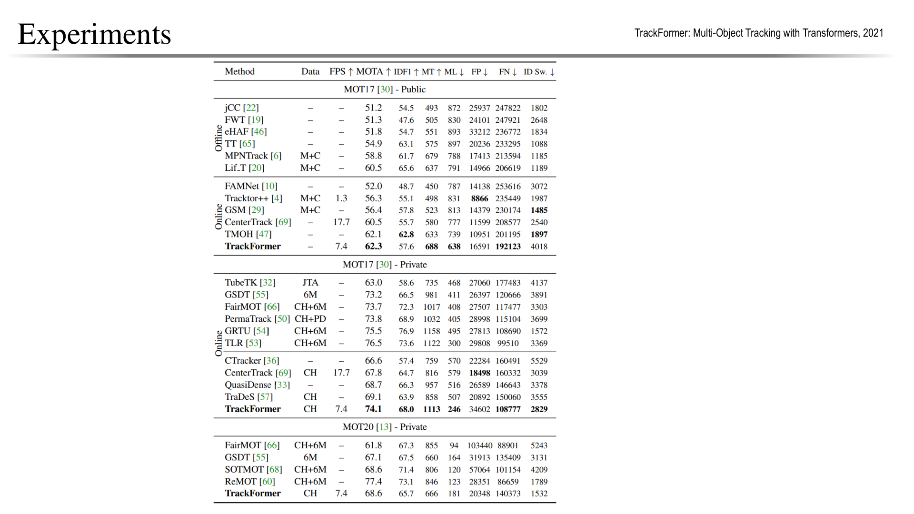

| 슬라이드의 TrackFormer 설정 | MOTA | IDF1 | FPS |
| -------------------- | ---- | ---- | --- |
| MOT17 Public         | 62.3 | 57.6 | 7.4 |
| MOT17 Private        | 74.1 | 68.0 | 7.4 |
| MOT20 Private        | 68.6 | 65.7 | 7.4 |

Public/Private는 검출 입력과 평가 설정이 다르고 학습 자료도 다를 수 있어, 62.3→74.1을 구조 개선량으로 해석하면 안 됩니다. 

MOT17 Public에서 TMOH는 MOTA 62.1·IDF1 62.8로, TrackFormer보다 MOTA는 약간 낮지만 IDF1은 높습니다.

**Attention 기반 공동 학습의 가능성과 모든 지표의 우승은 다른 주장**입니다. 

FP·FN·IDSW·FPS를 함께 봐야 하고, ByteTrack의 다른 평가 조건 수치와 직접 순위를 매겨서는 안 됩니다.

---

## 5. 추적의 오류와 평가

### Tracking challenges — 검출이 맞아도 ID는 바뀔 수 있다

자료: [PDF 37쪽](../교안/04_00_Applications.pdf#page=37).

교안 그림 펼쳐 보기 — 본문 설명을 읽은 뒤 대조

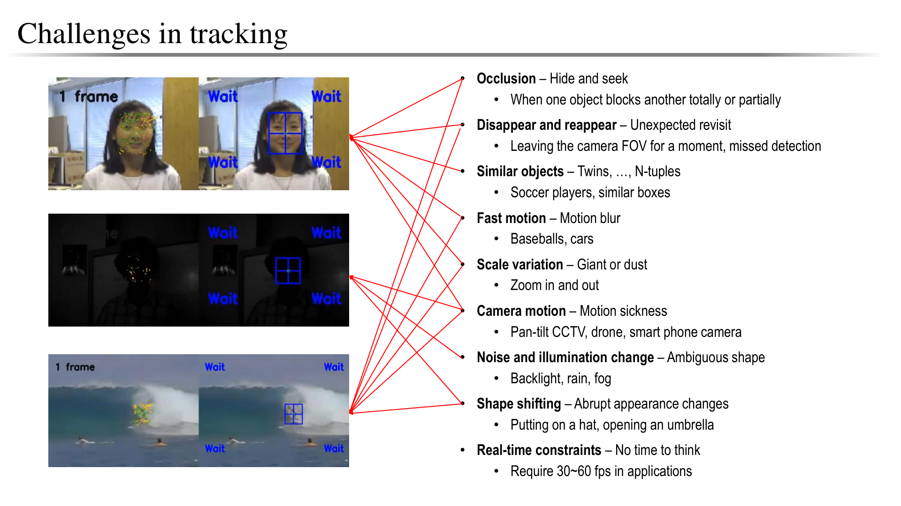

Tracking의 어려운점.

- 물체가 가려지거나 시야 밖으로 사라졌다 돌아오면 이전 ID를 되찾아야 합니다. 
- 비슷한 옷을 입은 사람, 빠른 이동과 Motion blur, 카메라 이동은 위치와 외형 단서를 동시에 바꿉니다.

프레임마다 사람을 모두 찾더라도 두 사람의 ID가 바뀌면 추적 오류입니다. 

- **누락, 잘못된 검출, ID switch, 궤적 단절을 분리해 평가**해야 합니다. 
- 실시간 요구도 응용마다 달라 슬라이드의 30~60 FPS가 모든 시스템의 공통 기준은 아닙니다.

---

### Tracking metrics (1/3) — MOTA와 IDF1

자료: [PDF 38쪽](../교안/04_00_Applications.pdf#page=38).

교안 그림 펼쳐 보기 — 본문 설명을 읽은 뒤 대조

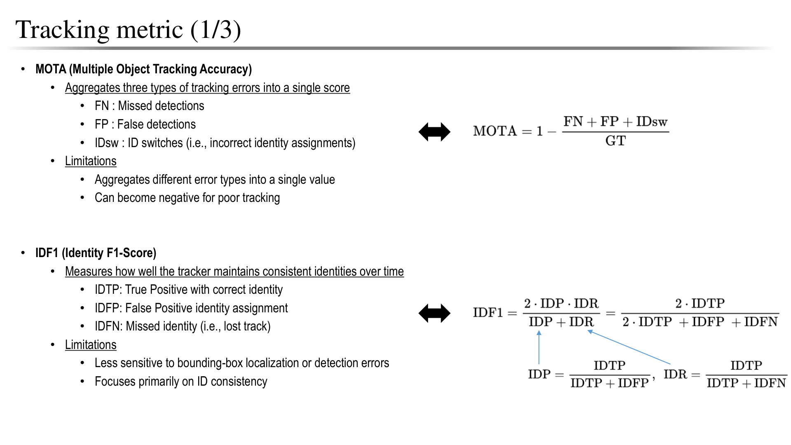

$$
MOTA=1-\frac{FN+FP+IDSW}{\sum_t GT_t},\qquad
IDF1=\frac{2IDTP}{2IDTP+IDFP+IDFN}
$$

MOTA는 누락·오검출·ID 교체를 합산합니다. 

- 분모는 전체 프레임의 정답 검출 수이며 고유한 사람 수가 아닙니다.
- 오류가 많으면 음수가 될 수 있고, 데이터에 따라 FN이 지표를 크게 좌우합니다.

IDF1은 시퀀스 전체에서 ID를 일관되게 유지한 정도에 초점을 둡니다. 

- IDTP·IDFP·IDFN은 궤적 간 전역 ID 대응을 바탕으로 계산하므로, 프레임별 검출 TP·FP·FN을 그대로 대입하는 것은 아닙니다.

#### IDSW — 같은 실제 물체에 연결된 추적 ID가 바뀌는 오류

- **ID Switch는 동일한 정답 물체에 매칭된 예측 Track ID가 이전에 매칭된 ID와 달라지는 사건**입니다. 
  - 물체를 놓치지 않고 박스를 정확히 찾아도, 사람 A에게 붙었던 ID 1이 ID 7로 바뀌면 시간에 걸친 동일성이 깨진 것입니다.
  - 여기서 ID는 사람·자동차 같은 **클래스가 아니라 개별 대상의 추적 번호**입니다.
  - 또한 정답 ID와 예측 ID의 숫자가 같을 필요는 없습니다. 
  - 정답 사람 A가 계속 예측 ID 7에 연결되면 일관된 추적입니다.

| 프레임 | 실제 사람 A에 매칭된 예측 ID | 해석                        |
| --- | ------------------ | ------------------------- |
| t=1 | ID 1               | 처음 연결: Switch 아님          |
| t=2 | ID 1               | 같은 ID 유지                  |
| t=3 | ID 7               | ID 1→7: IDSW 1회           |
| t=4 | ID 7               | 변경된 ID가 유지됨: 새 Switch는 아님 |
| t=5 | ID 1               | ID 7→1: IDSW 추가 1회        |

이 예시의 IDSW는 총 2회입니다.

- 두 사람이 교차한 뒤 **A: ID 1→2, B: ID 2→1**로 서로 ID를 바꾸면 각 정답 궤적에서 변화가 발생하므로 2회로 셀 수 있습니다. 
- 단순히 ‘ID가 잘못 붙어 있던 프레임 수’를 세는 값은 아닙니다.

#### FN·Fragmentation과의 차이

| 상황                             | 주로 발생하는 오류            |
| ------------------------------ | --------------------- |
| 물체가 정답에 존재하지만 예측과 매칭되지 않음      | FN — 검출 누락            |
| 추적됨 → 미추적 → 다시 추적됨             | Fragmentation — 궤적 단절 |
| 같은 정답 물체가 이전과 다른 Track ID에 매칭됨 | IDSW — 정체성 연결 변경      |

가림 뒤 같은 ID로 복구되면 누락과 단절은 생겨도 IDSW는 없을 수 있습니다. 

반대로 다른 ID로 복구되면 IDSW도 발생할 수 있습니다. 

**TrackEval의 CLEAR 평가는 바로 직전 프레임뿐 아니라 마지막으로 매칭된 ID를 기억**하므로, 중간에 누락 프레임이 있어도 새 ID로 돌아오면 Switch로 집계할 수 있습니다. 

정확한 집계는 해당 벤치마크의 평가 규칙을 따릅니다.

#### MOTA·IDF1에서 어떻게 반영될까?

- MOTA에서는 IDSW 1회가 분자의 오류를 1 늘립니다. 
- 예를 들어 
  - 전체 정답 검출 수가 100이고 FN=10, FP=5, IDSW=2이면 `MOTA=1−(10+5+2)/100=0.83`입니다. 
  - 다른 값이 같을 때 Switch가 1회 늘면 MOTA는 0.01, 즉 1%p 낮아집니다.

IDF1은 IDSW 횟수를 수식에 직접 넣지 않고 **시퀀스 전체의 ID 대응 아래에서 올바르게 연결된 검출 수**로 계산합니다.

 따라서 같은 Switch 횟수라도 잘못 연결된 구간의 길이와 궤적 구조에 따라 IDF1이 달라질 수 있습니다. MOTA와 함께 보는 이유입니다.

보충 출처: [TrackEval 공식 CLEAR 구현 — IDSW·Fragmentation·MOTA 계산](https://github.com/JonathonLuiten/TrackEval/blob/master/trackeval/metrics/clear.py).

---

### Tracking metrics (2/3) — HOTA·DetA·AssA·LocA

자료: [PDF 39쪽](../교안/04_00_Applications.pdf#page=39).

교안 그림 펼쳐 보기 — 본문 설명을 읽은 뒤 대조

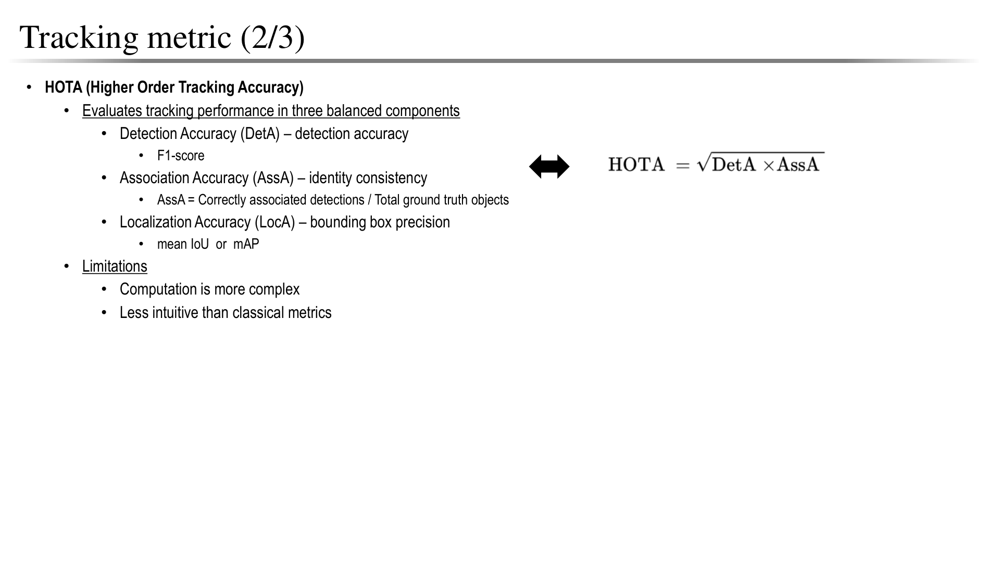

HOTA는 검출과 연결의 균형을 평가합니다. 위치 매칭 기준 α에서의 기본식은 다음과 같습니다.

$$
DetA_\alpha=\frac{TP}{TP+FP+FN},\qquad
HOTA_\alpha=\sqrt{DetA_\alpha AssA_\alpha}
$$

여러 위치 임계값의 결과를 평균해 HOTA를 구합니다. AssA는 올바르게 매칭된 검출을 기준으로 궤적 연결의 Jaccard 정확도를 평균한 값이고, LocA는 매칭된 검출의 위치 유사도 평균입니다.

**슬라이드의 DetA=F1, AssA=단순 정답 개수 비율, LocA=mAP 표기는 정확한 정의가 아닙니다.** LocA를 HOTA 식에 별도 세 번째 곱으로 넣지도 않습니다. 위치 품질은 매칭 임계값과 평가 과정에 반영됩니다.

교육용으로 한 임계값에서 DetA=0.64, AssA=0.81이면 HOTA=√(0.64×0.81)=0.72입니다. LocA가 0.9라고 이 값에 다시 곱하지 않습니다.

보충 출처: [TrackEval 공식 HOTA 구현](https://github.com/JonathonLuiten/TrackEval/blob/master/trackeval/metrics/hota.py).

### Tracking metrics (3/3) — 한 지표로 순위를 단정하지 않기

자료: [PDF 40쪽](../교안/04_00_Applications.pdf#page=40).

교안 그림 펼쳐 보기 — 본문 설명을 읽은 뒤 대조

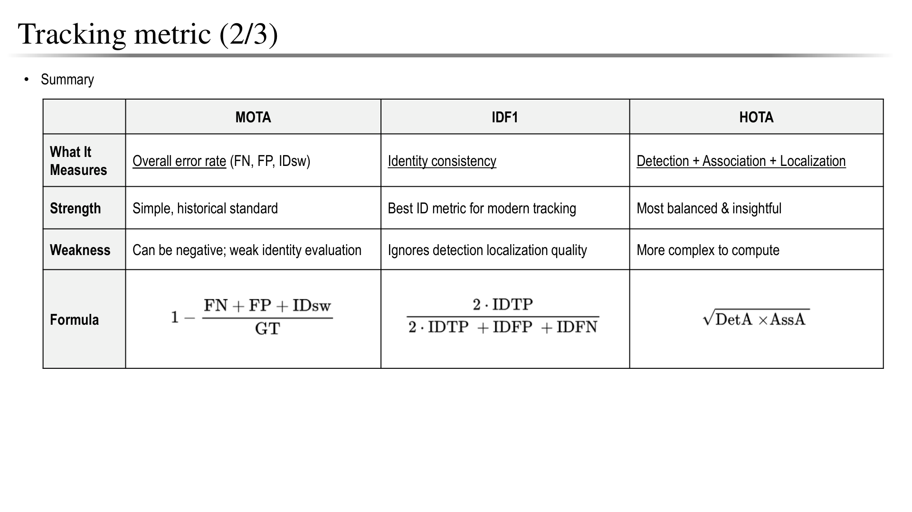

| 지표   | 주로 보는 것           | 함께 확인할 항목           |
| ---- | ----------------- | ------------------- |
| MOTA | FN·FP·IDSW의 합산 오류 | 누락 수가 지배하는지 확인      |
| IDF1 | 시퀀스의 ID 일관성       | 검출·좌표 품질을 별도 확인     |
| HOTA | 검출과 연결의 균형        | DetA·AssA를 나눠 원인 분석 |

예를 들어 MOTA가 높아도 ID가 자주 바뀔 수 있고, IDF1이 좋아도 일부 물체를 놓칠 수 있습니다. 슬라이드의 ‘best’는 직관적 강조이며 모든 용도에서 우월한 지표라는 의미는 아닙니다. 동일 데이터·검출 조건·FPS까지 묶어서 비교해야 합니다.

---

### Tracking methodology — 검출 후 연결과 위치 전파

자료: [PDF 41쪽](../교안/04_00_Applications.pdf#page=41).

교안 그림 펼쳐 보기 — 본문 설명을 읽은 뒤 대조

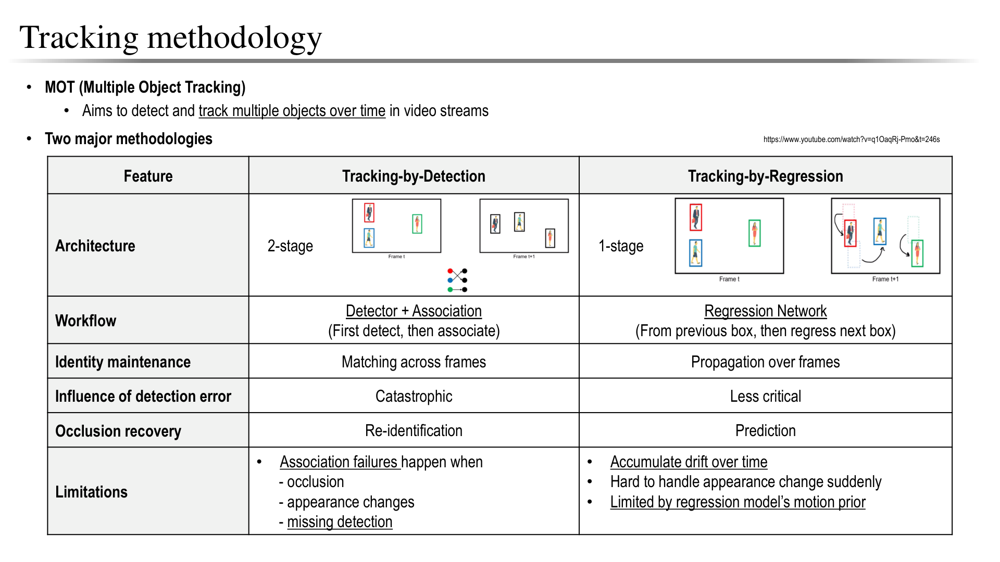

- **Tracking-by-detection**은 각 프레임의 검출을 위치·운동·외형 유사도로 연결합니다. 
- Tracking-by-regression은 이전 물체의 위치나 특징으로 다음 위치를 직접 갱신합니다.

전자는 누락과 연결 오류, 후자는 누적 Drift가 문제입니다.

 **이 구분은 객체 검출의 One-stage·Two-stage 구분과 같지 않습니다.** 

실제 시스템은 검출·회귀·외형 재식별을 섞으므로 슬라이드의 1단계/2단계 표를 엄격한 분류로 받아들이지 않는 것이 좋습니다.

---

## 6. 심화 — 고전 추적과 발전

연대표는 기술을 찾는 참고 지도입니다. 교안의 연도 표기를 최초 발표 연도로 암기하지 않습니다.

### Tracking evolution (1/2) — 운동·외형에서 학습 특징으로

자료: [PDF 42쪽](../교안/04_00_Applications.pdf#page=42).

교안 그림 펼쳐 보기 — 본문 설명을 읽은 뒤 대조

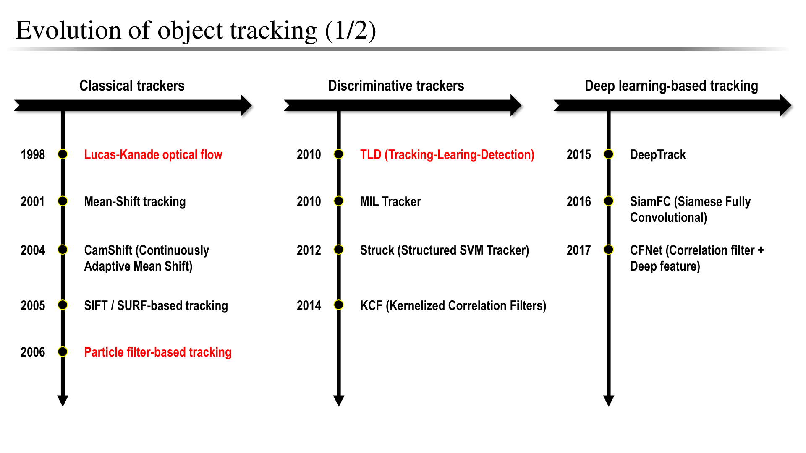

Optical flow는 픽셀 움직임, Mean/CamShift는 특징 분포, Particle filter는 상태의 불확실성을 이용합니다. 이후 온라인 분류기·상관 필터는 대상과 배경을 구분하고, 깊은 특징과 Siamese 구조는 두 영상 영역의 유사도를 학습합니다.

여기에는 **단일 대상 추적(SOT)과 다중 물체 추적(MOT)이 함께 등장**합니다. 첫 프레임의 대상 하나를 계속 찾는 문제와 새 물체의 등장까지 관리하는 문제를 구분해야 합니다. 연도는 개별 기술의 최초 제안과 적용 시점이 섞인 개요로 읽습니다.

---

### Tracking evolution (2/2) — Association에서 Query 전파로

자료: [PDF 43쪽](../교안/04_00_Applications.pdf#page=43).

교안 그림 펼쳐 보기 — 본문 설명을 읽은 뒤 대조

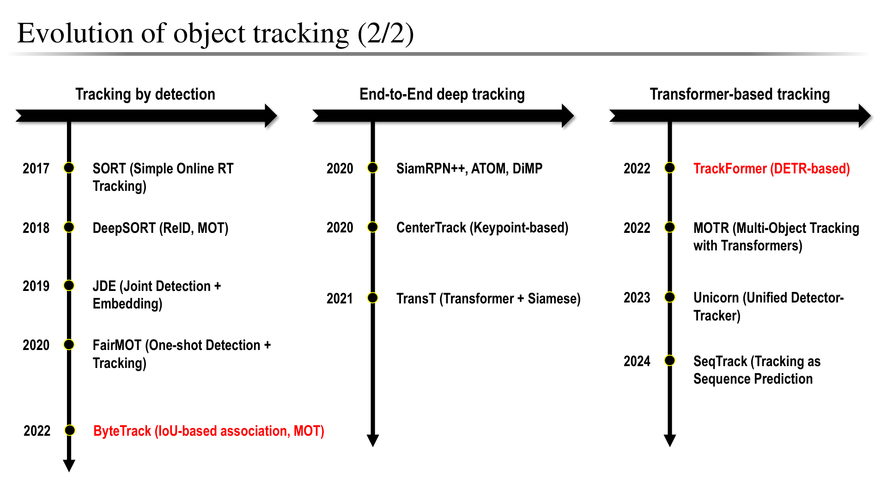

SORT 계열은 검출과 운동 기반 연결, DeepSORT는 외형 재식별, JDE·FairMOT는 검출과 특징 추출의 결합을 강조합니다. ByteTrack은 낮은 점수의 검출을 재활용하고, TrackFormer·MOTR은 Query에 시간 정보를 전달합니다.

학습 기반 연결이 늘어났어도 검출 품질과 Track 생성·종료 규칙은 여전히 중요합니다. 이 노트는 슬라이드의 연도별 순위를 외우기보다 **어떤 정보를 다음 프레임으로 전달하는지**에 초점을 맞춥니다.

---

### 고전 추적 방법

### Lucas–Kanade optical flow — 작은 영역의 공통 이동 추정

자료: [PDF 44쪽](../교안/04_00_Applications.pdf#page=44).

교안 그림 펼쳐 보기 — 본문 설명을 읽은 뒤 대조

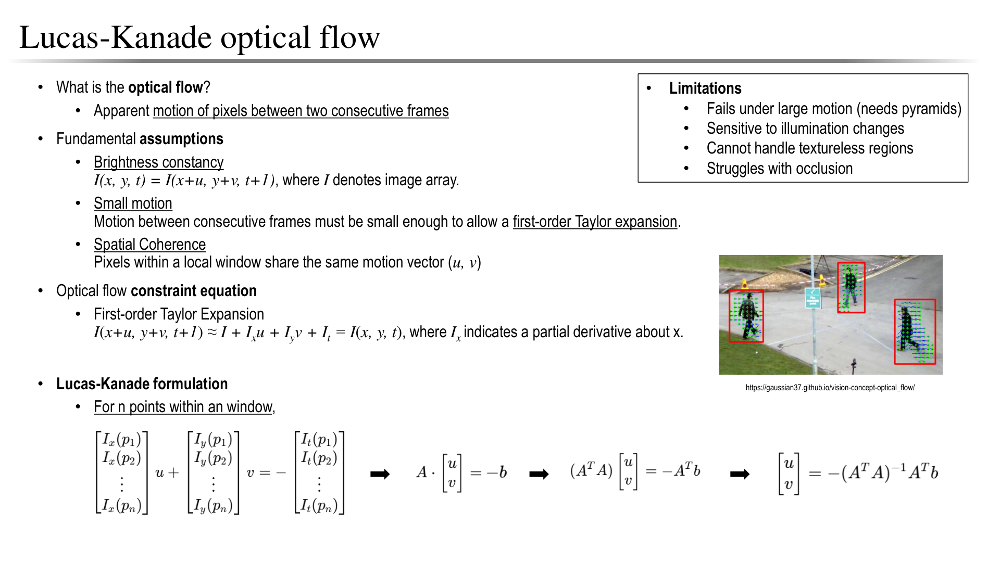

밝기 보존, 작은 이동, 한 윈도우 안의 유사한 움직임을 가정합니다. 밝기 식을 1차 근사하면 한 픽셀에서 다음 제약을 얻습니다.

$$
I_xu+I_yv+I_t=0,\qquad
\begin{bmatrix}u\\v\end{bmatrix}=(A^TA)^{-1}A^Tb
$$

여러 픽셀의 공간 미분을 A에, 음의 시간 미분을 b에 쌓아 최소제곱으로 이동 `(u,v)`를 구합니다. 평탄한 영역이나 한 방향 에지만 있으면 해가 불안정할 수 있습니다. 큰 이동은 영상 피라미드로 보완하지만 가림·급격한 조명 변화는 여전히 어렵습니다.

---

### Particle filter — 여러 가능한 상태를 유지하기

자료: [PDF 45쪽](../교안/04_00_Applications.pdf#page=45).

교안 그림 펼쳐 보기 — 본문 설명을 읽은 뒤 대조

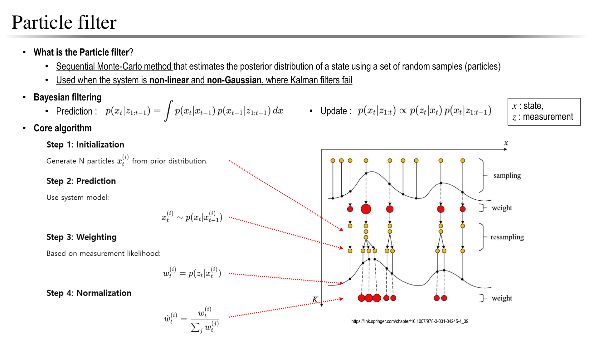

대상의 위치·속도 같은 상태를 다수의 입자와 가중치로 근사합니다. **예측 → 관측 적합도 계산 → 가중치 정규화 → 재표본화**를 반복해 가능성 높은 상태에 계산을 집중합니다. 그림의 흩어진 점과 굵은 점은 후보 상태와 확률 질량을 나타냅니다.

교육용으로 관측 적합도가 [2, 1, 1]인 세 입자는 합 4로 나누어 가중치 [0.5, 0.25, 0.25]를 얻습니다. 재표본화는 이 확률에 따라 뽑으므로 첫 입자가 더 자주 선택될 가능성이 높지만 매번 정확히 절반이 되지는 않습니다.

비선형·다봉 분포를 다루기 편하지만 입자 수와 좋은 관측 모델이 필요합니다. 입자가 부족하면 올바른 상태를 잃을 수 있습니다. Kalman filter의 선형·가우시안 가정을 완화하는 대안이지, 어떤 비선형 문제에서도 항상 우월한 것은 아닙니다.

---

### TLD — 추적·학습·재검출의 순환

자료: [PDF 46쪽](../교안/04_00_Applications.pdf#page=46).

교안 그림 펼쳐 보기 — 본문 설명을 읽은 뒤 대조

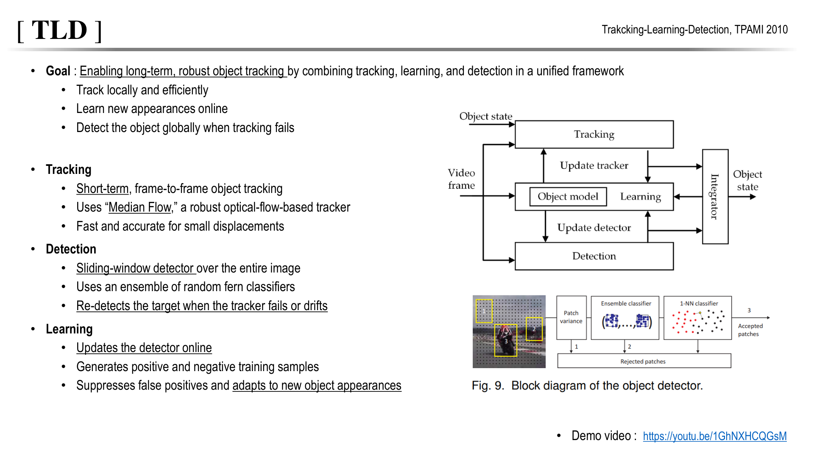

교안의 TLD는 Median Flow로 짧은 시간 움직임을 추적하고, 슬라이딩 윈도우와 Random fern 분류기 앙상블로 전체 화면에서 후보를 검사합니다. Learner는 양성·음성 사례를 갱신합니다. Tracker가 짧은 시간의 연속 움직임을 따라가고, Detector가 전체 화면에서 대상을 다시 찾으며, Learner가 새 외형과 오류 사례로 Detector를 갱신합니다. 그림의 세 화살표는 이 기능들이 서로 보완하는 관계입니다.

Local tracking이 실패해도 전역 검출로 복귀할 수 있는 것이 장기 추적의 장점입니다. 반대로 잘못된 영역을 대상이라고 학습하면 Drift가 누적됩니다. **온라인 업데이트가 항상 도움이 되는 것은 아니며**, 언제 학습할지 판단하는 장치가 중요합니다.

---
## 7. 스스로 확인하기

먼저 답을 가리고 풉니다. 계산은 교육용이며 실제 벤치마크 실행 결과가 아닙니다.

1. x=10, v=2, 시간 간격이 2프레임이면 예측 중심은? 관측 z=13, K=0.75이면 갱신 중심은? ID도 바뀌는가?
2. 높은 점수 기준 0.6, 낮은 후보 하한 0.1인 예에서 검출 점수 0.35, 기존 Track과 IoU=0.8이다. 1차에서 남은 적격 Track이라면 어떻게 처리하는가? 같은 박스가 기존 Track과 전혀 겹치지 않으면?
3. 정답 검출 합 100, FN=10, FP=5, IDSW=2일 때 MOTA는? IDSW를 그대로 IDF1 분모에 넣을 수 있는가?
4. DetA=0.64, AssA=0.81인 한 위치 임계값에서 HOTA는? 이것이 최종 다중 임계값 HOTA인가?
5. **확장 학습 — §4 TrackFormer를 읽은 뒤:** TrackFormer FN 증강은 현재 정답 사람까지 삭제하는가? 학습의 Hungarian matching과 추론의 ID 전달은 무엇이 다른가?

해설과 복귀 위치

1. 10+2×2=14, 잔차 13−14=−1, 갱신은 14−0.75=13.25픽셀입니다. 동일 대상에 연결했으므로 ID는 유지합니다. 속도 단위와 시간 간격을 함께 써야 합니다. [2절](#2-한-프레임의-예측매칭갱신)로 돌아갑니다.
2. 낮은 점수 그룹에서 2차 연결 기준도 만족하면 기존 ID와 상태를 갱신합니다. 연결 근거가 없으면 낮은 검출을 버리며 무조건 새 ID를 만들지 않습니다. [3절](#3-bytetrack)의 두 단계 표를 복습합니다.
3. 1−(10+5+2)/100=0.83입니다. IDF1은 전역 ID 대응의 IDTP·IDFP·IDFN이 필요하므로 이 정보만으로 계산할 수 없습니다. [5절](#5-추적의-오류와-평가)에서 두 지표의 분모를 비교합니다.
4. √(0.64×0.81)=√0.5184=0.72입니다. 한 임계값 결과이므로 여러 위치 임계값을 평균하는 최종 HOTA와 구분합니다. [5절](#5-추적의-오류와-평가)로 돌아갑니다.
5. Query만 제거하고 정답은 남겨 Object query가 다시 찾도록 합니다. 학습은 정답 ID를 이용하고 새 대상을 최소 비용으로 할당하지만 추론에는 정답이 없고 이전 Track query의 표현과 수명 관리로 ID를 이어갑니다. [4절](#4-trackformer)의 학습·증강·추론을 비교합니다.

다음 [영상 분할](04_04_영상_분할.md)은 ‘같은 대상인가’에서 ‘정확히 어느 픽셀인가’로 출력 단위를 바꿉니다. 마스크의 개체 번호를 얻어도 시간 ID가 자동으로 유지되는 것은 아닙니다.
