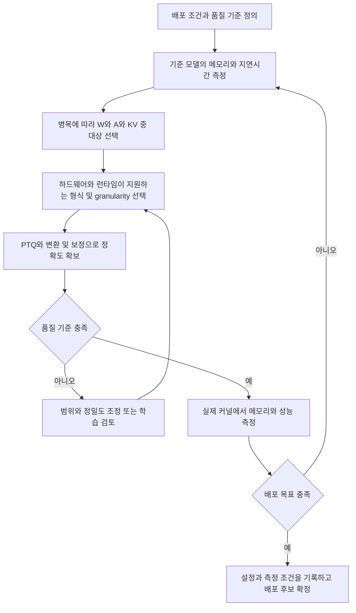

# LLM 양자화 실무 의사결정 가이드

LLM 양자화는 값을 적은 비트로 표현하여 모델 저장 공간, 메모리 이동량, 연산 비용을 줄이는 기술이다. 좋은 설정은 가장 낮은 비트 수가 아니라 **목표 하드웨어에서 품질과 메모리 예산을 만족하면서 실제 요청을 빠르게 처리하는 조합**이다.

배포 조건과 병목을 먼저 확인하고, 양자화 대상과 실행 가능한 형식을 정한 뒤 정확도를 복구한다. 마지막에는 실제 저정밀 커널로 성능을 검증한다. 아래 선택 조건과 시나리오는 후보를 좁히는 실무 판단 기준이며, 특정 모델의 성능을 보장하는 벤치마크 결과가 아니다.

## 1 전체 선택 흐름

| 단계 | 핵심 질문 | 산출물 | 관련 지도 항목 |
| --- | --- | --- | --- |
| ① 배포 조건 | 어느 장치에서 어떤 요청을 처리하는가? | 메모리 한도, 입력·출력 길이, 동시 요청 수, 품질·지연 목표 | 전체의 전제 |
| ② 병목 판단 | 가중치 로딩, 연산, KV 접근 중 무엇이 지배적인가? | 기준 모델의 프로파일과 우선 개선 대상 | 7, 9 |
| ③ 대상 선택 | W, A, KV 중 어디에 저정밀을 적용하는가? | W-only, W+A, KV 포함 여부 | 7 |
| ④ 표현과 실행 설정 | 어떤 조합을 실제 커널로 실행할 수 있는가? | 수치 형식, 비트 수, 대칭 여부, scale 공유 범위와 계산 시점 | 1–5 |
| ⑤ 품질 확보 | 양자화 오차를 어떻게 줄일 것인가? | PTQ 또는 학습 경로, 변환, clipping, rounding, 보정 데이터 | 6, 8 |
| ⑥ 배포 검증 | 실제로 빠르고 작으며 정확한가? | 품질, peak memory, TTFT, TPOT, 처리량과 커널 기록 | 9 |

단계 ④와 ⑤는 반복한다. 예를 들어 W4 설정에서 품질이 부족하면 변환이나 rounding을 바꿔보고, 여전히 부족하면 group 크기나 일부 레이어의 비트 수를 조정한다. 변환을 바꿨다면 그 변환이 반영된 모델에서 통계와 scale을 다시 구해야 한다.

### 원본 지도를 읽는 방법

원본은 9개 항목을 A부터 E까지의 범주로 묶는다. 이는 분류 체계이며 작업 순서가 아니다. 숫자가 생략된 Format & Bit-width와 PTQ 계열 행을 각각 3번과 6번으로 읽는다.

| 범주 | 결정하는 내용 | 서로 혼동하기 쉬운 개념 |
| --- | --- | --- |
| A 수치 표현 | 표현 값의 배치, 대칭 여부, 형식과 비트 수 | 비균일 표현과 granularity는 다른 선택이다 |
| B 파라미터 공유 범위 | 어떤 원소들이 scale 등을 공유하는가 | Per-group과 벡터 코드북은 같은 개념이 아니다 |
| C 결정 시점과 최적화 | 언제 범위를 정하고 어떻게 오차를 줄이는가 | Dynamic과 QAT는 서로 다른 축이다 |
| D 양자화 대상 | W, A, KV 중 무엇을 줄이는가 | Activation-aware가 activation quantization을 뜻하지는 않는다 |
| E 전처리와 실행 | 분포를 어떻게 바꾸고 실제로 어떻게 실행하는가 | Fake quantization의 정확도와 실제 속도는 별개다 |

## 2 선택에 필요한 기초

### W와 A와 KV의 역할

| 기호 | 의미 | 생기는 시점 | 양자화의 주된 목적 |
| --- | --- | --- | --- |
| W | Weight, 학습된 가중치 | 모델 학습 후 저장 | 모델 크기와 가중치 이동량 감소 |
| A | Activation, 연산 중 만들어지는 활성값 | 요청 처리 중 | 활성값 이동량 감소와 저정밀 행렬곱 활용 |
| KV | Attention의 Key와 Value 캐시 | Prefill 및 이후 토큰 생성 중 | 긴 문맥과 많은 동시 요청의 캐시 용량·접근량 감소 |

W4A16은 가중치를 4비트로 저장하고 활성값은 16비트로 다루는 구성을 뜻한다. 이 표기만으로 INT4인지 NF4인지, scale 형식이나 실제 곱셈·누산 정밀도가 무엇인지 알 수 없다. KV 정밀도도 별도로 기록해야 한다. W4A8KV4 역시 숫자만 정한 상태이며 각 텐서의 형식과 커널이 더 필요하다.

### 메모리와 병목의 대략적인 산정

가중치 데이터의 이론적 용량은 다음과 같다.

$$M_W \approx N_W b_W / 8 \quad \text{bytes}$$

여기서 $N_W$는 가중치 원소 수, $b_W$는 원소당 비트 수다. 예를 들어 **70억 개 가중치를 모두 같은 정밀도로 저장한다고 가정하면** FP16은 약 14 GB, 4비트는 약 3.5 GB다. GB는 $10^9$ bytes이며, 이 값에는 scale, zero-point, 코드북, 정렬 패딩, 고정밀 레이어와 실행 버퍼가 포함되지 않는다.

일반적인 dense attention 모델에서 KV 데이터의 근사 용량은 다음과 같다.

$$M_{KV} \approx 2 L B T H_{KV} d_h b_{KV}/8 \quad \text{bytes}$$

$L$은 레이어 수, $B$는 동시 시퀀스 수, $T$는 시퀀스당 캐시 토큰 수, $H_{KV}$는 KV head 수, $d_h$는 head 차원, $b_{KV}$는 K와 V에 동일하게 적용한다고 가정한 비트 수다. 앞의 2는 K와 V 두 텐서를 뜻한다. 가변 길이 요청은 각 요청의 길이를 합산하고, K와 V 정밀도가 다르면 따로 계산한다. 페이지 여유 공간, scale, 고정밀 잔여 캐시는 별도다. MQA·GQA는 query head 수가 아닌 KV head 수를 넣어야 한다.

작은 배치의 decode는 가중치 이동에 제한되는 경우가 많고, 토큰을 한꺼번에 처리하는 prefill은 연산량의 비중이 커지는 경우가 많다. 긴 문맥에서는 KV 접근이 중요해진다. **이는 프로파일을 읽기 위한 출발 가설이다.** 큰 배치, attention 구현, 모델 구조에 따라 실제 병목은 달라진다.

## 3 아홉 가지 설계 선택

### 3.1 Uniform과 Non-uniform

**개념과 목적.** Uniform은 scale을 적용한 뒤 표현 가능한 값의 간격이 일정한 방식이다. Non-uniform은 값이 많이 모이는 영역 등에 표현 수준을 다르게 배치한다. 같은 비트 예산에서 오차와 실행 비용을 조절하는 선택이다.

**결정 시점.** 단계 ④에서 런타임이 지원하는 표현과 함께 고른다.

| 케이스 | 후보로 삼을 조건 | 목적과 비용 |
| --- | --- | --- |
| 균일 정수 양자화 | 표준 INT 연산이나 효율적인 INT 가중치 복원 커널이 있을 때 | 단순한 scale 연산과 정수 표현 활용 |
| NF4 등 비균일 스칼라 표현 | 해당 포맷의 저장·복원 경로가 있고 분포에 맞는 표현이 유리할 때 | 제한된 레벨을 재배치하여 오차 감소 |
| 코드북 기반 벡터 양자화 | 매우 낮은 가중치 비트 예산에서 전용 구현을 사용할 수 있을 때 | 여러 원소의 패턴을 공동 표현하며 코드북·조회 비용 부담 |

**상호작용.** NF4는 개별 값에 적용하는 비균일 스칼라 표현이고, 벡터 양자화는 여러 원소를 코드북 항목으로 표현한다. Codebook도 수치 표현 선택에 속한다. Per-group은 scale을 공유하는 범위이므로 별도의 축이다. QLoRA의 NF4는 양자화된 기반 모델을 저장하는 데 사용된다. [QLoRA 원 논문](https://arxiv.org/abs/2305.14314)

**검증.** 비트 수가 같아도 scale과 코드북을 포함한 전체 저장량, 품질, 복원 비용이 다르므로 세 항목을 함께 비교한다.

### 3.2 Symmetric과 Asymmetric

**개념과 목적.** 균일 affine 양자화의 기본식은 다음과 같다.

$$q=\operatorname{clip}(\operatorname{round}(x/s)+z,q_{min},q_{max}),\qquad \hat{x}=s(q-z)$$

$x$는 원래 값, $q$는 정수 코드, $\hat{x}$는 복원 값, $s>0$는 scale, $z$는 zero-point다. $q_{min}$과 $q_{max}$는 정수 코드의 범위다. Round는 반올림, clip은 범위 밖 값을 경계값으로 제한하는 연산이다.

Symmetric은 보통 $z=0$으로 두어 양·음 범위를 처리한다. Asymmetric은 0에서 벗어난 분포에 표현 범위를 맞추도록 zero-point를 설정한다. Asymmetric이라고 해서 zero-point를 반드시 학습하는 것은 아니다.

**결정 시점.** 단계 ④에서 텐서의 분포와 커널 지원을 함께 본다.

| 케이스 | 후보로 삼을 조건 | 목적과 비용 |
| --- | --- | --- |
| 대칭 | 0 주변의 분포이며 지원 커널이 단순한 zero-point 경로를 요구할 때 | 보정 연산과 구현 복잡도 감소 |
| 비대칭 | 분포가 치우쳤고 해당 zero-point 경로를 효율적으로 실행할 때 | 표현 범위 활용률 개선 |

**상호작용.** 비대칭 행렬곱은 zero-point에 따른 보정항이 생긴다. 이 비용을 커널이 흡수하는지 확인한다. INT4 코드가 `[-8, 7]`이라고 해서 반드시 한 레벨을 버리는 것은 아니다. `[-7, 7]`을 쓰는 좁은 범위 방식인지, 전체 코드를 쓰는지에 따라 다르다.

**검증.** 분포 그림뿐 아니라 clipping 비율, 출력 오차, zero-point 보정의 실행 비용을 확인한다.

### 3.3 Format과 Bit-width

**개념과 목적.** 비트 수는 저장 예산을, 형식은 그 비트로 어떤 값을 표현하는지를 정한다. 저장 정밀도, 곱셈 정밀도, 누산 정밀도를 구분한다.

**결정 시점.** 단계 ④에서 실제 장치와 커널을 기준으로 후보를 제한한다.

| 케이스 | 후보로 삼을 조건 | 주요 판단 |
| --- | --- | --- |
| INT8 | INT8 경로가 있고 비교적 보수적인 정밀도 감소부터 시작할 때 | W-only인지 W8A8인지 구분 |
| INT4 | 가중치 용량과 이동량을 더 줄여야 할 때 | Packing, group 크기, 복원 비용과 품질 |
| INT2와 ternary | 압축 예산이 매우 작고 전용 알고리즘·커널을 사용할 때 | 표현력 감소와 추가 학습 필요성 |
| FP8 | 해당 FP8 행렬곱을 실행할 수 있을 때 | E4M3와 E5M2의 범위·정밀도 차이, scale 정책 |
| FP4 | 4비트 부동소수 표현을 지원하는 경로가 있을 때 | 원소 포맷과 함께 scale 구조 명시 |
| MXFP4와 NVFP4 | 해당 block scaling과 연산을 지원하는 하드웨어·런타임일 때 | 블록 크기, scale 형식, 전체 메타데이터 비용 |

표준적인 MXFP4는 32개 원소당 power-of-two scale을 사용하고, NVIDIA가 설명하는 NVFP4는 16개 원소당 FP8 E4M3 scale과 추가 전역 scale을 사용한다. 동일한 4비트 원소 표현이라도 scaling 구조가 다르다. [NVIDIA의 NVFP4 설명](https://developer.nvidia.com/blog/introducing-nvfp4-for-efficient-and-accurate-low-precision-inference)

**상호작용.** NF4, INT4, FP4는 서로 다른 표현이다. Ternary의 세 수준을 이상적으로 부호화한 $\log_2 3\approx1.585$ bits는 실제 저장량과 같지 않다. 포장 방식과 메타데이터를 포함해 비교한다.

**검증.** 포맷 이름에 더해 장치, 런타임 버전, 지원 연산, scale 형식, 누산 정밀도를 기록한다. 한 런타임의 지원을 다른 런타임에 그대로 적용하지 않는다. [TensorRT 양자화 공식 문서](https://docs.nvidia.com/deeplearning/tensorrt/latest/inference-library/work-with-quantized-types.html)

### 3.4 Granularity

**개념과 목적.** Granularity는 여러 원소가 하나의 scale과 zero-point 같은 양자화 파라미터를 공유하는 범위다. 분포 차이를 더 세밀하게 반영하는 것과 메타데이터·실행 비용 사이의 균형을 정한다.

**결정 시점.** 단계 ④에서 대상 텐서와 커널 레이아웃을 함께 정한다.

| 케이스 | 공유 범위 | 후보로 삼을 조건 |
| --- | --- | --- |
| Per-tensor | 텐서 전체 | 단순한 구현과 작은 메타데이터가 우선일 때 |
| Per-output-channel | 선형층의 출력 채널별 | 채널별 가중치 분포 차이를 반영할 때 |
| Per-token | 토큰 벡터별 | 토큰마다 활성값 범위가 다를 때 |
| Per-head | Attention head별 | KV head 간 분포 차이를 반영하며 실행 경로가 지원할 때 |
| Per-group | 지정한 축의 일정 개수 원소별 | 저비트에서 국소적인 분포 차이를 반영할 때 |

**상호작용.** Group size 128만 적으면 불완전하다. 텐서 shape, grouping 축, scale shape를 함께 적는다. 출력 채널과 저장 행·열의 관계는 가중치 배치 방식에 따라 달라진다. Per-token은 공유 범위이고 dynamic은 계산 시점이므로 서로 다른 항목이다.

선형층을 $Y=XW^T$로 나타내면 $X$의 마지막 축이 축소 차원 $K$다. 한 출력의 합산 동안 scale이 일정하면 정수 내적 결과에 scale을 곱할 수 있다. 반면 $K$ 방향 group마다 scale이 다르면 그룹별 부분합과 scaling이 필요하다. 따라서 원본의 “축소 차원에서 scale을 일정하게 유지”는 효율적인 실행을 위한 원칙이며, group-wise 양자화 자체를 금지하는 조건은 아니다.

**검증.** Group을 줄였을 때 품질 개선이 실제 메모리와 처리시간 증가를 정당화하는지 비교한다. KV의 K와 V는 같은 공유 범위가 최선이라고 가정하지 않는다. KIVI는 K에 per-channel, V에 per-token을 사용하는 사례다. [KIVI 원 논문](https://arxiv.org/abs/2402.02750)

### 3.5 Static과 Dynamic

**개념과 목적.** Static은 사전 보정으로 정한 범위와 scale을 추론 중 고정한다. Dynamic은 실행 중 입력이나 토큰 등의 현재 값에서 범위와 scale을 구한다. 입력 분포 적응력과 실행 중 통계 계산 비용을 조절한다.

**결정 시점.** 단계 ④에서 A와 KV의 양자화 정책을 정한다. 고정 가중치는 일반적으로 오프라인에서 양자화한다.

| 케이스 | 후보로 삼을 조건 | 목적과 비용 |
| --- | --- | --- |
| Static | 실제 요청을 잘 대표하는 calibration 데이터가 있고 고정 scale 경로가 유리할 때 | 실행 중 범위 계산 감소, 분포 변화에 취약할 수 있음 |
| Dynamic | 토큰·입력별 범위 차이가 크고 실행 중 양자화를 지원할 때 | 현재 분포에 적응, reduction과 quantization 비용 발생 |

**상호작용.** Dynamic도 fusion이 좋으면 추가 비용이 작을 수 있지만 항상 무료는 아니다. KV는 생성 시 동적으로 양자화한 뒤 코드와 scale을 저장할 수 있다. 이때 새 토큰이 추가될 때마다 과거 캐시 전체를 다시 양자화한다는 뜻은 아니다.

**검증.** 보정 데이터와 다른 언어·도메인·길이에서 clipping과 품질을 확인한다. Dynamic은 scale 계산까지 포함한 지연시간을 측정한다.

### 3.6 PTQ와 QAFT와 QAT 및 Rounding과 Calibration

**개념과 목적.** 이 항목은 하나의 선택지가 아니라 학습 필요 여부, 범위 추정, 정수 코드 선택 방법을 함께 다룬다. 먼저 PTQ로 배포 목표를 만족하는지 확인하고, 부족한 원인에 맞춰 복구 비용을 늘리는 접근이 유용하다.

**결정 시점.** 단계 ⑤에서 데이터·학습 예산과 품질 요구를 기준으로 정한다.

| 케이스 | 사용하는 상황 | 역할과 구분 |
| --- | --- | --- |
| PTQ | 학습된 모델을 추가 대규모 학습 없이 변환할 때 | 통계 수집, scale 탐색, rounding 최적화 등을 포함할 수 있음 |
| QAFT | 양자화된 모델을 바탕으로 미세조정할 때 | 여기서는 이미지의 넓은 의미로 사용하며 구체적인 학습 대상과 연산을 별도 명시 |
| QAT | 배포 양자화 효과를 학습 forward에 반영해야 할 때 | Fake quantization 등을 통해 양자화 오차에 적응하도록 학습 |
| RTN | 가장 단순한 기준 후보를 만들 때 | 가까운 표현 수준으로 반올림 |
| GPTQ | 저비트 가중치에서 단순 반올림보다 오차를 줄이고 싶을 때 | 근사 2차 정보를 이용한 가중치 양자화 |
| AdaRound와 BRECQ | 레이어·블록 재구성을 통한 PTQ 개선을 검토할 때 | LLM 크기에서의 지원과 비용은 구현별 확인 |
| Calibration | 범위·scale·변환·오차 민감도 추정에 대표 입력이 필요할 때 | 원래 모델의 정답 라벨이 필요 없는 방식도 많음 |
| Data-free | 대표 입력을 구하기 어렵고 선택 방법이 이를 지원할 때 | 데이터 없이 가능한 범위 추정·알고리즘을 사용하며 품질은 별도 검증 |

GPTQ는 근사 2차 정보를 활용하는 PTQ 방법이다. [GPTQ 원 논문](https://arxiv.org/abs/2210.17323)

**상호작용.** PTQ는 모든 최적화를 금지하는 말이 아니다. QLoRA는 동결된 4비트 기반 모델을 통과하는 gradient로 LoRA adapter를 학습한다. 이를 전체 가중치를 학습하는 QAT와 동일하게 취급하면 안 된다. Adapter를 병합하거나 배포 형식을 바꾼 후에는 다시 품질을 평가한다. [QLoRA 원 논문](https://arxiv.org/abs/2305.14314)

**검증.** Calibration과 최종 평가는 분리한다. 한국어·코드·수학·긴 문맥 등 실제 요청 분포를 보정 데이터에 반영하고, 독립 평가셋에서 품질을 확인한다. PTQ가 부족할 때는 먼저 보정 데이터, clipping, group 크기, 민감 레이어 정밀도를 점검한 뒤 학습 비용을 투입한다.

### 3.7 Target Tensors

**개념과 목적.** 어떤 텐서를 줄일지 정하는 선택이며, 단계 ③의 핵심이다.

| 케이스 | 우선 검토할 조건 | 기대하는 효과와 한계 |
| --- | --- | --- |
| W-only | 모델이 메모리에 안 올라가거나 가중치 읽기 비용이 큰 경우 | 모델 용량과 가중치 대역폭 감소, 활성값 연산은 고정밀일 수 있음 |
| W+A | 큰 행렬곱의 연산 비용이 크고 저정밀 연산기가 지원되는 경우 | 저정밀 행렬곱 활용, 활성값 outlier와 양자화 비용 관리 필요 |
| KV | 문맥 길이·동시 요청 수 때문에 캐시가 커지는 경우 | 캐시 메모리와 접근량 감소, attention 품질·읽기 경로 검증 필요 |
| W+A+KV | 여러 병목을 함께 줄여야 하는 경우 | 한 대상씩 비교한 뒤 결합 효과 검증 |

**상호작용.** “Activation-aware Weight Quantization”의 AWQ는 활성값 통계를 활용하는 **가중치 양자화** 방법이다. 이름에 activation이 있어도 A 자체를 저비트로 저장한다는 뜻은 아니다. [AWQ 원 논문](https://arxiv.org/abs/2306.00978)

**검증.** W-only로 짧은 요청의 속도가 개선되어도 긴 문맥의 캐시 부담은 남을 수 있다. W, A, KV의 메모리와 시간 기여를 분리해서 본다.

### 3.8 Pre-quantization Transform

**개념과 목적.** 양자화하기 전에 값의 분포를 바꿔 저비트 표현이 어려운 outlier와 범위 차이를 줄인다. 변환이 정확한 산술에서 함수를 보존하더라도 clipping과 양자화 이후의 오차는 따로 평가해야 한다.

**결정 시점.** 단계 ⑤에서 오차 원인을 확인한 뒤 적용하고 최종 scale을 다시 구한다.

| 케이스 | 후보로 삼을 조건 | 원리와 실행상 확인점 |
| --- | --- | --- |
| Smoothing과 migration | 활성값의 특정 채널이 범위를 지배할 때 | 등가 scaling으로 W와 A 사이의 양자화 난도를 조절 |
| AWQ 계열 scaling | W-only에서 활성값을 고려한 중요 채널 보호가 필요할 때 | 채널 scale을 조절하여 가중치 양자화 오차 감소 |
| Rotation | 일부 좌표에 집중된 큰 값을 분산하고 싶을 때 | 회전과 보상 변환 적용, 온라인 변환 비용·fusion 확인 |
| Clipping | 극단값 때문에 일반 값의 해상도가 부족할 때 | 극단값의 오차와 나머지 값의 오차 사이 균형 탐색 |
| Outlier decomposition | 소수 outlier를 고정밀 경로로 분리할 수 있을 때 | 저정밀 주 경로와 고정밀 경로의 결과 결합 |

SmoothQuant는 등가 변환으로 활성값의 양자화 어려움을 가중치 쪽으로 이동시켜 W8A8을 가능하게 하는 접근이다. QuaRot은 회전을 사용하고, SpinQuant는 양자화에 유리한 회전을 학습한다. 이처럼 같은 rotation 범주라도 보정·학습 비용이 다르다. [SmoothQuant 공식 프로젝트](https://hanlab.mit.edu/projects/smoothquant), [QuaRot 원 논문](https://arxiv.org/abs/2404.00456), [SpinQuant 원 논문](https://arxiv.org/abs/2405.16406)

Min-max는 관측 범위 보존, percentile은 지정 비율의 극단값 제외, MSE 기반 clipping은 선택한 오차 기준 최소화를 목표로 한다. 텐서의 MSE 최소가 최종 생성 품질 최선을 보장하지는 않는다.

**상호작용.** 회전 행렬을 임의의 비선형 함수 앞뒤에 넣어도 동등한 것은 아니다. 모델 구조상 동등성을 유지하는 위치와 보상 변환이 필요하다. Smoothing, clipping, rounding은 결합할 수 있으나 순서와 통계를 다시 확인해야 한다.

**검증.** 분포 개선과 레이어 출력 오차를 확인한 뒤 최종 작업 품질을 평가한다. 온라인 회전과 outlier 분리의 실행 비용도 포함한다.

### 3.9 Simulated Quantization과 Real Kernel

**개념과 목적.** Fake quantization은 양자화 후 복원한 값으로 오차를 재현하며 주로 부동소수 연산으로 실행할 수 있다. Real kernel은 압축된 표현을 실제로 읽고, 장치에 맞는 복원·저정밀 연산·fusion을 수행한다.

**결정 시점.** 단계 ⑤에서는 오차 분석에 시뮬레이션을 활용하고, 단계 ⑥에서는 실제 커널을 사용한다. 실행 경로의 작은 사전 검증은 단계 ④부터 하는 것이 좋다.

| 케이스 | 사용하는 목적 | 확인할 결과 |
| --- | --- | --- |
| Fake quantization | 후보의 오차 비교, QAT, 민감 레이어 분석 | 품질과 오차 |
| 실제 packed weight 실행 | 저장·전송·복원 경로 검증 | 실제 메모리, packing 호환성, 복원 비용 |
| 실제 저정밀 커널 | 배포 속도와 처리량 검증 | 실행된 커널, 누산 형식, end-to-end 시간 |

**상호작용.** W4A16은 압축 가중치를 커널 내부에서 복원한 뒤 FP16/BF16 연산할 수도 있다. 이것도 실제 양자화 배포 경로이며 반드시 INT4 곱셈을 하는 것은 아니다. 반대로 모델 파일에 INT4가 들어 있다고 실제 메모리와 지연시간이 줄었다고 결론내릴 수는 없다.

**검증.** 커널 profiler로 fallback, Q/DQ, layout 변환과 CPU·GPU 간 이동을 확인한다. 시뮬레이션과 실제 실행 간 품질 차이도 확인한다.

## 4 알고리즘 이름과 설계 옵션의 연결

INT4·대칭·per-group은 설정이고, GPTQ·AWQ는 오차를 줄이는 방법이다. 아래 표의 방법은 여러 설계 축과 연결되므로 하나의 배타적인 선택 목록으로 읽지 않는다.

| 이름 | 주로 답하는 질문 | 연결되는 항목 | 혼동을 피할 점 |
| --- | --- | --- | --- |
| RTN | 어떤 수준으로 반올림할까? | 6 | 정밀도·공유 범위는 별도로 정함 |
| GPTQ | 가중치 양자화 오차를 어떻게 보상할까? | 6, 7 | 파일 포맷 이름이 아님 |
| AWQ | 활성값을 고려해 중요한 가중치 채널을 어떻게 보호할까? | 6, 7, 8 | A 양자화를 뜻하지 않음 |
| SmoothQuant | 활성값 outlier를 W와 A 사이에서 어떻게 완화할까? | 7, 8 | 모든 배포가 같은 static 정책을 쓰는 것은 아님 |
| QuaRot와 SpinQuant | 회전으로 분포를 어떻게 개선할까? | 6, 8 | 고정 회전과 학습 회전의 비용이 다름 |
| QLoRA | 양자화 기반 모델을 적은 메모리로 어떻게 미세조정할까? | 1, 6 | 배포 속도를 보장하는 이름이 아님 |
| AQLM과 QuIP# | 매우 낮은 비트에서 벡터 코드북을 어떻게 활용할까? | 1, 6, 8 | 전용 저장·복원·실행 지원 확인 필요 |
| KIVI | KV 캐시를 분포에 맞게 어떻게 압축할까? | 2, 4, 7 | K와 V의 정책을 구분 |

벡터 코드북 사례는 [QuIP# 원 논문](https://openreview.net/pdf?id=9BrydUVcoe)을 참고한다. 표는 각 방법의 주된 역할을 설명하며 특정 프레임워크의 기본 설정을 정의하지 않는다.

## 5 시나리오별 선택 과정

다음 네 사례는 **실험 설계를 위한 가상 조건**이다. 기대 효과와 채택 조건을 제시하며 실측 속도나 품질 점수를 가정하지 않는다.

### 5.1 메모리가 작은 온디바이스 챗봇

**조건.** 작은 배치의 대화형 요청이며, 기준 모델의 가중치가 메모리 예산의 큰 부분을 차지한다.

**후보.** 해당 장치에서 실행되는 W8A16을 비교 기준으로 두고 W4A16을 검토한다. 지원되는 대칭·per-group 설정을 선택하고, 단순 RTN과 지원되는 GPTQ 또는 AWQ 경로를 비교한다.

**선택 이유.** 우선 가중치 용량과 이동량을 줄이는 것이 목표다. A와 KV는 초기 비교에서 고정하여 W 양자화의 효과를 확인한다.

**측정과 채택.** 모델 파일뿐 아니라 실제 peak memory, 첫 토큰 시간, 이후 토큰 시간을 측정한다. 한국어 대화 품질이 기준을 통과하고 메모리 여유까지 확보한 후보를 채택한다. 모바일 장치는 지속 부하에서 전력·발열에 따른 성능 변화도 확인한다.

**재조정.** 품질이 부족하면 보정 데이터와 clipping을 점검하고, 지원되는 더 작은 group이나 민감 레이어 고정밀 유지를 검토한다. 속도가 부족하면 복원·fallback 비용을 확인한다. 긴 대화에서만 메모리가 부족하면 KV를 다음 대상으로 삼는다.

### 5.2 동시 요청이 많은 추론 서비스

**조건.** 실제 부하에서 prefill과 큰 행렬곱의 연산 비용이 크고, 지연시간 제한 안에서 처리량을 높여야 한다.

**후보.** 기준 FP16/BF16, W-only, 지원되는 W8A8 또는 FP8 경로를 비교한다. A outlier가 문제라면 smoothing을 검토하고 static과 dynamic 정책은 제공되는 커널 범위에서 비교한다.

**선택 이유.** W-only는 가중치 이동을 줄이지만 주요 연산 비용을 충분히 줄이지 못할 수 있다. W+A는 실제 저정밀 행렬곱을 활용할 후보가 된다.

**측정과 채택.** 같은 요청 길이 분포와 동시성에서 TTFT의 p50·p95, TPOT, 처리량을 함께 측정한다. 지연시간 목표와 품질 기준을 통과한 후보 중 처리량이 높은 설정을 채택한다.

**재조정.** 전체 시간 개선이 작다면 양자화 대상 밖의 attention, 통신, 스케줄링 비중을 확인한다. 큰 배치에서의 이득을 단일 사용자 응답 속도에 그대로 적용하지 않는다.

### 5.3 긴 문서 질의응답 서비스

**조건.** 입력 문맥과 동시 요청 수가 늘수록 KV 캐시가 커지고 최대 수용 요청 수가 제한된다.

**후보.** W 정밀도를 고정한 상태에서 지원되는 KV8을 먼저 비교하고, 필요하면 더 낮은 KV 정밀도를 검토한다. K와 V의 공유 범위 및 최근 토큰의 고정밀 유지 정책을 확인한다.

**선택 이유.** W 용량은 문맥 길이에 따라 늘지 않지만 KV는 길이와 동시 요청 수에 따라 증가한다. KV 양자화가 직접 줄이는 비용을 분리해서 확인한다.

**측정과 채택.** 문맥 길이별 peak memory, 최대 동시성, TPOT와 긴 문맥의 검색·요약·다단계 추론 품질을 평가한다. 메모리 감소뿐 아니라 실제 attention 경로의 속도와 품질을 통과해야 한다.

**재조정.** 긴 문맥에서만 품질이 떨어지면 K와 V 정밀도, group 축, 고정밀 잔여 구간을 점검한다. Pruning은 토큰 정보를 제거하고 quantization은 수치 정밀도를 낮추므로, 둘을 결합할 때는 별도 후보로 평가한다.

### 5.4 품질 저하에 민감한 모델

**조건.** 전체 평균보다 한국어 지시 이행·코드·수학 등 특정 작업의 품질 유지가 중요하다.

**후보.** 상대적으로 높은 정밀도의 PTQ부터 시작하고 대표 입력으로 calibration한다. 낮은 비트 후보에서는 변환과 rounding을 비교하고, 민감 레이어를 식별해 선택적으로 정밀도를 유지한다.

**선택 이유.** 모든 레이어의 비트 수를 일괄적으로 낮추면 제한된 영역의 큰 품질 저하를 평균 점수가 가릴 수 있다.

**측정과 채택.** 작업별 평가와 실패 예시를 함께 확인한다. 각 필수 작업의 최소 품질을 통과하고 배포 예산 안에 드는 후보를 채택한다.

**재조정.** PTQ로 기준을 충족하지 못하면 데이터·학습 예산에 따라 QAT나 adapter 미세조정을 검토한다. Adapter 병합과 최종 재양자화까지 거친 배포 모델을 다시 평가한다.

## 6 실제 검증과 의사결정 기록

### 비교 실험의 순서

1. 기준 모델의 품질·메모리·지연시간을 같은 장치에서 측정한다.
2. 대상과 비트 수가 다른 소수의 후보를 만든다. 처음부터 모든 옵션의 조합을 탐색하지 않는다.
3. 한 번에 주요 변경 하나를 비교하여 품질 저하와 성능 변화의 원인을 찾는다.
4. 선택한 변환과 scale을 반영해 실제 배포 포맷으로 변환한다.
5. 변환된 모델의 품질과 실제 커널 실행을 확인하고 요청 단위 성능을 측정한다.
6. 최종 후보의 품질·메모리·지연시간이 목표를 동시에 만족하는지 판정한다.

### 측정 지표

| 지표 | 의미 | 함께 기록할 조건 |
| --- | --- | --- |
| 작업 품질 | 정확도, 지시 이행, 생성 품질 등 | 평가셋 버전, 작업별 점수, decoding 설정 |
| Perplexity | 다음 토큰 예측의 평균적인 적합도 | 데이터와 tokenizer, 최종 작업 평가도 병행 |
| 모델 저장량 | 배포 파일 전체 용량 | Scale·코드북·adapter 포함 여부 |
| Peak memory | 실행 중 최대 메모리 | KV, workspace, 런타임 버퍼, 메모리 측정 기준 |
| TTFT | 요청부터 첫 토큰까지 시간 | Queue·전처리 포함 범위, 입력 길이, 동시성 |
| TPOT | 첫 토큰 이후의 토큰당 시간 | 출력 길이, 캐시 길이, 평균 산정 방식 |
| Throughput | 단위 시간당 처리 토큰 또는 요청 수 | 입력·출력 토큰 구분, 동시성, 지연시간 제한 |

Warm-up 후 반복 측정하며, GPU 비동기 실행은 적절한 동기화 또는 장치 이벤트로 측정한다. 장치 실행 시간과 사용자 요청 전체 시간은 각각 측정 범위를 밝힌다. 실험 중 배치나 문맥 길이를 바꾸면 양자화 외의 효과가 섞인다.

### 후보 비교표

아래의 대시는 측정 전 상태를 뜻한다. 실제 수치를 채워 채택 근거로 사용한다.

| 항목 | 기준 모델 | 후보 A | 후보 B |
| --- | --- | --- | --- |
| 장치와 런타임 버전 | — | — | — |
| W와 A와 KV 형식 | — | — | — |
| Scale 형식과 공유 축 | — | — | — |
| 대칭 여부와 zero-point | — | — | — |
| Static 또는 dynamic | — | — | — |
| 보정 데이터와 알고리즘 | — | — | — |
| 변환과 clipping | — | — | — |
| 예외 고정밀 레이어 | — | — | — |
| 실제 커널과 fallback | — | — | — |
| 작업별 품질 | — | — | — |
| 모델 크기와 peak memory | — | — | — |
| TTFT와 TPOT 및 처리량 | — | — | — |
| 채택 여부와 이유 | — | — | — |

### 최종 체크리스트

- [ ] 대상 장치, 런타임 버전, 메모리 한도와 품질 목표를 정했다.
- [ ] 실제 요청의 입력·출력 길이와 동시성으로 병목을 확인했다.
- [ ] W, A, KV 각각의 형식과 양자화 적용 범위를 기록했다.
- [ ] Scale의 형식·공유 축·group 크기와 zero-point 정책을 기록했다.
- [ ] 보정 데이터와 최종 평가 데이터를 분리했다.
- [ ] 변환·adapter 병합·재양자화 이후의 최종 모델을 평가했다.
- [ ] Fake quantization과 실제 커널 간 품질 차이를 확인했다.
- [ ] Fallback과 Q/DQ를 포함한 실제 실행 경로를 확인했다.
- [ ] 메타데이터·KV·workspace를 포함한 메모리를 측정했다.
- [ ] 품질·메모리·지연시간 목표를 동시에 만족하는 후보를 선택했다.

## 7 원본 이미지에서 보완해서 읽을 내용

| 이미지의 표현 | 실무 해석 |
| --- | --- |
| 설계 축은 대체로 독립적 | 개념상 분리되지만 커널이 지원하는 조합은 제한됨 |
| INT4 대칭에서 한 수준이 낭비됨 | 코드 범위와 scale 정의에 따라 달라짐 |
| Weight는 대칭이고 activation은 비대칭 | 흔한 선택 경향이며 의무 규칙은 아님 |
| Head 단위 KV 양자화 | 후보 중 하나이며 K와 V에 다른 정책을 쓸 수도 있음 |
| Dynamic은 fusion하면 거의 무료 | 실제 통계·양자화 비용을 측정해야 함 |
| Full QAT는 LLM에서 비현실적 | 비용이 클 수 있으므로 모델·학습 범위·예산으로 판단 |
| Decode는 메모리 병목이고 prefill은 연산 병목 | 배치·길이·구현에 따라 검증해야 할 출발 가설 |
| 변환은 양자화 전처리 | 일부 변환은 실행 중에도 연산이 남으므로 비용 포함 |
| 분포 통계는 배포 조건 다음에 고려 | 실행 가능한 후보를 먼저 정하고 통계로 후보를 최적화한다는 뜻 |

## 8 참고 자료

원본 지도는 같은 폴더의 `Design Choices in LLM Quantization.png`이다. 본문의 선택 흐름·시나리오·체크리스트는 이를 실무 판단 과정으로 재구성한 것이다. 논문의 성능 수치는 서로 다른 실험 조건을 사용하므로 직접적인 알고리즘 순위로 취급하지 않는다.

| 자료 | 확인할 내용 |
| --- | --- |
| [GPTQ](https://arxiv.org/abs/2210.17323) | 근사 2차 정보를 활용한 PTQ |
| [AWQ](https://arxiv.org/abs/2306.00978) | 활성값 통계 기반 가중치 채널 보호 |
| [SmoothQuant](https://hanlab.mit.edu/projects/smoothquant) | 활성값과 가중치 사이의 등가 scaling |
| [QLoRA](https://arxiv.org/abs/2305.14314) | NF4와 동결된 양자화 기반 모델의 adapter 학습 |
| [KIVI](https://arxiv.org/abs/2402.02750) | K와 V의 서로 다른 양자화 공유 범위 |
| [QuaRot](https://arxiv.org/abs/2404.00456) | 회전을 활용한 저비트 추론 |
| [SpinQuant](https://arxiv.org/abs/2405.16406) | 양자화에 유리한 회전 학습 |
| [QuIP#](https://openreview.net/pdf?id=9BrydUVcoe) | Hadamard 변환과 lattice codebook |
| [NVIDIA NVFP4 설명](https://developer.nvidia.com/blog/introducing-nvfp4-for-efficient-and-accurate-low-precision-inference) | MXFP4와 NVFP4의 scaling 차이 |
| [TensorRT 양자화 문서](https://docs.nvidia.com/deeplearning/tensorrt/latest/inference-library/work-with-quantized-types.html) | 실행 포맷과 런타임 제약을 확인하는 예시 |
