# 1장. AI 연산과 성능·메모리 병목

원본 범위: **PDF p.1–15**. 이미지의 페이지 번호는 PDF 파일의 실제 페이지 번호다. 아래에서 **원문 요지**는 슬라이드의 주장, **교육용 보충**은 이해를 돕는 설명, **정정·주의**는 계산·전제·표현을 바로잡는 내용이다.

## 학습 목표와 선수 개념

이 장을 마치면 DNN·CNN·Transformer가 어떤 데이터를 계산하는지 설명하고, LLM의 prefill과 decode가 다른 병목을 갖는 이유를 말할 수 있어야 한다. 또한 가중치 저장 용량, 활성값 메모리, KV cache, MACs와 FLOPs를 구분하고 간단한 메모리 예산을 계산할 수 있어야 한다.

필요한 선수 지식은 벡터·행렬의 곱, 곱셈과 덧셈, byte와 bit의 관계다. **벡터**는 수를 한 줄로 모은 것, **행렬**은 수를 행과 열로 배열한 것이다. **텐서(tensor)**는 벡터·행렬을 포함하는 다차원 수 배열이다. 1 byte는 8 bits이며, 이 문서에서는 `GB=10^9 bytes`, `GiB=2^30 bytes`, `MB=10^6 bytes`, `MiB=2^20 bytes`를 구별한다. 모델 크기의 `B`는 billion, 즉 10억 개의 파라미터를 뜻하며 byte와 다르다.

## 1.1 강의의 범위와 학습 경로 — p.1–2

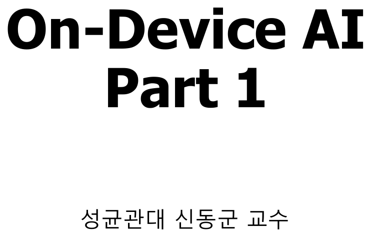

[원본 전체 내용 Crop](../assets/ODAI-1/p001-crop.png)

**이미지 읽기:** p.1은 `On-Device AI Part 1`의 표지다. 기술 설명이 있는 페이지가 아니며, 이 문서가 첫 번째 강의 자료를 설명한다는 범위를 확인한다.

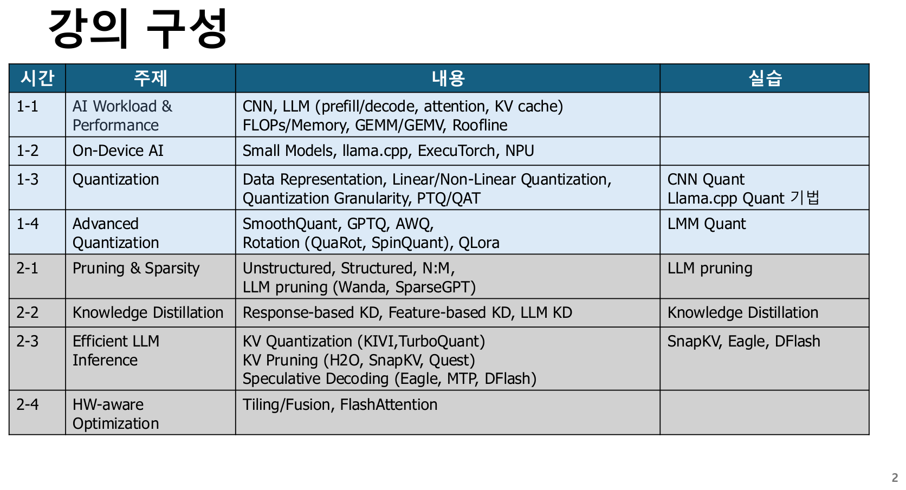

[원본 전체 내용 Crop](../assets/ODAI-1/p002-crop.png)

**이미지 읽기:** p.2의 첫날 네 항목은 연산·성능, 실행 환경, 양자화, 고급 양자화다. 둘째 날 항목은 이후 학습의 위치를 보여주는 예고로 읽는다.

**원문 요지:** 온디바이스 AI를 이해하려면 먼저 AI 연산의 특성과 하드웨어 제약을 알아야 하고, 그다음 모델 경량화와 양자화를 배운다.

**교육용 보충:** 이 문서의 학습 질문은 “얼마나 작은 모델인가?”에서 끝나지 않는다. “장치에 올라가는가?”, “사용자가 기다릴 수 있는 시간 안에 답하는가?”, “정확도를 유지하는가?”까지 이어진다. 양자화는 이 세 질문의 균형을 바꾸는 방법이다.

| 범위 | 이 PDF에서 다루는 수준 | 학습 위치 |
|---|---|---|
| AI workload·성능·메모리 | 기초 원리와 계산 | 1장 |
| 소형 모델·추론 프레임워크·NPU | 실행 환경과 구조 | 2장 |
| 양자화 표현·PTQ·QAT | 수식·오차·학습 방법 | 3–5장 |
| LLM 고급 양자화 | outlier·GPTQ·AWQ·QLoRA 등 | 6장 |
| Pruning·KD·KV 최적화·speculative decoding·FlashAttention | 강의 계획상 Part 2 예고 | 본 문서의 상세 설명 범위 밖 |

여기서 **추론(inference)**은 이미 학습된 모델로 입력의 결과를 계산하는 과정이고, **학습(training)**은 예측 오차를 줄이도록 모델 파라미터를 바꾸는 과정이다. **모델 경량화(model compression)**는 저장량·메모리 사용·연산 비용을 줄이는 기법들의 묶음이다.

## 1.2 DNN: 가중치와 활성값의 출발점 — p.3

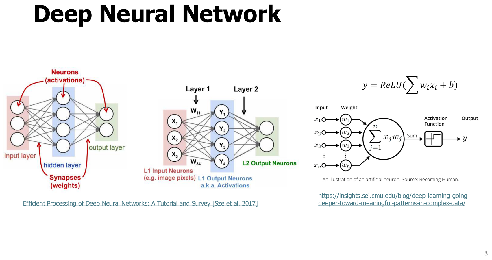

[원본 전체 내용 Crop](../assets/ODAI-1/p003-crop.png)

**이미지 읽기:** 왼쪽 네트워크에서 입력이 여러 층을 통과하는 경로를 보고, 오른쪽 뉴런에서 곱셈·합산·활성 함수가 연결되는 순서를 확인한다.

**Deep Neural Network(DNN, 심층 신경망)**는 여러 층의 계산을 연결하여 입력을 출력으로 변환하는 모델이다. 한 뉴런의 계산은 다음처럼 쓸 수 있다.

$$
z=\sum_{i=1}^{n}w_i x_i+b,\qquad y=\operatorname{ReLU}(z)=\max(0,z).
$$

`x_i`는 i번째 입력, `w_i`는 학습된 가중치, `b`는 bias(편향), `n`은 입력 개수, `z`는 비선형 함수 이전의 값, `y`는 출력이다. 값들의 물리적 단위는 모델의 표현에 따라 달라지며, 여기서는 일반적인 수치값으로 다룬다.

**Weight(가중치)**와 **bias**는 학습 후 저장되는 **parameter(파라미터)**다. **Activation(활성값)**은 특정 입력을 처리하는 동안 만들어지는 중간 결과다. 같은 모델이라도 입력 크기·배치 크기가 달라지면 활성값 메모리가 달라진다. **ReLU(Rectified Linear Unit)**는 음수를 0으로 바꾸는 비선형 함수이며, 여러 층을 단순한 하나의 선형 변환과 다르게 만든다.

**교육용 예제:** `x=[1,2]`, `w=[0.5,-1]`, `b=0.2`이면 `z=0.5×1−1×2+0.2=−1.3`, 따라서 `y=0`이다. 이 작은 연산을 수많은 뉴런과 층에서 반복하므로 가중치를 읽는 비용과 곱셈·합산 비용이 커진다.

## 1.3 CNN: 공간 정보와 feature map — p.4

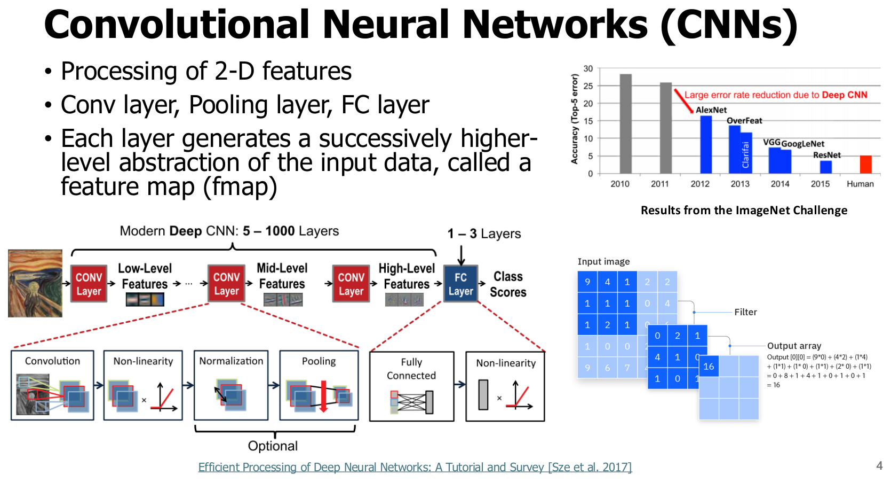

[원본 전체 내용 Crop](../assets/ODAI-1/p004-crop.png)

**이미지 읽기:** 입력 영상에서 convolution과 pooling을 거쳐 분류 결과로 가는 흐름을 따라간다. 층이 깊어질수록 feature map이 표현하는 특징이 더 복합적이 되는 점을 본다.

**Convolutional Neural Network(CNN, 합성곱 신경망)**는 이미지처럼 공간 구조를 가진 데이터를 처리하는 신경망이다. **Convolution(합성곱)**은 작은 가중치 묶음인 **kernel/filter(커널/필터)**를 공간 위치에 반복 적용하는 연산이다. 위치마다 같은 가중치를 재사용하므로 완전연결보다 파라미터를 절약할 수 있다.

| 용어 | 정의 | 메모리·연산 관점 |
|---|---|---|
| Feature map / fmap(특징맵) | 각 위치에서 검출한 특징을 채널별로 모은 활성값 | 높이·너비·채널 수가 크면 중간 메모리가 큼 |
| Channel(채널) | 같은 공간 격자에서 서로 다른 특징을 담는 축 | 입력·출력 채널 수가 합성곱 비용에 영향 |
| Pooling(풀링) | 지역의 최댓값·평균 등으로 공간 크기를 줄임 | 후속 연산과 활성값 크기를 줄일 수 있음 |
| FC / Fully Connected(완전연결층) | 각 출력이 모든 입력과 연결된 층 | 입력·출력 차원의 곱만큼 가중치 필요 |
| Stride(보폭) | 커널을 이동시키는 간격 | 출력 공간 크기를 결정 |
| Padding(패딩) | 입력 경계에 값을 추가하는 처리 | 경계 처리와 출력 크기를 결정 |
| Group convolution(그룹 합성곱) | 채널을 그룹으로 나눠 그룹 안에서 계산 | 일반 합성곱보다 연결·가중치 수 감소 |

**정정·주의:** CNN이 “항상 compute-bound”인 것은 아니다. 작은 연산, depthwise convolution, 작은 batch, 데이터 이동이 큰 구조는 메모리나 실행 오버헤드에 제한될 수 있다. p.4의 정확도 추세 그림은 모델 발전의 배경이며 현재 모델 순위로 해석하지 않는다.

## 1.4 Transformer: Attention과 토큰 — p.5

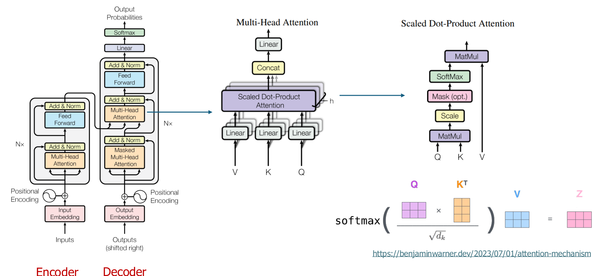

[원본 전체 내용 Crop](../assets/ODAI-1/p005-crop.png)

**이미지 읽기:** encoder·decoder 블록을 구분하고 attention에서 Q·K·V를 만든 뒤 유사도와 가중합을 계산하는 부분을 본다.

**Token(토큰)**은 모델이 처리하는 기본 단위다. 텍스트의 경우 단어 전체 또는 일부, 문자·기호 등이 될 수 있으며 “한 토큰=한 단어”로 고정되지 않는다. **Embedding(임베딩)**은 토큰을 수치 벡터로 바꾸는 표현이다. **Transformer**는 attention과 위치별 feed-forward 연산을 반복하여 토큰 간 문맥을 반영하는 모델 구조다. 원본 p.5는 encoder–decoder 구조를 보여주지만, 생성형 LLM에는 decoder-only 구조도 널리 쓰인다. Transformer의 출발 구조는 [Attention Is All You Need 원 논문](https://arxiv.org/abs/1706.03762)에서 확인할 수 있다.

**Self-attention(자기 주의)**은 같은 입력 시퀀스의 토큰 사이 관계를 계산하는 연산이다. 한 head의 기본 형태는 다음과 같다.

$$
\operatorname{Attention}(Q,K,V)=\operatorname{softmax}\left(\frac{QK^T}{\sqrt{d_k}}+M\right)V.
$$

`Q`는 query(현재 토큰이 찾는 정보), `K`는 key(각 토큰을 찾기 위한 특징), `V`는 value(실제로 모을 정보) 행렬이다. `d_k`는 key 벡터의 차원 수이며 무차원 개수다. `K^T`는 전치 행렬이다. `M`은 허용하지 않는 위치의 점수에 매우 큰 음수 등을 넣는 **mask(마스크)**다. **Softmax**는 점수를 합이 1인 가중치로 바꾸는 함수다. 생성형 decoder의 **causal mask(인과 마스크)**는 미래 토큰을 보지 못하게 한다.

**Multi-head attention(MHA, 다중 헤드 주의)**은 서로 다른 투영으로 여러 attention을 병렬 수행한다. **Head(헤드)**는 그중 하나의 attention 계산 단위다. **Feed-forward network / MLP**는 각 토큰의 특징 차원을 확장·변환하는 신경망 부분이다. **Layer normalization(층 정규화)**은 활성값의 크기를 정돈하는 연산이고, **residual connection(잔차 연결)**은 블록의 입력을 출력에 더해 정보와 학습 신호가 흐르도록 한다.

**Positional encoding/embedding(위치 표현)**은 토큰 순서를 모델이 구별하도록 위치 정보를 반영하는 장치다. attention 식 자체만으로는 토큰 순서를 충분히 표현하지 못하기 때문에 필요하다. 모델에 따라 위치 벡터를 더하거나 Q·K에 회전 형태로 반영하는 등 구현이 다르다. 위 식은 한 head에서 query 토큰 수가 `S_Q`, key 토큰 수가 `S_K`일 때 `Q∈R^(S_Q×d_k)`, `K∈R^(S_K×d_k)`, `V∈R^(S_K×d_v)`, 출력은 `S_Q×d_v`다. `d_v`는 value 차원이고, prefill의 self-attention에서는 보통 `S_Q=S_K`, 한 토큰 decode에서는 `S_Q=1`이다.

**교육용 보충:** attention만이 LLM 연산의 전부는 아니다. Q/K/V 투영과 MLP의 큰 행렬곱도 중요하다. 따라서 “attention 최적화”와 “전체 LLM 최적화”를 같은 뜻으로 사용하지 않는다.

**가중치와 활성값 연결:** 입력 활성값을 $X$라 하면 $Q=XW_Q$, $K=XW_K$, $V=XW_V$로 만든다. $W_Q,W_K,W_V$는 학습 후 저장하는 투영 가중치이고, $Q,K,V$는 입력마다 달라지는 활성값이다. 따라서 가중치 양자화와 KV cache 양자화는 서로 다른 텐서를 대상으로 한다.

## 1.5 Prefill과 Decode: 같은 모델의 서로 다른 작업 — p.6

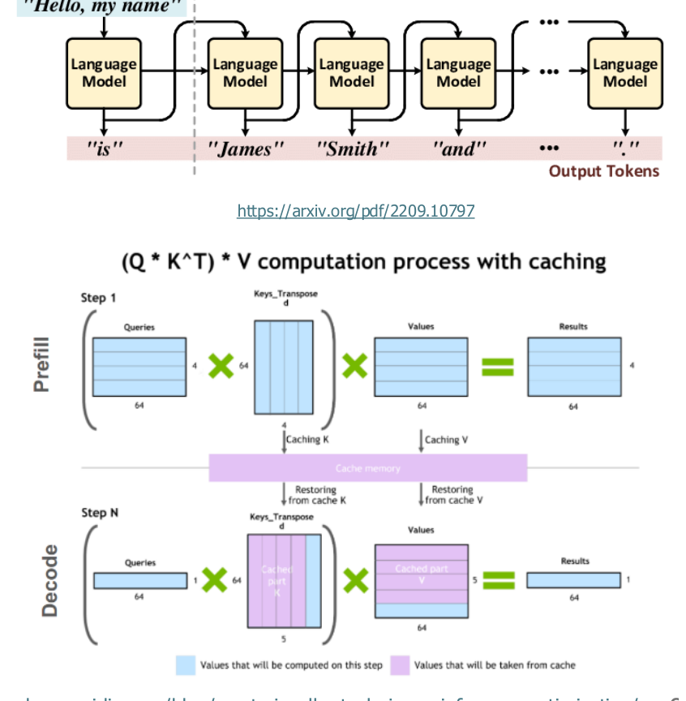

[원본 전체 내용 Crop](../assets/ODAI-1/p006-crop.png)

**이미지 읽기:** prompt를 한 번에 처리하는 단계와 이후 토큰을 하나씩 만드는 단계를 구분한다. 캐시를 쓰는 그림에서는 과거 토큰의 K·V를 다시 만드는 대신 저장한 값을 읽는 부분을 본다.

**Prefill(입력 처리 단계)**은 prompt의 여러 토큰을 처리하여 은닉 상태와 K·V를 만드는 단계다. **Decode(생성 단계)**는 이미 처리한 문맥을 이용해 다음 토큰을 반복 생성하는 단계다. **Autoregressive generation(자기회귀 생성)**은 지금 생성한 토큰을 다음 계산의 입력에 포함하는 방식이다. **KV cache**는 각 층의 과거 토큰 K·V를 보관하여 재계산을 피하는 메모리다. Q는 현재 위치에서 새로 만들므로 과거 모든 Q를 같은 방식으로 저장할 필요가 없다.

| 비교축 | Prefill | Decode |
|---|---|---|
| 처리 단위 | prompt의 여러 토큰 | 보통 요청마다 새 토큰 1개/반복 |
| 대표 선형 연산 | 여러 토큰의 GEMM | batch=1에서는 GEMV와 유사한 작은 행렬곱 |
| 가중치 재사용 | 많은 토큰이 같은 가중치를 사용 | 작은 batch에서는 재사용이 낮음 |
| KV cache 동작 | prompt K·V를 생성·저장 | 과거 K·V를 읽고 새 K·V를 추가 |
| 흔한 병목 | 비교적 높은 연산 집약도, 긴 prompt의 attention | 가중치·KV 읽기 대역폭, 순차 의존성 |
| 사용자 지표 | 첫 토큰까지 시간 | 다음 토큰 간 지연·생성 속도 |

**GEMM(General Matrix–Matrix Multiplication)**은 행렬–행렬 곱, **GEMV(General Matrix–Vector Multiplication)**는 행렬–벡터 곱이다. `Y=XW`에서 `X`에 토큰 행이 많이 있으면 GEMM으로 가중치 재사용을 높일 수 있다. 요청당 새 토큰이 하나이고 batch도 1이면 `X`의 행 수가 작아 GEMV에 가까워진다.

**교육용 보충:** **Batch(배치)**는 함께 처리하는 입력 묶음이다. 요청을 묶으면 가중치를 여러 입력에 재사용하여 처리량을 높일 수 있지만, 대기시간과 KV 메모리도 커질 수 있다. **Throughput(처리량)**은 단위 시간의 처리량, **latency(지연시간)**는 한 요청이 기다리는 시간이다. **TTFT(Time To First Token)**는 요청부터 첫 토큰까지 시간, **TPOT(Time Per Output Token)**는 출력 토큰당 시간이다. 토큰화·대기열·샘플링·전송 등을 포함하는지에 따라 측정값이 달라지므로 측정 범위를 명시해야 한다.

**정정·주의:** p.6의 “prefill=GEMM, decode=GEMV”는 대표 선형층을 이해하기 위한 요약이다. 두 단계 모두 여러 종류의 연산을 포함하며, 큰 batch·긴 문맥·특정 하드웨어에서는 병목이 달라진다.

흐름을 복습할 때는 [추론 단계 Canvas](../assets/ODAI-1/inference-flow.canvas)를 함께 본다. [SVG 미리보기](../assets/ODAI-1/inference-flow.svg)는 Canvas를 열지 않고 읽는 용도다.

**단계 경계 보충:** 일반적인 자기회귀 생성에서는 prefill의 마지막 위치 출력으로 첫 생성 토큰을 선택한다. 그 토큰을 입력으로 이후 decode를 반복해 두 번째 이후의 생성 토큰을 만든다. 따라서 TTFT와 이후 토큰 간 지연을 구분한다.

## 1.6 LLM과 VLM을 보는 방법 — p.7–8

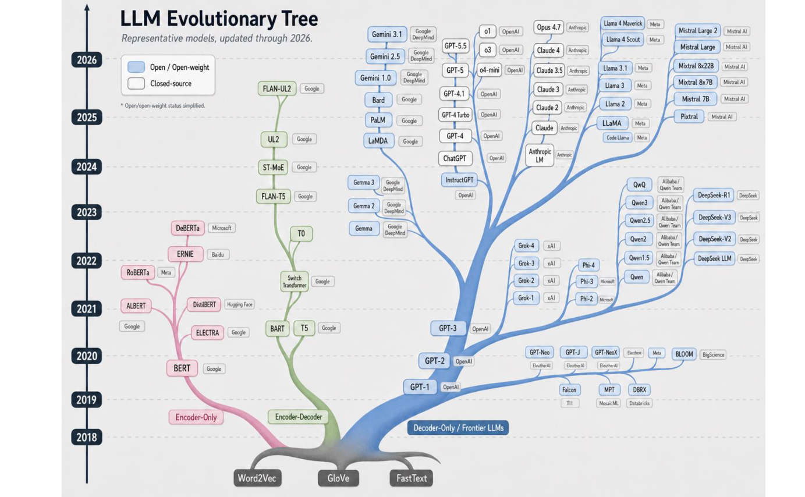

[원본 전체 내용 Crop](../assets/ODAI-1/p007-crop.png)

**이미지 읽기:** p.7은 모델 이름을 암기하기 위한 표가 아니라 LLM 계열이 여러 갈래로 발전했음을 보여주는 계보 지도다. 현재의 전체 모델 목록이나 성능 순위로 읽지 않는다.

**Large Language Model(LLM, 대규모 언어 모델)**은 많은 텍스트 등으로 학습하여 언어 패턴을 모델링하는 큰 신경망이다. 생성형 언어 모델은 문맥 다음에 올 토큰의 확률 분포를 계산하고, **sampling(샘플링)**이나 선택 규칙으로 다음 토큰을 정한다. **Pretraining(사전학습)**은 광범위한 데이터로 기본 표현을 학습하는 과정, **fine-tuning(미세조정)**은 특정 목적·데이터에 맞게 추가 학습하는 과정이다. **Instruction tuning(지시 미세조정)**은 사용자 지시와 응답 예제로 지시 수행 능력을 학습하는 방식이다.

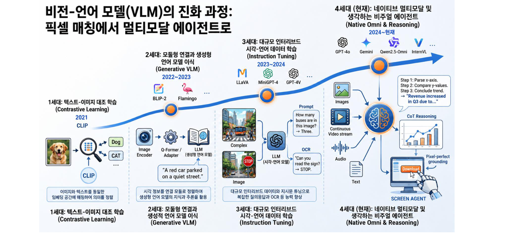

[원본 전체 내용 Crop](../assets/ODAI-1/p008-crop.png)

**이미지 읽기:** p.8은 텍스트–이미지 대조학습, 시각 인코더와 언어 모델의 연결, 지시 학습, 멀티모달 처리로 이어지는 흐름을 요약한다. 그림의 “현재”는 원본 제작 시점의 표현이다.

**Vision Language Model(VLM, 시각–언어 모델)**은 이미지와 언어를 함께 처리하는 모델이다. **Multimodal(멀티모달)**은 텍스트·이미지·음성 등 여러 입력/출력 형태를 다룬다는 뜻이다. **Image encoder(이미지 인코더)**는 이미지를 특징 벡터로 바꾸고, **projector/adapter(투영기/어댑터)**는 그 특징을 언어 모델이 사용할 표현으로 연결한다. **Contrastive learning(대조학습)**은 관련된 이미지–문장 표현을 가깝게, 무관한 쌍을 멀게 학습하는 방식이다. **OCR(Optical Character Recognition)**은 이미지 안의 글자를 읽는 작업이다.

**교육용 보충:** 이미지를 넣으면 시각 인코더·연결 모듈의 가중치와 활성값이 추가되고, 이미지가 많은 시각 토큰으로 바뀌면 이후 LLM의 prefill과 KV 비용도 커질 수 있다. 따라서 텍스트 LLM의 가중치 용량만으로 VLM의 실행 가능 여부를 판단할 수 없다. 세대 구분과 연도는 그림의 교육적 요약이며 모든 VLM을 엄밀히 나누는 표준 분류는 아니다.

## 1.7 Cloud AI와 On-Device AI — p.9

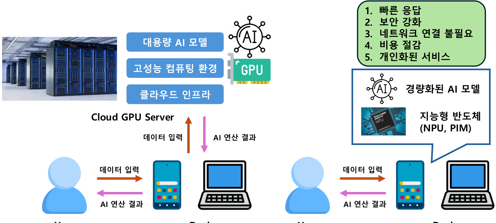

[원본 전체 내용 Crop](../assets/ODAI-1/p009-crop.png)

**이미지 읽기:** cloud 경로는 장치에서 서버로 입력과 결과를 주고받고, on-device 경로는 장치 안에서 연산한다. 화살표가 네트워크를 거치는지 먼저 확인한다.

**Cloud AI**는 서버 인프라에서 주요 AI 연산을 실행하는 방식이고, **On-Device AI**는 사용자 장치나 현장 장치에서 주요 AI 연산을 수행하는 방식이다. **Edge AI**는 데이터 발생 지점 가까이에서 처리하는 더 넓은 개념으로, 개별 장치 외의 가까운 게이트웨이도 포함할 수 있다.

| 비교축 | Cloud AI | On-Device AI |
|---|---|---|
| 자원 | 큰 모델과 서버 가속기 활용 가능 | 장치 메모리·전력·발열 제약 |
| 응답시간 | 네트워크·서버 대기의 영향 | 통신 지연을 줄일 수 있으나 장치 계산 성능에 의존 |
| 데이터 이동 | 서버 전송 경로 설계 필요 | 원시 데이터를 로컬에 유지하도록 설계 가능 |
| 오프라인 | 서버 연결이 필요한 기능은 제한 | 모델·필수 리소스가 로컬에 있으면 가능 |
| 비용 | 서버·네트워크·운영 비용 | 장치 자원·배터리·배포 비용 |
| 모델 갱신 | 중앙 관리가 비교적 용이 | 장치별 버전·호환성 관리 필요 |

**정정·주의:** 원문의 빠른 응답·보안 강화·비용 절감은 가능한 이점이지 자동 보장되는 결과가 아니다. 로컬 실행이어도 로그·동기화·업데이트 경로에 따라 데이터가 전송될 수 있다. 모델 다운로드나 외부 도구 호출이 필요하면 기능 전체가 오프라인인 것도 아니다.

## 1.8 메모리에 들어가는가: 가중치 저장 용량 — p.10

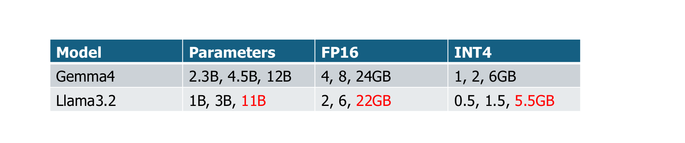

[원본 전체 내용 Crop](../assets/ODAI-1/p010-crop.png)

**이미지 읽기:** 모델 파라미터 수, FP16·INT4 저장량, 장치 RAM을 나란히 비교한다. 장치 전체 RAM이 모델 전용 공간은 아니라는 점을 함께 생각한다.

**RAM(Random Access Memory)**은 실행 중 데이터를 담는 메모리다. 파라미터가 `N`개이고 각 파라미터의 저장 비트 수가 `b`라면, 부가 정보가 없는 가중치 저장량은 다음과 같다.

$$
M_W=N\frac{b}{8}\quad\text{bytes}.
$$

예를 들어 30억(`3×10^9`) 개를 FP16(16-bit)으로 저장하면 `6×10^9 bytes=6 GB≈5.59 GiB`, INT4(4-bit)로 저장하면 `1.5 GB≈1.40 GiB`다. **FP16**은 16-bit 부동소수점, **INT4**는 4-bit 정수 표현이다. 양자화 모델에는 scale·zero point·block 정보 등이 추가되므로 실파일은 이 이론값과 다를 수 있다.

**정정·주의:** p.10의 모델명·기기명·RAM은 강의 원문 예시이며 최신 제품 사양 확인표가 아니다. 특히 원문에서 2.3B·4.5B라 적은 항목은 단순 계산하면 FP16이 각각 **4.6·9.0 GB**, INT4가 **1.15·2.25 GB**다. 원문의 4·8 GB, 1·2 GB를 정확한 계산값으로 재사용하지 않는다. 모델의 활성 파라미터 수와 전체 저장 파라미터 수가 다르면 저장량에는 전체 저장 대상을 사용해야 한다.

장치 실행 예산은 적어도 다음 항목을 함께 잡는다.

$$
M_{\text{run,peak}}\approx M_W+M_{KV}+M_{\text{live act}}+M_{\text{workspace}}+M_{\text{runtime}}.
$$

`M_run,peak`는 실행 중 최대 메모리, `M_KV`는 KV cache, `M_live act`는 동시에 살아 있는 활성값, `M_workspace`는 커널의 임시 작업 공간, `M_runtime`은 실행기 관리 공간이다. 실제 메모리 공유·할당 시점에 따라 합산은 달라지므로 계획용 근사다. OS·다른 앱의 메모리는 장치 전체 RAM에서 별도로 빼야 한다.

## 1.9 Roofline: 연산량과 데이터 이동을 함께 보기 — p.11

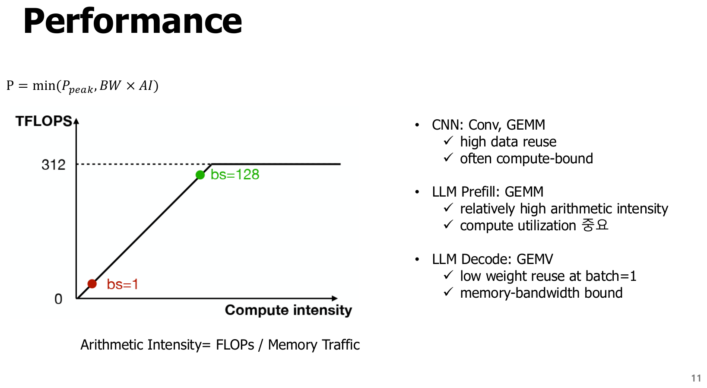

[원본 전체 내용 Crop](../assets/ODAI-1/p011-crop.png)

**이미지 읽기:** 가로축이 커질 때 성능 상한이 기울어진 선을 따라 오르다가 수평선에 제한되는 지점을 본다. decode와 prefill이 놓이는 위치 차이가 중요하다.

**Arithmetic intensity(AI, 연산 집약도)**는 메모리에서 옮긴 1 byte당 수행하는 연산 수다. 이 절의 AI는 인공지능의 약자와 다르다.

$$
AI=\frac{F}{T}\quad[\mathrm{FLOPs/byte}],\qquad
P\leq\min(P_{\text{peak}},BW\cdot AI).
$$

`F`는 작업의 부동소수점 연산 수(FLOPs), `T`는 **선택한 메모리 계층에서 실제 이동한 bytes**, `P`는 달성 성능(FLOP/s), `P_peak`는 해당 자료형의 연산 성능 상한(FLOP/s), `BW`는 해당 계층의 대역폭(bytes/s)이다. **Bandwidth(대역폭)**는 단위 시간에 옮길 수 있는 데이터 양이다. **Roofline model**은 연산 상한과 데이터 이동 상한 중 낮은 쪽으로 성능을 제한하는 모델이다. 원본의 등식은 이상적 상한을 나타내며 실제 성능은 스케줄링·의존성·커널 효율 때문에 더 낮을 수 있다.

| 병목 | 의미 | 우선 생각할 방법 |
|---|---|---|
| Compute-bound | 연산 처리 능력이 주로 제한 | 효율적 커널, 병렬화, 가속기가 지원하는 저정밀 연산 |
| Memory-bandwidth-bound | 데이터를 옮기는 속도가 주로 제한 | 가중치·KV 압축, 재사용, fusion, 메모리 배치 |
| Capacity-limited | 필요한 데이터를 장치 메모리에 담지 못함 | 모델 축소, 양자화, 문맥·batch 조정, offload |

**교육용 계산:** 가상의 장치에서 `P_peak=10 TFLOP/s`, `BW=100 GB/s`라고 하자. `AI=10 FLOPs/byte`이면 `BW×AI=1 TFLOP/s`, 따라서 상한은 1 TFLOP/s다. `AI=200`이면 대역폭 상한이 20 TFLOP/s라 연산 상한 10 TFLOP/s에 제한된다. `Tera=10^12`다. 실제 장치 성능을 예측한 실측값은 아니다.

작은 batch의 decode는 가중치를 적은 연산에 재사용하므로 AI가 낮아지기 쉽다. 양자화로 가중치 이동 bytes를 줄이면 이 경우 연산기 최고 FLOP/s가 같아도 빨라질 수 있다. 반대로 dequantization 비용이나 지원되지 않는 커널 때문에 이점이 작아질 수 있다.

## 1.10 파라미터·활성값·MACs 계산 — p.12

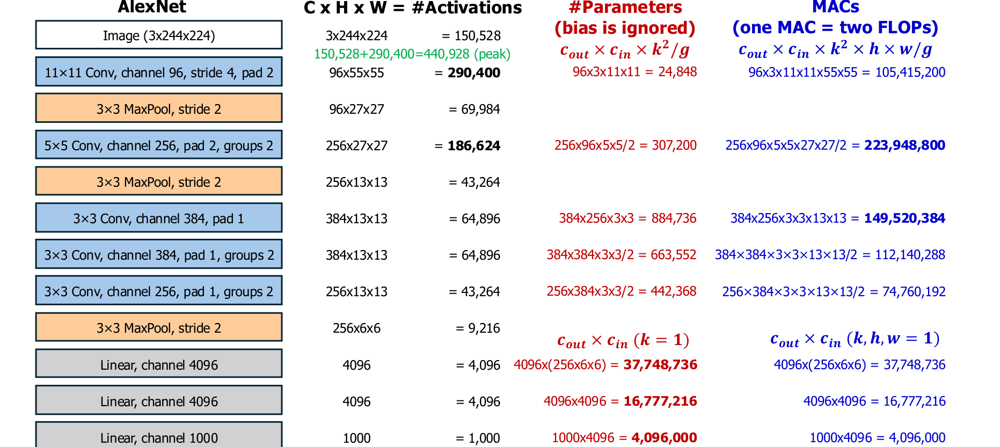

[원본 전체 내용 Crop](../assets/ODAI-1/p012-crop.png)

**이미지 읽기:** 파란색 활성값, 빨간색 가중치, 오른쪽 MACs 열을 따로 읽는다. 같은 층이라도 세 열의 크기가 서로 다른 이유를 확인한다. 원본의 수치 오기는 아래 정정표와 함께 읽는다.

**MAC(Multiply–Accumulate)**은 곱셈한 값을 누산하는 연산이다. 부동소수점 계산에서 이 강의의 관례는 **1 MAC=곱셈 1회+덧셈 1회=2 FLOPs**다. **FLOPs**는 부동소수점 연산 개수이고 **FLOP/s**는 초당 연산 성능이므로 구별한다. 정수 MAC도 두 연산으로 셀 수 있지만 부동소수점 FLOP는 아니다. 벤더의 TOPS는 정수 자료형·희소성·MAC 계수 등의 산정 조건을 함께 확인한다.

정사각 커널의 2D convolution에서 bias를 제외하면 다음과 같다.

$$
N_W=C_{out}(C_{in}/g)k^2,\quad
N_A=C_{out}H_{out}W_{out},\quad
N_{MAC}=N_WH_{out}W_{out}.
$$

`C_in`, `C_out`은 입력·출력 채널 수, `g`는 그룹 수, `k`는 커널 한 변의 길이, `H_out`, `W_out`은 출력 높이·너비다. 개수는 모두 무차원 정수다. batch `B_batch`개를 처리하는 경우 활성값과 MACs는 그 배수이며 파라미터 수는 변하지 않는다. 완전연결층은 `N_W=D_in×D_out`, 한 샘플의 `N_MAC=N_W`다. dilation이 1인 합성곱의 공간 크기는 한 축에 대해 `H_out=floor((H_in+2p−k)/s)+1`이며, `p`는 padding, `s`는 stride다.

**검산 예제:** 원문의 첫 convolution을 입력 `3×224×224`, `k=11`, stride 4, padding 2, 출력 96채널로 읽으면 출력 한 변은 `floor((224+4−11)/4)+1=55`다. 가중치는 `96×3×11×11=34,848`개, 활성값은 `96×55×55=290,400`개, MACs는 `34,848×55×55=105,415,200`이다.

| 원본 p.12 항목 | 검산 결과 | 해석 |
|---|---|---|
| 입력 `3×244×224`, 활성값 150,528 | `3×224×224=150,528` | 표의 다른 수치와 맞추려면 224×224로 읽어야 함. 244라면 첫 출력 높이는 60이며 원본 출력 55와 불일치 |
| 첫 convolution 가중치 `24,848` | **34,848** | 곱셈 결과 오기 |
| 가중치 합계 약 61M, `224MB` | **60,954,656개**, FP32 **243,818,624 bytes=243.82 MB≈232.52 MiB** | 원본에 표시된 8개 가중치 층을 bias 없이 직접 합산한 값 |
| 활성값 전체 932,264 | **932,264개**, FP32 **3,729,056 bytes≈3.73 MB** | 입력·각 층 출력을 모두 합한 값. 동시 사용 peak는 아님 |
| 입력+첫 convolution의 peak 예시 | **440,928개**, FP32 **1,763,712 bytes≈1.76 MB** | 중간 버퍼 재사용을 가정한 단순 예시. workspace와 전체 실행기 메모리는 제외 |
| MACs 합계 약 724M | **724,406,816 MACs**, 약 **1.449 GFLOPs** | 원본 가중치 층의 곱셈·누산만 합산. pooling 등은 별도 |

위 합계는 슬라이드에 제시된 층·출력 크기의 계산을 재현한 것이며, 모든 AlexNet 구현의 정확한 수치가 같다는 뜻은 아니다. bias·padding·전처리·구현 선택에 따라 달라진다.

**교육용 보충:** 완전연결층은 파라미터 수가 매우 커도 공간 위치마다 반복하지 않으므로 MACs가 convolution보다 작을 수 있다. 파라미터 수만 보고 연산 시간 순서를 판단하지 않는다.

## 1.11 작은 모델과 작은 peak memory는 다르다 — p.13–14

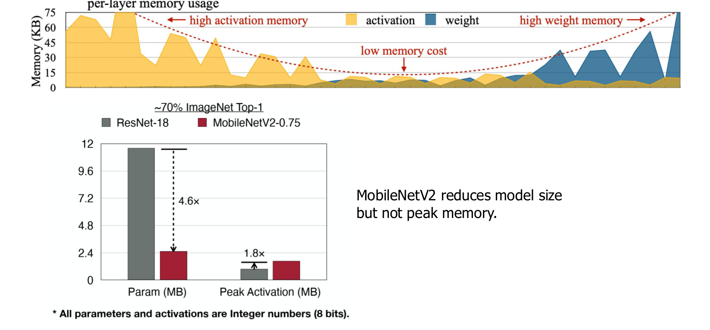

[원본 전체 내용 Crop](../assets/ODAI-1/p013-crop.png)

**이미지 읽기:** p.13의 가중치 저장량 막대와 peak activation 막대를 따로 비교한다. 연산층별 그림에서는 중간 feature map이 커지는 위치를 확인한다.

**Peak memory(최대 메모리 사용량)**는 실행 중 어느 순간에 가장 많은 메모리가 사용되는지 나타낸다. 활성값 전체 합과 다르며, 중간 버퍼의 **lifetime(생존 기간)**이 겹치는지에 따라 달라진다. **Buffer reuse(버퍼 재사용)**는 더 이상 필요 없는 활성값 공간을 다음 연산에 다시 쓰는 기법이다. **Workspace(작업 공간)**는 연산 구현이 임시로 확보하는 공간이다.

**원문 요지:** MobileNetV2처럼 가중치가 작은 모델도 중간 활성값 때문에 peak memory가 기대만큼 작지 않을 수 있다. 슬라이드의 특정 비교 결과를 모든 입력 해상도와 구현에 일반화하지 않는다.

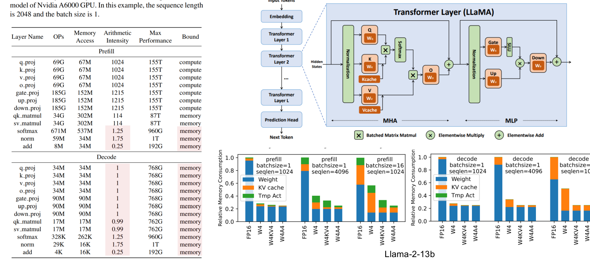

[원본 전체 내용 Crop](../assets/ODAI-1/p014-crop.png)

**이미지 읽기:** p.14 왼쪽 표는 Llama-2-7B, NVIDIA A6000, sequence length=2048, batch=1이라는 특정 조건의 연산별 Roofline 분석이다. 오른쪽 아래 막대는 Llama-2-13B의 상대 메모리 소비 예시다. 두 영역을 같은 모델·같은 측정 조건으로 합쳐 읽지 않는다. 파란색 weight, 주황색 KV cache, 초록색 임시 활성값을 구분하고, batch나 시퀀스 길이가 바뀔 때 어떤 부분이 커지는지를 본다.

막대의 `W4`는 가중치 4-bit, `A4`는 활성값 4-bit, `KV4`는 KV cache 4-bit를 나타낸다. `W4`만 적용한 경우 줄지 않은 KV·활성값의 상대적 비중이 커질 수 있다. 이 표기는 저장·연산 정책의 요약이며 어떤 연산까지 4-bit로 실행되는지는 개별 구현을 확인해야 한다. 왼쪽 표에서도 prefill의 큰 선형층은 compute로, softmax·norm·add는 memory로 표시된다. 같은 단계 안에서도 연산별 병목이 다를 수 있다는 예다.

**교육용 보충:** LLM의 가중치는 같은 모델이면 요청 길이와 무관하게 거의 고정이지만 KV cache는 batch와 문맥 길이에 따라 증가한다. attention score를 큰 행렬로 물질화하는 구현과 메모리 효율적인 구현도 임시 메모리가 다르다. 최종 파일 크기, 로드 직후 메모리, 긴 요청 처리 중 peak를 구분하여 측정해야 한다.

## 1.12 KV cache 일반식과 MHA·MQA·GQA — p.15

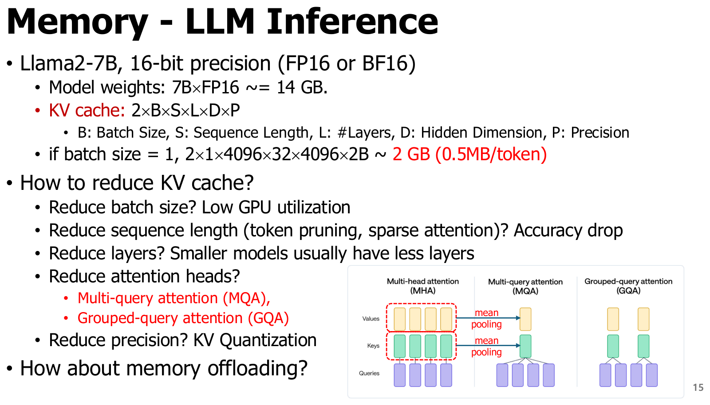

[원본 전체 내용 Crop](../assets/ODAI-1/p015-crop.png)

**이미지 읽기:** 원본 식의 `2`는 K와 V 두 종류를 뜻한다. 아래 head 그림은 query head 수와 KV head 수를 구분해서 읽는다. mean pooling 화살표는 변환 아이디어를 보여주며 임의 모델을 무손실로 바꾸는 보장으로 해석하지 않는다.

모든 층이 같은 attention 크기를 갖고 전체 문맥을 저장한다고 가정하면 KV cache의 데이터 저장량은 다음과 같다.

$$
M_{KV}=2\,B_{batch}\,S\,L\,H_{KV}\,d_h\,p\quad[\mathrm{bytes}].
$$

| 기호 | 정의 | 단위 |
|---|---|---|
| `B_batch` | 함께 저장하는 요청/시퀀스 수 | 개 |
| `S` | 요청마다 캐시에 보관한 토큰 수 | tokens |
| `L` | attention 층 수 | layers |
| `H_KV` | 각 층의 K/V head 수 | heads |
| `d_h` | 각 head의 벡터 차원 | elements/head |
| `p` | K 또는 V 원소당 저장 bytes, FP16이면 2 | bytes/element |
| `2` | K와 V 두 텐서 | 무차원 |

원본의 `2×B×S×L×D×P`는 MHA에서 `H_KV×d_h=D`(hidden dimension, 은닉 차원)이고 `P`를 bits가 아닌 **bytes/element**로 쓸 때 성립한다. GQA·MQA에 hidden dimension을 그대로 넣으면 과대 계산한다. 요청 길이가 서로 다르면 `B_batch×S` 대신 각 요청의 저장 토큰 수의 합을 써야 한다. padding·paged cache의 빈 공간·메타데이터 등은 이 단순식에 포함하지 않는다.

**검산 예제:** 원본의 Llama2-7B형 MHA 가정을 따라 batch=1, S=4096, L=32, H_KV=32, d_h=128, FP16=2 bytes라 하자.

$$
M_{KV}=2\times1\times4096\times32\times32\times128\times2
=2,147,483,648\ \mathrm{bytes}=2\ \mathrm{GiB}\approx2.147\ \mathrm{GB}.
$$

토큰 하나당 증가량은 `524,288 bytes=0.5 MiB≈0.524 MB`다. 원본의 “약 2 GB, 0.5 MB/token”은 이진 단위를 느슨하게 쓴 표현이다. `7×10^9` 가중치의 FP16 저장량 근사 14 GB에 이 KV 2.147 GB를 더하면 벌써 약 16.147 GB이고 활성값·workspace·OS는 아직 제외다. INT4 가중치의 이론값 3.5 GB를 사용해도 KV는 별도로 줄이지 않는 한 그대로 남는다.

| 구조 | Query head 수 | KV head 수 | 캐시 크기 관계(다른 조건 동일) | 고려점 |
|---|---|---|---|---|
| MHA | `H_Q` | `H_Q` | 기준 1 | head마다 별도 K/V |
| GQA(Grouped-Query Attention) | `H_Q` | `1 < H_KV < H_Q` | `H_KV/H_Q` | 여러 Q head가 한 KV head를 공유 |
| MQA(Multi-Query Attention) | `H_Q` | 1 | `1/H_Q` | 가장 많은 KV 공유 |

예를 들어 32개 query head에 KV head를 8개 쓰는 GQA는 동일 조건의 MHA 대비 KV 데이터량이 1/4이다. 이 구조 구분은 [GQA 원 논문](https://arxiv.org/abs/2305.13245)과 일치한다. 단, 이미 학습된 MHA의 head 수를 추론 설정만으로 줄여 같은 정확도를 얻을 수 있다는 뜻은 아니다.

### KV를 줄이는 방법과 대가

| 방법 | 줄어드는 항목 | 대가·전제 |
|---|---|---|
| Batch 축소 | `B_batch` | 서버 처리량·활용률 감소 가능 |
| 문맥 제한·token pruning | `S` | 필요한 정보를 잃을 수 있음 |
| 더 작은 모델 | `L`, head 수·차원 등 | 과제 품질을 재평가해야 함 |
| GQA·MQA 구조 | `H_KV` | 모델 구조·학습과 연동 |
| KV quantization | `p` | 복원·scale 비용과 정확도 변화 |
| Offloading(외부 메모리 이동) | 장치에 상주한 양 | 전송 대역폭과 지연, 전체 데이터량 자체는 남음 |

**교육용 보충:** **Offloading**은 데이터를 CPU 메모리·다른 저장 계층으로 옮겨 장치의 상주 메모리를 줄이는 방법이다. 압축과 달리 데이터 자체가 줄어드는 것은 아니다. 언제 어떤 데이터를 읽는지까지 고려해야 한다.

## 장 요약과 흔한 오해

- 파라미터는 모델에 저장되고 활성값은 입력 처리 중 생성된다. 가중치 저장량만으로 실행 peak를 알 수 없다.
- Prefill과 decode는 같은 LLM이 수행하지만 batch·토큰 병렬성·가중치 재사용이 다르다.
- FLOPs가 같아도 메모리 이동량·커널 구현이 다르면 지연시간이 다르다. Roofline은 이 차이를 보는 출발점이다.
- KV cache는 보관 토큰 수·batch·층 수·**KV head 수**·저장 정밀도에 비례한다.

| 흔한 오해 | 바로잡기 |
|---|---|
| “4-bit 모델은 FP16보다 무조건 4배 빠르다.” | 가중치 원소당 저장량이 1/4이라는 뜻이다. 전체 메모리·실행 시간 비율은 다르다. |
| “LLM은 언제나 memory-bound다.” | 작은 batch의 decode에서 흔한 경향이다. prefill·큰 batch·긴 문맥은 다시 분석해야 한다. |
| “작은 파라미터 수면 peak memory도 작다.” | 활성값·KV·workspace·버퍼 생존 기간을 함께 봐야 한다. |
| “KV cache의 D는 모든 모델의 hidden dimension이다.” | MHA의 간단식에서만 그렇다. 일반식은 `H_KV×d_h`를 쓴다. |

## 복습 질문과 해설

1. **3B 가중치를 FP16과 INT4로 저장하면 부가 정보 제외 용량은?** 6 GB와 1.5 GB다. 실제 파일은 metadata 때문에 달라지고 실행 메모리에는 다른 항목이 더해진다.
2. **batch=1 decode에서 FLOPs를 줄이지 않고도 빨라질 수 있는가?** 가능하다. 가중치·KV의 데이터 이동량을 줄이거나 재사용을 높여 메모리 병목을 완화할 수 있다. 단 복원 비용을 포함해 실측해야 한다.
3. **batch·문맥 길이를 각각 2배로 하면 KV cache는?** 같은 구조·정밀도이면 4배다. 가중치 저장량은 변하지 않는다.
4. **MHA 32 KV heads를 GQA 8 KV heads로 설계하면 캐시의 이론 비율은?** 1/4이다. 임의의 기존 모델을 설정만 바꿔 동일 품질로 전환한다는 뜻은 아니다.
5. **p.12의 활성값 합계 3.73 MB가 peak인가?** 아니다. 모든 층 출력을 합한 수치다. 동시에 유지되는 텐서와 workspace를 따로 분석해야 한다.
6. **10 TFLOP/s 장치, 100 GB/s, AI=10에서 이상적 상한은?** `100×10^9×10=10^12 FLOP/s`, 즉 1 TFLOP/s다.

## 다음 장으로

병목과 예산을 알았으면 이를 실제 장치에서 실행할 수 있게 하는 도구가 필요하다. [2장 실행 환경](ODAI-1_02_실행환경.md)에서는 모델, 추론 프레임워크, 하드웨어의 역할을 분리하고 llama.cpp·ExecuTorch·NPU를 살펴본다.
