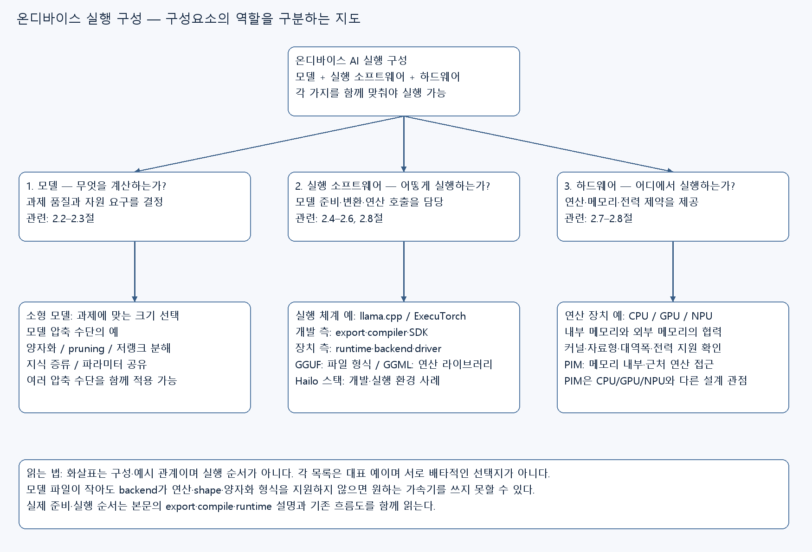
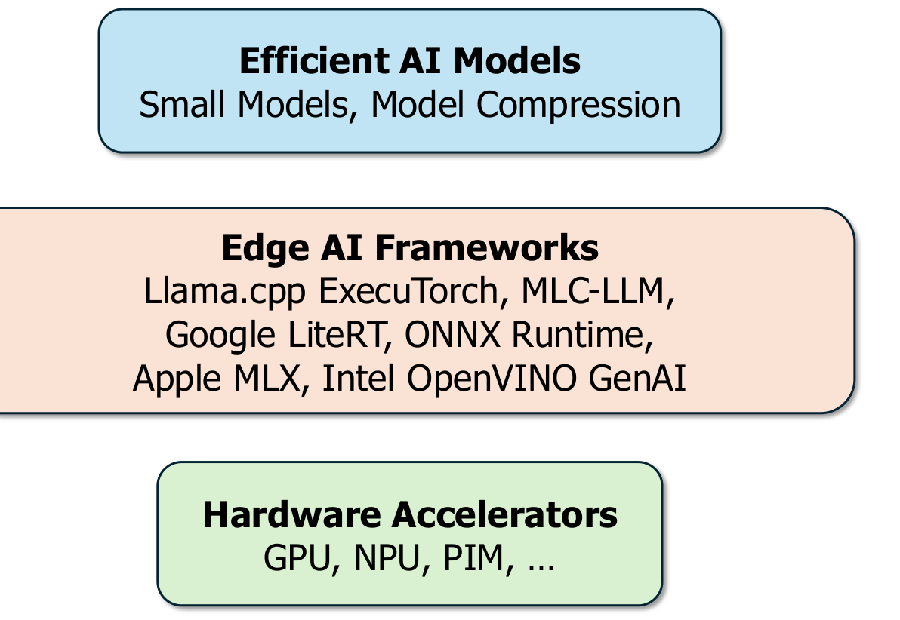
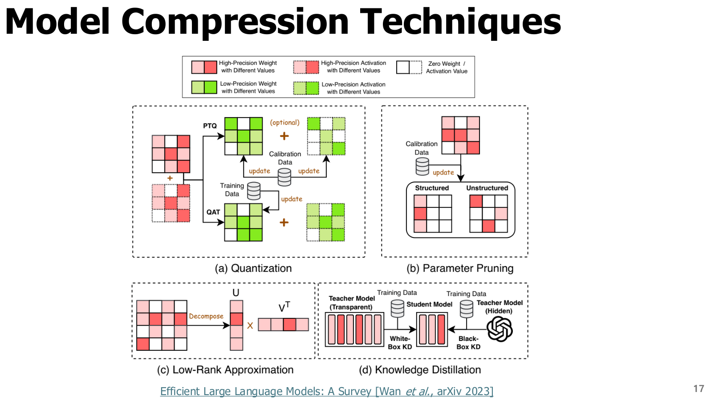
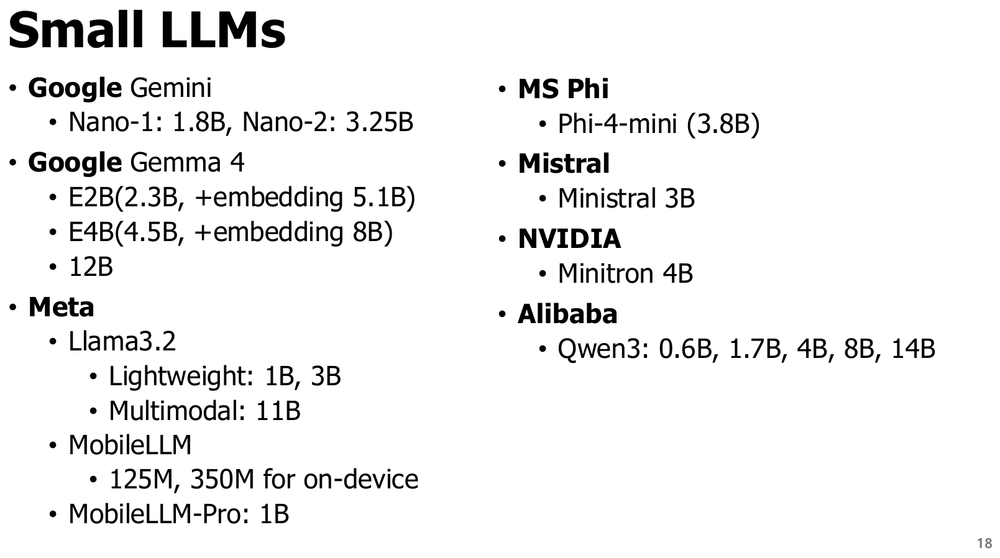
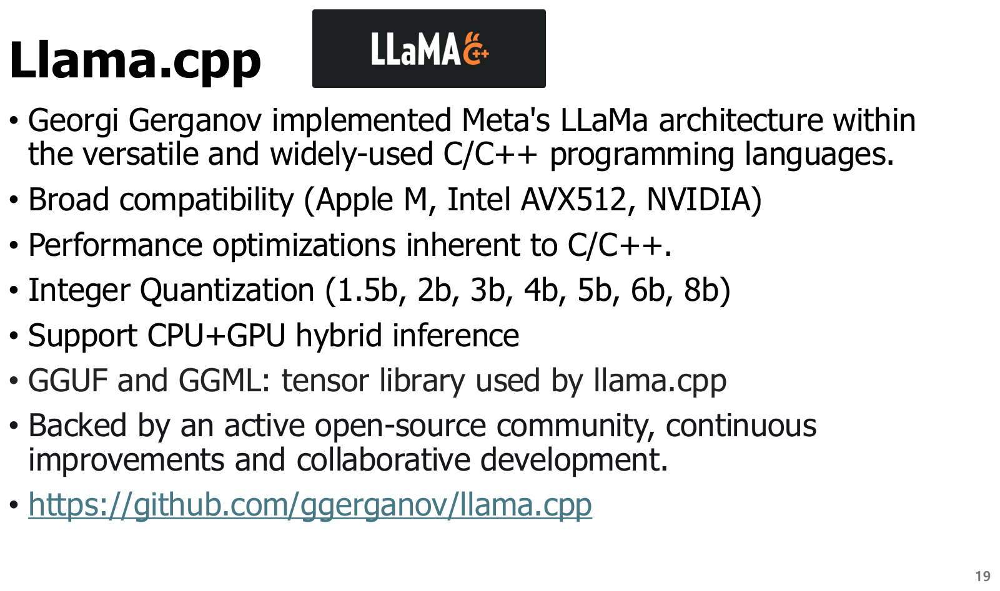
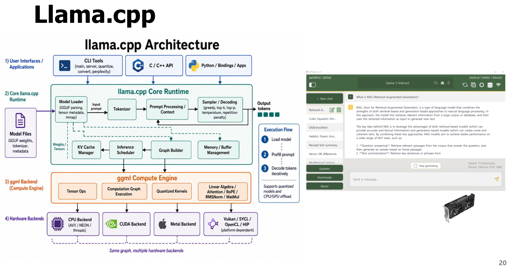
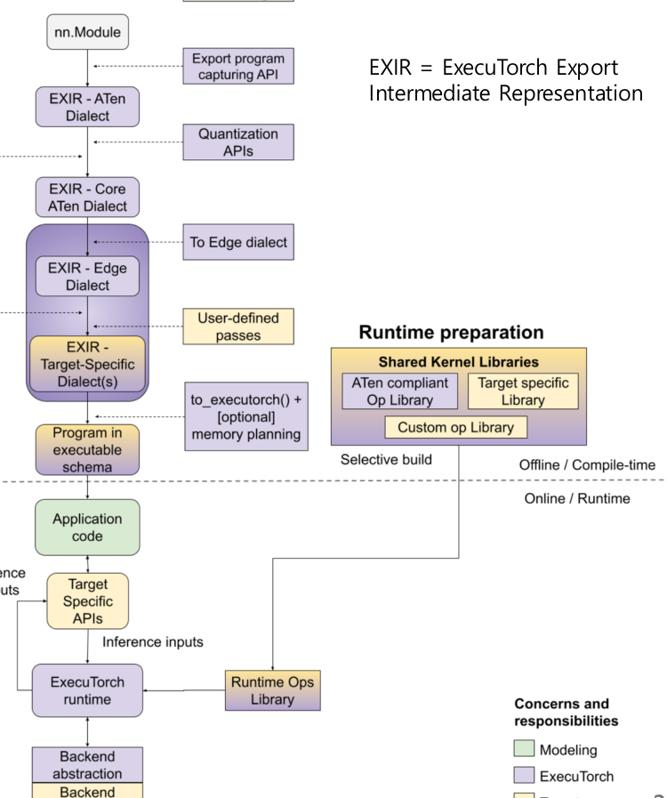
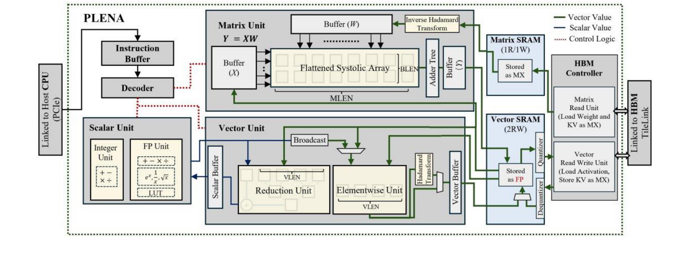
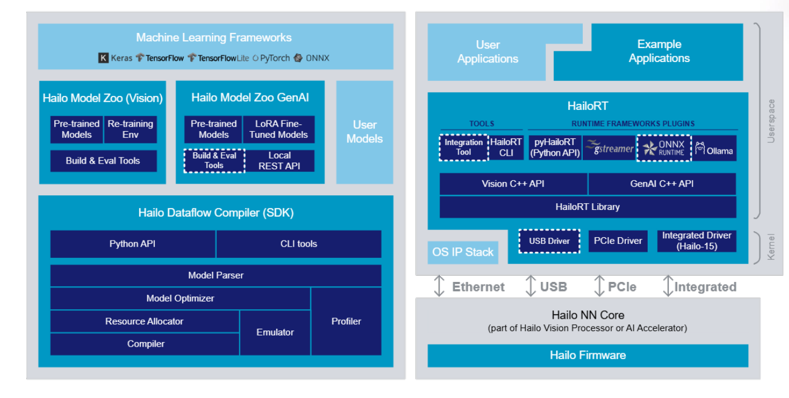

# 2장. 온디바이스 AI 실행 환경

## 실행 구성요소 가지치기 지도

[편집 가능한 Canvas](../assets/ODAI-1/deployment-components-tree.canvas) · [확대용 SVG](../assets/ODAI-1/deployment-components-tree.svg)

모델·실행 소프트웨어·하드웨어는 함께 맞춰야 하는 구성요소다. 아래 그림은 각 요소의 역할과 대표 예를 묶어 보여준다. 화살표는 실행 순서나 소프트웨어가 하드웨어를 포함한다는 뜻이 아니다. 상세 배포 순서는 본문의 흐름 설명을 따른다.
원본 범위: **PDF p.16–23**. 앞 장에서 계산한 가중치·KV·연산·메모리 예산을 실제 장치 배포에 연결한다. **원문 요지**, **교육용 보충**, **정정·주의**를 구분하여 읽는다. 모델 목록과 지원 하드웨어 목록은 원본 강의의 예시이며, 현재 모든 버전의 호환성 보장표가 아니다.

## 학습 목표와 선수 개념

모델, 프레임워크, 가속기가 맡는 역할을 구분하고, llama.cpp와 ExecuTorch가 모델을 장치에서 실행하는 방법을 설명한다. NPU의 이론 연산량과 앱의 실제 지연시간이 다른 이유를 설명하고, 변환→검증→프로파일링의 배포 절차를 세울 수 있어야 한다.

선수 개념은 1장의 parameter·activation·latency·bandwidth다. **Operator(연산자, op)**는 convolution·행렬곱·ReLU 같은 계산 단위, **kernel(커널)**은 특정 장치에서 그 연산을 수행하는 구현 코드다. **Runtime(실행기)**는 모델의 연산을 순서대로 실행하고 메모리·장치 호출을 관리하는 소프트웨어다. **Backend(백엔드)**는 CPU·GPU·NPU 등의 실행 경로를 제공하는 구성 요소다.

## 2.1 모델·프레임워크·하드웨어의 세 축 — p.16

[원본 전체 내용 Crop](../assets/ODAI-1/p016-crop.png)

**이미지 읽기:** 위쪽 모델, 가운데 프레임워크, 아래 가속기의 세 층을 본다. 어느 한 층만 선택해서 끝나는 문제가 아니라 세 층의 호환성을 맞추는 문제다.

**원문 요지:** Efficient AI models, Edge AI frameworks, Hardware accelerators가 함께 온디바이스 AI를 가능하게 한다.

| 축 | 역할 | 확인할 질문 |
|---|---|---|
| Efficient model(효율적인 모델) | 정확도·저장·연산 요구를 결정 | 과제 품질을 만족하는가? 문맥·입력 크기는? |
| Framework/runtime(프레임워크·실행기) | 모델 로드·변환·스케줄링·커널 호출 | 구조·연산·양자화 형식을 지원하는가? |
| Hardware accelerator(하드웨어 가속기) | 연산과 데이터 이동을 수행 | 메모리·대역폭·자료형·전력 예산이 맞는가? |

**CPU(Central Processing Unit)**는 범용 제어와 연산을 수행한다. **GPU(Graphics Processing Unit)**는 다수 데이터를 병렬 계산하는 데 적합하다. **NPU(Neural Processing Unit)**는 신경망 연산에 맞춘 전용 가속기다. **PIM(Processing In Memory)**은 데이터 이동을 줄이기 위해 메모리 내부 또는 가까이에서 연산하는 접근이다. PIM과 모든 NPU가 같은 구조를 갖는 것은 아니다.

원본은 llama.cpp, ExecuTorch, MLC-LLM, LiteRT, ONNX Runtime, MLX, OpenVINO GenAI를 프레임워크 예시로 든다. 이름만으로 실행 대상을 결정하지 말고, 실제 모델 구조·장치·빌드·정밀도 경로를 함께 확인한다.

**교육용 사례:** 4-bit 가중치를 가진 모델이 4 GB 안에 들어가더라도, NPU가 그 블록 형식이나 연산을 지원하지 않으면 CPU 경로로 실행될 수 있다. “메모리에 들어간다”와 “가속기를 활용한다”는 별개의 조건이다.

## 2.2 모델 압축 지도 — p.17

[원본 전체 내용 Crop](../assets/ODAI-1/p017-crop.png)

**이미지 읽기:** 같은 모델 경량화라도 값의 정밀도를 줄이는지, 연결을 없애는지, 구조를 바꾸는지, 다른 모델에서 학습하는지 구분한다.

| 기법 | 정의 | 주로 줄이는 것 | 한계·조건 |
|---|---|---|---|
| Quantization(양자화) | 값을 더 작은 표현 집합으로 근사 | 저장량·메모리 이동, 지원 시 연산 비용 | 오차·메타데이터·커널 지원 고려 |
| Pruning(가지치기) | 중요도가 낮은 가중치·채널 등을 제거 | 연결·연산·저장량 | 비정형 0이 많아도 dense 커널이면 속도 이점 제한 |
| Low-rank factorization(저랭크 분해) | 큰 행렬을 작은 행렬들의 곱으로 근사 | 파라미터·행렬곱 비용 | 근사 오차와 추가 연산 경계 |
| Knowledge distillation(KD, 지식 증류) | 큰 teacher의 출력·특징을 이용해 작은 student 학습 | 배포 모델의 규모 | student 학습과 평가 필요 |
| Parameter sharing(파라미터 공유) | 여러 위치·층에서 같은 값을 재사용 | 독립 저장 파라미터 수 | 모델 설계와 품질 영향 |

**교육용 보충:** 저랭크 예제에서 `W`가 1000×1000이고 이를 `A` 1000×100과 `B` 100×1000의 곱으로 근사하면, 가중치 수는 1,000,000개에서 200,000개로 줄어든다. 여기서 **rank(랭크)**는 독립적인 선형 정보의 차원 수다. 5배 감소는 이 예제의 파라미터 수 비율이며 품질이나 지연시간 5배 개선을 보장하지 않는다.

이 PDF의 후반은 양자화에 집중한다. pruning과 KD는 강의 계획상 다음 Part에서 상세 학습할 주제이므로 이 표에서는 위치와 정의만 확보한다.

**Dense kernel(조밀 커널)**은 일반적인 조밀 행렬 형태로 계산하는 구현이다. 가중치에 0이 많아도 그 위치를 건너뛰는 희소 전용 경로가 없으면 연산 시간이 비례해서 줄지 않는다.

## 2.3 Small LLM: 모델 이름보다 예산과 과제 — p.18

[원본 전체 내용 Crop](../assets/ODAI-1/p018-crop.png)

**이미지 읽기:** 제공자별 모델 계열과 파라미터 규모를 본다. 원문의 특정 버전·크기는 강의 시점의 사례 목록이며 최신성·완전성을 보장하는 카탈로그가 아니다.

**Small LLM / SLM(소형 언어 모델)**은 자원 제약을 고려해 상대적으로 작게 설계한 언어 모델이다. “small”을 나누는 단일한 절대 파라미터 기준은 없으며 목표 장치와 과제에 따라 판단한다. 원본은 Gemini Nano, Gemma, Llama, MobileLLM, Phi, Ministral, Minitron, Qwen 등의 계열을 예시로 든다. 이 설명자료는 원본 표기의 제품 버전·파라미터 수를 새로 인증하지 않는다.

**교육용 보충:** 모델 크기에는 전체 파라미터 수, 특정 입력에서 활성화되는 파라미터 수, embedding을 포함하는지 등이 섞일 수 있다. 실제 저장량은 배포 파일에 들어가는 모든 가중치와 부가 정보를 기준으로 계산한다. **Embedding table(임베딩 테이블)**은 토큰 ID별 벡터를 저장하므로 어휘 수가 크면 상당한 저장량을 차지한다.

| 선택 기준 | 확인 방법 | 작은 수치만 고르면 생기는 문제 |
|---|---|---|
| 과제 품질 | 실제 한국어·업무 입력으로 평가 | 파라미터가 작아도 업무 정확도 부족 가능 |
| 실행 메모리 | 가중치+KV+활성값+workspace peak 측정 | 파일은 들어가도 긴 문맥에서 메모리 부족 |
| 응답 성능 | TTFT·TPOT·throughput 별도 측정 | 짧은 예제의 속도가 실제 업무와 다름 |
| 입력·출력 기능 | 텍스트·이미지·도구 사용 요구 확인 | 기능이 없는 모델을 잘못 선택 |
| 실행 지원 | 구조·파일·자료형·backend 조합 확인 | 변환·가속 실패 가능 |
| 배포 조건 | 모델 카드·라이선스·업데이트 방법 확인 | 기술 실행 가능성과 서비스 사용 가능성 혼동 |

처음에는 같은 과제에서 비교 가능한 작은 기준 모델을 정하고, 품질·지연·메모리를 측정한 뒤 양자화를 적용하는 순서가 학습에 적합하다. 특정 모델 구매나 채택을 권하는 목록은 아니다.

## 2.4 llama.cpp, GGUF, GGML의 관계 — p.19

[원본 전체 내용 Crop](../assets/ODAI-1/p019-crop.png)

**이미지 읽기:** C/C++ 구현, 저비트 표현, CPU+GPU 혼합 실행이라는 세 가지 역할을 본다. C++로 작성됐다는 사실 자체가 모든 모델·장치에서 높은 성능을 보장하는 것은 아니다.

**llama.cpp**는 C/C++ 중심의 LLM 추론 프로젝트다. 학습 프레임워크의 모델을 장치가 읽는 형식으로 준비하고 CPU 또는 지원 backend에서 실행한다. 프로젝트의 현재 구조와 지원 범위는 [llama.cpp 공식 저장소](https://github.com/ggml-org/llama.cpp)를 기준으로 확인한다.

| 구성 | 정확한 역할 | 혼동하기 쉬운 점 |
|---|---|---|
| llama.cpp | 모델 로드·토큰 처리·추론 등을 제공하는 실행 프로젝트 | 모델 그 자체나 단일 양자화 알고리즘이 아님 |
| GGML | 텐서 연산을 위한 라이브러리 | 문맥에 따라 과거 파일 형식 이름도 가리켜 구분 필요 |
| GGUF | 모델 텐서와 메타데이터를 담는 파일 형식 | 연산 라이브러리가 아니며 GGUF라는 이름만으로 같은 정밀도인 것도 아님 |
| Quantization format | 가중치·scale 등을 저장·해석하는 구체 방식 | 4-bit 계열 안에서도 블록·혼합 정밀도·부가 정보가 다름 |

**정정·주의:** p.19의 “GGUF and GGML: tensor library”는 두 역할을 혼합한 표현이다. GGUF는 추론 모델의 텐서와 메타데이터를 담는 **파일 형식**으로 구별해야 한다. 이 구분은 [GGUF 공식 명세](https://github.com/ggml-org/ggml/blob/master/docs/gguf.md)에 근거한다.

**CPU+GPU hybrid inference(혼합 추론)**는 모델의 일부를 CPU·시스템 메모리에, 일부를 GPU 경로에 배치하는 실행 방식이다. **Offload**는 이 배치와 이동을 조정하는 행위를 가리킬 수 있다. 가속기에 올리는 양이 늘면 항상 빨라지는 것이 아니라 전송·메모리·연산 균형을 측정해야 한다.

## 2.5 llama.cpp 실행 흐름과 측정 — p.20

[원본 전체 내용 Crop](../assets/ODAI-1/p020-crop.png)

**이미지 읽기:** 왼쪽 구조도는 입력·모델 실행·backend의 연결을 보고, 오른쪽 화면은 실제 로드와 실행 결과를 확인하는 예로 읽는다. 화면의 명령·모델·경로를 현재 버전에서 그대로 실행 가능한 실습 스크립트로 취급하지 않는다.

**교육용 실행 절차:** 원본 모델의 구조와 tokenizer를 확인하고, 실행기가 지원하는 모델 파일을 준비한다. 필요하면 지원 형식으로 변환·양자화한다. 이어 CPU/GPU 경로·문맥 크기·batch 등을 설정해 로드하고, prefill·decode를 수행하며 품질·속도·메모리를 측정한다. 변환 성공은 정확도 보존이나 최적 성능의 증거가 아니므로 기준 출력과 비교한다.

**Tokenizer(토크나이저)**는 텍스트를 토큰 ID로 바꾸고 다시 텍스트로 복원하는 구성 요소다. **Chat template(대화 템플릿)**은 역할·구분 토큰 등 모델이 기대하는 대화 입력 형식이다. 같은 가중치라도 tokenizer·template이 맞지 않으면 출력 품질이 나빠질 수 있다. **Context length(문맥 길이)**는 처리·보관할 토큰 범위이며 메모리와 연관된다.

| 단계 | 확인할 증거 |
|---|---|
| 로드 | 모델 구조·tokenizer·양자화 형식·설정값이 의도와 일치 |
| 기능 | 기준 prompt에서 정상 출력, 필수 기능 동작 |
| 품질 | 동일 데이터·template에서 비양자화 기준과 비교 |
| 성능 | 같은 prompt 길이·출력 길이·batch에서 TTFT·TPOT·peak memory 측정 |
| 지속 실행 | 반복 요청 중 발열·전력·속도 변화 관찰 |

이 장은 개념 중심 설명이다. 원본 화면의 명령을 검증하지 않은 상태에서 복사 가능한 최신 설치 명령으로 제시하지 않는다.

## 2.6 ExecuTorch와 AOT·Backend Delegation — p.21

[원본 전체 내용 Crop](../assets/ODAI-1/p021-crop.png)

**이미지 읽기:** 개발 PC에서 준비하는 export·변환 경로와 장치에서 실행하는 runtime 경로를 분리한다. backend로 보내는 부분과 공통 실행 경로가 어디에서 나뉘는지 본다.

**ExecuTorch**는 PyTorch 모델을 edge 장치에 배포·추론하기 위한 실행 체계다. **AOT(Ahead-of-Time compilation, 사전 컴파일)**는 실행 전에 모델의 연산 그래프를 분석·변환하여 장치용 실행 계획을 준비하는 방식이다. **Export(내보내기)**는 모델 계산을 명시적인 그래프로 캡처하는 과정이며, **IR(Intermediate Representation, 중간 표현)**은 변환·최적화에 쓰는 모델 표현이다. **Lowering(하향 변환)**은 그래프를 더 구체적인 장치·실행 수준으로 변환하는 과정이다.

**Backend delegation(백엔드 위임)**은 실행 그래프의 지원 부분을 특정 가속기용 컴파일러·실행 경로에 맡기는 방식이다. 원본의 EXIR은 ExecuTorch의 export 중간 표현을 가리킨다. 세부 IR 명칭·API는 버전별 문서와 맞춰야 한다.

**교육용 흐름:** PyTorch 모델 → export된 그래프 → edge용 변환·양자화·지원 부분 partition → backend compile 및 메모리 계획 → 실행 프로그램 → 장치 runtime 순으로 이해한다. **Partition(분할)**은 그래프 중 어떤 부분을 어느 backend가 맡는지 나누는 과정이다. 실제 변환 순서는 backend와 버전에 따라 달라진다. export→compile→run이라는 큰 구조는 [ExecuTorch 공식 동작 설명](https://docs.pytorch.org/executorch/stable/intro-how-it-works.html)에 근거한다.

| 비교축 | llama.cpp 중심 접근 | ExecuTorch 중심 접근 |
|---|---|---|
| 대표 출발점 | 지원 LLM과 실행 가능한 모델 파일 | PyTorch 모델과 export 그래프 |
| 핵심 추상화 | LLM 실행기·텐서 backend·모델 형식 | 그래프 변환·실행 프로그램·delegate |
| 최적화 위치 | 형식별 커널·backend·메모리 배치 | AOT 변환·partition·backend compile·메모리 계획 |
| 사전 확인 | 모델 구조·GGUF·양자화·backend 호환성 | export 가능성·연산 지원·delegate 제약 |
| 공통 검증 | 품질·지연시간·peak memory·전력 | 품질·지연시간·peak memory·전력 |

**정정·주의:** 목록에 장치 제조사가 있다고 모든 모델의 모든 연산이 해당 NPU로 가는 것은 아니다. unsupported op(미지원 연산)가 남거나 그래프 분할로 장치 간 복사가 늘면 실제 속도가 달라진다. **Fallback(대체 실행 경로)**은 가속 경로가 처리하지 못하는 연산을 다른 backend 등으로 실행하는 처리다. 가능한 fallback의 종류는 실행기·빌드마다 다르므로 자동 CPU 실행을 항상 보장한다고 쓰지 않는다.

## 2.7 NPU: 연산기와 메모리의 협력 — p.22

[원본 전체 내용 Crop](../assets/ODAI-1/p022-crop.png)

**이미지 읽기:** p.22의 PLENA 구조도에서 matrix unit, vector/scalar unit, SRAM, 외부 메모리 controller를 나누어 본다. 선의 색과 범례로 제어 흐름과 데이터 흐름을 구분한다. 이 그림은 특정 설계 예시이며 모든 상용 NPU의 표준 블록도가 아니다.

| 블록·용어 | 정의와 역할 |
|---|---|
| Matrix unit(행렬 연산부) | 큰 행렬곱을 병렬 수행하는 부분 |
| Systolic array(시스톨릭 배열) | 연산 소자 사이로 데이터를 규칙적으로 흘려 곱셈·누산을 수행하는 배열 |
| Vector unit(벡터 연산부) | 원소별 계산·축소 등 벡터 성격의 연산 처리 |
| Scalar unit(스칼라 연산부) | 단일 값 계산·일부 제어·보조 연산 처리 |
| Reduction(축소 연산) | 합·최대값처럼 여러 원소를 더 작은 결과로 모으는 연산 |
| SRAM(Static Random Access Memory) | 칩 내부의 빠른 메모리. 용량이 제한되어 데이터 재사용 계획이 중요 |
| HBM(High Bandwidth Memory) | 높은 대역폭을 제공하는 외부 메모리 기술. 모든 NPU가 사용하는 것은 아님 |
| Controller(제어기) | 메모리 접근·명령 실행 등을 조정하는 구성 요소 |
| LUT(Lookup Table, 조회표) | 미리 준비한 값으로 연산의 일부를 대체하는 표 |

**교육용 보충:** 행렬 연산기가 빨라도 데이터가 늦게 도착하면 기다려야 한다. LayerNorm·softmax처럼 행렬곱 이외의 연산, quant/dequant(양자화/복원), 메모리 복사도 전체 시간에 포함된다. **TOPS(Tera Operations Per Second)**는 초당 10^12 operations라는 이론 연산 성능 단위다. 자료형·희소성·MAC 산정·지속 전력 조건이 다를 수 있으므로 TOPS 수치만으로 앱 지연시간을 비교하지 않는다.

**원문 범위 주의:** 그림의 inverse Hadamard transform과 quantizer/dequantizer는 이 설계가 변환과 저정밀 저장을 결합함을 보여준다. 이것이 일반 NPU의 필수 기능이라는 뜻은 아니다. 회전·Hadamard를 통한 양자화 개선은 6장에서 연결한다.

## 2.8 Hailo: 개발 환경과 실행 환경 분리 — p.23

[원본 전체 내용 Crop](../assets/ODAI-1/p023-crop.png)

**이미지 읽기:** 왼쪽 Model Build Environment는 모델을 준비하는 경로, 오른쪽 Runtime Environment는 앱이 장치에서 실행되는 경로다. parser→optimizer→resource allocator→compiler와 application→runtime→driver→firmware의 책임 차이를 본다.

**원문 요지:** Hailo 예시는 모델을 가속기에 맞는 형태로 만드는 개발 소프트웨어와, 장치에서 모델을 실행하는 runtime·driver·firmware의 층을 보여준다. 그림에 표시된 플러그인·인터페이스의 실제 지원 여부는 해당 제품·소프트웨어 버전 문서에서 확인해야 한다.

| 용어 | 역할 | 일반적인 문제 예 |
|---|---|---|
| SDK(Software Development Kit) | 개발용 도구·라이브러리 묶음 | 대상 장치·모델·호스트 환경 호환성 |
| Model parser | 원본 모델의 구조와 연산을 읽음 | 지원하지 않는 연산·입력 shape |
| Model optimizer | 수치 표현·그래프 등을 조정 | 변환 후 정확도 하락 |
| Resource allocator | 연산과 버퍼를 장치 자원에 배치 | 메모리·연산 자원 제약 |
| Compiler(컴파일러) | 장치가 실행할 프로그램으로 변환 | 변환 실패·비효율적인 배치 |
| Emulator(에뮬레이터) | 장치 동작을 소프트웨어로 재현·검토 | 실기기의 전송·발열·지연을 전부 대체할 수 없음 |
| Profiler(프로파일러) | 시간·메모리·실행 경로 등을 계측 | 병목의 위치와 원인 구분 |
| Runtime / HailoRT | 앱의 실행 요청과 장치 실행 관리 | 프로그램 로드·입출력·동시성 설정 |
| Driver(드라이버) | OS와 장치의 통신 연결 | OS·장치·runtime 버전 불일치 |
| Firmware(펌웨어) | 장치 내부 동작을 제어하는 소프트웨어 | 지원 버전·기능 조합 |
| Model Zoo | 검증·준비된 모델과 예제의 모음 | 모든 사용자 모델을 그대로 지원하는 것은 아님 |

**교육용 보충:** 한 프레임워크에서 정확히 동작한 모델도 변환 시 연산 분해·자료형·입력 shape가 달라질 수 있다. **Shape(형상)**는 텐서의 각 차원 크기다. **Calibration data(보정 데이터)**는 양자화 범위·scale 등을 정할 때 쓰는 대표 입력 집합으로 4장에서 자세히 다룬다. 변환 전과 후를 같은 입력으로 비교하고, 마지막에는 실제 보드에서 성능을 측정해야 한다.

**범례 주의:** p.23의 흰 점선 테두리는 원본 범례에서 `Future support (for Hailo-10H)`로 표시한 부분이다. 원본 제작 시점의 향후 지원 표시이므로 현재 제공 기능으로 단정하지 않는다.

## 2.9 배포 판단을 위한 교육용 점검표

아래는 원본의 모델–프레임워크–하드웨어 구성을 실제 학습 과제로 연결한 보충 양식이다. 통합 문서의 Canvas에서는 이 준비·실행 흐름을 시각적으로 따라갈 수 있다.

[전체 학습 흐름 Canvas](../assets/ODAI-1/learning-flow.canvas) · [SVG 미리보기](../assets/ODAI-1/learning-flow.svg)

- [ ] 과제와 품질 기준을 정하고 대표 입력을 준비했다.
- [ ] 모델 전체 저장량과 최대 문맥·batch에서의 실행 메모리를 계산했다.
- [ ] 모델 구조·연산·shape·양자화 형식의 backend 지원을 확인했다.
- [ ] tokenizer·대화 template·전처리·후처리를 맞췄다.
- [ ] 변환 전후 같은 입력으로 결과를 비교했다.
- [ ] 가속기로 위임된 부분과 다른 실행 경로를 로그·프로파일로 확인했다.
- [ ] TTFT·TPOT·peak memory를 조건과 함께 측정했다.
- [ ] 반복 실행에서 발열·전력·지속 성능을 확인했다.
- [ ] 모델·실행기·컴파일러·driver·firmware 버전을 기록했다.

## 장 요약과 흔한 오해

온디바이스 배포는 작은 모델을 선택하는 데서 끝나지 않는다. 모델의 계산·표현을 실행기가 이해해야 하고, backend가 이를 실제 장치의 연산·메모리에 맞게 실행해야 한다. 모델 파일 형식과 연산 라이브러리, 개발용 compiler와 장치 runtime을 구분하면 변환·품질·속도 문제를 어디에서 확인할지 명확해진다.

| 흔한 오해 | 바로잡기 |
|---|---|
| “GGUF가 저비트 연산 라이브러리다.” | GGUF는 파일 형식이다. 실행 커널은 라이브러리·backend가 제공한다. |
| “export 성공이면 NPU에서 전체 모델이 실행된다.” | 지원 연산·분할·컴파일·실제 실행 경로를 확인해야 한다. |
| “NPU TOPS가 크면 반드시 응답이 빠르다.” | 대역폭·전송·미지원 연산·전력·커널 효율에 따라 달라진다. |
| “소형 모델이면 한국어 업무 품질도 충분하다.” | 사용 과제와 대표 데이터에서 검증해야 한다. |
| “emulator가 통과하면 실기기 측정은 생략해도 된다.” | 장치 전송·지속 전력·발열·실행 경로는 실기기에서 확인한다. |

## 복습 질문과 해설

1. **모델이 메모리에 들어가도 실행하지 못할 수 있는 이유는?** 실행기가 모델 구조나 연산·형식·shape를 지원하지 않거나 backend 변환이 실패할 수 있다.
2. **GGUF와 GGML의 차이는?** GGUF는 모델을 담는 파일 형식이고, GGML은 텐서 연산 라이브러리다. 과거 파일 형식 이름의 GGML과도 문맥을 구분한다.
3. **AOT는 언제 무엇을 준비하는가?** 장치 실행 전에 그래프 변환·컴파일·메모리 계획 등을 수행해 runtime이 사용할 실행 프로그램을 준비한다.
4. **가속기 일부 위임이 항상 빠른가?** 아니다. 장치 경계의 복사·동기화나 미지원 부분 실행 비용이 이점을 상쇄할 수 있다.
5. **가중치 1,000×1,000을 1,000×100과 100×1,000으로 분해하면 저장 파라미터 수는?** 200,000개다. 기준 1,000,000개의 1/5이며 근사 오차와 실제 지연은 별도로 검증한다.
6. **NPU 설계에서 SRAM은 왜 중요한가?** 제한된 내부 공간에 가중치·활성값을 재사용하면 외부 메모리 이동을 줄일 수 있다. 공간이 부족하면 이동이 늘어 연산기가 기다릴 수 있다.

## 다음 장으로

이제 모델과 실행 경로를 구분할 수 있다. 다음 3장에서는 모델을 작은 수 표현으로 바꾸는 양자화를 배운다. “몇 비트인가?”뿐 아니라 scale·zero point·clipping·블록 부가 정보·실행 커널을 함께 보는 이유가 이 장의 실행 환경과 연결된다.
