# 3장. 수 표현과 선형 양자화의 원리

## 한눈에 보는 Linear / Nonlinear 양자화 가지치기 지도

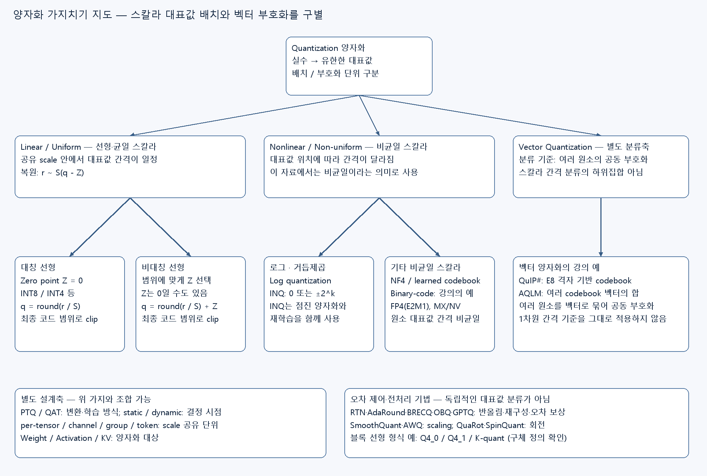

[편집 가능한 Canvas 열기](../assets/ODAI-1/quantization-taxonomy.canvas) · [확대용 SVG](../assets/ODAI-1/quantization-taxonomy.svg)

**분류 기준:** 이 그림의 Linear는 공유 scale 안에서 대표값 간격이 일정한 **uniform/affine 양자화**, Nonlinear는 대표값 간격이 달라지는 **non-uniform 양자화**를 뜻한다. 신경망의 비선형 활성함수 분류와는 다르다. 아래 지도는 강의에서 다룬 대표 기법을 정리한 것이며 모든 양자화 방법을 망라한 목록은 아니다.

| 가지 | 대표 기법·표현 | 핵심 차이 | 본문 연결 |
|---|---|---|---|
| 선형·대칭 | Z=0인 INT8·INT4 affine 표현 | 실수 0을 코드 0으로 표현 | 이 장 3.7–3.8 |
| 선형·비대칭 | 범위에 따라 Z를 선택하는 affine 표현 | 치우친 범위를 활용; Z가 0일 수도 있음 | 이 장 3.7–3.8 |
| 비균일·로그 | Log quantization, INQ의 거듭제곱 값 | 0 또는 ±2^k 등 비균일 대표값 | 이 장 3.6, 4장 4.3 |
| 비균일·스칼라 | NF4, 학습 codebook, binary-code 조합, FP4 | 원소마다 비균일 대표값·조합값 선택 | 이 장 3.4, 4장 4.2–4.3 |
| 벡터 단위의 별도 분류 | QuIP#, AQLM | 여러 값을 공동 codeword로 표현; 스칼라 간격 기준과 구별 | 4장 4.4 |

**다른 분류축과 구별하기:** PTQ/QAT는 변환·학습 방식이고, per-channel/group은 scale 공유 단위다. GPTQ·AWQ·SmoothQuant·QuaRot 등은 오차 제어나 사전 변환 기법이며, 그 이름만으로 대표값이 선형인지 비균일인지 정해지는 것은 아니다. FP4는 지수 때문에 원소 대표값 간격이 일정하지 않으며 MXFP4·NVFP4는 FP4 원소에 블록 scale을 결합한 표현이다. VQ는 벡터 단위의 별도 분류축이므로 Non-uniform의 엄밀한 하위집합으로 두지 않았다. 특히 E8 격자에는 1차원 대표값 간격 기준을 그대로 적용하지 않는다. Binary-code 조합도 계수 선택에 따라 균일해질 수 있으며, 여기서는 4장의 비균일 예제를 가리킨다.

> 원본 범위: PDF p.24–38. 원본의 개념을 설명하는 부분은 **강의 해설**, 이해를 돕는 추가 예제는 **교육용 보충**, 잘못 읽기 쉬운 식·수치는 **정정·주의**로 구별한다. 그림은 원본 PDF의 본문 영역 Crop이다.

## 3.1 학습 목표와 선수 개념

이 장을 마치면 비트 수를 줄일 때 무엇이 손실되는지 설명하고, scale과 zero point를 직접 계산해 양자화·복원할 수 있어야 한다. 또한 “4비트 모델”의 파일 크기와 실제 정수 연산의 속도가 서로 다른 문제임을 구별할 수 있어야 한다.

선수 개념은 1장의 **가중치(weight: 학습으로 정해지는 모델 계수)**, **활성값(activation: 입력에 따라 달라지는 중간 계산값)**, **메모리 대역폭**, 2장의 **실행 커널(kernel: 장치에서 특정 연산을 수행하는 구현)**이다. 행렬곱은 여러 곱셈 결과를 더하는 내적의 모음으로 이해하면 된다.

## 3.2 양자화는 무엇을 줄이는가 — p.24–25

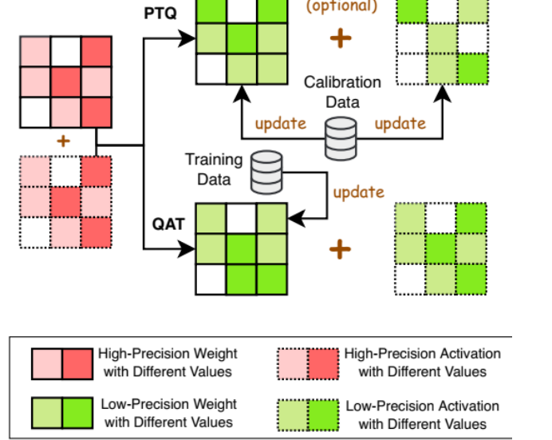

[원본 전체 내용 Crop](../assets/ODAI-1/p024-crop.png)

**p.24 읽는 포인트:** 이 페이지는 장 구분 페이지다. 아래 압축 지도에서 같은 모델 구조를 두고 숫자 표현을 바꾸는 양자화의 위치를 확인한다. 연결 자체를 제거하는 pruning과 구분한다.

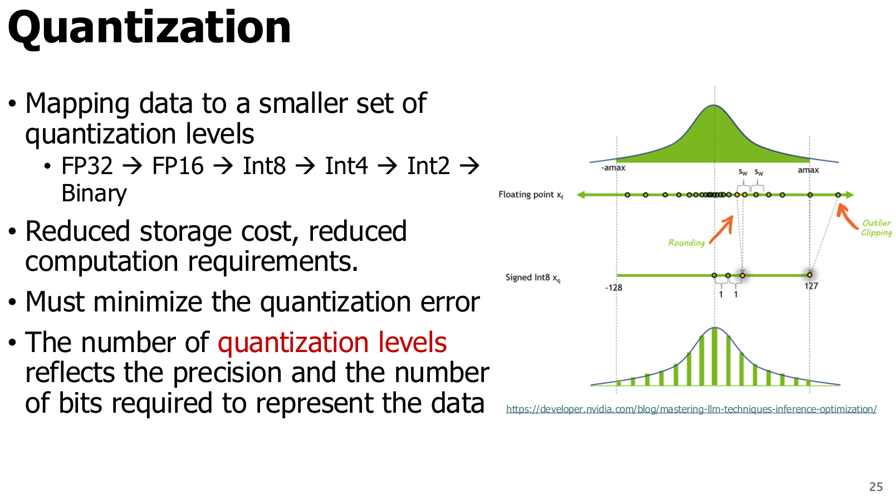

[원본 전체 내용 Crop](../assets/ODAI-1/p025-crop.png)

**강의 해설:** Quantization(양자화)은 연속적이거나 매우 촘촘한 실수 표현을 **더 적은 수의 대표값**으로 대응시키는 과정이다. b비트는 최대 `2^b`개의 비트 패턴을 구별할 수 있다. INT8은 256개, 4비트는 16개 패턴이다. 부동소수점 형식은 특수값·중복된 0 등으로 인해 모든 패턴이 서로 다른 유한 실수를 뜻하지는 않는다.

그림에서 원래 분포의 값들이 몇 개의 수직선으로 모이는 모습을 본다. 값이 많고 대표값이 적을수록 여러 실수가 같은 값으로 표현된다. 따라서 보통 **저장량과 메모리 전송량을 줄이는 대신 복원 오차**가 생긴다. 적절한 커널과 장치가 있으면 저정밀 연산의 처리량도 높일 수 있다.

**교육용 보충:** 가중치가 N개이고 각각 b비트라면 순수 가중치 payload는 `N×b/8`바이트다. 예를 들어 10억 개의 FP16 가중치는 2 GB, INT4 payload는 0.5 GB다(여기서 GB는 `10^9`바이트). 실제 파일에는 scale, zero point, codebook, 텐서 정렬·헤더 등이 붙는다. 실행 중에는 KV cache와 작업 버퍼도 추가된다.

**정정·주의:** 원문의 `FP32 → FP16 → INT8 → INT4 → INT2 → Binary`는 비트 축소 방향을 보여주는 예다. 모든 모델을 이 순서대로 변환해야 하거나, 각 단계가 같은 비용·정확도를 갖는다는 뜻은 아니다. FP16은 부동소수점이고 INT8은 보통 scale을 따로 갖는 정수 표현이다.

## 3.3 수 표현: 범위와 정밀도를 분리해 이해하기 — p.26

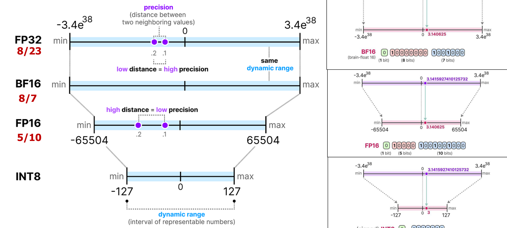

[원본 전체 내용 Crop](../assets/ODAI-1/p026-crop.png)

**p.26 읽는 포인트:** 왼쪽의 지수부·가수부 비트 수와 오른쪽의 표현 간격을 함께 본다. 비트 수가 같아도 작은 값과 큰 값을 얼마나 넓게 표현하는지, 특정 크기 주변을 얼마나 촘촘히 표현하는지는 다르다.

| 용어 | 정의 | 양자화에서의 의미 |
|---|---|---|
| Sign, 부호 | 양수·음수를 구분하는 비트 | 양·음의 가중치 표현 |
| Exponent, 지수부 | 대략적인 크기를 2의 거듭제곱으로 정하는 부분 | 넓은 동적 범위를 표현 |
| Mantissa/Fraction, 가수부 | 같은 지수 범위 안에서 값을 세분하는 부분 | 가까운 두 수를 구별하는 정밀도 |
| Dynamic range, 동적 범위 | 표현 가능한 작은 크기와 큰 크기의 범위 | 큰 outlier와 작은 값을 함께 담을 수 있는가 |
| Precision, 정밀도 | 가까운 수를 구별하는 정도 | 범위가 넓다고 정밀도까지 높은 것은 아님 |
| Outlier, 이상치 | 다른 값보다 유난히 큰 절댓값을 갖는 값 | 공통 scale을 크게 만들어 보통 값의 정밀도를 악화시킬 수 있음 |

| 형식 | 총비트 | 부호/지수/가수 | 특징과 주의 |
|---|---:|---|---|
| FP32 | 32 | 1/8/23 | 범위와 정밀도가 높지만 저장·전송 비용 큼 |
| FP16 | 16 | 1/5/10 | BF16보다 촘촘하지만 유한값 범위가 좁음. 최대 유한값 65,504 |
| BF16 | 16 | 1/8/7 | FP32와 같은 지수 비트 수, FP16보다 적은 가수 비트 |
| INT8 | 8 | 부동소수점 지수·가수 구분 없음 | signed 범위는 보통 −128~127. 실제 실수 범위는 scale·zero point로 결정 |

**교육용 보충:** 부동소수점은 크기가 커질수록 인접 표현값의 절대 간격이 커진다. 선형 정수 양자화는 하나의 scale을 공유하는 구간에서 실수 간격이 일정하다. 따라서 FP8·FP4를 “작은 INT8·INT4”로 읽으면 안 된다.

## 3.4 Microscaling과 FP4 — p.27–28

### 3.4.1 MXFP4: 작은 원소와 공유 scale

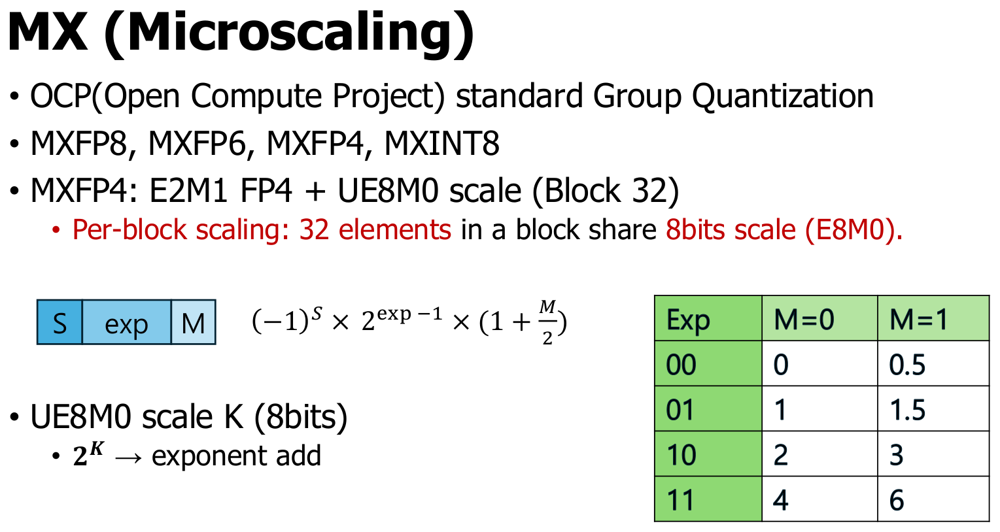

[원본 전체 내용 Crop](../assets/ODAI-1/p027-crop.png)

**강의 해설:** Microscaling(MX)은 작은 블록의 여러 원소가 하나의 scale을 공유하도록 하는 표현 방식이다. **Block(블록)**은 같은 scale로 해석할 원소 묶음이다. MXFP4는 32개 원소마다 8비트 E8M0 scale을 공유하고, 각 원소는 E2M1 FP4로 저장한다. E2M1은 지수 2비트·가수 1비트에 부호 1비트를 더한 4비트 형식이다.

**p.27 읽는 포인트:** 표의 양의 대표값은 `0, 0.5, 1, 1.5, 2, 3, 4, 6`이다. 부호를 붙이면 음수도 표현한다. 모든 간격이 같지 않다. 블록 scale을 곱하면 이 작은 수 집합이 블록의 실제 크기에 맞춰진다.

**정정·주의:** 원문의 `2^K`는 K를 실제 지수로 해석할 때의 개념식이다. 저장된 E8M0 코드가 k라면 유한 scale은 `2^(k−127)`이다. 127의 **exponent bias(지수 편향)**를 빼야 한다. FP4에서도 지수 비트가 0인 경우는 일반 정규수 식을 그대로 쓰지 않고 **subnormal(비정규수)** 규칙을 사용하므로 0과 0.5가 표현된다. [OCP MX 공식 규격](https://www.opencompute.org/documents/ocp-microscaling-formats-mx-v1-0-spec-final-pdf)

### 3.4.2 NVFP4: 더 작은 블록과 두 단계 scale

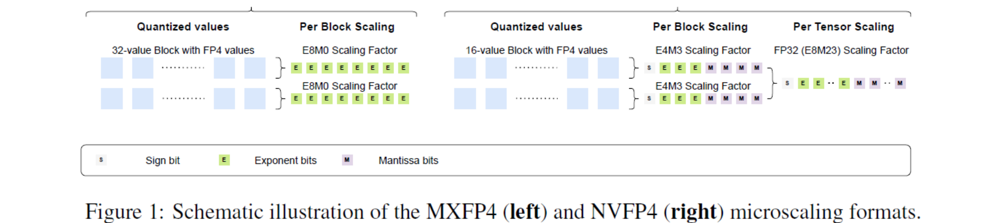

[원본 전체 내용 Crop](../assets/ODAI-1/p028-crop.png)

**p.28 읽는 포인트:** 원소의 E2M1 형식이 같아도 scale 형식과 블록 크기가 다르다. NVFP4는 블록당 16개 원소에 FP8 E4M3 scale을 붙이고, 텐서 전체 FP32 scale을 추가한다. 복원은 `원소 FP4값 × 블록 scale × 전체 scale`로 이해한다. [NVIDIA NVFP4 공식 설명](https://docs.nvidia.com/deeplearning/transformer-engine/features/low_precision_training/nvfp4/nvfp4.html)

| 비교축 | MXFP4 | NVFP4 |
|---|---|---|
| 원소 형식 | E2M1, 4비트 | E2M1, 4비트 |
| 블록 크기 | 32개 | 16개 |
| 블록 scale | E8M0, 8비트 | E4M3, 8비트 |
| scale 표현 | 2의 거듭제곱 | 가수부를 갖는 FP8 값 |
| 전체 scale | 여기서 비교하는 기본 형식에는 없음 | 텐서당 FP32 한 개 |
| metadata 포함 비트/원소 | `4 + 8/32 = 4.25` | N개 원소 기준 `4 + 8/16 + 32/N = 4.5 + 32/N` |
| 선택 시 확인 | 형식·블록 배치·커널 지원 | 형식·두 단계 scale·커널 지원 |

**교육용 보충 — 검산:** N=1,024개라면 MXFP4는 `1,024×4 + 32×8 = 4,352비트 = 544바이트`다. NVFP4는 `1,024×4 + 64×8 + 32 = 4,640비트 = 580바이트`, 즉 원소당 4.53125비트다. 블록이 꽉 차며 추가 padding·헤더가 없다는 가정이다.

**정정·주의:** NVFP4를 MXFP4의 단순한 상위 버전으로만 이해하기보다 서로 다른 scale 설계로 구분한다. 더 작은 블록·세밀한 scale은 오차를 줄이는 데 도움이 될 수 있지만 metadata가 늘고, 장치 지원에 따라 성능이 달라진다. 특정 장치에서의 실제 지원은 배포 시점에 확인해야 한다.

## 3.5 양자화 설계 선택 지도 — p.29

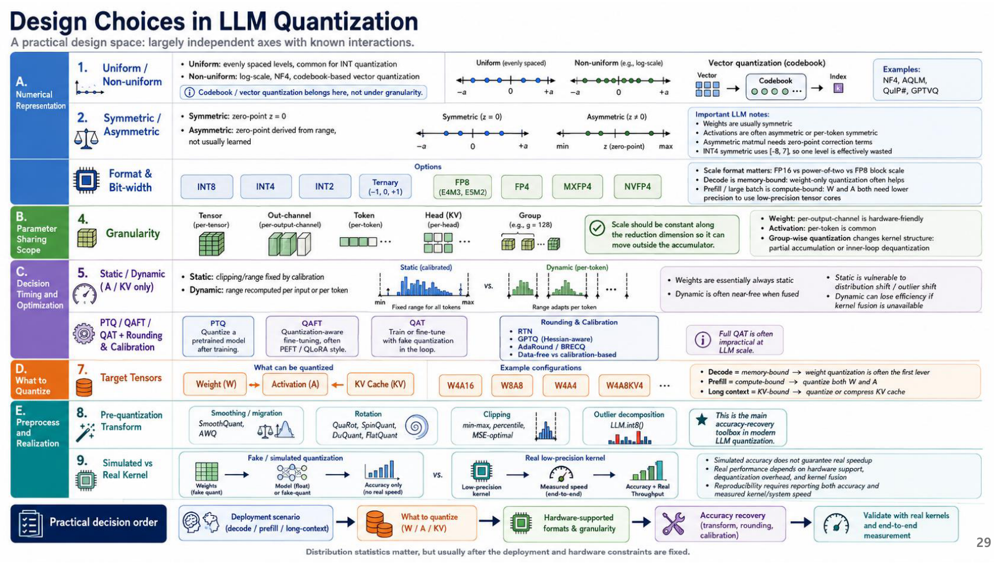

[원본 전체 내용 Crop](../assets/ODAI-1/p029-crop.png)

이 페이지는 이미지로 된 종합 지도다. 글을 한 줄씩 외우기보다 **서로 독립적인 선택축**을 구별한다. 예를 들어 “4비트”는 비트 수만 정할 뿐, 어떤 텐서를 양자화하는지와 scale을 공유하는 범위를 정하지 않는다.

| 설계축 | 질문 | 예시와 이후 학습 위치 |
|---|---|---|
| 표현 수준 | 대표값 간격은 같은가? | Uniform·non-uniform, 이 장과 4장 |
| 원점 | 실수 0을 어느 정수로 나타내는가? | 대칭·비대칭, 3.8절 |
| 형식·비트 수 | 어떤 비트 패턴을 쓰는가? | INT8, INT4, FP4, ternary |
| Granularity, 공유 범위 | 몇 개 값이 같은 scale을 쓰는가? | tensor·channel·token·head·group, 4장 |
| 결정 시점 | scale을 언제 구하는가? | static·dynamic, 4장 |
| 최적화 방식 | 학습 후 보정하는가, 양자화를 넣고 학습하는가? | PTQ·QAT·미세조정, 4–6장 |
| 대상 텐서 | 무엇을 줄이는가? | weight·activation·KV cache, 6장 |
| 사전 변환 | 분포를 어떻게 다듬는가? | smoothing·rotation·clipping·outlier 분리, 6장 |
| 실제 실행 | 시뮬레이션인가 실제 커널인가? | fake quant와 저정밀 커널, 5장 |

**교육용 보충:** `W4A16`은 가중치(weight) 4비트, 활성값(activation) 16비트라는 표기다. codebook/VQ는 대표값을 정하는 표현 방식이며, 그 자체가 scale 공유 범위인 granularity를 뜻하지 않는다. group-wise codebook처럼 두 축을 조합할 수 있다.

이 지도의 실무 흐름은 **배포 상황·병목 확인 → 대상 텐서 결정 → 장치가 지원하는 형식과 granularity 선택 → 오차 복구 → 실제 커널로 검증**이다. 통합 문서의 Canvas에서 이 흐름을 다시 확인한다. 원문의 decode·prefill 병목 표시는 대표적인 경향이며 batch와 문맥 길이에 따라 달라진다.

관련 절차는 [양자화 흐름 Canvas](../assets/ODAI-1/quantization-flow.canvas)와 [미리보기](../assets/ODAI-1/quantization-flow.svg)에서도 확인할 수 있다.

## 3.6 균일·비균일 양자화 — p.30

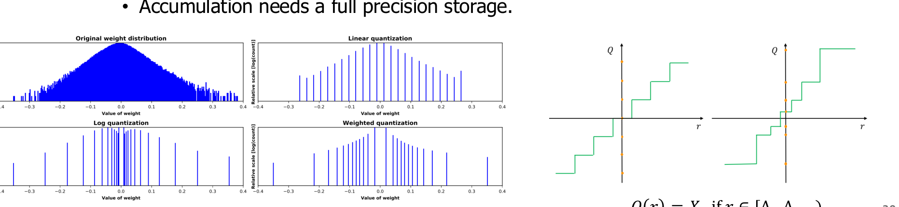

[원본 전체 내용 Crop](../assets/ODAI-1/p030-crop.png)

**p.30 읽는 포인트:** 아래 분포에서 대표값을 일정 간격으로 둘 때와 값이 많이 몰린 곳에 촘촘하게 둘 때를 비교한다. 오른쪽 log 그림은 크기가 커질수록 간격이 커지는 예다.

| 비교축 | Uniform / linear, 균일 양자화 | Non-uniform, 비균일 양자화 |
|---|---|---|
| 대표값 간격 | 공유 범위 안에서 일정 | 위치에 따라 다름 |
| 복원 예 | `r̃=S(q−Z)` | codebook 조회, 지수값·조합값 복원 등 |
| 장점 | 정수 행렬곱·고정소수점 구현과 연결하기 쉬움 | 특정 분포에 대표값을 집중할 수 있음 |
| 한계 | outlier 때문에 작은 값 정밀도가 낮아질 수 있음 | lookup·복호화와 전용 커널 비용이 생길 수 있음 |
| 강의 예 | 대칭·비대칭 INT8 | Log, NF4, binary code, VQ |

**Logarithmic quantization(로그 양자화)**은 크기를 로그 축에서 나눠, 대표값을 대체로 2의 거듭제곱 등으로 두는 방식이다. 이런 수와의 곱셈은 일부 상황에서 shift로 바꿀 수 있지만, 누적과 부호·지수 처리 비용까지 사라지는 것은 아니다.

**정정·주의:** 슬라이드의 VGG-16 정확도 손실 수치는 인용 연구의 설정에서 나온 비교다. 모든 4비트 선형 양자화가 같은 정확도 손실을 낸다는 규칙으로 쓰지 않는다. 비균일 방식도 모델 분포와 커널이 맞아야 유리하다.

## 3.7 Scale·zero point·clipping과 복원 — p.31–34

### 3.7.1 먼저 완전한 양자화 식을 정의하기

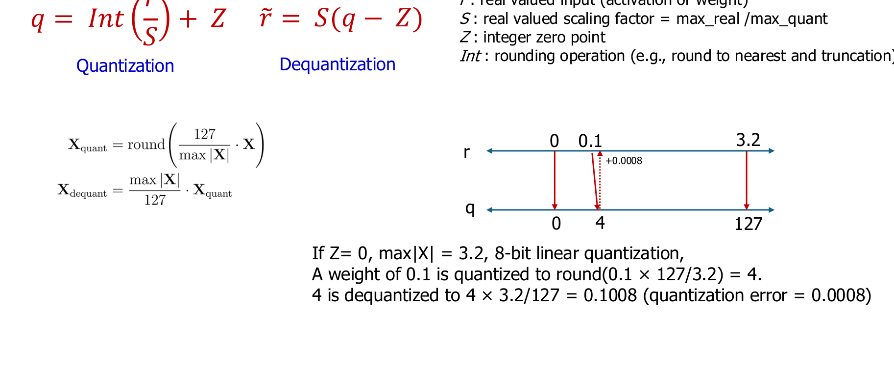

[원본 전체 내용 Crop](../assets/ODAI-1/p031-crop.png)

원본의 핵심을 clipping까지 포함해 쓰면 다음과 같다.

$$
q=\operatorname{clip}\left(\operatorname{round}(r/S)+Z,\ q_{\min},q_{\max}\right),\qquad
\tilde r=S(q-Z)
$$

| 기호 | 뜻과 단위 |
|---|---|
| r | 원래 실수값. 가중치 또는 활성값과 같은 단위 |
| q | 저장하는 정수 코드. 무차원 |
| S>0 | scale, 정수 코드 한 칸에 대응하는 실수 간격. r와 같은 단위 |
| Z | zero point, 실수 0에 대응하는 정수 코드. 무차원 |
| r̃ | dequantization(역양자화)으로 복원한 근사 실수값 |
| q_min, q_max | 허용 정수 코드의 최솟값·최댓값 |
| round | 가까운 정수로 반올림. 정확히 중간인 값의 규칙은 구현에 맞춰 정함 |
| clip | 범위를 벗어난 코드를 가장 가까운 끝점으로 제한하는 연산 |

**Quantization error(양자화 오차)**를 `e=r̃−r`로 정의한다. clipping이 없고 nearest rounding이면 보통 절댓값 오차는 `S/2` 이하다. 범위를 넘어 잘린 값에는 이 보장이 없다. 역양자화는 원래 정보를 되찾는 역함수가 아니라 저장된 코드를 근사 실수로 해석하는 과정이다.

**p.31 검산:** `max|r|=3.2`, 대칭 INT8 범위 −127~127, `Z=0`이면 `S=3.2/127≈0.02519685`다. `r=0.1`은 `q=round(3.96875)=4`, `r̃≈0.10078740`, `e≈0.00078740`이다. 원본의 0.1008·0.0008은 이를 반올림한 수치다.

### 3.7.2 정수 패턴과 실수를 혼동하지 않기

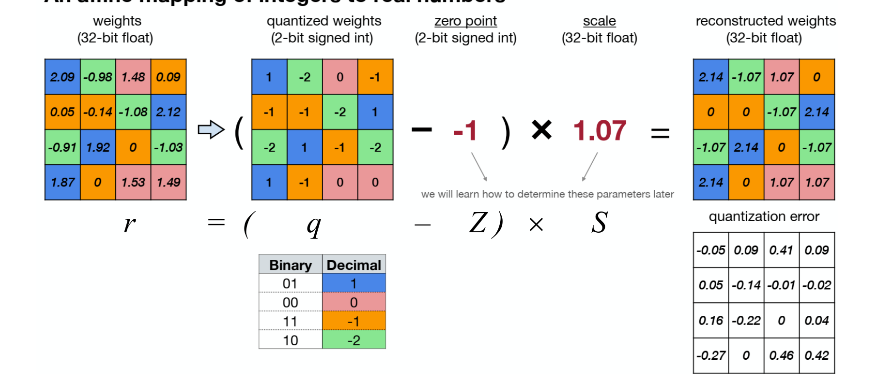

[원본 전체 내용 Crop](../assets/ODAI-1/p032-crop.png)

**p.32 읽는 포인트:** 같은 이진 코드가 곧 원래 실수는 아니다. 정수 행렬에서 zero point를 빼고 scale을 곱하는 두 단계를 추적한다. scale과 zero point가 다르면 같은 정수 q도 서로 다른 실수로 복원된다.

### 3.7.3 비대칭 범위에서 파라미터 구하기

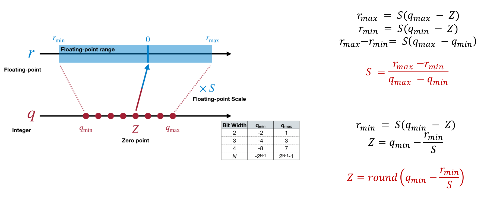

[원본 전체 내용 Crop](../assets/ODAI-1/p033-crop.png)

실수 범위의 최솟값 r_min, 최댓값 r_max를 정수 범위에 대응시키는 기본 식은 다음과 같다.

$$
S=\frac{r_{\max}-r_{\min}}{q_{\max}-q_{\min}},\qquad
Z=\operatorname{clip}\left(\operatorname{round}\left(q_{\min}-\frac{r_{\min}}S\right),q_{\min},q_{\max}\right)
$$

**p.33 읽는 포인트:** 양 끝점을 빼서 zero point를 소거하면 scale 식이 나온다. 이후 한쪽 끝점 식을 사용해 Z를 구한다. Z를 정수로 반올림하기 때문에 두 실수 끝점이 모두 정확히 표현되지는 않을 수 있다. 일반적인 구현에서는 범위에 0을 포함시키며, r_min=r_max인 상수 텐서는 S가 0이 되지 않도록 별도 처리한다.

### 3.7.4 비대칭 예제와 원본의 반올림 주의

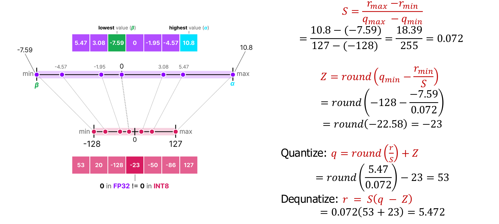

[원본 전체 내용 Crop](../assets/ODAI-1/p034-crop.png)

**강의 해설:** `r_min=−7.59`, `r_max=10.8`, signed INT8 코드 범위 `−128~127`, 입력 `r=5.47`의 예다. 작은 중간값을 너무 일찍 반올림하면 최종 결과가 달라질 수 있으므로 두 계산을 구분한다.

| 단계 | 원본의 단순화된 scale 사용 | 더 긴 정밀도로 검산 |
|---|---|---|
| S | 0.072 | `18.39/255 = 0.072117647…` |
| Z | −23 | `round(−128+7.59/S)=−23` |
| q | `round(5.47/0.072)−23=53` | `round(5.47/S)−23=53` |
| r̃ | `0.072×76=5.472` | `S×76≈5.480941176` |
| e=r̃−r | +0.002 | 약 +0.010941176 |

**정정·주의:** 5.472는 슬라이드에서 표시한 근사 scale 0.072를 그대로 사용했을 때의 값이다. 정확한 비율 S를 쓴 계산의 결과라고 소개하면 안 된다. 양자화 구현은 표시용 소수 자릿수보다 높은 정밀도의 scale을 저장할 수 있다.

## 3.8 양자화된 행렬곱과 대칭·비대칭 — p.35–37

### 3.8.1 정수 곱셈을 해도 누적은 넓은 비트가 필요하다

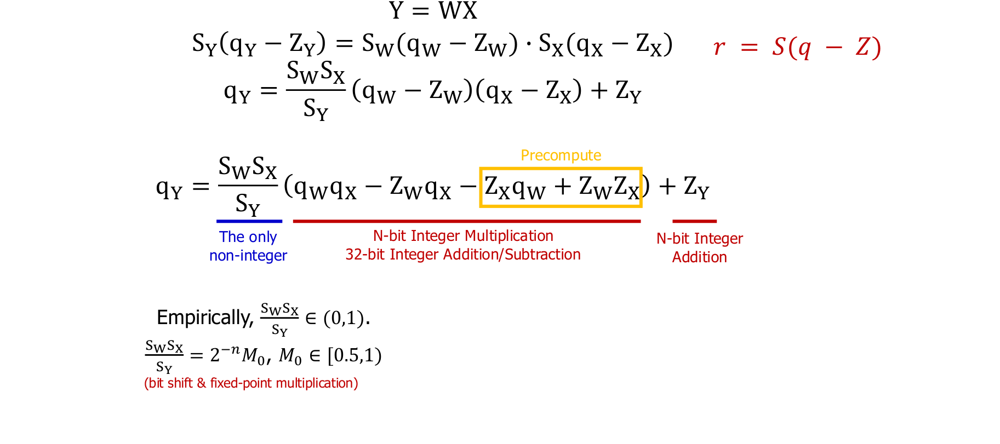

[원본 전체 내용 Crop](../assets/ODAI-1/p035-crop.png)

**교육용 보충 — 차원을 명시한 식:** 이 절은 열 방향 입력 표기 `Y=WX`를 사용한다. `W∈R^(m×k)`는 가중치, `X∈R^(k×n)`는 n개 입력, `Y∈R^(m×n)`는 출력이다. 각 텐서가 하나의 scale과 zero point를 공유한다고 가정한다. i는 출력 행, j는 입력 열, t는 내적의 합산 축이다.

$$
q_{Y,ij}=\operatorname{clip}\left(\operatorname{round}\left[
\frac{S_WS_X}{S_Y}\sum_{t=1}^{k}(q_{W,it}-Z_W)(q_{X,tj}-Z_X)
\right]+Z_Y, q_{Y,\min},q_{Y,\max}\right)
$$

`S_W,S_X,S_Y`는 각 텐서의 scale, `Z_W,Z_X,Z_Y`는 zero point다. 실제 실수 단위가 있는 문제라면 Y의 단위는 W×X이며, 재양자화 배율 `S_W S_X/S_Y`는 무차원이다.

**p.35 읽는 포인트:** 저비트 정수 곱을 INT32처럼 더 넓은 누산기에 모으고, 마지막에 출력 scale로 다시 변환한다. **Accumulator(누산기)**는 여러 곱의 합을 보관하는 공간이고, **requantization(재양자화)**은 이 합을 출력 정수 범위로 맞추는 과정이다. 긴 내적은 작은 값의 합이어도 overflow(범위 초과)가 날 수 있다.

zero point 보정은 내적을 전개하면 더 분명하다.

$$
\sum_t q_{W,it}q_{X,tj}
-Z_W\sum_t q_{X,tj}
-Z_X\sum_t q_{W,it}
+kZ_WZ_X
$$

**정정·주의:** 슬라이드의 축약된 `+Z_W Z_X` 항을 내적 전체에 적용하면 합산 길이 k가 필요하다. 가중치 쪽 합과 일부 보정은 미리 구할 수 있지만, 입력이 달라지면 입력 의존 항은 달라진다. 고정소수점 multiplier와 shift로 재양자화 배율을 근사할 수 있다. 이 배율이 항상 0~1이라는 수학적 보장은 없으므로 커널의 실제 지원 범위를 확인해야 한다.

**검산 예제:** `q_W=[2,4]`, `q_X=[3,1]`, `Z_W=Z_X=0`, `S_W=0.5`, `S_X=0.25`이면 정수 내적은 10이고 실수 출력은 `10×0.5×0.25=1.25`다. `S_Y=0.125`, `Z_Y=0`이면 출력 코드는 10이다. 원래 실수 벡터 `[1,2]`와 `[0.75,0.25]`의 내적도 1.25다.

### 3.8.2 대칭과 비대칭의 선택

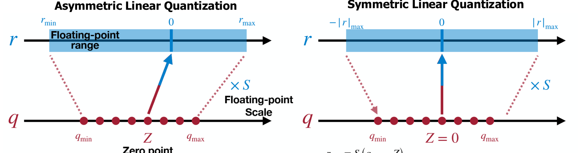

[원본 전체 내용 Crop](../assets/ODAI-1/p036-crop.png)

**p.36 읽는 포인트:** 비대칭은 실수 범위를 정수 범위에 밀어 넣고, 대칭은 0을 중심으로 양쪽을 배치한다. 양수로 치우친 분포에서는 대칭 표현의 음수 쪽 코드가 덜 쓰일 수 있다.

| 비교축 | Symmetric, 대칭 | Asymmetric, 비대칭 |
|---|---|---|
| zero point | 보통 Z=0 | 범위에 맞게 정수 Z를 선택 |
| scale 예 | `max(abs(r))/127` (INT8 −127~127 정책) | `(r_max−r_min)/255` (INT8 전체 범위) |
| 장점 | zero point 보정이 단순함 | 치우친 범위를 더 고르게 활용할 수 있음 |
| 한계 | 치우친 분포에서 일부 코드 낭비 | 보정·구현 복잡도가 늘 수 있음 |
| 자주 보는 적용 | 부호가 양쪽에 있는 가중치 | 치우친 활성값 등의 후보 |

**교육용 보충:** signed INT8의 실제 코드 범위는 −128~127로 한쪽에 코드가 하나 더 있다. 대칭 구현은 −127~127을 써서 −128을 쓰지 않기도 한다. INT4도 −8~7 중 −7~7을 쓸 수 있다. “대칭”이라는 이름만 보고 코드 범위·반올림 정책을 추정하지 말고 확인한다.

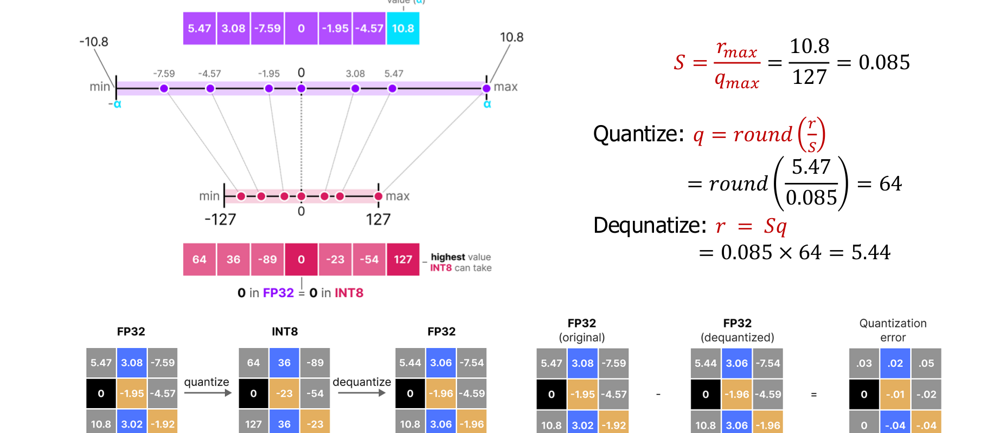

[원본 전체 내용 Crop](../assets/ODAI-1/p037-crop.png)

**p.37 검산:** 앞 예의 `max|r|=10.8`을 사용하면 `S=10.8/127≈0.08503937`, `q=round(5.47/S)=64`, `r̃≈5.44251969`이고 오차는 약 −0.02748031이다. 원본의 5.44는 scale을 0.085로 먼저 근사한 값이다. 앞의 단일 값에서 비대칭이 오차가 작았다고 해서 전체 분포·모든 입력에서도 항상 우수한 것은 아니다.

## 3.9 Q/DQ와 fusion: 비트 수가 속도를 보장하지 않는 이유 — p.38

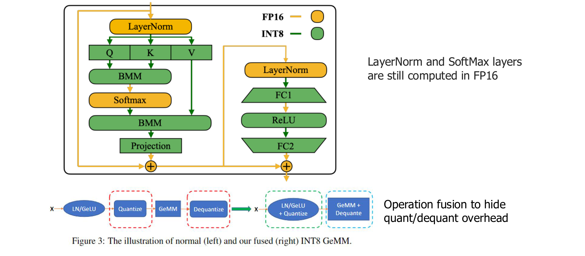

[원본 전체 내용 Crop](../assets/ODAI-1/p038-crop.png)

**강의 해설:** Q는 실수를 정수 코드로 바꾸는 quantize, DQ는 정수 코드를 계산 가능한 실수로 해석하는 dequantize다. 모든 연산이 저정밀 커널로 실행되지 않으면, FP16 영역과 정수 영역 사이에서 변환·메모리 쓰기·다시 읽기가 반복될 수 있다.

**p.38 읽는 포인트:** LayerNorm·Softmax 같은 연산이 FP16에 남아 있는 예에서 어느 지점에 Q/DQ가 들어가는지 본다. 아래 **fusion(연산 융합)** 그림은 여러 단계를 한 커널 안에서 처리해 중간 텐서 저장과 실행 호출을 줄이는 방법이다.

| 구현 상황 | 기대할 수 있는 효과 | 반드시 확인할 항목 |
|---|---|---|
| 가중치만 압축 저장 | 파일 크기·메모리 전송 감소 | 복호화 비용, batch=1 decode 지연 |
| W/A 저정밀 행렬곱 지원 | 행렬곱 계산량 처리 개선 가능 | 실제 커널 사용 여부, 누적 정밀도 |
| Q/DQ가 분리되어 반복 실행 | 변환·버퍼 비용이 이득을 상쇄할 수 있음 | profiler의 변환·복사 시간 |
| Q/DQ와 행렬곱 등을 fusion | 중간 접근과 호출 감소 가능 | backend의 fusion 가능 패턴 |

**정정·주의:** 슬라이드의 FP16 LayerNorm·Softmax는 해당 구현 예다. 모든 양자화 모델의 영구적 규칙은 아니다. 정확도 시뮬레이션에서 4비트로 보인다는 사실과 실제 하드웨어가 4비트로 곱셈한다는 사실도 구분한다.

## 3.10 장 요약과 흔한 오해

양자화는 **대표값·scale·zero point·공유 범위·변환 비용을 함께 설계하는 문제**다. 비트 수만 줄이면 메모리는 줄일 수 있지만, 정확도와 지연시간은 분포·배포 커널에 달려 있다. 선형 양자화는 `q=clip(round(r/S)+Z)`와 `r̃=S(q−Z)` 두 식에서 시작한다.

| 흔한 오해 | 바르게 이해하기 |
|---|---|
| INT4면 모든 원소가 정확히 4비트만 차지한다 | scale·zero point·padding까지 포함한 effective bits/value를 계산해야 함 |
| 역양자화하면 원래 값으로 돌아간다 | 여러 원래 값이 같은 코드가 되므로 손실 정보는 복구되지 않음 |
| 범위가 넓은 형식이 항상 정확하다 | 동적 범위와 근처 수를 구별하는 정밀도는 다른 성질 |
| 저비트 곱셈이면 누산기도 저비트다 | 내적의 합은 더 넓은 누산기를 필요로 함 |
| Q/DQ는 공짜다 | fusion과 메모리 접근에 따라 실제 비용이 달라짐 |

## 3.11 복습 질문과 해설

1. **S=0.1, Z=3, 정수 범위 0~15일 때 r=0.26과 r=2.0을 양자화·복원하라.**
   - r=0.26은 `q=round(2.6)+3=6`, `r̃=0.1×(6−3)=0.3`, 오차 +0.04다. r=2.0은 clipping 전 q=23이지만 15로 잘려 `r̃=1.2`, 오차 −0.8이다. 범위를 벗어나면 오차가 S/2 이하라는 보장이 사라진다.
2. **MXFP4를 왜 정확히 원소당 4비트라고 할 수 없는가?**
   - 32개마다 8비트 scale이 있어 payload만 평균 4.25비트다. 그 외 파일 metadata는 별도다.
3. **W4A16은 INT4 정수 행렬곱을 뜻하는가?**
   - 아니다. 가중치 저장 정밀도와 활성값 정밀도의 표기다. 구현에 따라 가중치를 복호화해 고정밀 곱셈을 할 수도 있다.
4. **대칭 양자화의 Z=0은 어떤 계산을 줄여 주는가?**
   - zero point가 0인 쪽의 내적 보정항을 없앤다. 양쪽 모두 0이면 순수 정수 내적으로 단순해진다.
5. **scale을 일찍 반올림하면 왜 검산이 달라지는가?**
   - 반올림 경계와 복원 간격 자체가 달라진다. 표시용 scale과 실제 계산에 쓰는 scale을 분리해야 한다.

다음 [4장](ODAI-1_04_PTQ와비균일양자화.md)에서는 같은 비트 예산에서 **어떤 대표값과 범위·반올림·공유 단위를 선택해야 오차가 줄어드는지** 살펴본다. QAT의 학습 과정은 5장에서 다룬다.

## 3.12 집필 자체 점검

- [x] p.24–38 15개 페이지의 이미지와 읽는 포인트를 포함했다.
- [x] FP/INT, MX/NV, uniform/non-uniform, symmetric/asymmetric 비교표를 작성했다.
- [x] clipping, zero point, scale, 단위, 상수 텐서·반올림 정책을 설명했다.
- [x] p.31·34·37 수치를 검산하고 근사 수치 차이를 명시했다.
- [x] 내적의 zero-point 보정항과 누산기·재양자화 비용을 설명했다.
- [x] 장 요약, 오해, 복습 정답, 다음 장 연결을 포함했다.
