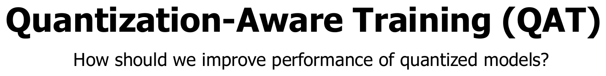
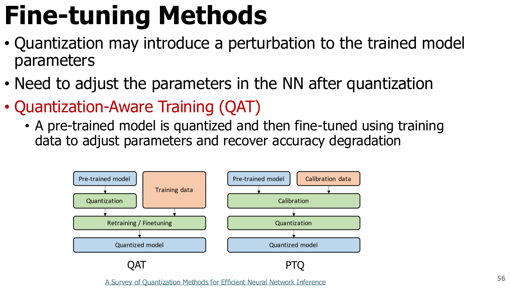
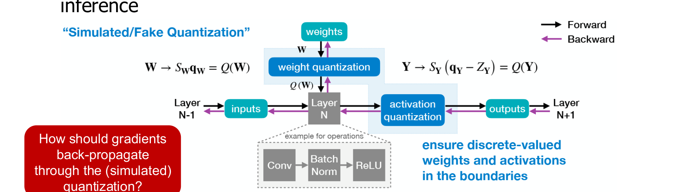
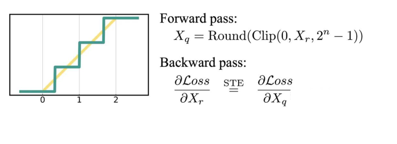
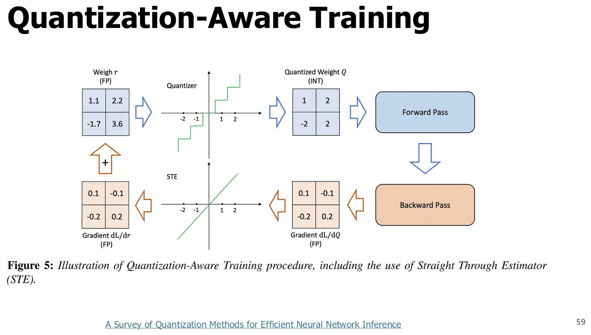
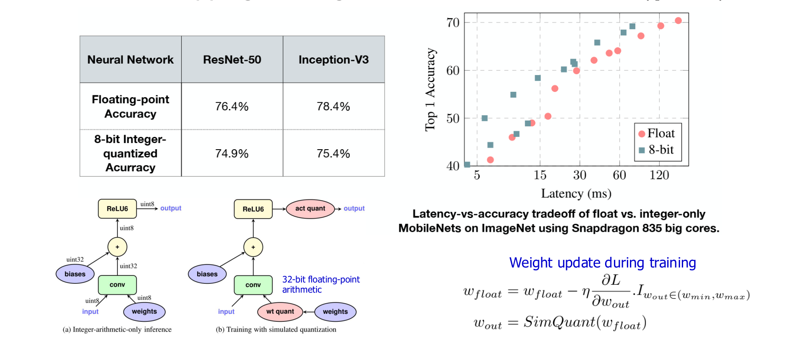
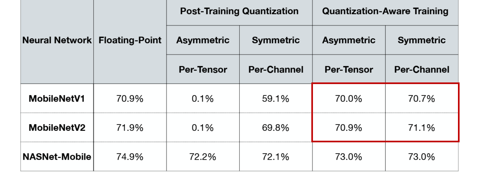
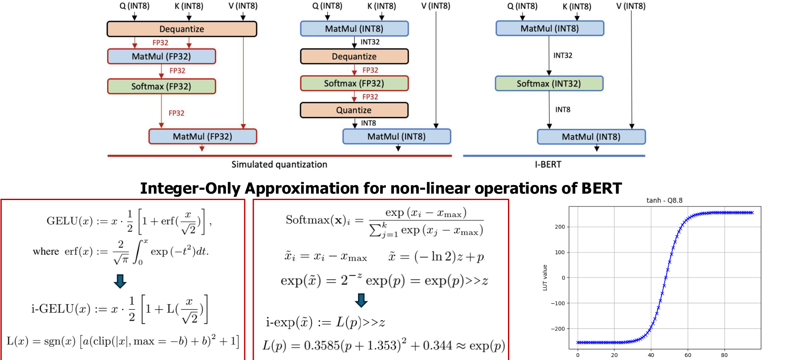

# 5. QAT와 정수 추론

**원본 범위: p.55–62.** 앞 장의 PTQ가 이미 학습된 모델의 표현을 바꾸는 방법이었다면, 이 장은 모델이 양자화 오차에 적응하도록 학습하는 방법을 설명한다. 별도 표시가 없는 그림은 원본 강의자료의 본문 Crop이다. 수치 실험은 원본의 사례이며 모든 모델에서 재현되는 보장이 아니다.

## 5.1 학습 목표와 선수 개념

이 장을 마치면 fake quantization의 순전파와 STE의 역전파를 구별하고, 학습용 가중치와 배포용 가중치가 다른 이유를 설명할 수 있어야 한다. 또한 QAT를 수행한 사실만으로 모든 연산이 정수로 실행된다고 단정하지 않아야 한다.

선수 개념은 3장의 scale·zero point·clipping, 4장의 calibration과 PTQ다. **Gradient(기울기)**는 파라미터를 조금 바꿀 때 손실이 변하는 정도이고, **backpropagation(역전파)**은 출력 손실에서 각 파라미터까지 연쇄법칙으로 기울기를 전달하는 계산이다. **Optimizer(최적화 알고리즘)**는 기울기를 이용해 파라미터를 갱신한다. **Fine-tuning(미세조정)**은 사전학습 가중치를 출발점으로 추가 학습하는 것이다.

## 5.2 PTQ로 부족할 때 QAT를 선택한다 — p.55–56

[원본 전체 내용 Crop](../assets/ODAI-1/p055-crop.png)

**p.55 읽는 포인트:** 이 페이지는 장 구분 페이지다. 핵심 질문은 “양자화된 모델의 성능을 어떻게 회복할 것인가?”다. 여기서 성능은 정확도와 실행 속도를 구분해 읽어야 한다. QAT의 직접적인 목적은 양자화 후 정확도 저하를 줄이는 것이며, 실행 속도는 최종 커널과 배포 환경에 달려 있다.

[원본 전체 내용 Crop](../assets/ODAI-1/p056-crop.png)

**p.56 읽는 포인트:** 두 경로 모두 사전학습 모델에서 시작한다. PTQ 경로는 calibration 후 변환하고, QAT 경로는 양자화의 영향을 학습에 넣어 가중치를 조정한다. QAT를 모델 전체의 사전학습을 처음부터 반복하는 것으로 이해하지 않는다.

**Quantization-Aware Training(QAT, 양자화 인지 학습)**은 학습 중 양자화·복원으로 생기는 오차를 모사해, 배포 시 저정밀 표현에 더 잘 맞는 파라미터를 얻는 방법이다. 반면 **Post-Training Quantization(PTQ, 학습 후 양자화)**는 보통 전체 모델의 일반적인 재학습 없이 통계 추정과 양자화·보정을 수행한다. PTQ 안에서도 AdaRound처럼 보정 목적의 최적화가 있을 수 있으므로 “PTQ는 계산이나 최적화를 전혀 하지 않는다”는 정의는 부정확하다.

| 비교축 | PTQ | QAT |
|---|---|---|
| 모델의 출발점 | 사전학습 모델 | 사전학습 모델 또는 학습 중인 모델 |
| 주요 작업 | calibration, 반올림·범위·스케일 선택, 필요 시 국소 보정 | 양자화 오차를 모사한 forward와 gradient를 이용한 학습 |
| 데이터 | 대표 입력을 담은 작은 calibration 집합을 쓰는 경우가 많음 | 학습 목적에 맞는 데이터·손실이 필요 |
| 비용 | 상대적으로 낮은 편 | 학습 연산, activation, gradient, optimizer 상태 비용 추가 |
| 유리한 상황 | 빠른 변환, 학습 자원 부족, 목표 정확도 이미 충족 | 낮은 비트 수 또는 민감한 모델에서 PTQ 정확도가 부족 |
| 배포 속도 | 실제 저정밀 커널·하드웨어 지원에 달림 | 동일하게 커널·하드웨어 지원에 달림 |

**교육용 판단 예시:** INT8 PTQ가 목표 정확도를 만족하고 장치에서 빨라졌다면 QAT를 추가할 이유가 크지 않다. 반대로 작은 CNN에서 정확도가 크게 떨어지고 학습 데이터가 있다면 QAT를 검토한다. QAT가 항상 PTQ보다 좋다는 순위보다, 목표 정확도를 회복하는 데 필요한 비용을 비교한다.

## 5.3 Fake quantization과 FP master weight — p.57

[원본 전체 내용 Crop](../assets/ODAI-1/p057-crop.png)

**p.57 읽는 포인트:** 순전파는 양자화된 값을 모사하고, 역전파는 고정밀 가중치를 갱신한다. 그림의 full-precision weights와 discrete-valued weights가 서로 다른 역할임을 확인한다.

**Fake quantization(모의 양자화)**은 정수 코드로 양자화한 뒤 다시 실수로 복원해, 일반적인 학습 연산 안에서 양자화 오차를 재현하는 것이다. 대표적인 affine fake quantizer는 다음과 같다.

$$
q=\operatorname{clip}\left(\operatorname{round}(w/S)+Z,q_{\min},q_{\max}\right),\qquad
\widetilde w=S(q-Z).
$$

여기서 $w$는 학습용 실수 가중치, $S>0$는 실수 단위/code의 scale, $Z$는 정수 zero point, $q$는 정수 코드, $q_{\min},q_{\max}$는 표현 가능한 코드 범위, $\widetilde w$는 복원된 학습용 순전파 값이다. clip은 범위를 벗어난 값을 끝값으로 제한한다. 가중치에 물리 단위가 없는 경우 이 값들도 무차원이다.

**Master weight(기준 가중치)**는 작은 업데이트를 누적하기 위해 보존하는 고정밀 파라미터다. 강의의 전형적인 구성에서는 FP32 사본을 사용한다. 실무의 mixed-precision 학습에서는 파라미터·gradient·optimizer 상태별 dtype이 달라질 수 있다. 중요한 점은 8비트 정수 가중치만으로 작은 gradient를 직접 누적하지 않는다는 것이다.

**검산 예시:** $S=0.1, Z=0$, clipping이 발생하지 않는다고 하자. $w=0.26$은 $q=3$, $\widetilde w=0.3$이 된다. 작은 학습 업데이트가 0.01이면 master weight는 0.25가 된다. 그 즉시 정수 코드가 바뀌지 않더라도, 반복 갱신으로 양자화 경계를 넘을 수 있다. 매번 0.3에 업데이트 후 다시 반올림하면 작은 변화가 계속 사라질 수 있다. 경계값 0.25의 반올림 결과는 ties-to-even 등 반올림 규칙에 따라 달라지므로 예제의 요점은 경계 규칙보다 **고정밀 누적의 필요성**이다.

## 5.4 불연속 반올림을 통과하는 STE — p.58–59

[원본 전체 내용 Crop](../assets/ODAI-1/p058-crop.png)

**p.58 읽는 포인트:** 계단형 양자화 함수의 진짜 기울기와, 학습을 위해 대신 사용하는 기울기를 구분한다. 양자화 함수는 구간 내부에서 기울기가 0이고 경계에서는 일반적인 의미로 미분되지 않는다. 강의의 delta-spikes 표현은 이 불연속성을 직관적으로 보여주는 설명이지, 일반적인 backpropagation에서 그대로 사용하는 gradient가 아니다.

**Straight-Through Estimator(STE, 직통 기울기 추정기)**는 순전파에는 반올림을 사용하면서 역전파에는 계산 가능한 대체 기울기를 쓰는 규칙이다. 가장 단순한 identity STE는 $\partial\widetilde w/\partial w\approx1$로 놓는다. clipping을 반영한 구현은 표현 구간 내부에서 1, 외부에서 0인 마스크를 사용하는 경우도 있다. 이 선택은 구현·학습법에 따라 다르다.

$$
\frac{\partial\mathcal L}{\partial w}
\approx\frac{\partial\mathcal L}{\partial\widetilde w},\qquad
w\leftarrow w-\eta\frac{\partial\mathcal L}{\partial w}.
$$

$\mathcal L$은 학습 손실, $\eta$는 학습률, $w$는 master weight다. 이 식은 clipping 범위 내부의 identity STE를 가정한다. STE는 정확한 미분이나 불편추정량이라는 보장이 없다. 극저비트·binary처럼 양자화 오차가 큰 상황에서는 학습 안정성과 대체 기울기 선택을 더 신중히 검토해야 한다.

[원본 전체 내용 Crop](../assets/ODAI-1/p059-crop.png)

**p.59 읽는 포인트:** 위쪽 forward는 master weight를 quantize한 값으로 손실을 계산하고, 아래쪽 backward는 그 손실의 신호를 master weight로 돌려보낸다. “역전파에서 양자화를 무시한다”는 것은 forward 오차까지 없애는 말이 아니다. forward는 양자화 오차를 그대로 반영한다.

**교육용 연결:** QAT의 학습 흐름은 `FP master → fake quant → forward·loss → STE backward → master update`다. 배포 흐름은 학습 완료 후 별도로 `최종 scale 확정 → 정수 코드 저장 → 지원 커널로 변환`을 거친다. [양자화 학습·배포 Canvas](../assets/ODAI-1/quantization-flow.canvas)와 [미리보기](../assets/ODAI-1/quantization-flow.svg)에서도 이 두 경로를 구분해 읽는다.

## 5.5 QAT 학습과 실제 정수 추론은 다르다 — p.60–61

[원본 전체 내용 Crop](../assets/ODAI-1/p060-crop.png)

**p.60 읽는 포인트:** 학습 가중치 갱신이 32비트 부동소수점 연산이라는 표시와, 추론 시 integer arithmetic 경로를 함께 본다. 학습을 INT8로 모두 실행한다는 뜻이 아니다. 정수 추론에서 곱셈 입력이 INT8이어도 누산은 흔히 INT32를 사용한다.

**Accumulator(누산기)**는 여러 곱의 합을 저장하는 값이다. 좁은 INT8 누산기는 쉽게 overflow하므로 더 넓은 표현을 쓴다. **Requantization(재양자화)**은 INT32 누산 결과를 다음 연산이 요구하는 scale과 비트 수로 다시 변환하는 단계다. **Integer-only inference(정수 전용 추론)**는 정해진 추론 경로를 정수·고정소수점 연산으로 구현한다는 뜻이며, 입력·출력 인터페이스의 표현까지 무조건 같다는 뜻은 아니다. QAT와 정수 연산을 함께 설계한 대표 사례가 [Jacob 등의 원 논문](https://arxiv.org/abs/1712.05877)이다.

| 단계 | 대표 표현 | 확인할 사항 |
|---|---|---|
| QAT 파라미터 보존·갱신 | FP32 등 고정밀 master | 작은 업데이트가 누적되는가 |
| QAT 순전파 | 실수 텐서에 fake quant 적용 | 배포의 clipping·rounding과 일치하는가 |
| 배포 가중치 저장 | INT8 코드와 scale·zero point | 메타데이터를 포함한 용량은 얼마인가 |
| 정수 행렬곱 | INT8 곱, INT32 누산 등 | 지원 커널, overflow, bias scale이 맞는가 |
| 비선형·정규화 | 정수 근사 또는 실수 fallback | “전체 정수 실행”이 실제로 성립하는가 |

[원본 전체 내용 Crop](../assets/ODAI-1/p061-crop.png)

**p.61 읽는 포인트:** 빨간 상자는 QAT 결과이며, MobileNet 계열에서 PTQ보다 회복되는 원본 실험 사례다. 예를 들어 MobileNetV2의 floating-point 71.9%와 QAT symmetric per-channel 71.1%의 차이는 **0.8 percentage point(%p)**다. 상대 오차 0.8%와 혼동하지 않는다. 원본 표는 배치·데이터 전처리·calibration 세부 설정을 모두 제공하지 않으므로, 숫자를 새 장치의 성능 보장으로 사용하면 안 된다. PTQ 0.1%도 해당 구성의 실패 사례이지 PTQ 일반의 성능이 아니다.

## 5.6 비선형 연산의 정수 근사 — p.62

[원본 전체 내용 Crop](../assets/ODAI-1/p062-crop.png)

**p.62 읽는 포인트:** 행렬곱을 INT8로 바꾼 뒤에도 GELU·Softmax·LayerNorm이 남는다. 그림은 이 연산들을 정수 연산으로 근사하는 I-BERT 사례다. 그래프의 곡선이 근접하다는 사실과 전체 모델의 정확도가 보장된다는 주장을 구분한다.

| 용어 | 정의와 역할 | 정수화가 까다로운 이유 |
|---|---|---|
| GELU(Gaussian Error Linear Unit) | 입력의 크기에 따라 부드럽게 통과시키는 활성화 함수 | 정규분포 함수와 곱을 그대로 정수 연산하기 어려움 |
| Softmax | logits를 합이 1인 비음수 확률로 바꾸는 함수 | 지수함수, 합, 나눗셈과 넓은 동적 범위를 다룸 |
| LayerNorm | 각 샘플의 정해진 feature 축을 평균·분산으로 정규화 | 제곱근·나눗셈·scale 처리가 필요 |
| Polynomial approximation | 복잡한 함수를 저차 다항식으로 근사 | 근사 구간 밖 오차와 고정소수점 overflow 관리 필요 |
| Fallback | 지원하지 않는 연산을 다른 dtype·backend로 실행 | 변환·전송 비용과 혼합 정밀 경로가 생김 |

**교육용 보충:** Softmax는 먼저 입력 최댓값을 빼도 결과가 같다. 이 성질은 지수함수의 입력 범위를 제한해 근사와 안정성을 돕는다. 그러나 어떤 다항식이나 LUT만 끼우면 해결되는 것이 아니라, 정수 표현 범위·scale·반올림·누산을 함께 설계해야 한다. [I-BERT 원 논문](https://arxiv.org/abs/2101.01321)은 BERT 계열에서 GELU·Softmax·LayerNorm의 정수 근사를 제시한다. 이것을 모든 LLM·NPU에 즉시 적용되는 범용 기능으로 읽지 않는다.

## 5.7 장 요약과 복습

QAT의 핵심은 **양자화 오차가 있는 순전파**와 **학습 가능한 대체 기울기**를 결합하는 데 있다. 고정밀 master weight로 작은 업데이트를 누적하고, 배포 단계에서 정수 코드·커널·비선형 연산 지원을 별도로 검증한다.

| 흔한 오해 | 바로잡기 |
|---|---|
| QAT는 처음부터 모델 전체를 다시 학습한다 | 사전학습 모델의 미세조정으로 수행할 수도 있다 |
| Fake quant는 실제 INT8 커널의 속도를 보여준다 | 학습 오차를 모사하며 배포 속도와 별개다 |
| STE는 반올림의 정확한 미분이다 | 학습을 위한 대체 gradient 규칙이다 |
| QAT가 끝나면 전 연산이 정수다 | 비선형·정규화·backend fallback까지 확인해야 한다 |

1. **왜 학습 중 정수 코드만 보존하지 않는가?** 작은 gradient 업데이트가 양자화 간격보다 작으면 사라질 수 있다. master weight에서 누적해야 한다.
2. **STE를 쓰면 forward도 반올림을 생략하는가?** 아니다. forward는 반올림·clipping을 반영하고, backward만 대체 기울기를 사용한다.
3. **INT8 QAT 모델이 FP16보다 느릴 수 있는 이유는?** 저정밀 커널 부족, Q/DQ overhead, fallback, 작은 연산의 launch 비용 등이 실제 이득을 상쇄할 수 있다.
4. **INT8 곱셈인데 INT32 누산을 쓰는 이유는?** 여러 곱을 더할 때 표현 범위가 커져 overflow 위험이 있기 때문이다.
5. **PTQ부터 시도하고 QAT를 판단하는 기준은?** 목표 품질·실측 속도·메모리를 만족하는지 확인한 뒤, 학습 비용과 기대 회복량을 비교한다.

**다음 장 연결:** 대형 LLM에서는 전체 QAT의 자원 부담이 크다. 따라서 activation outlier를 완화하는 변환, calibration 기반 가중치 양자화, 양자화된 기저 모델 위의 소수 어댑터 학습 등 서로 다른 해법을 비교한다.
