# 6. 고급 LLM 양자화와 적용 판단

## 고급 LLM 기법 가지치기 지도

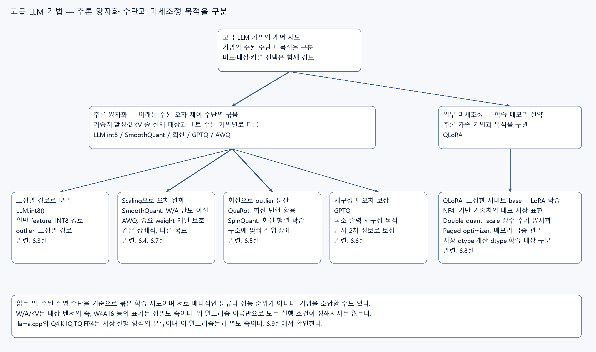

[편집 가능한 Canvas](../assets/ODAI-1/llm-methods-tree.canvas) · [확대용 SVG](../assets/ODAI-1/llm-methods-tree.svg)

여러 기법의 이름을 외우기 전에 주된 수단과 목적을 구분한다. 추론 양자화의 오차 제어 수단과 QLoRA의 업무 미세조정 목적을 나누었다. 기법 간 조합이 가능하므로 이 그림을 배타적인 분류나 성능 순위로 읽지 않는다. W/A/KV 대상과 llama.cpp 저장 형식은 별도 설계축이다.
**원본 범위: p.63–80.** 이 장은 Part 1의 마지막 장이다. p.63의 학습 비용과 p.69·77의 정확도·속도 비교는 원본의 시점과 실험 조건에 따른 설명이며, 최신 모델의 가격·지원·성능으로 단정하지 않는다. 그림은 원본 강의자료의 본문 Crop이다.

## 6.1 학습 목표·선수 개념·표기

학습 목표는 병목에 맞춰 양자화 대상을 정하고, outlier 대응 방법의 차이를 설명하며, 저장 dtype·계산 dtype·학습 대상을 구별하는 것이다. 1장의 prefill/decode와 KV cache, 3장의 선형 양자화, 4장의 calibration·granularity, 5장의 QAT·gradient를 먼저 알아야 한다.

**W4A16**은 보통 가중치 4비트 저장과 activation 16비트를 뜻한다. 이 표기만으로 곱셈 커널·누산 dtype·KV cache 정밀도를 알 수는 없다. **Outlier(이상값)**는 다른 값에 비해 절댓값이 큰 값이나 feature를 말한다. 오류 데이터라는 뜻은 아니며 중요한 정보를 담을 수 있다. **Perplexity(PPL, 혼란도)**는 언어모델이 정답 토큰을 얼마나 잘 예측하는지 나타내는 지표로, 같은 데이터·토큰화·평가 조건에서는 낮을수록 좋다. 서로 다른 조건의 PPL은 직접 비교하지 않는다.

이 장의 기본 행렬 표기는 입력 $X\in\mathbb R^{T\times d}$, 가중치 $W\in\mathbb R^{d\times m}$, 출력 $Y=XW\in\mathbb R^{T\times m}$다. $T$는 처리 token 수, $d$는 입력 feature 수, $m$은 출력 feature 수이며 모두 개수다. GPTQ 절만 원본에 맞춰 전치된 column-sample 표기를 명시한다.

## 6.2 무엇을 양자화할 것인가 — p.63–64

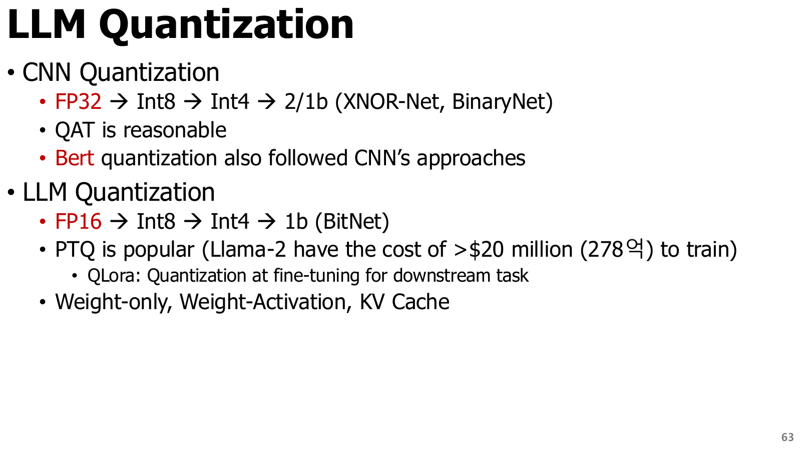

[원본 전체 내용 Crop](../assets/ODAI-1/p063-crop.png)

**p.63 읽는 포인트:** CNN에서 익힌 원리를 LLM으로 옮기되, 모델 규모와 비용 때문에 PTQ가 실용적인 선택이 되는 맥락을 읽는다. 원본의 달러·원화 학습비는 모델 학습 전체에 대한 시점 의존 사례이며, QAT나 개인 미세조정의 비용 견적이 아니다. BitNet 같은 저비트 학습 모델과 기존 FP 모델을 사후 변환한 결과도 구별해야 한다.

| 대상 | 줄이려는 비용 | 주로 유의할 점 |
|---|---|---|
| Weight-only, 예: W4A16 | 가중치 저장량과 메모리 전송량 | 복원·packing·지원 커널 overhead, activation·KV 메모리는 별도 |
| Weight + activation, 예: W8A8 | 가중치·activation 이동과 저정밀 행렬곱 | activation outlier, token별 분포, Q/DQ 비용 |
| KV cache | 긴 context·여러 요청에서 증가하는 cache 메모리 | K/V 분포 차이, attention 품질, cache 갱신·복원 비용 |

**교육용 용량 예제:** 7×10⁹개의 가중치를 16비트에서 4비트로 저장하면 값 본체는 14 GB에서 3.5 GB로 줄어든다. 여기서 GB는 10⁹ byte다. scale·zero point·비양자화 tensor·정렬 공간은 제외했다. 총 실행 메모리는 여기에 KV cache, activation, workspace와 runtime 비용을 더해야 하므로 3.5 GB 장치에서 실행된다는 뜻은 아니다.

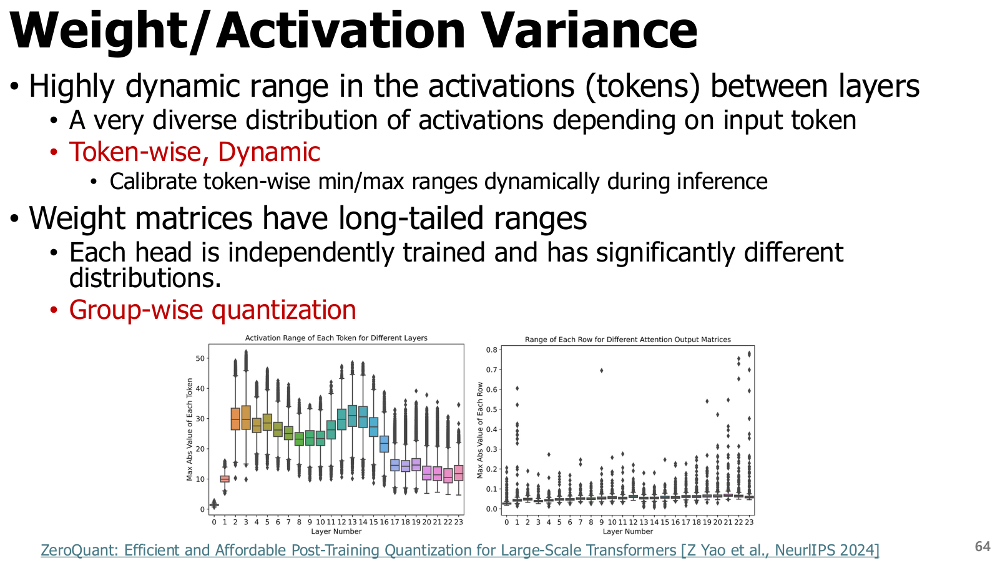

[원본 전체 내용 Crop](../assets/ODAI-1/p064-crop.png)

**p.64 읽는 포인트:** 분포가 layer·token·channel에 따라 바뀌는 모습을 본다. **Token-wise dynamic quantization**은 token별 activation 통계로 scale을 실행 중 정하는 방식이다. **Group-wise weight quantization**은 한 가중치 행·열의 연속된 일부 값을 묶어 scale을 공유한다. 작은 group은 분포에 잘 맞지만 scale metadata가 늘어난다. 원본의 “각 head는 독립 학습된다”는 문장은 head별 분포가 다를 수 있다는 직관으로 읽는다. Transformer는 보통 하나의 목적함수로 공동 학습하며, head마다 완전히 독립된 학습 작업을 수행한다는 뜻은 아니다.

## 6.3 LLM.int8: 중요한 outlier는 고정밀로 분리 — p.65

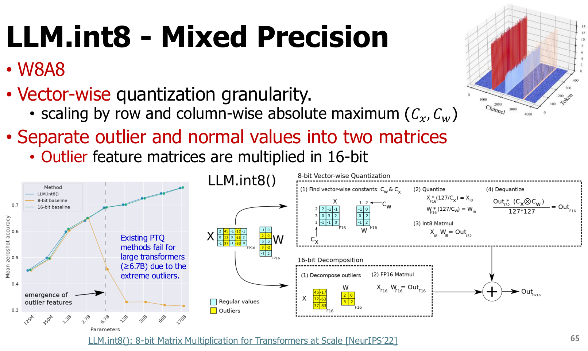

[원본 전체 내용 Crop](../assets/ODAI-1/p065-crop.png)

**p.65 읽는 포인트:** 일반 feature 경로와 outlier feature 경로를 나눈 뒤 출력을 합치는 구조를 본다. 단순히 tensor 전체를 INT8로 반올림하는 것과 다르다.

**LLM.int8()**은 vector-wise scale과 mixed-precision decomposition을 결합한다. **Vector-wise**는 행렬곱의 입력·가중치 vector에 따라 별도 scale을 두는 것이다. feature 집합을 일반 부분 $N$과 outlier 부분 $O$로 나누면 개념적으로 다음과 같다.

$$
Y=X_NW_N+X_OW_O
\approx\operatorname{Dequant}(Q_8(X_N)Q_8(W_N))+X_OW_O.
$$

$Q_8$은 8비트 양자화, Dequant는 해당 scale로 복원하는 연산이다. $N,O$는 입력 feature 축의 서로 겹치지 않는 분할이며, 두 항의 출력 모양은 $T\times m$으로 같다. outlier 항은 16비트 경로로 처리해 정보 손실을 줄인다. 어느 feature를 outlier로 정하는지와 threshold는 구현 조건을 확인해야 한다. 원본의 6.7B 전후 관찰은 당시 분석 대상 모델에서 나타난 현상이지 모든 모델 크기에 적용되는 경계가 아니다. [LLM.int8 원 논문](https://arxiv.org/abs/2208.07339)은 이러한 분해를 제시한다.

## 6.4 SmoothQuant: activation의 어려움을 weight로 옮긴다 — p.66–69

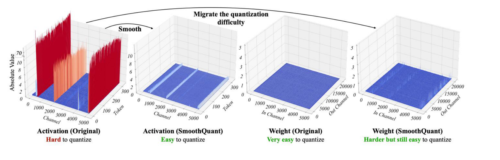

[원본 전체 내용 Crop](../assets/ODAI-1/p066-crop.png)

**p.66 읽는 포인트:** activation의 특정 channel에 세로로 반복되는 큰 값을 찾는다. SmoothQuant는 값을 단순 삭제하는 대신 activation과 weight를 반대 방향으로 rescale한다.

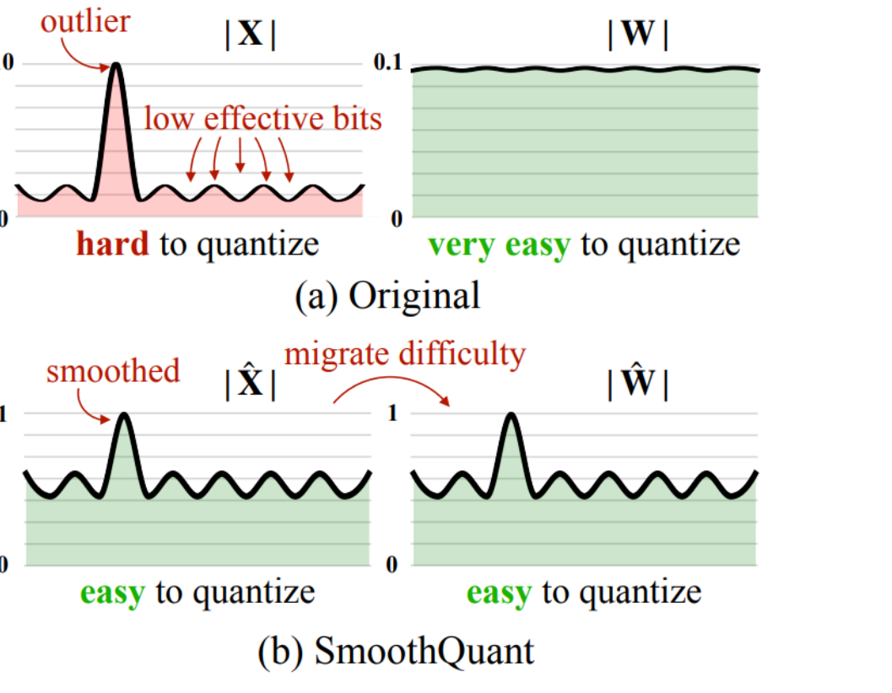

[원본 전체 내용 Crop](../assets/ODAI-1/p067-crop.png)

**p.67 읽는 포인트:** 원래 activation 분포는 넓고 weight 분포는 상대적으로 다루기 쉬운 상황을 가정한다. smoothing 뒤 activation은 양자화하기 쉬워지는 대신 weight 쪽 난이도가 증가한다. 두 tensor를 모두 같은 방향으로 줄이는 그림으로 읽지 않는다.

양의 channel scale $s_j>0$를 대각원소로 갖는 $D=\operatorname{diag}(s_1,\ldots,s_d)$를 사용하면

$$
XW=(XD^{-1})(DW).
$$

이는 양자화 전 실수 연산에서 정확한 등가 변환이다. $D$는 $d\times d$, $XD^{-1}$은 입력 channel을 줄이고 $DW$는 대응 weight 행을 키운다. $s_j$는 calibration activation과 weight의 channel 통계로 offline 결정한다. 그 뒤 두 tensor를 저정밀화하면 서로 다른 오차가 생기므로 **변환의 등가성**과 **양자화의 무손실성**을 구별한다.

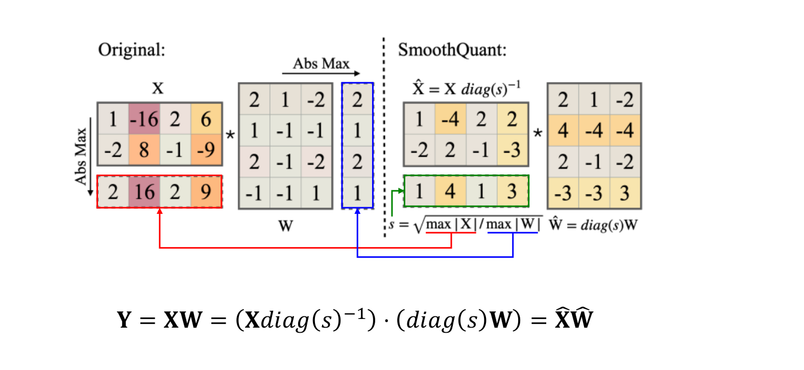

[원본 전체 내용 Crop](../assets/ODAI-1/p068-crop.png)

**p.68 읽는 포인트와 검산 예시:** $X=[10,1]$, $W=[1,2]^\top$, $D=\operatorname{diag}(10,1)$이면 원래 출력은 12다. 변환 후 입력은 $[1,1]$, 가중치는 $[10,2]^\top$이므로 출력은 여전히 12다. 이 예제는 상쇄를 보이는 것이며 최적 scale이나 실제 INT8 오차 개선을 보장하는 수치는 아니다.

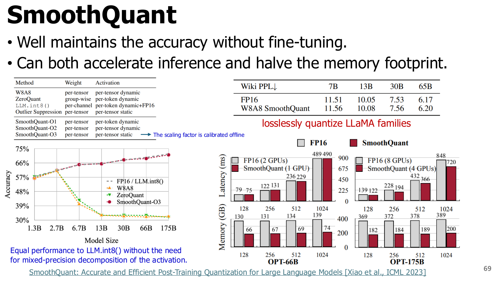

[원본 전체 내용 Crop](../assets/ODAI-1/p069-crop.png)

**p.69 읽는 포인트:** 정확도 표와 속도·메모리 그래프는 서로 다른 평가축이다. 원본의 “losslessly”는 해당 평가 지표에서 손실이 거의 없다는 결과 표현이지 모든 입력에서 원래 출력과 bitwise 동일하다는 뜻이 아니다. [SmoothQuant 원 논문](https://arxiv.org/abs/2211.10438)의 주요 목표는 W8A8 추론이다. 해당 실험의 메모리 절감이나 가속을 W4A4, 모든 장치, 전체 프로세스 peak memory로 그대로 확대하지 않는다.

## 6.5 QuaRot과 SpinQuant: 좌표계를 바꿔 outlier를 분산 — p.70–71

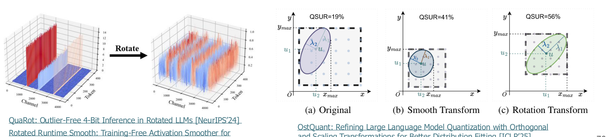

[원본 전체 내용 Crop](../assets/ODAI-1/p070-crop.png)

**p.70 읽는 포인트:** 회전 전 일부 feature에 집중된 큰 값이 회전 후 여러 축으로 분산되는 모습을 본다. 값의 정보 자체를 지우는 것이 아니라 표현 좌표계를 바꾼다.

**Orthogonal matrix(직교 행렬)** $R\in\mathbb R^{d\times d}$는 $RR^\top=R^\top R=I$를 만족한다. 따라서 $R^{-1}=R^\top$이다. $I$는 항등행렬이다. **Hadamard transform(하다마드 변환)**은 ±1 패턴으로 구성한 직교 변환을 정규화해 사용하는 방법이며, randomized 변형은 부호 등을 무작위화한다.

**원문 수식 정정:** p.70의 $(XR)(R^{-1}W^{-1})=XW^\top$ 표기는 일반적인 선형 layer 등가식으로 성립하지 않는다. 이 문서의 $Y=XW$ 표기에서 올바른 기본식은

$$
Y=(XR)(R^\top W)=XW.
$$

가중치를 $W\in\mathbb R^{m\times d}$로 저장해 $Y=XW^\top$라 쓰는 관례라면 $W'=WR$, $X'=XR$로 두어 $X'W'^\top=XW^\top$가 된다. 원문의 $|R|=1$은 행렬식 표기다. 일반 직교 행렬은 determinant가 ±1이고, 방향을 보존하는 회전은 +1이다. 따라서 이를 “R 자체가 1”로 읽으면 안 된다.

**QuaRot**은 이러한 불변성을 Transformer 구조에 맞게 적용하고 outlier를 분산해 weight·activation·KV cache의 4비트화를 추구한다. 임의의 비선형 함수 앞뒤에 R과 Rᵀ를 삽입하면 항상 상쇄되는 것은 아니다. residual·정규화·attention·실행 중 변환의 위치를 함께 설계해야 한다. [QuaRot 원 논문](https://arxiv.org/abs/2404.00456)은 이 구조를 제시한다. 원본에 병기된 RRS와 OstQuant는 관련 후속 변환 연구의 예시이며, 같은 알고리즘의 다른 이름은 아니다. 그림의 QSUR은 해당 그림에서 사용하는 양자화 공간 활용 지표로 읽고 보편적인 정확도 지표와 동일시하지 않는다.

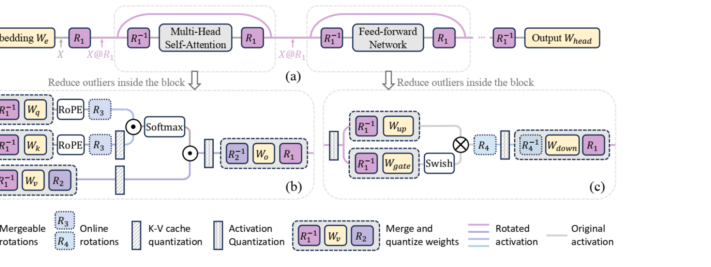

[원본 전체 내용 Crop](../assets/ODAI-1/p071-crop.png)

**p.71 읽는 포인트:** 회전을 고정하는 것과, 양자화 후 손실이 작아지도록 회전을 최적화하는 것을 비교한다. **SpinQuant**은 회전 행렬을 학습하는 방법이다. **Cayley SGD**는 직교성 제약을 유지하는 갱신을 구성하기 위해 Cayley transform을 활용하는 최적화 방식이다. 여기서 SGD는 stochastic gradient descent(확률적 경사하강법)를 뜻한다. [SpinQuant 원 논문](https://arxiv.org/abs/2405.16406)은 무작위 회전 선택에 따른 성능 편차를 줄이려는 학습 접근을 설명한다. 회전 파라미터 최적화와 모델 전체의 일반적인 QAT는 학습 대상과 비용이 같지 않다.

| 비교축 | SmoothQuant | QuaRot | SpinQuant |
|---|---|---|---|
| 기본 변환 | channel별 대각 scaling | 직교·Hadamard 계열 회전 | 학습한 직교 회전 |
| outlier 대응 | activation 난이도를 weight 쪽으로 이전 | 큰 값을 좌표축 사이로 분산 | 양자화 손실을 고려해 분산 방향 선택 |
| 대표 목표 | W8A8 | W4A4·KV4 경로 | W4A4·KV4의 품질 개선 |
| 추가 작업 | 대표 입력 통계 calibration | 구조 변환과 필요 online 회전 | 회전 최적화용 데이터·계산 |
| 확인할 비용 | scale fusion, Q/DQ | online transform·packing·커널 | 최적화 비용과 최종 runtime |

## 6.6 Weight-only와 GPTQ — p.72–74

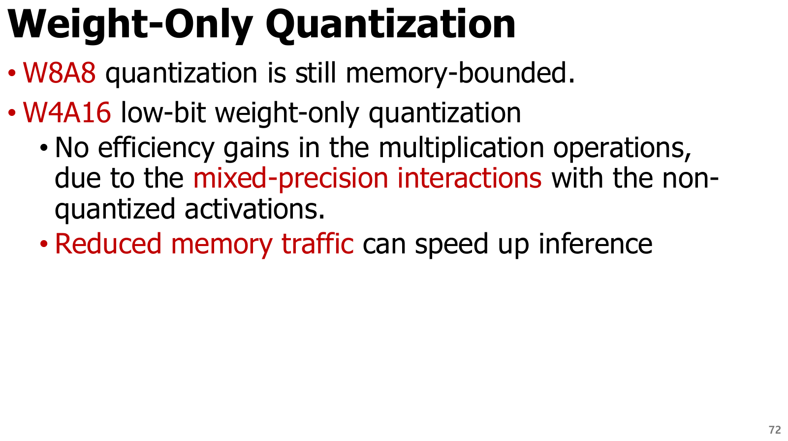

[원본 전체 내용 Crop](../assets/ODAI-1/p072-crop.png)

**p.72 읽는 포인트:** W4A16의 장점은 우선 weight 전송량 감소다. weight를 4비트로 저장하더라도 multiplication을 native INT4로 수행한다는 뜻은 아니다. fused dequantization과 행렬곱 구현에 따라 실제 속도가 달라진다. 원본의 “W8A8도 memory-bound”는 특정 decode·batch·장치 조건에서의 설명으로 읽어야 한다. 큰 prefill이나 batch에서는 병목이 바뀔 수 있다.

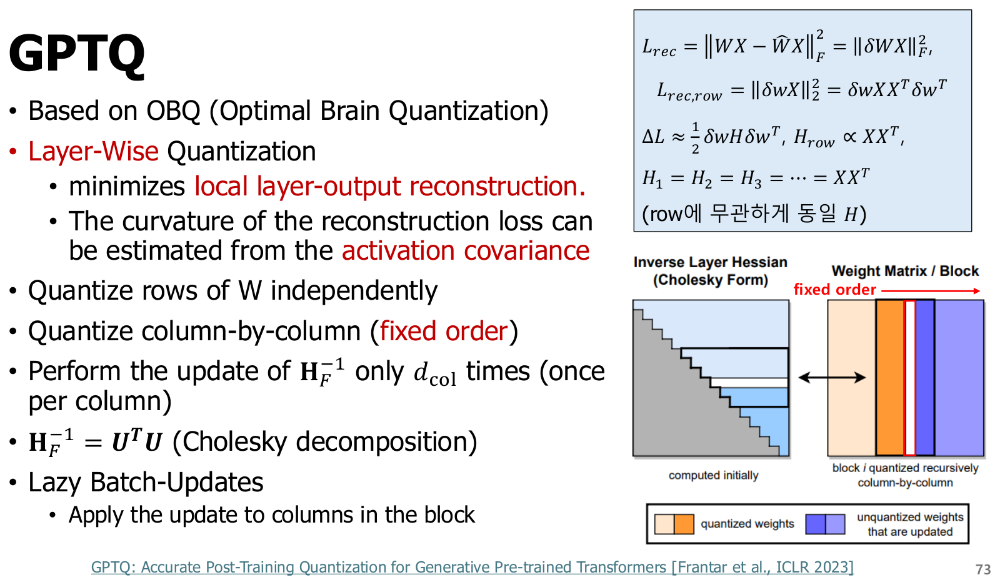

[원본 전체 내용 Crop](../assets/ODAI-1/p073-crop.png)

**p.73 읽는 포인트:** 가장 가까운 정수로만 반올림하지 않고, 한 weight를 양자화한 오차를 아직 양자화하지 않은 weight로 보상한다. OBQ에서 출발하되 대형 행렬에 적용하도록 계산을 조직한다.

**GPTQ**는 calibration 입력에 대한 layer 출력의 차이를 줄이는 weight PTQ다. **Reconstruction(재구성)**은 원본 layer 출력을 양자화 layer 출력으로 가깝게 재현하는 목적을 뜻한다. **Hessian(헤시안)**은 손실의 2차 미분 행렬이며 오차 방향에 따른 곡률을 나타낸다. 여기서는 원본 GPTQ 슬라이드와 맞추기 위해 $X_c\in\mathbb R^{d\times n}$에 calibration sample을 열로, $W_c\in\mathbb R^{m\times d}$에 출력 channel을 행으로 놓는다.

$$
\mathcal L_{\rm rec}=\|W_cX_c-\widehat W_cX_c\|_F^2,
\quad H=2X_cX_c^\top.
$$

$n$은 calibration 위치 수, $\widehat W_c$는 양자화·복원한 가중치, $\|\cdot\|_F$는 모든 원소 제곱합의 제곱근인 Frobenius norm이다. row별 동일한 입력을 사용하므로 이 국소 목적의 Hessian을 행 사이에 공유할 수 있다. 실제 안정화에는 damping 등 수치 처리가 필요하며, 이것을 모델 전체 task loss의 정확한 Hessian이라고 부르면 안 된다.

**Damping(감쇠·대각 안정화) 보충:** 입력 feature가 선형 종속이면 $H=2X_cX_c^\top$가 특이행렬이 되어 역행렬을 구할 수 없을 수 있다. $H_\lambda=2X_cX_c^\top+\lambda I$, $\lambda>0$처럼 양의 대각 보정값을 더하면 수치 안정성과 Cholesky 분해를 확보하는 데 도움이 된다. $\lambda$는 안정화 강도이며 실제 구현의 선택·크기를 확인해야 한다.

**Cholesky decomposition(콜레스키 분해)**은 양의 정부호 행렬을 삼각행렬의 곱으로 나타내는 것이다. GPTQ는 이러한 수치 구조와 **lazy batch update(지연 블록 갱신)**를 활용해 weight 양자화와 오차 보정을 효율적으로 조직한다. [GPTQ 원 논문](https://arxiv.org/abs/2210.17323)은 근사 2차 정보를 이용한 one-shot weight quantization을 제시한다.

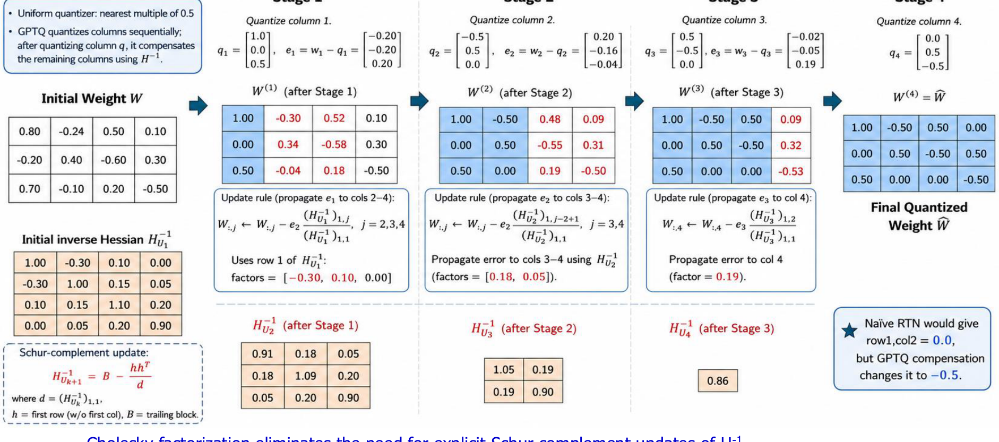

[원본 전체 내용 Crop](../assets/ODAI-1/p074-crop.png)

**p.74 읽는 포인트와 검산:** 이 그림은 0.5 간격으로 양자화하는 개념 예제다. 첫 열의 첫 값 0.80을 1.00으로 양자화하면 오차 $e=0.80-1.00=-0.20$이다. 그림의 첫 inverse-Hessian 행에서 첫 대각값이 1, 다음 값이 −0.30이면, 다음 weight −0.24에 대한 보정은 $-0.24-(-0.20)(-0.30)/1=-0.30$이다. 이후 −0.30을 양자화하면 −0.50이 되어, 보정 없이 −0.24를 0.0으로 반올림한 결과와 달라진다. 그림의 단계별 Schur-complement 표는 보상 직관을 설명한다. 실제 GPTQ의 Cholesky 기반 구현에서 이 작은 표들을 매번 그대로 만드는 것으로 읽지 않는다. 모든 후속 숫자는 구현의 반올림 규칙·damping·블록 처리에 따라 달라질 수 있다.

## 6.7 AWQ: activation으로 중요한 weight channel을 찾는다 — p.75–77

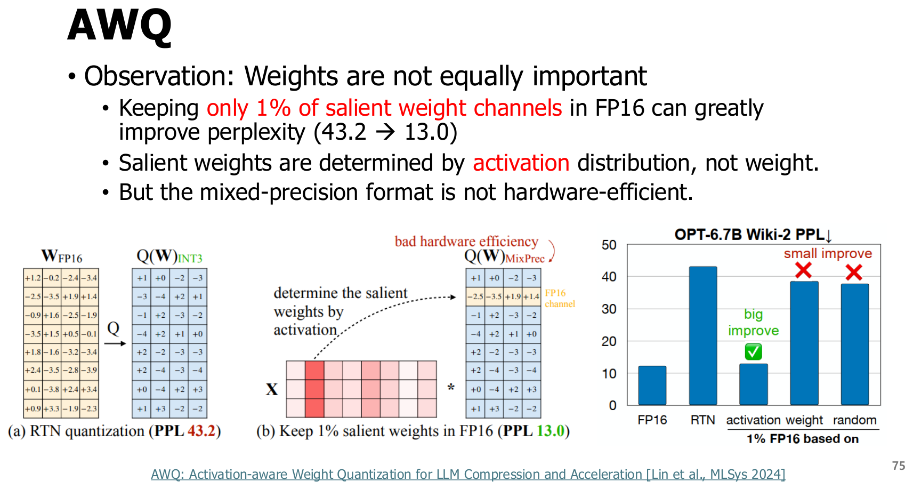

[원본 전체 내용 Crop](../assets/ODAI-1/p075-crop.png)

**p.75 읽는 포인트:** 중요한 1% channel을 FP16으로 남겼을 때 PPL이 크게 개선되는 실험은 **중요도 가설을 확인하는 관찰**이다. 최종 AWQ를 “항상 weight 1%를 FP16으로 저장하는 알고리즘”이라고 정의하면 안 된다. 원본의 43.2→13.0은 그림의 해당 실험 설정에 한정한다.

**Activation-aware Weight Quantization(AWQ, 활성값을 고려한 가중치 양자화)**는 입력 activation 통계로 중요한 weight channel을 찾아 scaling으로 보호한다. weight 크기만 보는 대신 실제 입력에 의해 출력에 얼마나 영향을 주는지 고려한다. 최종 설계는 하드웨어에 불리한 mixed-precision 보존을 피하려는 방향이다. [AWQ 원 논문](https://arxiv.org/abs/2306.00978)은 이러한 등가 scaling 기반 접근을 제시한다.

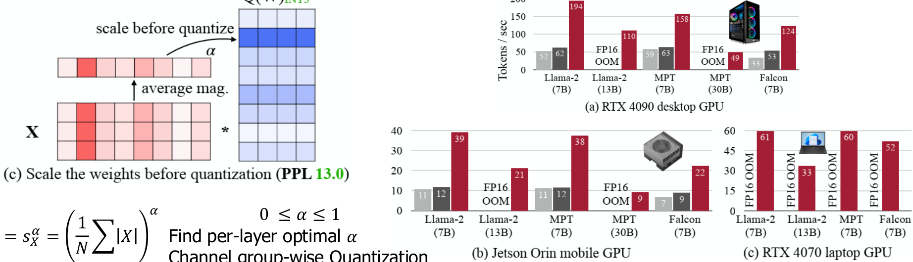

[원본 전체 내용 Crop](../assets/ODAI-1/p076-crop.png)

**p.76 읽는 포인트:** scale $s>1$로 중요한 channel을 키우고, 대응 입력을 역으로 나누어 실수 연산의 등가성을 유지한다. 기본 상쇄 식은 SmoothQuant와 같은 $(XD^{-1})(DW)$이지만, **어느 오차를 줄이려는가**가 다르다. AWQ는 low-bit weight-only의 출력 오차를 줄이기 위한 channel 보호가 중심이다.

**교육용 보충:** activation 절댓값 평균 $a_j=\frac1N\sum_{i=1}^N|x_{ij}|$ 등을 구해 $s_j\propto a_j^\alpha$, $0\le\alpha\le1$ 같은 후보를 탐색할 수 있다. $N$은 통계를 수집한 입력 위치 수, $j$는 feature channel, $\alpha$는 탐색 지수다. 이는 원리를 설명하는 단순화이며, 실제 정규화·clipping·검색 방식은 구현을 확인해야 한다. 한 channel을 키우면 group 전체 scale도 바뀔 수 있으므로 모든 channel의 오차가 동시에 감소한다는 보장은 없다.

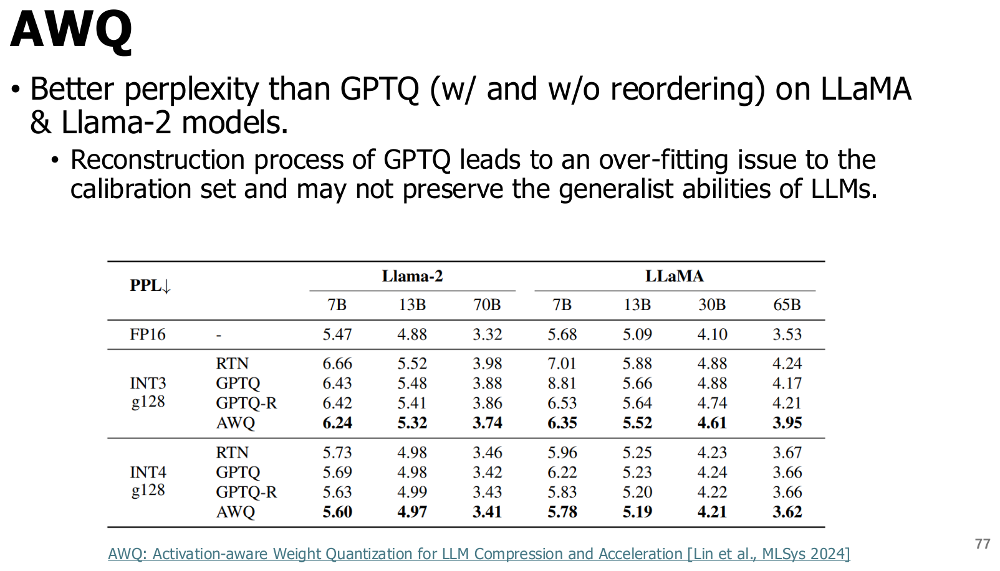

[원본 전체 내용 Crop](../assets/ODAI-1/p077-crop.png)

**p.77 읽는 포인트:** 모델과 bit 수가 고정된 열 안에서 비교한다. calibration 재구성에 과도하게 맞추는 문제는 검토할 가치가 있지만, 표 한 장으로 “AWQ가 항상 GPTQ보다 좋다”거나 “GPTQ는 반드시 과적합한다”고 결론내리지 않는다. 목표 도메인과 별도 평가 입력에서 검증해야 한다.

| 비교축 | GPTQ | AWQ |
|---|---|---|
| 핵심 판단 | layer 출력 재구성 오차의 곡률과 보상 | activation 통계에 기반한 channel 중요도 |
| 주요 처리 | weight 순차 양자화와 남은 weight의 오차 보정 | 중요 channel scaling과 weight quantization |
| 대표 대상 | low-bit weight-only | low-bit weight-only |
| calibration의 역할 | 재구성 목적과 근사 2차 정보 추정 | activation 통계와 scale 후보 평가 |
| 검증할 위험 | calibration 대표성, 수치 안정성, 과도한 국소 적합 | 통계 대표성, group scale 상호작용 |
| 배포 시 공통 확인 | 저장 형식·group·커널·성능·품질 | 저장 형식·group·커널·성능·품질 |

## 6.8 QLoRA: 양자화한 기저 모델 위에 작은 어댑터를 학습 — p.78–79

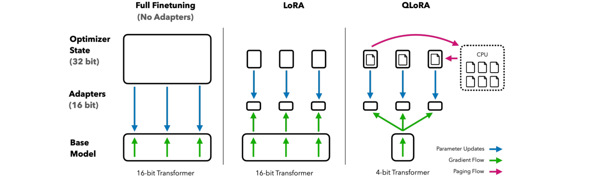

[원본 전체 내용 Crop](../assets/ODAI-1/p078-crop.png)

**p.78 읽는 포인트:** 기저 모델의 4비트 저장과 학습 가능한 어댑터를 구분한다. gradient가 기저 모델의 계산을 통과할 수 있다는 것과 기저 weight가 업데이트된다는 것은 다르다.

**Low-Rank Adaptation(LoRA, 저랭크 적응)**은 큰 weight 갱신을 작은 두 행렬의 곱으로 표현해 학습 파라미터 수를 줄이는 기법이다. 이 장의 $W\in\mathbb R^{d\times m}$ 표기에서

$$
Y=X\bigl(\widehat W+cAB\bigr),\qquad
A\in\mathbb R^{d\times r},\;B\in\mathbb R^{r\times m},\;r\ll\min(d,m).
$$

$\widehat W$는 양자화 저장 후 계산용으로 복원한 고정 기저 weight, $A,B$는 학습하는 adapter 행렬, $r$은 rank, $c$는 adapter 배율이다. 가중치 본체의 학습 파라미터 $dm$개 대신 $r(d+m)$개를 학습한다. 예를 들어 $d=m=4096,r=8$이면 본체 16,777,216개와 비교해 adapter는 65,536개로 약 0.39%다. optimizer 상태 감소에 유리하지만 activation 메모리가 없어지는 것은 아니다.

**QLoRA**는 frozen quantized base와 LoRA를 결합한다. **NF4(NormalFloat 4-bit)**는 정규분포를 가정한 비균일 codebook 기반 표현으로, 보편적인 IEEE FP4나 INT4와 다르다. **Paged optimizer**는 unified-memory paging 등을 활용해 optimizer 관련 메모리 급증을 관리한다. CPU 이동이 생기면 전송 비용이 발생할 수 있으며, 모든 optimizer가 항상 CPU에 있다는 뜻은 아니다. [QLoRA 원 논문](https://arxiv.org/abs/2305.14314)은 NF4, double quantization, paged optimizer를 결합한다.

| 구분 | QLoRA의 대표 구성 | 의미 |
|---|---|---|
| 기저 모델 저장 | NF4 코드와 block scale | 저장 비용 절감 |
| 행렬곱 계산 | 복원 후 BF16 등 | 4비트 code를 모든 연산에서 직접 곱한다는 뜻이 아님 |
| 학습 대상 | LoRA adapter | frozen base의 모든 weight를 업데이트하지 않음 |
| gradient 경로 | 모델 계산을 거쳐 adapter까지 전파 | base weight 업데이트 여부와 별개 |
| 배포 형태 | base+adapter 또는 병합·재변환 | target runtime 지원과 품질을 다시 검증 |

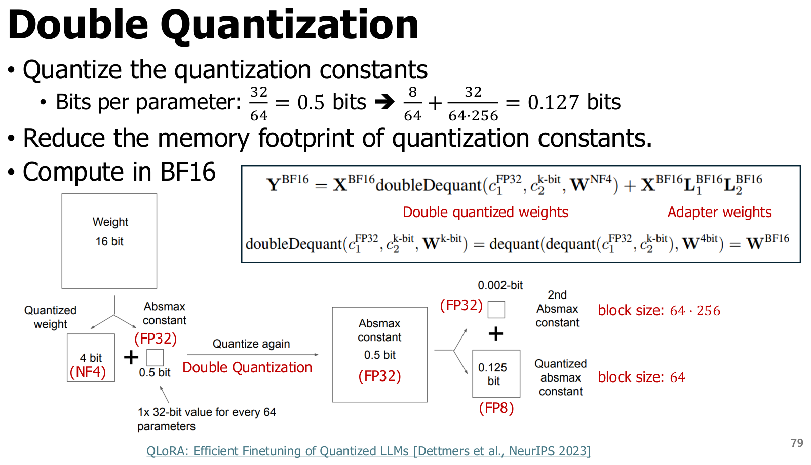

[원본 전체 내용 Crop](../assets/ODAI-1/p079-crop.png)

**p.79 읽는 포인트:** double quantization의 두 번째 대상은 weight 값 자체가 아니라 첫 번째 양자화의 **scale 상수**다. BF16 계산과 NF4 저장이 함께 보이는 이유도 확인한다.

**검산:** 64개 weight마다 FP32 scale 하나를 저장하면 scale 비용은 $32/64=0.5$ bit/weight다. 이를 8비트로 양자화하고, 256개 scale마다 FP32 상위 scale 하나를 공유하는 단순 모델에서는

$$
\frac8{64}+\frac{32}{64\times256}
=0.125+0.001953125
=0.126953125\text{ bit/weight}.
$$

절감량은 약 0.37305 bit/weight다. 따라서 4비트 코드에 이 scale만 더한 유효 저장량은 약 4.12695 bit/weight가 된다. 기타 상수, tensor별 예외, padding, 비양자화 layer, adapter와 optimizer는 제외한 계산이다. 전체 학습 메모리가 FP16 대비 정확히 4배 줄어든다고 해석하지 않는다.

## 6.9 llama.cpp 형식: 비트 수와 파일 크기를 구분 — p.80

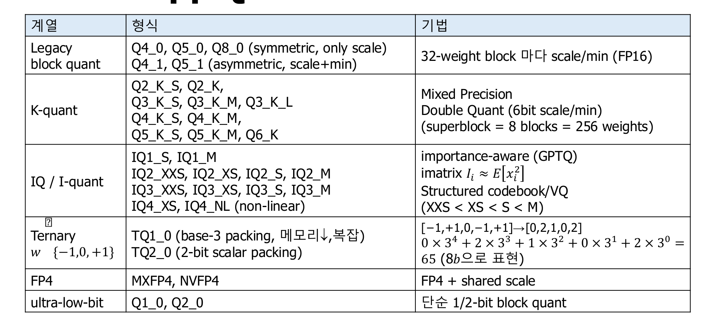

[원본 전체 내용 Crop](../assets/ODAI-1/p080-crop.png)

**p.80 읽는 포인트:** 표의 행은 모두 동일한 구현이 아니다. 값 본체의 bit 수, block scale, 중요도 정보, codebook, packing을 나누어 본다. 아래 형식명은 **강의 원문 목록의 분류 예시**다. 실제 사용 가능 형식·모델·backend는 설치한 llama.cpp 버전에서 확인해야 하며, 원본만으로 최신 지원을 단정하지 않는다.

| 계열 | 강의의 예시 | 이해해야 할 구조·주의 |
|---|---|---|
| Legacy block | Q4_0, Q4_1, Q5_0, Q5_1, Q8_0 | block 단위 scale, 형식에 따라 min 등을 추가. 같은 Q4라도 metadata·복원식이 다름 |
| K-quant | Q2_K, Q3_K_*, Q4_K_*, Q5_K_*, Q6_K | superblock과 하위 scale·min 표현. 모든 K 형식이 똑같은 6비트 metadata 구조는 아님 |
| IQ/I-quant | IQ1_*, IQ2_*, IQ3_*, IQ4_XS, IQ4_NL | 중요도·격자·codebook·비균일 표현 등을 활용하는 여러 형식. 모든 형식이 같은 VQ나 GPTQ 구현은 아님 |
| Ternary | TQ1_0, TQ2_0 | 값 집합을 −1,0,+1로 제한하고 base-3 또는 scalar packing 등으로 저장 |
| FP4 | MXFP4, NVFP4 | FP4 값과 공유 scale. native 커널·장치 지원 별도 확인 |
| 극저비트 예시 | Q1_0, Q2_0 | 강의 목록에 있는 명칭. 해당 버전의 실제 정의·지원 여부 확인 필요 |

**Importance matrix(imatrix, 중요도 통계)**는 calibration activation의 제곱 평균 등으로 weight 오차가 출력에 미치는 영향을 가중하는 정보다. 원본의 $I_i\approx E[x_i^2]$에서 $x_i$는 i번째 입력 feature, $E$는 calibration 입력에 대한 평균이다. GPTQ도 입력 통계를 활용하지만, imatrix 사용을 곧 GPTQ의 Hessian 기반 순차 보정과 동일시해서는 안 된다.

**Packing(비트 묶음 저장) 검산:** 원본의 삼진 예제는 $[-1,+1,0,-1,+1]$을 $[0,2,1,0,2]$로 매핑한다. 이를 $0\times3^4+2\times3^3+1\times3^2+0\times3+2=65$로 저장한다. 5개의 삼진 값은 $3^5=243$가지이므로 8비트에 넣을 수 있어 1.6 bit/value다. 이 값은 해당 toy packing의 값 본체만 계산한 것이며 전체 모델의 scale·정렬 비용은 제외했다.

**교육용 보충:** Q4의 “4”는 보통 값 코드 폭을 가리키며 파일 전체의 정확한 평균 4 bit/weight를 뜻하지 않는다. 같은 계열의 S/M/L 접미사도 모든 모델·형식에 공통인 품질 서열로 해석하지 않는다. 실제 파일 크기와 정확도는 tensor별 정밀도 배치·형식 정의·모델 구조에 달려 있다.

## 6.10 종합 적용 시나리오와 배포 검증

양자화 기법은 단일 순위가 아니라 **병목·정확도·지원 커널**의 조합으로 선택한다. 아래는 교육용 판단 예시이며 특정 제품 구매나 최신 backend 지원을 추천하는 목록이 아니다.

| 관측 상황 | 검토할 방향 | 결론 전에 측정할 것 |
|---|---|---|
| batch=1 decode에서 weight 읽기가 지배적 | 지원되는 low-bit weight-only | token/s, dequant 비용, PPL·업무 품질 |
| prefill 행렬곱 비중이 크고 INT8 커널이 잘 지원됨 | W8A8과 outlier 대응 | TTFT, 입력 길이별 품질, Q/DQ·fusion |
| INT4 activation에서 일부 feature 때문에 품질이 악화 | scaling·회전 계열 | 변환 비용과 정확도, 모델 구조 호환성 |
| 긴 대화에서 KV cache가 메모리를 지배 | KV 양자화 또는 Part 2의 cache 최적화 | 긴 context 품질, cache 비용, decode 지연 |
| 메모리가 부족하지만 업무 맞춤 미세조정이 필요 | QLoRA 같은 adapter 학습 | 학습 peak memory, adapter 품질, 배포 경로 |
| 저비트 PTQ 품질이 목표 미달이고 학습 자원이 있음 | QAT 또는 학습 기반 보정 | 학습 비용, 분포 변화, 최종 device 성능 |

**TTFT(Time To First Token, 첫 토큰 시간)**는 요청에서 첫 출력 토큰까지 걸리는 시간이다. **TPOT(Time Per Output Token, 출력 토큰당 시간)**는 이후 token 생성 간격을 나타낸다. token/s와 함께 측정하되 측정 구간·batch·동시 요청 수를 명시해야 한다.

배포 전에는 같은 prompt·tokenizer·출력 길이로 FP 기준과 비교한다. 품질 평가에는 calibration에서 보지 않은 업무 데이터와 긴 context를 포함한다. 파일 크기, peak RAM/VRAM, TTFT·TPOT, 전력·열 제약, 실패·fallback 여부를 기록한다. **VRAM(Video RAM)**은 GPU의 전용 메모리를 가리키며, 통합·공유 메모리 구조에서는 시스템 RAM과 중복 합산하지 않는다. 멀티모달 모델은 언어 측면 PPL뿐 아니라 실제 이미지 이해 과제를 확인한다. 이러한 흐름은 [양자화 적용 Canvas](../assets/ODAI-1/quantization-flow.canvas)와 [미리보기](../assets/ODAI-1/quantization-flow.svg)를 함께 읽는다.

## 6.11 용어 찾아보기

| 용어 | 짧은 정의 | 다시 볼 절 |
|---|---|---|
| W4A16 / W8A8 | 가중치·activation 정밀도 조합 표기 | 6.1–6.2 |
| Outlier | 분포의 다른 값보다 절댓값이 큰 값·feature | 6.1, 6.3–6.5 |
| Mixed precision | 일부 계산·tensor를 다른 정밀도로 처리 | 6.3 |
| Offline calibration | 배포 전 대표 입력으로 통계·scale 추정 | 6.4, 6.7 |
| Orthogonal / Hadamard | 길이를 보존하는 직교 변환 / ±1 기반 변환 | 6.5 |
| Reconstruction / Hessian | 출력 재현 목적 / 손실의 2차 곡률 행렬 | 6.6 |
| Salient channel | 출력에 중요하여 오차 보호가 필요한 channel | 6.7 |
| LoRA / QLoRA | 저랭크 adapter 학습 / 양자화 frozen base 위 adapter 학습 | 6.8 |
| NF4 / double quant | 정규분포 기반 4비트 codebook / scale 상수의 추가 양자화 | 6.8 |
| Imatrix / packing | 입력 통계 기반 중요도 / 여러 코드를 비트에 묶어 저장 | 6.9 |
| TTFT / TPOT | 첫 출력까지의 시간 / 이후 토큰당 생성 시간 | 6.10 |

## 6.12 요약·흔한 오해·최종 복습

LLM.int8은 outlier를 고정밀 경로로 분리하고, SmoothQuant는 channel scaling으로 activation 난이도를 이전한다. QuaRot·SpinQuant는 좌표계를 바꾸고, GPTQ는 출력 재구성의 곡률을 활용하며, AWQ는 activation으로 중요한 weight channel을 보호한다. QLoRA는 이들과 목적이 다른 **메모리 효율적인 adapter 미세조정** 접근이다. 형식의 이름과 실제 계산 경로는 별도로 검증해야 한다.

| 흔한 오해 | 바로잡기 |
|---|---|
| 변환이 수학적으로 등가면 양자화도 무손실이다 | 등가성은 양자화 전 실수 계산의 성질이다 |
| AWQ는 weight 1%를 항상 FP16으로 남긴다 | FP16 실험은 중요도 관찰이며 최종은 scaling 기반 보호다 |
| QLoRA는 모든 weight를 NF4로 업데이트한다 | frozen base를 통해 gradient를 전달하며 adapter를 학습한다 |
| 4비트 저장이면 4비트 곱셈이다 | 복원 후 FP16/BF16 계산하는 경로도 있다 |
| IQ는 GPTQ의 다른 이름이다 | 중요도 정보와 양자화 보정 알고리즘을 구분해야 한다 |
| 가장 작은 파일이 가장 빠르다 | unpacking·커널·cache·batch에 따라 달라진다 |

1. **왜 weight-only는 decode에서 유리할 수 있는가?** 작은 batch에서 weight 재사용이 작으면 weight 전송량 감소가 병목을 줄일 수 있다. 실제 효과는 커널 overhead와 장치에 달려 있다.
2. **SmoothQuant와 AWQ가 같은 scaling 식을 쓰는데 왜 다른가?** 전자는 activation·weight 동시 저정밀화를 위해 activation 난이도를 이전하고, 후자는 low-bit weight-only에서 activation 기반 중요 channel의 weight 오차를 보호한다.
3. **회전의 상쇄 조건은?** 호환되는 위치에 R과 Rᵀ를 짝지어 삽입해야 한다. 비선형 연산을 임의로 가로질러 이동할 수 없다.
4. **GPTQ의 Hessian은 무엇의 Hessian인가?** calibration 입력에 대한 국소 layer 출력 재구성 손실의 곡률이다. 전체 task loss의 정확한 Hessian으로 해석하지 않는다.
5. **QLoRA에서 NF4·BF16·adapter는 각각 무엇인가?** 기저 모델의 대표 저장 표현, 복원 후 대표 계산 표현, 실제 학습하는 작은 파라미터다.
6. **7B 모델을 4비트로 저장하면 3.5 GB 장치에서 실행 가능한가?** 가중치 본체만 3.5 GB이므로 판단할 수 없다. metadata·KV·activation·workspace와 장치 가용 메모리를 더해야 한다.
7. **양자화 후 PPL은 비슷하지만 업무 답변이 나빠지면?** 업무 평가를 독립 기준으로 삼고 calibration 대표성·긴 문맥·특정 연산 민감도를 재검토한다.

**Part 2로 이어지는 질문:** weight를 줄인 뒤 KV cache나 attention 메모리가 새 병목이 될 수 있다. 원본 p.2의 pruning·knowledge distillation·KV 최적화·speculative decoding·FlashAttention은 후속 과정이며 이 Part 1에서 상세 학습한 것으로 간주하지 않는다.
